# 拆解百篇精华帖，我把赚钱逻辑整理成了这份新人入门地图

> 来源：[https://mkfwp3u79v.feishu.cn/docx/doxcnk4mqgBMJTv0mklq0eR48fg](https://mkfwp3u79v.feishu.cn/docx/doxcnk4mqgBMJTv0mklq0eR48fg)

先自我介绍一下：

我是七小，99年出生于深圳的知识管理从业者。

擅长检索、信息采集、内容拆解和关键词深挖，核心能力就是把零散的碎片信息拼成可变现的知识体系。

圈子里大家叫我赚钱课代表，专门帮赚钱新朋友答疑解惑，想让更多人用好龙哥盟的价值。

微信：rickea150，加我请备注：赚钱圈友 。欢迎聊聊。
公众号：七小的人生游戏攻略

* * *

# 一、前言

赚钱圈友们好，我是七小。

入圈不到一个月，这是第一次发声。按社群习惯，先做个简单的自我介绍，内容稍长，但和后面要展开的干货有关，请耐心看完。

* * *

我是七小，99年深圳人，目前自由职业。2021年毕业后起步做学习效率博主，2022年开始向互联网创业博主转型。

对赚钱一直有强烈的探究欲。

大一2017年起就开始试水各种副业和项目。做过英语口语地推、驾校代理、旅游代理；毕业季卖过鲜花、回收洗衣机；开学季倒过洗衣机、电话卡；平时也给学弟学妹代课。

大学里有两个项目小有斩获：

1）2019年3月第一次做驾校代理，当月成交20单，赚到1W；

2）2019.06~2019.09，和三位合伙人跑珠三角各大高校卖洗衣机，团队营业额320W，盈利20W，我分到5W。

做了不少实操后，我感觉手感有了，但理论根基薄弱。于是2020年停下项目，把时间用在研究【学习底层方法论】和【商业常识】上。

后来得到两点验证：

1）成为一名教人高效学习的学习博主，累计帮助200+学员提升成长。

2）成为百万粉新商业笔记社区【笔记侠】2021年度达人。

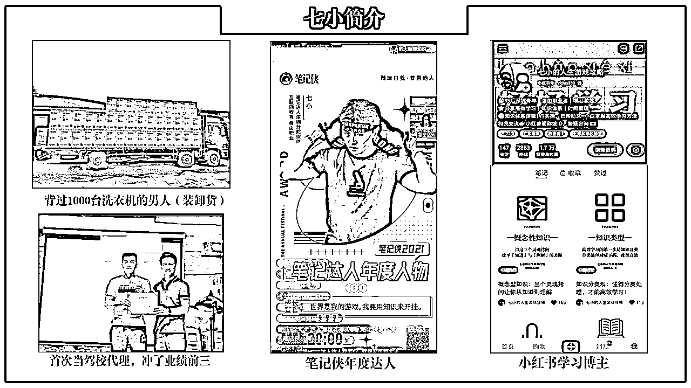

* * *

回头看我的经历，其实能提炼出两句话：

1）学习力和信息整理能力很强，在笔记侠整理过数十万字的商业稿件。

2）对搞钱既有实战经验，也有理论沉淀。

进入赚钱后我一直在思考：我能从这里获得什么？又能为圈友贡献什么？

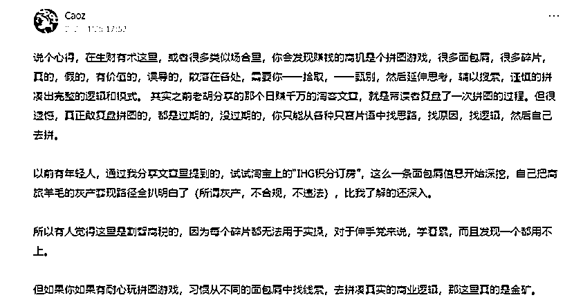

有一次看到曹大的帖子，【拼图游戏】这个概念点醒了我。结合自身擅长的整理能力，我想：

既然我擅长做知识拼图，又想彻底搞明白【赚钱到底是怎么回事】，那就去精读100+篇赚钱精华帖，结合自己的过往经历，把知识点提炼整合，拼出一套完整的赚钱认知体系？

这样既能满足自己的好奇心，为搞钱打下地基；也能降低新人的学习门槛，帮助大家更快吸收赚钱精华。两全其美。

于是就有了这篇文章。

# 二、赚钱的本质是什么？

## 1）赚钱到底是什么行为？

先听听几位大佬怎么定义。

Caoz：

谈到赚钱，核心就是交易。能带来钱的只有交易。

交易不只是外出推销卖货。拿到一份Offer也是交易；创业做商业模式，本质也是设计交易方式。

先建立一个底层认知：万物皆交易。

来源：https://wx.zsxq.com/dweb2/index/topic_detail/582511151218254

刘小排：

做任何企业都绕不开三个字：卖东西。

🪡 高雅说法：「创业」「商学」
🪡 次高雅说法：「商业」「做企业」
🪡 常见说法：「做生意」「赚钱」
🪡 最直白说法：「卖东西」「搞钱」

这些词本质上是同义词。听着别扭？商业世界的真相就是如此。我三十岁后才看透。

来源：https://articles.zsxq.com/id_59tz5lf5aadw.html

明白：

赚钱是结果，是完成某件事后的结果。

只盯结果不看过程的人赚不到钱。

就像想长寿却不锻炼、不注意饮食睡眠，注定做不到。

所以要想赚钱，先想清楚：要做哪件「事」，才能带来钱。

来源：https://wx.zsxq.com/dweb2/index/topic_detail/118818854252482

做自己擅长的，把技能打通，再谈变现

来源：https://wx.zsxq.com/dweb2/index/topic_detail/844145541882282

拱卒：

钱的底层逻辑是价值交换，也就是交易、买卖。

想赚到一百万，就要思考：如何为他人创造远超一百万的价值。利他是最大的利己。

来源：https://wx.zsxq.com/dweb2/index/topic_detail/582855588185544

花爷：

对普通人，第一桶金多数来自信息差。

生产力提升，生活水平提高，社会开始分层。不同地域、收入、兴趣的人被拆成一个个小圈子。

富人圈、穷人圈甚至互相不来往。触达所有圈层的难度变大，价值也就水涨船高。

信息差的“差”，就差在圈层隔绝上。社会越发达，圈层越多，信息差越好赚钱。

来源：https://wx.zsxq.com/dweb2/index/topic_detail/548814145851214

纵横：

生意的本质是流量，交易的本质是信任。

来源：https://wx.zsxq.com/dweb2/index/topic_detail/182848115558552

把这些观点提炼成关键词：

Caoz：交易、资源、买家、稀缺、影响力、信用
刘小排：卖东西
拱卒：利他、创造价值
花爷：圈层信息差
明白：做事、结果、擅长、优势
纵横：生意、流量、交易、信任

我最认同曹大和刘小排的说法，合并起来就是：

赚钱 = 交易 = 卖东西 = 买卖

以此为出发点，下面展开赚钱与其他要素的关系。

## 2）赚钱等于卖东西，那到底能卖什么？

这个结论对没卖过东西的新人来说会很懵：卖东西？我能卖啥？

龙哥是这样解释的：

龙哥：

2. 基于用户需求设计话术/产品

什么叫产品？
万物皆产品，能满足需求就是产品。

一套话术、一篇文案、一个眼神、一次电话、一篇文章、一门课程、一件商品、一场咨询、一句关心、一套方法论、一本书、一次对话、一个回答、一个社群、一本日历、一个方案……

都能算产品，只要能解决对方问题。

从这个角度看，创业是不是容易多了？

来源：https://wx.zsxq.com/dweb2/index/topic_detail/818221142114152

我的理解是：眼里看到的，都是潜在商品，关键是谁买、怎么卖。

拿我房间随手拍的照片举例。里面藏着的商品有：门、口罩、纸巾、电脑、键盘、水桶、书包、床单、一拖四转换器、网页里的这篇文章、以及赚钱星球里大佬的文章。

怎么卖？

比如囤几箱纸巾、几小包口罩送房东，换取在楼栋入口做广告位，住户来403找我买。口罩加5块，纸巾加10块，这是线下实体玩法。

或者卖无线鼠标键盘和转接口，去拼多多搬图搬文案挂闲鱼做无货源。

或者我读到大佬文章很有收获，觉得这些思维误区很多人会踩坑，就在朋友圈发广告：周日开一场9.9元/人的分享，讲赚钱路上常见的10种思维陷阱。这是虚拟资源玩法。

目光所及皆可售。此时你看到的任何东西，都有人靠它做到年入30W+。

抛开个人情况，单就赚钱而言，几乎任何东西都能卖，也都能赚到钱。

这部分主要是拓宽视野，接下来讲结合实际情况如何抉择。

## 3）赚钱和选项目有什么关系？

市场上有无数能年赚30W的商品，但不等于你去卖就能赚30W。

比如我照片里的滑动门，普通人根本干不了卖门的生意。囤纸巾口罩还能接受，卖不掉自用送人也行，可家里囤几扇门就很离谱了。

所以，什么都能卖，但不是什么都适合你长期做。要稳定盈利，必须筛选项目。

我参考了多位大佬的观点，整理出了一张项目评估图。

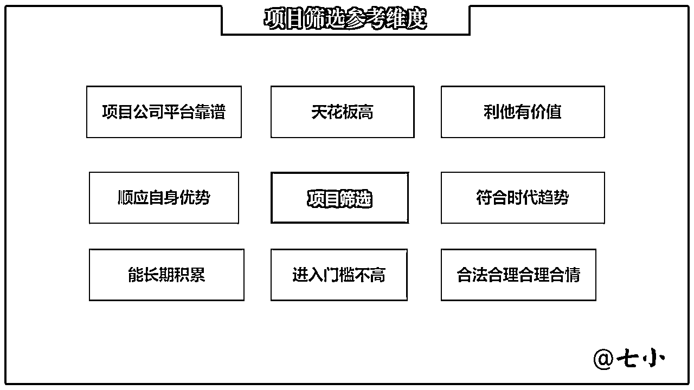

图里有8个维度，这里重点讲对普通人最重要的两个：

关于优势：

V先生：

001. 兜兜转转，一个人很难跳脱天赋、爱好、行业积累去做事。
- 没天赋，做不精；
- 没爱好，做不久；
- 没积累，很难赚钱。

不是所有风口都能抓，所有机会都属于你。机会建立在天赋、爱好、积累之上。

012. 不同人适合不同角色：
- 内容型：付费专栏、课程
- 工具型：小程序、App开发
- 媒体型：网感强、懂传播
- 运营型：社群、线上线下活动
- 商务型：渠道、客户关系、一对一销售
- 品牌型：品牌策划、VI、包装设计
- 管理型：战略、复盘、团队培训

做不好别自责，停下来想想自己最适合什么。让郎朗踢足球、姚明弹钢琴，只会浪费资源。

国产教父：

杜国楹说过“短期看优势，长期看趋势”。

看懂趋势不等于能落地，能落地不等于能变现。要清楚自己的优势在哪，在趋势里用擅长点找到自己的位置。

进入门槛不高：

明白：

巧妇难为无米之炊，有案例才能复盘吸取精华。

选案例要匹配。偏自由职业或副业的“小微创业者”，不要去对标淘宝、微信、抖音这类大公司。它们靠金钱、渠道、流量、品牌支撑，经验对普通人参考性低。

我们要找“精益创业”案例，靠知识、能力、方法起家，更接地气。

七小思考：

世界上有无数成功项目，但你未必能复制。所以选项目要结合兴趣、优势、能力、资源。

项目前景重要，但能否被你承接住、做得下去更关键。

七小补充：

如果觉得当前条件挑不到好项目，就先做能做的。用它打基础、攒资金、练能力，时机成熟再切换。能力资源变强，自然有资格挑更好的项目。

做项目像打怪升级，变现速度是逐步提升的：

步行→跑步→骑行→电动车→摩托→私家车→跑车→飞机→火箭…

一开始的项目不完美没关系，只要能练手、能赚钱、能为下一个项目铺路就行。有些项目是“桥”，不是“终点”，做一时即可。

其他维度参考来源见文末。

## 4）别人为什么要从你这里买

徐蒙老师的一篇小品文写得特别透，我直接摘录：

徐蒙：

赚钱的本质是什么？卖出东西去？

那为什么别人要买？无非三种可能：

第一，他不知道别处能买；【信息不对称】
第二，他不方便去别处买；【交付不便利】
第三，他不信任其他人；【信用不传递】

……

明白这三点，就能找到“卖什么给谁”的切入点，信息不对称、交付不便利、信用不传递就是赚钱的机会。

来源：https://wx.zsxq.com/dweb2/index/topic_detail/215128812554251

## 5）赚钱和圈层有什么关系？

结合前面内容，加上花爷、低调、刘小排的观点，我做了下图。

上半部分灵感来自：

低调：

大家常说“赚不到认知之外的钱”。认知差由三要素构成：资源差、技术差、信息差。

来源：https://wx.zsxq.com/dweb2/index/topic_detail/585244142288214

刘小排：

赚钱真相只有一个：卖东西。

“卖东西”分两种：卖自己的东西、帮别人卖东西。

“东西”也分两种：服务、产品。

商业模式只有两种：自己创造价值卖给消费者，或做中间商传递价值。

来源：https://articles.zsxq.com/id_0l9wqp7m2fj9.html

由此推导：

1）把信息差、资源差、技术差包装成产品和服务。
2）自己会创造就直接面向C端，自己创造也自己交付。
3）自己不擅长创造就做中介，从上游拿价值到下游释放。
4）左右两侧都是不同的买家/卖家群体，需求多样。

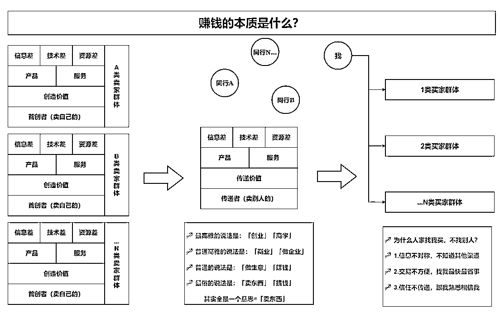

如何在日常生活中发现商机，利用信息差变现有哪些道与术？——花爷

在存量市场里还能赚到钱，本质上是一场圈层之间的价值搬运。

生产力上去之后，生活质量跟着水涨船高，社会就自然开始切片。按地域、收入、兴趣切开，一个大圈层被拆成无数个小圈子。富人之间都未必聊得来，穷人之间也互相看不上。圈子越碎，触达成本越高，流通的价值也越值钱。

信息差的“差”，差就差在圈层之间。

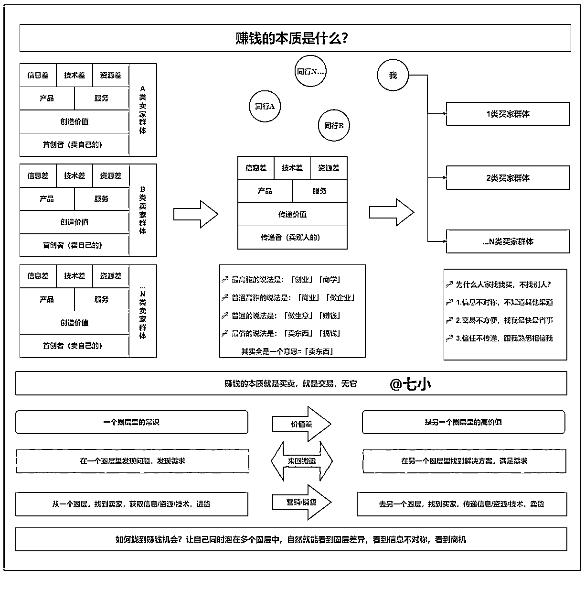

一个圈里习以为常的操作，放到另一个圈里就是刚需高价。会薅羊毛的人知道网盘年费官网要298，拼多多上148到198就能拿下，倒手238卖还有人感谢你送优惠。这就是常识跨圈层变现。

一个圈里卡壳的难题，换个圈就成了小儿科。有人要把上百篇知乎公众号文章手工复制，折腾到心态崩掉。对懂采集的人来说，打开后羿采集器就能跑完；对会搜的人来说，找个现成采集工具直接用就行。难不难，取决于你站在哪个圈层看。

所以赚钱和圈层的逻辑是什么？圈层越多，差值越大，流通的利润也就越大。让价值流动起来本身就是价值。信息差的本质是圈层差，读不懂圈层，就读不懂信息差。

顺着这个逻辑能推导出一套实操路径。

因为生产力提升→分层加剧→大圈层被拆成无数小圈子→信息差被放大的同时可流通价值也变大。

因为赚钱=交易=价值流通。

所以要把自己泡进更多的圈子里。能接触的圈子越多，能发现的需求越多，能找到的解决方案越多，赚钱的概率就越高。

具体怎么做？在A圈子里发现痛点，从别的圈子里找解法，把它打包成产品或服务，再回到A圈子去卖。这就是一趟完整的价值搬运。

差值越大，赚得越狠。所以要学会向上学习，向下变现。向上进入更高端的圈子，大家欢迎你；向下进入更低端的圈子，大家觉得你掉价。但超额收益往往就藏在那些你觉得“低端”的地方。因为你的常识是别人的高价值，你的轻而易举是别人的不可思议。你觉得他们菜，他们觉得你是神。

赚钱离不开另一个稀缺资源：信用。

代工厂能把品牌标品生产出来，却只能拿辛苦钱，品牌方赚大头。差在哪？信用支撑。信用不够，利润就赚不到。

老板选人时，水平难以判断，就会优先看信用。能判断水平时，信用也常排在能力前面。职场里最核心的评价从来不是“能力强”，而是“人靠谱”。凡事有交代，件件有着落，事事有回应，这就是信用。买房装修你分不清谁技术好，就选沟通积极、敢说风险、能兑现的。淘宝和拼多多同样商品差价明显，很多人仍只敢在天猫下单，也是信用成本在做选择。

信用可以积累，也能转嫁。明星代言是信用转嫁，导师背书也是信用转嫁。信任够了才有交易，信任不够，钱就进了别人的口袋。

知道要流通价值，还要会卖。

卖得多：可复购×高客单价×分销/代理制，三者只要占其一就有威力，三者兼具就更猛。网络课靠分销，微商靠代理，可复购会员靠复购+客单，樊登读书、保险业务都是典型。模式跑通了，规模自然上去。

卖得贵：稀缺方掌握定价权。新品上市供不应求，率先体验面子价值高，加价是必然；供给充足后，掌握现金的买家定价。口罩机、熔喷布的暴涨暴跌就是这个规律。两瓶矿泉水在城市不值钱，在沙漠里对马云就是稀缺。

溢价也能靠包装和借力。一个普通钥匙扣，加年份加二维码，把情感纪念需求挖出来，就成了17万份的爆款。用户买的不是扣子，是情绪传递的礼物。给卖花的人配手写信，给做TikTok的手机预装环境，给培训配工具折扣，本质都是把隐性需求显性化，提高感知价值。

卖得多元：一个粉丝有多重变现属性。小米靠手机低价获客，利润放在后端家电生态。用户一旦成为米粉，就会被不断迁移到手机卡、电视、净化器、小配件等全链路。粉丝经济的终局是生态占位。

看这么多精华帖，为什么还是赚不到钱？三个误区。

第一，关键动作不到位。减肥靠管嘴迈腿，游泳靠下水扑腾。赚钱不是靠看教程。互联网创业的硬动作是：有产品、有引流、有朋友圈广告、有私聊成交和复购。你文章写了多少，广告发了几条，私聊了几个人，自己心里清楚。动作没做，看再多也没用。

第二，重复不够。很多人用战术上的勤奋掩盖战略上的懒惰，总在追求质量，却不堆数量。俯卧撑姿势再标准，练一次十次也不长肌肉。文章再好，发一次也引不来流量。聪明人需要的是重复、重复、再重复。

第三，越级学习。每个年龄、财富、人生的阶段都有对应的任务。还在大学就去学团队管理资本结构，看不懂也做不了；有家有业的中年人天天研究抖音引流 landing page，不现实。越级内容要么看不懂，要么看懂了也落不了地，成了屠龙术。健身时能做标准俯卧撑就别用跪姿偷懒，也别一上来就练单手倒立，容易受伤。赚钱也是打怪升级，修为不够强行突破境界，容易走火入魔。

所以别在错误的阶段学高阶打法。找准你当下的阶段，做这一阶段该做的事，从0到1，再从1到10，一步步打怪升级，才是能真正在存量世界里赚到钱的路径。

普通人想赚钱，最怕的不是没能力，而是没有方向。很多人闷头努力了很久，却依然在原地打转。问题出在哪？不是不够拼，而是心里没有一张“成长地图”。

这篇文章，结合多位从0起步做到年入百万、月入十万的实战派经验，整理出一条适合普通人的赚钱成长路线。每一个阶段会遇到什么、该做什么，都给你摆清楚。

先看理论部分。有人把人生增值分成四段：开眼界，复制案例，贯通商业本质，最终跨界变现。也有人从日本剑道借来一套心法——守、破、离：先老老实实学会，再试着突破，最后自成一派。而看透赚钱的本质，其实就是“卖东西”。找到一件你想卖的东西，从模仿开始，尽快跑通一个最小闭环，然后不断反馈、迭代、破局。

还有大佬给出了简单的做事循环：模仿，改进，失败，复盘，再来。成功了就复制放大。小白创业也有方法论：少碰技术型项目，多做能看到反馈的推广型项目；商业模式要简单直接，一手交钱一手交货；不要选择随时归零的事情，要做能阶段性积累的事；坚持、勤奋、执行，是月入过万不变的底牌。

以上就是理论地图的底子，整体长这样：

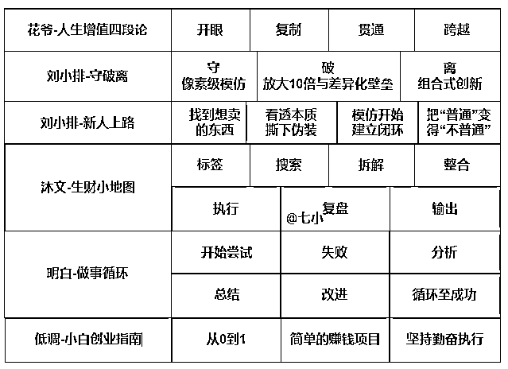

接下来，把理论和实践对照，我总结出普通人赚钱的三大阶段。心中有图，脚下不慌。

## 第一阶段：摸索

这个阶段的核心是“开眼+复制”。大多数人被自己的领域困住太久，抬头看世界的时候全是陌生。缺的不是道理，而是具体的案例、细节和推演。所以先大量看别人怎么赚钱，把别人验证过的技巧，搬到自己的领域里。别怕失败，前几次移植大概率会翻车，但那都是经验。

把前面那些理论筛选出适合这个阶段的内容，大概是下面这张图：

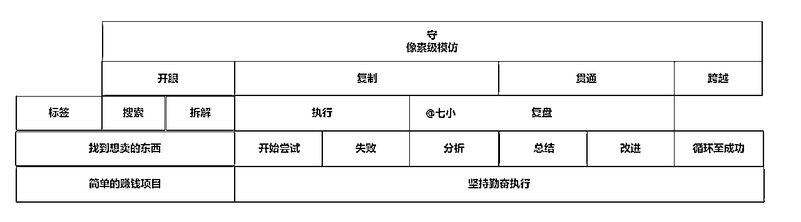

再浓缩成一句话版，就是这张：

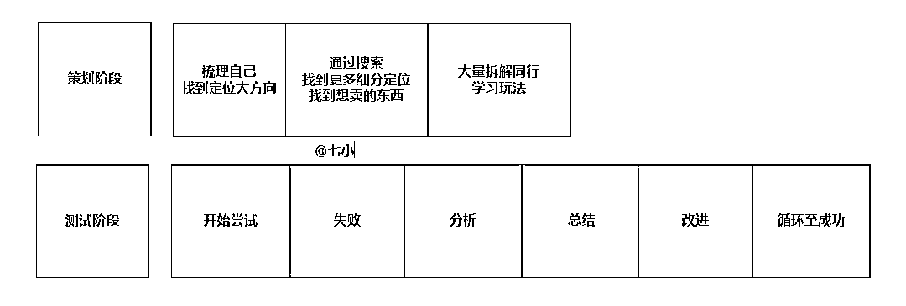

这个阶段不要碰太复杂、太技术流的项目，要做那种付出就有反馈、卖一份赚一份的事。加上好友就聊，聊完就成交，简单循环。同时记得：积累比爆发更重要，找那种能让你慢慢长大的项目。

## 第二阶段：放大、差异、壁垒

当你能稳定赚到第一笔钱，接下来怎么赚更多？这时候没有“保姆级教程”了。你需要“破”。

破有两种方式。第一种，比别人做得好十倍。说白了就是横向扩展，从1到N，渐进式创新。第二种，做出有壁垒的差异化。

什么叫差异化？比如你找到一个引流方法，整个圈子里没人提过，效果却不输任何公开方法。恭喜你，这就是有效的差异化。别到处声张，这是你的秘密，商业增长靠秘密。

什么叫壁垒？在找差异化的过程中，刻意去找门槛高的事。最好这件事和你独特的技能组合有关——你能轻松做到，别人想做却很难。

这个阶段，想做大还要学会放手：不要所有事都亲力亲为，把重复性工作交给助理；把项目拆解成流水线，分工协作；提升管理能力，让项目公司化。最快的管理学习方式，就是去那些做同样业务但井井有条的公司，虚心请教，拿回来直接用。

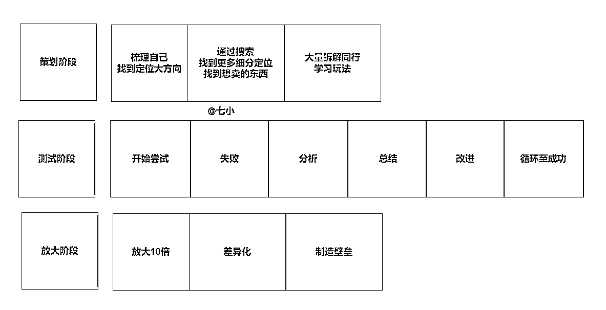

## 第三阶段：稳定、转型

项目进入稳定期后，要学会分享。把项目分享出去，让别人也能赚钱，用这种方式结交高手、认识富人。钱是赚不完的，这次你拉别人一把，未来某个机会，别人就可能拉你一把。

同时，稳定期也是探索新项目的最佳时机。试错要花成本，但你不淘汰别人，就会被别人淘汰。必须逼自己去做开创性的事。

如果你的项目已经到了瓶颈，突破不了，那就维持现状的同时，赶紧找新赛道。别贸然换完全不同的领域，最好找你原来业务类型相似、但还没那么红海的项目，小规模试错。项目不行，就果断推新项目。也不要闭门造车，多出去交流，建自己的行业小圈子，筛选有用信息。

把三个阶段拼在一起，完整的地图是这样：

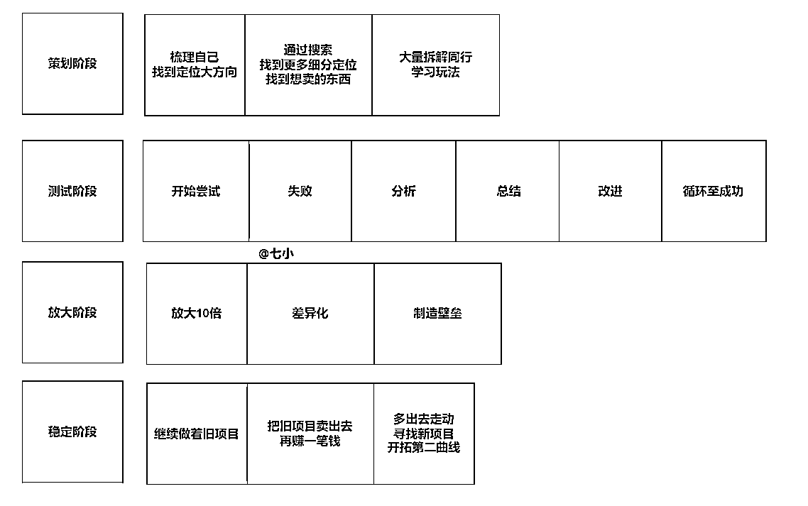

## 贯穿全程的5件事

不同阶段有不同任务，但有五条积累，什么阶段都该做。

**第一，持续结交高手。** 想快速入门一个行业，要么找专业人士带你，要么自己死磕。但等你研究出皮毛，红利可能已经没了。付费是接近高手最直接的方式，花小钱省大时间，少走弯路。

**第二，持续留意机会。** 机会分两类：主动寻找，和留一扇窗。主动寻找，是让上面的人看到你的进步，有好机会先想到你。留一扇窗，是保持在线、及时回复、永远礼貌——你不知道哪件小事会给你带来大机会。对陌生人客气一点，就是给自己多开一扇门。

**第三，持续锻炼身体。** 身体永远是第一位。有人做互联网做到体重从170飙到240，整个人差点废掉。后来一年减回160，才重新找回状态。少熬夜、别暴饮暴食、关注体重，精力才是搞钱的燃料。

**第四，持续提升能力。** 再好的机会，没能力也接不住。别整天找机会，先把你本事的核心技能练好。很多行业真正值钱的不是表面技能，而是底层逻辑，比如外贸的底子是心理学和谈判学，开车的底子是防御性预判。学能力，最快的是找行业里的实战高手，而不是纸上谈兵的人。最厉害的能力，是获得能力的能力。

**第五，持续让人受益。** 多分享、多合作、多帮人。帮别人一次，别人就可能在关键时刻帮你一次。对人好一点，就是对自己好一点。即便接到推销电话，也客气说声“暂时不需要，周末愉快”。那些你不放在眼里的小人物，往往能给你最真实的信息。就像给保安送水果，朋友来停车就能方便很多。富而好礼，路会越走越宽。

当然，这条路上也有贯穿始终的煎熬。

**孤独。** 创业者的常态不是光鲜，是深夜里的一个人扛。到转型期，压力最大，能靠的只有自己。但正是这种孤独和危机感，让人不敢松懈。

**迷茫和怀疑。** 第一桶金阶段，你从没赚过钱，会怀疑、会不被理解、会长期孤独。这时候需要强大的信念，强忍耐，赌性重。黑暗里，要相信光明一定会来。

地图已经给你了。每一段路，都会有人替你走过。你要做的，就是带着这张图，闷头走完该走的路。

机会从来不缺，缺的是看懂机会的眼光，和撑到天亮的人。

朋友，你有没有想过，那些能把一件事死磕到底的人，他们的信念到底从哪来？我的答案就四个字：找人找物。去找一个能照亮你的真人，比如地产圈的王石，他把云南烟草大王褚时健奉为偶像；也可以去书里找一个虚拟英雄，或者去找一首能让你瞬间满血的歌。哪怕是一项运动、一个爱好，都能成为支撑你走到“第一桶金”的燃料。我自己在上班最难熬的日子里，就常一个人去夜跑，或者坐在黑夜里望着远方发呆。直到今天，我仍然靠健身和歌单给自己续命。

说到失败，云蔓这个例子就挺刺激。她先后栽过四次跟头，结果反而在一个月内搞定十万粉丝、变现一百万。这背后其实有个规律：做一件事通常要经历四个阶段，顺利时靠正向坚持，难熬时得背着负向煎熬。等你把这两种滋味都尝遍，完整的地图才会浮出水面。

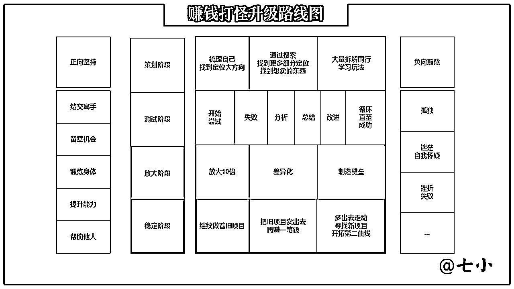

赚钱，就是一场拼图游戏。

在变现这件事上，光有一颗赚钱的心远远不够，你还得像《龙珠》里集龙珠一样，把知识和能力的碎片一片片凑齐。别觉得单块拼图夠精致就能召唤神龙，数量不够，一切白搭。

为了让各位早点集齐“赚钱碎片”，我把自己刷完的100多篇精华帖里看起来最有用的部分，整理了一份给你。

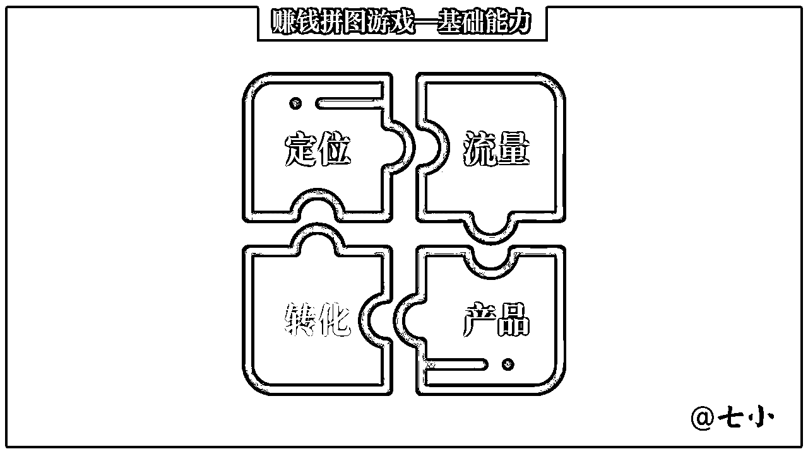

一、定位

先说人。每个人都有适合自己的玩法：有人适合做内容产品，搞课程、写专栏；有人适合做工具型产品，捣鼓小程序、App；有人适合做媒体，网感强、懂传播；有人适合做运营，擅长搞社群、张罗活动；有人适合做商务，铺渠道、拉客户、一对一成交；有人适合做品牌，策划、设计VI、做海报；也有人适合做管理，定战略、盯目标、做复盘、带队伍。如果你某件事没做好，别急着自我攻击，也别被别人的嘴带进坑里。你让郎朗去打篮球，让姚明去弹钢琴，拧巴的是两个人，浪费的是社会资源。先停下来，想想自己到底是什么料。

沐文的方法更具体：思路要匹配认知，再叠加信息，才会闪出赚钱的启蒙点。怎么找到它？先给自己贴标签。别说什么都没有，哪怕是小白，也总有过一次兼职、一段工作、一个爱好，哪怕只是一个“宝妈”“创业失败者”的身份。把这些标签列出来，身份、资源、经验、职业、行业……至少写五个。然后在这些标签前后造句：“XX怎么做”“XX有什么用”“XX需要什么”。比如“怎么当好一个宝妈？”“知乎好物推荐怎么做？”“创业者要注意什么？”当标签和问题都成型，你的赚钱方向自然就长出来了，再也不会像无头苍蝇一样乱撞。

再谈趋势。V先生有个比喻很带感：猪肉过手，手上沾油。没有猪肉的地方，你蹭不到油；走进猪肉市场，转个身就能抹一手油。钱也同理，它流向哪，你就去哪。要知道钱往哪走，可以盯的东西太多了：国家五年规划、年底经济工作会议、国务院文件、银行信贷、进出口贸易额、物价、财政投入、GDP、人口流动、土地拍卖、用电量、快递包裹、投资公司和巨头的项目、App月活排行榜、百度指数、淘宝销量、有钱人和中产的生活方式、内容平台融资、高手的玩法和新社群、新建的大学城和商业街……总结起来，就是锚定政府、锚定银行、锚定巨头、锚定红利平台、锚定有钱人。为什么？因为他们手里才有钱，他们决定钱的流向；钱流向哪里，哪里就有增量；有增量，普通人才有空间。红海里搏杀，不如蓝海里开荒。长者那句话一点没错：一个人的成功，既要靠个人奋斗，更要靠历史进程。最大的增量、持续四十年和未来三十年的十倍百倍增量，都在历史进程里。而在我们国家，历史进程的发动机就三个地方：先进生产力的发展要求、先进文化的前进方向、最广大人民的根本利益。

接着看项目类型。低调把赚钱项目分成了六类：平台类，跟着平台干，要跟平台规则斗智斗勇，比如短视频、直播带货、电商店群；推广类，靠引流和跑量赚钱，比如淘宝客、CPA、CPS；羊毛类，一波流，能直接撸或拉人头，比如橙心优选、花小猪；代理类，建立团队拉人头，比如社交电商、淘客App；自营类，靠微信吸粉卖货，比如服务类、软件销售、直营；IP类，树个人品牌做转化，比如社群、培训、带货。对小白来说，平台类和推广类见得最多，但一个拼技术，一个拼流量，这两块短板卡住了不少人。

白一喵在变现方式上有他自己的心法，原文框架放这里：

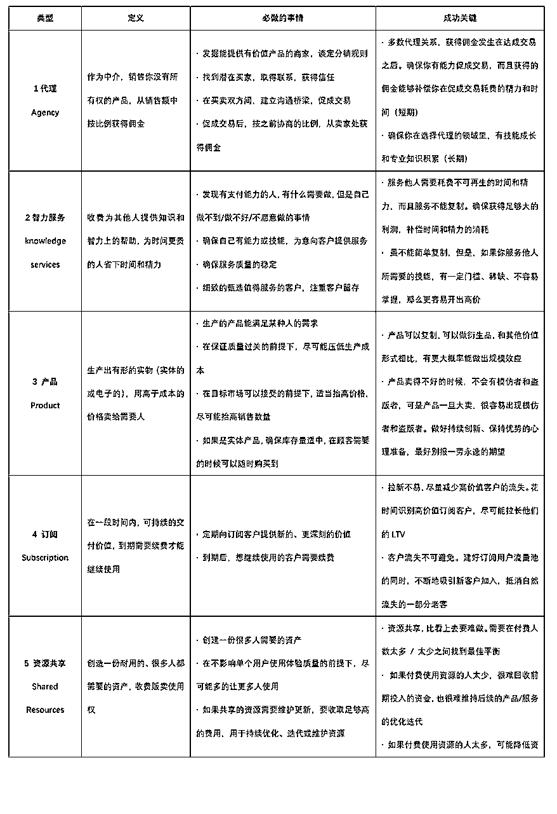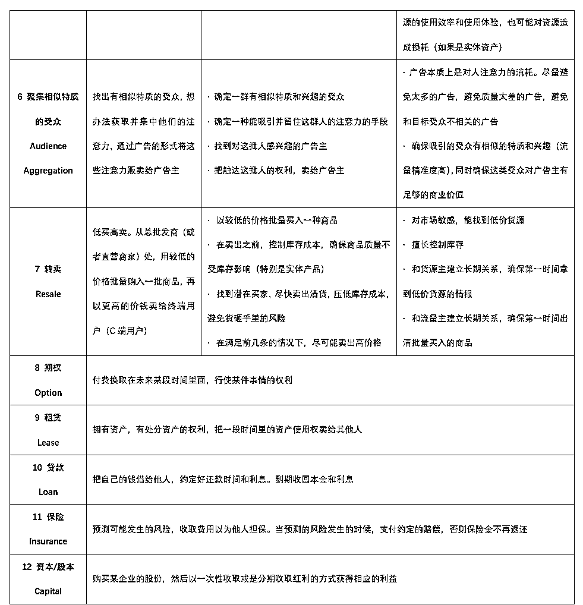

二、流量

流量渠道这个事，网络上有一份流传很广的整理，直接看：

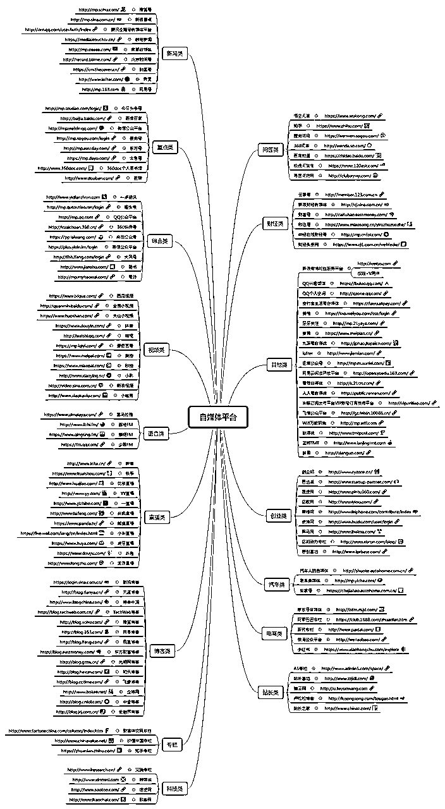

至于互联网创作，徐蒙给过几个当天下午就能上手的思路。一是搬运：别人已经测过的爆款内容，你复制粘贴总会吧？比如抖音上把电视剧截成一段段的人，就是在搬。二是整合：把零散信息做成合集，你看那些美女合集号，本质上也是ctrl ctrl v。三是照抄：依葫芦画瓢，别人吃肉你喝汤，多喝几次汤就有肉了。四是组合：把老旧的段子和鸡汤换个新瓶，找张新面孔讲一遍，照样有无数人买单。你以为那些抖音语录号很新鲜？其实就是十几年前校内网玩剩下的。

输出，沐文建议：可以讲步骤、讲细节、讲方向、讲工具、讲技巧、讲经验、讲理论。载体不限，音频、视频、文字、图文都行。平台更是一片汪洋，公众号、头条号、百家号、抖音、快手、小红书……做成分发矩阵就好。

三、产品

沐文对产品的看法很极致：价格、外观、服务、交付，全部往死里打磨。龙哥盟就是极致交付的样板。产品供应链、设计、现场服务、线上交付、选品逻辑、定价、文化……每一个环节打磨到极致，都可以成为你对外的赚钱点，比如设计牛人就成了设计师，交付牛人就成了社群运营师。

四、转化

V先生给过一个互联网赚钱公式：销售额=流量×转化率×客单价×复购。这个公式在电商领域很通用，网课、社群、微商也能参考。既然销售额是最终的结果，其他是原因，那就不如死磕销售额这个北极星指标。怎么放大？方式很多：自建大流量池、写爆文、做事件炒作、找KOL推荐、抱大平台大腿、在红利期内容平台批量投放、扩张销售团队、社群裂变、搞微商代理、打造个人品牌、拉高客单价、做可复购会员、卖刚需产品、深耕垂直领域服务、玩小众稀缺品或亚文化潮玩……这十五招，至少要占一个。

转化率本身也是一门生意。沐文说，转化率可以细分为文案转化率、图片设计转化率、视频转化率、音频话术转化率、朋友圈转化术等等。陈勇的案例已经说明：把SOP的颗粒度拆到极细，转化率就成了一个超级代名词，也成了新的赚钱点。极致地深挖每一个转化细节，都会长出对应的赚钱机会，比如文案转化率导师、小红书文案导师、设计转化率导师。

五、其他

先说“赚钱兵器库”。明白认为，所有赚钱案例背后都离不开需求、流量、营销、变现四件事。每次看精华帖，都从这四个角度去拆，然后总结成自己的清单。积累到一定量级，再遇上一个新项目，你就能脱口而出：这里有什么需求，谁在哪个平台做过，用什么方式引流，怎么营销，怎么变现。你不再是没带装备的裸奔者，遇到问题就从兵器库里挑一件，模仿、改进、落地。不行就换一件，快速迭代，成功率自然高。

然后是“赚钱能力树”。七小把不同高手的总结都收在了一起：

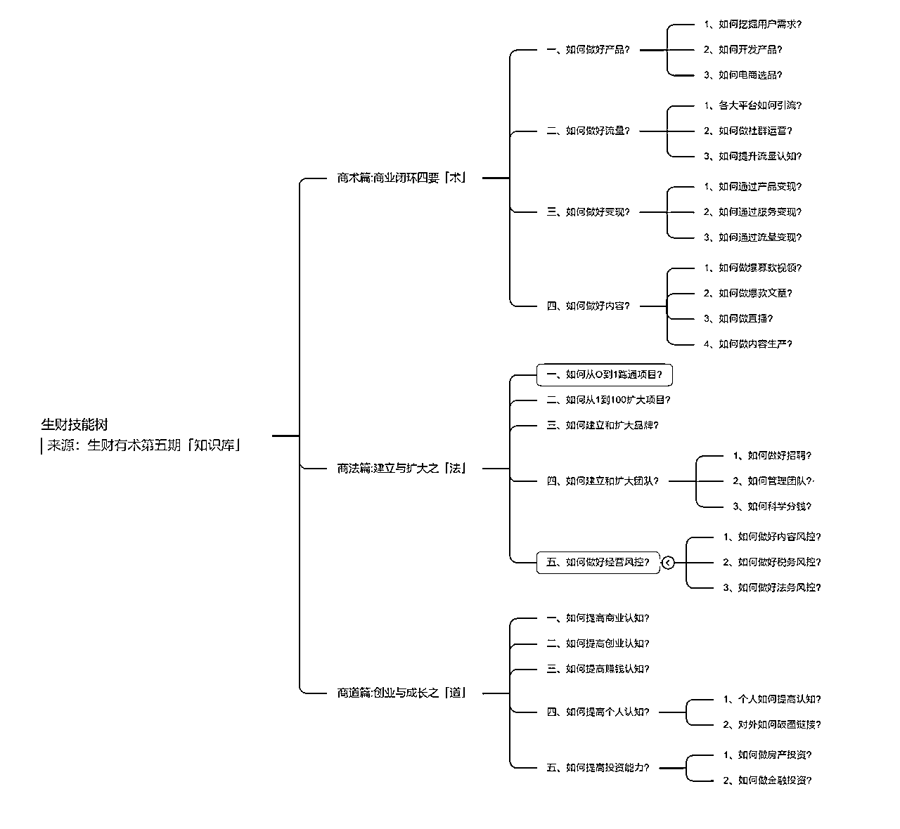

沐文的七步法是：项目开启靠标签和信息，然后搜索、拆解、整合、执行、复盘、输出。包小滚的微创业心法是：学习能力要对口，方向要适合自己，定制计划，多用搜索做调研，低成本快速落地，像素级模仿跟跑，及时复盘，高执行力、务实、诚信。明白的能力清单是：挖掘用户需求、做出产品、找到目标用户、让用户付费、做好增长和拓展。拱卒靠吃苦练出了一身技能：SEO、操盘、自媒体全平台推广、电商、社群、设计、管理、策划、课程设计、投资、演讲、销售、私域运营……正因为有这些技能，才能一次次抓住风口。闫寒提出了五项更抽象的能力：超视距价值的钻探能力、群体需求的抽象能力、清空自己的迁移能力、勘定边界的战略能力、对不确定性的利用能力。白一喵则提醒年轻CEO们：重点是造梦、打牌、盖楼，别让务虚太空，别让管人带人太虚。海程和Caoz不约而同地强调：算账能力、数据分析能力，是商业的基本功。

对了，最后还有一个“赚钱新人指南”合集。官方有使用指南，杨涛写过走心版新人手册，老黄牛聊过怎样学习龙哥盟事半功倍，张世磊分享了“这才是龙哥盟真正正确的打开方式”，明白也有一篇教新人从职场切入互联网赚钱领域的成长路径。想不上头地进场，这些可以作为你的第一份地图。

好了，拼图碎片先给你这么多。赚钱这件事，说到底就是一场既考验耐力又考验眼力的游戏，你要做的，是把碎片一片片捡起来，拼出属于自己的那幅图。

看了不下上百篇精华内容，熬了整整十天，从早到晚整理了四天，终于把这套东西摸透了。

如果你刚进龙哥盟，面对满屏的精华帖，很可能第一反应是：这么多，从哪里开始看？别急，下面这份整理能帮你少走很多弯路。

先说新人的进阶路径。很多人刚进来就急着赚第一笔钱，但其实第一步应该是“养思维”。有篇帖子讲得很到位：普通人从0到1培养赚钱思维，核心不是学技巧，而是建立对“赚钱”这件事的整体认知。先把地图打开，再谈走路。

再说说龙珠规则。这颗球，就是社群的硬通货。怎么拿？写精华帖是最主流的路径之一。精华帖要有干货、有实操、能帮别人解决问题——不是写作文，是交作业。龙珠规则本质上是一个反馈机制：你贡献了多少价值，就获得多少认可。不是靠运气，是靠持续输出。

然后是利他。很多人不理解，为什么有人愿意把自己从0到1做成事的全过程分享出来？闷声发大财不好吗？龙哥解释过这件事：分享本身就是筛选和连接的过程。利他不是牺牲，而是用你的能力去换更大的信任和更多的可能性。有人说“利他即利己”，听上去像鸡汤，但在这个社群里，它是被反复验证过的生存法则。

再聊焦虑。恰恰是因为这个社群太“卷”了，很多人一进来就慌了：别人都月入十万了，我怎么还在起步？有篇帖子写得特别实在，说30天消除焦虑并赚回门票钱，做对了什么？核心就是两件事：降低预期，专注执行。不要拿别人的结果来惩罚自己，把注意力放回自己能控制的事情上。焦虑不会消失，但可以被行动稀释。

还有一个重要话题：快钱和慢钱。有帖子讨论是赚快钱还是慢钱，本质上是在问你想要什么。快钱给人安全感和正反馈，慢钱积累壁垒和复利。真正有价值的事情，往往是一开始看起来“不值钱”的。梁宁有句话说得好：赚钱的事和值钱的事，是两个维度。你在做的事，是让你越来越贵，还是只是换来一笔钱？

最后，说点我自己的感受。整理完这么多精华之后，最大的变化不是学到了多少技巧，而是两个字的感受——敢了。之前觉得赚钱这事隔着层纱，看完这么多普通人跑通的路，你会发现，其实这条路没那么难。别人能做到的事，我也可以试试。

这篇文章对我来说是个里程碑，不算什么大成就，但它意味着我开始把赚钱这件事当成一门学科去系统学习。

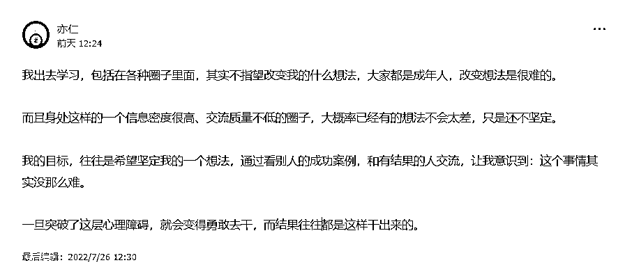

以后这块内容，我还会继续整理，帮大家降低学习成本，也希望能成为赚钱的首席内容整理官。如果你也刚进来，别焦虑，别贪快，先从建立认知开始。路长着呢，一起走。