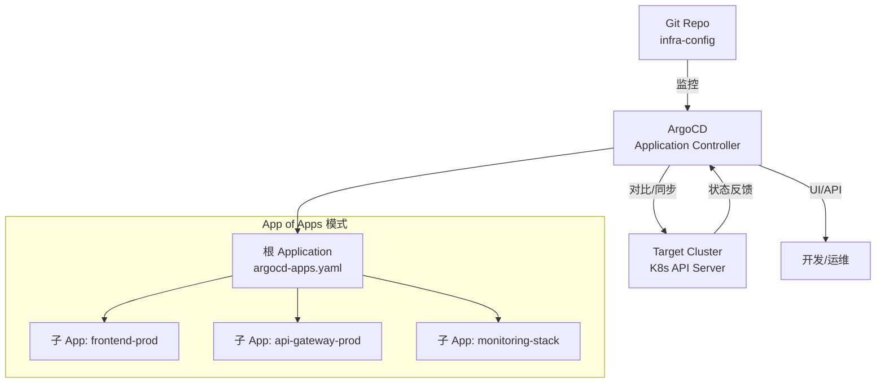
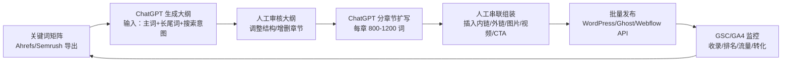

# 第 20 章 前端部署与发布体系 —— 从容器化到边缘计算与渐进式交付
作者：龙哥

## 学习目标

- 理解前端构建产物标准化的核心规范：不可变产物、内容寻址、SPA 回退与 SRI 防篡改
- 掌握生产级 Dockerfile 多阶段构建、非 Root 用户、Distroless 基础镜像、健康检查与资源限额的最佳实践
- 熟悉 Kubernetes 部署策略（RollingUpdate/Recreate）、Ingress 流量治理、ConfigMap/Secret 解耦配置、HPA/VPA 弹性伸缩及 Istio Service Mesh 金丝雀发布能力
- 理解边缘计算与边缘渲染的架构差异（Edge Runtime vs Node.js），掌握 Next.js/Nuxt Edge Functions 部署、Edge KV 状态管理、Middleware 实现 A/B 测试与个性化路由
- 掌握 GitOps 核心原则与 ArgoCD 工程化落地：声明式同步、App of Apps 模式、PreSync/PostSync Hook、自动回滚、Secret 安全管理与变更日志自动化
- 理解小红书内容电商已度过纯搬运/混剪红利期，进入需精细化运营的内容电商阶段，重点揭示无货源新人常忽视的单品二次处理与合规风控难题
- 掌握小红书电商选品定赛道、内容为核心、AI辅助创作、多店矩阵起号的核心方法论
- 理解情感粉引流项目的全套操作逻辑，掌握各平台适配的制作类型、制作难度与投产比（ROI）的反向关系
- 掌握 ChatGPT 在跨境电商运营全链路（选品定位、Listing撰写、邮件营销、SEO引流、站外推广、品牌建设）的六大具体应用场景及工具化封装方向

## 20.1 生活类比

想象前端部署发布体系是一个**现代化集装箱物流与边缘仓储网络**：**构建产物标准化** = 给每个集装箱贴上**全球唯一 RFID 芯片（内容哈希）**，并加装**防拆封铅封（SRI）**，货物（资源）一旦装箱不可篡改，客户（浏览器）可长期缓存信任；SPA 回退则是**兜底配送中心**，无论客户从哪个门进，最终都能找到主入口（index.html）。**容器化部署** = **标准化集装箱**：Builder 阶段是装货车间（含工具、原料），Runner 阶段只运走成品箱（Distroless 极简箱），箱体贴上**健康体检码（Probes）**与**载重限额贴（Resources Limit）**，非授权人员（Root）禁止驾驶。**K8s 与 Service Mesh** = **智能港口调度系统**：滚动更新是**分批换班卸货**，Ingress 是**智能分拣闸机**（TLS 检票、路由重写），Istio 是**空中交通管制**，能将 10% 航班引导至新航线（金丝雀），甚至隐形复制一份飞行数据去新机型验证（流量镜像），不影响乘客体验。**边缘计算/渲染** = **社区微型前置仓**：不再从中央大仓（源站）千里调拨，而是把**组装生产线（SSR 渲染）**搬到用户家门口（Edge 节点），利用 **Edge KV 存储** 备好常用配料（会话/偏好），Middleware 是**门口分流员**，根据会员卡（Cookie）秒级决定走 VIP 通道还是普通通道（A/B 测试），实现毫秒级交付。**GitOps** = **单一账本驱动的自动化仓储**：Git 仓库是**唯一真实账本**（期望状态），ArgoCD 是**不知疲倦的核对员**，时刻比对账本与实物（集群状态），一旦不符自动整修（同步/回滚），所有变更留痕可查，Secret 则是**存放在金库（Vault/Sealed Secrets）的钥匙**，账本里只记钥匙编号不记实物。**小红书内容电商** = **精品买手店**：不再是堆货的超市（货架电商），而要做**内容驱动的精品店**；选品定赛道是选址，内容为核心是陈列，合规前置是消防验收，AI是高效导购员，多店矩阵是连锁分店。**情感粉引流** = **婚恋咨询所的分流前台**：内容（作品）是海报招牌，平台是商圈位置，制作类型是装修档次，**书单号是低成本快招牌**，精准作品是金牌销售，**私域咨询师是后台专家**，零门槛轻资产开店。**跨境电商 AI 协作** = **配备超级实习生的出海贸易行**：ChatGPT 是**英语母语的外贸专员**，Prompt Engineering 是**标准作业指导书**，角色设定是**岗位职责说明**，工具化封装是**内部 SaaS 系统**，让语言障碍不再是准入门槛。

## 20.2 概念地图

前端部署与发布体系
├── 构建产物标准化
│   ├── 不可变产物与内容寻址哈希  —— P001
│   ├── SPA 回退落地 (fallback: index.html)  —— P001
│   ├── 资源完整性校验 SRI (Subresource Integrity)  —— P001
│   └── Import Maps 动态依赖映射  —— P001
├── 容器化部署最佳实践
│   ├── 多阶段构建  —— P002
│   ├── 非 Root 用户与 Distroless/Alpine 精简镜像  —— P002
│   ├── 健康检查 liveness/readiness 探针  —— P002
│   └── CPU/内存 Limit/Request 资源限额  —— P002
├── K8s 部署策略与 Service Mesh
│   ├── Deployment 策略  —— P003
│   ├── Ingress TLS 终结与路由重写  —— P003
│   ├── ConfigMap/Secret 运行时配置解耦  —— P003
│   ├── HPA/VPA 弹性伸缩  —— P003
│   └── Istio 金丝雀发布与流量镜像  —— P003
├── 边缘计算与边缘渲染
│   ├── Edge Runtime (V8 Isolates) 与 Node.js 差异  —— P004
│   ├── 地理就近 SSR 渲染降低 TTFB  —— P004
│   ├── Edge KV / Durable Objects 分布式状态  —— P004
│   └── Middleware 改写/重定向/A/B 测试  —— P004
├── GitOps 持续交付流水线
│   ├── ArgoCD 声明式同步与 App of Apps  —— P005
│   ├── PreSync/PostSync Hook 迁移测试  —— P005
│   ├── 自动回滚 (selfHeal/prune) 与健康检查  —— P005
│   ├── Secret 管理  —— P005
│   └── 变更日志自动生成  —— P005
├── 小红书内容电商精细化运营
│   ├── 内容电商核心公式：正确赛道 × 优质内容 × 合规供应链 × 时间复利  —— 20230418_145.md
│   ├── 单品二次处理与合规风控前置  —— 20230418_145.md
│   ├── AI辅助创作与过原创  —— 20230418_145.md
│   └── 多店矩阵起号与多笔记玩法验证  —— 20230418_145.md
├── 情感粉引流全流程操作体系
│   ├── 情感细分需求用户画像（恋爱挽回/婚姻修复/婚姻挽回/脱单追求）  —— 20230418_158.md
│   ├── 作品发布精准度分级（鸡汤/半精准/精准）  —— 20230418_158.md
│   ├── 制作类型难度与投产比反向法则  —— 20230418_158.md
│   ├── 平台-制作类型适配矩阵  —— 20230418_158.md
│   ├── 零门槛轻资产创业定理  —— 20230418_158.md
│   └── 情感刚需长期主义定理  —— 20230418_158.md
└── 跨境电商 ChatGPT 实战应用体系
    ├── 角色设定提示词与中英双语无损生产  —— 20230418_136.md
    ├── Listing全要素生成与全周期邮件营销矩阵  —— 20230418_136.md
    ├── SEO内容规模化引擎与品牌本土化命名  —— 20230418_136.md
    └── 垂直SaaS工具化封装（邮件/SEO/数据分析）  —— 20230418_136.md

## 20.3 构建产物标准化 —— 让发布物拥有“指纹”与“防篡改锁"

### 为什么需要这个概念？

你有没有遇到过这样的场景：线上版本回滚后，用户刷新页面依然加载旧版本的 JS，导致白屏或报错？或者 CDN 被劫持注入了恶意广告代码，却无法在浏览器端拦截？这些问题的根因在于：**构建产物缺乏唯一身份标识、缺乏防篡改验证机制、单页应用路由缺乏兜底入口**。

传统部署直接覆盖同名文件（如 `app.js`），导致版本不可追溯、浏览器缓存失效混乱、回滚极其困难。而现代前端工程要求：**产物一旦产出即不可变、内容变更即身份变更、浏览器可长期无感缓存、资源加载可自证完整性**。

> "确立产物输出规范：`index-[hash].html`、静态资源长缓存、`importmap` 动态依赖、Subresource Integrity (SRI) 防篡改、SPA `fallback: index.html` 配置。"
> 
> ——《PU9Id4IPMoZ3QdxLzZUcEPBRnWO.md》

### 核心定义

#### 不可变产物与内容寻址

**不可变产物** 是指：构建产出的每一个文件，其文件名中包含该文件内容的哈希摘要（如 `index-a1b2c3d4.js`）。内容不变则哈希不变，内容一变哈希必变。

**内容寻址** 则是以哈希作为文件的唯一标识符。这带来三大收益：
1. **长缓存策略生效**：你可以安全地对带哈希的静态资源设置 `Cache-Control: max-age=31536000, immutable`，浏览器一年内不再发起请求。
2. **零停机部署**：新旧版本产物共存于服务器（文件名不同），HTML 入口原子切换，老用户加载旧版资源不报错，新用户加载新版资源。
3. **精准去重与版本追踪**：相同内容的文件在存储层面可去重，部署记录即哈希列表，回滚只需指向旧哈希。

在 Vite/Rollup 中，你只需配置输出文件名模板：

```json
// vite.config.ts
export default defineConfig({
  build: {
    rollupOptions: {
      output: {
        entryFileNames: 'assets/[name]-[hash].js',
        chunkFileNames: 'assets/[name]-[hash].js',
        assetFileNames: 'assets/[name]-[hash].[ext]'
      }
    }
  }
})
```

这个配置展示了：通过 `[hash]` 占位符，将内容指纹嵌入文件名，实现内容寻址。构建工具会在生成文件后计算哈希并重命名，HTML 模板插件会自动注入最新的文件名引用。

#### SPA 回退

单页应用（SPA）在前端路由模式下，用户刷新 `/dashboard/detail` 时，服务端若无对应文件会返回 404。**SPA 回退** 是指：服务端配置兜底规则，当请求路径不匹配任何静态文件时，返回 `index.html`，将路由控制权交还前端路由器。

Nginx 典型配置：

```nginx
location / {
  try_files $uri $uri/ /index.html;
}
```

这个配置展示了：`try_files` 按顺序尝试匹配精确文件、目录索引，最终回退到 `/index.html`。这保证了前端路由在任意深度刷新、分享链接打开时均能正常加载应用入口。

#### 资源完整性校验 (SRI)

**Subresource Integrity (SRI)** 允许浏览器在加载外部脚本/样式时，校验其内容哈希是否与 HTML 中声明的 `integrity` 属性一致。若不一致（如 CDN 被劫持篡改），浏览器拒绝执行。

```html
<script 
  src="/assets/app.a1b2c3d4.js" 
  integrity="sha384-oqVuAfXRKap7fdgcCY5uykM6+R9GqQ8K/uxy9rx7HNQlGYl1kPzQho1wx4JwY1wZ"
  crossorigin="anonymous"></script>
```

这个标签展示了：`integrity` 值为 `sha384-` 前缀 + Base64 编码的哈希值。`crossorigin="anonymous"` 告诉浏览器以匿名模式发起跨域请求（不发送 Cookie），这是 SRI 校验跨域资源的前提。SRI 是供应链安全的最后一道防线：即使 CDN 被攻破，恶意代码也无法在用户浏览器执行。

#### Import Maps

**Import Maps** 解决了“裸模块说明符”在浏览器原生 ES Module 中无法直接解析的问题（如 `import { ref } from 'vue'`）。它提供了一个运行时映射表，将包名映射到具体的带哈希 URL。

```html
<script type="importmap">
{
  "imports": {
    "vue": "/assets/vue.3.4.21.esm-browser.prod.a1b2c3d4.js",
    "vue/": "/assets/vue.3.4.21.esm-browser.prod/"
  }
}
</script>
```

这个映射展示了：浏览器遇到 `import 'vue'` 时，查表找到带哈希的精确文件 URL。这实现了**依赖版本与构建产物的解耦**——你可以在不重新打包业务代码的前提下，仅通过更新 Import Map 实现库版本热切换（前提是 API 兼容）。

### 边界条件与常见坑

| 场景 | 陷阱 | 对策 |
|------|------|------|
| HTML 入口文件 | 若 `index.html` 也加哈希（`index-a1b2c3d4.html`），用户收藏链接会失效 | HTML 通常**不加哈希**，配置 `Cache-Control: no-cache, must-revalidate`；若必须版本化，配合 Import Maps 间接引用 |
| SRI 跨域资源 | 无 `crossorigin` 或 CDN 未返回 `Access-Control-Allow-Origin` | 确保脚本标签加 `crossorigin="anonymous"`，CDN 响应头包含 `Access-Control-Allow-Origin: *` |
| Import Maps 兼容性 | Safari 旧版、Firefox 旧版不支持 | 使用 `es-module-shims` Polyfill，或在构建时将 Import Map 内联为 SystemJS/AMD 兼容代码 |

---

## 20.4 容器化部署最佳实践 —— 从“开发机环境”到“生产级标准集装箱”

### 为什么需要这个概念？

“我本机跑得好好的，部署到服务器就挂了”——这是环境差异的经典痛点。Node.js 版本、系统库、原生模块编译环境、文件权限、时区配置……任何一项不一致都可能导致故障。

容器化的核心价值是**环境标准化**。但如果你把 `node_modules`、源码、构建工具、甚至 `.git` 目录全塞进镜像，得到的将是一个 1.5GB 的“超重集装箱”：拉取慢、启动慢、攻击面大、违反最小权限原则。

生产级镜像必须做到：**仅包含运行时必需产物、非 Root 用户运行、极简基础镜像、具备健康检查与资源配额**。

> "编写生产级 Dockerfile：Builder 阶段安装依赖构建、Runner 阶段仅复制产物、非 root 运行、Distroless/Alpine 精简镜像、liveness/readiness 探针、CPU/内存 Limit/Request。"
> 
> ——《PU9Id4IPMoZ3QdxLzZUcEPBRnWO.md》

### 核心定义：多阶段构建

**多阶段构建** 利用 Dockerfile 多个 `FROM` 指令，将构建环境与运行环境物理隔离：

```dockerfile
# ===== Stage 1: Builder (构建环境) =====
FROM node:20-alpine AS builder
WORKDIR /app

# 1. 仅复制锁文件，利用层缓存：依赖不变则不重装
COPY package*.json ./
RUN npm ci --prefer-offline --no-audit --progress=false

# 2. 复制源码并构建
COPY . .
RUN npm run build

# ===== Stage 2: Runner (运行环境) =====
# 使用 Distroless：无 Shell、无包管理器、仅含运行时
FROM gcr.io/distroless/nodejs20-debian12
WORKDIR /app

# 3. 仅从 Builder 复制产物与运行时依赖
COPY --from=builder /app/dist ./dist
COPY --from=builder /app/node_modules ./node_modules
COPY --from=builder /app/package.json ./

# 4. 非 Root 用户（Distroless 预置 nonroot:nonroot 65532:65532）
USER nonroot:nonroot

EXPOSE 3000
CMD ["dist/server.mjs"]
```

这个 Dockerfile 展示了四个关键设计：

1. **依赖层缓存**：`COPY package*.json` 与 `RUN npm ci` 独立成层。源码变更不触发依赖重装，构建提速 5-10 倍。
2. **产物裁剪**：Runner 阶段**仅复制** `dist/`、`node_modules/`、`package.json`。源码、测试文件、构建工具、`.git` 全部丢弃，镜像体积从 ~1.2GB 降至 ~150MB。
3. **非 Root 运行**：`USER nonroot:nonroot` 确保进程以 UID 65532 运行。即使容器逃逸，攻击者也只拥有非特权用户权限。
4. **Distroless 基础镜像**：`gcr.io/distroless/nodejs20-debian12` 仅包含 Node.js 运行时及必要系统库，无 Shell、无 `apt`、`apk`、无任何包管理器。攻击面极小，CVE 漏洞扫描通常 0 高危。

### 关键性质对比：Alpine vs Debian Slim vs Distroless

| 基础镜像 | 体积 | 包管理器 | Libc | 原生模块兼容性 | 推荐场景 |
|----------|------|----------|------|----------------|----------|
| `node:20-alpine` | ~45MB | `apk` | musl | **需额外编译工具链**（`python3 make g++`） | 纯 JS 项目、体积极致追求 |
| `node:20-slim` | ~120MB | `apt` | glibc | **原生兼容** | 含原生模块（`sharp`、`bcrypt`、`canvas`） |
| `gcr.io/distroless/nodejs20-debian12` | ~90MB | **无** | glibc | **原生兼容** | **生产环境首选**：安全、体积适中、无需维护包管理器 |

> **注意**：Alpine 基于 musl libc，若项目依赖原生模块（如 `sharp` 图像处理、`bcrypt` 加密），在 Alpine 中 `npm ci` 会报错 `libc.musl-x86_64.so.1 not found`。此时必须安装构建工具链 `RUN apk add --no-cache python3 make g++`，但这会显著增加镜像体积和构建时间。**生产环境推荐直接使用 Distroless 或 Debian Slim**，避开 musl 兼容性坑。

### 健康检查与资源限额

在 Kubernetes 中，容器必须暴露两类探针：

```yaml
# deployment.yaml
livenessProbe:
  httpGet:
    path: /healthz
    port: 3000
  initialDelaySeconds: 10
  periodSeconds: 10
  failureThreshold: 3
readinessProbe:
  httpGet:
    path: /ready
    port: 3000
  initialDelaySeconds: 5
  periodSeconds: 5
  failureThreshold: 3
resources:
  limits:
    cpu: "500m"
    memory: "512Mi"
  requests:
    cpu: "100m"
    memory: "128Mi"
```

这段配置展示了：
- **Liveness Probe（存活探针）**：检测进程是否存活。失败则 K8s **杀掉容器并重启**（`RestartPolicy`）。路径 `/healthz` 应仅检查进程心跳，不依赖下游。
- **Readiness Probe（就绪探针）**：检测是否准备好接收流量。失败则 K8s **从 Service Endpoints 剔除该 Pod**，流量不再转发。路径 `/ready` 应检查数据库连接、缓存连接、依赖服务可达性。
- **Resources**：`requests` 用于调度器决策（保证最小资源），`limits` 用于 Cgroups 硬性限制（防止 OOM Kill 或 CPU 节流）。QoS 类别：Guaranteed（limits=requests）、Burstable（limits>requests）、BestEffort（无配置）。

### 边界条件与调试技巧

- **Distroless 无 Shell 怎么进容器排查？**
  使用 `kubectl debug -it <pod> --image=busybox:1.36 --target=<container>` 启动临时 Sidecar，共享 PID/Network/文件系统命名空间，在 Sidecar 中执行 `ps aux`、`netstat`、`cat /proc/<pid>/environ`。
  
- **为什么 `npm ci` 优于 `npm install`？**
  `npm ci` 要求 `package-lock.json` 存在，严格按锁文件安装，**不更新锁文件**、不解析语义化版本范围、自动清理 `node_modules` 重装。这保证了**构建的绝对可复现性**，且在 Docker 分层缓存下，锁文件未变则层命中。

- **Monorepo 锁文件同步问题**：
  pnpm/yarn workspaces 生成的根锁文件需完整复制到构建上下文。若子项目独立发布，建议在 CI 中为每个子项目生成独立的 Docker 构建上下文（含根锁文件）。

---

## 20.5 K8s 部署策略与 Service Mesh —— 让流量在版本间“平滑过渡”

### 为什么需要这个概念？

直接 `kubectl set image` 触发滚动更新，默认参数可能导致：**瞬间可用副本数归零（请求失败）、新版本启动未就绪却已接入流量（502）、旧版本连接未排空即被杀（连接重置）**。微服务架构下，服务间调用还需要：熔断、重试、超时控制、流量镜像验证、可观测性。

K8s 原生资源 + Istio Service Mesh 共同构成了**生产级流量治理体系**。

> "配置 RollingUpdate/Recreate 策略、Ingress TLS 终结/路由重写、ConfigMap 挂载运行时配置、Secret 管理敏感信息、HPA 基于 CPU/自定义指标弹性、Istio 金丝雀流量镜像。"
> 
> ——《PU9Id4IPMoZ3QdxLzZUcEPBRnWO.md》

### 核心定义

#### Deployment 滚动更新策略

```yaml
spec:
  strategy:
    type: RollingUpdate
    rollingUpdate:
      maxSurge: 25%        # 允许超出期望副本数的最大比例/数量
      maxUnavailable: 0    # 允许不可用副本数（0 表示全程保证满副本）
  minReadySeconds: 10      # Pod Ready 后再等 10s 才算真正可用，防止启动瞬间就绪探针通过但应用未完全初始化
  progressDeadlineSeconds: 600  # 滚动更新超时判定
```

这个配置展示了：
- `maxUnavailable: 0` + `maxSurge: 25%` = **满副本滚动更新**。旧版本全部在线的前提下，先启动新 Pod，就绪后再逐个终止旧 Pod。代价是临时需要 125% 资源配额。
- `minReadySeconds` 解决“就绪探针通过但应用预热未完成（如 JIT 编译、连接池建立）”导致的早期错误率飙升。

#### 优雅终止：PreStop Hook + 终止宽限期

```yaml
lifecycle:
  preStop:
    exec:
      command: ["/bin/sh", "-c", "sleep 15"]  # 等待 Endpoints 控制器剔除本 Pod IP
terminationGracePeriodSeconds: 30
```

这个钩子展示了：`preStop` 在 SIGTERM 发送前执行，`sleep 15` 留出时间让 kube-proxy/iptables/Envoy 更新 Endpoints，**将本 Pod 从 Service 负载均衡池移除**。随后应用收到 SIGTERM，应在 30 秒内完成连接排空、事务提交、资源释放。这是**零连接丢失发布**的关键。

#### Ingress：七层网关

```yaml
apiVersion: networking.k8s.io/v1
kind: Ingress
metadata:
  name: frontend-ingress
  annotations:
    nginx.ingress.kubernetes.io/ssl-redirect: "true"
    nginx.ingress.kubernetes.io/rewrite-target: /$2
spec:
  tls:
  - hosts: [app.example.com]
    secretName: tls-secret
  rules:
  - host: app.example.com
    http:
      paths:
      - path: /api(/|$)(.*)
        pathType: Prefix
        backend:
          service:
            name: api-gateway
            port: {number: 80}
      - path: /(/|$)(.*)
        pathType: Prefix
        backend:
          service:
            name: frontend
            port: {number: 80}
```

这个 Ingress 展示了：TLS 终结在入口层（卸载应用层 HTTPS 压力）、路径重写（`/api/users` -> 后端 `/users`）、基于 Host/Path 的多服务路由。

#### ConfigMap 与 Secret：配置与代码分离

```yaml
# configmap.yaml
apiVersion: v1
kind: ConfigMap
metadata:
  name: frontend-config
data:
  API_BASE_URL: "https://api.example.com"
  FEATURE_FLAGS: "new_ui=true,beta_api=false"
---
# secret.yaml (Base64 编码，非加密！生产需 Sealed Secrets)
apiVersion: v1
kind: Secret
metadata:
  name: frontend-secret
type: Opaque
stringData:  # 直接写明文，K8s 自动 Base64
  SENTRY_DSN: "https://xxx@sentry.io/123"
  REDIS_PASSWORD: "super-secret"
```

应用通过环境变量或挂载卷读取：
```yaml
envFrom:
- configMapRef: {name: frontend-config}
- secretRef: {name: frontend-secret}
```

这个模式展示了：**镜像构建时不包含任何环境差异配置**，同一镜像可跑 Dev/Staging/Prod，仅通过挂载不同 ConfigMap/Secret 实现环境隔离。

#### HPA/VPA：弹性伸缩

```yaml
# HPA: 基于自定义指标 (Prometheus Adapter)
apiVersion: autoscaling/v2
kind: HorizontalPodAutoscaler
metadata:
  name: frontend-hpa
spec:
  scaleTargetRef:
    apiVersion: apps/v1
    kind: Deployment
    name: frontend
  minReplicas: 3
  maxReplicas: 50
  metrics:
  - type: Pods
    pods:
      metric:
        name: http_requests_per_second
      target:
        type: AverageValue
        averageValue: "1000"  # 每个 Pod 目标 1000 QPS
  behavior:
    scaleDown:
      stabilizationWindowSeconds: 300  # 缩容冷却 5 分钟，防抖
    scaleUp:
      stabilizationWindowSeconds: 0    # 扩容即时响应
```

这个 HPA 展示了：基于**业务指标（QPS）**而非仅 CPU/内存进行扩缩容，更贴近用户体验。`behavior` 字段控制扩缩容节奏，防止抖动。

#### Istio Service Mesh：流量治理神器

Istio 通过 Sidecar (Envoy) 透明拦截 Pod 进出流量，实现**应用零侵入**的高级治理。

**金丝雀发布（权重分流）**：

```yaml
# DestinationRule 定义子集
apiVersion: networking.istio.io/v1beta1
kind: DestinationRule
metadata:
  name: frontend
spec:
  host: frontend
  subsets:
  - name: v1
    labels: {version: v1}
  - name: v2
    labels: {version: v2}
---
# VirtualService 定义流量权重
apiVersion: networking.istio.io/v1beta1
kind: VirtualService
metadata:
  name: frontend
spec:
  hosts: [frontend]
  http:
  - route:
    - destination:
        host: frontend
        subset: v1
      weight: 90
    - destination:
        host: frontend
        subset: v2
      weight: 10
```

这个配置展示了：`VirtualService` 在网格层面按权重分流，**无需修改 Deployment/Service**，新旧版本共存，流量精准控制。观测 v2 指标（错误率、延迟、业务转化）正常后，逐步调整权重至 100%。

**流量镜像（影子流量）**：

```yaml
http:
- route:
  - destination:
      host: frontend
      subset: v1
    weight: 100
  mirror:
    host: frontend
    subset: v2
  mirrorPercentage:
    value: 100.0  # 100% 镜像到 v2
```

这个配置展示了：**生产流量 100% 照常跑 v1，同时复制一份完整请求发给 v2（镜像流量不返回响应给客户端）**。v2 可真实承载生产负载进行压测、兼容性验证、日志分析，**零风险**。

**熔断与重试**：

```yaml
# DestinationRule 补充策略
trafficPolicy:
  connectionPool:
    tcp:
      maxConnections: 1000
    http:
      h2UpgradePolicy: UPGRADE
      http1MaxPendingRequests: 1000
      http2MaxRequests: 1000
  outlierDetection:  # 熔断
    consecutive5xxErrors: 5
    interval: 30s
    baseEjectionTime: 60s
    maxEjectionPercent: 50
  retryPolicy:       # 重试
    retryOn: connect-failure,refused-stream,unavailable,cancelled,retriable-status-codes
    numRetries: 3
    perTryTimeout: 2s
```

这个策略展示了：**熔断**自动剔除持续报错的上游实例（防止雪崩）；**重试**自动处理瞬时网络抖动（需业务幂等）。两者结合构建韧性调用链。

### 边界条件

- **RollingUpdate 要求 API 向后兼容**：v1/v2 同时在线时，数据库 Schema 必须兼容两版代码。迁移策略：先加字段/表（不删）、再上代码、最后清理旧字段。
- **Istio Sidecar 资源开销**：每个 Pod 额外 ~50-100MB 内存、~1-2ms 延迟。小规模应用可评估 ROI。
- **Secret 默认 Base64 非加密**：Git 存明文 Secret 违规。生产必须配合 **Sealed Secrets**（Bitnami，控制器端解密）、**External Secrets Operator**（对接 Vault/AWS Secrets Manager/GCP Secret Manager）、**HashiCorp Vault Agent Injector**。

---

## 20.6 边缘计算与边缘渲染 —— 让首屏渲染发生在“用户家门口”

### 为什么需要这个概念？

传统架构：用户（北京） -> DNS -> 源站（弗吉尼亚） -> SSR 渲染 -> HTML 传回北京。物理距离决定了 **TTFB (Time To First Byte) ≥ 200ms**（跨太平洋光纤单程 ~70ms，往返 + 服务端处理）。

**边缘渲染** 将 SSR 计算搬到 CDN 边缘节点（用户同城/同省）：用户 -> Edge 节点（SSR） -> HTML。TTFB 可降至 **< 50ms**，首屏性能质变。

但 Edge Runtime 不是 Node.js：**基于 V8 Isolates（隔离区）而非进程**，启动极快（ms 级），但**无文件系统、无原生模块、API 受限、执行时间严格限制**。

> "对比 Edge Runtime 与 Node.js Runtime 差异、部署 Next.js/Nuxt Edge Functions、地理就近渲染降低 TTFB、Edge KV 存储会话/配置、A/B 测试中间件。"
> 
> ——《PU9Id4IPMoZ3QdxLzZUcEPBRnWO.md》

### 核心定义

#### Edge Runtime vs Node.js

| 特性 | Node.js Runtime | Edge Runtime (V8 Isolates) |
|------|-----------------|----------------------------|
| 启动时间 | ~100-500ms (冷启动) | **< 5ms** |
| 进程模型 | 进程隔离 | **Isolate 隔离**（同进程多上下文） |
| 文件系统 | 完整 `fs` 模块 | **无**（只读内存文件系统） |
| 原生模块 | 支持 (NAPI) | **不支持** (`crypto`, `fs`, `net`, `child_process` 等) |
| Web APIs | 部分 (实验性) | **标准 Web APIs** (`fetch`, `crypto.subtle`, `ReadableStream`, `URL`, `Headers`) |
| 执行时限 | 无硬性限制 (受平台配置) | **严格限制**：10-50ms CPU 时间 (免费/标准层) |
| 状态持久化 | 进程内变量、本地文件 | **不可持久化**，必须外置 |
| 典型平台 | 传统服务器、K8s、Vercel Node.js Functions | Cloudflare Workers, Vercel Edge Functions, AWS Lambda@Edge, Netlify Edge Functions |

#### Next.js Edge Runtime 部署

```javascript
// app/dashboard/page.tsx
export const runtime = 'edge'  // 声明使用 Edge Runtime

import { getUserPreference } from '@/lib/edge-kv'

export default async function DashboardPage({ cookies }) {
  const theme = await getUserPreference(cookies.get('user_id'), 'theme')
  return <Dashboard theme={theme} />
}
```

```javascript
// middleware.ts (Edge Middleware)
import { NextResponse } from 'next/server'
import type { NextRequest } from 'next/server'
import { getABBucket } from '@/lib/ab-test'

export function middleware(request: NextRequest) {
  // 1. A/B 测试分桶
  const bucket = getABBucket(request.cookies.get('ab_bucket')?.value, request.ip)
  if (bucket === 'beta') {
    return NextResponse.rewrite(new URL('/beta' + request.nextUrl.pathname, request.url))
  }
  
  // 2. Bot 拦截
  if (request.headers.get('user-agent')?.includes('bot')) {
    return new NextResponse(null, { status: 403 })
  }
  
  // 3. 重写/重定向/注入 Header
  const response = NextResponse.next()
  response.headers.set('x-edge-cache', 'miss')
  return response
}

export const config = {
  matcher: ['/dashboard/:path*', '/api/:path*']
}
```

这段代码展示了：
- `export const runtime = 'edge'` 让页面组件在 Edge 节点 SSR 渲染。
- `middleware.ts` 运行在 Edge，拦截请求，**零客户端跳转**实现 A/B 测试重写、Bot 拦截、Header 注入。
- **数据库访问必须使用 HTTP 驱动**：`@vercel/postgres`、`@neondatabase/serverless`、`@planetscale/database`、`@libsql/client` (Turso)、**Upstash Redis (REST API)**。传统 TCP 连接池（`pg`、`mysql2`）在 Edge 无法工作。

#### Edge KV / Durable Objects：边缘状态

```typescript
// lib/edge-kv.ts (Cloudflare Workers KV / Vercel KV / Upstash Redis)
export async function getUserPreference(userId: string, key: string): Promise<string> {
  // KV 读取：最终一致性，跨区域复制延迟 ~几百毫秒
  const value = await kv.get(`user:${userId}:${key}`)
  return value || 'default'
}

export async function setUserPreference(userId: string, key: string, value: string) {
  await kv.put(`user:${userId}:${key}`, value, { expirationTtl: 86400 * 30 })
}
```

```typescript
// Durable Objects (Cloudflare 独有：强一致性、单线程执行、可存状态)
export class UserSession implements DurableObject {
  state: DurableObjectState
  constructor(state: DurableObjectState) { this.state = state }
  
  async fetch(request: Request) {
    const { userId, action, data } = await request.json()
    if (action === 'get') {
      return Response.json(await this.state.storage.get(userId))
    }
    if (action === 'set') {
      await this.state.storage.put(userId, data)
      return new Response('OK')
    }
  }
}
```

这对比展示了：**KV 适合读多写少、容忍最终一致性的配置/缓存**；**Durable Objects 适合需强一致、有状态的协作/会话/计数器**（如 WebSocket 连接管理、实时协作文档）。

### 关键性质与工程约束

1. **代码体积限制**：Edge Function 打包后通常 **< 1-5MB (gzip)**。依赖需精简：避免 `lodash`、`moment` 等大体积库，改用原生 API 或 `date-fns`、`es-toolkit`。
2. **执行时间预算**：CPU 时间 10-50ms。**串行调用多个外部 API 极易超时**。必须采用**并行预取 + 超时兜底**模式：

```typescript
// middleware.ts: 并行预取 + Promise.race 超时兜底
async function fetchWithTimeout(url: string, ms: number) {
  const controller = new AbortController()
  const timeout = setTimeout(() => controller.abort(), ms)
  try {
    return await fetch(url, { signal: controller.signal })
  } finally {
    clearTimeout(timeout)
  }
}

export async function middleware(request: NextRequest) {
  // 并行发起鉴权、风控、画像三个请求，各自 20ms 超时
  const [auth, risk, profile] = await Promise.allSettled([
    fetchWithTimeout(AUTH_URL, 20),
    fetchWithTimeout(RISK_URL, 20),
    fetchWithTimeout(PROFILE_URL, 20)
  ])
  
  // 任一失败/超时，降级使用默认值，不阻塞主流程
  const user = profile.status === 'fulfilled' ? await profile.value.json() : defaultUser
  // ...
}
```

3. **读己之写一致性**：Edge KV 多为最终一致性。用户修改偏好 -> 写 KV -> 立即刷新 -> 可能读到旧值。解决方案：
   - **客户端乐观更新**：前端本地状态立即更新，不等后端确认。
   - **写后读重定向到强一致存储**：写入后重定向至源站/主区域读取。
   - **使用 Durable Objects**（强一致、单线程、有状态）。

### 边界条件

- **Node.js 原生模块不可用**：`crypto.createHash` -> `crypto.subtle.digest`；`fs.readFile` -> 构建时内联或对象存储；`path.resolve` -> 字符串拼接或 `url` 模块。
- **长连接/WebSocket**：Vercel Edge Functions **不支持** WebSocket。Cloudflare Workers 通过 **Durable Objects** 支持。
- **成本模型**：按 **调用次数 + CPU 时间 + 出站流量** 计费。高频、长耗时任务（如复杂 PDF 生成、视频转码）成本可能远超源站服务器。需按业务场景评估 ROI。

---

## 20.7 GitOps 持续交付流水线 —— 用 Git 仓库作为“唯一事实来源”驱动集群收敛

### 为什么需要这个概念？

传统 CI/CD（推模式）：Jenkins/GitLab CI 拥有集群 Admin 凭证，执行 `kubectl apply`/`helm upgrade`。
- **权限过大**：CI 系统被攻破 = 集群沦陷。
- **状态漂移**：人工 `kubectl patch`、热修复、紧急扩容导致集群实际状态偏离 Git 期望状态，无审计、难复现。
- **发布流程碎片化**：构建、部署、验证、通知分散在多个脚本/平台。

**GitOps** 反转控制流：**Git 仓库 = 唯一事实来源（期望状态）**，集群内控制器（ArgoCD/Flux）**主动拉取并持续协调**，实现声明式、可审计、自愈的交付闭环。

> "落地 GitOps：ArgoCD 监控 Git 仓库声明式同步、PreSync/PostSync Hook 运行迁移/测试、自动回滚健康检查失败版本、集成 Jira/Confluence 自动生成发布说明。"
> 
> ——《PU9Id4IPMoZ3QdxLzZUcEPBRnWO.md》

### 核心定义：GitOps 四大原则

1. **声明式**：系统由一组声明式配置文件描述（K8s Manifest、Helm Values、Kustomize）。
2. **版本化**：期望状态存储在 Git，拥有完整历史、不可篡改、可回滚、可审计。
3. **拉取同步**：集群内 Agent 定期/事件驱动拉取 Git 状态，**不暴露集群凭证给外部 CI**。
4. **持续协调**：控制器持续对比实际与期望，自动修正漂移（`selfHeal`），保障收敛。

### ArgoCD 架构与 App of Apps



这个架构展示了：
- **Application Controller** 监控 Git 仓库，管理 `Application` CRD。
- **App of Apps**：根 `Application` 管理一组子 `Application`，实现**多环境、多租户、多集群的层级化管理**。每个团队只维护自己的子 Application 目录，平台团队维护根 Application。

#### 典型 GitOps 仓库结构

```text
infra-config/
├── apps/
│   ├── prod/
│   │   ├── frontend/
│   │   │   ├── kustomization.yaml
│   │   │   ├── deployment.yaml
│   │   │   ├── service.yaml
│   │   │   ├── rollout.yaml          # Argo Rollouts 资源
│   │   │   └── hpa.yaml
│   │   ├── api-gateway/
│   │   └── ...
│   └── staging/
│       └── ...
├── clusters/
│   ├── prod/
│   │   ├── argocd-apps.yaml          # 根 Application
│   │   └── cluster-config.yaml
│   └── staging/
└── base/                             # 通用基础组件
    ├── cert-manager/
    └── ingress-nginx/
```

#### kustomization.yaml：镜像标签与环境差异化

```yaml
# apps/prod/frontend/kustomization.yaml
apiVersion: kustomize.config.k8s.io/v1beta1
kind: Kustomization

namespace: prod

resources:
- deployment.yaml
- service.yaml
- rollout.yaml
- hpa.yaml

# 镜像标签管理：仅修改此处触发滚动更新
images:
- name: registry.example.com/frontend
  newTag: v2.3.1  # CI 流水线更新此字段并提交

# 通用标签
commonLabels:
  app: frontend
  env: prod
  managed-by: argocd

# 环境差异化补丁
patches:
- patch: |-
    - op: replace
      path: /spec/replicas
      value: 10
  target:
    kind: Deployment
- patch: |-
    - op: replace
      path: /spec/template/spec/containers/0/resources/limits/memory
      value: "1Gi"
  target:
    kind: Deployment
```

这个配置展示了：**Kustomize 原生无模版**，通过 `images` 字段管理镜像版本、`patches` 注入环境差异（副本数、资源限额、Feature Flags）。CI 流水线仅需 `sed` 更新 `newTag` 并 `git push`，ArgoCD 自动检测并同步。

#### ArgoCD Application 与自动同步策略

```yaml
# clusters/prod/argocd-apps.yaml (根 Application 管理子 App)
apiVersion: argoproj.io/v1alpha1
kind: Application
metadata:
  name: prod-apps
  namespace: argocd
spec:
  project: production
  source:
    repoURL: https://github.com/org/infra-config
    targetRevision: main
    path: apps/prod
  destination:
    server: https://kubernetes.default.svc
    namespace: prod
  syncPolicy:
    automated:
      prune: true           # 删除 Git 中移除的资源
      selfHeal: true        # 集群漂移自动修正
      allowEmpty: false     # 防止误删：Git 目录为空时不清空命名空间
    retry:
      limit: 5
      backoff:
        duration: 5s
        factor: 2
        maxDuration: 3m
    syncOptions:
    - CreateNamespace=true
    - PrunePropagationPolicy=foreground
    - PruneLast=true
```

这个 Application 展示了：
- `automated.prune/selfHeal`：**全自动模式**。Git 变更 -> 自动同步；集群人工改动 -> 自动回滚至 Git 状态。
- `allowEmpty: false`：防止误配导致命名空间被清空。
- `syncOptions`：创建命名空间、级联删除策略。

#### PreSync/PostSync Hook：发布流程编排

```yaml
# rollout.yaml (Argo Rollouts 资源，支持金丝雀/蓝绿)
apiVersion: argoproj.io/v1alpha1
kind: Rollout
metadata:
  name: frontend
  annotations:
    # PreSync Hook: 同步前运行数据库迁移 Job
    argocd.argoproj.io/hook: PreSync
    argocd.argoproj.io/hook-delete-policy: HookSucceeded
---
apiVersion: batch/v1
kind: Job
metadata:
  name: db-migrate-{{.Release.Revision}}
  annotations:
    argocd.argoproj.io/hook: PreSync
    argocd.argoproj.io/hook-delete-policy: HookSucceeded
spec:
  template:
    spec:
      restartPolicy: OnFailure
      containers:
      - name: migrate
        image: registry.example.com/frontend:migrate-v2.3.1
        command: ["npm", "run", "db:migrate"]
---
# PostSync Hook: 同步后运行冒烟测试
apiVersion: batch/v1
kind: Job
metadata:
  name: smoke-test-{{.Release.Revision}}
  annotations:
    argocd.argoproj.io/hook: PostSync
    argocd.argoproj.io/hook-delete-policy: HookSucceeded
spec:
  template:
    spec:
      restartPolicy: OnFailure
      containers:
      - name: smoke
        image: registry.example.com/test-runner:latest
        command: ["npm", "run", "test:smoke", "--", "--baseUrl=https://app.example.com"]
```

这个配置展示了：**Hook 将数据库迁移、冒烟测试纳入 GitOps 同步流程**。PreSync 同步前运行（阻塞同步），PostSync 同步后运行（不阻塞）。失败则同步标记 Degraded，触发告警。

#### 自动回滚与健康检查

ArgoCD 结合 Argo Rollouts 实现**基于指标的自动回滚**：

```yaml
# rollout.yaml 补充分析模版
spec:
  strategy:
    canary:
      steps:
      - setWeight: 10
      - pause: {duration: 5m}
      - setWeight: 30
      - pause: {duration: 10m}
      - setWeight: 100
      analysis:
        templates:
        - templateName: success-rate
        args:
        - name: service-name
          value: frontend
        startingStep: 1  # 从第 1 步开始分析
---
apiVersion: argoproj.io/v1alpha1
kind: AnalysisTemplate
metadata:
  name: success-rate
spec:
  args:
  - name: service-name
  metrics:
  - name: success-rate
    interval: 1m
    successCondition: result[0] >= 0.995  # 成功率 ≥ 99.5%
    failureLimit: 3
    provider:
      prometheus:
        address: http://prometheus.monitoring.svc:9090
        query: |
          sum(rate(istio_requests_total{destination_service=~"{{args.service-name}}",response_code!~"5.."}[1m])) 
          / 
          sum(rate(istio_requests_total{destination_service=~"{{args.service-name}}"}[1m]))
```

这个模版展示了：**金丝雀每阶段暂停期间，Argo Rollouts 每分钟查询 Prometheus 成功率**。连续 3 次低于 99.5% 判定失败，**自动回滚至上一稳定版本**，并标记 Rollout 为 `Degraded`。

#### Secret 管理：Git 不存明文

```bash
# 1. 安装 kubeseal (客户端) + Sealed Secrets Controller (集群端)
# 2. 获取公钥加密明文 Secret
kubeseal --controller-name=sealed-secrets --controller-namespace=kube-system \
  --format yaml < secret-plain.yaml > sealed-secret.yaml
```

```yaml
# sealed-secret.yaml (可安全提交 Git)
apiVersion: bitnami.com/v1alpha1
kind: SealedSecret
metadata:
  name: frontend-secret
  namespace: prod
spec:
  encryptedData:
    SENTRY_DSN: AgBy3...  # AES-256 加密，仅集群端控制器持有私钥可解密
    REDIS_PASSWORD: AgBy3...
  template:
    type: Opaque
    metadata:
      name: frontend-secret
      namespace: prod
```

这个流程展示了：**开发只见公钥加密明文，生成 `SealedSecret` 提交 Git**。ArgoCD 同步到集群，Sealed Secrets Controller 解密生成标准 `Secret`，应用正常挂载使用。**私钥永不离开集群**，Git 仓库泄露也无风险。

### 边界条件与规模化挑战

- **Webhook 触发即时同步**：ArgoCD 默认 3 分钟轮询 Git。配置 GitHub/GitLab Webhook -> ArgoCD Repo Server `/api/webhook`，实现**推送即同步**。需注意 Webhook 重放幂等性（ArgoCD 基于资源版本号去重）。
- **大规模集群性能**：资源数 > 10 万时，单个 Application Controller 成为瓶颈。方案：**分片** `--application-controller-shard` 或部署**多个 ArgoCD 实例**（每实例管理独立命名空间/项目），配合 `argocd-application-controller` 水平扩展。
- **Helm/Kustomize 渲染位置**：ArgoCD 支持原生 Helm/Kustomize 渲染。但复杂模版建议 **CI 预渲染生成纯 Manifest 提交 Git**（`helm template` / `kustomize build`），审计更清晰、ArgoCD 负载更低、Diff 更准确。

---

## 20.8 小红书内容电商精细化运营 —— 从“搬运红利”到“内容为核心、合规前置”

### 为什么需要这个概念？

小红书电商已度过纯搬运/混剪红利期，进入需精细化运营的内容电商阶段。无货源新人常忽视**单品二次处理**与**合规风控**难题，导致账号存活率低、利润微薄甚至封店。

> "1.小红书电商目前仍然出去前期红利，但纯搬运和软件混剪的时期已过。2.今年进来很多做无货源的新人，对单号的二次处理，以及如何有效规避处罚很多都不懂。平台早晚会出相应政策（其他平台是罚款几千上万）。3.不管是用 Ai 还是 ChatGPT 来创作内容，这只是过原创的一种方式和提高内容质量的手段，做小红书店铺就是做内容电商，那么你赛道和品一定要选好。4.不要看到别人晒的销售额就热血沸腾，也不要因为自己长时间没出单而气馁。找对方向，用对方法，结果自然就有。"
> 
> ——《20230418_145.md》

### 核心定义：内容电商核心公式

**小红书店铺成功 = 正确赛道选择 × 优质内容生产能力 × 合规供应链执行力 × 时间复利**

这四个变量**缺一不可**，呈乘法关系：
- **正确赛道选择**：需求验证、竞品分析、利润空间测算，定战略方向。
- **优质内容生产能力**：笔记策划、拍摄/剪辑、文案、封面、互动引导，定获客效率。
- **合规供应链执行力**：单品二次处理、资质合规、售后履约、风控台账，定存活底线。
- **时间复利**：内容资产沉淀、账号权重累积、老客复购、品牌心智建立，定长期价值。

### 单品二次处理与合规风控前置

**单品二次处理 SOP（标准作业程序）** 是无货源模式生存的核心技能：

| 处理环节 | 传统搬运痛点 | 二次处理标准动作 |
|----------|--------------|------------------|
| **主图** | 直接搬运供应商图，平台查重判“纯搬运”、用户审美疲劳 | 去水印、重构构图、换背景、添加场景化道具、统一店铺视觉风格（VI） |
| **详情页** | 复制供应商长图，参数冗长、卖点不突出、同质化严重 | **差异化改写**：提炼核心卖点、植入真实测评场景、对比竞品、嵌入用户痛点解决方案、移动端排版优化 |
| **SKU 属性** | 直接同步供应商规格，规格不全、命名混乱 | 规范化属性（颜色/尺寸/规格统一命名）、补全必填项、设置合理库存预警 |
| **资质合规** | 无资质或资质过期、授权链条断裂 | **自查清单**：品牌授权书、质检报告、3C认证、商标注册证、成分表备案，建立电子档案库 |

**合规台账**建设：
- **敏感词库拦截**：导入平台违禁词/高风险词（如“第一”、“顶级”、“根治”、“纯天然无添加”），发布前自动扫描拦截。
- **发布前自查清单**：资质在有效期、主图无水印/违规文案、详情页无虚假宣传、SKU 价格/库存正常、售后承诺合规。
- **售后响应 SLA**：响应时效 < 5min、退款率 < 5%、纠纷责任率 < 0.5%，纳入绩效考核。
- **违规案例复盘库**：记录每次违规详情（违规类型、触发内容、处罚结果、整改措施），团队周会复盘，防止二犯。

### AI 辅助创作与“过原创”

AI 定位：**效率工具 + 原创度辅助**，而非决策主体。

```
AI 协作流：
ChatGPT 按垂类模板生成初稿 
  → 人工注入真实体验/避坑指南/Emoji 排版 
  → 适配小红书风格（标题吸睛、正文分段、标签精准、评论区引导） 
  → 发布
```

**垂类内容模板示例**：
- **美妆**：知识科普（成分解析）+ 实测对比（手臂试色/持妆测试）+ 推荐清单（干皮/油皮/学生党分层）
- **健身**：引言（痛点共鸣）+ 动作拆解（关键点/常见错误/进阶版本）+ 装备/饮食推荐 + 号召行动（打卡/领计划）
- **情感/生活**：引入（场景化故事）+ 细节（具体做法/心理变化）+ 感悟（升华主题）+ 励志金句（引发共鸣转发）

### 多店矩阵起号与多笔记玩法验证

**“三个号”最小起步单位**：
- **号 A**：同类产品，走“种草笔记”路线（场景化种草、情感共鸣、软性带货）。
- **号 B**：同类产品，走“测评/避雷”路线（硬核参数、横向对比、真实吐槽、建立专业信任）。
- **号 C**：覆盖相邻子类目（如主推瑜伽服，号 C 测试瑜伽垫/瑜伽砖），验证品类延展性。

**数据对比指标**：
| 指标 | 种草号 (A) | 测评号 (B) | 延展号 (C) |
|------|------------|------------|------------|
| 笔记产出量 | 15/周 | 10/周 | 8/周 |
| 平均阅读量 | 5,000 | 8,000 | 3,000 |
| 点击率 (CTR) | 3.2% | 4.5% | 2.8% |
| 转化率 (CVR) | 1.8% | 3.2% | 1.5% |
| **单笔记 ROI** | **2.1** | **3.8** | **1.2** |
| 结论 | 辅助品牌心智 | **主力变现模型** | 暂不扩展 |

**复制放大**：确定主力模型（如测评号）后，批量复制该玩法至更多账号，形成矩阵。

### 边界条件与认知偏差

| 认知偏差 | 表现 | 修正 |
|----------|------|------|
| **重销售额轻利润/合规** | 被“单日 GMV 10w+”吸引，忽视利润率核算、退货率、罚款成本 | 建立**全链路利润表**：GMV - 成本 - 推广 - 退货损耗 - 罚款 - 人力 = 净利润，周度复盘 |
| **忽视单品二次处理** | 直接上传供应商素材，导致限流、判违规、账号权重受损 | 将二次处理纳入**上架 SOP 必经环节**，无处理不上架 |
| **实名制制约多店** | 个体户/公司主体数量有限，无法无限开店 | 合规解决：家人/朋友主体、孵化器园区主体、服务商代入驻（需核实合规性） |
| **分销模式可行性存疑** | 假设一件代发/分销无需囤货、零风险 | 需关注平台对分销供应链的政策支持度、佣金结算周期、售后责任归属，小规模验证后再决策 |

---

## 20.9 情感粉引流全流程操作体系 —— 从内容制作到私域变现

### 为什么需要这个概念？

情感赛道属于马斯洛高层需求，具备**全人群覆盖、全生命周期高频、物质富足后需求增强**特征，是“一辈子的生意”。普通人切入应优先从“情感粉引流”起步，而非高门槛的开公司模式。该模式**无需粉丝基础、无需繁琐售后、零成本轻资产运营**，适配学生/教师/上班族/宝妈等全人群。

> "在各大短视频平台发布情感类作品，吸引需求用户添加咨询师微信。简单来说：就是制作作品，在短视频平台上发布，将精准用户引流到能够帮助他们解决问题的咨询师微信上。你就会产生收益。"
> 
> ——《20230418_158.md》

### 核心定义

#### 情感细分需求用户画像

将情感咨询需求精准划分为四大核心场景，**单一账号聚焦单一场景**，内容、话术、变现匹配度最高：

| 细分场景 | 核心痛点 | 典型用户画像 | 付费意愿 | 客单价区间 |
|----------|----------|--------------|----------|------------|
| **恋爱挽回** | 分手后悔、联系不上、对方冷淡 | 20-30 岁、一二线城市、有一定经济基础、情绪焦虑高 | 极强（挽回成功可付万级） | 2,000-20,000 元 |
| **婚姻修复** | 沟通破裂、冷暴力、婆媳矛盾、信任危机 | 30-45 岁、已婚、有孩子、家庭资产绑定强 | 强（离婚成本极高） | 5,000-50,000 元 |
| **婚姻挽回** | 出轨、分居、离婚冷静期、财产分割 | 30-50 岁、面临离婚边缘、急需专业介入 | 极强（挽回家庭价值巨大） | 10,000-100,000 元 |
| **脱单追求** | 不会聊天、约会翻车、长期单身、择偶标准偏高 | 25-38 岁、高学历/高收入、社交圈窄 | 中等（提升成功率愿付费） | 1,000-10,000 元 |

#### 作品发布精准度分级

根据内容垂直度与引流效果分三级，**精准度决定变现效率**：

| 等级 | 定义 | 典型内容 | 引流效果 | 适用阶段 |
|------|------|----------|----------|----------|
| **鸡汤作品** | 宽泛情感语录、励志金句、通用建议 | “爱自己是终身浪漫的开始”、“成熟的表现是不争辩” | **仅涨粉，几乎不引流** | 冷启动积累基础粉丝、提升账号权重 |
| **半精准作品** | 泛情感话题、通用技巧、性别对立/共鸣 | “男人不爱你的三个表现”、“吵架后如何复合的通用步骤” | **泛流量可引流，转化率低** | 账号成长期，测试选题方向 |
| **精准作品** | 针对单一细分场景深度讲解、打标签、挂话术 | “老公出轨离婚冷静期如何挽回财产权益”、“避免型依恋伴侣如何建立安全感” | **垂直流量高转化，咨询师成单率最高** | **成熟期核心内容产出** |

#### 制作类型难度与投产比（ROI）反向法则

> "制作难易程度：IP号>混剪号>口罩号>实拍号>书单号，投产比（投入产出比）：书单号>口罩号>实拍号>混剪号>IP号 (仅供参考)"
> 
> ——《20230418_158.md》

**核心洞见：制作门槛越高，ROI 往往越低**。新手必须从**书单号**起步，验证模型跑通后，再考虑升级制作形式。

| 制作类型 | 核心制作流程 | 难度 | 所需资源 | 优势 | 劣势 | ROI 排名 |
|----------|--------------|------|----------|------|------|----------|
| **书单号** | 选背景图 + 排版文案 + 背景音乐 → 7s 视频 | ⭐ 最低 | 手机/电脑 + 剪映 | 产能极高（日更 10+ 条）、成本极低、通过原创审核易、矩阵化极易复制 | 人设弱、信任度低、同质化严重、平台打压纯图文 | **1 (最高)** |
| **口罩号** | 素材 A(带口罩人物视频) + 素材 B(优质口播音频) → 合成 → “真人口播” | ⭐⭐ | 现成口播音频库 + 无版权人物视频素材 | 有真人感、权重较高、可建立弱人设、过原创率高 | 需匹配音频与视频时长/氛围、素材采集耗时 | 2 |
| **实拍号** | 真人出镜 + 文案/标题/简介承载核心内容 | ⭐⭐⭐ | 真人、场景、灯光、收音、剪辑技能 | **权重最高**、信任度最强、易建立强 IP、直播转化佳 | 产能低、成本高、对人设要求高、不可批量复制 | 3 |
| **混剪号** | 下载口播音频 + 按时长混剪对应视频素材 → 合成 | ⭐⭐⭐⭐ | 丰富视频素材库、剪辑节奏感、去重技巧 | 内容丰富、视觉冲击强、可蹭热点素材 | 去重难度大、版权风险高、平台打击力度大、产能中等 | 4 |
| **IP号** | 系统化人设打造 + 专业内容体系 + 运营团队 | ⭐⭐⭐⭐⭐ | 专业团队、长期投入、品牌运营 | 护城河最深、品牌溢价最高、全链路变现 | 投入巨大、周期长、失败成本高、非普通人可为 | 5 (最低) |

#### 平台-制作类型适配矩阵

| 平台 | 算法偏好 | 用户心智 | 推荐制作类型 | 情感赛道适配度 |
|------|----------|----------|--------------|----------------|
| **抖音** | 完播率、互动率、账号权重 | 泛娱乐、年轻化、接受度高 | **全品类兼容**：IP/混剪/口罩/实拍/书单均可 | ⭐⭐⭐⭐⭐ 流量池最大、变现路径最成熟 |
| **快手** | 信任度、真实感、老铁文化 | 下沉市场、重人情、信真人 | **实拍号、书单号** | ⭐⭐⭐ 真人实拍信任度高、书单号下沉穿透强 |
| **视频号** | 社交推荐、私域连接、完播率 | 微信生态、高客单价、重信任 | **口罩号、实拍号、书单号** | ⭐⭐⭐⭐ 私域沉淀最顺滑、高客单价匹配情感咨询 |
| **小红书** | 笔记质量、关键词搜索、种草心智 | 女性占比高、精致生活、重颜值 | **混剪号、图文号** | ⭐⭐⭐⭐⭐ **女性用户匹配情感赛道优势明显**、图文承载深度内容 |

### 零门槛轻资产创业定理与长期主义

- **零门槛轻资产创业定理**：消解传统电商三大壁垒——（1）无需营业执照/粉丝基础/拍摄能力，（2）无需发货售后/资金链压力，（3）手机+剪映即可起步，**实现 0 成本创业**。
- **全人群时间自由适配性定理**：操作难度低、时间自由可控（碎片时间产出）、上手快（1 周出作品），适配学生/教师/上班族/宝妈等全人群副业。
- **情感刚需长期主义定理**：情感需求属于高层需求，全人群覆盖、全生命周期高频、物质富足后需求增强，**确定长期抗周期性**，不是昙花一现的风口。

### 私域转化与咨询师供给体系

**私域转化话术七要素**（针对咨询师微信端）：
1. **产地溯源**：展示咨询师资质证书、从业年限、擅长领域、成功案例脱敏展示。
2. **价格锚定**：先抛高价课程/咨询费（如 29800 元/年），再推出限时优惠/分期方案（如 9800 元/半年）。
3. **视觉冲击**：发送咨询流程图、协议截图、客户锦旗/感谢信（脱敏）、专业书架/办公环境实拍。
4. **售后兜底**：承诺“未达成目标全额退款”或“免费延长服务期”、“1v1 专属方案调整”。
5. **社会认同**：展示同类客户见证（脱敏）、“已帮助 128 位姐妹挽回婚姻”、媒体报道/专家背书。
6. **氛围制造**：建立“挽回/成长”社群，每日分享干货、打卡、心理疏导，营造“都在变好”的群体氛围。
7. **稀缺逼单**：“本周仅剩 3 个 1v1 名额”、“老学员续费享 8 折、今日下单赠送《高情商沟通话术包》”。

**咨询师供给体系标准化**：
- **准入**：持国家二级/三级心理咨询师证、婚姻家庭咨询师证、或知名机构认证，**实操案例 ≥ 50 例**。
- **分成模式**：前端引流方 50% / 咨询师 50%（可根据流量质量、咨询师知名度调整 4:6 或 6:4）。
- **运营体系**：工单派单系统（标记场景/紧急度/预算）→ 服务过程质检（录音抽检/聊天记录审核/客户满意度回访）→ 结算对账（周结/月结、发票合规）。

### 边界条件

- **内容精准度决定变现效率**：鸡汤作品几乎不能引流，精准作品吸引粉丝群体统一、转化最佳。**必须从鸡汤进阶到精准**。
- **后端变现环节缺失是决策关键缺口**：素材仅覆盖引流前端，咨询师供给体系、分成合作模式、多平台对接机制、服务质检标准**未在素材中详述**，实操中需自行建立或对接成熟服务商。
- **合规风险量化监控**：投诉率、退款率、平台违规处罚次数、舆情负面扩散，需建立仪表盘预警，单账号单日投诉 > 3 例立即熔停内容发布排查。

---

## 20.10 跨境电商 ChatGPT 实战应用体系 —— 从“会用工具”到“工具化封装”

### 为什么需要这个概念？

跨境电商从业者面临**英语短板、文案产出慢、运营动作繁杂**等痛点。ChatGPT 母语级英语能力可实现**中文指令输入、专业英文输出**，彻底消解语言障碍。但单点 Prompt 技巧不足以规模化，需将高频 Prompt 工作流**封装为标准化 SaaS 工具**实现商业变现。

> "我们事先给 ChatGPT 一个角色设定，假设它是一个亚马逊的运营专家。因为 ChatGPT 的母语是英文，它是一个非常专业、非常标准英语的英语翻译器，没有任何的语法错误。你可以直接用中文提问，让它用英文输出。你有了 GPT，你还有什么理由说你的英文不好，不能做好跨境电商了呢？"
> 
> ——《20230418_136.md》

### 核心定义：六大应用场景与 Prompt 工程化

#### 1. 角色设定提示词

**核心模版**：

```markdown
# System Prompt: 亚马逊资深运营专家
## 角色定义
你是拥有 10 年经验的亚马逊资深运营专家，精通 A9 算法、Listing 优化、PPC 广告、合规申诉、供应链管理。你熟悉美/欧/日/澳站点差异，擅长从 0-1 孵化 Best Seller。

## 输入变量槽位
- {product_name}: 产品中文名
- {core_keywords}: 核心关键词列表（中文）
- {target_market}: 目标站点
- {selling_points}: 核心卖点（中文，含参数/材质/场景/痛点解决）
- {competitor_asins}: 竞品 ASIN 列表（可选）
- {brand_tone}: 品牌调性

## 输出格式约束
- 标题：≤ 200 字符，含核心词+长尾词+卖点，符合站点规范
- 五点描述：每点 ≤ 500 字符，结构：核心利益点 + 场景化描述 + 参数佐证 + 信任背书
- 产品描述：HTML 格式，含品牌故事、使用指南、规格参数表、售后承诺
- 后端搜索词：≤ 250 字节，不重复前台词，覆盖拼写错误/同义词/西语/法语

## 合规红线
- 禁用违规词（Best/Top 1/#1/Guaranteed/Free Shipping 等）
- 禁用医疗/治疗暗示词（除非有 FDA 认证）
- 尺寸单位按目标站点（美制/公制）
```

这个模版展示了：**结构化 Prompt = 角色 + 变量槽位 + 格式约束 + 合规红线**。将隐性经验显性化为可复用、可版本控制、可 A/B 测试的“代码”。

#### 2. 中英双语无损生产

利用 ChatGPT 母语优势，**中文指令 -> 专业英文输出**：

```markdown
# 用户指令（中文）
产品：便携式折叠电热水壶
核心卖点：食品级硅胶折叠体、双电压全球通用、30秒速烧、干烧防护、旅行/办公/母婴多场景
目标站点：美国站
请生成完整 Listing（标题、五点、描述、搜索词）
```

```markdown
# ChatGPT 输出（英文）
Title: Portable Collapsible Electric Kettle - Food Grade Silicone, Dual Voltage 110V/220V, 30s Rapid Boil, Dry-Boil Protection, Travel & Office Essential

Bullet Points:
1. 【Food Grade Safety】Made of 100% BPA-free food grade silicone and 304 stainless steel heating plate. Non-toxic, odorless, healthy boiling for baby formula & coffee.
2. 【Global Dual Voltage】110V-220V wide voltage compatibility. No converter needed for US/EU/UK/JP travel. One kettle fits all sockets.
...
Search Terms: foldable kettle travel electric kettle silicone kettle dual voltage portable water heater...
```

这个能力展示了：**语言障碍不再是准入门槛**。招聘标准从“英语六级/专八”重构为“懂 Prompt Engineering + 懂业务逻辑”。

#### 3. Listing 全要素生成与迭代优化

| 要素 | 生成策略 | 迭代优化循环 |
|------|----------|--------------|
| **标题** | 核心大词 + 长尾词 + 卖点 + 场景词，按权重排序 | 周度分析 Search Term Report，高转化词前置，低点击词替换 |
| **五点描述** | 结构：利益点 + 场景 + 参数 + 信任 | A/B 测试不同利益点排序、情感文案 vs 参数文案 |
| **产品描述** | 品牌故事 + 使用指南 + 规格表 + FAQ + 售后 | 热力图分析阅读深度，补充高关注 FAQ |
| **后端搜索词** | 覆盖拼写错误、同义词、西语/法语、长尾词、竞品词 | 定期挖掘 ABA 排名词、竞品反向流量词补充 |

#### 4. 全周期邮件营销矩阵

| 邮件场景 | 触发时机 | 核心结构 | 关键指标 |
|----------|----------|----------|----------|
| **开发信** | 新客户获取/展会名单/领英挖掘 | 个性化称呼 + 痛点钩子 + 产品差异化价值 + 社会认同 + 低摩擦 CTA（回复/预约/领样） | 打开率 > 30%、回复率 > 5% |
| **弃购挽回** | 加购未下单 / 下单未付款（1h/24h/72h） | 紧迫感（库存/价格/赠品） + 解决顾虑（退换货/物流/支付） + 直接支付链接 | 挽回率 > 15% |
| **网红合作** | KOL/KOC 筛选后批量邀约 | 个性化夸赞 + 合作模式（寄样/佣金/定制码）+ 合作权益 + 便捷回复模版 | 回复率 > 20%、合作转化 > 5% |

**结构化邮件生成 Prompt**：

```markdown
# System: EDM 营销专家
## 输入
- email_type: "cold_outreach" | "abandoned_cart" | "influencer_invite"
- recipient_profile: {name, company, role, pain_points, language}
- product: {name, usp, price, social_proof}
- offer: {discount, deadline, cta_text, cta_link}

## 输出
{
  "subject_lines": ["主题行 A", "主题行 B", "主题行 C"],  // A/B 测试备选
  "preview_text": "预览文本",
  "body_html": "<html>...</html>",
  "body_text": "纯文本版本",
  "compliance_check": ["含退订链接", "物理地址", "无垃圾词"]
}
```

#### 5. SEO 内容规模化引擎

利用 ChatGPT **逻辑严密、权重友好的长文生成能力**，结合关键词矩阵低成本构建独立站/亚马逊外部流量入口。

**分步骤协作模式（规避长文截断）**：



这个流程展示了：**人机协作流水线**。ChatGPT 负担“逻辑构建+语言生成”，人工负责“策略决策+质量把关+资源嵌入+发布运营”。

#### 6. 品牌本土化命名与叙事

```markdown
# Prompt: 品牌命名专家
## 输入
- 核心价值：便携、健康、科技感、环保
- 目标人群：北美 25-40 岁户外/旅行/健身人群，中高收入
- 禁用词：含 China/Chinese/Asia 暗示、难拼写/难发音、已注册商标冲突
- 偏好风格：英文拟声词/拉丁词根/复合词/双字母开头

## 输出
10 组品牌名候选：
1. NomadSip (Nomad + Sip) - 流浪者啜饮，暗示随时随地健康饮水
2. AquaFlex (Aqua + Flex) - 水的灵活，折叠特性直观传达
3. VitalGo (Vital + Go) - 生命力在路上，动感健康
...
每组附带：域名可用性、商标初筛建议、品牌故事 100 词、Slogan、视觉联想关键词
```

#### 7. 数据分析助手（Code Interpreter 能力）

```python
# 用户上传店铺后台导出 CSV，ChatGPT Code Interpreter 执行：
import pandas as pd
df = pd.read_csv('business_report.csv')

# 1. 商品分析：销售额/转化率/广告占比/库存天数 TOP/BOTTOM 10
# 2. Listing 优化建议：低转化 ASIN 关联 Search Term 报告，推荐增词/否词
# 3. 评论分析：情感倾向、高频痛点、竞品对比提及、功能改进建议
# 4. 客户人群分析：RFM 模型、复购周期、LTV 预测、地域分布
# 5. 关键词分析：自然排名/广告排名/搜索量/转化率 四象限分布
```

### 垂直 SaaS 工具化封装：从 Prompt 到产品

将上述高频工作流封装为**低代码产品**：

| 封装形态 | 适用场景 | 技术栈示例 | 变现模式 |
|----------|----------|------------|----------|
| **浏览器插件** | 亚马逊后台嵌入式操作、一键生成/复制 | Manifest V3 + React + OpenAI API Proxy | 订阅制 $29/月/席位 |
| **网页应用** | 多平台通用、团队协作、数据看板 | Next.js + Supabase + Vercel + Stripe | Freemium + 按量付费 |
| **飞书/钉钉/企微机器人** | 企业内部流程集成、审批流、通知推送 | Webhook + OpenAI API + 多租户隔离 | 私有化部署/年费 |
| **Chrome Extension + AIPRM 风格 Prompt 库** | 个人/小团队、低开发成本、社区共创 | AIPRM 框架 / 自研 Prompt 管理面板 | 免费增值 / Prompt 市场分成 |

**工具化解决的工程化问题**：
- **“不会写 Prompt”** → 预设结构化表单，用户只填变量槽位。
- **“批量处理难”** → CSV 导入 + 异步队列并发调用 + 结果导出。
- **“上下文丢失/截断”** → 分步骤协作模式（大纲->分章扩写->组装）、向量数据库存储长期上下文（RAG）。
- **“版本管理与 A/B 测试”** → Prompt Git 版本控制、生成结果评分、自动化回归测试。

### 边界条件与风险

| 风险点 | 表现 | 缓解方案 |
|--------|------|----------|
| **品牌名商标冲突** | GPT 生成名称已被注册 | 人工必做：USPTO/EUIPO/TMView 核查 + 律师确认 |
| **长文截断/幻觉** | 单次输出截断、事实编造 | 分段生成 + 人工组装 + RAG 检索真实规格/参数 |
| **数据隐私合规** | 上传业务数据至 OpenAI 违反 GDPR/CCPA | 数据脱敏、私有化部署开源模型、Azure OpenAI/企业版零数据留存 |
| **平台政策收紧** | 亚马逊/谷歌打击 AI 生成内容 | 人工深度编辑注入真实体验、合规审核流程、声明 AI 辅助非全自动 |
| **工具化赛道竞争** | AIPRM/Jasper/Copy.ai 等巨头已占位 | 差异化聚焦**垂直场景深度**（合规申诉/供应链协同/选品决策模型），而非通用文案生成 |

---

## 20.11 多源对照

本章涉及的技术与业务概念来自不同来源素材，现对核心概念进行多源对照。

### 共识

| 概念 | 素材来源 | 共识要点 |
|------|----------|----------|
| **构建产物标准化** | `PU9Id4IPMoZ3QdxLzZUcEPBRnWO.md` | 不可变产物、内容寻址哈希、SPA 回退、SRI、Import Maps 是现代前端部署基线 |
| **多阶段 Docker 构建** | `PU9Id4IPMoZ3QdxLzZUcEPBRnWO.md` | Builder/Runner 分离、非 Root、Distroless/Alpine、健康检查、资源限额是生产级标准 |
| **K8s 滚动更新与优雅终止** | `PU9Id4IPMoZ3QdxLzZUcEPBRnWO.md` | `maxSurge/maxUnavailable`、`preStop` + `terminationGracePeriod`、Readiness/Liveness 分离 |
| **Istio 金丝雀与流量镜像** | `PU9Id4IPMoZ3QdxLzZUcEPBRnWO.md` | VirtualService/DestinationRule 实现权重分流与镜像验证，零风险发布 |
| **Edge Runtime 约束** | `PU9Id4IPMoZ3QdxLzZUcEPBRnWO.md` | V8 Isolates、无 fs/原生模块、CPU 时间限制、HTTP 数据库驱动、Edge KV 最终一致性 |
| **GitOps 核心原则** | `PU9Id4IPMoZ3QdxLzZUcEPBRnWO.md` | 声明式、版本化、拉取同步、持续协调；ArgoCD App of Apps、Hook、自动回滚、Sealed Secrets |
| **内容电商核心公式** | `20230418_145.md` | 赛道 × 内容 × 合规 × 时间复利，缺一不可；单品二次处理是无货源生存核心技能 |
| **制作难度与 ROI 反向关系** | `20230418_158.md` | 书单号难度最低 ROI 最高，IP 号难度最高 ROI 最低，新手必须从低难度切入 |
| **平台-内容适配矩阵** | `20230418_158.md` | 抖音全品类、快手/视频号偏真人、小红书偏混剪图文且女性用户匹配情感赛道 |
| **ChatGPT 角色设定与中英双语** | `20230418_136.md` | System Prompt 结构化、中文指令英文输出、六大场景覆盖、工具化封装是落地主航道 |

### 分歧与互补

| 维度 | 前端工程视角 (`PU9Id4IPMoZ3QdxLzZUcEPBRnWO.md`) | 电商运营视角 (`20230418_145.md`, `20230418_158.md`, `20230418_136.md`) |
|------|--------------------------------------------------|-----------------------------------------------------------------------------|
| **核心关注** | 技术标准化、自动化、可观测、安全、弹性 | 选品决策、内容生产效率、合规风控、ROI 最大化、私域转化 |
| **“产物”定义** | JS/CSS/HTML/镜像/Manifest | 笔记/视频/直播/Listing/邮件/SEO 文章/品牌故事 |
| **“部署”含义** | 容器编排、流量切换、边缘渲染 | 发布笔记、投流、分发到多平台、私域沉淀 |
| **“回滚”机制** | ArgoCD 自动回滚、Istio 熔断 | 删笔记/改话术/换账号/换赛道（软性回滚） |
| **“观测指标”** | LCP/TTFB/错误率/CPU/内存/QPS | 阅读量/互动率/引流量/转化率/ROI/客单价/复购率 |
| **AI 角色** | 代码生成/Copilot/测试生成/文档 | **核心生产力工具**：选品分析、文案生产、翻译、数据分析、工具化封装 |

**互补洞察**：
- 前端工程的**“不可变产物/内容寻址”**思想，映射到电商运营即**“单品二次处理建立唯一内容指纹”**——避免平台查重判搬运。
- 前端工程的**“金丝雀发布/流量镜像”**映射到电商即**“多店矩阵测款/多笔记玩法 A/B 测试”**——小流量验证大流量复制。
- 前端工程的**“GitOps 声明式/单一事实来源”**映射到电商即**“SOP 标准化/台账留痕/复盘迭代”**——可复现、可审计、可规模化。

---

## 20.12 设计中的取舍

### 为什么不用单阶段 Docker 构建（直接 `FROM node:20` 全装）？

单阶段构建会将构建工具、源码、测试文件、开发依赖、`.git` 目录全部打包进最终镜像。
- **体积膨胀**：1.5GB+ vs 150MB，镜像拉取/推送/存储成本增加 10 倍。
- **攻击面扩大**：包含 `npm`、`git`、`python`、`make` 等工具链，CVE 漏洞基数大。
- **启动慢**：容器启动需初始化更多文件系统层、加载无用模块。
- **违反最小权限**：运行时不需要构建工具，却赋予了其存在权限。

**取舍结论**：多阶段构建是**非功能性需求（安全、性能、成本、合规）的硬性要求**，除非极简原型验证阶段，生产环境必须多阶段。

### 为什么不用 `Recreate` 部署策略？

`Recreate` 会先杀掉所有旧 Pod，再启动新 Pod。**中间有空窗期服务完全不可用**。仅适用于：
- 无法并存的旧版本（如数据库 Schema 不兼容且无法双写）。
- 单副本状态应用（无法负载均衡）。
- 极简测试环境。

生产环境**必须 `RollingUpdate` + `maxUnavailable: 0`**，配合优雅终止、就绪探针、数据库兼容迁移，实现**零停机发布**。

### 为什么边缘渲染不用传统 TCP 数据库驱动？

Edge Runtime 基于 V8 Isolates，**无 Node.js 进程、无 `net` 模块、无文件系统、无线程池**。传统驱动（`pg`、`mysql2`、`mongoose`、`ioredis`）依赖 TCP 连接池、TLS 握手、文件证书、本地缓冲，**根本无法运行**。

**取舍结论**：必须使用 **HTTP-based 数据库驱动**（Postgres over HTTP: Neon/PlanetScale/Supabase; Redis over HTTP: Upstash; libSQL/Turso）。这是架构层面的硬约束，迁移成本需在技术选型期评估。

### 为什么 GitOps 不把 Secret 明文存 Git？

Git 仓库通常有大量开发者读权限、可能被 Fork/镜像/泄露、CI 日志可能暴露。Secret 明文入 Git = **凭证泄露必然事件**。

**取舍结论**：**必须加密**。Sealed Secrets（K8s 原生、公钥加密/私钥解密）、External Secrets Operator（对接外部 Vault/云厂商 Secret Manager）、HashiCorp Vault Agent Injector。三选一落地，**零明文入 Git**。

### 为什么小红书电商不建议新手直接做“分销/一件代发”？

素材明确指出：*“分销模式在小红书的可行性存疑：平台对分销/一件代发供应链的政策支持度未知”*。且无货源新人连**单品二次处理、合规自查**都做不好，分销模式下供应链可控性更弱（发货延迟、质量不稳、售后推诿），风险放大。

**取舍结论**：新手先跑通**“自采/强供应链控制 + 单品二次处理 + 内容精细化 + 合规台账”**的标准化闭环，验证模型盈利后，再评估分销模式边际收益。

### 为什么情感粉引流新手不建议直接做“IP 号/实拍号”？

素材数据明确：**制作难度与 ROI 呈负相关**。IP 号需专业团队、长期投入、强人设、抗风险能力强；实拍号需真人出镜、场景搭建、剪辑技能、产能低。新手资源有限，**书单号（难度最低、ROI 最高）是验证模型、跑通流程、积累首桶金的唯一理性选择**。

**取舍结论**：“想做大，先做小；想做久，先活下去。”**低成本验证模型有效性，再迭代升级内容形态**，是资源受限个体的最优策略。

---

## 20.13 动手练习

### 练习 1：构建产物标准化实操与 SRI 验证

1. 使用 Vite 创建一个 Vue/React 项目，配置 `build.assetsDir` 与 `build.rollupOptions.output.entryFileNames: 'assets/[name]-[hash].js'`，执行 `npm run build` 两次且不改动代码，对比两次产物哈希是否一致。
2. 修改一行业务代码，再次构建，观察变更文件的哈希变化与未变更文件的哈希稳定性。
3. 手动计算某个产物 JS 文件的 SHA384 哈希（`openssl dgst -sha384 -binary dist/assets/index-xxx.js | openssl base64 -A`），在本地预览服务器的 `index.html` 中手动添加 `integrity` 属性验证加载通过。
4. 故意篡改该 JS 文件内容（加一个空格），刷新浏览器观察控制台报错信息。

**思考题**：
- 为什么 HTML 入口文件通常不建议加哈希？若必须版本化 HTML，应如何配合 Import Maps 实现？
- SRI 校验失败时，浏览器会阻塞资源加载，这对首屏指标（LCP/CLS）有何影响？如何设计降级兜底？

### 练习 2：编写生产级多阶段 Dockerfile 并排查 Alpine 兼容性问题

1. 为一个包含原生依赖（如 `sharp` 或 `bcrypt`）的 Node.js 项目编写两版 Dockerfile：一版基于 `node:20-alpine`，一版基于 `node:20-slim`（Debian）。分别构建镜像，对比镜像大小、构建耗时、运行时内存占用。
2. 尝试在 Alpine 版容器中运行 `npm rebuild` 或直接启动应用，观察是否报 `Error: The module was compiled against a different Node.js version` 或 `libc.musl-x86_64.so.1 not found` 类错误。
3. 为 Alpine 版添加 `RUN apk add --no-cache python3 make g++` 等构建工具链，重新构建并验证原生模块编译成功。
4. 配置非 Root 用户（`USER node`）、Distroless 基础镜像（`gcr.io/distroless/nodejs20-debian12`）、`livenessProbe`/`readinessProbe` HTTP 探针路径、`resources.limits.memory=512Mi`。

**思考题**：
- 为什么 `npm ci` 比 `npm install` 更适合 CI/CD 与 Docker 构建缓存层利用？
- Distroless 镜像无 Shell，生产环境如何进行『进容器排查』？请给出 `kubectl debug` 或临时 Sidecar 方案。

### 练习 3：K8s 金丝雀发布与 Istio 流量镜像模拟演练

准备：拥有一个可访问的 K8s 集群（Minikube/Kind/K3s/云托管），已安装 Istio（`istioctl install --set profile=demo`）并开启 Sidecar 自动注入（`kubectl label namespace default istio-injection=enabled`）。

1. 部署应用 v1 版本（Deployment + Service），通过 Ingress/Gateway 暴露，验证访问正常。
2. 部署应用 v2 版本（仅修改返回文案或 Header 标识版本），不单独暴露 Service。
3. 编写 Istio `DestinationRule` 定义 `v1`、`v2` 两个子集，编写 `VirtualService` 将 10% 流量路由至 `v2`，其余 90% 至 `v1`。持续请求 100 次，统计版本分布是否符合预期。
4. 修改 `VirtualService` 配置 `mirror` 字段，将 100% 生产流量镜像一份至 `v2`（镜像流量不返回响应），观测 v2 Pod 日志是否收到请求，主链路是否无感知。
5. 模拟 v2 版本异常（如返回 500 或挂起），配合 `DestinationRule` 的 `outlierDetection`（熔断）与 `retries` 策略，观察 Istio 是否自动剔除故障实例、重试至 v1。

**思考题**：
- 金丝雀发布要求 API 向后兼容，若 v2 数据库 Schema 变更（如字段重命名），如何设计数据库迁移策略配合滚动发布实现零停机？
- 流量镜像会产生双倍下游调用压力，若下游为非幂等接口（如扣款），镜像流量可能造成严重副作用，如何在 Istio 层面或应用层面规避？

### 练习 4：Edge Runtime 受限环境下的 Next.js 中间件与 KV 状态实战

准备：Vercel/Cloudflare Pages 账号或本地模拟环境（`wrangler dev` / `vercel dev`）。

1. 创建 Next.js App Router 项目，设置 `export const runtime = 'edge'` 的页面与 Middleware。
2. 在 Middleware 中尝试引入 Node.js 原生模块（`crypto.createHash`、`fs.readFile`、`path.resolve`），观察构建报错或运行时错误。改用 Web Crypto API (`crypto.subtle`)、Edge 兼容库（`@edge-runtime/cookies` 等）重写。
3. 接入 Vercel KV / Cloudflare KV / Upstash Redis (HTTP API)，在 Middleware 中读取 Cookie `user_id`，查 KV 获取用户偏好 `theme`，重写 URL 至 `/dashboard?theme=dark` 实现无闪烁个性化首屏。
4. 实现 A/B 测试 Middleware：基于请求 IP Hash 或 Cookie `ab_bucket` 将 20% 流量重写至 `/beta` 页面，其余走 `/stable`，验证边缘分流零客户端跳转。

**思考题**：
- Edge Function 执行时间限制通常 10-50ms CPU 时间，若 Middleware 需串行调用多个外部 HTTP API（鉴权、风控、用户画像），极易超时。请设计『并行预取 + 超时兜底』的异步编排模式（提示：`Promise.race` / `AbortController`）。
- Edge KV 多为最终一致性，跨区域写入后读取可能读到旧值。在『修改偏好 -> 立即刷新』场景下，如何保证『读己之写』一致性？

### 练习 5：GitOps 仓库结构设计与 ArgoCD 自动回滚演练

准备：Git 仓库（GitHub/GitLab/Gitea），ArgoCD 实例，目标 K8s 集群。

1. 规划 GitOps 仓库目录结构：`apps/prod/frontend/{kustomization.yaml, deployment.yaml, service.yaml, rollout.yaml}`、`apps/staging/...`、`clusters/prod/argocd-apps.yaml` (App of Apps 根应用)。
2. 编写 `kustomization.yaml` 使用 `images` 字段管理镜像 Tag，`commonLabels` 打标，`patches` 注入环境差异化配置（副本数、资源限额）。
3. 在 ArgoCD 中创建根 Application 指向 `clusters/prod/argocd-apps.yaml`，观察其自动创建子 Application 并同步资源。
4. 模拟发布流程：修改 `kustomization.yaml` 中镜像 Tag 为 `v2` -> 提交合并 -> 观察 ArgoCD 检测变更 -> 自动同步（或手动同步）-> 验证 Pod 滚动更新。
5. 模拟故障回滚：故意推送一个会导致 CrashLoopBackOff 的坏镜像 Tag `v3-bad` -> 观察 ArgoCD `selfHeal` 与 `rollback` 行为（需配置 `syncPolicy.automated.allowEmpty: false` 与健康检查），验证是否自动回滚至 `v2`。
6. 配合 Sealed Secrets：使用 `kubeseal` 加密生产环境 DB 密码生成 `SealedSecret` 资源提交 Git，ArgoCD 同步后验证 Pod 能正常解密启动。

**思考题**：
- ArgoCD 默认 3 分钟轮询一次 Git 仓库，如何实现『推送即同步』的 Webhook 触发模式？需注意 Webhook 重放与幂等性。
- 单集群资源数超过 10 万时，ArgoCD Application Controller 成为性能瓶颈，请给出分片策略或多实例部署方案核心思路。

### 练习 6：小红书内容电商精细化运营实战：从选品到合规的完整闭环

准备：小红书商家后台账号、蝉小红/新红等数据分析工具、AI写作工具（ChatGPT/Notion AI）、测试用的3个店铺账号。

1. 选品定赛道：使用第三方工具导出行业类目数据，构建『需求排名』与『电商价值排名』双维度指标，应用综合评分公式 Score = (30-需求排名)+(30-电商价值排名) 筛选高潜力类目，结合单品数据验证。
2. 内容为核心：针对目标类目，拆解竞品爆款笔记结构（封面/标题/正文/互动引导），建立垂类专属内容模板（如美妆『知识+实测+推荐』、健身『引言+动作拆解+装备/饮食+号召』）。
3. 单品二次处理：对采集的商品素材执行标准化重构流程——主图去水印/重构、详情页差异化改写、SKU属性规范化、资质合规自查，建立『单品SOP』文档。
4. 合规风控前置：梳理平台违规红线（虚假宣传/资质缺失/售后纠纷），配置敏感词库拦截、发布前自查清单、售后响应SLA，建立『合规台账』。
5. AI辅助创作：使用ChatGPT按垂类模板生成笔记初稿，人工注入真实体验、避坑指南、Emoji排版，实现『AI生成+人工润色+风格化』协作模式。
6. 多店矩阵起号：注册3个店铺账号，分别测试同类产品不同笔记玩法（种草/测评/避雷）或覆盖不同子类目，记录数据对比，复制最优模型放大。

**思考题**：
- 如何判断一个类目已进入『内容电商』成熟期而非『红利期』？请给出3个定量指标。
- 面对实名制制约多店矩阵扩张，如何合规解决主体资质来源问题？
- 分销模式在小红书的可行性如何验证？需关注哪些平台政策指标？

### 练习 7：情感粉引流项目全流程落地：从内容制作到私域变现

准备：手机/电脑、剪映/剪映专业版、注册抖音/快手/视频号/小红书账号、准备咨询师微信号（或模拟）。

1. 细分赛道选择：基于『情感细分需求画像』选择单一核心场景（如『婚姻修复』），而非泛情感。
2. 制作类型决策：新手优先选择『书单号』（难度最低、ROI最高），对照『制作难度与ROI反向法则』与『平台-制作适配矩阵』确定执行路径。
3. 内容生产SOP：
   - 书单号：选适配背景图 + 排版情感文案 -> 输出7秒视频；
   - 口罩号：素材A(带口罩人物视频) + 素材B(优质口播音频) -> 合成 -> 输出『真人口播』；
   - 混剪号：下载优质口播音频 + 按时长混剪对应视频素材 -> 合成输出；
   - 精准作品：针对单一细分场景（如『老公出轨怎么挽回』）深度讲解，打标签、挂话术。
4. 平台分发策略：依据『平台-制作适配矩阵』同步分发：抖音主发混剪/口罩/书单，快手主发实拍/书单，视频号主发口罩/实拍/书单，小红书主发混剪/图文。
5. 私域转化话术：建立『钩子-信任-成交-复购/转介绍』标准化沟通流程，话术包含：产地溯源、价格锚定、视觉冲击、售后兜底、社会认同、氛围制造、稀缺逼单七要素。
6. 咨询师供给体系：对接持证咨询师/情感机构，约定分成模式（如50%分成），建立工单派单、服务质检、结算对账的标准化运营体系。

**思考题**：
- 如何从『鸡汤作品』进阶到『精准作品』？请设计内容迭代的量化指标体系。
- 咨询师合作中，如何建立『信任前置成交』的标准化验收流程？
- 情感赛道合规风险（投诉/退款/平台打击）的量化监控指标体系设计。

### 练习 8：跨境电商 ChatGPT 工具化落地：开发垂直营销 SaaS 原型

准备：OpenAI API Key、基础 Python/Node.js 开发环境、跨境电商常用场景样本数据（Listing/邮件/SEO关键词）。

1. 角色设定 Prompt 库构建：为6大场景（选品定位、Listing撰写、邮件营销、SEO引流、站外推广、品牌建设）编写结构化 System Prompt，包含角色定义、输入变量槽位、输出格式约束、合规红线。
2. 结构化邮件生成工具原型：开发简单 Web 界面，输入『邮件类型/目标受众/产品卖点/营销钩子』，调用 API 一键生成符合 EDM 最佳实践的完整邮件正文（含主题、钩子、利益点、行动号召、售后保障）。
3. SEO 文章扩写与组装流水线：实现『生成大纲 -> 追加细节（如购买理由） -> 人工串联组装 -> 插入链接 -> 批量发布』的分步骤协作模式，规避长文截断风险。
4. 品牌本土化命名生成器：输入『品牌核心价值/目标人群/禁用词』，输出 10 组符合西方文化语境、通过商标初筛的品牌名及品牌故事。
5. 数据分析助手雏形：上传店铺后台导出 CSV，通过 ChatGPT Code Interpreter 能力生成『商品分析、Listing优化建议、评论分析、客户人群分析、关键词分析』报告。
6. 封装为 AIPRM 风格的浏览器插件/网页应用：将上述 Prompt 库与工具封装为『表单填写 -> 一键生成』的低代码产品，部署供团队内测。

**思考题**：
- 如何设计 Prompt 版本管理与 A/B 测试机制，持续优化生成质量？
- 跨境电商数据隐私合规（GDPR/CCPA）下，如何处理上传至 OpenAI 的敏感业务数据？
- 从『工具辅助』进阶到『Agent 自主决策』，需补充哪些能力模块（如 RAG/Function Calling/记忆）？

---

## 20.14 本章小结

这一章中我们学习了现代前端部署与发布体系的完整工程化实践，以及三大跨境/内容电商运营实战体系。首先我们建立了**构建产物标准化**规范：通过不可变产物、内容寻址哈希、SPA 回退、SRI 防篡改、Import Maps 动态依赖，让每个发布物拥有唯一指纹与防篡改锁。其次我们掌握了**生产级容器化部署**：多阶段构建分离构建与运行环境，Distroless/非 Root 极简镜像，健康检查与资源配额保障 SLA。接着我们深入 **K8s 部署策略与 Service Mesh**：滚动更新参数控制、优雅终止钩子、Ingress 七层网关、ConfigMap/Secret 解耦配置、HPA/VPA 业务指标弹性、Istio 金丝雀与流量镜像零风险发布。然后我们探索了**边缘计算与边缘渲染**：V8 Isolates 极速启动、地理就近 SSR 降低 TTFB、Edge KV/Durable Objects 分布式状态、Middleware 零跳转 A/B 与个性化。随后我们落地了 **GitOps 持续交付**：ArgoCD 声明式同步、App of Apps 多环境管理、PreSync/PostSync Hook 编排迁移测试、自动回滚自愈、Sealed Secrets 加密管理、变更日志自动化。最后我们拓展到三大实战领域：**小红书内容电商精细化运营**（赛道×内容×合规×时间复利、单品二次处理 SOP、AI 协作流、多店矩阵测款）、**情感粉引流全流程**（四大细分画像、三级精准度分级、制作难度与 ROI 反向法则、平台适配矩阵、零门槛轻资产定理、私域转化七要素、咨询师供给体系）、**跨境电商 ChatGPT 实战体系**（六大场景角色设定、中英双语无损生产、Listing/邮件/SEO/品牌/数据分析全链路、垂直 SaaS 工具化封装）。

本章我们一起学习了以下概念：

| 概念 | 解释 |
|------|------|
| 不可变产物 / 内容寻址哈希 | 文件名包含内容哈希，内容变则名变，实现长缓存与精准版本控制 |
| SPA 回退 (fallback: index.html) | 服务端兜底配置，保证前端路由刷新不 404，单页应用部署必备 |
| 资源完整性校验 SRI | HTML 引用资源附带哈希值，浏览器校验防止 CDN 劫持篡改，供应链安全关键 |
| 多阶段 Docker 构建 | Builder 阶段构建编译，Runner 阶段仅复制产物，极大缩减镜像体积与攻击面 |
| Distroless / 非 Root | 无 Shell、无包管理器的极简基础镜像 + 非特权用户，生产环境安全基线 |
| Liveness / Readiness Probe | 存活探针决定重启，就绪探针决定流量准入，实现零停机发布与自愈 |
| RollingUpdate 与 maxSurge/maxUnavailable | K8s 默认滚动更新策略参数，控制版本切换节奏与可用副本数 |
| Istio 金丝雀发布 / 流量镜像 | Sidecar 透明劫持流量，按权重分流至新版本或镜像复制流量验证，零风险发布 |
| Edge Runtime (V8 Isolates) | 边缘运行时基于隔离区而非进程，毫秒级启动、无文件系统、API 受限，适合轻量计算 |
| 边缘渲染 / 地理就近 SSR | 在 CDN 节点执行服务端渲染，物理距离极小化 TTFB，首屏性能质变 |
| Middleware (边缘中间件) | 请求入站拦截层，可重写路由、注入 Header、A/B 分桶、Bot 拦截，无需改动业务代码 |
| GitOps 核心原则 | 声明式、版本化、拉取同步、持续协调；Git 为唯一事实来源 |
| ArgoCD App of Apps | 根 Application 管理子 Application，实现多环境、多集群、多租户层级化 GitOps 管理 |
| PreSync / PostSync Hook | 同步前后运行 Job（数据库迁移、冒烟测试、通知），保障发布流程完整性 |
| 自动回滚与 SelfHeal | 健康检查失败自动回滚上一版本，集群漂移自动修正，保障 SLA |
| Secret 管理最佳实践 | Git 不存明文 Secret，配合 Sealed Secrets / External Secrets Operator 落地加密注入 |
| 内容电商核心公式 | 小红书店铺成功 = 正确赛道选择 × 优质内容生产能力 × 合规供应链执行力 × 时间复利 |
| 单品二次处理与合规规避 | 针对无货源模式，建立标准化的单品信息重构流程（图文改造、详情页差异化、资质合规），主动规避平台‘纯搬运’及未来政策处罚红线 |
| AI内容生产辅助 | 利用AI/ChatGPT进行文案撰写、图文优化，解决‘过原创’检测与内容产出效率问题，但决策权保留在人工选品与策略层 |
| 多账号矩阵测款 | 以‘三个号’为最小起步单位，通过同类产品不同笔记玩法（或不同子类目）进行A/B测试，快速验证爆款模型并复制放大 |
| 情感细分需求画像 | 将情感咨询需求精准划分为恋爱挽回、婚姻修复、婚姻挽回、脱单追求四大核心场景，是内容定向与变现匹配的基础 |
| 作品精准度分级 | 根据内容垂直度与引流效果，将作品分为鸡汤作品（仅涨粉）、半精准作品（泛流量可引流）、精准作品（垂直流量高转化）三个层级 |
| 制作难度与ROI反向关系 | 制作门槛（难易程度）与投入产出比（ROI）呈负相关：IP号难度最高但ROI最低；书单号难度最低但ROI最高 |
| 平台制作适配矩阵 | 抖音全品类兼容、快手/视频号偏好实拍/真人感、小红书偏好混剪/图文且女性用户匹配情感赛道 |
| 角色设定提示词 | 通过指定ChatGPT扮演特定专业角色（如亚马逊运营专家），结合业务背景输入，引导输出符合平台规范的垂直领域内容 |
| 中英双语无损生产 | 利用ChatGPT母语级英语能力，实现中文指令输入、专业英文内容输出，解决跨境电商从业者英语短板痛点 |
| Listing全要素生成 | 覆盖亚马逊Listing核心构成要素（标题、描述、五点描述）的自动化撰写与迭代优化流程 |
| 全周期邮件营销矩阵 | 覆盖开发信、弃购挽回、网红合作三大核心邮件场景的标准化营销邮件批量产出体系 |
| SEO内容规模化引擎 | 利用ChatGPT逻辑严密、权重友好的长文生成能力，结合关键词矩阵低成本构建独立站外部流量入口 |
| 品牌本土化命名与叙事 | 通过Prompt引导ChatGPT生成符合西方文化语境、去除‘中式英语’痕迹的品牌名及品牌故事 |
| 垂直SaaS工具化封装 | 将高频标准化的Prompt工作流封装为低代码/插件/独立应用，实现AI能力的产品化交付与商业变现 |

下一章中，我们将学习前端面试体系化备战 —— 从知识图谱构建到高频手写题与系统设计实战，助力求职突围。
