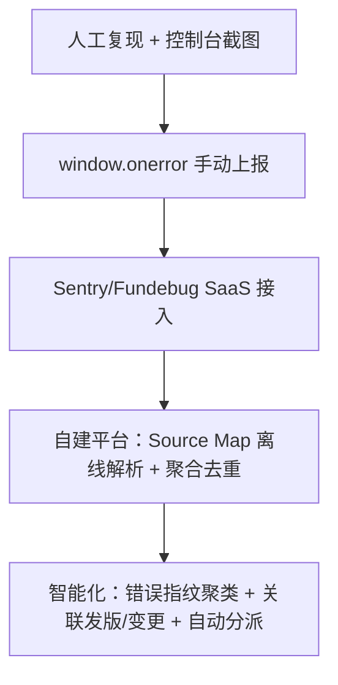
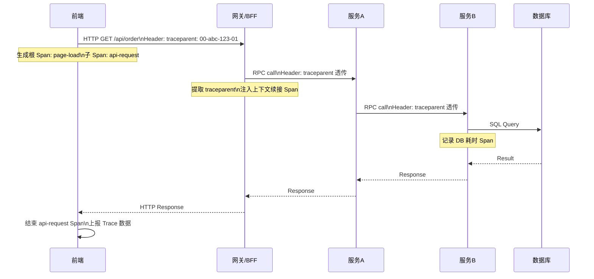
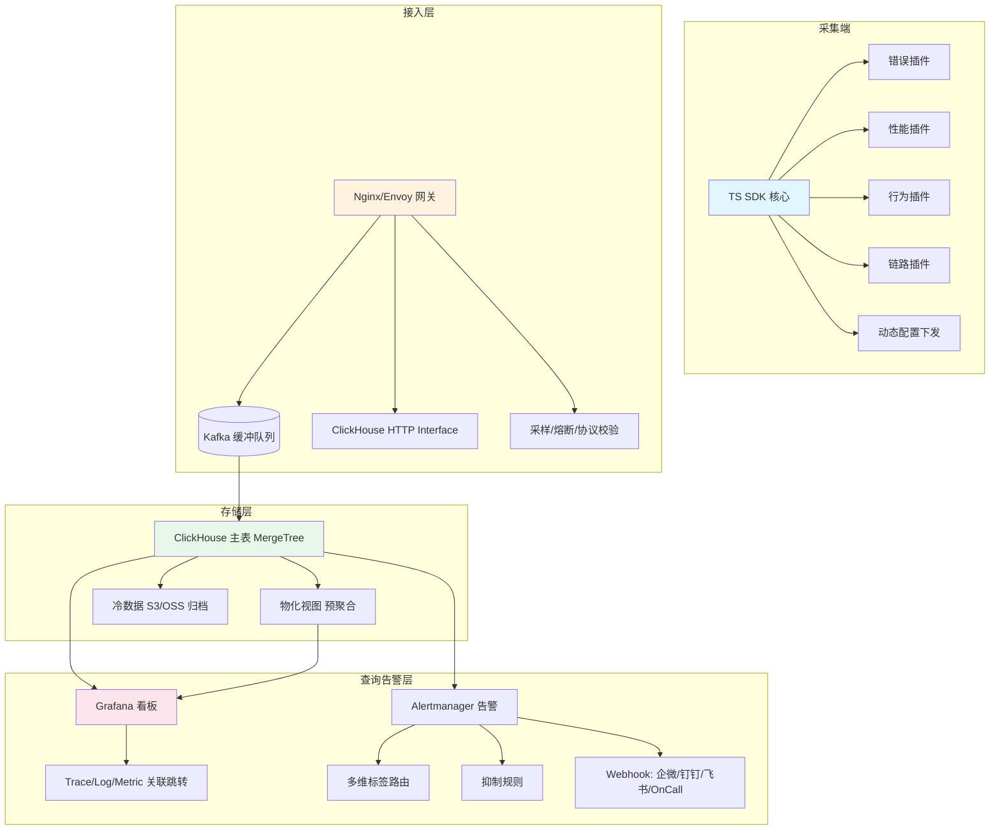

# 第 46 章 前端可观测性与异常监控 —— 从错误捕获到用户行为全链路追踪

## 学习目标

- 理解前端错误监控的全域捕获体系与 Source Map 还原原理
- 掌握基于 Web Vitals 的性能监控 SDK 设计与 Beacon 可靠上报机制
- 了解代码埋点与无痕埋点的优劣对比及事件模型设计规范
- 掌握基于 W3C TraceContext 的前后端链路追踪透传与结构化日志关联方案
- 能设计自研可观测平台的采集-存储-查询-告警全链路技术选型与落地架构

## 46.1 生活类比

想象前端可观测性是一座城市的**智慧交通指挥中心**：**错误监控** = **事故监控摄像头**：全路况覆盖（多层兜底）、自动识别车牌定位肇事车辆、同类事故聚合分析高发路段；**性能监控** = **路况实时大屏**：关键指标量化（LCP/CLS/INP）、资源加载瀑布图如车辆轨迹回放、长任务检测如拥堵预警、Beacon 上报如应急广播不丢包；**用户行为埋点** = **出行大数据分析**：代码埋点如定点计数器精准统计、无痕埋点如全路网感知、会话回放如行车记录仪还原现场、漏斗模型如转化率分析；**链路追踪** = **跨区域协同指挥**：TraceID 如统一调度指令贯穿前后端、Span 如每个路口通行记录、结构化日志如标准化案卷、全链路定位如多部门联合破案；**自研平台** = **自建指挥中枢**：采集端如前端感知设备、存储端如城市大脑数据湖、查询端如指挥大屏、告警端如智能调度系统，实现数据主权与成本可控。

## 46.2 概念地图

前端可观测性体系
├── 错误监控核心
│   ├── 多层兜底捕获  —— P001
│   ├── Source Map 还原  —— P001
│   └── 聚合去重与采样限流  —— P001
├── 性能监控 SDK
│   ├── Web Vitals 采集  —— P002
│   ├── 资源瀑布与长任务检测  —— P002
│   └── Beacon 可靠上报  —— P002
├── 用户行为与业务埋点
│   ├── 事件模型三元组  —— P003
│   ├── 代码埋点 vs 无痕埋点  —— P003
│   └── 会话回放与漏斗分析  —— P003
├── 链路追踪与日志关联
│   ├── TraceID 透传  —— P004
│   ├── 前端根 Span 生成  —— P004
│   └── 结构化日志与统一查询  —— P004
└── 自研可观测平台
├── 采集端：TS SDK + 动态配置  —— P005
├── 存储端：ClickHouse 宽表 + 冷热分离  —— P005
├── 查询端：Grafana 关联跳转  —— P005
└── 告警端：多维标签路由 + 抑制规则  —— P005

## 46.3 错误监控核心 —— 给前端装上“黑匣子”

### 为什么需要这个概念？

前端运行环境不可控（浏览器版本、插件、网络），错误不可避免。用户不会主动反馈，且难以复现现场（控制台信息丢失、源码压缩混淆）。我们需要自动化捕获、聚合、还原源码堆栈，实现“无感知”排查。

### 核心定义

- **全域错误捕获**：覆盖同步代码、Promise/Async 异步、框架错误边界、资源加载失败
- **Source Map 解析**：将压缩混淆后的行列号映射回源码位置（文件/行/列/原始函数名）
- **聚合去重**：基于错误指纹（类型+堆栈顶帧+业务路由）合并同类错误，统计频次与影响用户数

### 关键性质

- **分层兜底**：window.onerror → unhandledrejection → Vue errorHandler / React ErrorBoundary → 框架内部 try-catch
- **采样与限流**：高频错误（如第三方广告脚本报错）需客户端采样上报，防止日志风暴拖垮收集端
- **隐私脱敏**：上报前自动剥离 URL 参数中的 token、PII 字段、Request Body 敏感键

### 典型例子

线上某版本发布后，ErrorBoundary 捕获到 `TypeError: Cannot read property 'map' of undefined`，经 Source Map 还原定位至 `UserList.vue:42` 行 `users.value.map`，发现接口返回 `null` 导致，10 分钟内定位并热修复。

### 边界条件

- 跨域脚本错误（Script error.）无法获取堆栈，需配置 `crossorigin` 响应头
- Source Map 文件体积大、部署位置隐蔽，需构建时上传至对象存储并配置解析服务白名单
- 原生 `Error` 对象在不浏览器序列化时丢失堆栈，需手动提取 `error.stack` 字段

### 概念解析：多层兜底捕获机制

> "实现 `window.onerror`/`unhandledrejection`/Vue `errorHandler`/React `ErrorBoundary` 多层兜底、接入 Sentry/Fundebug 或自建平台解析 Source Map 还原源码堆栈。"
> 
> ——《20230418_046.md》

这段原文揭示了前端错误监控的核心架构思想：**纵深防御**。单一捕获点必然存在盲区，我们必须构建多层次的安全网。你可以把它想象成机场安检：`window.onerror` 是入口安检（捕获同步执行期错误），`unhandledrejection` 是登机口复检（捕获异步 Promise 拒绝），框架级错误边界则是机舱内的最后一道防线（捕获组件渲染期错误）。

**多层兜底捕获架构**（来源：《20230418_046.md》）

```
1. window.onerror              // 捕获同步运行时错误（语法错误、类型错误等）
2. window.unhandledrejection   // 捕获未处理的 Promise.reject
3. Vue.config.errorHandler     // Vue 组件渲染/生命周期/事件处理错误
4. React ErrorBoundary         // React 组件树渲染/生命周期/构造函数错误
5. try-catch 手动包裹          // 关键业务逻辑、第三方 SDK 调用的显式防护
```

这组捕获链路展示了从全局到局部、从同步到异步、从框架无关到框架相关的层层递进覆盖。注意第 5 点虽然不在自动捕获体系内，但在工程实践中是处理“已知风险区”（如支付 SDK、地图组件）的必要补充。

### 概念解析：Source Map 还原原理

当构建工具（Vite/Webpack/Rollup）将 TypeScript/JSX/ESNext 代码编译压缩为产物时，会生成 `.map` 文件。该文件记录了**生成代码位置 → 源码位置**的双向映射关系。

**Source Map 核心字段**（来源：《20230418_046.md》）

| 字段 | 含义 |
|------|------|
| `version` | Source Map 版本（当前为 3） |
| `sources` | 源文件路径列表（相对或绝对） |
| `sourcesContent` | 源文件原始内容（可选，用于离线还原） |
| `mappings` | VLQ 编码的映射数据：生成代码行/列 → 源码文件/行/列/命名 |
| `names` | 变量/函数名列表（用于 mappings 引用） |

**还原流程公式化描述**：

$$
\text{OriginalPosition} = \text{SourceMapConsumer}(\text{GeneratedPosition}, \text{SourceMap})
$$

其中 `GeneratedPosition = { line: number, column: number }` 来自错误堆栈中的行列号。这个公式展示了还原过程的本质：一次**查表操作**。Source Map Consumer（如 `@jridgewell/trace-mapping` 或 `source-map` 库）解析 `mappings` 字段的 VLQ 编码，找到对应的源码位置。

**VLQ 编码简述**：Variable-Length Quantity 变长编码，用 5 位表示数值（符号位+数据位），高位为 1 表示后续字节仍属当前数值。这是为了压缩 `mappings` 体积（通常占 Source Map 90%+ 大小）。

### 方法演进图：错误监控工具链演进



这个演进图展示了从“被动响应”到“主动感知”再到“智能归因”的工程化成熟度跃迁。现代前端可观测性平台的核心竞争力不再是“能不能收到错误”，而是**“能不能在噪音中秒级定位真因”**。

---

## 46.4 性能监控 SDK 设计 —— 让性能指标“可量化、可上报、可追踪”

### 为什么需要这个概念？

体感性能主观且不可度量，需标准化指标（Core Web Vitals）对齐业务目标。手工埋点侵入业务代码、维护成本高，需轻量、无侵入的自动化采集 SDK。上报通道必须可靠（页面卸载不丢失）、低开销（不阻塞主线程）。

### 核心定义

- **Web Vitals 采集**：基于 PerformanceObserver 监听 LCP/CLS/FID/INP/TTFB 等关键指标
- **资源瀑布**：Resource Timing API 采集每个资源的 DNS/TCP/TLS/TTFB/Download 耗时
- **长任务检测**：Long Task API 识别阻塞主线程 >50ms 的任务，归因脚本来源
- **可靠上报**：`navigator.sendBeacon` 或 `fetch(keepalive)` 保证页面卸载前数据送达

### 关键性质

- 零依赖、体积 < 2KB gzip、ESM/UMD 双格式、Tree-shaking 友好
- 采样率可配（如 10% 全量 + 100% 错误用户），支持动态下发采样策略
- 上报批次合并、压缩、重试指数退避，内存队列溢出保护

### 典型例子

SDK 初始化即注入 `performance.mark('app-init')`，路由切换完成 `measure('route-change')`，自动上报 SPA 软导航 LCP 等价指标。

### 边界条件

- PerformanceObserver 不支持的旧浏览器需 Polyfill 或降级采集
- CLS 计算需排除用户主动交互导致的布局偏移（hadRecentInput 标志）
- sendBeacon 有 payload 大小限制（约 64KB），超长日志需分片或降级 localStorage 缓存

### 概念解析：Web Vitals 采集的标准化实现

> "轻量 SDK 设计：`PerformanceObserver` 监听 LCP/CLS/FID/INP、Resource Timing API 采集资源耗时、Long Task API 识别阻塞、`navigator.sendBeacon` 可靠上报。"
> 
> ——《20230418_046.md》

浏览器原生 `PerformanceObserver` 是性能监控的“传感器阵列”。我们不需要手动轮询 `performance.timing`（已废弃），而是订阅特定 `entryType`，浏览器在指标就绪时回调给我们数据。这种**推模式**避免了主线程轮询开销，也是现代性能监控 SDK 的基石。

**核心指标采集映射表**：

| 指标 | entryType | 关键字段 | 业务含义 |
|------|-----------|----------|----------|
| LCP | `largest-contentful-paint` | `startTime`, `element`, `size` | 首屏主内容渲染完成时间 |
| CLS | `layout-shift` | `value`, `hadRecentInput`, `sources` | 视觉稳定性，累积布局偏移分 |
| FID | `first-input` | `processingStart - startTime` | 首次交互响应延迟（已被 INP 取代） |
| INP | `event` | `duration`, `target`, `interactionId` | 所有交互的 98 分位延迟 |
| TTFB | `navigation` | `responseStart - requestStart` | 首字节时间，网络/服务端性能 |

**CLS 计算公式**（排除用户交互导致的偏移）：

$$
\text{CLS} = \sum_{\substack{\text{entry} \in \text{layout-shifts} \\ \text{entry.hadRecentInput} = \text{false}}} \text{entry.value}
$$

这个公式展示了 CLS 的核心逻辑：**只累加非用户主动触发的布局偏移**。`hadRecentInput` 为 true 表示 500ms 内有用户输入（点击/滚动/按键），此时的布局变化属于“预期内”，不计入体感指标。

**INP 采集伪代码**（来源：《20230418_046.md》）

```
1. 创建 PerformanceObserver 监听 'event' 类型
2. 回调中遍历 entries，过滤 interactionId 存在的条目
3. 计算每个交互的 duration = processingEnd - startTime
4. 维护交互耗时数组，上报时取 98 分位数（或简单取最大值近似）
5. 记录交互类型、目标元素选择器（CSS Path）、延迟耗时
```

这段伪代码展示了 INP 采集的关键点：**交互归因**（interactionId）、**耗时计算**、**元素定位**（便于复现）。注意 Safari 旧版本不支持 `event` entryType，需降级使用 `first-input` (FID) 或 Polyfill。

### 概念解析：Beacon 可靠上报机制

页面卸载（关闭标签、跳转、刷新）时，浏览器会终止 JS 执行、切断网络连接。传统 `fetch`/`XMLHttpRequest` 会被取消，导致最后时刻的性能/错误数据丢失。`navigator.sendBeacon(url, data)` 专为场景设计：

- **异步非阻塞**：浏览器在后台发送，不阻塞卸载流程
- **可靠送达**：即使页面已卸载，浏览器仍保证尝试发送
- **Payload 限制**：建议 < 64KB（各浏览器实现不同），超限需分片或本地存储降级

**上报策略决策树**：

```
上报时机 → 数据大小 ≤ 64KB? → 是 → navigator.sendBeacon()
                    ↓ 否
               数据分片 → 并行 sendBeacon() / fetch(keepalive)
                    ↓ 全部失败
               localStorage 缓存 → 下次启动合并上报
```

这个决策树展示了工程化上报的“兜底思维”：主通道、备用通道、本地持久化三层保障。

---

## 46.5 用户行为与业务埋点 —— 从“猜用户想什么”到“看用户做什么”

### 为什么需要这个概念？

产品决策依赖数据而非直觉，需量化用户路径、转化漏斗、功能使用率。代码埋点侵入性强、易漏埋/错埋；无痕埋点覆盖面广但语义弱、噪音大。需要统一事件模型、标准化采集流程、支持会话回放与漏斗分析。

### 核心定义

- **事件模型三元组**：Event（动作：click/submit/view）、Properties（属性：页面/组件/业务ID）、User（身份：匿名ID/登录UID）
- **代码埋点**：业务代码显式调用 `track('event', props)`，语义精准、类型安全
- **无痕埋点**：通过 CSS Selector/XPath 绑定 DOM 事件，配置化下发，零代码侵入
- **会话回放**：rrweb 录制 DOM 变更与用户交互，重现用户操作现场

### 关键性质

- **埋点治理**：建立埋点字典、命名规范、校验规则（CI 阻断未注册事件）、版本管理
- **数据质量**：自动校验必填属性、枚举值合法性、上报成功率监控
- **隐私合规**：GDPR/个保法要求，敏感页面/字段自动脱敏、用户可撤回同意

### 典型例子

电商下单漏斗：`view_product` → `add_cart` → `create_order` → `pay_success`，通过漏斗模型发现 `add_cart` 转化率异常下跌，定位至新版规格选择组件交互 Bug。

### 边界条件

- 无痕埋点在 Shadow DOM、Canvas/WebGL、原生弹窗内失效
- SPA 路由切换需手动触发 `pageview` 事件，避免 PV 统计缺失
- rrweb 录屏数据量大，需按采样率录制、压缩存储、按需回放

### 概念解析：事件模型三元组与数据契约

> "定义事件/属性/用户三元模型、集成 rrweb 实现会话录屏回放、构建转化漏斗模型。"
> 
> ——《20230418_046.md》

标准化的**事件模型**是埋点体系的“通用语言”。没有它，数据仓库就是无法查询的垃圾场。三元组定义了每条埋点数据的最小完整语义：

**事件模型三元组结构**：

```json
{
  "event": "add_cart",           // Event: 标准化动作名，snake_case
  "properties": {                // Properties: 业务上下文
    "product_id": "SKU_12345",
    "category": "electronics",
    "price": 5999,
    "page": "product_detail",
    "component": "sku_selector_v2"
  },
  "user": {                      // User: 身份标识
    "anonymous_id": "a1b2c3d4",
    "user_id": "uid_10086",      // 登录后回填
    "traits": { "vip_level": 3 }
  },
  "context": {                   // Context: 环境信息（自动采集）
    "timestamp": 1700000000000,
    "url": "https://shop.com/item/12345",
    "referrer": "https://search.com",
    "ua": "Mozilla/5.0...",
    "screen": "1920x1080"
  }
}
```

这个结构展示了**语义层**（event/properties/user）与**技术层**（context）的分离。语义层由业务定义，技术层由 SDK 自动注入。这种分离让数据治理成为可能：你可以只管“event 名规不规范”，而不用关心“UA 怎么采集”。

### 多源对照：代码埋点 vs 无痕埋点

不同团队、不同业务阶段对埋点模式的选择往往存在争论。

**共识**：两种模式互补而非互斥，成熟体系通常**混合使用**——核心业务流程（下单、支付、注册）用代码埋点保证准确性；长尾页面、运营活动页、探索性分析用无痕埋点降低接入成本。

**分歧**：

- **代码埋点派**：《20230418_046.md》强调“语义精准、类型安全”，认为无痕埋点维护成本高（DOM 结构变更即失效）、语义模糊（只知道“点击了按钮”，不知道“点击了什么业务按钮”）。
- **无痕埋点派**：主张“零侵入、全量采集、快速试错”，认为代码埋点开发成本高、发版周期长、易漏埋，且无痕埋点配合“可视化圈选”可补齐语义。
- **折中派**：采用**混合模式 + 埋点字典治理**。字典是唯一事实来源，代码埋点从字典生成 TS 类型（编译期保障），无痕埋点从字典下发配置（运行期绑定），CI 校验两者一致性。

### 方法演进图：埋点技术演进路线

```mermaid
graph LR
    A[手工插桩 track()] --> B[可视化圈选/无痕埋点]
    B --> C[埋点字典 + 类型安全代码埋点]
    C --> D[混合模式：核心代码埋点 + 长尾无痕 + 字典治理]
    D --> E[智能埋点：AI 辅助圈选 + 自动化回归校验 + 实时数据质量监控]
```

---

## 46.6 链路追踪与日志关联 —— 打通前后端的“神经中枢”

### 为什么需要这个概念？

单纯前端报错无法定位是前端逻辑、BFF 聚合、下游微服务还是数据库慢查询导致。请求链路跨进程、跨语言、跨网络边界，缺乏统一 TraceID 串联。需要前后端统一日志格式、链路透传、统一查询平台，实现“全链路定位”。

### 核心定义

- **Trace Context 透传**：HTTP Header 传递 `traceparent` (W3C TraceContext 标准) 或 `trace-id`/`span-id`
- **前端生成根 Span**：页面加载/路由切换/XHR-Fetch 发起时创建根 Span，子 Span 记录资源加载、组件渲染、API 请求
- **后端续接**：网关/偏入层提取 Header 注入上下文，下游微服务继承传递
- **结构化日志**：统一 JSON 格式（timestamp/level/traceId/spanId/message/context），接入 ELK/Grafana Loki

### 关键性质

- **采样决策**：前端按比例采样（如 1/1000），错误/慢请求 100% 采样；Header 标记 `sampled=true` 通知后端全量采集
- **跨域限制**：第三方域名请求无法读写 Header，需代理层转发或接受断链
- **时钟同步**：前端 `performance.now()` 相对时间戳需映射到服务端绝对时间，便于跨端对齐

### 典型例子

用户反馈“提交订单转圈 10s”，前端 Trace 显示 `fetch('/api/order')` 耗时 9.8s，点击 Span 跳转至后端链路，发现 `inventory-service` 数据库锁等待 8s，定位至未加索引的 `sku_lock` 表。

### 边界条件

- 旧版浏览器不支持 `fetch` 拦截器，需重写 `XMLHttpRequest.prototype.send` 实现 Header 注入
- 日志量巨大，需按 TraceID 分片存储、建立倒排索引、配置 TTL 降本
- 微服务调用深度过大导致 Span 栈溢出，需限制最大嵌套层级或采用异步上报

### 概念解析：W3C TraceContext 标准与前端落地

> "HTTP Header 透传 `trace-id`、`span-id`，前端生成根 Span、后端续接，统一 JSON 格式日志接入 Loki，实现“前端报错 → 后端调用链 → 数据库慢查询”全链路定位。"
> 
> ——《20230418_046.md》

W3C TraceContext 定义了标准 Header `traceparent`，格式为：

```
traceparent: 00-<trace-id>-<parent-span-id>-<trace-flags>
```

- `version`：00（当前版本）
- `trace-id`：32 位十六进制，全链路唯一标识
- `parent-span-id`：16 位十六进制，当前 Span 的父 ID
- `trace-flags`：01 表示 sampled（采样），00 表示不采样

**前端 TraceID 生成与透传算法**（来源：《20230418_046.md》）

```
1. 页面初始化：生成 trace-id (16 字节随机)、span-id (8 字节随机)
2. 决策采样：按配置采样率决定 trace-flags (01/00)
3. 写入 localStorage：同标签页会话保持 trace-id，刷新不变
4. 重写 fetch/XHR：请求前读取 traceparent，注入 Header
5. 响应后：可选读取响应 Header 中的 tracestate 更新上下文
6. 创建根 Span：page-load / route-change / api-request
7. 子 Span 栈管理：startSpan() 压栈，endSpan() 出栈上报
```

这个算法展示了前端作为**链路发起端**的核心职责：生成全局唯一 TraceID、决定采样策略、透传上下文、生成本地 Span 树。

**Span 数据模型**：

```typescript
interface Span {
  traceId: string;           // 关联全链路
  spanId: string;            // 当前 Span 唯一标识
  parentSpanId: string | null; // 父 Span ID，根 Span 为 null
  name: string;              // 如 'fetch:/api/order', 'render:UserList'
  kind: 'client' | 'internal'; // client=网络请求, internal=内部计算
  startTime: number;         // performance.now() 相对时间戳(ms)
  endTime: number;           // 结束时间戳
  duration: number;          // 耗时 ms
  status: 'ok' | 'error' | 'timeout';
  attributes: Record<string, any>; // 业务属性：url, method, statusCode, component...
  events: SpanEvent[];       // 关键事件：log, error, annotation
}
```

### 数据流图：前后端链路打通



这个时序图展示了 **TraceID 如何像“接力棒”一样在分布式系统中传递**。前端是起跑者，网关是第一棒交接点，微服务依次传递。关键点在于：网关必须**提取**前端 Header 并**注入**到下游 RPC 上下文，而非生成新的 TraceID。

---

## 46.7 自研可观测平台建设 —— 从“用工具”到“造平台”

### 为什么需要这个概念？

SaaS 方案（Sentry/Datadog）成本随数据量指数增长，数据合规要求私有化部署。业务指标（转化率、GMV）与技术指标（错误率、LCP）割裂，需统一度量看板。告警风暴与通知疲劳，需多维标签聚合、动态阈值、分级路由。

### 核心定义

- **采集端**：TypeScript/Rollup 打包 SDK，支持动态配置下发、插件化扩展（错误/性能/行为/链路）
- **接入层**：Nginx/Envoy 网关 + Kafka/ClickHouse HTTP Interface 缓冲写入，支持高并发写入
- **存储层**：ClickHouse 宽表存储（MergeTree 分区+TTL），冷热分离对象存储归档
- **查询/可视化**：Grafana Dashboard 模版化、Drill-down 钻取、Trace/Log/Metric 关联跳转
- **告警端**：Alertmanager + 多维标签路由（团队/服务/严重级）、抑制规则、自动恢复通知

### 关键性质

- **多租户隔离**：团队/项目级数据权限、资源配额、独立看板空间
- **成本控制**：采样率动态调整、列压缩编码、预聚合物化视图加速常用查询
- **扩展性**：OpenTelemetry 协议兼容、自定义指标上报、Webhook 对接企业微信/钉钉/飞书/OnCall

### 典型例子

双十一大促前，配置“错误率 > 1% 且影响用户 > 100”动态阈值告警，触发时自动关联发版记录、变更日志、关联 Trace，10 分钟内定位至某第三方支付 SDK 版本回归 Bug。

### 边界条件

- ClickHouse 单表写入 QPS 瓶颈，需分库分表或引入 Kafka Engine 缓冲
- 高基数标签（如 UserID、SessionID）不可建索引，仅用于过滤，需预聚合降维
- SDK 版本碎片化导致上报协议不兼容，需制定协议版本策略、网关侧做协议适配转换

### 架构分层图：自研可观测平台四层架构



这个架构图展示了**数据流向**与**职责边界**：采集端只负责“采什么、怎么采”，接入层负责“抗压、清洗、路由”，存储层负责“写快、查快、存得久、存得省”，查询告警层负责“看得见、查得透、吵得准”。

### 设计中的取舍

**为什么不用 Elasticsearch 而选 ClickHouse？**

ES 在全文检索、日志分析上极强，但**时序指标聚合查询**（如“按分钟聚合错误率”、“P95 LCP 趋势”）性能远弱于 ClickHouse。可观测平台 80%+ 查询是**聚合分析**（Group By + Count/Sum/Quantile），ClickHouse 列式存储+向量化执行+预聚合物化视图是天然契合。且 CH 单节点写入吞吐可达百万行/秒，成本仅为 ES 的 1/3~1/5。

**这种设计的 trade-off 是什么？**

- **牺牲**：全文检索能力变弱（CH 无倒排索引），复杂文本搜索需配合 ES 或倒排插件
- **收益**：聚合查询快 10-100 倍、存储压缩比 5-10x、硬件成本降 60%+、SQL 兼容学习成本低

---

## 46.8 动手练习

- **错误监控实战：手写一个简易的全域错误捕获与上报类**
  - 要求实现一个 `ErrorMonitor` 类，包含以下能力：
  - 1. 捕获同步错误
  - 2. 捕获 Promise 未处理拒绝
  - 3. 捕获资源加载错误
  - 4. 集成 Vue/React 错误边界（伪代码即可）
  - 5. 生成错误指纹（类型+堆栈顶帧+当前路由）
  - 6. 使用 `navigator.sendBeacon` 上报，包含采样率控制
  - 思考题：
    - 如何解决跨域脚本 `Script error.` 无堆栈问题？
    - Source Map 文件通常不部署在 CDN，前端 SDK 如何在上报时辅助后端还原？
    - 高频错误（如第三方广告 SDK 报错）如何在不丢失核心业务错误的前提下限流？

- **性能监控实战：基于 PerformanceObserver 采集 Core Web Vitals**
  - 编写一个 `PerfCollector` 模块，完成：
  - 1. 监听 LCP、CLS、FID、INP、TTFB
  - 2. CLS 计算需排除 `hadRecentInput` 为 true 的布局偏移
  - 3. INP 需记录交互类型、目标元素选择器、延迟耗时
  - 4. 资源瀑布：筛选出耗时 > 500ms 的资源，上报其 initiatorType 和 timing 明细
  - 5. 长任务检测：记录任务耗时、启动时间、归属脚本 URL
  - 6. 所有指标打包，页面卸载时通过 `sendBeacon` 上报
  - 思考题：
    - SPA 应用中路由切换如何重新计算 LCP/CLS 等价指标？
    - `PerformanceObserver` 在 Safari 旧版本中不支持 LCP/INP，如何 Polyfill 或降级？
    - 采样率 10% 时，如何保证慢页面（LCP > 4s）100% 上报？

- **埋点体系设计：从事件字典到自动化校验**
  - 设计一套埋点治理方案：
  - 1. 定义事件字典 JSON Schema：包含事件名、必填属性、属性类型、枚举值、版本、负责人
  - 2. 代码埋点类型安全：基于字典生成 TypeScript 类型定义，`track<EventName>(props)` 编译期报错
  - 3. 无痕埋点配置下发：CSS Selector 绑定事件、属性提取规则、采样率
  - 4. CI 校验流水线：检查代码中埋点调用是否在字典注册、属性是否齐全、命名规范
  - 5. 数据质量监控：上报成功率、必填属性缺失率、枚举值非法率仪表盘
  - 思考题：
    - 如何在不修改业务代码的情况下，为老项目增量接入类型安全埋点？
    - Shadow DOM / Canvas / 视频播放器内的交互无法通过无痕埋点捕获，如何补齐？
    - rrweb 会话回放数据量巨大，如何设计『按需录制 + 增量快照 + 按需回放』的存储策略？

- **链路追踪实战：前端 TraceID 生成、透传与 Span 埋点**
  - 实现一个轻量 `Tracer` 库：
  - 1. 页面初始化生成 `trace-id`、`span-id`，写入 `localStorage` 实现同标签页会话保持
  - 2. 重写 `fetch`/`XMLHttpRequest`，自动注入 `traceparent` Header
  - 3. 封装 `startSpan(name, attrs?)` / `endSpan()`，支持嵌套 Span 栈管理
  - 4. 自动创建根 Span：`page-load`、`route-change`、`api-request`
  - 5. Span 结束时自动上报至收集端，包含耗时、状态码、错误信息
  - 6. 采样决策：Header `traceparent: 00-<trace-id>-<span-id>-01` 标记 sampled=true
  - 思考题：
    - 跨域请求无法读写 Header，如何通过代理层或 `document.domain` 等方案透传 TraceID？
    - 前端 `performance.now()` 相对时间戳如何与后端绝对时间戳对齐？
    - 微服务调用链路过深导致 Span 层级过多，前端如何压缩上报（如只上报关键 Span）？

- **可观测平台架构评审：技术选型与容量规划**
  - 假设日活 500 万，PV 2 亿，错误上报峰值 5 万/秒，Trace 上报峰值 20 万/秒：
  - 1. 采集端：SDK 体积预算 2KB gzip，如何做到 Tree-shaking 按需加载错误/性能/行为/链路四大模块？
  - 2. 接入层：Nginx + Lua 或 Envoy 做协议校验、采样决策、批量转发 Kafka，如何设计 Kafka Topic 分区数与 Partition Key？
  - 3. 存储层：ClickHouse 宽表设计（MergeTree 分区键、TTL、预聚合物化视图），单表写入 QPS 如何支撑峰值？
  - 4. 查询层：Grafana Dashboard 模版变量设计（服务/版本/环境/地域），如何实现 Trace/Log/Metric 三维关联跳转？
  - 5. 告警层：配置『错误率 > 1% 且影响用户 > 100』多维告警，如何避免发版瞬间的抖动误报？
  - 6. 成本优化：高基数标签（user_id/session_id）不建索引，如何通过预聚合降维实现『按用户维度查询错误分布』？
  - 思考题：
    - SaaS 方案（Sentry/Datadog）成本随数据量指数增长，自建平台 ROI 临界点在哪里？
    - 数据合规要求『数据不出园区』，自建平台如何对接 OpenTelemetry 生态实现厂商无关？
    - SDK 版本碎片化导致上报协议不兼容，网关层如何做协议适配转换与版本灰度？

## 46.9 本章小结

这一章中我们学习了前端可观测性体系的完整建设路径。首先我们攻克了错误监控核心，建立了多层兜底捕获、Source Map 还原与聚合去重的“黑匣子”机制；其次我们设计了轻量级性能监控 SDK，基于 PerformanceObserver 采集 Web Vitals 核心指标，配合 Beacon 可靠上报解决卸载丢包难题；接着我们构建了统一的用户行为埋点体系，对比代码埋点与无痕埋点优劣，确立事件模型三元组标准，并引入会话回放与漏斗分析赋能业务决策；然后我们打通了前后端链路追踪，基于 W3C TraceContext 标准实现 TraceID 透传、根 Span 生成与结构化日志关联，实现“前端报错 → 后端调用链 → 数据库慢查询”全链路定位；最后我们落地了自研可观测平台四层架构，完成采集端、接入层、存储层、查询告警层的技术选型与工程化实践，解决多租户隔离、成本控制、高基数标签降维、动态告警抑制等生产级挑战。

本章我们一起学习了以下概念：

| 概念 | 解释 |
|------|------|
| 多层兜底捕获 | window.onerror/unhandledrejection/框架错误边界层层兜底，实现全域错误零遗漏 |
| Source Map 还原 | 将压缩混淆代码的行列号映射回源码位置，还原真实报错上下文 |
| 聚合去重与采样限流 | 基于错误指纹合并同类错误，高频错误客户端采样防止日志风暴 |
| Web Vitals 采集 | 基于 PerformanceObserver 监听 LCP/CLS/FID/INP/TTFB 等核心体感指标 |
| 资源瀑布与长任务检测 | Resource Timing API 采集资源耗时，Long Task API 识别 >50ms 主线程阻塞 |
| Beacon 可靠上报 | navigator.sendBeacon/fetch keepalive 保证页面卸载前数据不丢失 |
| 事件模型三元组 | Event（动作）、Properties（属性）、User（身份）构建标准化埋点数据模型 |
| 代码埋点 vs 无痕埋点 | 代码埋点语义精准类型安全，无痕埋点零侵入覆盖面广但语义弱需配置治理 |
| 会话回放与漏斗分析 | rrweb 录制 DOM 变更还原现场，多步事件序列量化转化率与流失节点 |
| TraceID 透传 | HTTP Header 传递 traceparent/span-id 打通前后端调用链，W3C TraceContext 标准化 |
| 前端根 Span 生成 | 页面加载/路由切换/网络请求创建根 Span，子 Span 记录渲染/资源/API 细节 |
| 结构化日志与统一查询 | 统一 JSON 格式接入 Loki/ELK，实现 Trace/Log/Metric 三维关联跳转 |
| 自研平台四层架构 | 采集端/接入层/存储层/查询告警端，技术选型 TS SDK + ClickHouse + Grafana + Alertmanager |
| 多租户与成本控制 | 团队级数据隔离、列压缩/预聚合降本、高基数标签降维处理 |
| 动态告警策略 | 多维标签路由、抑制规则、自动恢复通知、关联发版变更记录快速定责 |

下一章中，我们将学习跨端开发技术选型与架构演进 —— 从 Hybrid/小程序到 React Native/Flutter/Uni-app，全景扫描主流跨端方案架构原理、渲染机制、生态成熟度，提供基于团队技术栈与业务形态的决策框架与混合栈共存实践。
