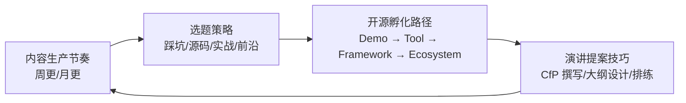
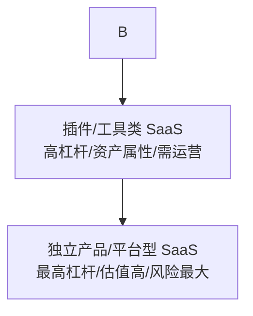
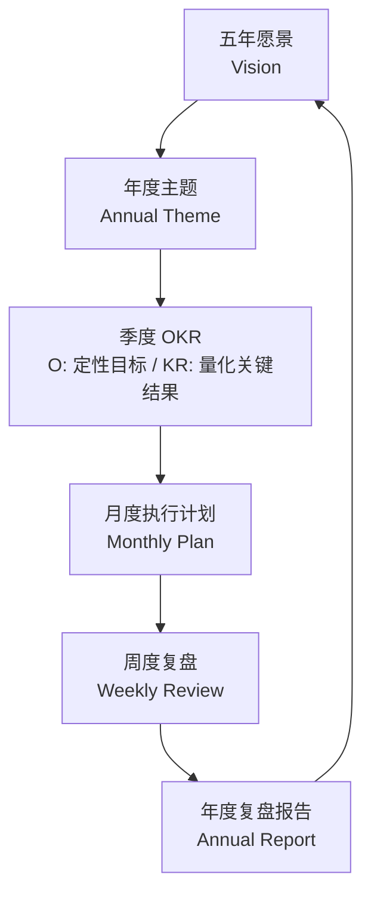

# 第 22 章 前端工程师职业成长路径 —— 从技术深度到影响力构建与技术变现
作者：龙哥

## 学习目标

- 建立前端工程师分阶段的能力雷达图，明确各阶段在业务交付、技术深度、工程效能、团队协作、影响力五维度的量化期望值
- 掌握晋升答辩核心素材包的结构化构建方法：业务价值量化、技术难点拆解、复用推广案例、规范建设成果
- 理解技术影响力复利模型，制定内容生产节奏、选题策略、开源项目孵化路径与演讲提案技巧
- 对比技术管理（EM）与技术专家（IC）双通道的核心能力模型差异，设计6个月转型验证计划与试岗策略
- 掌握技术变现MVP验证路径：从咨询/模版变现到课程/插件/独立产品的阶梯式探索与合规边界
- 构建个人《技术成长五年规划》与《季度OKR复盘模版》，建立愿景-年度主题-季度OKR-月度计划-周度复盘的PDCA闭环操作系统

## 22.1 生活类比

想象职业成长是一场《文明》系列策略游戏：**成长阶段模型** = **科技树与时代进阶**：从部落时代（初级）到信息时代（专家），每个时代解锁新建筑（能力维度），需满足人口（业绩）、科技点（技术深度）、文化（影响力）多维指标才能进阶；**技术影响力构建** = **建立世界奇观与贸易路线**：博客/开源是“金字塔”“大图书馆”，持续产出文化/科技溢出收益；开源项目是“丝绸之路”，连接外部文明获取资源（机会/认可）；**双通道抉择** = **选择“统治者”还是“伟大科学家/工程师”路线**：统治者（EM）管城市（团队）、调度资源、外交（跨部门）；科学家（IC）攻关核心科技（疑难杂症）、制定蓝图（标准）、辐射文明（赋能）；**技术变现路径** = **发展副业产业链**：用主城（主业）盈余资源，先建低成本贸易站（咨询/模版），再建工厂（课程/插件），最终建立殖民地（独立产品/SaaS）实现资源自给自足；**个人成长操作系统** = **游戏内的“顾问面板”与“胜利条件”设定**：五年愿景=胜利条件（科技/文化/征服胜利）；季度OKR=每回合政策调整；周复盘=回合结束结算；PDCA=根据局势动态调整战略。

## 22.2 概念地图

前端工程师职业成长路径
├── 成长阶段模型 —— P001
│   ├── 五维度能力雷达（业务交付/技术深度/工程效能/团队协作/影响力）
│   ├── 五阶段定义（初/中/高/专家/资深专家）与量化行为锚点
│   ├── 晋升答辩素材包结构（业务价值/技术难点/复用推广/规范建设）
│   └── 边界条件（年限≠阶级、维度不平衡、组织语境校准）
├── 技术影响力构建 —— P002
│   ├── 五大渠道（技术博客/开源项目/技术分享/专利论文/社区运营）
│   ├── 复利模型（内容生产节奏 → 选题策略 → 开源孵化路径 → 演讲提案）
│   ├── 关键性质（长尾效应/信任传递/复利杠杆）
│   └── 边界条件（拒绝伪输出/脱敏抽象/不挤占核心交付）
├── 双通道抉择与转型 —— P003
│   ├── EM vs IC 核心能力模型对比（管人/项目/流程 vs 技术前瞻/攻关/标准/赋能）
│   ├── 试岗策略（内部轮岗/导师制/6个月验证计划OKR/退出机制）
│   ├── 关键性质（可逆性/互补性/组织语境相关性）
│   └── 边界条件（组织天花板/薪资波动/架构师头衔模糊性）
├── 技术变现路径探索 —— P004
│   ├── MVP验证阶梯（咨询/模版 → 课程/专栏 → 独立产品/SaaS）
│   ├── 协同飞轮（咨询案例库 → 课程素材 → 插件需求 → SaaS种子用户）
│   ├── 合规红线（竞业协议/IP归属/数据安全/通用技能优先）
│   └── 边界条件（法律风险/失败率>90%/非唯一经济支柱）
└── 个人成长操作系统 —— P005
    ├── 五年规划分层（愿景 → 年度主题 → 季度OKR → 月度计划 → 周度复盘 → 年度报告）
    ├── 核心工件（季度OKR设定会/周度复盘会/年度复盘报告三资产盘点）
    ├── 关键性质（PDCA闭环/聚焦性OKR/抗脆弱缓冲带）
    └── 边界条件（OKR非KPI/工具洁癖/生命全维度纳入）

## 22.3 成长阶段模型 —— 给职业进阶装上“导航仪”

### 22.3.1 为什么需要这个概念？

你是否常陷入“只会写业务代码”的迷茫？当面试官问“你的核心竞争力是什么”时，你能否给出结构化回答？企业晋升答辩本质是“能力对标”，却常因缺乏统一坐标系而变成流水账比拼。行业缺乏标准化的能力雷达定义，导致跳槽面试、薪资谈判缺乏客观依据。我们需要一套**可度量、可对标、可复用**的职业坐标系。

### 22.3.2 核心定义

> "定义各阶段在业务交付/技术深度/工程效能/团队协作/影响力五维度的期望值、整理晋升答辩 PPT 结构（业务价值/技术难点/复用推广/规范建设）。"
> 
> ——《YE1FdsTuxoaBbNx4f5dcnSNenxb.md》

**成长阶段模型**将职业生涯划分为五大阶段：**初级、中级、高级、专家、资深专家**。每个阶段在以下五个维度设定量化期望值：

1.  **业务交付**：从“完成指派任务”到“定义业务边界与技术战略”。
2.  **技术深度**：从“熟练使用框架 API”到“构建领域基础设施/制定行业标准”。
3.  **工程效能**：从“遵守规范”到“建设工程化体系/研发效能平台”。
4.  **团队协作**：从“配合完成”到“跨部门技术攻关/人才梯队建设”。
5.  **影响力**：从“团队内分享”到“社区生态建设/行业话语权”。

**晋升答辩素材包**标准化结构：
- **业务价值量化**：用数字说话（GMV、PV、转化率提升、成本下降）。
- **技术难点拆解**：采用 STAR 法则（Situation/Task/Action/Result），还原攻关全景。
- **复用推广案例**：组件库/脚手架/规范的覆盖范围与收益测算。
- **规范建设成果**：代码规范、评审机制、CI/CD 门禁的落地与效能提升。

### 22.3.3 关键性质

- **阶梯性**：高阶能力**包含**低阶能力并叠加新维度。初级是“执行者”，中级是“独立模块负责人”，高级是“复杂系统架构师”，专家是“技术战略制定者”，资深专家是“生态建设者”。
- **正交性**：五维度相对独立。避免“技术极强但协作为零”导致的模糊判定，晋升要求“无短板”达标。
- **可度量性**：拒绝“熟悉性能优化”这类模糊描述，要求**可观测行为锚点**。例如：
    - ❌ 熟悉性能优化
    - ✅ 主导过首屏加载从 3s 优化至 1s 以下的项目，输出《性能优化实战指南》被 3 个业务组复用

### 22.3.4 典型例子

| 阶段 | 业务交付 | 技术深度 | 工程效能 | 团队协作 | 影响力 |
| :--- | :--- | :--- | :--- | :--- | :--- |
| **初级** | 在导师指导下完成单模块开发，修复指派 Bug | 掌握 Vue/React 基础 API、CSS 布局、基础 TS 类型 | 遵守团队 ESLint/Prettier 规范，会跑构建/部署流程 | 按时参会、及时回复、配合联调 | 团队内周会分享 1 次/季度 |
| **中级** | 独立负责中型项目（如后台管理系统重构），跨端适配 | 深入理解框架原理（响应式/虚拟 DOM/调度器），能排查疑难杂症 | 搭建项目级脚手架，引入单测/E2E 体系，优化构建速度 30%+ | 指导 1-2 名新人，主导模块级 Code Review | 部门级技术分享 1 次/半年，输出 2 篇深度复盘 |
| **高级** | 主导复杂系统重构（微前端落地、中台化拆分），技术选型决策者 | 构建通用基础设施（组件库/请求库/监控 SDK），攻克疑难性能/稳定性问题 | 建设团队级工程化体系（Monorepo/CI/CD/研发效能看板），人均效能提升 20%+ | 跨团队技术攻关牵头人，建立新人培养体系/导师制 | 公司级/社区大会分享，开源项目获 500+ Star，专利申请 |
| **专家** | 制定前端技术战略（如 AI 原生应用架构/多端统一技术栈），ROI 论证 | 攻克领域前沿难题（如 Wasm 渲染引擎/信号响应式框架/边缘计算），定义技术标准 | 建设公司级/行业级研发效能平台/基础设施，驱动全链路度量体系 | 跨部门/跨 BU 技术委员会成员，人才梯队规划与晋升委员会成员 | 行业技术雷达制定者，核心开源项目 Maintainer，受邀国际会议 Keynote |
| **资深专家** | 定义行业技术演进方向，参与 W3C/TC39 标准制定，技术商业化落地 | 创造新范式/新基建（如 React 级框架/新语言运行时），解决“从 0 到 1”原创性问题 | 孵化新业务线/新技术品牌，建立生态合作伙伴网络 | 培养出多位专家/总监，构建技术人才供应链 | 行业意见领袖，技术社区核心治理者，拥有独立商业影响力 |

### 22.3.5 边界条件

1.  **年限 ≠ 阶级**：部分工程师 5 年仍处于初级（重复 1 年经验 5 次），也有 3 年冲到高级的“加速跑者”。**行为锚点**是唯一硬指标。
2.  **维度不平衡**：允许“尖刀型”人才存在（如技术极强、业务一般），但晋升通常要求“无短板”达标线。
3.  **组织语境校准**：初创公司“高级”可能等同大厂“中级”；To B 业务重工程化，To C 业务重体验/性能。对标时需结合公司规模、业务阶段、技术栈成熟度校准。

## 22.4 技术影响力构建 —— 从“闷声干活”到“被动被看见”

### 22.4.1 为什么需要这个概念？

技术能力若不外化，组织无法感知，晋升、加薪、话语权均受限。传统“写博客”往往坚持不下或无人问津，缺乏系统性运营方法论。影响力是**复利资产**，越早布局边际收益越高，是打破“35 岁危机”的核心护城河。

### 22.4.2 核心定义

> "制定内容生产节奏（周更/月更）、选题策略（踩坑复盘/源码解析/最佳实践/前沿解读）、开源项目孵化路径（Demo→Tool→Framework→Ecosystem）、演讲提案技巧。"
> 
> ——《YE1FdsTuxoaBbNx4f5dcnSNenxb.md》

技术影响力构建通过**五大渠道**持续输出：
1.  **技术博客/专栏**：深度复盘、源码解析、最佳实践、前沿解读。
2.  **开源项目**：从工具库到框架再到生态的孵化路径。
3.  **技术分享**：公司内部分享、社区 Meetup、行业大会（QCon/GMTC/React Conf 等）。
4.  **专利/论文**：防御性专利布局、顶会论文投递。
5.  **社区运营**：技术群/社区/Newsletter 运营，建立私域流量池。

遵循**复利模型**四步走：

### 22.4.3 关键性质

- **长尾效应**：一篇深度源码解析文章可能持续 3 年引流（SEO/被引用），边际收益远超十篇追热点短文。**时间换空间**，内容即资产。
- **信任传递**：开源项目 Star 数、分享 PPT 下载量、专栏订阅数，是比简历更硬的“能力货币”。它们证明了**“别人愿意为你的认知买单”**。
- **复利杠杆**：单次内容产出可衍生为视频、课程、直播、咨询、插件多形态变现。**一份源码分析 → 1 篇博客 + 1 个 Demo 仓库 + 1 场内部分享 + 1 节付费课程素材**。

### 22.4.4 典型例子

**案例：微前端改造全景复盘**
1.  **工作产出顺手整理**：主导公司微前端改造，记录决策矩阵、qiankun/Module Federation 选型对比、沙箱隔离踩坑、性能优化数据。
2.  **博客系列化**：《微前端落地避坑指南（上/中/下）》发布至掘金/个人博客，半年阅读量 5w+。
3.  **开源孵化**：抽离通用脚手架 `@enterprise/micro-app-starter` 开源，获 800+ Star，被 10+ 公司生产环境使用。
4.  **大会分享**：受邀 GMTC 分享《大规模微前端架构演进》，PPT 开源获 2k+ 下载。
5.  **晋升/跳槽核心谈资**：答辩/面试时直接甩链接，“这是我主导的项目，这是社区验证的影响力”。

### 22.4.5 边界条件

1.  **拒绝“伪输出”**：单纯转发资讯、堆砌 API 文档、水群打卡无助于建立专家人设。**只输出“经过大脑加工”的内容**。
2.  **脱敏抽象**：公司机密/核心代码不可公开。掌握“脱敏抽象”写作技巧：将具体业务代码抽象为通用模式，数据脱敏、逻辑通用化。
3.  **不挤占核心交付**：影响力建设不能挤占核心业务交付时间。建议**“工作产出顺手整理”**而非“额外造轮子”。下班后的 1 小时写作，源于白天 8 小时的深度思考。

## 22.5 双通道抉择与转型 —— 管理与专家的“双向奔赴”

### 22.5.1 为什么需要这个概念？

高级工程师面临“继续钻技术”还是“带团队”的十字路口，盲目选择易导致职业倦怠。企业虽设双通道，但 IC（Individual Contributor）晋升路径往往不如管理清晰，缺乏转型验证机制。核心能力模型差异巨大：**EM 管人/项目/流程/招聘/文化**，**IC 管技术前瞻/攻关/标准/赋能**，混淆两者会“两头不讨好”。

### 22.5.2 核心定义

> "对比 EM（人/项目/流程/招聘/文化）与 IC（技术前瞻/攻关/标准/赋能）能力模型、申请内部轮岗/导师制体验异己路径、制定 6 个月转型验证计划。"
> 
> ——《YE1FdsTuxoaBbNx4f5dcnSNenxb.md》

**EM vs IC 核心能力模型对比**：

| 能力维度 | Engineering Manager (EM) | Individual Contributor (IC / Staff+) |
| :--- | :--- | :--- |
| **核心交付物** | 团队绩效、项目交付率、人才密度 | 技术方案、架构标准、核心难题攻关、基础设施 |
| **人/项目/流程** | 绩效面谈、职业规划、招聘/离职、团队文化建设 | 技术指导、Code Review 标准制定、技术文档沉淀 |
| **技术前瞻/攻关** | 判断技术可行性、资源协调、风险兜底 | **亲自下场**攻克疑难杂症、原创性技术突破 |
| **标准/赋能** | 执行公司级规范、推广最佳实践 | **制定**公司级/行业级标准、建设通用基建赋能业务 |
| **影响力半径** | 团队/部门/跨职能协作 | 技术社区/跨 BU 技术委员会/行业标准组织 |

**试岗策略与 6 个月转型验证计划**：
1.  **内部轮岗/导师制**：申请“技术领头羊”轮岗（验证 IC）或“带 2-3 人实习生/外包组”（验证 EM）。
2.  **设定验证 OKR**：
    - **验证 EM**：项目按时交付率 > 95%、成员成长（如 1 人晋升/转正）、产出 1 份团队流程规范。
    - **验证 IC**：产出 1 份技术选型白皮书、推广覆盖 3+ 业务组、核心性能指标提升 30%+。
3.  **定义退出机制**：若 6 个月末 OKR 完成度 < 50% 或强烈不适感，**无损回归原赛道**，不记录负面绩效。

### 22.5.3 关键性质

- **可逆性**：转型非一锤定音，建立“试错-评估-回滚/深化”的缓冲机制。**低成本试错**是核心原则。
- **互补性**：优秀 EM 需懂技术判断可行性，优秀 IC 需懂业务推动落地。纯粹单极极难走远。**T 型/π 型**人才是终极形态。
- **组织语境相关性**：业务高速扩张期缺 EM，技术攻关攻坚期缺 IC。需结合公司阶段决策，而非单纯个人偏好。

### 22.5.4 典型例子

**案例 A：强行转管理的反面教材**
某技术大牛因“晋升必须带人”压力转 EM。不擅长绩效面谈、冲突调解、招聘 JD 撰写。团队半年离职率飙升 40%，项目延期。最终申请回归 IC 赛道，损失半年且信心受挫。**教训：未经验证盲目转型，代价高昂。**

**案例 B：低成本验证 IC 的正面教材**
高级工程师申请“技术领头羊”轮岗，负责跨团队组件库选型标准制定。6 个月产出《前端技术选型白皮书》，推动 5 个业务组统一升级，构建通用组件库 `@enterprise/ui` 并开源。验证 IC 适配性后顺利晋升 Staff Engineer。**关键：有明确交付物、有时间盒、有退出机制。**

### 22.5.5 边界条件

1.  **组织天花板**：并非所有公司真正落地双通道。部分“专家岗”实为“高级码农”，无预算、无话语权、无跨团队影响力。入职/晋升前需通过 JD、历史晋升案例、薪资带位验证。
2.  **薪资波动**：转型期薪资/绩效可能波动（如 EM 绩效挂团队业绩，IC 绩效挂技术产出）。需做好半年以上财务/心理预案。
3.  **“架构师”头衔模糊**：可能偏向 EM（管人/管项目）或 IC（管技术/管标准）。入职前需明确 JD：**是否有直接下属？绩效考核权归谁？技术决策最终裁决权归谁？**

## 22.6 技术变现路径探索 —— 让技能生出“第二曲线”

### 22.6.1 为什么需要这个概念？

单一薪资收入抗风险能力弱，裁员/降薪/行业周期下行时无缓冲。许多工程师有变现念头但陷入“完美主义陷阱”：想做完美课程、完美产品，结果从未开始。变现本身是检验技术商业价值的最佳试金石，倒逼提升产品思维、运营思维、用户同理心。

### 22.6.2 核心定义

> "最小化验证 MVP：技术咨询单次收费、小册预售验证需求、Gumroad 销售数字化产品、Chrome 插件/Figma Plugin/Notion 模版变现、独立产品 MRR 增长模型。"
> 
> ——《YE1FdsTuxoaBbNx4f5dcnSNenxb.md》

基于 **MVP（最小可行性产品）思维**的验证阶梯：

**核心逻辑**：低成本试错 → 快速获得正反馈（真金白银/真实用户） → 迭代扩大规模，而非大批量投入再求收益。

### 22.6.3 关键性质

- **阶梯性**：
    - **L1 咨询/模版/插件**：换时间换钱，上限低、启动快、现金流正。如：代码审计咨询、Notion 面试复盘模版、VS Code 片段插件。
    - **L2 课程/专栏/小册**：一次制作多次售卖，杠杆高。需先**预售验证需求**（如掘金小册预售 100 份再录制）。
    - **L3 独立产品/SaaS**：资产属性强、估值高、可复利。需跑通 **MRR（月度经常性收入）增长模型**：`MRR = 用户数 × ARPU - 流失`。
- **协同飞轮**：
    - 技术咨询积累**案例库** → 沉淀为**课程素材** → 学员反馈催生**插件需求** → 插件用户转化为 **SaaS 种子用户** → SaaS 反哺咨询权重。
- **合规性（红线）**：
    - 严守**竞业协议**、**IP 归属条款**、**数据安全红线**。
    - 优先做**“通用技能/工具类”**（如：脚手架、通用组件、效率插件、通用最佳实践课程），**不碰“业务逻辑类”**（如：具体电商下单流程、某公司私有架构方案）。

### 22.6.4 典型例子

**案例 1：VS Code 插件“接口自动生成器”**
- **起因**：日常开发手写 TS 接口繁琐。
- **MVP**：周末开发 Demo，支持 Swagger/OpenAPI URL 一键生成 TS 类型 + Request 封装代码。
- **发布**：发布至 VS Code Marketplace，免费增值模式（基础功能免费，团队协作/私有云同步收费）。
- **结果**：月活 2000+，付费转化 3%，月收入 $2000+。后衍生出团队版卖给中小厂，MRR 破万。

**案例 2：掘金小册《前端架构设计实战》**
- **预售验证**：大纲 + 试读章发布预售，目标 100 份，实际 500 份，**验证通过**。
- **交付**：分 4 个月录制/更新，配套 GitHub 仓库可运行代码。
- **收益**：年收入超主业薪资 30%，建立“架构方向”个人 IP，带动咨询/面试辅导副业。

### 22.6.5 边界条件

1.  **法律红线**：切勿触碰核心业务代码/数据/客户资源红线，**法律风险 > 收益**。公司电脑/时间/网络不碰副业项目。
2.  **高失败率**：独立开发产品失败率 > 90%，必须接受“亏本学运营”心理预期，**切勿裸辞创业**。
3.  **非唯一支柱**：变现收入波动大，不可作为唯一家庭经济支柱。建议**“主业稳健 + 副业探索”双轨并行**。

## 22.7 个人成长操作系统 —— 用 OKR 驾驭不确定的五年

### 22.7.1 为什么需要这个概念？

职业发展周期长（5-10 年），靠“冲动/运气/被动机会”驱动极不稳定。年度目标常年“年初立 Flag、年底躺平”，缺乏季度复盘、月度拆解、周度执行的落地机制。你需要一套**“个人操作系统”**，将模糊愿景转化为可执行、可度量、可迭代的工程化流程。

### 22.7.2 核心定义

> "输出五年愿景、年度主题、季度 OKR（Objective/Key Results）、月度执行计划、周度复盘模版、年度复盘报告，建立持续进化的个人操作系统。"
> 
> ——《YE1FdsTuxoaBbNx4f5dcnSNenxb.md》

**五层规划分层**：

**核心工件（三大资产盘点）**：
1.  **季度 OKR 设定会**：每季度初 2 小时，回顾上季度，设定本季度 O/KR。
2.  **周度复盘会**：每周日 30 分钟，填写“本周完成/受阻原因/下周 Top 3/需协调资源”。
3.  **年度复盘报告（三资产盘点）**：
    - **技术资产**：代码仓库/技术文档/专利/开源贡献/核心项目复盘。
    - **影响力资产**：粉丝数/Star 数/受邀分享/专栏收入/社区职位。
    - **财务资产**：主业薪资/副业收入/投资收益/被动收入占比。

### 22.7.3 关键性质

- **闭环性（PDCA 微循环嵌套宏循环）**：
    - **Plan**：季度 OKR 设定、月度拆解。
    - **Do**：周度执行、每日待办。
    - **Check**：周度复盘、季度复盘。
    - **Act**：调整下季度 OKR、修正年度主题。
- **聚焦性（少即是多）**：OKR 强制“少即是多”，**每季度最多 3 个 O，每个 O 最多 3-5 个 KR**，防止贪多嚼不烂。KR 必须可量化（数字/比例/里程碑事件）。
- **抗脆弱性（缓冲带）**：预设“黑天鹅缓冲带”（预留 20% 时间应对突发项目/家庭变故/健康问题），允许目标动态调整而非僵化考核。**OKR 完成度 70% 即为成功**（挑战性目标），100% 说明目标定低了。

### 22.7.4 典型例子

**某前端工程师的第 1 年规划实录**：

- **五年愿景**：成为“前端工程化/智能化方向”的领域专家并拥有独立变现产品（MRR $5k+）。
- **年度主题（第 1 年）**：夯实工程化底座，打造个人影响力极简模型。
- **Q1 OKR**：
    - **O1**：搭建企业级脚手架开源项目，建立“工程化”专家人设。
        - KR1：核心功能上线并文档化。
        - KR2：GitHub Star 破 100。
        - KR3：输出 3 篇配套实战文章（脚手架设计/插件机制/Monorepo 实战）。
    - **O2**：完成《Vue 3 组合式 API 设计模式》专栏预售验证。
        - KR1：大纲完成并预售 50 份。
        - KR2：录制前 3 章试读版。
- **周复盘模版（每周日 20:00-20:30）**：
    - 本周完成了什么？（列出 3-5 项 Done）
    - 受阻原因？（技术卡点/精力不足/优先级被插队）
    - 下周 Top 3 重心？（只做最重要的 3 件事）
    - 需协调资源？（需领导批准/跨部门配合/购买工具/家人支持）
- **年度复盘报告（三资产盘点）**：
    - 技术资产：开源脚手架 500 Star、3 个核心组件库 PR merged、1 项实用新型专利受理。
    - 影响力资产：掘金粉丝 +3000、受邀 1 次技术大会分享、专栏预售收入 ¥15k。
    - 财务资产：主业薪资 ¥50w、副业收入 ¥5w、基金定投收益 ¥1w。

### 22.7.5 边界条件

1.  **OKR ≠ KPI**：完成度 70% 即为成功（挑战性目标），100% 说明目标定低了。**不可绩效挂钩惩罚**，否则退化为 KPI，失去挑战性。
2.  **避免“工具洁癖”**：Notion/Obsidian/Excel/纸笔均可，核心是**思维框架**而非软件。不要花 1 个月折腾模版、数据库、自动化，先跑通 1 个季度闭环。
3.  **生命全维度纳入**：家庭/健康/财务/社交等非技术维度同样需纳入生命 OKR，防止“技术牛人、生活失意”。例如：O3“构建健康体魄” - KR1“体脂率降至 18%”、KR2“周均运动 3 次”、KR3“年度体检无异常”。

## 22.8 多源对照

本章核心观点主要基于素材 `YE1FdsTuxoaBbNx4f5dcnSNenxb.md` 构建。由于该素材为单一来源，暂无多源对照冲突。若引入《程序员的职业生涯指南》、《软技能》、《高产程序员》等经典职业规划文献，可在以下维度形成互补与校验：

### 共识

- **阶段模型必要性**：主流职业指南均主张建立显性的阶段/能力模型（如《职场地图》的 P 序列/M 序列）。
- **影响力即资产**：“个人品牌/影响力”是跨周期的核心资产，长尾效应显著。
- **双通道分离**：EM 与 IC 能力模型本质不同，强行互转风险极高，需试错验证。
- **OKR 适用性**：OKR 作为个人目标管理工具，强调聚焦、挑战性、分离绩效考核，业界共识。

### 分歧

- **变现激进度**：本章主张“主业稳健+副业探索”双轨，部分文献（如《副业致富》）主张更激进的“全职创业/裸辞验证”，风险收益比截然不同。
- **开源必要性**：本章将开源视为影响力核心渠道；部分观点认为“闭源商业项目/内部基建”同等甚至更能证明商业价值，开源非必选项。
- **规划颗粒度**：本章提倡周度复盘、季度 OKR；部分敏捷个人管理流派（如 GTD）主张更高频次的“下一行动”清单，而非固定周期的 OKR。

## 22.9 设计中的取舍

### 为什么不用“年限/职级”作为唯一坐标，而要引入“五维度能力雷达”？

**年限/职级**是组织行政管理的产物，**能力雷达**是市场/价值交换的通用货币。
- 年限易作弊（摸鱼 5 年 = 1 年经验 × 5），职级不通用（大厂 P7 ≠ 小厂总监）。
- 五维度雷达**可跨组织对标**，面试/跳槽/自由职业时皆可复用。
- **Trade-off**：雷达维护成本高（需定期自省/校准），年限/职级获取成本低（看合同/工牌）。**建议：内部用职级，对外/长期用雷达。**

### 为什么不建议“全职创业/裸辞做独立开发”作为变现首选？

**全职创业**是“All-in”赌局，**副业 MVP 验证**是“小注试水”实验。
- 独立产品失败率 > 90%，全职创业失败成本是“收入归零+职业空窗+心理创伤”。
- MVP 验证成本仅为“周末时间+域名服务器费”，失败仅损失沉没时间，成功可平滑过渡。
- **Trade-off**：全职创业时间充裕、专注度高、上限高；副业验证抗风险、可迭代、但推进慢。**建议：PMF（产品市场匹配）验证通过、MRR 覆盖生活费 6 个月前，不全职。**

### 为什么 OKR 完成度 70% 即为成功，而非 100%？

**100% 完成度 = 目标定低了（保底目标）**，**70% 完成度 = 挑战性目标（Stretch Goal）的合理区间**。
- OKR 核心功能是**“聚焦最重要的事”**和**“激发潜能”**，而非“考核完成率”。
- 若绩效挂钩 100%，人性会趋向设定保底目标，系统失去张力。
- **Trade-off**：70% 机制需组织/自我文化成熟度支撑，否则易被误读为“执行力差/不靠谱”。**个人系统中必须显性约定：OKR 不挂钩奖惩，仅作导航复盘。**

## 22.10 动手练习

### 练习 1：绘制个人能力雷达图与差距分析

1. 参考五维度（业务交付、技术深度、工程效能、团队协作、影响力）定义，为自己当前阶段（如中级→高级）在每个维度打分（1-10分）。
2. 列出目标阶段（如高级）在每个维度的 3 个可观测行为锚点（如：主导过年 PV>100万项目、输出过通用组件库、指导过 2 名新人）。
3. 对比差距，制定本季度针对性提升计划（每个维度最多 1 个行动项）。
4. 回答问题：
   - 哪个维度是你的“短板”？是否会成为晋升阻碍？
   - 如何将“熟悉性能优化”转化为可度量的行为锚点？

### 练习 2：设计个人技术影响力“最小可行性内容产出” (MVCP) 计划

1. 选择 1 个你最擅长的细分技术领域（如：Vue 响应式原理、微前端落地、CI/CD 优化）。
2. 制定未来 3 个月的内容生产节奏：每月 1 篇深度复盘/源码解析/最佳实践文章，发布至掘金/博客/GitHub。
3. 设计 1 个开源项目孵化路径：Demo(周末原型) → Tool(解决团队痛点) → Framework(抽象通用) 的里程碑节点。
4. 回答问题：
   - 如何确保内容产出不挤占核心业务交付时间？（提示：工作产出顺手整理）
   - 文章/项目发布后，如何追踪“长尾效应”与“信任传递”指标？

### 练习 3：双通道试岗验证方案设计

1. 假设你处于高级工程师阶段，面临 EM/IC 抉择。为自己设计一份“6 个月转型验证计划”。
2. 若倾向 EM：申请带 2-3 人实习生/外包小组，设定 OKR（如：项目按时交付率、成员成长、流程规范产出）。
3. 若倾向 IC：申请“技术领头羊”角色，主导跨团队技术选型/重构/标准制定，设定 OKR（如：白皮书产出、推广覆盖率、性能指标提升）。
4. 定义“退出机制”：若 6 个月末 OKR 完成度<50%或强烈不适感，如何无损回归原赛道？
5. 回答问题：
   - 你所在组织是否真正落地双通道？如何通过 JD/晋升案例/薪资带位验证？
   - EM 与 IC 的“互补性”在你身上如何体现？缺失哪一极会导致职业天花板？

### 练习 4：技术变现 MVP 预售验证实战

1. 基于你的技术栈优势，构思 1 个数字化产品创意（如：VS Code 插件、Notion 模版库、付费小册大纲、Figma 插件）。
2. 完成 MVP 预售验证：制作 Landing Page/预售文档，发布至技术社区/朋友圈，设定“预售 10 份/收集 50 份留资”为通过线。
3. 若通过，制定正式交付计划；若未通过，复盘是“需求假”、“分发渠道假”还是“定价假”，并决定 Kill 或 Pivot。
4. 回答问题：
   - 如何确保变现内容不触碰公司竞业协议/IP 红线？（提示：通用技能/工具类 vs 业务逻辑类）
   - 独立产品 MRR 增长模型的核心驱动变量有哪些？（获客成本 CAC、生命周期价值 LTV、流失率 Churn Rate）

### 练习 5：搭建个人《季度 OKR 复盘模版》并执行首轮

1. 在 Notion/Obsidian/Excel 中建立模版，包含：五年愿景、年度主题、本季度 O(最多 3 个)/KR(每 O 3-5 个、可量化)、月度拆解、周度复盘记录区、年度三资产盘点表。
2. 设定下一季度 OKR（示例：O1：夯实工程化底座 → KR1: 脚手架核心功能上线并文档化；KR2: Star 破 100；KR3: 输出 3 篇实战文章）。
3. 执行首周周度复盘：填写“本周完成/受阻原因/下周 Top 3/需协调资源”。
4. 回答问题：
   - 为什么 OKR 完成度 70% 即为成功？若连续两季度 100% 达成，说明了什么？
   - 如何将“技术资产盘点”（如 GitHub 仓库/技术文档/专利）量化纳入年度复盘报告？

## 22.11 本章小结

这一章中我们系统规划了前端工程师全周期成长路线。首先我们建立了**成长阶段模型**，用五维度能力雷达替代模糊年限，配套标准化晋升答辩素材包，让进阶有据可依。其次我们拆解了**技术影响力复利模型**，明确博客/开源/分享/专利/社区五渠道联动路径，强调长尾效应与信任传递。接着我们对比了**双通道抉择 (EM vs IC)** 的核心能力模型差异，提供 6 个月试岗验证机制与可逆转型路径。然后我们探索了**技术变现 MVP 阶梯**，从咨询/模版到课程/插件再到独立产品，核心是低成本试错与合规红线。最后我们构建了**个人成长操作系统 (OKR/PDCA)**，将五年愿景拆解为季度 OKR、月度计划、周度复盘的嵌套闭环，含技术/影响力/财务三资产盘点。

本章我们一起学习了以下概念：

| 概念 | 解释 |
|------|------|
| 成长阶段模型 | 五阶段×五维度能力雷达，用量化行为锚点替代模糊年限，配套标准化晋升答辩素材包 |
| 技术影响力复利模型 | 博客/开源/分享/专利/社区五渠道联动，遵循“节奏-选题-孵化-演讲”路径，建立长尾资产与信任货币 |
| 双通道抉择 (EM vs IC) | EM管人/项目/流程/招聘/文化，IC管技术前瞻/攻关/标准/赋能，提供6个月试岗验证机制与可逆转型路径 |
| 技术变现MVP阶梯 | 咨询/模版（低杠杆快启动）→ 课程/专栏（高杠杆可复制）→ 独立产品/SaaS（资产属性强），核心是低成本试错与合规红线 |
| 个人成长操作系统 (OKR/PDCA) | 五年愿景→年度主题→季度OKR(O/KR)→月度计划→周度复盘→年度报告，嵌套PDCA微循环，含技术/影响力/财务三资产盘点 |
| 晋升答辩素材包 | 结构化证据集：业务价值量化(数字)、技术难点拆解(STAR)、复用推广案例(范围)、规范建设成果(标准) |
| 开源孵化路径 | Demo(验证想法) → Tool(解决痛点) → Framework(建立标准) → Ecosystem(构建生态)，每阶段对应影响力跃迁 |
| 转型验证计划 | 6个月周期，设定OKR、关键动作清单、退出机制，通过“技术领头羊”轮岗等低风险方式验证IC/EM适配性 |
| 抗脆弱缓冲带 | 预留20%时间应对黑天鹅，允许目标动态调整，OKR完成度70%即成功，防止僵化考核导致系统崩溃 |
| 三资产盘点 | 年度复盘核心工件：技术资产(代码/文档/专利)、影响力资产(粉丝/Star/受邀)、财务资产(主业/副业/投资) |

感谢你读到了这里，恭喜你，你已经完成了《前端工程师进阶全景图谱》全书 24 章的学习旅程。从提示工程基石到大模型推理对齐，从前端工程化基建到图形渲染/WebAssembly 前沿，从 AI 原生应用架构到认知重塑与教材工程化，我们一起构建了一个跨越“应用层-模型层-基础设施层-认知层”的完整知识体系。

**这不是终点，而是起点。**

真正的成长发生在**合上书本、打开编辑器、面对真实业务复杂度、在不确定性中做决策、在失败中复盘迭代**的每一天。愿你手中的“导航仪”（能力雷达）、“奇观”（影响力资产）、“双通道选择权”、“第二曲线收入”、“个人操作系统”陪伴你穿越周期，抵达你定义的彼岸。

**保持好奇，持续构建，我们下个版本见。**
