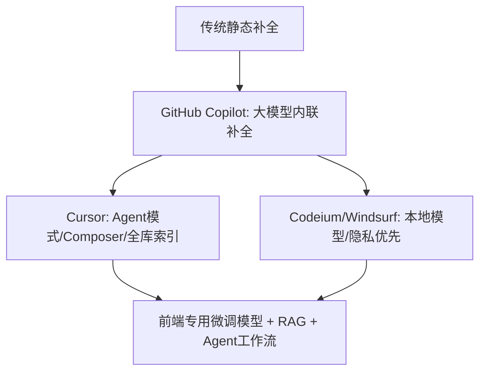

# 第 17 章 前端智能化与 AI 编程辅助 —— 从 Copilot 到 RAG 知识库与 Agent 工作流
作者：龙哥

## 学习目标

- 理解 AI 编程助手从补全工具向结对程序员演进的核心范式转变
- 掌握前端私有知识库 RAG 系统的工程化落地全流程（AST 切片、混合检索、重排序、溯源）
- 理解基于 LangGraph/AutoGen 等框架的 Agent 多角色协作编排与状态机流转机制
- 掌握前端专用模型微调的数据工程、LoRA 训练配置与评测体系构建方法
- 能够设计并落地 AI Code Review 机器人，实现规范检查、安全扫描、单测生成的自动化质量红线
- 掌握前端工程化中 AI 辅助开发的完整工具链选型与提示词工程最佳实践
- 理解上下文工程在长上下文窗口下的裁剪策略与检索精度优化
- 掌握 AI Code Review 中多模型协作分级路由与结构化输出的工程化落地
- 理解模型微调中继续预训练、SFT、DPO/ORPO 的协同机制与灾难性遗忘缓解策略
- 建立前端智能化研发效能的量化评估体系（采纳率、修改率、通过率、假阳性率）
- 掌握前端代码库 RAG 中增量索引策略与 Git Hooks/CI 自动化更新机制
- 理解 AI 编程助手在隐私合规场景下的本地模型部署与零保留模式选型
- 掌握 Agent 工作流中上下文压缩、沙箱隔离、权限最小化等工程化安全边界
- 理解前端专用模型微调中 Replay Buffer、通用代码数据混合比例的灾难性遗忘缓解实操
- 掌握 AI Code Review 反馈闭环中负样本采集、Prompt 优化、自动化微调流水线的治理体系
- 掌握 AI 编程助手在前端框架/类型系统/样式/测试生成能力差异的评测方法
- 理解提示词工程模式在 AI 编程助手中的应用与长上下文裁剪策略
- 掌握 Tree-sitter 解析 AST 切片、Embedding 模型选型、Milvus/Chroma 向量库、Hybrid Search 的实操细节
- 理解引用源码行号溯源在 RAG 系统中的幻觉控制机制
- 掌握基于 LangGraph/AutoGen 编排多 Agent 的工具调用、状态机流转、人工审批检查点设计
- 理解继续预训练、指令微调、RLHF 对齐在前端专用模型构建中的协同流程
- 掌握 HumanEval-MBPP 前端子集、TypeScript 类型正确率等评测基准的构建方法
- 理解 GitHub Action 触发 PR Review、结构化评审意见输出、ESLint/TypeCheck 结果集成的自动化流程
- 掌握自动生成单测草案供开发者确认的工程化实现路径

## 17.1 生活类比

想象前端团队引入 AI 是一次“新员工入职与晋升”的完整过程：AI 编程助手 = 实习生：手里拿着通用技能手册（预训练模型），能写样板代码、查语法，但不懂业务规范、不认识内部组件库，需时刻监督（Inline Chat/补全）。RAG 知识库 = 入职导师手册 + 代码库地图：把私有组件库、架构文档、历史 ADR 切片索引好，实习生遇到不会的“查手册”，不再瞎猜，还能指引到具体文件行号（溯源）。Agent 工作流 = 资深工程师：给一个 Issue（需求），能自主拆解任务（Planner）、写代码（Coder）、跑测试（Tester）、自查 Bug（Reviewer），只在关键节点找你批准（人工介入点）。模型微调 = 内部晋升培训/肌肉记忆形成：把团队最佳实践、代码规范、独特模式“练”进模型权重里，变成“不看文档也能写出符合规范代码”的专家级员工。AI Code Review = 自动化质检闸机 + 初级 Reviewer：PR 一提交，瞬间扫描格式、安全、性能、测试覆盖，把确定性错误拦在门外，只把架构决策、业务逻辑留给人类专家把关。增量索引机制 = 每日站会同步进度：代码推送即触发向量库更新，保证实习生查阅的永远是最新版“手册”，不踩旧坑。隐私合规部署 = 离线工作模式：核心代码不出内网，实习生在本地沙箱干活，产出只交付成果物，零数据泄露风险。Agent 安全边界 = 权限分级管理：实习生只有读写工作目录权限，危险命令需主管审批，生产环境隔离“防火墙”。灾难性遗忘缓解 = 复习旧知识 + 学新知识：微调时混入通用代码数据、保留 Replay Buffer，防止“只会新框架、忘了基础语法”。反馈闭环治理 = 绩效复盘机制：“Not Helpful” 标记自动入库，定期微调 Prompt/模型，把假阳性率从 15% 降到 5% 以下，建立信任红线。

## 17.2 概念地图

前端智能化与 AI 编程辅助
├── AI 编程助手现状
│   ├── 模型能力梯队（开源 vs 闭源）  —— HgjLdWdxHo8ezoxv9iLc4HSwnAh.md
│   ├── 上下文工程策略（检索/裁剪/符号索引）  —— HgjLdWdxHo8ezoxv9iLc4HSwnAh.md
│   ├── 交互范式演进（Inline/Chat/Agent）  —— HgjLdWdxHo8ezoxv9iLc4HSwnAh.md
│   └── 主流工具对比  —— HgjLdWdxHo8ezoxv9iLc4HSwnAh.md
├── RAG 知识库落地
│   ├── 代码切片策略  —— HgjLdWdxHo8ezoxv9iLc4HSwnAh.md
│   ├── Embedding 模型选型  —— HgjLdWdxHo8ezoxv9iLc4HSwnAh.md
│   ├── 混合检索与重排序  —— HgjLdWdxHo8ezoxv9iLc4HSwnAh.md
│   ├── 溯源引用与幻觉控制  —— HgjLdWdxHo8ezoxv9iLc4HSwnAh.md
│   └── 增量索引与 Git Hooks 自动化  —— HgjLdWdxHo8ezoxv9iLc4HSwnAh.md
├── Agent 工作流自动化
│   ├── 多角色分工  —— HgjLdWdxHo8ezoxv9iLc4HSwnAh.md
│   ├── 状态机流转与人工介入点  —— HgjLdWdxHo8ezoxv9iLc4HSwnAh.md
│   ├── 工具集成生态  —— HgjLdWdxHo8ezoxv9iLc4HSwnAh.md
│   ├── 编排框架选型  —— HgjLdWdxHo8ezoxv9iLc4HSwnAh.md
│   ├── 上下文压缩与历史摘要  —— HgjLdWdxHo8ezoxv9iLc4HSwnAh.md
│   ├── 沙箱隔离与权限最小化  —— HgjLdWdxHo8ezoxv9iLc4HSwnAh.md
│   └── 成本预算与熔断机制  —— HgjLdWdxHo8ezoxv9iLc4HSwnAh.md
├── 前端专用模型微调
│   ├── 继续预训练与指令微调  —— HgjLdWdxHo8ezoxv9iLc4HSwnAh.md
│   ├── LoRA 低秩适配配置  —— HgjLdWdxHo8ezoxv9iLc4HSwnAh.md
│   ├── 对齐训练（DPO/ORPO）  —— HgjLdWdxHo8ezoxv9iLc4HSwnAh.md
│   ├── 评测基准体系  —— HgjLdWdxHo8ezoxv9iLc4HSwnAh.md
│   ├── 灾难性遗忘缓解（Replay Buffer/通用数据混合）  —— HgjLdWdxHo8ezoxv9iLc4HSwnAh.md
│   └── 本地模型部署与零保留模式  —— HgjLdWdxHo8ezoxv9iLc4HSwnAh.md
└── AI Code Review 机器人
    ├── 触发机制与上下文构建  —— HgjLdWdxHo8ezoxv9iLc4HSwnAh.md
    ├── 多模型协作分级  —— HgjLdWdxHo8ezoxv9iLc4HSwnAh.md
    ├── 结构化输出与单测生成  —— HgjLdWdxHo8ezoxv9iLc4HSwnAh.md
    └── 反馈闭环与假阳性治理  —— HgjLdWdxHo8ezoxv9iLc4HSwnAh.md

## 17.3 AI 编程助手现状 —— 从补全工具到结对程序员

### 为什么需要这个概念？

前端研发面临框架更新快、样式调试繁、类型系统复杂等高认知负荷场景。传统 IDE 补全仅基于静态分析，无法理解业务意图与上下文语义。我们需要一种能生成样板代码、解释报错、编写测试、甚至重构架构的智能副驾。

> "浅谈 ChatGPT 在跨境电商的应用场景和机会，分享我们团队在过去几个月里，在跨境电商上使用 ChatGPT 的一些经验"
> 
> ——《HgjLdWdxHo8ezoxv9iLc4HSwnAh.md》

### 核心定义

**AI 编程助手**（来源：《HgjLdWdxHo8ezoxv9iLc4HSwnAh.md》）

> 定义：基于大语言模型（LLM），集成于 IDE/编辑器中，通过上下文感知提供代码生成、补全、重构、问答、测试生成等全生命周期辅助能力的工具。

核心差异维度：
- 模型能力（推理/代码理解）
- 上下文窗口大小
- 上下文构建策略（检索/裁剪）
- 交互范式（Inline Chat/Chat Panel/CMD+K）
- 工具链集成度（终端/浏览器/数据库）

### 关键性质与多源对照

不同论文和工具对“AI 编程助手的核心能力边界”给出了不同侧重。

**共识**：上下文工程是决定体验上限的关键，主流工具均采用“最近文件+语义检索+符号索引+用户选中”混合策略。

**分歧**：

- 《HgjLdWdxHo8ezoxv9iLc4HSwnAh.md》强调**模型能力梯队**的差异：CodeLlama/StarCoder 等开源模型与 GPT-4o/Claude 3.5 Sonnet 等闭源模型在前端任务（TS 类型推导、CSS 布局、Vue/React 组件生成）上存在显著能力差距。
- 业界实践（Cursor/Windsurf）则更强调**交互范式演进**的价值：从被动补全 → 主动对话 → Agent 模式（自主规划-执行-验证闭环），认为工程化的交互设计能弥补模型能力的部分不足。

### 典型例子与工具选型矩阵

以下是主流工具在核心维度上的能力对比（来源：《HgjLdWdxHo8ezoxv9iLc4HSwnAh.md》整理）：

| 维度 | GitHub Copilot | Cursor | Codeium / Windsurf |
|------|----------------|--------|-------------------|
| **核心模型** | OpenAI Codex / GPT-4o | GPT-4o / Claude 3.5 Sonnet (可选) | 自研模型 / GPT-4o / 本地模型 |
| **交互范式** | Inline 补全为主，Chat 面板非原生 | **原生 Composer (多文件)**, Cmd+K 内联编辑, @Codebase 语义检索 | 补全/聊天/命令面板，支持本地推理 |
| **上下文工程** | 近期文件 + 语义索引 (有限) | **全库语义索引 + 符号索引 + 文件引用 (@file)** | 上下文感知 + 本地索引 |
| **隐私合规** | 企业版零保留策略 | 隐私模式，数据不训练 | **强项：支持完全本地部署/零保留** |
| **前端特化能力** | TS/JS 强，框架知识依赖预训练 | **@Codebase 精准检索私有组件库/类型** | 规则引擎约束生成风格 |

**选型建议**：
- 追求极致体验、依赖私有组件库检索：首选 **Cursor**。
- 追求隐私合规、本地化部署、免费额度：首选 **Codeium/Windsurf**。
- 团队深度绑定 GitHub 生态、微软合规体系：首选 **Copilot Enterprise**。

### 边界条件与风险控制

1. **幻觉风险**：生成不存在的 API、编造 TypeScript 类型、引用已废弃的库版本。
2. **上下文污染**：无关文件检索噪声导致模型跑偏，需依赖 `.gitignore`/`.cursorignore` 等机制隔离。
3. **隐私合规**：代码上传云端训练/推理风险，金融/政企需部署本地模型或使用零保留模式。
4. **成本控制**：闭源模型按 Token 计费，大规模团队需评估 ROI，开源模型需算力投入。



## 17.4 RAG 在前端知识库落地 —— 让 AI 读懂你的私有代码库

### 为什么需要这个概念？

通用大模型不知晓私有业务组件库、内部设计系统、架构规范、历史决策记录（ADR）。直接喂给模型全量代码超出窗口且 Token 成本高，且噪声干扰推理质量。我们需要精准检索相关代码片段、文档、配置作为上下文注入，实现“领域专家级”回答。

> "实战：Tree-sitter 解析 AST 切片、Embedding 模型选型、Milvus/Chroma 向量库、Hybrid Search（稀疏+稠密）、引用源码行号溯源。"
> 
> ——《HgjLdWdxHo8ezoxv9iLc4HSwnAh.md》

### 核心定义

**代码库 RAG**（来源：《HgjLdWdxHo8ezoxv9iLc4HSwnAh.md》）

> 定义：面向代码仓库的检索增强生成系统，核心流程为“代码解析切片 → 向量化嵌入 → 向量库存储 → 混合检索 → 重排序 → 上下文注入 → 生成回答”。

关键差异点：代码具有严格语法结构（AST）、强依赖关系（Import/Call Graph）、高频更新（增量索引）、多语言混合（TS/JS/CSS/HTML/GraphQL）。

### 关键流程详解：从 AST 切片到溯源引用

#### 1. 代码切片策略：Tree-sitter AST 语义切片

传统的固定长度分块会破坏函数、类的语法完整性。代码 RAG 必须基于 AST 进行语义单元切片。

**切片单元定义**（来源：《HgjLdWdxHo8ezoxv9iLc4HSwnAh.md》）：

- **切片粒度**：函数/类/组件/Interface/Type Alias/Enum/导出常量。
- **元数据附带**：文件路径、起止行号、符号名、父级作用域、依赖导入列表、调用图邻居。

**伪代码实现**：

```python
# 伪代码：基于 Tree-sitter 的 TypeScript/Vue 切片器
def slice_codebase(repo_path: str) -> List[CodeChunk]:
    parser = Parser(Language('typescript')) # 支持 TSX/Vue SFC script 块
    chunks = []
    for file_path in glob(f"{repo_path}/**/*.ts") + glob(f"{repo_path}/**/*.vue"):
        if is_excluded(file_path): continue # 排除 node_modules, dist, .d.ts
        tree = parser.parse(read_file(file_path))
        # 遍历 AST 提取顶层声明节点
        for node in tree.root_node.children:
            if node.type in TARGET_NODE_TYPES: # function_declaration, class_declaration, interface_declaration, export_statement
                chunk_text = extract_node_text(node)
                metadata = {
                    "file_path": file_path,
                    "start_line": node.start_point.row + 1,
                    "end_line": node.end_point.row + 1,
                    "symbol_name": get_symbol_name(node),
                    "imports": get_imports(node),
                    "node_type": node.type
                }
                chunks.append(CodeChunk(text=chunk_text, metadata=metadata))
    return chunks
```

**这个切片策略展示了**：保留语法完整性是代码检索的前提；元数据中的行号与文件路径是后续“溯源引用”的物理基础；依赖导入列表可用于构建调用图，辅助跨文件上下文扩展。

#### 2. Embedding 模型选型：代码专用 vs 通用文本

代码检索对标识符、符号、语法结构极其敏感，通用文本 Embedding 模型（如 text-embedding-ada-002, bge-large-zh）在代码语义空间表现不佳。

**对比实验建议**（来源：《HgjLdWdxHo8ezoxv9iLc4HSwnAh.md》）：

| 模型 | 维度 | 适用场景 | TypeScript/Vue 召回表现 |
|------|------|----------|------------------------|
| **voyage-code-2** | 1536 | 商业闭源，SOTA 代码检索 | **最佳**，对符号/泛型/JSX 理解深 |
| **jina-embeddings-v2-code** | 768 | 开源，支持 8k 上下文 | **优秀**，长函数/组件完整嵌入无截断 |
| **nomic-embed-text-v1.5** | 768 | 开源，通用+代码混合 | 良好，部署成本低，适合私有化 |

**工程选型建议**：
- 预算充足、追求极致召回：`voyage-code-2` (API 调用)。
- 自建 GPU 集群、需长上下文：`jina-embeddings-v2-code` (本地部署，支持 8192 tokens)。
- 资源受限、快速验证：`nomic-embed-text` (CPU 推理可接受)。

#### 3. 混合检索：稠密向量 + 稀疏 BM25

单一向量检索在“精准符号匹配”（如 `v-permission`、`useUserStore`、`ERROR_CODE_401`）上表现差，必须引入稀疏检索互补。

**Hybrid Search 融合公式**（来源：《HgjLdWdxHo8ezoxv9iLc4HSwnAh.md》工程实践）：

$$ \text{Score}_{\text{final}} = \alpha \cdot \text{Score}_{\text{dense}} + (1 - \alpha) \cdot \text{Score}_{\text{sparse}} $$

其中：
- $\text{Score}_{\text{dense}}$：向量余弦相似度（归一化到 [0,1]）。
- $\text{Score}_{\text{sparse}}$：BM25 得分（归一化到 [0,1]）。
- $\alpha$：融合权重，**工程经验值设为 0.6 ~ 0.7**（偏向语义，但保留关键词硬匹配能力）。

**针对符号精准命中的特殊处理**：
- 在 BM25 语料构建时，对标识符（函数名、变量名、类名、指令名）进行**分词保护**（不分词或 n-gram 索引）。
- 查询改写阶段，若检测到查询包含驼峰/下划线标识符，自动提升 BM25 权重至 $\alpha = 0.3$。

#### 4. 重排序：Cross-Encoder 与 LLM-based Reranker

混合检索召回 Top-K (通常 K=50~100) 后，需精排过滤“语义相关但业务无关”的噪声。

| 重排序器 | 延迟 | 精度提升 | 适用阶段 |
|----------|------|----------|----------|
| **Cross-Encoder (bge-reranker-large)** | 低 (~50ms/批) | 显著 | **在线服务首选**，批量打分快 |
| **LLM-based Reranker (GPT-4o-mini / 小模型)** | 高 (~500ms) | 极高 (可推理业务逻辑) | 离线评测 / 关键高价值查询 |

**工程决策**：在线推理链路**强制使用 Cross-Encoder**，保证 P99 延迟 < 200ms；离线评测/复盘时引入 LLM Reranker 标注高质量训练数据。

#### 5. 溯源引用与幻觉控制：强制模型“亮证据”

这是代码 RAG 区别于文本 RAG 的核心工程约束。

**Prompt 约束模版**（来源：《HgjLdWdxHo8ezoxv9iLc4HSwnAh.md》实战）：

```markdown
## 角色
你是资深前端架构师，仅基于以下【参考代码片段】回答问题。

## 核心约束 (硬性)
1. **必须引用来源**：每个关键结论后必须标注 [文件路径:起止行号]，如 `[@/src/directives/permission.ts:10-25]`。
2. **不知即答不知**：若参考片段不足以回答，直接回复“上下文信息不足，无法确认”，严禁编造 API 或类型。
3. **版本冲突处理**：若检索到新旧版本混存（如 Vue 2/3 混用），以**行号更大/文件修改时间更新**的片段为准，并在回答中显式警告版本差异。

## 参考代码片段
{context_chunks}

## 用户问题
{user_query}
```

**这个 Prompt 模版展示了**：通过结构化约束将“引用行号”变为模型输出的强制语法；引入“版本冲突处理规则”解决 Monorepo 中多版本共存的检索歧义；将“不知即答不知”内化为系统提示词，从根源上压制幻觉。

### 增量索引与 Git Hooks 自动化

代码库高频更新，全量重建索引成本高且延迟大。必须建立增量更新流水线。

**增量索引架构**（来源：《HgjLdWdxHo8ezoxv9iLc4HSwnAh.md》）：

```mermaid
graph LR
    A[Git Push / Merge Request] --> B[Git Hook / CI Pipeline 触发]
    B --> C[获取变更文件列表 git diff --name-only]
    C --> D{变更类型判断}
    D -- 新增/修改 .ts/.vue --> E[Tree-sitter 增量解析变更文件]
    D -- 删除文件 --> F[向量库按 file_path 删除旧向量]
    D -- 重命名 --> F
    E --> G[生成新 Chunks + Embedding]
    G --> H[向量库 Upsert (Milvus/Chroma 支持主键更新)]
    H --> I[更新元数据索引 (文件->Chunk 映射)]
    I --> J[完成: 向量库版本号 +1]
```

**关键工程细节**：
- **幂等性**：向量库主键设计为 `file_path:chunk_id`，Upsert 天然去重。
- **原子性**：单次提交的所有文件变更在一个事务/批次中完成，避免部分成功导致索引不一致。
- **延迟 SLA**：从 `git push` 到 向量库可查，**目标 < 2 分钟**（小仓库） / < 10 分钟（万级文件 Monorepo）。

## 17.5 Agent 工作流自动化 —— 从需求到 PR 的无人驾驶流水线

### 为什么需要这个概念？

单轮代码生成无法完成“需求分析→拆解任务→编码→测试→修 Bug→提交 PR”的完整工程闭环。复杂任务需要规划能力、工具调用能力（读写文件、运行测试、Git 操作）、状态管理与错误恢复。我们需要将“人工驱动 AI”升级为“AI 自主驱动，人工把关关键节点”。

> "基于 LangGraph/AutoGen 编排多 Agent：Planner、Coder、Tester、Reviewer，定义工具调用、状态机流转、人工审批检查点。"
> 
> ——《HgjLdWdxHo8ezoxv9iLc4HSwnAh.md》

### 核心定义

**代码 Agent**（来源：《HgjLdWdxHo8ezoxv9iLc4HSwnAh.md》）

> 定义：以 LLM 为大脑，具备规划、工具调用、记忆、反思能力的自主系统，输入为自然语言需求/Issue，输出为代码变更集。

**编排框架选型对比**：

| 框架 | 核心抽象 | 适用场景 | 学习曲线 | 生产就绪度 |
|------|----------|----------|----------|------------|
| **LangGraph** | 状态图 + 循环控制 + 持久化 | **复杂多步、需精确流程控制、状态回溯** | 中 | 高 (生产级检查点/持久化) |
| **AutoGen** | 多 Agent 群聊 + 对话式协作 | 探索性任务、多角色辩论/头脑风暴 | 低 | 中 (需自建监控/状态管理) |
| **OpenHands / SWE-agent** | 软件工程专用基准/环境 | 科研基准对标、Issue 修复基准跑分 | 低 | 低 (科研原型为主) |

**工程选型建议**：生产级落地**首选 LangGraph**，因其状态图机制天然支持“Plan→Code→Test→Review→Fix 循环”的显式建模、断点续跑、人工介入检查点注入。

### 关键性质：多角色协作与状态机流转

#### 角色分工设计（来源：《HgjLdWdxHo8ezoxv9iLc4HSwnAh.md》）

| 角色 | 职责 | 核心工具 | 输出产物 |
|------|------|----------|----------|
| **Planner** | 拆解 Issue 为任务树/DAG，依赖 RAG 检索架构文档/组件用法 | RAG 检索、文件读取、LSP 跳转定义 | `TaskPlan`: 结构化任务列表 (步骤、文件、依赖、验收标准) |
| **Coder** | 单文件/多文件编辑，处理导入依赖冲突 | 文件读写、LSP (补全/重命名)、Git Diff 生成 | `CodePatch`: 统一格式的文件变更集 |
| **Tester** | 运行 vitest/jest，解析报告，生成覆盖率 | 终端执行、测试报告解析器 | `TestReport`: 通过/失败/覆盖率/错误堆栈 |
| **Reviewer** | 静态分析 (ESLint/TypeCheck)、规范检查、安全扫描 | Linter API、安全规则引擎、RAG 检索规范文档 | `ReviewOpinions`: 结构化评审意见列表 |

#### 状态机流转设计（LangGraph 实现伪代码）

```python
# 状态定义
class AgentState(TypedDict):
    issue: str                    # 原始需求
    task_plan: TaskPlan           # Planner 产出
    current_task_idx: int         # 当前执行任务索引
    code_patches: List[CodePatch] # Coder 累积产出
    test_report: TestReport       # Tester 最新报告
    review_opinions: ReviewOpinions # Reviewer 产出
    retry_count: int              # 修复重试次数
    human_approval: bool          # 人工审批标记
    status: Literal["planning", "coding", "testing", "reviewing", "fixing", "committing", "done", "failed"]

# 节点定义
def planner_node(state: AgentState) -> AgentState:
    # 1. RAG 检索相关上下文 (组件库用法、架构约束、类型定义)
    context = rag_retrieve(state["issue"], top_k=20)
    # 2. LLM 生成结构化任务树 (JSON Schema 约束输出)
    plan = llm.invoke(PLANNER_PROMPT.format(issue=state["issue"], context=context))
    return {"task_plan": plan, "status": "coding", "current_task_idx": 0}

def coder_node(state: AgentState) -> AgentState:
    task = state["task_plan"].tasks[state["current_task_idx"]]
    # 并行修改多文件，处理导入依赖
    patch = llm.invoke(CODER_PROMPT.format(task=task, repo_context=get_repo_context()))
    return {"code_patches": state["code_patches"] + [patch], "status": "testing"}

def tester_node(state: AgentState) -> AgentState:
    apply_patches(state["code_patches"]) # 应用到沙箱/工作区
    report = run_vitest() # 执行测试
    if report.failed and state["retry_count"] < MAX_RETRY:
        return {"test_report": report, "status": "fixing", "retry_count": state["retry_count"] + 1}
    return {"test_report": report, "status": "reviewing"}

def reviewer_node(state: AgentState) -> AgentState:
    opinions = run_linter_and_llm_review(state["code_patches"])
    if opinions.has_blocking_issues:
        return {"review_opinions": opinions, "status": "fixing", "retry_count": state["retry_count"] + 1}
    return {"review_opinions": opinions, "status": "human_approval"}

def human_approval_node(state: AgentState) -> AgentState:
    # 暂停图执行，发送钉钉/Slack 通知，等待人工 Confirm
    wait_for_human_approval(state) 
    return {"human_approval": True, "status": "committing"}

# 图编排
workflow = StateGraph(AgentState)
workflow.add_node("planner", planner_node)
workflow.add_node("coder", coder_node)
workflow.add_node("tester", tester_node)
workflow.add_node("reviewer", reviewer_node)
workflow.add_node("human_approval", human_approval_node)
# ... add edges ...
app = workflow.compile(checkpointer=MemorySaver()) # 持久化支持断点续跑
```

**这个状态机展示了**：
1. **显式状态建模**：每个节点输入输出强类型，便于调试、审计、回滚。
2. **循环与熔断**：`fixing` 状态通过 `retry_count` 控制循环上限，防止无限修复。
3. **人工介入点显式化**：`human_approval_node` 是图中的“阻塞节点”，保证关键决策有人工把关。
4. **持久化**：`MemorySaver`/`PostgresSaver` 保证进程重启可恢复执行进度。

### 边界条件与工程化安全边界

1. **规划幻觉**：Planner 可能遗漏隐性依赖（全局样式、路由守卫、环境变量），需 RAG 检索架构文档辅助规划。
2. **上下文爆炸**：多轮交互 Token 激增。
   - **压缩策略**：保留“关键决策摘要 + 当前任务相关文件快照 + 最近 3 轮错误反馈”，丢弃中间过程对话。
3. **权限与安全**：
   - **沙箱隔离**：Docker/Firecracker 临时容器，挂载只读代码卷，工作目录读写。
   - **命令白名单**：仅允许 `npm test`, `npm run lint`, `git diff`, `git commit`，拦截 `rm -rf`, `sudo`, `curl` 等危险命令。
   - **Git 受保护分支**：Agent 仅能推送到 `feature/ai-xxx` 分支，合并主干需人工 PR Review。
4. **成本不可控**：设置单任务 Token 预算 (如 50k) / 美元上限 ($10)，超限自动暂停并告警。

## 17.6 前端专用模型微调 —— 打造懂业务、懂规范的专属 Copilot

### 为什么需要这个概念？

通用模型不了解内部组件库 API、项目特有的 TypeScript 模式、CSS 架构约定、错误码体系。RAG 只能解决“知识检索”，无法解决“模式内化”（如团队独特的组合式 API 写法、状态管理范式）。微调能将最佳实践固化进模型权重，实现零样本遵循团队规范、生成高通过率代码。

> "收集高质量前端代码语料（组件库/工具库/最佳实践）、LoRA 低秩适配微调、评测基准：HumanEval-MBPP 前端子集、TypeScript 类型正确率。"
> 
> ——《HgjLdWdxHo8ezoxv9iLc4HSwnAh.md》

### 核心定义：三阶段训练范式

**继续预训练** → **指令微调** → **对齐训练**

#### 1. 继续预训练：注入领域知识密度

- **数据来源**：高质量前端代码语料（组件库源码、工具函数、最佳实践文档、优质 PR Diff）、The Stack v2 等通用代码语料（混合比例 10%-20% 缓解遗忘）。
- **目标**：Next Token Prediction，增强模型对领域词汇、API 模式、类型体系的“熟悉度”。
- **工程细节**：全量参数训练或 LoRA (r=128)；学习率 1e-5 ~ 5e-5；训练 1-3 Epochs。

#### 2. 指令微调：固化团队最佳实践

- **数据构建**：5 类核心任务模版（来源：《HgjLdWdxHo8ezoxv9iLc4HSwnAh.md》）：
  1. 组件开发（按规范生成 ProTable/ProForm 页面）
  2. Hook 封装（useRequest, usePermission 等通用逻辑）
  3. API 接入（基于 OpenAPI Schema 生成类型安全请求层）
  4. Bug 修复（输入报错信息+上下文，输出修复 Diff）
  5. 单测编写（输入实现代码，输出 Vitest 用例）
- **质量保障**：每类 ≥ 200 条；GPT-4o 打分 > 4 分；响应代码需通过 ESLint/TypeCheck/Prettier 格式化验证。
- **LoRA 配置**（来源：《HgjLdWdxHo8ezoxv9iLc4HSwnAh.md》）：
  - `r=64/128`, `alpha=16/32`
  - `target_modules = ["q_proj", "k_proj", "v_proj", "o_proj", "gate_proj", "up_proj", "down_proj"]` (Attn + MLP 全覆盖)
  - 显存估算：7B 模型 LoRA (r=64) + 梯度检查点 + 4bit 量化 ≈ **16GB 显存** (可单张 24GB/3090/4090 跑通)；14B 需 ≈ **32GB** (需 A100 40GB 或 双 3090)。

#### 3. 对齐训练：DPO/ORPO 修正模型倾向

- **偏好数据构建**：
  - **Chosen (优秀)**：符合规范、类型安全、无障碍达标、性能最优的代码。
  - **Rejected (违规)**：滥用 `any`、忽略 `v-permission`、硬编码魔法数字、同步阻塞主线程、XSS 隐患的代码。
- **方法选型**：
  - **DPO**：需 RM 或成对数据，两阶段 (SFT → DPO)，效果上限高。
  - **ORPO**：单阶段 (SFT + Odds Ratio Loss 同时进行)，**工程效率更高**，无需单独 RM 训练，推荐资源受限团队采用。

### 评测基准体系：离线指标与在线业务指标双轨

| 评测维度 | 离线基准 (自动化跑分) | 在线业务指标 (A/B 测试) |
|----------|------------------------|--------------------------|
| **代码正确性** | HumanEval-MBPP 前端子集 (TS/JS/Vue/React 专用) | **采纳率** (开发者直接接受/微调后接受) |
| **类型系统** | **TypeScript 类型正确率** (tsc --noEmit 0 错误比例) | **修改率** (接受后需人工修改的行数占比) |
| **规范遵循** | **ESLint 规则通过率** (团队自定义规则集) | **通过率** (CI 流水线一次性通过比例) |
| **生态适配** | **组件库 API 调用准确率** (自定义 Eval Set) | **假阳性率** (Review Bot 误报比例) |
| **工程质量** | **单测生成覆盖率** (生成测试覆盖变更代码分支) | **开发者满意度** (NPS/问卷) |

**自动化跑分管线**：
```yaml
# .github/workflows/eval.yml
jobs:
  eval:
    runs-on: [self-hosted, gpu-a100]
    steps:
      - uses: actions/checkout@v4
      - name: Run HumanEval-Frontend
        run: python -m eval.humaneval_frontend --model-path ./output_lora --pass-at-k 1,10
      - name: Run TypeCheck Eval
        run: python -m eval.typecheck --model-path ./output_lora --dataset ./data/types_eval.json
      - name: Run ESLint Eval
        run: python -m eval.eslint --model-path ./output_lora --config .eslintrc.cjs
      - name: Upload Report
        uses: actions/upload-artifact@v4
        with:
          name: eval-report
          path: eval_results/
```

### 灾难性遗忘缓解：三大工程策略协同

| 策略 | 作用阶段 | 核心机制 | 典型配置 | 效果边界 |
|------|----------|----------|----------|----------|
| **通用数据混合** | 继续预训练 / SFT | 在领域数据中混入 10%-20% 通用代码/指令数据 | The Stack v2 样本 + 通用指令集 (Alpaca/CodeAlpaca) | **基础防线**，防止基础语法/推理能力崩塌 |
| **Replay Buffer** | SFT / DPO | 维护固定大小缓冲区存储通用高质量样本，每 Step 采样 20% 混合训练 | Buffer Size = 5000 样本；采样比例 0.2 | **动态防线**，针对性保护高频通用模式 |
| **LoRA 合并与量化** | 部署前 | 将 LoRA 权重合并回 Base Model，再量化 (AWQ/GPTQ 4bit) | `merge_and_unload()` → `autoawq` 量化 | **部署防线**，合并后模型表现更接近全量微调，通用能力保持更好 |

**实验结论参考**（来源：《HgjLdWdxHo8ezoxv9iLc4HSwnAh.md》细纲实验设计）：
> 在领域任务提升 10%+ 的前提下，**“继续预训练混入 10% 通用数据 + SFT 阶段 Replay Buffer 20%”** 组合策略通常能将通用能力下降控制在 < 5%，是性价比最高的工程落地方案。

### 隐私合规部署：本地模型与零保留模式

| 部署模式 | 适用场景 | 硬件要求 | 数据流向 | 维护成本 |
|----------|----------|----------|----------|----------|
| **本地推理** | 金融/政企/核心机密代码 | A100 40GB/80GB * N (并发支撑) | **代码不出内网**，模型权重本地加载 | 高 (需运维集群、模型更新分发) |
| **零保留 API** | 一般企业、合规要求高但无算力团队 | 无 (云厂商托管) | 请求/响应**不存储、不训练**、传输加密 | 低 (按 Token 付费) |
| **混合模式** | 核心仓库本地、外围业务云端 | 视核心规模 | 分级路由 | 中 |

**选型决策树**：
```
是否涉及绝对机密 (核心算法/用户隐私原始数据)?
  是 --> 本地部署 (vLLM / TGI / Ollama) + 物理隔离网络
  否 --> 是否有 GPU 算力预算 & 运维能力?
    是 --> 本地部署 (长期 ROI 优)
    否 --> 零保留商业 API (OpenAI Enterprise / Azure AI / Anthropic Claude) 或 Codeium Enterprise
```

## 17.7 AI Code Review 机器人 —— 从人工把关到自动化质量红线

### 为什么需要这个概念？

人工 Code Review 耗时长、覆盖面窄（仅看变更行）、受审阅者经验波动大、低级错误（命名、格式、未用变量）浪费专家时间。我们需要在 PR 提交即刻进行：规范检查、安全扫描、性能隐患识别、单测补全、最佳实践建议，人工只关注架构与业务逻辑。实现“机器拦截确定性错误，专家聚焦不确定性决策”。

> "GitHub Action 触发 PR Review、调用内部模型 API 输出结构化评审意见、集成 ESLint/TypeCheck 结果上下文、自动生成单测草案供开发者确认。"
> 
> ——《HgjLdWdxHo8ezoxv9iLc4HSwnAh.md》

### 核心定义

**AI Code Review Bot**（来源：《HgjLdWdxHo8ezoxv9iLc4HSwnAh.md》）

> 定义：集成于 Git 平台 的自动化审查系统，触发器为 PR Open/Update，核心能力为“静态分析上下文增强 + LLM 语义分析 + 结构化评审意见输出”。

### 关键工程难点攻关

#### 1. 上下文构建优化：大型 PR 的 Token 预算分配

大型 PR 变更文件超 50 个，Token 预算 128k（或 200k），无法全量塞入。需设计分级裁剪算法。

**上下文裁剪算法**（来源：《HgjLdWdxHo8ezoxv9iLc4HSwnAh.md》细纲 Exercise 4）：

```
输入: PR 变更文件列表 Files_changed, Token预算 B (如 100k)
输出: 构建的上下文 Context

1. 分层收集:
   Tier 1 (核心): 变更块本身 + 前后 20 行上下文 (最高优先级, 必放入)
   Tier 2 (关联): RAG 检索关联文件 (被修改组件的父组件/调用者/类型定义, Top-5)
   Tier 3 (规范): 团队规范文档摘要 (ESLint规则/架构约定/安全清单, 固定预算 10k)
   Tier 4 (静态分析): ESLint/TypeCheck/SonarQube 报错输出 (全量放入, 通常较小)
   Tier 5 (历史): 同类历史问题案例 (RAG 检索, Top-3)

2. 贪心填充:
   按 Tier 1 -> 5 顺序塞入 Context, 直到剩余 Token < 阈值 (如 2k) 停止.
   Tier 1 若超预算: 仅保留变更行 (无上下文), 标记 "TRUNCATED" 供模型感知.

3. Prompt 组装:
   SYSTEM_PROMPT + Tier3规范 + Tier4静态分析 + Tier5历史 + Tier2关联 + Tier1变更块 + USER_QUERY
```

**这个算法展示了**：通过分层优先级保证“变更本身”和“静态分析结果”必定进入上下文；RAG 检索的关联文件与历史案例作为增强信息按重要性降序填充；显式标记截断信息防止模型幻觉补全上下文。

#### 2. 多模型协作分级路由：成本与效果的帕累托最优

并非所有审查任务都需要 GPT-4o/Claude 3.5。设计路由分发机制。

**路由决策矩阵**：

| 审查类别 | 典型问题 | 推荐模型 | 理由 |
|----------|----------|----------|------|
| **格式/命名/未用变量/简单规范** | Prettier/ESLint 核心规则 | **小模型 (7B-13B 本地/云)** | 确定性强、Token 少、成本极低、延迟低 |
| **安全扫描 (XSS/CSRF/注入/密钥泄露)** | 规则匹配 + 语义判断 | **小模型 + 规则引擎** | 规则引擎做召回，小模型做语义确认/去误报 |
| **架构分层违规/跨层调用** | Controller 调用 DAO、Store 直接改 DOM | **大模型 (GPT-4o/Claude)** | 需理解全局架构、模块边界、隐性契约 |
| **业务逻辑漏洞/边界条件** | 并发竞态、幂等性缺失、状态机漏洞 | **大模型** | 深度推理、需结合业务领域知识 |
| **性能隐患** | N+1 查询、大列表无虚拟化、主线程阻塞 | **大模型** | 需结合代码结构与运行时特性推理 |
| **单测生成** | 新增函数/组件/Hook 的测试用例 | **中模型 (34B/70B 或 大模型)** | 需理解代码语义生成断言，质量要求高 |

**路由 Prompt 示例**：

```python
def route_review_task(changed_files: List[FileChange]) -> List[ReviewSubTask]:
    # 1. 静态分析快速分类
    lint_results = run_eslint_typecheck(changed_files)
    security_hits = run_semgrep(changed_files) # 规则引擎预筛
    
    # 2. LLM 轻量分类 (小模型, 低温度)
    classification_prompt = f"""
    请将以下变更文件分类为: [FORMAT, SECURITY, ARCHITECTURE, LOGIC, PERFORMANCE, TEST_GEN]
    变更摘要: {summarize_changes(changed_files)}
    静态分析结果: {lint_results}
    安全规则命中: {security_hits}
    仅输出 JSON 列表: [{{"file": "xxx", "categories": ["LOGIC", "TEST_GEN"]}}]
    """
    routing_plan = small_llm.invoke(classification_prompt)
    
    # 3. 聚合生成子任务分发
    return build_subtasks(routing_plan)
```

#### 3. 结构化输出与 IDE 集成：JSON Schema 强制约束

非结构化文本评论无法被 IDE 解析为“快速修复”，必须强制结构化输出。

**JSON Schema 定义**（来源：《HgjLdWdxHo8ezoxv9iLc4HSwnAh.md》细纲）：

```json
{
  "$schema": "http://json-schema.org/draft-07/schema#",
  "title": "CodeReviewOpinion",
  "type": "object",
  "required": ["file", "start_line", "end_line", "severity", "category", "description", "fix_suggestion", "confidence"],
  "properties": {
    "file": {"type": "string", "description": "相对仓库根目录路径"},
    "start_line": {"type": "integer", "minimum": 1},
    "end_line": {"type": "integer", "minimum": 1},
    "severity": {"type": "string", "enum": ["BLOCKER", "CRITICAL", "MAJOR", "MINOR", "INFO"]},
    "category": {"type": "string", "enum": ["STYLE", "TYPE_SAFETY", "SECURITY", "PERFORMANCE", "ARCHITECTURE", "BEST_PRACTICE", "TEST_MISSING", "BUG_RISK"]},
    "description": {"type": "string", "maxLength": 500},
    "fix_suggestion": {"type": "string", "description": "可直接应用的修复代码片段或 Diff"},
    "confidence": {"type": "number", "minimum": 0.0, "maximum": 1.0, "description": "模型自信度, 低于 0.6 建议人工复核"},
    "references": {"type": "array", "items": {"type": "string"}, "description": "关联规范文档链接/ADR编号"}
  }
}
```

**GitLab/GitHub 界面渲染**：
- 使用平台 API (GitLab Notes API / GitHub Review Comments API) 按 `file` + `start_line` 创建**行级内联评论**。
- 评论体包含：`severity` 图标、 `description`、 `fix_suggestion` (代码块)、 `Apply Fix` 按钮 (调用 Web IDE API 或本地 IDE 插件一键应用)。
- `confidence < 0.6` 的标记为“AI 建议，需人工核实”，UI 上显示警告色。

#### 4. 单测生成触发与质量控制

并非所有变更都需生成测试，需精准触发并控制质量。

**触发条件**：
- 新增/修改 `export` 的函数、类、Vue/React 组件、自定义 Hook。
- 变更涉及核心业务逻辑（启发式：文件路径包含 `services/`, `store/`, `utils/`, `hooks/`）。

**生成策略**：
- **上下文注入**：被测代码 + 类型定义 + 现有测试文件风格 (Arrange-Act-Assert / Describe-It) + 测试工具库。
- **覆盖目标**：边界条件 (空/极值)、异常分支 (throw/catch)、Props 组合 (必填/可选/冲突)、异步流程 (loading/error/success)。
- **去重/无效过滤**：
  - 静态分析生成代码的**分支覆盖率增量**，增量 < 5% 视为冗余测试丢弃。
  - 运行生成的测试，**失败/报错/耗时 > 5s** 的自动丢弃。
  - 正则过滤 `expect(true).toBe(true)` 等无效断言。

#### 5. 假阳性治理闭环：从“Not Helpful”到模型进化

假阳性是 AI Review 信任度的杀手。必须建立数据飞轮。

**治理流水线**（来源：《HgjLdWdxHo8ezoxv9iLc4HSwnAh.md》细纲 Exercise 4）：

```mermaid
graph TD
    A[开发者点击 Not Helpful] --> B[负样本入库: {PR_ID, File, Line, Opinion_Json, User_Feedback}]
    B --> C[周度离线分析 Job]
    C --> D{负样本聚类分析}
    D -- 模式固定 (如: 频繁误报某规则) --> E[Prompt 优化: 增加 Few-shot 反例 / 修正指令]
    D -- 模式分散/语义理解偏差 --> F[微调数据增强: 将负样本构造为 DPO Rejected / SFT 修正样本]
    E --> G[Prompt 版本灰度验证 (影子模式跑历史 PR)]
    F --> G
    G --> H{假阳性率 < 5% ?}
    H -- 是 --> I[全量发布新 Prompt / 新模型版本]
    H -- 否 --> C
    I --> J[监控看板: 假阳性率趋势 / 采纳率 / 修改率]
```

**关键指标与红线**：
- **假阳性率 (FPR)** = `Not Helpful 标记数 / 总评论数`，**红线 < 5%**（初期可放宽至 10%，逐季度收紧）。
- **漏报率 (FNR)** = `人工发现但 AI 未报告的严重问题 / 总严重问题`，**红线 < 1%** (BLOCKER/CRITICAL 级)。
- **采纳率** = `开发者 Apply Fix 或采纳建议数 / 总评论数`，**目标 > 30%**。

## 17.8 设计中的取舍

- **为什么不用全量代码喂给长窗口模型 (1M/2M Context) 而要做 RAG？**
  - 虽然长窗口模型支持全量输入，但“针在干草堆”检索精度随上下文增长而下降（Lost-in-the-Middle 现象）；Token 成本随输入线性增长，大型 Monorepo 单次请求成本极高；延迟随输入二次方增长 (Attention 复杂度)，交互体验不可用。RAG 以精准检索换取低成本、低延迟、高精度。

- **为什么 Agent 工作流不采用单一大模型“一人包揽”而要多角色协作？**
  - 单一模型在规划、编码、测试、审查等差异巨大的认知任务上难以同时达到专家级；Prompt 冲突严重（规划需发散，编码需聚焦）；状态管理混乱，难以插入人工检查点。多角色分工配合专用 Prompt/工具/小模型，实现“专人专岗”，且状态机流转天然支持工程化管控。

- **为什么微调不用全量参数训练而选 LoRA？**
  - 全量微调 7B 模型需 ~100GB+ 显存 (BF16 + Optimizer States + Gradients)，硬件门槛极高；训练时间长，迭代周期慢；灾难性遗忘风险大。LoRA 仅训练 0.1%-1% 参数，单张 24GB/48GB 显存即可跑 7B/14B，训练快、存储小 (适配器仅几十 MB)、可快速切换/回滚版本、合并后无推理延迟增量。

- **AI Code Review 为什么不直接提交代码修复而只给建议？**
  - 代码修复涉及写权限，风险极高（误改核心逻辑、破坏构建、引入安全漏洞）；Git 受保护分支策略通常禁止 Bot 直接推送；人工确认是合规审计的必要环节。建议模式下，开发者保留最终决策权，AI 承担“初筛+草案”角色，责任边界清晰。

## 17.9 动手练习

### 练习 1：设计前端代码库 RAG 切片与检索方案

假设你接手一个包含 5000 个文件的 Vue 3 + TypeScript Monorepo 代码库，包含业务组件、工具函数、请求封装、设计系统组件库源码。
1. 设计基于 Tree-sitter 的切片策略：定义哪些 AST 节点类型作为切片单元？如何处理跨文件的类型引用与组件依赖？
2. 选择 Embedding 模型：对比 voyage-code-2、jina-embeddings-v2-code、nomic-embed-text 在 TypeScript/Vue 代码上的召回效果，给出选型建议。
3. 设计混合检索权重：稠密向量检索与 BM25 稀疏检索的融合权重如何设定？针对 `v-permission` 这类指令名搜索如何保证精准命中？
4. 重排序策略：Top-K 取多少？Cross-Encoder 与 LLM-based Reranker 在延迟与精度上的权衡如何决策？
5. 溯源设计：生成回答时如何强制模型引用文件路径与行号？若检索片段相互矛盾（新旧版本混存），如何在 Prompt 中约束模型行为？
6. 增量索引自动化：设计基于 Git Hooks 的增量更新流水线，如何处理删除/重命名文件时的向量库同步？

### 练习 2：编排一个‘需求到 PR’的 Agent 工作流原型

使用 LangGraph 或伪代码设计一个最小可行的 Agent 状态机，完成‘为现有用户列表页新增导出 Excel 功能’的任务。
1. 定义状态图的节点：Plan -> Code -> Test -> Review -> Fix(循环) -> Commit -> PR，每个节点的输入输出 Schema 设计。
2. Planner 节点：如何利用 RAG 检索现有 ProTable 组件用法、权限指令、请求封装、Excel 导出工具函数作为上下文？如何输出结构化任务树？
3. Coder 节点：工具集成设计（文件读写、LSP 跳转定义、Git Diff 生成），如何并行修改多个文件并处理导入依赖冲突？
4. Tester 节点：自动运行 vitest，解析测试报告（通过/失败/覆盖率），失败时如何将错误堆栈精准反馈给 Coder 修复？
5. 人工介入点设计：在哪些节点必须暂停等待人工 Confirm？如何设计‘最多重试 3 次后升级给人工’的熔断机制？
6. 上下文压缩策略：多轮交互 Token 激增时，如何压缩历史（摘要/关键决策/文件快照）而非全量保留？
7. 沙箱与权限隔离：Agent 拥有写文件、执行命令权限，如何设计沙箱环境与命令白名单？

### 练习 3：制定前端专用模型微调数据工程与评测方案

团队决定基于 DeepSeek-Coder-7B-Base 进行继续预训练 + LoRA SFT + DPO 对齐，打造内部专用 Copilot。
1. 数据收集与清洗：从 Git 历史中提取高质量 PR Diff 作为训练语料，设计去重、去敏感信息、质量打分（如 GPT-4o 打分 > 4 分）的清洗管线。
2. 构建 SFT 数据集：设计 5 类核心任务模版（组件开发、Hook 封装、API 接入、Bug 修复、单测编写），每类至少 200 条高质量指令-响应对，如何保证响应代码的‘标准性’？
3. LoRA 超参数配置：r=64/128, alpha=16/32, target_modules 选择 qkv/o/gate/up/down，在单张 A100 40GB / H100 80GB 显存下的最大 Batch Size 与训练时长估算。
4. 评测基准搭建：设计前端专用评测集，包含 TypeScript 类型正确率、ESLint 规则通过率、组件库 API 调用准确率、单测生成覆盖率四大指标，如何自动化跑分？
5. 灾难性遗忘缓解：继续预训练阶段混入多少比例通用代码数据？SFT 阶段如何使用 Replay Buffer？最终模型如何通过在线 A/B 测试（采纳率/修改率）验证真实效果？
6. 隐私合规部署：训练数据含私有业务逻辑，模型部署如何隔离？本地推理与零保留 API 模式的选型标准是什么？

### 练习 4：落地 AI Code Review 机器人的核心工程难点攻关

在公司 GitLab 部署 AI Code Review Bot，要求覆盖规范检查、安全扫描、性能建议、单测补全。
1. 上下文构建优化：大型 PR 变更文件超 50 个，Token 预算 128k，设计‘变更块优先 + 关联文件检索 + 规范文档注入’的上下文裁剪算法。
2. 多模型协作路由：小模型（如 7B）处理命名规范/格式/未用变量；大模型（GPT-4o/Claude）处理架构分层违规/业务逻辑漏洞/性能隐患。设计路由分发 Prompt 与成本控制策略。
3. 结构化输出与 IDE 集成：定义 JSON Schema 强制模型输出，包含 file/start_line/end_line/severity/category/description/fix_code/confidence。如何在 GitLab MR 界面渲染为可交互的行级评论？
4. 单测生成触发条件：仅对新增/修改的导出函数、组件、Hook 触发生成。生成的 Vitest 用例如何覆盖边界条件、异常分支、Props 组合？如何防止生成冗余/无效测试？
5. 假阳性治理闭环：开发者点击‘Not Helpful’后，数据如何流入负样本池？设计每周自动化微调/Prompt 优化流水线，将假阳性率从 15% 降至 5% 以下。
6. 反馈闭环自动化：设计‘Not Helpful 标记 → 入库负样本 → 周度 Prompt 优化/月度微调 → 灰度验证 → 全量发布’的治理流水线。

### 练习 5：Agent 工作流安全与成本控制实战

基于 LangGraph 实现一个带安全边界的 Agent 原型，完成‘重构请求层统一错误处理’任务。
1. 实现上下文压缩：当对话历史超过 80k Token 时，自动触发摘要压缩，保留关键决策与文件快照。
2. 沙箱隔离：使用 Docker/Firecracker 创建临时容器，Agent 仅在容器内执行文件操作与命令，挂载只读代码卷。
3. 权限最小化：Agent 仅拥有工作目录读写权限，Git 操作通过受限 PAT，危险命令（rm -rf, sudo）拦截报警。
4. 成本熔断：设定单任务 Token 预算 50k/美元上限 $10，超限自动暂停并推送钉钉告警。
5. 熔断升级：连续 3 次 Test 失败或成本超限，自动创建 Issue 指派给 Tech Lead 人工介入。

### 练习 6：前端专用模型微调灾难性遗忘缓解实验

在继续预训练 + LoRA SFT 流程中，设计对比实验验证灾难性遗忘缓解策略。
1. 实验组 A：继续预训练混入 10% 通用代码数据（The Stack v2 样本）
2. 实验组 B：SFT 阶段引入 Replay Buffer，每步从缓冲区采样 20% 通用指令数据混合训练
3. 实验组 C：LoRA 合并策略，训练完成后合并权重再量化部署
4. 对照组：纯领域数据微调，无缓解措施
5. 评测指标：HumanEval-MBPP 前端子集通过率、TypeScript 类型正确率、通用代码补全能力（HumanEval 基准）保持率
6. 分析对比：哪种策略在领域任务提升 10%+ 的前提下，通用能力下降 < 5%？给出工程化落地建议。

## 17.10 本章小结

这一章中我们学习了前端智能化与 AI 编程辅助的完整工程体系。首先我们剖析了 AI 编程助手从补全工具向结对程序员演进的核心范式转变，对比了主流工具在模型能力、上下文工程、交互范式上的差异；其次我们深入讲解了 RAG 在前端私有知识库落地的全流程，重点攻克了 Tree-sitter AST 语义切片、代码专用 Embedding 选型、稠密稀疏混合检索、Cross-Encoder 重排序、溯源引用幻觉控制及 Git Hooks 增量索引自动化等工程难点；接着我们设计了基于 LangGraph 的 Agent 多角色协作工作流，定义了 Planner/Coder/Tester/Reviewer 四角色分工、状态机流转、人工介入检查点、沙箱隔离与成本熔断等生产级工程机制；然后我们构建了前端专用模型微调的三阶段范式（继续预训练→LoRA SFT→DPO/ORPO 对齐），详解了数据工程管线、LoRA 超参配置、评测基准体系及灾难性遗忘的三大缓解策略；最后我们落地了 AI Code Review 机器人，解决了大型 PR 上下文裁剪、多模型分级路由、结构化输出与 IDE 集成、单测生成质量控制、假阳性治理闭环等核心工程挑战。

本章我们一起学习了以下概念：

| 概念 | 解释 |
|------|------|
| AI 编程助手 | 基于 LLM 的 IDE 集成工具，核心差异在于模型能力、上下文工程策略与交互范式（补全/对话/Agent） |
| 上下文工程 | 构建高质量模型输入的关键技术，融合最近文件、语义检索、符号索引与用户选中，解决“大海捞针”精度问题 |
| 代码库 RAG | 面向代码仓库的检索增强生成，核心流程：AST 切片 → 代码专用 Embedding → 混合检索 → 重排序 → 溯源引用 |
| Tree-sitter AST 切片 | 按函数/类/组件/接口等语义单元切分代码，保留语法完整性与元数据（路径、行号、依赖），优于固定长度分块 |
| 混合检索 | 稠密向量（语义）+ 稀疏 BM25（关键词/符号）召回，解决符号精准匹配与语义相关并重的需求 |
| 代码 Agent | 具备规划、工具调用、记忆、反思能力的自主系统，输入需求输出代码变更集，编排框架如 LangGraph/AutoGen |
| 多角色协作 | Planner（规划）、Coder（编码）、Tester（测试）、Reviewer（评审）分工协作，通过状态机流转实现闭环 |
| 人工介入点 | 计划确认、高风险审批、测试失败暂停、PR 提交确认，实现“AI 驱动，人工把关”的安全边界 |
| 继续预训练 | 在基座模型上继续训练高质量领域代码语料，增强领域知识密度，解决“不知业务”问题 |
| 指令微调 (SFT) | 构建“指令-标准响应”对，用 LoRA 低成本适配，固化团队最佳实践与编码规范模式 |
| 对齐训练 (DPO/ORPO) | 基于偏好数据（优秀 vs 违规代码）对齐，修正模型倾向（如滥用 any、忽略无障碍），提升代码合规率 |
| AI Code Review Bot | 集成于 Git 平台的自动化审查系统，融合静态分析结果与 LLM 语义分析，输出行级结构化评审意见 |
| 结构化评审输出 | 强制 JSON Schema（file/line/severity/category/fix_suggestion），支持 IDE 一键应用修复与单测草案生成 |
| 反馈闭环 | 开发者标记 Not Helpful → 纳入负样本微调/调整 Prompt，持续治理假阳性，建立信任 |
| 增量索引 | Git Hooks/CI 触发向量库自动更新，解决代码推送后检索滞后问题，保证上下文时效性 |
| 隐私合规部署 | 本地模型/零保留模式，核心代码不出内网，满足金融/政企数据安全红线要求 |
| Agent 安全边界 | 沙箱隔离、命令白名单、Git 受保护分支强制 Review、最小权限原则，防止越权操作 |
| 灾难性遗忘缓解 | 混合通用代码数据、Replay Buffer、LoRA 合并策略，平衡领域适配与通用能力保持 |
| 假阳性治理 | 负样本采集 → Prompt 优化/微调流水线自动化，将假阳性率从 15% 降至 5% 以下，建立开发者信任 |

下一章中，我们将学习前端架构治理与技术决策 —— 从 ADR 文档到技术雷达与演进路线图，建立支撑大规模团队长期健康演进的架构治理体系。
