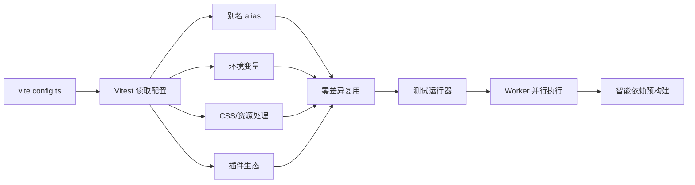
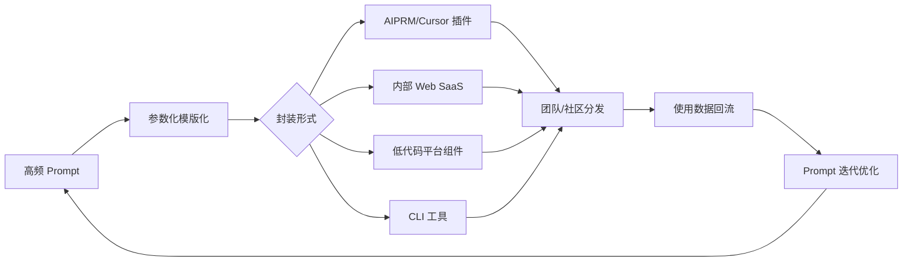

# 第 39 章 前端测试金字塔与 AI 赋能工程化实战

## 学习目标

- 理解前端测试策略分层的核心原则与 ROI 权衡，能制定团队级单测/集成/E2E 覆盖率标准
- 掌握 Vitest 在 Vite/ESM/TS 生态下的零配置集成、Mock 机制、并行运行与覆盖率门禁实战
- 熟练运用 Vue Test Utils 进行组件挂载策略选择（mount/shallowMount）、响应式解包断言、事件触发与插槽测试
- 掌握 Playwright 多浏览器矩阵、Page Object 模式、网络拦截、视觉回归等生产级 E2E 核心技能
- 能搭建包含 Lint/TypeCheck/单测/构建/E2E/部署的全链路 CI/CD 流水线，配置质量红线与自动化通知
- 掌握 ChatGPT 在跨境电商运营中的结构化提示词工程方法，实现谷歌广告文案、选品分析、客服回复等场景的标准化落地
- 理解 AI 时代前端工程化效能跃迁路径：Prompt Engineering + RPA + 低代码平台的组合拳打法

## 39.1 生活类比

想象前端测试体系是**汽车出厂前的质检流水线**：**单元测试** = **零部件台架测试**：发动机、刹车片、芯片单独在实验室极限压测（毫秒级、隔离环境、覆盖率高），保证每个零件合格；**集成测试** = **底盘/动力总成联调**：发动机+变速箱+传动轴组装在一起跑台架，验证接口匹配、协作逻辑（保留真实依赖、中等速度）；**E2E 测试** = **整车试驾/碰撞测试**：真实路况/赛道/极端天气下整车跑完全程，验证从启动到停车的全链路体验（真实环境、慢、贵、但置信度最高）。**Vitest** = **高精度自动化台架**：兼容旧设备(Jest)、即插即用(Vite配置)、并行多工位、自动出报告；**Playwright** = **全天候无人驾驶测试车**：跨品牌(Chromium/Firefox/WebKit)、自动避障(自动等待)、远程遥控(网络拦截)、自动拍照对比(视觉回归)；**CI/CD 流水线** = **出厂合格证自动签发机**：任一工位不合格即锁死流水线、自动通知工程师、生成可追溯质检档案、贴上合格徽章才能发运。想象 AI 提示词工程是**大型会议的提问环节**：**角色设定** = 你手里的**身份工牌**（谷歌广告专家/跨境运营总监）；**任务定义** = 你要解决的**议程议题**（写10条符合规范的广告标题）；**输出约束** = **会议规则**（英文输出、字数限制、引人入胜）；**少样本案例** = **往期会议纪要**，让模型学会格式与风格。就像主持人根据议题动态分配发言时间，结构化 Prompt 让模型按规范输出高质量内容。

## 39.2 概念地图

前端测试金字塔体系
├── 测试策略分层
│   ├── 单元测试（70%）：纯函数、Composables、Store、组件逻辑隔离测试  —— P001
│   ├── 集成测试（20%）：组件+Router、组件+Pinia、API Mock、跨组件通信  —— P001
│   ├── 端到端测试（10%）：关键业务全链路真实浏览器验证  —— P001
│   └── 模型对比：金字塔 vs 奖杯 vs 冰激凌筒 vs 倒金字塔  —— P001
├── 单测/集成工具链：Vitest + Vue Test Utils
│   ├── Vitest 核心：ESM原生、Vite配置复用、并行Worker、Jest兼容API、覆盖率阈值  —— P002
│   ├── Mock 体系：vi.mock/vi.spyOn/vi.fn/vi.useFakeTimers/vi.hoisted  —— P002
│   ├── Vue Test Utils：mount vs shallowMount 挂载策略  —— P003
│   ├── 响应式断言：ref/reactive 自动解包、vm 实例访问、nextTick 等待  —— P003
│   ├── 交互测试：trigger/setValue/findComponent 事件与表单验证  —— P003
│   └── 插槽/边界：slots 分发验证、Suspense/Teleport attachTo、flushPromises 异步  —— P003
├── E2E 工具链：Playwright
│   ├── 核心架构：Browser → Context(隔离) → Page 多标签页模型  —— P004
│   ├── 语义定位：getByRole/getByTestId/getByLabel 抗重构选择器  —— P004
│   ├── 自动等待：可操作性检查消除显式睡眠  —— P004
│   ├── 网络拦截：page.route 模拟异常/延迟/限流/Mock响应  —— P004
│   ├── 认证复用：storageState 跳过登录加速执行  —— P004
│   ├── 视觉回归：pixelmatch 像素级对比、跨OS/浏览器/DPR分目录管理基线图  —— P004
│   └── Page Object：业务动作封装、选择器内聚、测试用例可读性  —— P004
└── CI/CD 质量红线自动化
    ├── 流水线编排：lint → typecheck → test:unit → build → test:e2e → deploy  —— P005
    ├── 质量门禁：覆盖率阈值、非零退出码阻断、E2E重试机制  —— P005
    ├── 制品管理：构建产物、覆盖率报告、Playwright Trace/Video/HTML报告  —— P005
    ├── 缓存加速：node_modules/浏览器/中间产物缓存策略  —— P005
    ├── 通知告警：失败即时推送钉钉/飞书/Slack、附带链接与错误摘要  —— P005
    └── Monorepo 优化：turbo affected 受影响包测试、paths-ignore 精准触发  —— P005
AI 赋能跨境电商与前端工程化
├── 结构化提示词工程
│   ├── 角色设定+任务定义+输出约束（格式/字数/语言/营销目标）  —— P039
│   ├── 谷歌广告文案生成：RSA字符限制+英文输出+转化导向  —— P039
│   └── 迭代版本化发布：v1.0先行→持续迭代收集反馈  —— P039
├── AI 辅助开发工作流
│   ├── ChatGPT + RPA 自动化：超级写手机器人、批量内容生产  —— P037
│   ├── Prompt 库沉淀：学习指令/知识结构/范文库/修正指令  —— P044
│   └── 低代码/工具化封装：AIPRM 插件验证、SaaS 交付模式  —— P136
└── 前端工程化效能跃迁
    ├── 提示词即代码：版本化、参数化、A/B测试  —— P105
    ├── 结构化输出：Pydantic/OutputParser 类型安全契约  —— P105
    └── 自动优化闭环：DSPy/OPRO 编译流程、数据飞轮  —— P105

## 39.3 测试策略分层 —— 单元/集成/E2E 的黄金分割比

### 为什么需要这个概念？

- 只写单测：无法发现组件间集成Bug、路由跳转、API联调问题
- 只写E2E：运行慢、调试难、维护成本高、CI流水线耗时过长
- 需要一套科学的分层模型，指导资源在不同层级的最优分配

> "引用测试金字塔/奖杯模型，制定“核心逻辑单测全覆盖、关键交互集成测、核心链路 E2E 兜底”的团队规范。"
> 
> ——《20230418_039.md》

### 核心定义

**测试金字塔/奖杯模型**（来源：《20230418_039.md》）

测试策略分层定义了三个层级的资源分配黄金比例：

- **单元测试（底座，70%）**：隔离测试纯函数、组合式函数、Pinia Store、Vue组件逻辑（shallowMount），不依赖网络/浏览器DOM
- **集成测试（中层，20%）**：验证多单元协作，如组件+Router、组件+Pinia、组件+API Mock、跨组件通信
- **端到端测试（顶尖，10%）**：真实浏览器模拟用户关键路径（登录、下单、支付），验证全链路业务闭环

这个模型展示了：越往上层，运行越慢、越脆弱、维护成本越高，但置信度越强。我们要避免“倒金字塔”（E2E过多）和“冰激凌筒”（缺中层集成测试）两种反模式。

### 关键性质

**ROI评估与依赖隔离原则**（来源：《20230418_039.md》）

| 测试层级 | 典型运行时间 | 置信度 | 维护成本 | ROI | 依赖处理策略 |
|---------|-------------|--------|----------|-----|-------------|
| 单元测试 | 毫秒级 | 低-中 | 极低 | 最高 | 必须Mock外部依赖（axios、router、子组件） |
| 集成测试 | 秒级 | 中-高 | 中 | 中 | 可选择性保留真实依赖（如真实Pinia、Router） |
| E2E测试 | 分钟级 | 最高 | 高 | 最低 | 真实后端/数据库，或Contract Testing |

**覆盖率阈值设定**：

$$
\text{Coverage Threshold} = \begin{cases}
\text{lines} \ge 80\% \\
\text{branches} \ge 70\% \\
\text{functions} \ge 80\% \\
\text{statements} \ge 80\%
\end{cases}
$$

这个公式展示了：分支覆盖率可适当低于行覆盖率，因为防御性编程、错误处理分支往往难以全覆盖且边际收益递减。

### 典型例子

**单测示例**：`useDebounceFn` 返回值在不同时间点的断言；`ProTable` 组件 `columns` prop 变更触发 `reload`  
**集成测试示例**：`UserProfile` 组件挂载后自动请求 `/api/user` 并渲染数据；路由守卫拦截未登录用户跳转登录页  
**E2E示例**：用户输入账号密码点击登录 → 跳转首页 → 侧边栏展示权限菜单 → 退出登录回登录页

### 边界条件

- 避免“倒金字塔”：E2E数量超过单测，导致CI极其缓慢且频繁闪断
- 避免“冰激凌筒”：只有单测和E2E，缺中层集成测试，导致组件协作Bug频发
- 纯UI展示型组件（如 Button、Icon）无需E2E，单测+视觉回归即可
- 复杂表单联动、多步向导、支付流程必须有E2E兜底

## 39.4 Vitest 核心实战 —— 原生 ESM 下的极速测试运行器

### 为什么需要这个概念？

- Jest 基于 CommonJS，对 ESM/Vite/TypeScript 原生支持弱，配置复杂、启动慢
- 前端项目已标准化 Vite + ESM + TS，需要零配置复用 Vite 配置、插件、转换管线的测试工具
- 需要与现代前端工程链（HMR、类型检查、覆盖率）无缝融合

> "演示 `vi.mock`/`vi.spyOn` 模拟依赖、`--watch` 热更新测试、`coverage` 配置阈值阻断流水线。"
> 
> ——《20230418_039.md》

### 核心定义

**Vitest**（来源：《20230418_039.md》）

Vitest：基于 Vite 的下一代测试框架，API 兼容 Jest，原生支持 ESM、TypeScript、Vite 插件生态。

核心命令：
- `vitest run`（CI模式）
- `vitest --watch`（开发模式）
- `vitest --coverage`（覆盖率）

### 关键性质

**配置复用与并行运行**（来源：《20230418_039.md》）



Vitest 直接复用 `vite.config.ts`，实现别名、环境变量、CSS处理、插件的零差异复用。基于 Worker 多进程并行执行测试文件，利用 Vite 模块图实现智能依赖预构建，监听模式下仅重跑受影响测试，配合 HMR 实现毫秒级反馈循环。

**Mock 能力体系**（来源：《20230418_039.md》）

Vitest 提供完全兼容 Jest API 的 Mock 能力：

```typescript
// 1. 模块级 Mock - 必须在顶层调用
vi.mock('@/api/user', () => ({
  getUser: vi.fn().mockResolvedValue({ data: { name: 'Test' } })
}))

// 2. 函数级 Mock
const spy = vi.spyOn(console, 'log')

// 3. 定时器 Mock
vi.useFakeTimers()
await vi.advanceTimersByTimeAsync(1000)
vi.useRealTimers()

// 4. hoisted 解决顶层变量提升问题
const { mockGetUser } = vi.hoisted(() => ({
  mockGetUser: vi.fn()
}))
vi.mock('@/api/user', () => ({
  getUser: mockGetUser
}))
```

这个代码块展示了：`vi.mock` 必须在文件顶层静态声明（Vite 编译时提升），`vi.hoisted` 解决了 Mock 工厂函数中引用外部变量未定义的问题，`vi.useFakeTimers` 让我们能精确控制时间流逝验证防抖/节流等时序逻辑。

### 典型例子

- `vi.mock('axios')` 拦截网络请求返回 `Promise.resolve({ data: [...] })`
- `vi.useFakeTimers()` 控制 `setTimeout`/`setInterval` 验证防抖节流逻辑
- `expect(x).toMatchSnapshot()` 快照测试组件渲染输出，CI 中 `--update` 更新基准
- `vi.hoisted` 解决 `vi.mock` 声明提前导致变量未定义的顶层作用域问题

### 边界条件

- `vi.mock` 必须在顶层调用，不能在 `describe`/`it` 内部动态调用
- ESM 环境下 Mock 静态导出需用 `vi.mock(..., { virtual: true })` 或重新导入
- 覆盖率阈值 `coverage.threshold` 建议在 CI 中设为 `branches: 80, functions: 80, lines: 80, statements: 80` 阻断合并
- 全局变量污染：需在 `afterEach` 中 `vi.restoreAllMocks()`、`vi.useRealTimers()` 重置状态

## 39.5 Vue 组件测试范式 —— Vue Test Utils 的挂载策略与交互断言

### 为什么需要这个概念？

- 组件包含模板渲染、响应式状态、生命周期、事件触发、插槽分发，单纯逻辑测试无法覆盖
- 需要专门的工具在 JSDOM/happy-dom 中真实渲染组件，验证 DOM 结构、CSS 类、用户交互反馈
- 必须处理 Vue 3 特有的 `ref`/`reactive` 解包、组合式 API、`<Suspense>`、`<Teleport>` 等特性

> "对比 `shallowMount` 与 `mount`、处理 `ref`/`reactive` 解包断言、`trigger`/`findComponent` 交互测试、插槽内容验证。"
> 
> ——《20230418_039.md》

### 核心定义

**Vue Test Utils (VTU) 挂载策略**（来源：《20230418_039.md》）

Vue Test Utils (VTU) 官方测试工具库，提供两种核心挂载策略：

- **`mount`（全量渲染）**：完整渲染组件及其所有子组件，保留真实 DOM 结构，适合集成测试
- **`shallowMount`（浅渲染存根子组件）**：将子组件存根为 `<ComponentStub />`，隔离子组件实现细节，适合单元测试

核心 API：
- 选择器：`find`/`findAll`/`findComponent`
- 事件触发：`trigger`/`setValue`
- 实例访问：`vm` 访问组件实例（自动解包 ref/reactive）

### 关键性质

**响应式解包与异步等待**（来源：《20230418_039.md》）

```typescript
// 响应式解包：wrapper.vm 自动解包 ref/reactive
const wrapper = mount(Counter)
expect(wrapper.vm.count).toBe(0)  // count 是 ref，自动解包为 number

// 交互测试必须 await 等待 nextTick
await wrapper.find('button').trigger('click')
await nextTick()  // 或 await flushPromises()
expect(wrapper.vm.count).toBe(1)
```

这个代码片段展示了：VTU 的 `vm` 属性会自动解包 `ref` 和 `reactive`，让我们像访问普通属性一样断言响应式状态。但交互触发后必须 `await nextTick()` 或 `await flushPromises()` 等待 Vue 完成 DOM 更新，否则断言会读取到旧值。

**挂载选项对比**（来源：《20230418_039.md》）

| 选项 | mount | shallowMount | 使用场景 |
|------|-------|-------------|---------|
| 子组件渲染 | 真实渲染 | 存根 `<ComponentStub />` | 单测用 shallowMount，集成测用 mount |
| 全局组件存根 | `global.stubs` | `global.stubs` | RouterLink、FontAwesome 等通用组件 |
| 插槽注入 | `slots` | `slots` | 验证分发内容正确渲染 |
| 插件注入 | `global.plugins` | `global.plugins` | Pinia、Router 等插件 |
| 真实 DOM 挂载 | `attachTo` | 不支持 | `<Teleport>`/`<Suspense>` 必须用 mount + attachTo |

### 典型例子

**单测（shallowMount）**：
```typescript
shallowMount(ProTable, { 
  props: { columns, data }, 
  global: { stubs: { ElTable: true } } 
})
// 验证 props 透传、内部方法调用、不关心 ElTable 实现细节
```

**集成测试（mount）**：
```typescript
mount(LoginForm, { 
  global: { plugins: [pinia, router] } 
})
// setValue 输入 → trigger('submit') → 断言 router.push 被调用
```

**组件通信测试**：
```typescript
const wrapper = mount(Parent)
const child = wrapper.findComponent(Child)
child.vm.$emit('custom')
// 断言父组件处理函数被调用
```

### 边界条件

- 优先 `shallowMount` 单测组件内部逻辑（隔离子组件实现细节），集成测试用 `mount`
- 含 `<Suspense>`/`<Teleport>` 组件必须用 `mount` 且 `attachTo: document.body` 避免 JSDOM 找不到容器报错
- 避免测试私有方法/内部状态，聚焦 Props/Events/Slots/公开方法/渲染输出（黑盒视角）
- `flushPromises` 处理异步组件/异步 Setup：`await flushPromises()` 后再断言异步渲染结果

## 39.6 Playwright E2E 实战 —— 多浏览器矩阵下的可靠交互自动化

### 为什么需要这个概念？

- Cypress 仅支持 Chromium 系、难以处理多标签页/跨域/原生对话框/下载上传
- Selenium 维护成本高、定位器脆弱、无原生等待机制导致大量显式睡眠
- 需要原生支持所有主流浏览器引擎、自动等待、强大定位器、网络拦截、视觉回归的现代 E2E 方案

> "构建可维护的 Page Object 层、使用 `page.route` 模拟后端异常/延迟、引入 `pixelmatch` 实现截图像素级对比。"
> 
> ——《20230418_039.md》

### 核心定义

**Playwright 核心架构**（来源：《20230418_039.md》）

Playwright：微软出品的跨浏览器（Chromium/Firefox/WebKit）E2E 测试框架，单进程多上下文隔离，支持 TypeScript 原生。

核心架构层级：
```
Playwright → Browser → BrowserContext（隔离 Cookie/Storage） → Page（标签页）
```

### 关键性质

**自动等待与语义定位器**（来源：《20230418_039.md》）

Playwright 的核心优势在于**自动等待**机制：

```typescript
// 无需显式等待，内置可操作性检查：
// 1. 元素可见
// 2. 元素稳定（不在动画/过渡中）  
// 3. 元素可接收事件（非 disabled、非遮挡）
await page.click('button')  
await page.fill('input[name="email"]', 'test@example.com')
```

语义定位器推荐优先级：
```typescript
// 优先级 1：语义角色（最抗重构）
page.getByRole('button', { name: '提交' })
page.getByRole('textbox', { name: '邮箱' })

// 优先级 2：测试 ID（需开发配合添加 data-testid）
page.getByTestId('submit-btn')

// 优先级 3：标签关联
page.getByLabel('邮箱地址')

// 避免：CSS/XPath 选择器（脆弱、不语义）
```

这个设计展示了：语义定位器基于无障碍树（Accessibility Tree），天然兼容屏幕阅读器，重构时只要语义不变测试就不破坏。

**网络拦截与认证复用**（来源：《20230418_039.md》）

```typescript
// 1. Mock 接口响应
await page.route('**/api/orders**', route => 
  route.fulfill({ json: mockOrders })
)

// 2. 模拟异常/延迟/限流
await page.route('**/api/**', async route => {
  await new Promise(r => setTimeout(r, 2000)) // 模拟 2s 延迟
  await route.fulfill({ status: 500, body: 'Server Error' })
})

// 3. 认证复用 - 登录一次，后续用例跳过登录
await page.context().storageState({ path: 'auth.json' })
// 后续测试：
const context = await browser.newContext({ storageState: 'auth.json' })
const page = await context.newPage()
// 直接访问受保护页面，无需登录
```

这个机制展示了：`storageState` 将 Cookie、LocalStorage、IndexedDB 序列化到文件，新 Context 加载即可恢复登录态，大幅加速测试执行（登录往往是最耗时的步骤）。

**视觉回归测试**（来源：《20230418_039.md》）

```typescript
// 像素级对比，容忍阈值
expect(await page.screenshot()).toMatchSnapshot('order-list.png', { 
  maxDiffPixels: 100,      // 允许最多 100 个像素差异
  threshold: 0.2           // 像素颜色差异阈值
})
```

基线图管理策略：
```
snapshots/
├── chromium/
│   ├── linux/
│   │   ├── dpr-1/
│   │   └── dpr-2/
│   └── darwin/
│       └── dpr-1/
├── firefox/
└── webkit/
```

这个策略展示了：必须按 OS/浏览器/设备像素比（DPR）分目录管理基线图，因为字体渲染、抗锯齿、颜色配置在不同环境下差异巨大，混用会导致大量误报。

### 典型例子

**Page Object 模式**：
```typescript
// pages/LoginPage.ts
export class LoginPage {
  constructor(private page: Page) {}
  
  async login(username: string, password: string) {
    await this.page.getByLabel('用户名').fill(username)
    await this.page.getByLabel('密码').fill(password)
    await this.page.getByRole('button', { name: '登录' }).click()
    await this.page.waitForURL('**/dashboard')
  }
}

// tests/order.spec.ts
test('订单列表渲染', async ({ page }) => {
  const login = new LoginPage(page)
  await login.login('user', 'pass')
  
  const orderPage = new OrderListPage(page)
  await orderPage.gotoOrders()
  const rows = await orderPage.getOrderRows()
  expect(rows).toHaveLength(3)
})
```

这个模式展示了：将选择器与业务动作封装在 Page Object 类中，测试用例仅调用 `login()`、`gotoOrders()` 等高层语义，选择器变更只需改一处，测试用例可读性大幅提升。

### 边界条件

- 严禁在测试用例中写 CSS/XPath 选择器，强制推行 `getByRole`/`getByTestId`/`getByLabel` 语义定位
- CI 环境需安装系统依赖 `npx playwright install-deps`，Headless 模式需字体包支持中文截图
- 并行执行 `workers: 4` 时注意测试数据隔离（独立账号/数据库事务回滚/随机前缀）
- 视觉回归基线图需按 OS/浏览器/设备像素比分目录存储，避免跨环境误报

## 39.7 CI/CD 质量红线自动化 —— 从代码提交到生产部署的自动化质量闸

### 为什么需要这个概念？

- 本地跑通 ≠ 线上可用：环境差异、依赖版本漂移、并发冲突、配置缺失
- 人工审核不可靠：漏跑测试、忽略警告、主观放行、无审计追溯
- 需要一条强制执行、快速反馈、可视化报告、失败阻断的自动化流水线守住质量底线

> "串联 `lint` → `typecheck` → `test:unit` → `build` → `test:e2e` → `deploy`，配置失败通知、覆盖率徽章、测试报告归档。"
> 
> ——《20230418_039.md》

### 核心定义

**标准化流水线编排**（来源：《20230418_039.md》）

GitHub Actions / GitLab CI / Jenkins 定义的标准化流水线：

```
lint → typecheck → test:unit → build → test:e2e → deploy
```

**质量红线**：任意阶段失败即阻断合并/部署，覆盖率不达标、Lint 报错、类型错误、E2E 闪断均视为红线。

### 关键性质

**GitHub Actions 完整流水线配置**（来源：《20230418_039.md》）

```yaml
# .github/workflows/ci.yml
name: CI

on:
  push:
    branches: [main]
  pull_request:
    branches: [main]

jobs:
  lint-typecheck:
    runs-on: ubuntu-latest
    steps:
      - uses: actions/checkout@v4
      - uses: pnpm/action-setup@v2
      - uses: actions/setup-node@v4
        with:
          node-version: 20
          cache: 'pnpm'
      - run: pnpm install --frozen-lockfile
      - run: pnpm lint
      - run: pnpm typecheck

  unit-test:
    needs: lint-typecheck
    runs-on: ubuntu-latest
    steps:
      - uses: actions/checkout@v4
      - uses: pnpm/action-setup@v2
      - uses: actions/setup-node@v4
        with:
          node-version: 20
          cache: 'pnpm'
      - run: pnpm install --frozen-lockfile
      - run: pnpm test:unit --coverage
      - uses: actions/upload-artifact@v4
        with:
          name: coverage-report
          path: coverage/

  build:
    needs: unit-test
    runs-on: ubuntu-latest
    steps:
      - uses: actions/checkout@v4
      - uses: pnpm/action-setup@v2
      - uses: actions/setup-node@v4
        with:
          node-version: 20
          cache: 'pnpm'
      - run: pnpm install --frozen-lockfile
      - run: pnpm build
      - uses: actions/upload-artifact@v4
        with:
          name: dist
          path: dist/

  e2e-test:
    needs: build
    runs-on: ubuntu-latest
    strategy:
      matrix:
        browser: [chromium, firefox, webkit]
    steps:
      - uses: actions/checkout@v4
      - uses: pnpm/action-setup@v2
      - uses: actions/setup-node@v4
        with:
          node-version: 20
          cache: 'pnpm'
      - run: pnpm install --frozen-lockfile
      - run: npx playwright install --with-deps ${{ matrix.browser }}
      - run: pnpm test:e2e --project=${{ matrix.browser }}
      - uses: actions/upload-artifact@v4
        if: always()
        with:
          name: playwright-report-${{ matrix.browser }}
          path: test-results/

  notify-failure:
    needs: [lint-typecheck, unit-test, build, e2e-test]
    if: failure()
    runs-on: ubuntu-latest
    steps:
      - name: Send Feishu Notification
        uses: feishu/feishu-action@v1
        with:
          msg_type: "card"
          card: |
            {
              "header": {"title": {"tag": "plain_text", "content": "🚨 CI 失败告警"}},
              "elements": [
                {"tag": "div", "text": {"tag": "lark_md", "content": "**失败 Job**: ${{ needs.lint-typecheck.result }}/${{ needs.unit-test.result }}/${{ needs.build.result }}/${{ needs.e2e-test.result }}"}},
                {"tag": "div", "text": {"tag": "lark_md", "content": "**仓库**: ${{ github.repository }}"}},
                {"tag": "div", "text": {"tag": "lark_md", "content": "**分支**: ${{ github.ref }}"}},
                {"tag": "div", "text": {"tag": "lark_md", "content": "**提交者**: @${{ github.actor }}"}},
                {"tag": "hr"},
                {"tag": "div", "text": {"tag": "lark_md", "content": "[查看详细日志](${{ github.server_url }}/${{ github.repository }}/actions/runs/${{ github.run_id }})"}}
              ]
            }
```

这个配置展示了：通过 `needs` 定义 Job 依赖链，`matrix` 策略跨浏览器并行，`if: failure()` 捕获任意上游失败发送告警卡片，制品上传覆盖率报告、构建产物、Playwright HTML 报告/Trace/Video。

**覆盖率门禁与 E2E 重试**（来源：《20230418_039.md》）

```typescript
// vitest.config.ts
export default defineConfig({
  test: {
    coverage: {
      thresholds: {
        lines: 80,
        branches: 70,   // 分支可适当低于行
        functions: 80,
        statements: 80
      }
    }
  }
})
```

```typescript
// playwright.config.ts
export default defineConfig({
  retries: 2,                    // 闪断自动重跑 2 次
  workers: 4,                    // 并行 4 个 Worker
  use: {
    trace: 'on-first-retry',     // 首次重试时录制 Trace
    video: 'retain-on-failure',  // 失败时保留视频
    screenshot: 'only-on-failure'
  }
})
```

这个配置展示了：覆盖率阈值直接在 `vitest` 进程中阻断（非零退出码），E2E 配置 `retries: 2` 配合 `trace: 'on-first-retry'` 让闪断用例自动重跑并生成可复现的 Trace 文件，本地可用 `npx playwright show-trace trace.zip` 可视化定位时序问题。

### 典型例子

**Monorepo 受影响测试优化**（来源：《20230418_039.md》）

```yaml
# 仅在 apps/admin 变更时触发完整流水线
on:
  push:
    paths:
      - 'apps/admin/**'
      - 'packages/ui/**'
      - 'packages/utils/**'
  pull_request:
    paths:
      - 'apps/admin/**'
      - 'packages/ui/**'
      - 'packages/utils/**'

# jobs 中使用 turbo affected
jobs:
  unit-test:
    runs-on: ubuntu-latest
    steps:
      - uses: actions/checkout@v4
        with:
          fetch-depth: 0  # turbo 需要完整历史
      - run: pnpm install --frozen-lockfile
      - run: pnpm turbo run test --filter=./apps/admin... --filter=./packages/ui... --filter=./packages/utils...
```

这个配置展示了：利用 `paths` 过滤触发条件，配合 `turbo affected` 仅运行受影响包的测试，大幅缩短流水线耗时。

### 边界条件

- 单测/类型检查/构建必须在 5-8 分钟内完成（缓存+并行），E2E 单独 Job 允许 15-20 分钟
- 禁止在 CI 中跳过任何阶段（除非显式 `skip ci` commit message），禁止手动点击“通过”
- Monorepo 需配置 `paths-ignore` / `turbo affected` 仅跑受影响包的测试，避免全量跑浪费资源
- 生产部署需人工审批环节（`environment: production` + `required reviewers`），禁止全自动无人值守发布

## 39.8 ChatGPT 结构化提示词工程 —— 跨境电商谷歌广告文案标准化生成

### 为什么需要这个概念？

- 手写广告文案耗时、质量依赖个人经验、难以批量产出符合平台规范的高转化文案
- 跨境电商从业者英语非母语，易出现语法错误、表达不地道、关键词缺失等问题
- 需要一套标准化、可复用、可版本管理的 Prompt 工程方法论，将‘玄学咒语’转化为工程资产

> "提示词： 现在你是一名谷歌广告的编写人员，你需要为 xxx 产品写 10 条谷歌广告标题和谷歌广告描述。要求是： 1.用英文输出你的答案。 2.广告的标题和广告描述的字数等要符合谷歌的标准。 3.广告要引人入胜，让人有下单的欲望。"
> 
> ——《20230418_120.md》

### 核心定义

**结构化提示词范式**（来源：《20230418_105.md》, 《20230418_120.md》）

结构化提示词由三大核心要素组成：

- **角色设定**：显式赋予专业身份，激活垂直领域知识
- **任务定义**：明确输入输出契约、业务目标
- **输出约束**：格式、字数、语言、营销目标硬编码进 Prompt

**谷歌广告 RSA 规则**（来源：《20230418_120.md》）

- 标题 ≤30字符，最多15个标题
- 描述 ≤90字符，最多4个描述  
- 需覆盖不同卖点组合，系统自动组合测试

### 关键性质

**标准化 Prompt 模板**（来源：《20230418_120.md》, 《20230418_105.md》）

```markdown
# 角色设定
现在你是一名拥有 10 年经验的谷歌广告资深文案专家，擅长撰写高转化率的 RSA 响应式搜索广告。

# 任务定义
为产品「便携式户外电源」生成 10 条广告标题和 4 条广告描述。
核心卖点：2000Wh 大容量、300W 快充、多接口（AC/USB-C/USB-A/车充）、IP65 防水防尘、便携手提设计。
目标受众：露营爱好者、房车旅行者、户外直播工作者、应急备灾家庭。

# 输出约束
1. 全部用英文输出
2. 标题 ≤30 字符，描述 ≤90 字符，严格符合 Google RSA 规范
3. 广告文案要引人入胜，激发下单欲望，突出痛点解决与利益点
4. 覆盖不同卖点组合：容量续航、充电速度、接口丰富、防护等级、便携性
5. 输出格式为 JSON：
{
  "headlines": ["标题1", "标题2", ...],
  "descriptions": ["描述1", "描述2", ...]
}

# 少样本示例
## 示例 1
产品：便携式投影仪
卖点：4K、自动对焦、内置电池、Netflix 认证
输出：
{
  "headlines": ["4K Portable Cinema", "Auto Focus in Seconds", "Built-in Battery 5H Play", "Netflix Certified Projector", "Movie Night Anywhere"],
  "descriptions": ["True 4K resolution with auto keystone correction.", "5-hour built-in battery for outdoor movie nights.", "Pre-installed Netflix, YouTube, Prime Video.", "Compact design fits in your backpack."]
}

## 示例 2
产品：降噪耳机
卖点：主动降噪 45dB、续航 60H、多点连接、舒适佩戴
输出：
{
  "headlines": ["45dB Deep ANC", "60H Battery Life", "Multipoint Connection", "All-Day Comfort Fit", "Silence The World"],
  "descriptions": ["Industry-leading 45dB active noise cancellation.", "60 hours playtime with fast charging.", "Connect two devices simultaneously.", "Memory foam earcups for zero pressure."]
}
```

这个模板展示了：通过显式角色设定、结构化任务定义、硬性输出约束、高质量少样本示例，将“玄学咒语”转化为可复用、可版本化、可 A/B 测试的工程资产。

### 典型例子

**输入**：产品=便携式户外电源，卖点=大容量/快充/多接口/防水  
**Prompt 执行**：角色(资深广告文案) + 任务(生成10标题4描述) + 约束(英文/字数/RSA规范/高转化) + 少样本(2组历史优秀广告)  
**输出**：10条标题（如：Power Anywhere, 300W Fast Charge...）、4条描述（如：2000Wh capacity charges 99% devices...），均符合字数与语言规范

### 边界条件

- 避免一次性投喂超长 Prompt 导致上下文截断，采用分轮次交互（角色设定→知识灌输→范例注入→生成指令）
- ChatGPT 多语言输出存在幻觉风险，必须人工复核语言本地化与事实准确性
- Prompt 需纳入版本管理（Git），建立变更日志，支持 A/B 测试与回滚

## 39.9 AI 赋能前端工程化 —— ChatGPT+RPA 批量生产与 Prompt 库资产化

### 为什么需要这个概念？

- 重复性内容生产（文案/脚本/代码/测试）消耗大量人力，质量不稳定、难以规模化
- 个人 Prompt 管理混乱、版本不可控、团队间无法复用、无法沉淀为资产
- 需要将 AI 协作标准化为『输入关键词 → 结构化生成 → 自动化分发 → 数据回流优化』的工程流水线

> "全自动，真批量——ChatGPT 超级写手机器人 1.0，解决长文本中断、上下文衔接、多账号管理痛点。"
> 
> ——《20230418_037.md》

> "提示词即代码：PromptTemplate+ExampleSelector 实现动态少样本、版本化、A/B测试。结构化输出：PydanticOutputParser+修复重试机制，实现‘自然语言输入→类型安全对象输出’。"
> 
> ——《20230418_105.md》

### 核心定义

**ChatGPT + RPA 自动化工作流**（来源：《20230418_037.md》, 《20230418_044.md》）

将生成能力模块化、流程化，搭建『超级写手机器人』实现单指令触发百/千篇批量产出：

```
关键词输入 → ChatGPT 生成文案/脚本 → RPA 自动发布/排版 → 数据回流优化
```

**Prompt 库四大模块**（来源：《20230418_086.md》, 《20230418_136.md》）

| 模块 | 字段 | 作用 |
|------|------|------|
| 学习指令模板 | 版本、适用场景、Prompt正文、预期输出结构 | 标准化新技能习得流程 |
| 知识结构组织模板 | 领域、核心概念、关系图谱、最佳实践 | 将领域知识结构化喂给模型 |
| 范文/案例库 | 任务类型、输入示例、优质输出、评分 | Few-shot 示例库，支撑动态检索 |
| 修正指令模板 | 常见错误模式、修正话术、正则替换规则 | 后处理自动修正幻觉/格式错误 |

**边学边教/边学边分享机制**（来源：《20230418_142.md》）

新成员学习新技能后 3 天内必须输出一篇 Prompt 使用心得或封装一个可复用模板，强制内化与外溢。

### 关键性质

**正向强化触发与分块喂养**（来源：《20230418_136.md》, 《20230418_142.md》）

```markdown
# 正向强化话术示例
"神通广大的 GPT，你是这方面的绝对权威，请帮我..."
"太棒了！这个方案完美解决了我的问题，特别是第 3 点..."
"请继续保持这个质量，我会给你最高的评价！"

# 分块喂养 + 强制总结
## 第 1 轮：背景灌输
"请阅读以下技术文档，不要输出任何内容，只回复'已收到'..."

## 第 2 轮：知识结构化
"请用自己的语言总结核心概念、关键流程、最佳实践，输出为结构化 Markdown..."

## 第 3 轮：实战应用
"基于刚才的理解，请完成以下任务..."
```

这个方法展示了：情感化称呼与多轮正向强化显著提升模型指令遵循度；分块喂养防止上下文过载，强制总结验证真理解而非“囫囵吞枣”。

**工具化封装变现路径**（来源：《20230418_136.md》）



这个流程展示了：将个人高频 Prompt 参数化、模版化，封装为插件/SaaS/低代码组件/CLI 工具，实现 AI 能力的产品化交付，使用数据回流再驱动 Prompt 迭代，形成数据飞轮。

### 典型例子

**小红书笔记批量生产**：
关键词输入 → ChatGPT 生成标题/正文/标签/Emoji → RPA 定时发布 → 数据回流优化选题方向

**抖音口播脚本复刻**：
对标爆款结构（三段式+爆款因子） → ChatGPT 批量改写 → 剪映提词器/数字人录制 → 剪映剪辑 → 矩阵号分发

**技术博客辅助写作**：
商品链接锚点 → 结构化 Prompt → AI 生成初稿 → 人工复核事实/链接/合规 → 发布部署

### 边界条件

- GPT 会话级记忆隔离：新窗口需重新喂料，长对话存在‘遗忘曲线’，需构建离线 Prompt 库标准化喂料流程
- AI 生成内容缺失非文本资产（图片/真实链接/合规声明），必须『人工筛选修改+个人经验注入+平台风格适配』三重介入
- 避免‘巨婴式学习’（依赖保姆级教程、等喂养），主张自主解决环境问题、自主训练模型、自主落地业务

## 39.10 多源对照

### 测试模型对比：金字塔 vs 奖杯 vs 冰激凌筒 vs 倒金字塔

**共识**：都承认测试需要分层，单测速度快、E2E 置信度高，资源分配需权衡。

**分歧**：

| 模型 | 核心主张 | 适用场景 | 细纲来源 |
|------|---------|---------|---------|
| 测试金字塔 | 单测 70% / 集成 20% / E2E 10%，底座最宽 | 传统后端、稳定界面的前端项目 | P001 |
| 测试奖杯 | 集成测试占比最高（如 50%），单测 E2E 各 25% | 组件交互复杂、UI 频繁变更的前端项目 | P001 |
| 冰激凌筒 | 只有单测和 E2E，缺中层 | 遗留项目、团队缺乏集成测试能力 | P001 (反模式) |
| 倒金字塔 | E2E 最多，单测最少 | 无测试文化、追求“全真”验证的早期项目 | P001 (反模式) |

本章推荐**金字塔模型**作为基准，团队可根据组件复杂度向奖杯模型微调。

### Mock 策略对比：vi.mock vs vi.spyOn vs MSW

**共识**：都用于隔离外部依赖，支持函数级/模块级 Mock。

**分歧**：

| 方案 | 层级 | 优势 | 劣势 | 推荐场景 |
|------|------|------|------|---------|
| `vi.mock` | 模块/编译期 | 彻底隔离、支持 ESM 虚拟模块、hoisted 解决提升 | 必须顶层静态声明、动态性弱 | 单测隔离 axios、router、子组件 |
| `vi.spyOn` | 运行时/实例 | 可监视真实实现、支持 `mockRestore`、可部分配置 | 需要真实模块存在、无法 Mock 未导出内部函数 | 集成测试验证副作用调用次数/参数 |
| MSW (Mock Service Worker) | 网络/Service Worker | 跨框架、拦截真实 fetch/XHR、支持 E2E 复用 | 需额外配置、启动开销大 | 集成测试/E2E 共享 Mock 契约 |

建议：单测用 `vi.mock`，集成测试关键路径用 `vi.spyOn` 验证调用，E2E/跨层共享用 MSW。

## 39.11 设计中的取舍

**为什么不用 Cypress 而选 Playwright？**

Cypress 架构限制在浏览器内部运行，难以原生支持多标签页、跨域 iframe、原生文件下载上传、多浏览器引擎（仅 Chromium 系）。Playwright 进程外架构天然支持多 Context 隔离、全引擎矩阵、网络层拦截、原生对话框处理。代价是 Playwright 学习曲线稍陡、社区生态早期不如 Cypress 丰富，但已基本追平。

**为什么覆盖率阈值不设 100%？**

100% 覆盖率会导致：为覆盖防御性分支编写无效测试（如 `if (false) { throw }`）、测试实现细节而非行为、维护成本指数级上升、CI 耗时激增。80% 行/函数 + 70% 分支是工程实践中的“甜蜜点”，覆盖核心业务逻辑与异常路径，忽略样板代码与极端防御分支。

**为什么单测推荐 shallowMount 而集成测试用 mount？**

`shallowMount` 存根子组件，将测试范围严格限制在当前组件内部逻辑，避免子组件 Bug/变更污染父组件测试，运行更快。`mount` 完整渲染子树，验证真实 DOM 结构、跨组件通信、插槽分发、Teleport/Suspense 等集成行为。混用会导致：单测因子组件变更频繁失败（脆弱），集成测试因子组件存根而漏测真实交互（盲区）。

## 39.12 动手练习

### 练习 1：测试分层策略决策与覆盖率配置

**场景**：某中后台项目包含以下模块：
1. `utils/date.ts`：纯日期格式化工具函数库
2. `hooks/useUserPermission.ts`：组合式函数，依赖 Pinia Store 与 router
3. `components/ProTable/index.vue`：复杂表格组件，含分页、排序、列配置、插槽
4. `views/OrderCheckout.vue`：下单页，涉及购物车数据、地址选择、支付 SDK 调用、路由跳转
5. 用户登录全流程：输入凭证 → 验证码 → 双因子认证 → 跳转首页 → 权限菜单渲染

**任务**：
1. 将上述 5 项分别归类到 单测 / 集成测试 / E2E，并说明理由
2. 设计 `vitest.config.ts` 中 `coverage.threshold` 的具体数值配置（lines/branches/functions/statements），解释为何不设 100%
3. 若团队目前 E2E 用例 200 条，单测仅 50 条，属于哪种反模式？会带来哪三个具体后果？如何在 3 个月内逐步修正比例？

### 练习 2：Vitest Mock 实战与边界处理

**给定组合式函数 `useFetchUser.ts`**：
```ts
import { ref } from 'vue'
import api from '@/api/user'

export function useFetchUser(id: string) {
  const user = ref<User | null>(null)
  const loading = ref(false)
  const error = ref<Error | null>(null)

  async function fetch() {
    loading.value = true
    try {
      const res = await api.getUser(id)
      user.value = res.data
    } catch (e) {
      error.value = e as Error
    } finally {
      loading.value = false
    }
  }

  return { user, loading, error, fetch }
}
```

**任务**：
1. 编写单测文件 `useFetchUser.spec.ts`，使用 `vi.mock` 模拟 `@/api/user`，覆盖成功、失败、loading 切换三个分支
2. 使用 `vi.useFakeTimers()` 控制时间，验证 `loading` 在异步操作期间为 true
3. 解释：为何 `vi.mock('@/api/user')` 必须放在文件顶层？若 `api` 是命名导出 `export const api = ...` 该如何 Mock？
4. 运行 `vitest --coverage` 后发现 `branches` 覆盖率仅 60%，排查可能原因并补全用例

### 练习 3：Vue 组件测试：挂载策略与交互断言

**组件 `SearchSelect.vue`**：
- Props: `options: { label: string, value: any }[]`, `modelValue: any`, `placeholder: string`
- Emits: `update:modelValue`, `change`
- 内部：使用 `<Teleport to="body">` 渲染下拉菜单，点击选项触发 emit，支持键盘 ↑/↓/Enter 选择

**任务**：
1. 编写单测：使用 `shallowMount` 验证 Props 透传、默认占位符渲染、点击输入框触发 `focus` 事件
2. 编写集成测试：使用 `mount` + `attachTo: document.body` 完整渲染 Teleport 下拉菜单，模拟键盘 ↑/↓/Enter 选择第三项，断言 `update:modelValue` 与 `change` 事件载荷正确
3. 解释：为何单测用 `shallowMount` 而集成测试必须用 `mount` + `attachTo`？若不加 `attachTo` 会报何种错误？
4. 组件内部使用 `watchEffect` 根据 `options` 变化自动修正 `modelValue`，如何在测试中验证此响应式联动？（提示：`await wrapper.setProps({ options: newOptions })` 后需等待什么？）

### 练习 4：Playwright E2E：Page Object 封装与网络拦截

**目标**：实现「用户登录 → 拦截订单列表接口返回模拟数据 → 断言表格渲染 → 视觉回归对比」完整流程。

**任务**：
1. 设计 `LoginPage` 与 `OrderListPage` 两个 Page Object 类，封装选择器与业务方法（如 `login(username, password)`、`gotoOrders()`、`getOrderRows()`）
2. 在测试用例中使用 `page.route('**/api/orders**', route => route.fulfill({ json: mockOrders }))` 拦截接口，`mockOrders` 需包含 3 条不同状态订单数据
3. 登录后复用认证态：使用 `storageState` 保存 Cookie/LocalStorage，后续测试用例通过 `browser.newContext({ storageState })` 跳过登录，说明为何能加速？
4. 实现视觉回归：`expect(await page.screenshot()).toMatchSnapshot('order-list.png', { maxDiffPixels: 100 })`，说明 `maxDiffPixels` 作用及跨 CI 环境（Ubuntu vs macOS）基线图不一致的解决方案
5. 思考：若接口返回 500，前端应展示空状态组件 `EmptyState`，如何通过 `page.route` 模拟 500 并断言 `EmptyState` 可见？

### 练习 5：CI/CD 流水线质量红线设计与故障演练

**现状**：团队使用 GitHub Actions，主分支保护规则要求所有检查通过方可合并。

**任务**：
1. 编写 `.github/workflows/ci.yml` 完整流水线 YAML，包含以下 Job 与依赖关系：
   - `lint-typecheck`（并行跑 ESLint + tsc --noEmit）
   - `unit-test`（依赖 lint-typecheck，跑 vitest --coverage，上传 coverage 报告 artifact）
   - `build`（依赖 unit-test，跑 pnpm build，上传 dist artifact）
   - `e2e-test`（依赖 build，矩阵策略 chromium/firefox/webkit，跑 playwright，上传 html-report artifact）
   - `notify-failure`（需求：任意前置 Job 失败触发，发送飞书机器人卡片，含失败 Job 名、链接、错误前 20 行）
2. 配置 `vitest` 覆盖率阈值阻断：`lines: 80, branches: 70, functions: 80, statements: 80`，解释为何 `branches` 可适当低于 `lines`？
3. 故障演练：某次提交导致 `e2e-test` 在 Firefox 中随机闪断（率 10%），排查步骤：
   - 如何利用 `retries: 2` 与 `trace: 'on-first-retry'` 复现？
   - 本地如何用 `npx playwright show-trace trace.zip` 定位时序问题？
   - 若确认为上游接口不稳定导致，应在 Page Object 或测试用例层面如何加固（而非单纯加睡眠）？
4. Monorepo 优化：项目迁移至 pnpm workspace，包含 `packages/ui`、`packages/utils`、`apps/admin` 三个包。修改 `ci.yml` 仅在 `apps/admin` 变更时触发完整流水线，`packages/utils` 变更仅跑单测，如何利用 `paths` 与 `turbo affected` 实现？

### 练习 6：ChatGPT 结构化提示词实战：跨境电商谷歌广告文案生成

**场景**：你是跨境电商运营，需要为某款产品（如：便携式户外电源）生成 10 组谷歌 RSA 广告标题（≤30字符）和 4 条描述（≤90字符），要求英文输出、符合字数限制、突出卖点且引人点击。

**任务**：
1. 设计一个结构化 Prompt，包含角色设定、任务定义、输出约束（格式/字数/语言/营销目标）、少样本示例（2组优秀广告文案）
2. 在 ChatGPT 中执行该 Prompt，观察输出是否符合 RSA 规范；若不符合，如何通过追加约束或修正示例进行迭代优化？
3. 对比：若不设定角色、不给字数约束、不提供少样本，输出质量会有何差异？
4. 将最终 Prompt 沉淀至团队 Prompt 库，设计其元数据结构（版本号、适用场景、标签、维护者、变更日志）

### 练习 7：AI 赋能前端工程化：ChatGPT+RPA 批量生产与 Prompt 库建设

**背景**：团队需每周产出 50+ 篇小红书笔记、20+ 条抖音口播脚本、10+ 篇技术博客，人工成本高、质量波动大。

**任务**：
1. 设计一套『ChatGPT + RPA (影刀/UiBot)』自动化生产流水线：关键词输入 → ChatGPT 生成文案/脚本 → RPA 自动发布/排版 → 数据回流优化
2. 搭建团队级 Prompt 库（语雀/Notion/Git），定义四大模块标准字段：学习指令模板、知识结构组织模板、范文/案例库、修正指令模板
3. 实施『边学边教/边学边分享』机制：新成员学习新技能后 3 天内必须输出一篇 Prompt 使用心得或封装一个可复用模板
4. 评估：引入该体系前后，单篇内容产出耗时、人工审核比例、爆款率分别有何变化？如何用数据说明 ROI？

## 39.13 本章小结

这一章中我们学习了前端测试金字塔体系与 AI 赋能工程化实战的完整知识体系。首先我们建立了测试策略分层的黄金比例模型（单测 70%/集成 20%/E2E 10%），理解了 ROI 权衡与依赖隔离原则；其次深入掌握了 Vitest 原生 ESM 零配置、Mock 体系、覆盖率门禁等核心实战技能；接着熟练运用 Vue Test Utils 的 mount/shallowMount 双策略、响应式解包、交互断言、插槽测试等组件测试范式；然后精通 Playwright 多浏览器矩阵、自动等待、语义定位器、网络拦截、Page Object、视觉回归等生产级 E2E 技能；随后搭建了包含 Lint/TypeCheck/单测/构建/E2E/部署全链路 CI/CD 流水线，配置质量红线、缓存加速、制品管理、失败通知与 Monorepo 受影响测试优化；最后掌握了结构化提示词工程方法论，实现谷歌广告文案标准化生成，并构建了 ChatGPT+RPA 批量生产流水线与团队级 Prompt 库资产化体系，完成了从“玄学咒语”到“工程资产”的范式跃迁。

本章我们一起学习了以下概念：

| 概念 | 解释 |
|------|------|
| 测试金字塔/奖杯模型 | 单测70%/集成20%/E2E10% 的资源分配黄金比例，避免倒金字塔与冰激凌筒反模式 |
| Vitest | 基于 Vite 的下一代测试运行器，原生 ESM/TS，零配置复用 Vite 生态，API 兼容 Jest |
| vi.mock / vi.spyOn | 模块级/函数级 Mock 核心 API，支持定时器模拟、ESM 虚拟模块、hoisted 变量提升 |
| 覆盖率阈值 | CI 中设定 lines/branches/functions/statements 80% 门禁，未达标直接阻断流水线 |
| Vue Test Utils (VTU) | 官方组件测试库，提供 mount(全量) 与 shallowMount(浅渲染存根子组件) 两种挂载策略 |
| 响应式解包 | wrapper.vm 自动解包 ref/reactive，断言时直接访问值，需配合 await nextTick/flushPromises 处理异步更新 |
| Playwright | 微软跨浏览器 E2E 框架，单进程多 Context 隔离，原生 TypeScript，自动等待与语义定位器 |
| Page Object 模式 | 将页面选择器与业务动作封装为类，测试用例仅调用 login()/gotoDashboard() 等高层语义 |
| 网络拦截 page.route | 拦截修改网络请求，模拟后端异常/延迟/限流，实现前端独立于后端的稳定测试 |
| 视觉回归测试 | 截图像素级对比 baseline，阈值容忍抗锯齿差异，需按 OS/浏览器/DPR 分目录管理基线图 |
| CI/CD 质量红线 | 强制执行 Lint/TypeCheck/单测/构建/E2E 全链路，任一失败阻断合并部署，制品上传与失败即时通知 |
| Monorepo 受影响测试 | 利用 turbo affected 或 paths-ignore 仅运行变更包相关测试，大幅缩短流水线耗时 |
| 结构化提示词范式 | 角色+任务+约束三要素标准化 Prompt，将‘玄学咒语’转化为可复用、可版本化的工程资产 |
| 谷歌广告文案生成 | 指定模型扮演资深广告文案，输出符合 RSA 字数限制的标题与描述组合，强调合规性与说服力并重 |
| ChatGPT+RPA 自动化 | 将生成能力封装为 RPA 流程，实现批量文案产出、数据采集、跨平台分发的无人值守作业 |
| Prompt 库资产化 | 沉淀学习指令、知识结构、范文库、修正指令四大模块，构建个人/团队核心生产力护城河 |

下一章中，我们将学习 CSS 现代布局与架构——从 Flex/Grid 到设计令牌与原子化工程化，构建可维护、可扩展、多主题适配的企业级样式体系。
