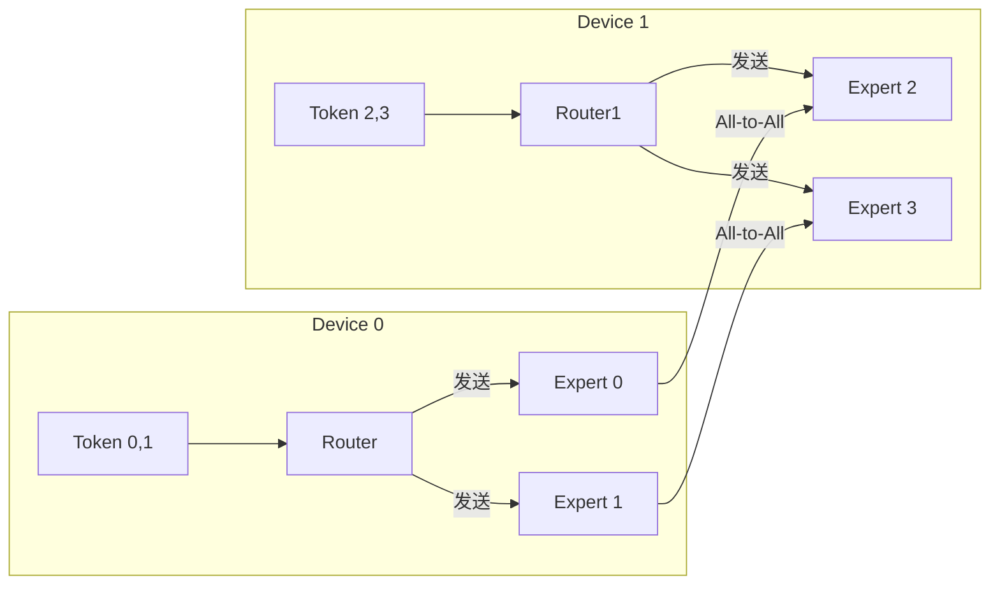
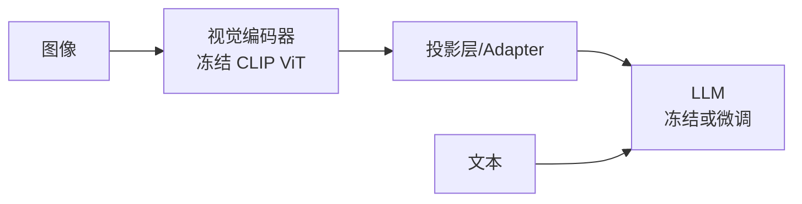
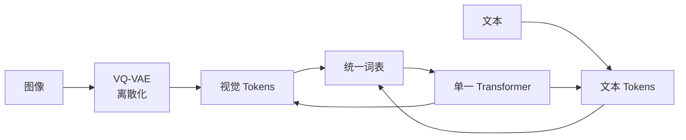
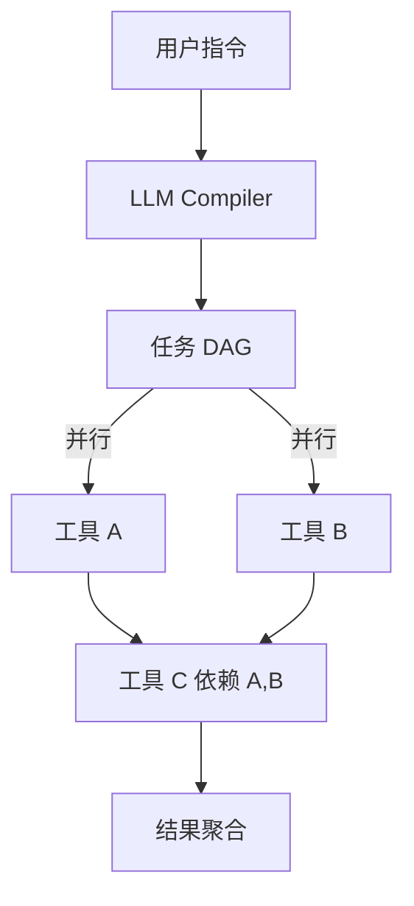
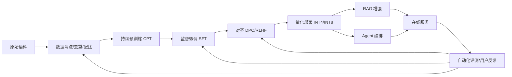

# 第 33 章 前沿扩展：MoE、多模态、Agent 与 Test-Time Scaling

## 学习目标

- 理解 MoE 架构如何实现参数规模与计算量的解耦及其核心工程挑战
- 掌握原生多模态模型统一 Tokenizer 与交错训练的建模范式差异
- 了解 LLM Agent 核心认知架构（ReAct/Plan-and-Execute/Reflexion）的适用边界与工具调用标准化
- 掌握 Test-Time Scaling 中过程奖励模型（PRM）与树搜索（MCTS/Beam Search）的协作机制
- 能设计领域大模型端到端工程流水线：数据清洗、持续预训练、SFT、对齐、量化、RAG、Agent、评测闭环

## 33.1 生活类比

想象 **MoE (混合专家模型)** 是一家 **“按需调度的专家咨询公司”**：**总参数量** = 公司签约的**所有专家总数**（可能上万名，涵盖法律、医疗、代码、写作等）；**激活参数量** = 客户提问时，**实际被叫来开会的专家数**（仅 2-3 位，Top-k 路由）；**Router (路由器)** = **智能前台**，听清问题关键词，决定找「法律专家」还是「代码专家」；**负载均衡损失** = **绩效考核机制**，防止前台只偏爱某几位明星专家，导致其他专家「吃闲饭」技能退化；**专家并行通信** = 专家们开会前**同步案卷资料**的开销，专家太多、会议太频，光传资料就耗光时间。想象 **原生多模态** 是一个 **“天生通感的多媒体创作者”**：**传统对齐范式 (CLIP+LLM)** = **“翻译官模式”**：画师画图 → 翻译官用文字描述 → 作家据此写故事（信息两次压缩，细节丢失）；**原生多模态** = **“全能创作者”**：大脑同一区域直接处理**像素块 Token**和**文字 Token**，想画就画、想写就写，图文交错如行云流水；**统一 Tokenizer** = **“通用思维词汇表”**，把图像切成 8192 种「视觉音节」，和文字共用一本字典。想象 **LLM Agent** 是一个 **“配备工具箱的实习项目经理”**：**ReAct** = **“边想边干”**：想一步、跑一步去查资料/敲代码、看结果再想下一步（灵活但易跑偏）；**Plan-and-Execute** = **“先甘特图再施工”**：先把整个项目拆解成任务图（DAG），再指挥团队并行干活（结构化、可并行）；**Reflexion** = **“写复盘日志”**：项目翻车后，不罚款、不骂人，让他写份《反思笔记》，下次避坑（语言层面的强化学习）；**Function Calling / MCP** = **“标准化外包接口文档”**：统一规定好参数格式、权限、返回值，PM 不用靠猜、靠沟通，直接按文档调用。想象 **Test-Time Scaling** 是 **“考试时允许草稿纸、允许检查、允许重考”** 的规则变革：**Train-time Scaling (预训练/微调)** = **“平时拼命刷题、背答案”**，上考场闭卷裸考（单次前向传播）；**Test-Time Scaling** = **“考场上发草稿纸、给红笔、给计算器、甚至允许组团讨论”**：**生成 N 条路径** = **“多写几套解题思路”**；**PRM (过程奖励模型)** = **“逐步给分的阅卷老师”**：不只看最终答案，每一步推理打分，哪步逻辑跳跃立马扣分；**MCTS / Beam Search** = **“在草稿纸上剪枝、回溯、找最优解”**；**代价** = 考试时间从 2 小时变 4 小时（推理延迟增加），但及格率飙升。想象 **端到端领域大模型构建** 是 **“把通才博士培养成‘持证上岗’的专科医生”** 的标准化住院医师规培流程：**数据清洗** = **“整理病历档案、去重、脱敏”**；**持续预训练 (CPT)** = **“系统学习医学教材、最新指南”**（注入领域知识底座）；**SFT (监督微调)** = **“跟着名医轮转、抄病历、学问诊模版”**（学会格式与流程）；**对齐 (DPO/RLHF)** = **“医德考核、病例复盘、医患沟通演练”**（守规矩、少幻觉、懂拒答）；**量化部署** = **“精简装备上战场”**：把大箱子教科书压缩成口袋手册（INT4/INT8），不耽误开刀；**RAG 增强** = **“查阅最新版药典、医保目录”**：大脑记不住、过时了，现查现用；**Agent 编排** = **“处理疑难杂症 MDT 会诊”**：拆解病情 → 调用检索/计算/影像工具 → 多科室协作 → 给方案；**评测飞轮** = **“定期考核+病人满意度回访 → 反馈进教学大纲 → 下一届规培更强”**。

## 33.2 概念地图

前沿扩展：MoE、多模态、Agent 与 Test-Time Scaling
├── 混合专家模型
│   ├── 稀疏门控路由机制          —— P001
│   ├── 负载均衡损失与辅助损失    —— P001
│   ├── 专家并行与 All-to-All 通信  —— P001
│   ├── 细粒度专家与共享专家      —— P001
│   └── 推理内存墙与部署优化      —— P001
├── 原生多模态
│   ├── 统一 Tokenizer (VQ-VAE)     —— P002
│   ├── 图文交错序列建模            —— P002
│   ├── 单一 Transformer 联合训练   —— P002
│   └── 模态竞争与训练稳定性      —— P002
├── LLM Agent
│   ├── 认知架构范式
│   │   ├── ReAct (推理+行动交织)    —— P003
│   │   ├── Plan-and-Execute (显式规划) —— P003
│   │   └── Reflexion (语言强化学习)  —— P003
│   ├── 工具生态标准化
│   │   ├── Function Calling 协议    —— P003
│   │   └── MCP (Model Context Protocol) —— P003
│   ├── 长程规划机制
│   │   ├── 树搜索 / ToT / MCTS      —— P003
│   │   ├── DAG 任务图并行执行       —— P003
│   │   └── LLM Compiler 编译优化    —— P003
│   └── 多 Agent 协作
│       ├── MetaGPT / ChatDev 角色扮演 —— P003
│       ├── AutoGen 群聊模式         —— P003
│       └── 辩论/反思机制           —— P003
├── Test-Time Scaling
│   ├── 过程奖励模型 (PRM)           —— P004
│   ├── 搜索算法
│   │   ├── Beam Search              —— P004
│   │   └── MCTS (蒙特卡洛树搜索)     —— P004
│   ├── 自我修正与验证机制           —— P004
│   └── 推理预算动态分配             —— P004
└── 端到端领域大模型构建
    ├── 数据工程：清洗、去重、配比  —— P005
    ├── 分阶段训练
    │   ├── 持续预训练 (CPT)       —— P005
    │   ├── 监督微调 (SFT)         —— P005
    │   └── 对齐 (DPO/RLHF)        —— P005
    ├── 部署优化：量化、RAG、Agent  —— P005
    └── 评测飞轮：离线基准+在线A/B  —— P005

## 33.3 混合专家模型 —— 让参数规模与计算量解耦

### 33.3.1 为什么需要 MoE：稀疏激活的直觉

在密集模型中，每一个 Token 都会流经模型的所有参数。这意味着参数总量 $N$ 与单次前向计算量 $FLOPs$ 呈线性绑定：想要更大的模型容量（知识存储），就必须支付成比例的推理算力成本。但生物大脑和人类认知并非如此——面对数学题我们调用逻辑区，面对翻译任务我们调用语言区。**稀疏激活先验** 告诉我们：对于任意特定输入，模型只需激活其参数子集即可完成处理。

MoE（Mixture of Experts）正是将这一先验显式建模：维持巨大的**总参数量**作为知识容器，但通过**路由器**动态选择仅有的少数**专家**参与计算，从而实现**参数规模与计算量的解耦**。

### 33.3.2 核心定义与数学形式化

> "The Mixture of Experts layer consists of a set of expert networks $E_i$ and a gating network $G$ that outputs a sparse probability distribution over the experts."
> 
> ——《Switch Transformer》[P001]

一个标准的 MoE 层包含 $N$ 个专家网络 $E_1, ..., E_N$（通常为 FFN）和一个路由器（门控网络）$G$。给定输入 Token 表示 $x \in \mathbb{R}^d$：

**路由器计算**：
路由器通常是一个线性层，将输入映射为专家数量维度的 logits，再经 Softmax 得到门控权重：
$$
\text{logits} = x W_g^T \quad \in \mathbb{R}^N
$$
$$
G(x) = \text{Softmax}(\text{logits}) \quad \in \mathbb{R}^N
$$

**稀疏 Top-k 选择**：
仅保留最大的 $k$ 个权重，其余置零，得到稀疏门控向量 $\tilde{G}(x)$。通常 $k=1$ 或 $k=2$。

**专家计算与加权求和**：
$$
y = \sum_{i=1}^N \tilde{G}_i(x) \cdot E_i(x)
$$

这个公式展示了 MoE 的核心机制：输入 $x$ 仅被路由到 Top-k 个专家，计算量与 $k$ 成正比，而与总专家数 $N$ 无关。这实现了**计算量恒定、参数量可无限扩展**的理想特性。

### 33.3.3 关键工程挑战与解法

#### 负载均衡：防止专家“偏科”

若路由器倾向于固定选择少数专家，会导致：**专家塌缩**（Expert Collapse）——部分专家从未被训练，参数浪费；**硬件负载不均**——部分 GPU 显存/算力闲置，部分过载。

**解法：辅助负载均衡损失**。Switch Transformer [P001] 引入：
$$
\mathcal{L}_{\text{balance}} = \alpha \cdot N \sum_{i=1}^N f_i \cdot P_i
$$
其中 $f_i$ 为第 $i$ 个专家被路由的 Token 比例（频率），$P_i$ 为路由器输出概率在该专家上的平均值。该损失鼓励 $f_i \approx 1/N$ 且 $P_i$ 均匀。

> "We add an auxiliary loss to encourage equal load balancing across experts... This loss is crucial for training stability."
> 
> ——《Switch Transformer》[P001]

#### 专家并行与 All-to-All 通信

训练时，同一批次的不同 Token 被路由到不同设备上的专家。这需要 **All-to-All 通信**：每个设备将本地 Token 按目标专家分发，再接收属于本地专家的 Token。



通信量与 Token 数、隐藏维度成正比。**DeepSeekMoE** [P001] 提出**设备受限路由**：将路由限制在同一设备内的专家子集，大幅削减跨节点通信。

#### 细粒度专家与共享专家

DeepSeekMoE 进一步将专家粒度细化（如 256 个专家，每层激活 8 个），并引入**共享专家**（始终激活的专家），承载通用知识，减少路由器决策压力，提升训练稳定性。

#### 推理内存墙

推理时，所有专家权重必须常驻显存/内存。对于万亿参数 MoE，单机部署面临严峻内存墙。工程对策包括：**专家卸载到 CPU/SSD**、**专家量化 (INT4/INT8)**、**稀疏推理引擎（如 vLLM 支持 MoE）**。

### 33.3.4 典型代表对比

| 模型 | 路由策略 | 专家粒度 | 关键创新 | 适用场景 |
|------|----------|----------|----------|----------|
| Switch Transformer | Top-1 + 辅助损失 | 粗粒度 (32-128) | 验证万亿参数可行性，简化路由 | 大规模预训练研究 |
| DeepSeekMoE | Top-k + 设备受限路由 + 共享专家 | 细粒度 (64-256) | 通信优化、训练稳定、工程落地标杆 | 生产级训练与部署 |
| GLaM / GShard | Top-2 + 负载均衡 | 中等 | 早期工程实践，TensorFlow 生态 | 历史参考 |

---

## 33.4 原生多模态 —— 让模型天生会“看图说话”

### 33.4.1 范式对比：对齐 vs 原生

**传统对齐范式**：

缺点：视觉信息经过两次压缩，细节丢失；仅支持“图→文”单向理解，难以原生生成图文交错内容。

**原生多模态范式**：

核心优势：统一 Token 空间、联合建模、原生支持任意模态输入输出组合。

### 33.4.2 统一 Tokenizer 设计

**VQ-VAE 离散化流程**：
1. 图像 $I \in \mathbb{R}^{H \times W \times 3}$ 经编码器 $E$ 得到连续潜变量 $z_e \in \mathbb{R}^{h \times w \times d}$。
2. 码本 $\mathcal{C} = \{e_k\}_{k=1}^K, e_k \in \mathbb{R}^d$（典型 $K=8192$）。
3. 最近邻量化：$z_q = \arg\min_{e_k \in \mathcal{C}} \|z_e - e_k\|$。
4. 解码器 $D$ 从 $z_q$ 重建图像。

**词表合并**：
文本词表大小 $V_{text}$（如 32k），视觉码本 $K$（如 8192），合并后统一词表 $V = V_{text} + K + N_{special}$。特殊 Token（``, `</img>`, `<boi>`, `<eoi>`）标识模态边界。

> "We unify the vocabulary by treating image tokens as additional special tokens... allowing a single Transformer to model interleaved sequences."
> 
> ——《Chameleon》[P002]

### 33.4.3 交错序列建模与训练目标

输入序列示例：
```
[用户提问文本]  [图像 Token 1] [图像 Token 2] ... [图像 Token 1024] </img> [回答文本] ...
```
统一使用**自回归下一 Token 预测**目标：
$$
\mathcal{L} = -\sum_t \log P(x_t | x_{<t})
$$
无需区分模态，Transformer 自动学习跨模态注意力。

### 33.4.4 核心挑战与缓解策略

| 挑战 | 成因 | 缓解策略 |
|------|------|----------|
| **图像离散化损失** | VQ-VAE 压缩率高（如 16×16→1 Token），高频纹理丢失 | 更大码本、更小压缩率、扩散 Tokenizer 探索 |
| **模态竞争** | 文本/图像损失尺度不一，梯度冲突导致文本能力退化 | 损失加权、模态特定学习率、数据配比调节（文本:图像 ≈ 10:1 → 1:1 动态调整） |
| **训练不稳定** | 多模态损失景观复杂，易发散 | 更小初始化、梯度裁剪、分阶段训练（先文本后多模态） |
| **推理延迟** | 图像 Token 序列极长（1024+），自回归生成慢 | 并行解码、投机解码、非自回归头 |

---

## 33.5 LLM Agent —— 赋予模型“手脚”与“规划大脑”

### 33.5.1 认知架构三大范式演进

#### ReAct：推理与行动交织

```mermaid
graph TD
    Q[用户问题] --> Thought1[Thought: 我需要查天气API]
    Thought1 --> Action1[Action: get_weather(city=北京)]
    Action1 --> Obs1[Observation: 晴, 25°C]
    Obs1 --> Thought2[Thought: 现在知道天气了，可以回答]
    Thought2 --> Answer[Final Answer: 北京今天晴，25°C]
```

优点：灵活、适合知识密集型、步数不定任务。缺点：易陷入循环、缺乏全局规划、Token 消耗不可控。

#### Plan-and-Execute：显式规划与执行分离

**阶段 1 - Planner**：生成结构化任务图（DAG）。
```json
{
  "plan": [
    {"id": 1, "tool": "pdf_parse", "args": {"file": "report.pdf"}, "deps": []},
    {"id": 2, "tool": "python_exec", "args": {"code": "calc_cagr(...)"}, "deps": [1]},
    {"id": 3, "tool": "plot", "args": {"data": "ref:2"}, "deps": [2]},
    {"id": 4, "tool": "html_render", "args": {"chart": "ref:3"}, "deps": [3]}
  ]
}
```

**阶段 2 - Executor**：拓扑排序并行执行，支持失败重试。
优点：结构化、可并行、易调试、Token 可控。缺点：规划错误难恢复、动态环境适应性弱。

#### Reflexion：语言强化学习

引入**语言层面的奖励信号**：执行失败 → LLM 生成自然语言反思 → 更新策略/记忆 → 重试。

```python
# 伪代码
trajectory = run_agent(task)
if not success:
    reflection = llm.generate(f"Task failed. Trajectory: {trajectory}. Reflect on mistakes.")
    memory.add(reflection)  # 存入长时记忆
    retry_with_memory(task, memory)
```

### 33.5.2 工具调用标准化：Function Calling 与 MCP

**OpenAI Function Calling Schema**：
```json
{
  "name": "python_exec",
  "description": "Execute Python code in sandbox",
  "parameters": {
    "type": "object",
    "properties": {
      "code": {"type": "string", "description": "Python code to execute"},
      "timeout": {"type": "integer", "default": 30}
    },
    "required": ["code"]
  },
  "returns": {"type": "object", "properties": {"stdout": {"type": "string"}, "stderr": {"type": "string"}, "exit_code": {"type": "integer"}}}
}
```

**MCP (Model Context Protocol)** 优势：
- **传输层中立**：支持 stdio、SSE、WebSocket 等多种传输
- **能力发现**：动态列出可用工具/资源/提示词，无需硬编码
- **版本管理**：工具版本化，支持向后兼容
- **权限控制**：细粒度访问控制（读/写/执行）

### 33.5.3 长程规划：树搜索与 LLM Compiler

**ToT (Tree of Thoughts)**：在推理步骤层面构建树，每个节点为一个部分解，通过启发式/价值函数剪枝。

**LLM Compiler**：将自然语言指令编译为并行执行计划图（DAG），识别任务间依赖，最大化并行度。



### 33.5.4 多 Agent 协作模式

| 框架 | 协作模式 | 典型应用 | 通信机制 |
|------|----------|----------|----------|
| MetaGPT / ChatDev | 角色扮演 + SOP 流程 | 软件开发全流程 | 结构化消息 + 共享内存 |
| AutoGen | 群聊 + 代理代理 | 通用问题求解 | 自然语言对话 + 代码块 |
| LangGraph | 状态图编排 | 复杂业务流程 | 显式状态机 + 检查点 |

---

## 33.6 Test-Time Scaling —— 让模型“多思考一会儿”就变强

### 33.6.1 范式转移：从训练时扩展到推理时扩展

传统 Scaling Law：$L(N, D, C) \approx \frac{A}{N^\alpha} + \frac{B}{D^\beta}$ —— 靠堆参数、数据、算力。
**Test-Time Scaling** 开辟新维度：固定模型参数，在推理时投入更多计算 $C_{test}$ 换取更低 Loss/更高 Acc。

### 33.6.2 核心组件：PRM + 搜索

#### 过程奖励模型 (PRM)

PRM 对推理**每一步**打分，而非仅看最终答案（ORM, Outcome Reward Model）。

> "Process supervision encourages the model to produce valid reasoning steps... mitigating reward hacking where the model guesses the answer but uses invalid logic."
> 
> ——《Let's Verify Step by Step》[P004]

**训练数据构建**：人工标注每一步的正确性，或用强模型（GPT-4）生成正/反例对进行偏好学习。

**推理时评分**：
对于推理路径 $\tau = (s_1, s_2, ..., s_T)$：
$$
\text{Score}(\tau) = \frac{1}{T} \sum_{t=1}^T \text{PRM}(s_t | s_{<t}, x)
$$
或仅取最后一步分数 $\text{PRM}(s_T | s_{<T}, x)$。

#### 搜索算法

**Beam Search**：
维护宽度为 $B$ 的候选集，每步扩展后按 PRM 分数保留 Top-B。

**MCTS (Monte Carlo Tree Search)**：
在 Token 树上平衡**探索**与**利用**，PUCT 公式：
$$
\text{PUCT}(s, a) = Q(s,a) + c \cdot P(s,a) \frac{\sqrt{N(s)}}{1 + N(s,a)}
$$
其中 $Q$ 为平均奖励，$P$ 为先验策略概率，$N$ 为访问次数。MCTS 支持**回溯**：发现死胡同可返回父节点探索其他分支。

### 33.6.3 计算分配策略

| 策略 | 适用场景 | 计算开销 | 性能增益 |
|------|----------|----------|----------|
| Best-of-N (N=8-64) | 简单任务、延迟敏感 | 线性 $O(N)$ | 中等 |
| Beam Search (B=4-8) | 结构化推理、代码 | $O(B \times \text{steps})$ | 高 |
| MCTS (模拟数 50-200) | 极难数学/逻辑、离线批处理 | 高，可控 | 最高 |
| 自适应预算 | 生产系统 | 动态 | 最优性价比 |

### 33.6.4 局限与风险

- **延迟墙**：推理延迟从秒级 → 分钟级，实时交互受限。
- **PRM 泛化难**：易过拟合训练题型分布，OOD 任务失效。
- **奖励作弊**：PRM 自身可能给错误推理高分（如“自信地胡说八道”）。
- **自我修正失效**：模型难以在没有外部验证器（代码执行器、证明助手）的情况下可靠自我修正。

---

## 33.7 端到端领域大模型构建 —— 工程全景图

### 33.7.1 全生命周期流水线



### 33.7.2 关键阶段决策清单

#### 数据工程
- **配比**：领域语料 : 通用语料 = 1:1 ~ 1:10（视领域稀缺度）。
- **去重**：MinHash (Jaccard 阈值 0.7-0.9) + 精确哈希去重。
- **质量过滤**：训练小模型打分、启发式规则（长度、特殊字符、语言识别）。

#### 持续预训练 (CPT)
- **学习率**：预训练峰值 LR 的 1/10 ~ 1/100，余弦衰减至 0。
- **数据顺序**：课程学习——易→难、通用→领域、短→长。
- **混合精度**：BF16 标配，FP8 探索中（需硬件支持 H100+）。

#### 监督微调 (SFT)
- **模板**：ChatML（系统/用户/助手角色分隔）优于 Alpaca。
- **Loss 掩码**：仅计算 Assistant 部分 Token 的 CE Loss。
- **LoRA 配置**：$r=64 \sim 128, \alpha=2r$，Target modules: q/k/v/o/gate/up/down。

#### 对齐
| 算法 | 优势 | 劣势 | 适用场景 |
|------|------|------|----------|
| DPO | 无 RM、无 PPO、稳定、单阶段 | 需偏好对数据、隐式 RM 容量受限 | 偏好数据充足、工程资源有限 |
| PPO/RLHF | 显式 RM、理论完备 | 训练极不稳定、超参敏感、需 4 模型 | 极高性能要求、有专业 RL 团队 |
| ORPO | 无参考模型、SFT+Align 一体 | 较新、超参敏感 | 想省显存、单阶段完成 |

#### 部署优化
- **量化**：W4A16 精度损失 <1%，W4A4/KV Cache 量化需校准。
- **RAG 策略**：父子文档（长上下文检索 + 精细重排）+ HyDE（假设性文档嵌入改写查询）。
- **Agent 范式**：结构化任务选 Plan-and-Execute + LLM Compiler；探索型任务选 ReAct + Reflexion。

#### 评测飞轮
- **离线**：自建领域基准（金融问答、代码生成单测通过率）+ 规则校验（格式、引用、计算正确性）。
- **在线 A/B**：采纳率、人工修改率、幻觉投诉率、任务完成时长。
- **触发条件**：幻觉率 > 5% 启动新一轮 DPO；新法规发布 24h 内增量 CPT+RAG 索引更新。

### 33.7.3 系统性风险与对策

| 风险 | 表现 | 对策 |
|------|------|------|
| **灾难性遗忘** | CPT/SFT 后通用推理/对话能力下降 | Replay Buffer (5-10% 通用数据)、KL 约束、合成数据回放 |
| **评测污染** | 测试集泄露导致指标虚高 | 哈希去重、动态基准（定期更新）、人工红队测试 |
| **数据合规** | 版权争议、PII 泄露、输出违规 | 数据溯源、脱敏管线、输出护栏（关键词/分类器拦截） |

---

## 33.8 多源对照

### 共识

- **MoE** 是突破密集模型参数-计算绑定的主流路径，细粒度专家+共享专家+设备受限路由是工程落地共识。
- **原生多模态** 统一 Tokenizer + 交错序列建模是长期技术方向，VQ-VAE 离散化是当前主流，但扩散 Tokenizer 潜力大。
- **Agent** 需要 Planning + Memory + Tool Use 三位一体，Function Calling/MCP 是工具生态标准化基石。
- **Test-Time Scaling** 通过 PRM + 树搜索实现推理时计算与性能的新换算关系，o1 验证了可行性。
- **领域模型** 必须走端到端工程化流水线，评测飞轮是持续迭代核心驱动力。

### 分歧

| 议题 | 观点 A | 观点 B | 综合建议 |
|------|--------|--------|----------|
| **MoE 推理部署** | 专家卸载到 CPU/SSD 可行 | 专家并行多卡部署更稳 | 小批量/长上下文卸载；高吞吐多卡专家并行 |
| **多模态 Tokenizer** | VQ-VAE 足够，追求压缩率 | 扩散/连续 Tokenizer 更强 | 理解任务 VQ-VAE；生成任务探索连续/扩散 |
| **Agent 规划** | ReAct 灵活通用 | Plan-and-Execute 更鲁棒 | 简单任务 ReAct；复杂长程任务 Plan-and-Execute |
| **对齐算法** | DPO 够用、工程友好 | PPO 上限更高、理论完备 | 起步用 DPO，追求极致再投入 PPO |
| **Test-Time 计算** | Beam Search 性价比最高 | MCTS 必须用于最难任务 | 分级策略：易题 BoN，中题 Beam，难题 MCTS |

---

## 33.9 设计中的取舍

### 为什么不用密集模型堆参数而是搞 MoE？

密集模型参数量 $N$ 与 FLOPs 线性绑定，万亿参数模型单次前向需 $2 \times 10^{15}$ FLOPs，推理成本不可承受。MoE 以**通信开销**和**内存占用**为代价，换取**计算量恒定、参数量可扩展**的收益。Trade-off：训练稳定性更难、推理内存墙更高、通信成为新瓶颈。

### 原生多模态 vs 对齐范式，如何选？

**对齐范式**：工程成熟、训练稳定、复用现有强 LLM/视觉编码器、适合“理解为主、生成弱”场景。**原生多模态**：统一建模优雅、原生生成图文交错、长期上限高，但训练极不稳定、数据饥渴、推理慢。建议：现有业务快速落地用对齐；自研基座模型、追求原生生成能力投入原生。

### DPO vs PPO：对齐算法的终局之战？

DPO 将 RLHF 目标显式求解为分类损失，移除 RM 和 PPO，工程极简。**但 DPO 隐式 RM 容量受限于策略模型，偏好数据分布偏移时易过拟合**。PPO 显式 RM 容量可独立扩展，理论上限更高。工程实践：**90% 场景 DPO 足够；极高风险/高价值场景（医疗、法律、金融合规）投入 PPO**。

### Test-Time Scaling 值不值得推广？

**值得**，但需分场景：离线批处理（报告生成、代码审查、科研推理）大力推行 MCTS+PRM；实时交互（客服、聊天）仅用 Best-of-N 或 Beam Search (B=2-4)；流式输出场景需支持**增量搜索**（先生成草稿再逐步修正）。

---

## 33.10 动手练习

### 练习 1：MoE 路由机制与负载均衡手算推演

假设有 8 个专家，批次大小 4，序列长度 2，Top-1 路由。
某层 Router 输出 logits (shape: [4, 2, 8]) 对第 0 个样本第 0 个 Token 为：[0.1, 0.5, 0.05, 0.8, 0.2, 0.3, 0.05, 0.1]。
1. 该 Token 被路由到哪个专家？门控权重 G 如何计算（Softmax 还是 Sigmoid）？
2. 若该批次所有 Token 均路由到专家 3，计算该专家的负载均衡辅助损失（假设均匀分布为目标）。
3. 回答问题：
   - 为什么 Top-1 配合辅助损失比 Top-k (k>1) 更利于通信优化？
   - 什么是“专家塌缩”？如何通过噪声注入或熵正则化缓解？

### 练习 2：原生多模态 Tokenizer 设计权衡

某原生多模态模型采用 VQ-VAE 将 256x256 图像压缩为 16x16 离散 Token，码本大小 8192。
1. 计算单张图像对应的视觉 Token 数量及压缩率（假设原始像素 3 通道 8bit）。
2. 视觉 Token 与文本 Token 共享词表时，需预留特殊 Token 标识模态边界（如 ``, `</img>`），这会如何影响文本词表的有效容量？
3. 回答问题：
   - 为什么 VQ-VAE 离散化会导致高频纹理细节丢失？扩散模型为何不直接作为 Tokenizer？
   - 交错训练数据中图文比例过高（如 1:10）会导致文本能力退化，如何通过数据配比或损失加权缓解？

### 练习 3：Agent 规划范式对比与工具调用设计

任务：“根据用户上传的财报 PDF，计算过去三年营收复合增长率，并绘制趋势图输出为 HTML”。
1. 分别用 ReAct、Plan-and-Execute、LLM Compiler 三种范式写出前 3 步 Thought/Action/Plan 伪代码。
2. 设计该任务所需的 Function Calling Schema（JSON 格式），包含：PDF 解析、Python 代码执行、绘图渲染三个工具，要求定义参数类型、必填字段、错误码。
3. 回答问题：
   - ReAct 在此任务中可能陷入“死循环”（反复尝试同一错误代码），Plan-and-Execute 如何通过显式规划避免？
   - MCP (Model Context Protocol) 相比 OpenAI Function Calling 在“工具发现与版本管理”上有何优势？

### 练习 4：Test-Time Scaling 树搜索模拟

数学题：“解方程 x^2 - 5x + 6 = 0”。模型生成 3 条候选推理路径，PRM 逐步打分 (0-1)：
路径 A：因式分解 → (x-2)(x-3)=0 → x=2,3  [步骤分: 0.9, 0.95, 0.98]
路径 B：求根公式 → x=(5±√(25-24))/2 → x=3,2  [步骤分: 0.8, 0.7, 0.9]
路径 C：暴力试数 → 试 x=1,2,3... → x=2,3  [步骤分: 0.5, 0.4, 0.8]
1. 若采用 Best-of-N (按最后一步分数选)，选哪条？若按平均分选呢？
2. 模拟 Beam Search (beam=2) 过程：假设每步展开 2 个子节点，展示前两步的剪枝决策。
3. 回答问题：
   - PRM 为何对“最终答案正确但中间逻辑错误”的路径（如猜中答案）给低分？这如何防止奖励作弊？
   - MCTS 引入“探索项 (PUCT)”相比纯贪心 Beam Search 有何优势？

### 练习 5：领域大模型端到端流水线关键决策清单

场景：构建一个“金融研报生成”领域大模型（基座 7B）。请列出以下各阶段的 3 个核心工程决策点及选型理由：
1. 数据清洗与配比：公开财报、研报、新闻、通用语料的混合比例？如何去重（MinHash 阈值）？
2. 持续预训练 (CPT)：学习率调度（余弦衰减 vs 常数）、数据顺序（课程学习：易→难）、混合精度策略 (BF16/FP8)。
3. SFT 阶段：指令模板设计（ChatML vs Alpaca）、仅计算 Assistant Loss 的掩码实现、LoRA rank 选择 (r=64 vs 128)。
4. 对齐阶段：DPO vs PPO 选择依据？偏好数据构建（GPT-4 标注 vs 专家标注）、KL 惩罚系数 β 设定。
5. 部署与增强：量化精度 (W4A16 vs W8A8) 对金融数值精度影响？RAG 检索策略（父子文档 vs 假设性文档嵌入 HyDE）？Agent 规划范式选择？
6. 评测体系：离线基准（自建金融问答集 + 规则校验）、在线 A/B 指标（采纳率、修改率、幻觉投诉率）、数据飞轮触发条件（如幻觉率 > 5% 启动新一轮 DPO）。

---

## 33.11 本章小结

这一章中我们系统梳理了大模型技术前沿的四大扩展方向与一条工程落地主线。首先，我们深入剖析了 **MoE (混合专家模型)** 如何通过稀疏门控路由实现参数规模与计算量的解耦，重点讲解了负载均衡损失、专家并行通信、细粒度专家与共享专家设计，以及推理部署面临的内存墙挑战。其次，我们对比了 **原生多模态** 与传统对齐范式，详细拆解了统一 Tokenizer (VQ-VAE) 设计、图文交错序列建模、模态竞争与训练稳定性等核心技术点。接着，我们梳理了 **LLM Agent** 的三大认知架构范式——ReAct、Plan-and-Execute、Reflexion，对比了其适用边界，并深入讲解了工具调用标准化（Function Calling/MCP）、长程规划机制（ToT/MCTS/LLM Compiler）及多 Agent 协作模式。随后，我们介绍了 **Test-Time Scaling** 新范式，重点推导了过程奖励模型 (PRM) 的过程监督优势，并对比了 Beam Search 与 MCTS 在推理时搜索中的探索-利用权衡。最后，我们将全书知识点串联为 **端到端领域大模型构建流水线**，覆盖数据清洗、持续预训练、SFT、对齐、量化部署、RAG 增强、Agent 编排、自动化评测闭环，给出了各阶段的关键工程决策清单与系统性风险对策。

本章我们一起学习了以下概念：

| 概念 | 解释 |
|------|------|
| MoE (混合专家模型) | 稀疏激活实现参数量与计算量解耦，Router 动态 Top-k 选择专家，需解决负载均衡、通信开销、推理内存墙 |
| Switch Transformer | 简化为 Top-1 路由，首个验证万亿参数规模可行性的 MoE 模型 |
| DeepSeekMoE | 细粒度专家 + 共享专家 + 设备受限路由，工程落地标杆，平衡性能与部署效率 |
| 原生多模态 | 单一 Transformer 建模图文混合 Token 序列，统一 Tokenizer (VQ-VAE) 实现跨模态深度融合与生成 |
| 统一 Tokenizer | 将图像离散化为视觉 Token 并入文本词表，共享嵌入层与 Transformer 主干 |
| Chameleon | 早期原生多模态代表，采用 VQ-GAN 离散化图像，统一建模图文交错序列 |
| LLM Agent | LLM 作为大脑，结合 Planning、Memory、Tool Use、Environment 形成自主决策闭环 |
| ReAct | 推理与行动交织范式，Thought-Action-Observation 循环，适合知识密集型任务 |
| Plan-and-Execute | 显式规划与执行分离，生成 DAG 任务图再并行执行，降低推理复杂度，提升鲁棒性 |
| Reflexion | 引入语言强化学习，通过自然语言反思优化策略，实现试错修正 |
| Function Calling / MCP | 工具调用标准化协议，定义 Schema、权限、调用约定，解决工具生态碎片化 |
| LLM Compiler | 将自然语言指令编译为并行执行计划图（DAG），优化多工具调用效率 |
| Test-Time Scaling | 推理阶段投入更多计算（搜索、验证、修正）换取性能，开辟推理算力与性能新 Scaling Law |
| 过程奖励模型 (PRM) | 对推理每一步打分而非仅看最终答案，引导搜索避开逻辑错误节点，核心训练难点在于逐步标注数据 |
| MCTS / Beam Search 在推理时的应用 | 在 Token 树上平衡探索与利用，寻找高奖励推理路径，支持回溯修正 |
| 端到端领域大模型流水线 | 数据清洗 → CPT → SFT → 对齐 → 量化 → RAG → Agent → 评测闭环，全生命周期工程化标准化 |
| 灾难性遗忘缓解 | 持续预训练/微调中通过 Replay Buffer、KL 约束、合成数据回放保持通用能力 |
| 评测污染防范 | 哈希去重、动态基准、人工红队测试，保证评测指标真实反映模型能力 |

下一章中，我们将学习 **大模型安全与对齐前沿**，包括红队测试方法论、越狱攻击与防御、宪法 AI、可解释性探针、以及超级对齐的理论与实践探索。感谢你读到了这里，恭喜你已经完成了大模型核心技术体系的系统性学习！
