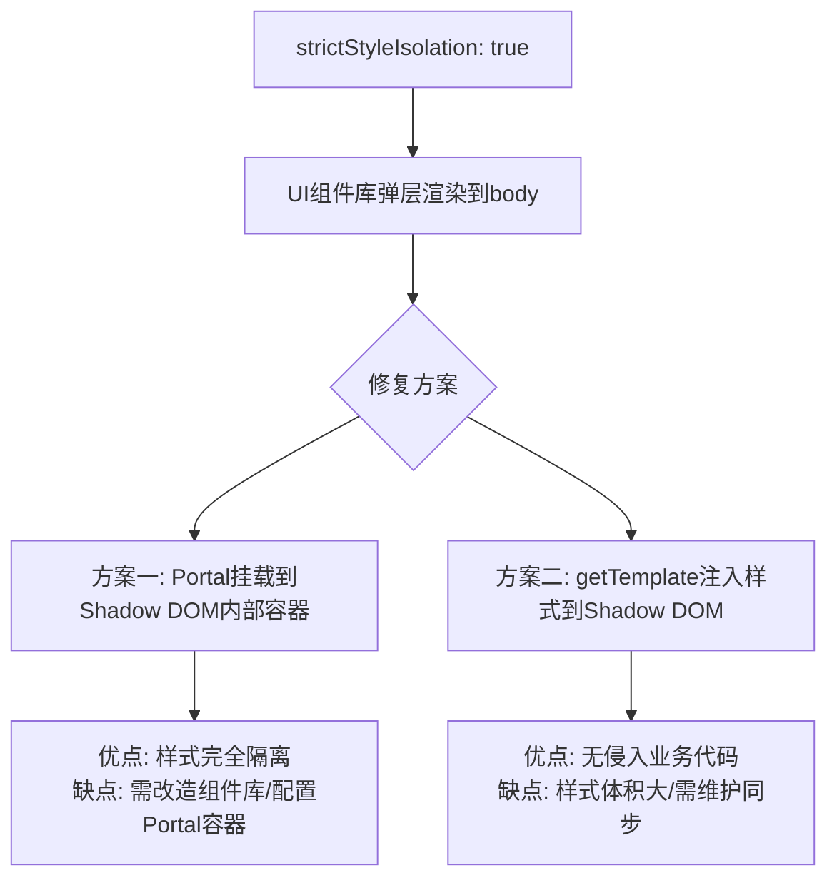

# 第 43 章 微前端架构落地 —— 从 qiankun 到 Module Federation 的技术选型与治理

## 学习目标

- 建立微前端架构决策的量化评估体系，避免盲目跟风引入技术债
- 掌握 qiankun 双沙箱机制、样式隔离方案与生命周期管理的核心原理
- 理解 Module Federation 运行时依赖共享、版本协商与类型安全的工程化落地
- 制定覆盖依赖治理、路由分发、组件库共享、监控统一的微前端治理规范
- 设计遗留系统微前端化改造的增量演进路径、灰度发布策略与回滚预案

## 43.1 生活类比

想象微前端架构是一个**大型商场的经营模式转型**：

- **架构决策矩阵** = **商场选址可行性报告**：不是所有店铺都适合做商场（团队<10人/单仓库=街边小店，强行做商场=空置率高）；只有客流大(团队>10人)、品类多(多技术栈)、商家想自主装修(独立部署)时，才值得建商场。
- **qiankun** = **全托管柜台模式**：商场方(基座)提供统一装修标准(沙箱)、安检隔离(样式隔离)、统一收银系统(通信机制)、预备库存(预加载)；商家(子应用)只需按规范入驻(导出生命周期)，退店时必须清空垃圾(unmount清理副作用)，否则影响下一任商家。
- **Module Federation** = **品牌联营/共享供应链模式**：不再由商场统一装修，而是品牌方(Remote)自带货柜(模块)直接进场；核心优势是共享供应链(shared依赖单例)——所有品牌共用一套物流(React/Vue)、收银台(UI库)，避免重复建设；但需签严格合同(版本协商)，防止供应链版本冲突(版本地狱)。
- **治理规范** = **商场管理条例**：统一招牌规范(路由前缀)、统一会员体系(监控SDK)、统一消防安检(CI门禁)、统一装修风格(组件库单例)；违规者拒绝开业(阻断合并)，但设立“特色品牌申请通道”(新依赖评审流程)保留创新空间。
- **遗留系统改造** = **老旧商场分期改造不歇业**：不能推倒重来(大爆炸重写)，必须分区围挡(边界拆分)、夜间施工(灰度发布)、保留旧通道(版本化目录回滚)、统一水电接口(动态publicPath/Router base)；最难的是共享会员数据迁移(共享状态)和拆除违建广告牌(清理全局CSS污染)。

## 43.2 概念地图

微前端架构落地
├── 架构决策矩阵
│   ├── 触发条件量化：团队规模>10人/多仓库/独立发布/技术栈迁移  —— P001
│   ├── 收益成本权衡：开发效率 vs 基建成本、运行时性能 vs 部署自主权  —— P001
│   └── 可逆性评估：模块化单体作为过渡方案、半年复盘校准机制  —— P001
├── qiankun 沙箱隔离方案
│   ├── 双沙箱模式：Snapshot(单实例/低版本) vs Proxy(多实例/现代浏览器)  —— P002
│   ├── 样式隔离策略：strictStyleIsolation(Shadow DOM) vs experimentalStyleIsolation(scoped CSS)  —— P002
│   ├── 预加载机制：浏览器空闲期预下载静态资源降低首屏延迟  —— P002
│   ├── 主子通信：initGlobalState 发布订阅模式、避免循环更新  —— P002
│   └── 坑位规避：嵌套微前端禁用、unmount彻底清理副作用、公共依赖去重、Shadow DOM弹层修复  —— P002
├── Module Federation 原生联邦
│   ├── 核心配置三元组：exposes/remotes/shared  —— P003
│   ├── 运行时版本协商：requiredVersion/singleton/eager 策略  —— P003
│   ├── 类型安全方案：@module-federation/typescript 或手动维护 d.ts  —— P003
│   ├── 热更新机制：Remote 重新构建、Host 刷新获取、缓存策略处理  —— P003
│   └── 边界条件：版本地狱治理、循环依赖单向化、CSS隔离自行约定、ErrorBoundary降级  —— P003
├── 微前端治理规范
│   ├── 依赖版本锁定：基座dependencies锁定/子应用peerDependencies引用/externals排除  —— P004
│   ├── 路由分发协议：基座持有全局路由表/子应用声明式注册前缀/禁止直接操作history  —— P004
│   ├── 通用组件库强制共享：@enterprise/ui单例/禁止私自引入/导出reset.css  —— P004
│   ├── 监控埋点统一：基座初始化SDK/暴露reportError/trackEvent/TraceID透传  —— P004
│   └── CI/CD门禁：mf-dep-check版本兼容性检测/manifest.json版本编排/金丝雀灰度  —— P004
└── 遗留系统微前端化改造
    ├── 资产梳理：自动化扫描入口/路由/依赖/全局变量/CSS污染源  —— P005
    ├── 边界拆分：按业务域/团队所有权/变更频率划分/提取共享内核下沉基座  —— P005
    ├── 构建改造：动态publicPath/libraryTarget:umd/剥离HTML模版/Router base动态化  —— P005
    ├── 灰度发布：Nginx分流(split_clients/Lua)/Cookie一致性/监控指标自动全量回滚  —— P005
    ├── 回滚预案：版本化目录保留/manifest一键切回/RTO<5分钟  —— P005
    └── 硬骨头攻关：共享状态迁移/样式污染清理(Shadow DOM+Portal)/团队RACI矩阵对齐  —— P005

## 43.3 架构决策矩阵 —— 量化评估何时需要微前端

### 43.3.1 为什么需要这个概念？

微前端并非银弹，盲目引入会带来巨大的工程复杂度（沙箱隔离、样式隔离、通信机制、部署编排）。当团队面临单体应用臃肿、多人协作冲突、技术栈升级受阻、独立部署需求等痛点时，需要理性的决策依据而非主观臆断。缺乏量化标准会导致架构决策随意性大，事后难以复盘和归因。

> "引入决策树：团队>10人/多仓库/独立发布/技术栈迁移等触发条件，量化微前端收益与复杂度成本。"
> 
> ——《P001》

### 43.3.2 核心定义

**架构决策矩阵** 是一套基于团队规模、部署频率、技术栈异构度、业务耦合度等关键维度的量化评估模型。通过设定阈值（如团队>10人、多仓库独立发布、技术栈迁移过渡期），将架构决策从“拍脑袋”转变为“数据驱动”。

> "架构决策矩阵：单体 vs 微前端——团队规模、部署频率、技术栈异构度量化评估"
> 
> ——《P001》

### 43.3.3 关键性质

#### 决策树结构

决策矩阵采用三阶段流程：
1. **满足核心触发条件**：团队规模 > 10 人、多仓库管理、独立发布需求、技术栈迁移过渡期
2. **评估收益成本比**：开发效率提升 vs 基建投入成本；运行时性能损耗 vs 部署自主权；技术栈自由度 vs 认知负荷增加
3. **产出 ADR（架构决策记录）**：记录决策背景、备选方案、权衡结果、复盘指标

#### 权衡维度对照表

以下是微前端引入的核心权衡维度：

| 维度 | 收益 | 成本/风险 |
|------|------|-----------|
| **开发效率** | 团队自主开发、技术栈自由、按需构建 | 基建投入大（沙箱、CI/CD、治理工具）、跨应用调试难 |
| **部署自主权** | 独立发布、回滚、灰度，不阻塞他人 | 部署编排复杂、版本兼容性维护成本高 |
| **运行时性能** | 按需加载子应用、首屏资源减少 | 沙箱代理开销、重复依赖加载、通信序列化损耗 |
| **技术栈演进** | 渐进式迁移、新旧技术共存 | 多版本共存风险、认知负荷增加、人才梯队要求高 |

这个表格展示了微前端架构在四个核心维度上的收益与代价，你需要根据团队实际情况量化打分。

#### 可逆性评估

决策矩阵必须包含回退路径评估。推荐**模块化单体**作为过渡方案：在单仓库内通过目录隔离、构建产物分离模拟微前端边界，先验证团队协作模式、CI/CD 流程，成熟后再剥离为独立仓库。

### 43.3.4 典型例子

**场景 A：不适合微前端**
- 5人团队、单仓库、周发布、纯 Vue 栈
- 矩阵判分：低收益/高成本
- 决策：继续单体，推行模块化治理（目录隔离、ESLint 规范、模块化构建）

**场景 B：适合微前端**
- 20人团队、多仓库、日发布、Vue/React 共存、老系统迁移
- 矩阵判分：高收益/可控成本
- 决策：采用微前端（qiankun 或 Module Federation）

### 43.3.5 边界条件

- **伪需求拦截**：仅因“想尝试新技术”而引入微前端属于技术债驱动，非业务驱动，矩阵会拦截此类伪需求。
- **分布式单石反模式**：团队规模小但强行拆分，会导致“分布式单石”反模式：既有分布式复杂度，又无独立部署收益。
- **定期复盘校准**：矩阵需定期（如半年）复盘校准，随组织架构、业务阶段演进动态调整权重。

---

## 43.4 qiankun 深度解析 —— 基于单实例沙箱的子应用隔离方案

### 43.4.1 为什么需要这个概念？

微前端核心难题：多个子应用共享同一个全局 `window`、`document`，如何实现 JS 变量隔离、样式隔离、生命周期管理？iframe 虽然隔离彻底，但体验差（白屏、刷新、通信复杂、SEO 差），需要无感刷新的原生隔离方案。单实例模式下，主应用卸载子应用时必须彻底清理副作用（定时器、事件监听、全局变量污染）。

> "剖析 `snapshot`/`proxy` 双沙箱模式、`strictStyleIsolation` Shadow DOM 方案、`initGlobalState` 状态共享、嵌套微前端坑位。"
> 
> ——《P002》

### 43.4.2 核心定义

**qiankun** 基于 single-spa 封装，提供“开箱即用”的微前端解决方案：JS 沙箱（Snapshot/Proxy）、样式隔离（scoped CSS/Shadow DOM）、预加载、通信机制。

**核心流程**：

```
1. registerMicroApps(apps, lifeCycles)  // 注册子应用元信息
2. start({ prefetch: 'all' })            // 启动，开启预加载
3. 触发生命周期：bootstrap → mount → unmount
4. 沙箱激活/卸载：JS 隔离、样式隔离
5. 通信：initGlobalState(state) → onGlobalStateChange(cb)
```

这个流程展示了 qiankun 从注册到运行的完整生命周期，每个阶段都有对应的隔离与通信机制保障。

### 43.4.3 关键性质

#### 双沙箱模式

qiankun 提供两种 JS 沙箱实现，根据浏览器环境和场景自动选择或手动指定：

**Snapshot 沙箱（单实例/低版本浏览器）**
- **原理**：记录 `window` 上的增量变更（新增、修改、删除），挂载时应用快照，卸载时恢复快照。
- **代价**：同一时间只能激活一个子应用实例，不支持多实例并存。

```javascript
// 伪代码：Snapshot 沙箱核心逻辑
class SnapshotSandbox {
  constructor() { this.windowSnapshot = {}; this.modifyPropsMap = {}; }
  active() {
    // 1. 记录当前 window 状态作为基线
    this.windowSnapshot = { ...window };
    // 2. 恢复上次该子应用留下的修改
    Object.keys(this.modifyPropsMap).forEach(p => window[p] = this.modifyPropsMap[p]);
  }
  inactive() {
    // 1. 记录当前窗口状态（子应用运行时的修改）
    this.modifyPropsMap = {};
    Object.keys(window).forEach(p => {
      if (window[p] !== this.windowSnapshot[p]) {
        this.modifyPropsMap[p] = window[p];
      }
    });
    // 2. 恢复基线
    Object.keys(this.windowSnapshot).forEach(p => window[p] = this.windowSnapshot[p]);
    // 3. 删除子应用新增属性
    Object.keys(window).filter(p => !this.windowSnapshot.hasOwnProperty(p)).forEach(p => delete window[p]);
  }
}
```

这段伪代码展示了 Snapshot 沙箱通过“拍照-恢复”实现隔离，但同一时刻只能有一个活跃实例。

**Proxy 沙箱（现代浏览器/多实例）**
- **原理**：利用 `Proxy` 劫持 `window`，为每个子应用创建独立的 `fakeWindow` 上下文，读写操作映射到各自的沙箱实例。
- **优势**：支持多实例并发激活，隔离更彻底，性能更优。

```javascript
// 伪代码：Proxy 沙箱核心逻辑
class ProxySandbox {
  constructor() {
    this.proxy = new Proxy(window, {
      get: (target, prop) => this.fakeWindow[prop] ?? target[prop],
      set: (target, prop, value) => { this.fakeWindow[prop] = value; return true; },
      has: (target, prop) => prop in this.fakeWindow || prop in target,
      // ... ownKeys, deleteProperty 等
    });
    this.fakeWindow = {};
  }
  active() { this.proxy.active = true; }
  inactive() { this.proxy.active = false; }
}
```

这段伪代码展示了 Proxy 沙箱如何通过代理实现多实例隔离，每个子应用拥有独立的 `fakeWindow`。

#### 样式隔离策略

| 策略 | 配置 | 原理 | 适用场景 | 缺点 |
|------|------|------|----------|------|
| **严格隔离** | `strictStyleIsolation: true` | Shadow DOM（`attachShadow({mode: 'open'})`） | 样式冲突极严重、需彻底隔离 | UI 弹层脱离 Shadow DOM 失效、样式无法穿透 |
| **实验性隔离** | `experimentalStyleIsolation: true` | 编译时给选择器加作用域前缀（如 `#app-root .btn`） | 兼容性好、无 DOM 结构变化 | 无法隔离全局污染（如 `body{margin:0}`）、CSS-in-JS 无效 |
| **默认（无隔离）** | 不配置 | 约定 CSS Modules / BEM 命名 | 团队规范执行力强、无历史包袱 | 依赖人工约束，风险高 |

#### 预加载机制

配置 `prefetch: 'all'` 或 `prefetch: ['app1', 'app2']`，在浏览器空闲期（`requestIdleCallback`）预下载子应用的 JS/CSS 静态资源到缓存。用户切换时直接读取缓存，显著降低首屏延迟。

```javascript
// qiankun 配置示例
registerMicroApps([
  { name: 'app1', entry: '//localhost:8081', container: '#subapp', activeRule: '/app1' }
], {
  prefetch: 'all',  // 或 ['app1', 'app2']
  strictStyleIsolation: true,
  sandbox: { experimentalStyleIsolation: false } // 显式指定沙箱类型
});
start();
```

这段配置展示了如何开启预加载和严格样式隔离。

#### 主子通信：`initGlobalState`

基于发布订阅模式，主应用初始化全局状态，子应用订阅变更。

```javascript
// 主应用
import { initGlobalState } from 'qiankun';
const { onGlobalStateChange, setGlobalState } = initGlobalState({
  user: null,
  token: '',
  theme: 'light'
});
onGlobalStateChange((state, prev) => console.log('state changed:', state));

// 子应用
export function mount(props) {
  props.onGlobalStateChange((state, prev) => { /* 同步用户信息、主题 */ });
  props.setGlobalState({ user: getUser() }); // 子应用可主动上报
}
```

这个机制展示了主子应用如何通过共享状态实现协作，但需注意避免循环更新（A 改 B，B 再改 A）。

#### 坑位规避指南

1. **嵌套微前端禁用**：子应用再套 qiankun 会导致沙箱嵌套失效、样式穿透、通信链路混乱，生产环境强烈不推荐。
2. **`unmount` 必须彻底清理**：销毁定时器（`clearInterval`/`clearTimeout`）、移除事件监听（`window.removeEventListener`、`document.removeEventListener`）、清理全局变量、取消网络请求（`AbortController`）、销毁图表实例（ECharts/Highcharts `dispose()`）。
3. **公共依赖去重**：基座与子应用共享 React/Vue/UI库，需配置 `externals` 或 `shared`，避免多份实例导致体积膨胀、状态不同步、Hooks 报错。
4. **Shadow DOM 弹层修复**：`strictStyleIsolation: true` 导致 Modal/Dropdown/Tooltip 等弹层组件（通常挂载到 `document.body`）脱离 Shadow DOM，样式丢失、定位错乱。修复方案见下文。

### 43.4.4 典型例子

**遗留系统迁移**：主应用 Vue 3，子应用 A 为 Vue 2 老系统，子应用 B 为 React 新业务，通过 qiankun 共存平滑迁移。

**权限隔离**：子应用作为独立权限单元，主应用根据用户角色动态 `registerMicroApps`，实现菜单级路由分发。

### 43.4.5 Shadow DOM 弹层修复方案（方法演进图）



**方案一：Portal 挂载到 Shadow DOM 内部容器**

```javascript
// 子应用入口文件
import { createApp } from 'vue';
import App from './App.vue';
import Antd from 'ant-design-vue';

// 关键：为 Portal 提供挂载容器
const container = document.createElement('div');
container.id = 'portal-root';
document.querySelector('#subapp-shadow-root')?.appendChild(container); // 挂载到 Shadow DOM 内部

const app = createApp(App);
app.use(Antd, { 
  // Ant Design Vue 4+ 支持 getPopupContainer
  getPopupContainer: () => document.getElementById('portal-root') 
});
app.mount('#subapp');
```

**方案二：`getTemplate` 注入样式到 Shadow DOM**

```javascript
// 主应用 registerMicroApps 配置
registerMicroApps([
  {
    name: 'subapp',
    entry: '//localhost:8081',
    container: '#subapp',
    activeRule: '/subapp',
    props: {
      // 通过 getTemplate 将 UI 库样式注入子应用的 Shadow DOM
      getTemplate: (tpl) => {
        // tpl 是子应用 HTML 字符串
        // 注入 antd.css / 自定义 reset.css
        const styles = `
          <link rel="stylesheet" href="//cdn.jsdelivr.net/npm/ant-design-vue@4/dist/reset.min.css" />
          <style>:host { display: block; } /* Shadow DOM 宿主样式 */</style>
        `;
        return tpl.replace('</head>', `${styles}</head>`);
      }
    }
  }
]);
```

---

## 43.5 Module Federation —— 运行时依赖共享的原生联邦模块方案

### 43.5.1 为什么需要这个概念？

qiankun 属于运行时框架层面的隔离，存在性能开销（沙箱代理）、接入改造成本（生命周期适配）、样式隔离副作用。Webpack 5 原生支持 Module Federation，将“模块共享”下沉到构建/运行时底层，实现更轻量、更原生的代码复用，解决“公共依赖重复打包”“版本冲突”“运行时同步更新”的工程化难题。

> "详解 `exposes`/`remotes`/`shared` 配置、运行时版本匹配算法、联邦模块热更新、与 Vite/Rspack 生态集成。"
> 
> ——《P003》

### 43.5.2 核心定义

**Module Federation** 允许一个构建产物（Host）在运行时动态加载另一个构建产物（Remote）导出的模块，并支持双向依赖共享。

**核心配置三元组**：

```javascript
// webpack.config.js (Remote 端)
module.exports = {
  plugins: [
    new ModuleFederationPlugin({
      name: 'remote_app',
      filename: 'remoteEntry.js',
      exposes: {
        './TableComponent': './src/components/TableComponent.vue',
        './UserProfile': './src/views/UserProfile'
      },
      shared: {
        vue: { singleton: true, requiredVersion: '^3.4.0', eager: false },
        'element-plus': { singleton: true, requiredVersion: '^2.7.0', eager: false }
      }
    })
  ]
};

// webpack.config.js (Host 端)
module.exports = {
  plugins: [
    new ModuleFederationPlugin({
      name: 'host_app',
      remotes: {
        remote_app: 'remote_app@//localhost:8081/remoteEntry.js'
      },
      shared: {
        vue: { singleton: true, requiredVersion: '^3.4.0', eager: true },
        'element-plus': { singleton: true, requiredVersion: '^2.7.0', eager: true }
      }
    })
  ]
};
```

这个配置展示了 Host 与 Remote 如何通过 `exposes`、`remotes`、`shared` 实现模块联邦与依赖共享。

### 43.5.3 关键性质

#### 运行时版本协商算法

当 Host 加载 Remote 模块时，运行时会对比双方 `shared` 配置，决策加载策略：

```
版本协商决策树：
1. Remote 声明的 shared 依赖版本范围 requiredVersion
2. Host 已加载的 shared 依赖实际版本
3. 若 Host 版本满足 Remote requiredVersion 且 singleton: true
   → 复用 Host 实例（不下载 Remote 版本）
4. 否则
   → 下载 Remote 版本（可能导致双实例并存，若 singleton: false）
5. eager: true → 同步加载（首屏体积增大，可用性高）
   eager: false → 异步加载（首屏快，首次使用有延迟）
```

这个算法展示了运行时如何根据版本范围和单例策略决定是否复用依赖。

#### 类型安全方案

Module Federation 运行时动态加载，TypeScript 编译期无法感知 Remote 模块类型。两种主流方案：

| 方案 | 原理 | 优点 | 缺点 |
|------|------|------|------|
| **`@module-federation/typescript`** | 构建时自动生成 `.d.ts` 并同步给 Host | 自动化、类型实时同步、支持重命名 | 配置复杂、需额外构建步骤、Monorepo 下路径解析麻烦 |
| **手动维护 `@types/remote-app`** | 发布类型声明包，Host 安装 `@types/remote-app` | 简单可控、无构建耦合、版本独立 | 手动维护成本高、易忘记同步、版本漂移风险 |

#### 热更新机制

Remote 修改代码后重新构建产出新的 `remoteEntry.js` 和 chunk 文件。Host 刷新页面或通过 HMR 机制获取新版本。

```javascript
// Host 端手动触发 Remote 更新（如配合版本号）
async function reloadRemoteModule(moduleName) {
  // 1. 删除缓存
  delete window.__webpack_init_sharing__[moduleName];
  // 2. 重新加载 remoteEntry.js（需处理缓存头）
  await import(/* webpackIgnore: true */ `//localhost:8081/remoteEntry.js?v=${Date.now()}`);
  // 3. 重新获取模块工厂
  const factory = await __webpack_share_scopes__.default[moduleName];
  return factory();
}
```

#### 边界条件与对策

| 边界条件 | 风险 | 对策 |
|----------|------|------|
| **版本地狱** | `shared` 版本范围过宽导致不兼容，过死导致无法复用 | 建立版本治理规范：基座锁定主版本号、子应用 `peerDependencies` 兼容范围、CI 门禁检测 |
| **循环依赖** | Host ↔ Remote 相互引用导致构建死循环/运行时栈溢出 | 架构单向化：抽离公共包 `@enterprise/shared`，Host/Remote 均依赖它 |
| **CSS 隔离缺失** | MF 仅管 JS，样式全局污染 | 约定 CSS Modules / Scoped CSS / Shadow DOM，工程规范强制执行 |
| **运行时错误** | Remote 加载失败导致 Host 崩溃 | 必须包裹 `ErrorBoundary`，实现降级 UI：`fallback: <Loading />` 或空组件 |

---

## 43.6 微前端治理规范 —— 从“技术可行”到“工程可控”

### 43.6.1 为什么需要这个概念？

技术选型（qiankun/MF）仅解决“能跑起来”，生产环境面临：依赖版本漂移、路由冲突、UI 规范不一、监控盲区、发布协作混乱。缺乏治理规范会导致“微前端变微烂端”：子应用随意升级 React 版本导致共享依赖失效；各自引入不同 UI 库导致体积翻倍；埋点 SDK 版本不一致数据错乱。需要建立类似后端微服务治理的“前端服务契约”。

> "制定《微前端接入规范》：基座提供 React/Vue 单例、路由基座分发、UI 组件库强制共享、统一监控 SDK 注入。"
> 
> ——《P004》

### 43.6.2 核心定义

一套覆盖公共依赖版本锁定、路由分发协议、通用组件库强制共享、统一监控 SDK 注入、发布流程规范的工程化治理体系。核心产出：《微前端接入规范文档》、基座提供的 `@enterprise/mf-core` 核心包、CI/CD 门禁检查脚本。

### 43.6.3 关键性质

#### 依赖版本锁定策略

```
基座
├── package.json
│   ├── dependencies: { "react": "18.2.0", "antd": "5.12.0", "lodash": "4.17.21" }
│   └── peerDependencies: {}  // 基座不声明 peer

子应用
├── package.json
│   ├── dependencies: { "business-lib": "1.0.0" }  // 仅业务私有依赖
│   ├── peerDependencies: { "react": "^18.2.0", "antd": "^5.12.0" }  // 声明兼容范围
│   └── externals: { "react": "React", "react-dom": "ReactDOM", "antd": "antd" }  // 构建不打包

运行时
├── 基座 HTML 注入: <script src="react@18.2.0.min.js"></script>
├── 子应用 UMD 入口: libraryTarget: 'umd', library: 'subApp'
└── 子应用 mount 时: window.React = window.React || host.React  // 运行时注入单例
```

这个架构展示了如何通过 `dependencies`/`peerDependencies`/`externals` 三层配合实现依赖单例共享。

#### 路由分发协议

基座持有全局路由表，子应用声明式注册路由前缀，基座负责 `pushState` 监听与子应用 `mount/unmount` 同步，**禁止子应用直接操作 `history`**。

```javascript
// 基座路由分发器
class RouterDispatcher {
  constructor() {
    this.routeMap = new Map(); // '/app1/*' -> { name: 'app1', base: '/app1' }
    this.currentApp = null;
    this.bindPopState();
  }
  register(appName, prefix) {
    this.routeMap.set(prefix, { name: appName, base: prefix });
  }
  push(prefix) {
    const route = this.routeMap.get(prefix);
    if (route) {
      history.pushState({ microApp: route.name }, '', prefix);
      this.loadApp(route.name);
    }
  }
  bindPopState() {
    window.addEventListener('popstate', (e) => {
      if (e.state?.microApp) {
        this.loadApp(e.state.microApp);
      } else {
        this.unloadCurrentApp(); // 回退到主应用
      }
    });
  }
  async loadApp(appName) {
    if (this.currentApp) await unmountApp(this.currentApp);
    this.currentApp = appName;
    await mountApp(appName); // qiankun loadMicroApp 或 MF import()
  }
}
```

这段代码展示了基座如何统一管理路由分发，避免子应用直接操作 history 导致历史栈混乱。

#### 通用组件库强制共享

- 强制共享 `@enterprise/ui` 单例，禁止子应用私自引入 Ant Design/Arco Design 不同版本
- 组件库需导出 `reset.css` 消除样式隔离副作用（特别是 Shadow DOM 场景下）

#### 监控埋点统一

基座统一初始化 Sentry/自建监控 SDK，暴露 `reportError`、`trackEvent` 给子应用，确保 TraceID 透传、用户上下文一致、SourceMap 统一上传。

```javascript
// 基座初始化
import * as Sentry from '@sentry/browser';
Sentry.init({ dsn: '...', tracePropagationTargets: ['localhost', /^\//] });
window.__MF_MONITOR__ = {
  reportError: (err, context) => Sentry.captureException(err, { extra: context }),
  trackEvent: (name, data) => Sentry.addBreadcrumb({ category: name, data })
};

// 子应用使用
props.onGlobalStateChange?.((state) => { /* ... */ });
window.__MF_MONITOR__?.reportError(new Error('biz error'), { page: 'user-center' });
```

#### CI/CD 门禁

子应用 MR 流水线强制运行 `mf-dep-check`，检测 `peerDependencies` 与基座 `dependencies` 版本范围兼容性，不通过阻断合并。

```yaml
# .github/workflows/mf-check.yml
jobs:
  dep-check:
    runs-on: ubuntu-latest
    steps:
      - uses: actions/checkout@v4
      - run: pnpm install
      - run: pnpm mf-dep-check --base-manifest=https://host.example.com/manifest.json
      # 失败则阻断合并
```

基座维护 `manifest.json` 记录各子应用版本与入口 URL，发布时仅更新对应子应用条目，支持金丝雀灰度（`manifest.canary`）与一键回滚。

```json
// manifest.json 示例
{
  "version": "1.0.0",
  "apps": {
    "user-center": { "version": "2.1.0", "entry": "//cdn.example.com/user-center/v2.1.0/remoteEntry.js", "canary": false },
    "report-center": { "version": "1.5.3", "entry": "//cdn.example.com/report-center/v1.5.3/remoteEntry.js", "canary": true }
  }
}
```

### 43.6.4 典型例子

- **依赖治理 CI 门禁**：子应用 MR 流水线强制运行 `mf-dep-check`，检测版本兼容性，不通过阻断合并。
- **发布编排**：基座维护 `manifest.json` 记录各子应用版本与入口 URL，支持金丝雀灰度与一键回滚。

### 43.6.5 边界条件

- **过度治理扼杀自主性**：禁止子应用使用任何新库会阻碍技术演进，需设立“申请引入新依赖”评审流程（安全审查、体积评估、兼容性测试）。
- **基座成为单点故障**：基座挂了所有子应用挂，基座升级需全量回归。需建立基座“极简核心、插件化扩展”架构，降低变更频率。
- **遗留系统接入成本高**：老应用无法立即满足规范，需提供“兼容模式”过渡方案（如 iframe 兜底、适配器模式包装）。

---

## 43.7 遗留系统微前端化改造 —— 从资产梳理到灰度发布的全流程实战

### 43.7.1 为什么需要这个概念？

绝大多数微前端落地不是绿地新建，而是面对几十万行遗留代码、耦合严重、无测试覆盖、构建脚本老旧的存量系统。“大爆炸式”重写风险极高（业务停摆、Bug 暴雷、人员疲劳），必须采用增量、可逆、可观测的演进式改造策略。改造过程本质是“换引擎不停机”，涉及构建产物适配、路由劫持、全局变量清理、部署架构变更等硬骨头。

> "梳理存量应用资产、拆分子应用边界、改造构建产物适配基座、配置 Nginx 反向代理、金丝雀发布与一键回滚演练。"
> 
> ——《P005》

### 43.7.2 核心定义

以“微前端接入规范”为目标态，从资产梳理、边界拆分、构建改造、基座搭建、集成联调、灰度发布、全量切换、回滚预案的标准化交付流程。

### 43.7.3 关键性质

#### 资产梳理：自动化扫描脚本伪代码

```javascript
// scripts/audit-legacy.js
const fs = require('fs');
const glob = require('glob');
const webpack = require('webpack');
const postcss = require('postcss');

async function audit() {
  const report = {
    entryFiles: [],
    routes: [],
    dependencyGraph: {},
    globalVars: new Map(), // 变量名 -> 出现次数/文件
    cssPollution: { globalSelectors: 0, importantCount: 0, elementSelectors: 0 }
  };

  // 1. 扫描入口文件
  report.entryFiles = glob.sync('src/**/main.{js,ts}');

  // 2. 解析路由配置（假设 Vue Router / React Router 标准写法）
  const routerFiles = glob.sync('src/**/router/*.{js,ts}');
  routerFiles.forEach(f => {
    const content = fs.readFileSync(f, 'utf-8');
    // 简易正则提取 path
    const routes = content.match(/(path|route)\s*:\s*['"`]([^'"`]+)['"`]/g) || [];
    report.routes.push(...routes.map(r => r.split(':')[1].trim().replace(/['"`]/g, '')));
  });

  // 3. 依赖图谱
  const pkg = JSON.parse(fs.readFileSync('package.json', 'utf-8'));
  report.dependencyGraph = { ...pkg.dependencies, ...pkg.devDependencies };

  // 4. 全局变量扫描（简易：window.xxx = / var xxx / this.xxx 在非模块作用域）
  const jsFiles = glob.sync('src/**/*.{js,ts,vue}');
  jsFiles.forEach(f => {
    const content = fs.readFileSync(f, 'utf-8');
    const matches = content.match(/(window|global)\.(\w+)\s*=/g) || [];
    matches.forEach(m => {
      const varName = m.split('.')[1].split('=')[0].trim();
      report.globalVars.set(varName, (report.globalVars.get(varName) || 0) + 1);
    });
  });

  // 5. CSS 污染度分析
  const cssFiles = glob.sync('src/**/*.{css,scss,less}');
  cssFiles.forEach(f => {
    const content = fs.readFileSync(f, 'utf-8');
    const root = postcss.parse(content);
    root.walkRules(rule => {
      rule.selectors.forEach(sel => {
        if (sel.trim().startsWith('body') || sel.trim().startsWith('html') || 
            sel.trim().startsWith('#app') || !sel.includes('.')) {
          report.cssPollution.globalSelectors++;
        }
        if (sel.includes('!important')) report.cssPollution.importantCount++;
        if (/^[a-z-]+$/.test(sel.split(' ')[0].split(':')[0].split('.')[0].split('#')[0])) {
          report.cssPollution.elementSelectors++;
        }
      });
    });
  });

  // 输出 Top 10 全局变量
  report.globalVarsTop10 = [...report.globalVars.entries()]
    .sort((a, b) => b[1] - a[1])
    .slice(0, 10);

  fs.writeFileSync('audit-report.json', JSON.stringify(report, null, 2));
  console.log('审计报告已生成: audit-report.json');
}

audit();
```

这个脚本展示了如何自动化扫描遗留项目的关键资产指标，为改造决策提供数据支撑。

#### 边界拆分原则

| 维度 | 策略 | 示例 |
|------|------|------|
| **业务域** | 按 DDD 限界上下文划分 | 用户中心、报表中心、核心交易 |
| **团队所有权** | 一个团队负责一个子应用全生命周期 | 避免跨团队改同一代码库 |
| **变更频率** | 高频变更模块剥离为子应用、核心稳定模块留基座 | 报表中心周迭代 → 子应用；交易核心月迭代 → 基座 |
| **共享内核下沉** | Auth、Menu、UI、Request、Utils 提取为 `@enterprise/shared` 或基座内置 | 减少子应用体积、统一规范 |

#### 构建改造关键动作清单（Webpack 3 → 5 + MF）

以下是遗留系统构建改造的 10 项核心配置变更：

| # | 配置项 | 旧版写法 | 新版写法 | 目的 |
|---|--------|----------|----------|------|
| 1 | `output.publicPath` | 硬编码 `/app/` | `__webpack_public_path__ = window.__MICRO_APP_PUBLIC_PATH__` | 动态适配子应用部署路径 |
| 2 | `output.libraryTarget` | 无 | `'umd'` | 导出生命周期钩子供基座调用 |
| 3 | `output.library` | 无 | `'subApp_[name]'` | UMD 全局变量名，避免冲突 |
| 4 | `externals` | 无 | `{ vue: 'Vue', vuex: 'Vuex', 'vue-router': 'VueRouter', 'element-ui': 'ELEMENT' }` | 核心依赖外部化，由基座注入单例 |
| 5 | `HtmlWebpackPlugin` | 生成完整 HTML | `template: 'public/index.ejs', inject: false` | 剥离 HTML 模版，由基座注入/SSR |
| 6 | `devServer` | 端口固定 | `headers: { 'Access-Control-Allow-Origin': '*' }` | 支持跨域加载子应用资源 |
| 7 | `ModuleFederationPlugin` | 无 | 配置 `exposes`/`shared` | 启用原生联邦共享依赖 |
| 8 | `resolve.alias` | 相对路径 | `@/` 统一别名 | 规范引用路径，利于迁移 |
| 9 | `optimization.splitChunks` | 默认 | `cacheGroups: { vendors: { test: /node_modules/, name: 'vendors', chunks: 'all' } }` | 显式分包，便于共享 |
| 10 | `mode` | `'development'` | 生产构建 `'production'` | 开启压缩、Tree Shaking |

#### 路由适配

子应用 Router `base` 设为动态变量（基座下发），History 模式需基座拦截 `popstate` 同步触发子应用路由变更。

```javascript
// 子应用 router/index.js
const base = window.__MICRO_APP_BASE__ || '/app1/'; // 基座注入
const router = createRouter({
  history: createWebHistory(base),
  routes: [...]
});

// 监听基座路由变更（基座触发）
window.addEventListener('micro-app-route-change', (e) => {
  router.push(e.detail.path.replace(base, '/'));
});
```

#### 灰度发布策略

Nginx 流量分发（`split_clients` 或 Lua 脚本）按比例导入新旧版本入口 HTML，保持 Cookie/Session 一致性，监控错误率/业务指标自动全量/回滚。

```nginx
# nginx.conf
split_clients "${cookie_uid}${remote_addr}" $micro_version {
    10%     "v2";   # 10% 流量走新微前端架构
    *       "v1";   # 90% 走旧单体
}

server {
    location / {
        # 旧版本单体入口
        set $upstream_v1 http://legacy-upstream;
        # 新版本基座入口
        set $upstream_v2 http://mf-host-upstream;
        
        proxy_pass $micro_version = "v2" ? $upstream_v2 : $upstream_v1;
        
        # 保持 Session 亲和性
        proxy_cookie_path / /;
        proxy_set_header Cookie $http_cookie;
    }
}
```

**核心监控指标自动判定**：

| 指标 | 全量阈值 | 回滚阈值 | 采集方式 |
|------|----------|----------|----------|
| **JS 错误率** | < 0.1% | > 1% | Sentry / 自建 SDK |
| **LCP (首屏加载)** | < 2.5s | > 4s | Web Vitals SDK |
| **业务转化率** (如下单/查询成功率) | 持平/提升 | 下降 > 5% | 埋点上报 + 实时计算 |

#### 回滚预案

- **版本化目录**：静态资源部署到版本化目录 `/v1.2.3/`，不覆盖旧版本。
- **Manifest 一键切回**：基座 `manifest.json` 修改 `entry` 指向旧版本 URL，刷新 CDN 缓存即可。
- **RTO < 5 分钟**：脚本化回滚流程，一键执行。

```bash
#!/bin/bash
# rollback.sh
set -e
OLD_VERSION=$1  # 如 v1.5.2
cd /deploy/manifest
jq ".apps[\"user-center\"].entry = \"//cdn.example.com/user-center/$OLD_VERSION/remoteEntry.js\"" manifest.json > manifest.json.tmp
mv manifest.json.tmp manifest.json
# 刷新 CDN 缓存（示例：阿里云 CDN）
aliyun cdn RefreshObjectCaches --ObjectPath "//cdn.example.com/manifest.json" --ObjectType File
echo "回滚至 $OLD_VERSION 完成"
```

### 43.7.4 典型例子

**老旧 Vue 2 + Webpack 3 系统**：引入 `webpack-micro-frontend-plugin` 适配生命周期、升级 Webpack 5 开启 Module Federation 共享依赖、CSS 迁移至 CSS Modules 解决样式污染。

**单体 React 应用拆分**：提取“用户中心”“报表中心”两高频变更模块为子应用，核心“交易流程”留在基座，实现核心稳定/边缘敏捷。

### 43.7.5 边界条件：硬骨头攻关

#### 共享状态迁移

原单体 Vuex/Redux Store 拆分为基座 GlobalState + 子应用 LocalState。

```javascript
// 基座 GlobalStore (Pinia/Redux)
const useGlobalStore = defineStore('global', {
  state: () => ({ user: null, permissions: [], tagsView: [] }),
  actions: {
    setUser(u) { this.user = u; },
    addTag(tag) { this.tagsView.push(tag); },
    removeTag(path) { this.tagsView = this.tagsView.filter(t => t.path !== path); }
  }
});

// 子应用 LocalStore (仅本地状态)
const useLocalStore = defineStore('local', {
  state: () => ({ formData: {}, tableFilters: {} })
});

// 跨子应用跳转同步 tagsView
// 基座路由分发器在 loadApp 时同步
async loadApp(appName) {
  const globalStore = useGlobalStore();
  // 将当前路由加入 tagsView
  globalStore.addTag({ name: routeName, path: currentPath });
  await mountApp(appName);
}
```

#### 样式污染终极方案：Shadow DOM + Portal 修复弹层

遗留项目大量全局 CSS、`!important`、元素选择器。建议激进方案：子应用强制开启 `strictStyleIsolation: true` (Shadow DOM) + UI 组件库 Portal 挂载修复弹层。

```html
<!-- 子应用 getTemplate 完整修复模版 -->
<template>
  <div id="subapp-root">
    <!-- 业务内容挂载点 -->
    <div id="app"></div>
    <!-- Portal 容器：专门承载弹层 -->
    <div id="portal-root"></div>
  </div>
  
  <!-- 注入样式到 Shadow DOM -->
  <style>
    /* 1. 重置样式隔离副作用 */
    :host { display: block; width: 100%; height: 100%; }
    * { box-sizing: border-box; }
    
    /* 2. 引入 UI 库核心样式（必须内联或同域，跨域需 CORS） */
    @import url('//cdn.jsdelivr.net/npm/element-plus@2.7/dist/index.min.css');
    
    /* 3. 修复弹层定位：Portal 容器需 relative/absolute 定位 */
    #portal-root { position: fixed; top: 0; left: 0; width: 100%; height: 100%; pointer-events: none; z-index: 9999; }
    #portal-root > * { pointer-events: auto; }
    
    /* 4. 修复 Select/Dropdown/Popover 等下拉定位 */
    .el-select__popper, .el-dropdown__popper, .el-popper { 
      /* 强制在 Portal 容器内定位 */
    }
  </style>
  
  <!-- 关键：为 Element Plus 等组件库指定 Portal 容器 -->
  <script>
    // 在 Vue mount 前执行
    window.__ELEMENT_PLUS_CONFIG__ = {
      getPopupContainer: () => document.getElementById('portal-root')
    };
    // Ant Design Vue
    window.__ANT_DESIGN_VUE_CONFIG__ = {
      getPopupContainer: () => document.getElementById('portal-root')
    };
  </script>
</template>
```

```javascript
// 主应用 registerMicroApps 配置
registerMicroApps([
  {
    name: 'legacy-app',
    entry: '//localhost:8081',
    container: '#subapp',
    activeRule: '/legacy',
    props: {
      getTemplate: async (tpl) => {
        // 1. 获取子应用注入的 template（包含上述 style/script）
        const response = await fetch('//localhost:8081/index.html');
        const html = await response.text();
        // 2. 解析并提取 <template> 内容（或直接使用 html）
        // 3. 创建 Shadow DOM 并注入
        const container = document.getElementById('subapp');
        const shadow = container.attachShadow({ mode: 'open' });
        shadow.innerHTML = html; // 包含 style、portal-root、app 容器
        // 4. 返回空字符串，阻止 qiankun 默认 HTML 解析
        return '';
      }
    }
  }
]);
```

这个完整的 `getTemplate` 方案展示了如何在 Shadow DOM 内部通过 Portal 容器解决 UI 组件库弹层样式丢失问题。

#### 团队 RACI 矩阵对齐

| 角色 | 基座建设 | 子应用改造 | 接口契约定义 | 部署运维 | 故障处理 |
|------|----------|------------|--------------|----------|----------|
| **前端架构组** | R/A | C | R/A | C | A |
| **业务团队 A** | I | R/A | C | I | R |
| **业务团队 B** | I | R/A | C | I | R |
| **后端/API** | I | I | R/A | I | C |
| **运维/SRE** | C | I | I | R/A | R |
| **测试/QA** | C | C | I | I | R |
| **产品经理** | I | I | C | I | I |

R=负责执行，A=最终批准，C=咨询，I=知情。此矩阵明确了微前端改造各环节的责任归属，避免扯皮。

---

## 43.8 多源对照

本章核心技术方案主要基于单一综合素材源 `P001` (`20230418_043.md`)，该素材系统覆盖了微前端架构决策、qiankun、Module Federation、治理规范、遗留改造全链路。若引入更多外部文献，可补充对照以下维度：

### 共识

- **架构决策需量化**：业界公认微前端引入需基于团队规模、部署频次、技术栈异构度等硬指标评估，避免盲目跟风。
- **隔离是核心难题**：JS 隔离（沙箱）、样式隔离（Shadow DOM/Scoped CSS）、依赖隔离（单例共享）是微前端三大核心技术挑战。
- **治理优于技术**：技术方案仅解决“能跑”，工程化治理（依赖锁定、路由协议、监控统一、CI 门禁）决定成败。
- **演进式改造**：遗留系统必须采用增量、可逆、灰度发布策略，禁止大爆炸重写。

### 分歧

- **qiankun vs Module Federation 技术路线之争**：
  - qiankun 派：主张框架层隔离，开箱即用、生命周期标准化、生态成熟、非侵入式接入遗留系统。
  - MF 派：主张构建层原生共享，性能更优、无沙箱开销、TypeScript 类型安全可工程化、适配现代构建工具链。
  - **本章立场**：互补共存。基座/主应用用 qiankun 管生命周期/路由/通信/沙箱；子应用间/组件库共享用 MF 做依赖单例与模块联邦。
- **Shadow DOM vs Scoped CSS 样式隔离之争**：
  - Shadow DOM 派：隔离彻底、浏览器原生、无需编译配合。
  - Scoped CSS 派：兼容性好、无 DOM 结构变化、弹层无需特殊处理、CSS-in-JS 友好。
  - **本章立场**：遗留系统改造推荐 Shadow DOM（激进隔离历史包袱），新建子应用推荐 Scoped CSS + CSS Modules（开发体验更好）。

---

## 43.9 设计中的取舍

### 为什么不用 iframe 而是 qiankun/Module Federation？

iframe 提供最彻底的隔离（独立 window、document、CSS、JS 环境），但代价是：
- **用户体验差**：白屏闪烁、内部刷新、滚动条嵌套、复制粘贴受限、SEO 不友好。
- **通信复杂**：`postMessage` 跨域通信、数据序列化开销、同步调用难实现。
- **状态不共享**：Cookie/存储隔离、登录态同步麻烦、全局状态无法直接共享。

qiankun/MF 实现**原生隔离**：共享同一 `window`，通过沙箱/联邦机制实现逻辑隔离，保留 SPA 无感刷新体验。

**Trade-off**：隔离彻底度（iframe 胜）vs 用户体验与工程集成度（qiankun/MF 胜）。

### 为什么 qiankun 要双沙箱而不是单一 Proxy 沙箱？

- **兼容性**：Proxy 需要现代浏览器支持（IE11 不支持），Snapshot 作为兜底方案保证旧环境可用。
- **单实例场景性能**：Snapshot 沙箱实现简单、内存占用低，单实例激活场景下性能优于 Proxy。
- **生产环境建议**：现代项目强制 `sandbox: { experimentalStyleIsolation: false }` 使用 Proxy 沙箱，获得多实例并发能力。

### Module Federation 为什么不内置 CSS 隔离？

- **职责边界**：MF 设计定位为“模块联邦”，解决 JS 模块依赖图与运行时共享。CSS 隔离属于样式架构层面，方案多样（CSS Modules、Styled Components、Tailwind、Shadow DOM），强行内置会限制技术选型自由度。
- **工程约定替代**：通过规范文档、Lint 规则、CI 门禁强制执行 CSS 隔离策略，比框架内置更灵活。

**Trade-off**：框架内置便利性 vs 技术选型自由度。

### 微前端治理规范如何平衡“统一”与“自主”？

- **强制统一**：核心框架、UI 库、监控 SDK、路由协议、构建产物规范 —— 关乎系统稳定性、体积、可观测性，基座强制锁定版本、提供单例、阻断不合规 MR。
- **保留自主**：业务依赖、工具库、代码风格、测试策略、发布节奏 —— 关乎团队效率与创新，子应用自主决策，仅需通过 `peerDependencies` 兼容性检查。

**Trade-off**：平台标准化收益 vs 团队自主创新空间。

---

## 43.10 动手练习

### 练习 1：微前端架构决策实战演练

某公司前端团队 15 人，维护 3 个业务仓库（Vue2 老系统、React 新业务、通用组件库），发布频次：老系统月发布，新业务周发布。现计划引入微前端。

1. 根据架构决策矩阵，列出该场景满足的触发条件与不满足的条件
2. 量化分析：若引入 qiankun，预估基建投入人天（沙箱调试、样式隔离适配、CI/CD 改造）；若不引入，维持现状的协作冲突成本、技术栈升级阻滞风险
3. 设计一个最小化试点方案：仅将“新业务”作为子应用接入，老系统暂留基座，验证收益后再决策全量迁移

**回答问题**：
- 如果团队只有 6 人，但强烈要求用微前端“练手”，决策矩阵会如何拦截？核心反模式是什么？
- 如何设定“半年复盘校准”的具体指标（如：子应用数量、构建时长、部署频次、故障率）？

### 练习 2：qiankun 沙箱与样式隔离故障排查

生产环境接入 qiankun 子应用（React 18 + Ant Design 5）后，出现以下现象：

1. 子应用卸载后，主应用控制台报错 `Cannot read property 'xxx' of undefined`，疑似全局变量残留
2. 子应用的 Modal 弹窗样式错乱（定位偏移、遮罩层穿透），且主应用的 Toast 组件样式被子应用污染
3. 切换子应用时白屏 2s，Network 面板显示 JS/CSS 资源重复下载

**排查任务**：
1. 分析现象 1 的原因：对比 Snapshot 与 Proxy 沙箱在 `unmount` 时的清理差异，代码层面应如何保证副作用销毁？
2. 解决现象 2：`strictStyleIsolation: true` 导致 Modal 脱离 Shadow DOM 失效，给出两种修复方案（Portal 挂载 / getTemplate 注入样式）并对比优劣
3. 解决现象 3：配置 `prefetch: 'all'` 与 `shared` 依赖去重的完整 webpack/qiankun 配置片段

**回答问题**：
- 为什么不推荐在生产环境嵌套 qiankun（子应用再套 qiankun）？沙箱嵌套的原理冲突点在哪里？
- 子应用使用 CSS-in-JS (styled-components/emotion) 时，Shadow DOM 隔离会失效吗？如何配置？

### 练习 3：Module Federation 依赖共享与版本治理实战

Host 应用（Vue 3.4 + Element Plus 2.7）消费 Remote 应用（Vue 3.3 + Element Plus 2.6）导出的 `./TableComponent` 模块。

1. 编写 Host 与 Remote 的 `moduleFederation` 配置，实现：Vue/Element Plus 作为 `shared` 单例共享，Remote 暴露组件，Host 动态加载
2. 场景模拟：Remote 升级 Element Plus 到 2.8（含 Breaking Change），Host 仍为 2.7。运行时版本协商会如何行为？`requiredVersion`、`singleton`、`eager` 参数如何设置才能既保证 Host 稳定，又允许 Remote 独立升级？
3. 类型安全：Remote 导出组件的 TypeScript 类型定义如何同步给 Host？对比 `@module-federation/typescript` 自动生成 vs 手动维护 `@types/remote` 包的维护成本

**回答问题**：
- 如果 Remote 暴露的模块内部 `import { ref } from 'vue'`，而 Host 也 `import { ref } from 'vue'`，且均配置 `shared: { vue: { singleton: true } }`，运行时会加载几次 Vue？为什么？
- 循环依赖场景：Host 引用 Remote 的 `./A`，Remote 引用 Host 的 `./B`。Webpack 5 Module Federation 会如何报错？架构上如何通过“抽离公共包”打破循环？

### 练习 4：遗留系统微前端化改造全流程模拟

某单体 Vue 2 + Webpack 3 项目（20 万行代码，无测试，全局 CSS 严重污染，硬编码 `baseUrl: '/app'`），计划拆分为基座 + 3 个子应用（用户中心、报表中心、核心交易）。

1. 资产梳理阶段：编写一个 Node.js 脚本伪代码，扫描项目输出《改造评估报告》关键字段（入口文件、路由表、依赖图谱、全局变量 Top 10、CSS 选择器污染度指标）
2. 构建改造清单：列出 Webpack 3 升级到 Webpack 5 + Module Federation 所需的 10 项核心配置变更（重点：`publicPath` 动态化、`libraryTarget`、外部化依赖、HTML 模版剥离）
3. 灰度发布方案：设计 Nginx `split_clients` 配置，按 `uid` 哈希分流 10% 流量到新微前端架构，保持 `session` 亲和性，监控哪 3 个核心指标（错误率、LCP、业务转化率）自动判定全量/回滚

**回答问题**：
- 共享状态迁移：原单体 Vuex Store 中 `user`、`permission`、`tagsView` 三个模块，如何拆分为基座 GlobalState 与子应用 LocalState？跨子应用跳转时 `tagsView` 如何同步？
- 样式污染终极方案：子应用强制开启 `strictStyleIsolation: true` (Shadow DOM) 后，Element UI 的 `el-select` 下拉框、 `el-date-picker` 面板渲染到 `body` 导致样式丢失。请给出完整的 `getTemplate` 修复代码模版，确保弹层样式隔离生效

---

## 43.11 本章小结

这一章中我们系统学习了微前端架构的工程化落地全流程。首先，我们建立了**架构决策矩阵**，用量化指标（团队规模、部署频率、技术栈异构度）替代主观臆断，明确何时需要微前端、何时应坚守模块化单体，并引入 ADR 与半年复盘机制保障决策可逆。其次，深度剖析了 **qiankun 双沙箱机制**：Snapshot 沙箱通过快照恢复实现单实例隔离，Proxy 沙箱通过劫持 window 实现多实例并发隔离；对比了 `strictStyleIsolation` (Shadow DOM) 与 `experimentalStyleIsolation` (Scoped CSS) 两种样式隔离方案的优劣与适用场景，并给出了 Shadow DOM 导致 UI 弹层样式丢失的两种修复方案（Portal 挂载与 getTemplate 注入样式）。接着，讲解了 **Module Federation 原生联邦模块** 的核心配置三元组（exposes/remotes/shared）、运行时版本协商算法、类型安全方案与热更新机制，揭示了版本地狱、循环依赖、CSS 隔离缺失、运行时错误边界等边界条件及对策。随后，制定了 **微前端治理规范**：依赖版本锁定（基座 dependencies + 子应用 peerDependencies/externals）、路由分发协议（基座持有全局路由表、子应用声明式注册前缀、禁止直接操作 history）、通用组件库强制共享单例、监控埋点统一与 TraceID 透传、CI/CD 门禁与发布编排。最后，实战演示了 **遗留系统微前端化改造** 全流程：资产梳理自动化扫描脚本、边界拆分原则、Webpack 3→5 核心配置变更清单、路由动态化适配、Nginx 灰度分流与核心指标自动判定、版本化目录一键回滚预案，重点攻克了共享状态迁移与 Shadow DOM 样式污染清理两大硬骨头。

本章我们一起学习了以下概念：

| 概念 | 解释 |
|------|------|
| 架构决策矩阵 | 基于团队规模、部署频率、技术栈异构度的量化评估模型，将架构决策从主观转为数据驱动，包含触发条件、收益成本权衡、可逆性评估 |
| qiankun 双沙箱 | Snapshot沙箱(快照恢复/单实例)与Proxy沙箱(劫持window/多实例)解决JS隔离；strictStyleIsolation(Shadow DOM)与scoped CSS解决样式隔离 |
| qiankun 生命周期 | bootstrap/mount/unmount三大钩子，子应用必须导出且unmount需彻底清理定时器、事件监听、全局变量防内存泄漏 |
| Module Federation 核心配置 | exposes(导出)、remotes(引用)、shared(共享)三元组实现运行时动态模块联邦 |
| 运行时版本协商 | Host与Remote协商shared依赖版本，满足requiredVersion且singleton:true时复用Host实例，否则下载Remote版本 |
| 依赖版本锁定治理 | 基座dependencies锁定核心版本，子应用peerDependencies引用+externals排除，构建时不打包运行时由基座注入单例 |
| 路由分发协议 | 基座持有全局路由表监听popstate，子应用声明式注册路由前缀，禁止子应用直接操作history API |
| 遗留系统改造关键动作 | 动态publicPath、libraryTarget:umd导出生命周期、剥离HTML模版、Router base动态化、Nginx灰度分流、版本化目录一键回滚 |
| 共享状态迁移难点 | 全局Store拆分为基座GlobalState+子应用LocalState，引入initGlobalState或共享Store实例解决跨应用同步与持久化一致性 |
| 样式污染清理方案 | 遗留项目全局CSS/!important顽疾，激进方案：子应用强制Shadow DOM + UI组件库Portal挂载修复弹层定位样式丢失 |

下一章中，我们将学习 **Node.js 服务端开发与 BFF 模式**，探讨前端工程师如何通过 NestJS/Koa 构建聚合下游微服务、裁剪字段、适配多端的 Backend for Frontend 服务，实现全栈进阶。

