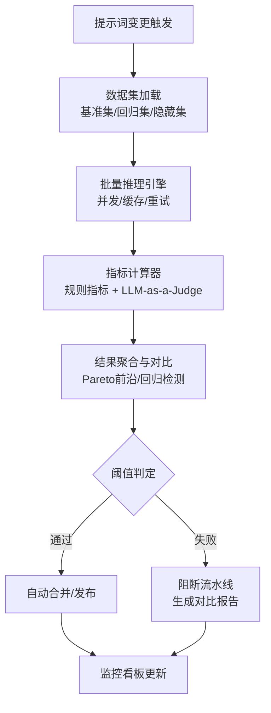

# 第 3 章 自动化提示优化 —— 从人工调参到算法搜索

## 学习目标

- 理解自动提示工程（APE）的“生成-评分-筛选”自举流程与核心公式
- 掌握 OPRO “优化轨迹上下文”机制，会用 LLM 作为黑盒优化器迭代提示词
- 建立多维提示评估指标体系（准确率、鲁棒性、Token 效率、格式合规、安全性）
- 搭建自动化评测流水线：数据集构建、批量推理、LLM-as-a-Judge 打分、CI/CD 集成
- 对比硬提示与软提示/前缀调优的适用边界，理解连续空间优化的参数高效优势与白盒依赖限制
- 能根据模型访问权限（黑盒/白盒）、任务类型、成本预算选择合适的自动化提示优化路线

## 3.1 生活类比

想象自动化提示优化是一场“编剧-导演-观众”的电影打磨循环：APE（自动提示工程师）像“海选编剧”，给一个故事梗概（任务描述），让无数编剧（LLM生成）各写一个开场白（候选提示词），再请专业评委（评分器）打分，留下最高分剧本。OPRO（大模型优化器）则像“成长型导演”：导演拿着历次试镜的剧本和评委打分单（优化轨迹上下文），自己琢磨“上次台词太啰嗦、上上次情节不连贯”，直接写出下一版更好的剧本，无需外部评委即时参与。自动化评测体系是“标准化考场”：不仅看票房（准确率），还测口碑稳定性（鲁棒性）、单位成本产出（Token效率）、能否过审（格式/安全），并用“AI 影评人”（LLM-as-a-Judge）替代人工试映，接入自动化流水线（CI/CD）每天跑分。软提示/前缀调优则是“植入潜意识”：不改剧本台词（硬提示），而是在演员（模型）大脑皮层植入几个微电极（可学习连续向量），通过微电流（梯度下降）直接调节演员潜意识状态，让演员不靠台词也能精准入戏。但这要求能动手术（白盒/开源模型），且电极参数需专用存储。

## 3.2 概念地图

自动化提示优化
├── 离散空间优化（黑盒/仅需 API）
│   ├── APE (Automatic Prompt Engineer)  —— P001
│   │   ├── 生成-评分-筛选自举循环
│   │   ├── 解耦：提示生成器 vs 评分器
│   │   └── 迭代变体：基于历史优秀提示词生成新候选
│   ├── OPRO (Optimization by PROmpting)  —— P002
│   │   ├── 优化轨迹上下文：{(p_i, s_i)} -> LLM -> p_{k+1}
│   │   ├── 自然语言梯度：隐式捕捉修改方向与性能相关性
│   │   └── 记忆增强：从错误中学习，避免重复低分模式
│   └── 评测基准与自动化评测体系  —— P003
│       ├── 多维指标：准确率、鲁棒性、Token效率、格式合规、安全性
│       ├── 分层评测：单元级/系统级/业务级金字塔
│       ├── LLM-as-a-Judge + Rubric 校准
│       └── 防污染：哈希去重、隐藏集、定期轮换
└── 连续空间优化（白盒/需反向传播）  —— P004
    ├── 软提示：输入层拼接可学习虚拟 Token 嵌入
    ├── 前缀调优：每层 K/V 前拼接任务相关前缀向量
    ├── 核心优势：可微优化、参数极少(0.1%-1%)、收敛稳定
    └── 核心限制：需模型权重访问权限、初始化敏感、多任务部署管理前缀向量

## 3.3 自动提示工程师（APE） —— 让模型自己写提示

### 3.3.1 为什么需要这个概念？

你可能已经体会过：面对一个新任务，写一个好提示词往往需要反复试错十几版。人工调优依赖经验直觉，效率低、上限受限、难以规模化。更本质的痛点在于：**提示词空间是离散且巨大的**，人类无法穷举，但大模型自身具备生成自然语言和评估自然语言的双重能力。如果我们能把“寻找最优提示”形式化为一个模型可执行的优化任务，就能实现“提示工程师的自动化”。

### 3.3.2 核心定义与自举公式

> "APE frames prompt generation as a black-box optimization problem over natural language strings. The algorithm alternates between proposing candidate prompts (generation step) and scoring them on a validation set (selection step). We use the LLM itself to generate variations of high-scoring prompts, enabling iterative refinement."
> 
> ——《20230418_080.md》 & 《20230418_081.md》

**APE（Automatic Prompt Engineer）** 采用“生成-评分-筛选”的**自举流程**。给定任务描述 $\mathcal{T}$ 和少量演示样本 $\mathcal{D}_{demo} = \{(x_i, y_i)\}$，目标是搜索提示词 $p$ 使得期望得分最大化：

$$
p^* = \arg\max_{p \in \mathcal{P}} \mathbb{E}_{(x,y) \sim \mathcal{D}_{val}} \left[ \text{Score}\big( \text{LLM}(p, x), y \big) \right]
\tag{3.1}
$$

这个公式展示了 APE 的核心逻辑：**将提示词搜索转化为黑盒优化问题**。$\mathcal{P}$ 是候选提示词空间，$\text{LLM}(p, x)$ 表示在提示词 $p$ 下模型对输入 $x$ 的输出，$\text{Score}(\cdot, \cdot)$ 是评分函数（如准确率、F1 等）。

**算法流程（APE 核心循环）：**

```
输入：任务描述 T, 少量演示样本 D_demo, 验证集 D_val, 迭代轮数 K
输出：最优提示词 p*

1. 初始化：基于 T 和 D_demo，提示 LLM 生成初始候选池 P_0 = {p_1, ..., p_N}
2. for k = 1 to K do
3.     评分：对每个 p in P_{k-1}，在 D_val 上计算 s = Score(LLM(p, x), y)
4.     筛选：选出 Top-M 高分提示词组成精英集 E_k
5.     变体生成：将 E_k 及其分数作为上下文，提示 LLM 生成新候选池 P_k
6. end for
7. 返回历史最高分提示词 p*
```

这个伪代码展示了 APE 如何通过**解耦“生成器”与“评分器”**实现自举迭代。第 3 步的评分器可以是规则、小模型，甚至另一个更强的 LLM；第 5 步的生成器利用 LLM 的变异能力，在精英集邻域探索新候选，近似“自然语言梯度下降”。

### 3.3.3 关键性质深度解析

#### 自举：零人工提示词标注
APE 只需任务少量输入输出样本（如 10-50 条），**完全不需要人工编写任何种子提示词**。种子提示词由 LLM 根据任务描述“脑补”生成。这打破了“写提示词需要懂提示工程”的循环依赖。

#### 解耦：生成 vs 评估
APE 明确分离两个角色：
- **生成器**：负责在提示词空间探索，产出多样化候选。
- **评分器**：负责在验证集上给候选打分，提供优化信号。

这种解耦允许你**热插拔更强的评分器**（如用 GPT-4 打分、用人工标注少量高难度样本、或引入鲁棒性/Token 效率等复合指标），而不改变生成逻辑。

#### 迭代优化：基于历史的变体生成
第 5 步是 APE 区别于随机搜索的关键。元提示词大致如下：

> "Here are some prompts and their scores on a task. Please analyze the patterns and generate 5 new prompts that are likely to score higher.
> Prompt 1: 'Classify sentiment.' Score: 0.72
> Prompt 2: 'Classify as positive or negative.' Score: 0.81
> ...
> New prompts:"

这种“读反馈、改提示”的能力，正是 LLM 的**元认知**体现。实验表明，基于精英集生成变体比纯随机生成收敛快得多（《20230418_081.md》）。

### 3.3.4 具体例子：情感分类任务

**任务**：二分类情感分析（正向/负向）
**演示样本（3 条）**：
1. "Movie was great!" -> Positive
2. "Terrible acting." -> Negative
3. "I liked the plot." -> Positive

**APE 运行一轮示例**：
1. **生成**：LLM 产出 10 个候选，如 `p1="Classify sentiment."`, `p2="You are a critic. Output Positive/Negative."`, `p3="Think step by step then answer."` ...
2. **评分**：在 100 条验证集上跑推理，得到分数：`s1=0.78`, `s2=0.85`, `s3=0.72` ...
3. **筛选**：Top-3 进入精英集。
4. **变体**：基于精英集生成新一轮候选，如结合 `p2` 的角色设定与 `p1` 的简洁性："Act as a sentiment classifier. Output only Positive or Negative."

### 3.3.5 边界条件与常见坑

| 问题 | 成因 | 缓解策略 |
|------|------|----------|
| **弱模型生成低质候选** | 基座模型指令遵循能力不足，产出模板化、无区分度提示词 | 升级生成器模型；人工提供 1-2 个高质量种子提示词冷启动 |
| **评分过拟合验证集** | 验证集小（如 <50 条），仅优化准确率会记住噪声 | 引入正则项：`Score = Acc - λ * Length`；使用交叉验证；保留隐藏测试集最终复测 |
| **陷入局部最优** | 生成器多样性不足，变体仅在局部微调 | 注入随机扰动（温度采样）；周期性重启生成器；引入外部优秀提示词库混合 |

> **设计中的取舍**：为什么 APE 不直接用梯度下降优化离散 Token？
> 因为提示词是离散符号序列，不可导。APE 用 LLM 的“自然语言推理能力”近似梯度方向：高分提示词的共性特征即为“上升方向”。这是**黑盒启发式优化**，牺牲了理论收敛保证，换取了通用性（仅需 API）和零样本冷启动能力。

---

## 3.4 OPRO —— 用大模型作为优化器优化提示

### 3.4.1 为什么需要这个概念？

APE 虽然实现了自动化，但存在两个结构性短板：
1. **生成与评分分离**：每轮需外部评分器跑验证集，延迟高、成本大，且未利用 LLM 自身“读反馈改提示”的直觉。
2. **无显式记忆**：每轮生成仅依赖当前精英集，未显式利用“历史失败教训”（如避免重复啰嗦模式）。

我们需要一种**端到端、纯自然语言交互的优化器**，像人类专家一样：看过往轨迹 -> 总结规律 -> 写下一版。

### 3.4.2 核心定义：优化轨迹上下文

> "OPRO uses the LLM as an optimizer: the optimization trajectory is serialized into the prompt, and the LLM outputs the next candidate solution. We observe that LLMs can capture optimization trends from the trajectory, e.g., 'previous prompts were too verbose, let me be concise.' The meta-prompt includes: task description, optimization goal, and the history of (prompt, score) pairs."
> 
> ——《20230418_082.md》 & 《20230418_083.md》

**OPRO（Optimization by PROmpting）** 的核心创新是**优化轨迹上下文**机制。第 $k$ 轮优化的输入是完整历史：

$$
\text{Context}_k = \big\{ (p_1, s_1), (p_2, s_2), \dots, (p_k, s_k) \big\}
$$

$$
p_{k+1} = \text{LLM}\big( \text{MetaPrompt}(\mathcal{T}, \text{Goal}, \text{Context}_k) \big)
\tag{3.2}
$$

这个公式展示了 OPRO 的**自然语言梯度下降**本质：历史轨迹 $\text{Context}_k$ 编码了“哪里好、哪里坏”，LLM 隐式学习修改方向 $\Delta p \approx p_{k+1} - p_k$ 使得分数上升。

**Meta-Prompt 结构（标准化）：**

```
[任务描述]
You are an expert prompt optimizer. Your goal is to maximize [指标, 如 Accuracy] on [任务类型].

[优化目标]
Generate a new prompt that improves upon previous attempts. Focus on: [关键点, 如 conciseness, step-by-step reasoning, format compliance].

[优化轨迹历史]
Attempt 1: Prompt="...", Score=0.42
Attempt 2: Prompt="...", Score=0.71
Attempt 3: Prompt="...", Score=0.68
...

[输出格式要求]
Output ONLY the new prompt text, wrapped in <prompt>...</prompt> tags.
```

### 3.4.3 关键性质深度解析

#### 记忆增强：从错误中学习
对比 APE 的“精英集只保留高分”，OPRO **保留全量历史（含低分）**。这让模型能显式对比：
- "Attempt 2 scored 0.71 with 'step by step', but Attempt 3 dropped to 0.68 when adding 'calculate carefully' — maybe the extra instruction distracted the model."
这种**反事实推理**能力是 OPRO 超越 APE 的关键来源（《20230418_083.md》实验证实：保留失败历史比仅保留成功历史效果显著更好）。

#### 自然语言梯度：隐式捕捉修改方向
传统梯度下降：$\theta_{t+1} = \theta_t - \eta \nabla_\theta \mathcal{L}$。
OPRO 类比：$p_{k+1} = p_k + \Delta p_k$，其中 $\Delta p_k$ 由 LLM 从轨迹中“悟”出。
LLM 不输出数值梯度，而是输出**语义修改指令**（如“更简洁”、“增加格式约束”、“修正逻辑漏洞”）。这规避了离散空间不可导的数学障碍。

#### 灵活的目标函数
评分函数 $\text{Score}(\cdot)$ 可以是**任意可计算指标**，无需可微：
- 准确率 / F1
- Token 数 / 延迟（效率）
- 格式合规率（JSON/XML 解析成功率）
- 安全分（拒答率、毒性分）
- 甚至“用户满意度模拟分”（由另一 LLM 打分）

### 3.4.4 具体例子：GSM8K 数学推理优化轨迹

**任务**：GSM8K 数学应用题求解
**初始**：`p1 = "Solve this math problem."` -> Score: 0.42
**第 1 轮优化**：LLM 观察到直接求解失败，生成 `p2 = "Let's think step by step."` -> Score: 0.71 （大幅跃升，发现 CoT 关键）
**第 2 轮优化**：LLM 尝试细化 `p3 = "Calculate carefully and show work."` -> Score: 0.68 （微降，提示“过度指令可能干扰”）
**第 3 轮优化**：LLM 综合前两轮经验，生成 `p4 = "Let's think step by step. Reason carefully, then output the final answer as a number."` -> Score: 0.78 （融合 CoT + 格式约束，再创新高）

这个轨迹展示了 OPRO 如何**自动重现人类提示工程的发现路径**：从零样本 -> CoT -> 格式约束。

### 3.4.5 边界条件与工程对策

| 挑战 | 根因 | 工程对策 |
|------|------|----------|
| **上下文窗口溢出** | 轨迹随轮次线性增长，长任务 20+ 轮即超限 | 1. 滑动窗口：仅保留最近 $W$ 轮<br>2. **轨迹摘要**：用 LLM 每 5 轮压缩一次历史为“关键经验总结”<br>3. 关键节点锚定：永久保留历史最优、最大跃升、典型失败 |
| **模型崩溃/生成乱码** | 优化后期模型可能输出全大写、重复 Token、非指令文本 | 后处理过滤：长度截断、非 ASCII 过滤、正则校验指令结构；加入“输出格式约束”进 Meta-Prompt |
| **优化成本高** | 每轮需调用大模型生成 + 评分跑验证集 | 离线异步优化；评分用小模型/规则代理；早停机制（连续 $N$ 轮无提升则停） |

> **设计中的取舍**：OPRO 为什么不需要单独的评分器模型？
> 因为**评分隐含在轨迹上下文中**。Meta-Prompt 明确要求 LLM “根据分数生成更好提示词”，LLM 必须内隐理解“分数高=好、分数低=坏”并推演出修改策略。这把“评估”内化为优化器的**先验知识**，省去了外部评分器调用，但要求优化器模型极强（通常需 GPT-4/Claude-3 级别）。

---

## 3.5 提示评估基准与自动化评测体系 —— 量化“好提示”的标尺

### 3.5.1 为什么需要这个概念？

自动化优化（APE/OPRO）的核心燃料是**可靠、可复现、任务无关的目标函数**。没有量化标尺，“优化”就是“瞎调”。人工评估成本高、主观差异大，无法支撑数百候选提示词的快速筛选。更棘手的是：**提示词质量是多维的**——只看准确率会选出啰嗦、易攻击、格式不稳的提示词。

### 3.5.2 核心定义：多维指标体系

> "A robust evaluation suite must measure Accuracy, Robustness (to paraphrase/typos), Efficiency (tokens/latency), and Format Compliance simultaneously. We adopt LLM-as-a-Judge with a detailed rubric to automate open-ended scoring, calibrated against human annotations. The evaluation pipeline is integrated into CI/CD: every prompt change triggers a regression test on the benchmark suite."
> 
> ——《20230418_084.md》 & 《20230418_085.md》

**五维核心指标**：

| 维度 | 指标定义 | 计算方式 | 典型阈值/关注点 |
|------|----------|----------|-----------------|
| **准确率** | 任务核心目标达成度 | Exact Match / F1 / Pass@k / LLM-as-a-Judge 打分 | 业务底线（如 > 90%） |
| **鲁棒性** | 对输入扰动（改写/错别字/无关前缀）的稳定性 | $\text{Robust} = \frac{1}{|\mathcal{P}|} \sum_{p' \in \mathcal{P}} \text{Acc}(p')$<br>$\mathcal{P}$: 扰动集（同义替换、Typos、注入干扰句） | 扰动下降 < 5% |
| **Token 效率** | 单位成本产出 | $\text{Eff} = \frac{\text{Acc}}{\text{Avg Tokens}}$ 或 直接约束 $\text{Avg Tokens} < T_{max}$ | Pareto 前沿权衡 |
| **格式合规** | 结构化输出解析成功率 | $\text{Fmt} = \frac{\#\text{Valid JSON/XML}}{\#\text{Total}}$ | > 99%（生产硬性要求） |
| **安全性** | 拒答率、毒性、PII 泄露、越狱鲁棒性 | 红队测试集通过率；安全评分器打分 | 零容忍关键风险 |

**复合目标函数示例**（用于 APE/OPRO 评分）：

$$
\text{Score}(p) = w_1 \cdot \text{Acc} + w_2 \cdot \text{Robust} - w_3 \cdot \frac{\text{AvgTokens}}{T_{ref}} + w_4 \cdot \text{Fmt} - w_5 \cdot \text{SafetyRisk}
\tag{3.3}
$$

权重 $w_i$ 根据业务优先级配置（如客服机器人：$w_4, w_5$ 极高；内部数据分析：$w_3$ 较高）。

### 3.5.3 自动化评测流水线架构



**分层评测金字塔**（工程落地核心）：

| 层级 | 范围 | 频次 | 典型指标 | 工具示例 |
|------|------|------|----------|----------|
| **单元级** | 组件（Retriever/Parser/单步 Prompt） | 每次提交/每日 | 召回率、解析成功率、单步准确率 | pytest + 自定义断言 |
| **系统级** | 端到端 Pipeline (RAG/Agent) | 每日/每周 | 端到端准确率、Token成本、延迟P99、安全分 | CI Job + 基准集 |
| **业务级** | 线上真实流量 A/B 测试 | 发布前/持续 | 用户满意度、任务完成率、留存、人工介入率 | 实验平台 + 仪表盘 |

### 3.5.4 LLM-as-a-Judge：自动化开放式评分

对于无标准答案的任务（生成摘要、写代码、角色扮演），引入**强模型作为评估员**：

**标准化 Rubric 示例（1-5 分制）**：
```
Score 5: 完全正确、格式完美、推理清晰、无冗余
Score 4: 核心正确、格式基本合规、有轻微冗余/小瑕疵
Score 3: 方向正确但有事实错误/逻辑跳跃/格式错误可自动修复
Score 2: 部分相关但关键遗漏/严重幻觉/格式严重不合规
Score 1: 完全跑题/拒答/有害内容
```

**校准机制**：每周抽样 50 条人工打分，计算与 LLM 判分的 Kappa 一致性；若漂移 > 0.1，更新 Rubric 或更换 Judge 模型版本。

### 3.5.5 防污染机制：防止“刷榜”过拟合

1. **哈希去重**：评测集每条样本存储 `hash(input + expected_output)`，新增样本自动去重。
2. **隐藏集**：保留 20% 样本**仅用于最终决策**，不参与任何优化循环反馈。
3. **定期轮换**：每季度从生产日志采样真实难例替换 30% 基准集，防止分布漂移。
4. **对抗注入**：自动生成对抗样本（指令注入、干扰上下文、分布外任务）混入评测集。

---

## 3.6 软提示与前缀调优 —— 连续空间中的隐式指令

### 3.6.1 为什么需要这个概念？

硬提示（离散 Token）优化面临**组合爆炸、不可导、搜索低效**三大数学硬伤。全参数微调又成本极高、易灾难性遗忘。我们需要一种**参数高效、可微优化、不占用上下文窗口**的方案——在连续嵌入空间直接优化“隐式指令”。

### 3.6.2 核心定义与数学形式

> "Prefix Tuning prepends a sequence of continuous task-specific vectors to the input, keeping the language model parameters frozen. Unlike discrete prompting, soft prompts are optimized via backpropagation, allowing gradient-based search in the continuous embedding space. The trade-off: soft prompts are less interpretable and require model access, but offer superior parameter efficiency and optimization stability."
> 
> ——《20230418_086.md》 & 《20230418_087.md`

#### 软提示
在嵌入层输入前拼接 $L$ 个可学习的连续向量 $P_\theta \in \mathbb{R}^{L \times d}$（虚拟 Token）：

$$
\text{Input}_{\text{soft}} = [P_\theta; E(x)] \in \mathbb{R}^{(L + |x|) \times d}
\tag{3.4}
$$

其中 $E(x)$ 是原始输入 Token 的嵌入。仅优化 $P_\theta$，冻结骨干网络 $\Phi$。损失函数标准交叉熵：

$$
\mathcal{L}(\theta) = -\sum \log P_\Phi(y \mid [P_\theta; x])
\tag{3.5}
$$

#### 前缀调优
在**每层** Transformer 的 Key/Value 前拼接任务相关前缀向量，等价于为注意力机制注入任务先验：

$$
K^{(l)}_{\text{new}} = [K^{(l)}_{\text{pref}}; K^{(l)}_{\text{input}}], \quad
V^{(l)}_{\text{new}} = [V^{(l)}_{\text{pref}}; V^{(l)}_{\text{input}}]
\tag{3.6}
$$

前缀向量通常通过一个小型 MLP（Prefix Encoder）从共享的前缀嵌入 $P_\theta$ 生成，进一步压缩参数量。

### 3.6.3 关键性质对比

| 性质 | 硬提示 | 软提示 | 前缀调优 |
|------|--------|--------|----------|
| **参数量** | 0（仅上下文 Token） | $L \times d$ (典型 0.01%-0.1%) | $L \times d \times 2 \times N_{\text{layers}}$ (典型 0.1%-1%) |
| **优化方式** | 离散搜索/启发式 | 反向传播（梯度下降） | 反向传播 |
| **可解释性** | 高（人类可读） | 低（向量无语义） | 低 |
| **模型访问** | 黑盒 API 即可 | **需白盒/开源（反向传播）** | **需白盒/开源** |
| **上下文占用** | 占用窗口长度 | 占用窗口长度 | **不占用窗口**（KV Cache 复用） |
| **表达力上限** | 受限于离散语言 | 受限于冻结骨干 | **更强**（深层注入注意力偏置） |
| **部署复杂度** | 极低（字符串） | 需管理前缀向量文件 | 需管理每层前缀向量 |

**参数量计算示例**（LLaMA-7B, $d=4096, N_{\text{layers}}=32$）：
- 软提示 $L=100$：$100 \times 4096 \approx 0.4\text{M}$ (0.006%)
- 前缀调优 $L=10$：$10 \times 4096 \times 2 \times 32 \approx 2.6\text{M}$ (0.04%)

### 3.6.4 典型例子：T5-base 上的 SuperGLUE 实验

> "In T5-base, tuning only 100 virtual tokens (≈0.05% parameters) achieves 95%+ performance of full fine-tuning on SuperGLUE benchmark."
> 
> ——《20230418_086.md》

这展示了**参数高效微调（PEFT）**的威力：极小代价换取接近全微调的效果。但注意：这是在**预训练分布内任务**上。对于全新领域（如古文翻译、新编程语言），冻结骨干的表达力上限会成为瓶颈。

### 3.6.5 边界条件与工程坑

| 问题 | 成因 | 缓解策略 |
|------|------|----------|
| **初始化敏感** | 随机初始化易陷入局部最优，梯度消失/爆炸 | **硬提示初始化**：用任务相关的硬提示词嵌入均值初始化 $P_\theta$；或用任务描述文本嵌入初始化 |
| **白盒依赖** | 需反向传播，API 黑盒模型无法使用 | 黑盒场景仅能用 APE/OPRO；或蒸馏：用白盒模型训练软提示，再用硬提示近似蒸馏到黑盒 |
| **多任务前缀管理** | 部署 50 个任务需存 50 组前缀向量，推理时动态拼接 KV | 统一前缀管理服务；前缀向量量化（INT4/INT8）；任务路由合并相似前缀 |
| **灾难性遗忘（持续学习）** | 顺序训练新任务前缀可能相互干扰 | 正交正则化约束新旧前缀向量正交；经验回放旧任务数据 |

> **设计中的取舍**：前缀调优相比输入层软提示，为何在深层语义任务上表现更好？
> 因为**注意力机制是分层的**：浅层捕捉句法/局部模式，深层捕捉语义/推理。软提示仅在输入层注入信号，需通过 32 层传播，易衰减；前缀调优**直接在每层注意力的 K/V 注入任务先验**，相当于给每层“打招呼”，信号保真度高得多（《20230418_087.md》实证分析）。

---

## 3.7 多源对照：离散 vs 连续优化范式的共识与分歧

### 共识
1. **提示词优化是必需的工程环节**：人工调参不可规模化，自动化是大模型落地生产的前置条件。
2. **评测体系是优化的基建**：无可靠评测，优化无方向；LLM-as-a-Judge + 多维指标 + 防污染是标配。
3. **参数效率是核心追求**：无论离散搜索还是连续优化，目标都是“最小成本换最大性能增益”。

### 分歧

| 维度 | 离散优化派（APE/OPRO） | 连续优化派 |
|------|------------------------|------------|
| **核心论点** | "提示词应保持自然语言可解释性，优化器应复用模型自身语言能力" | "连续空间可微优化在数学上更本质，参数效率极致，收敛有保证" |
| **适用场景** | 黑盒 API、快速原型、需人类审计、任务频繁变更 | 开源模型自建、长期固定任务、极致延迟/成本敏感、需深层语义注入 |
| **对对方批评** | "软提示不可解释、白盒强依赖、部署运维复杂、新任务上限低" | "离散搜索本质是盲人摸象、样本效率极低、无法理论收敛、易过拟合验证集" |
| **最新融合趋势** | **硬提示初始化软提示**：用 OPRO 找到好硬提示，取其嵌入初始化软提示/前缀，再梯度微调 | **软提示蒸馏硬提示**：训练好软提示后，用另一 LLM “读取”其行为反推硬提示词，兼得可解释性与性能 |

---

## 3.8 设计中的取舍

**为什么不用全参数微调而是选软提示/前缀调优？**
全参数微调需更新 7B+ 参数，显存/算力成本高 100 倍，且易灾难性遗忘预训练知识。软提示/前缀调优仅更新 0.1% 参数，**冻结骨干保留通用能力**，在分布内任务上性能接近全微调，是“性价比之王”。但若任务极度偏离预训练分布（如全新语言、专业代码生成），全微调或 LoRA 可能是唯一出路。

**APE vs OPRO：选哪个？**
- **选 APE**：模型能力中等、有现成评分器、需严格控制评分逻辑（如规则+小模型混合）、预算有限（OPRO 需强模型做优化器）。
- **选 OPRO**：有顶级模型（GPT-4/Claude-3）做优化器、任务复杂需多轮推理优化、希望利用“从失败中学习”的元认知、离线优化预算充足。

**硬提示 vs 软提示：部署决策矩阵**（见动手练习 4 完整版）

---

## 3.9 动手练习

1. **手动模拟 APE 一轮优化**
   - 任务：二分类情感分析（正向/负向）
   - 种子示例 (3条)：
     1. "Movie was great!" -> Positive
     2. "Terrible acting." -> Negative
     3. "I liked the plot." -> Positive
   - 步骤：
     1. 手写 3 个不同风格的候选提示词 p1, p2, p3（例如：直接指令风、角色扮演风、CoT 风）
     2. 设计一个简易评分函数 Score(p) = 准确率 - 0.01 * Token数（惩罚冗长）
     3. 假设在验证集上得到分数 s1, s2, s3，选出最高分作为 p*
   - 思考题：
     - 如果验证集只有 5 条样本，直接选最高分会有什么风险？如何缓解？
     - APE 中“基于历史优秀提示词生成变体”的具体 Prompt 怎么写？试写一段元提示词

2. **体验 OPRO 优化轨迹上下文构建**
   - 场景：优化 GSM8K 数学题提示词
   - 已有历史轨迹（前 3 轮）：
     - p1: "Solve this math problem." -> Score: 0.42
     - p2: "Let's think step by step." -> Score: 0.71
     - p3: "Calculate carefully and show work." -> Score: 0.68
   - 任务：
     1. 构造发送给 LLM 优化器的完整 Meta-Prompt（包含任务描述、优化目标、历史轨迹、输出格式要求）
     2. 预测 LLM 可能生成的 p4 会包含哪些关键改进？（提示：结合 p2 成功经验、p3 失败教训）
   - 思考题：
     - 当优化轮次达到 20 轮，上下文窗口装不下完整轨迹时，设计一种“轨迹压缩/摘要”策略
     - 为什么 OPRO 不需要单独的评分器模型？它的“评分”隐含在哪里？

3. **设计提示词自动化评测报告模版**
   - 要求：输出一份 JSON Schema，用于标准化记录一次提示词评测运行的结果
   - 必须包含字段：
     - prompt_id, prompt_text, task_name, dataset_version
     - metrics: {accuracy, robustness_score, avg_tokens, format_compliance_rate, safety_score}
     - judge_info: {judge_model, rubric_version, calibration_notes}
     - ci_metadata: {git_commit, pipeline_run_id, timestamp}
   - 实操：
     1. 写出该 JSON Schema（可用 TypeScript 接口或 JSON Schema Draft 7 表示）
     2. 给出一条填充示例数据
   - 思考题：
     - 如何在 CI 中实现“回归阻断”：新提示词若准确率下降 > 2% 或 Token 增加 > 20% 则阻断合并？
     - LLM-as-a-Judge 的偏好偏差（如偏长、偏特定格式）会污染评测，设计一种“人工校准回环”机制

4. **软提示 vs 硬提示：工程决策矩阵**
   - 场景对比表（请补全决策建议）：
     | 场景约束 | 推荐方案 | 核心理由 |
     |---|---|---|
     | 仅有黑盒 API (GPT-4/Claude) | ? | ? |
     | 开源模型 (Llama-3-8B)，需极低延迟推理 | ? | ? |
     | 多任务共享部署，任务数 > 50 | ? | ? |
     | 需要人类可读、可审计、可版本控制的提示词 | ? | ? |
     | 任务为全新领域（如古文翻译），预训练数据极少 | ? | ? |
   - 补充问题：
     - 前缀调优相比输入层软提示，为何在深层语义任务上表现更好？（提示：注意力机制的层级特性）
     - 如何用“硬提示初始化”缓解软提示随机初始化的局部最优问题？给出操作步骤

5. **端到端实战：为一个分类任务跑通 APE->评测->选型闭环**
   - 数据集：AG News 标题分类（4类），取 200 条做验证集，200 条做测试集
   - 基座模型：任意可调用的 LLM API（如 gpt-3.5-turbo）
   - 步骤：
     1. 用 APE 思路：让模型生成 10 个候选提示词（提供种子示例 5 条）
     2. 批量跑验证集，计算准确率、平均 Token、格式合规率（JSON 输出）
     3. 选出 Pareto 前沿（高准确率、低 Token）的 Top-3 提示词
     4. 在测试集上复测 Top-3，输出最终推荐提示词及评测报告
   - 交付物：
     - 候选提示词列表、验证集分数表、Pareto 前沿可视化（ASCII 图或描述）、最终报告
   - 无需提交代码，只需写出完整操作手册（Prompt 模版、评分脚本逻辑、决策阈值）

---

## 3.10 本章小结

这一章中我们系统学习了自动化提示优化的全景技术栈。首先，我们从 **APE（自动提示工程师）** 入手，理解了“生成-评分-筛选”自举循环如何将提示词搜索转化为黑盒优化问题，并通过解耦生成器与评分器实现迭代优化。其次，我们深入剖析了 **OPRO（大模型优化器）** 的核心创新——优化轨迹上下文机制，它让 LLM 自身成为优化器，利用自然语言梯度和记忆增强实现类人专家的试错进化。接着，我们建立了**多维提示评估指标体系**（准确率、鲁棒性、Token效率、格式合规、安全性）与**分层自动化评测流水线**（单元/系统/业务三层金字塔），解决了“如何量化好提示”的工程基建问题。然后，我们对比了**硬提示与软提示/前缀调优**的本质差异：离散搜索通用但低效，连续优化参数高效但需白盒权限，二者在初始化、部署、表达力上各有权衡。最后，我们通过决策矩阵梳理了在不同约束（黑盒/白盒、延迟、任务数、可审计性、新领域）下的技术选型指南。

本章我们一起学习了以下概念：

| 概念 | 解释 |
|------|------|
| APE (Automatic Prompt Engineer) | 生成-评分-筛选自举循环，将提示词搜索转化为黑盒优化问题，解耦生成与评估 |
| OPRO (Optimization by PROmpting) | 用 LLM 自身作为优化器，通过优化轨迹上下文实现自然语言梯度下降，具备记忆与元认知能力 |
| 提示评估多维指标体系 | 准确率、鲁棒性、Token效率、格式合规、安全性五维度量化“好提示”，支撑自动化筛选 |
| 自动化评测流水线 | 数据集构建→批量推理→LLM-as-a-Judge打分→CI/CD集成，实现分层（单元/系统/业务）防污染评测 |
| 软提示 | 在嵌入层拼接可学习连续向量（虚拟Token），仅优化向量冻结骨干，参数量<1%，需白盒模型支持反向传播 |
| 前缀调优 | 在每层注意力 K/V 前拼接可学习前缀向量，等价于为注意力注入任务先验，比软提示表达力更强但参数稍多 |
| 硬提示 vs 软提示 | 硬提示：离散、可解释、黑盒通用、搜索难；软提示：连续、可微、高效、白盒依赖、不可解释、部署需管理前缀参数 |

下一章中，我们将学习**多模态与复杂交互**——突破文本模态边界，探索视觉语言模型提示、多轮对话状态管理、代理规划与长上下文处理，构建通用多模态智能体的提示基础设施。
