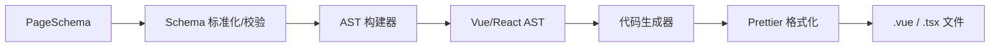
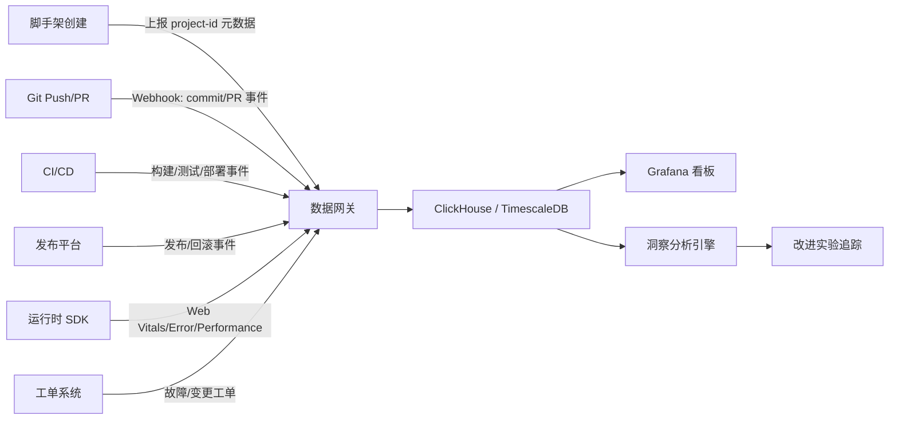
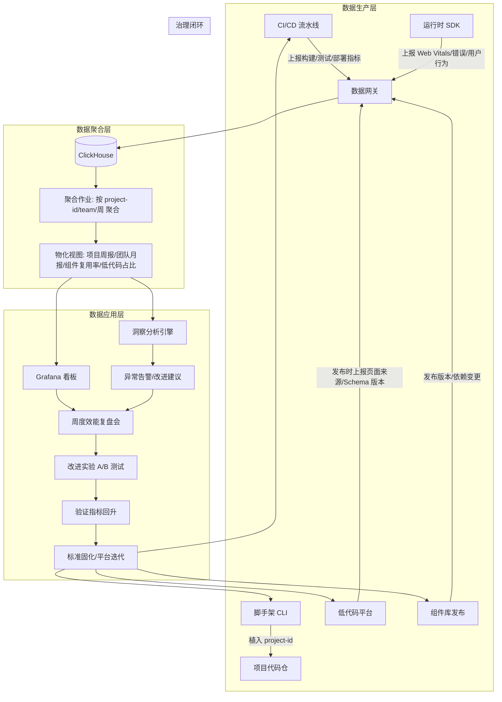

# 第 12 章 前端工程化效能平台 —— 脚手架、组件平台、低代码与研发度量体系

## 学习目标

- 理解前端效能平台的核心价值：以标准化工具链替代手工作业，以平台化治理推动规范落地，以数据驱动决策优化研发效能
- 掌握脚手架工程化的核心构建要素：模版引擎、Monorepo 管理、插件化扩展、自动化升级策略
- 掌握组件物料平台的建设体系：元数据规范、文档自动生成、沙箱演示、版本治理、依赖图谱
- 理解低代码搭建引擎的核心架构：Schema 协议设计、渲染器插件化、状态历史管理、AST 代码生成
- 掌握研发效能度量体系的指标选型与落地：北极星指标、DORA 四大指标、全链路数据采集、洞察分析闭环
- 能够串联脚手架、组件平台、低代码、度量看板，构建前端效能平台 MVP，形成全生命周期数据闭环

## 12.1 生活类比

想象前端效能平台是一个**现代化的“预制菜中央厨房 + 智能餐厅管理系统”**：**脚手架** = **标准化开餐套餐包**（预置好锅碗瓢盆、基础调料、SOP 流程），新厨师（新人/新项目）到岗即可开工，无需从零采购装修；**组件物料平台** = **中央食材库 + 标准半成品仓**（切好配好的肉丝、包好浆的虾仁、标准酱汁），有详细说明书（自动文档）、试吃间（沙箱）、溯源码（依赖图谱），厨师直接拿来用，避免每家餐厅自己养宰鸡、种菜（重复造轮子）；**低代码引擎** = **自动化出餐流水线**（针对标准化程度高的“盖饭/套餐”类订单），店长（运营/产品）在屏幕上拖拽配菜（Schema 配置），机器自动炒制出餐（渲染器），且支持“半成品出餐后大厨再加工”（代码生成接管）；**研发效能度量** = **餐厅经营看板**（翻台率=部署频次、上菜速度=前置时间、退菜率=失败率、投诉处理时长=MTTR），老板据此决定增开窗口、优化动线、换供应商；**前端效能平台 MVP** = **连锁餐厅总部的“数字化中台”**：从开店选址（创建）、备菜采购（开发）、出餐质检（构建）、上架销售（发布）、顾客反馈（运行）全链路打通，发现“分店 A 退菜率高”→ 追溯到“用了非标酱汁”→ 总部下发标准酱汁/更新菜单 → 退菜率下降，形成**“标准化生产 -> 数据反馈 -> 标准迭代”**的飞轮。

## 12.2 概念地图

前端工程化效能平台
├── 脚手架工程化
│   ├── 模版引擎
│   │   ├── Yeoman/Plop 核心机制
│   │   ├── 变量替换/条件渲染/子模版组合
│   │   └── 模版即代码原则
│   ├── Monorepo 多包管理
│   │   ├── pnpm workspace 结构
│   │   ├── 版本锁定与依赖提升
│   │   └── 多包联动变更
│   ├── 插件化扩展机制
│   │   ├── 核心 CLI 精简
│   │   ├── 业务逻辑插件注入
│   │   └── 微前端/组件库选型插件化
│   └── 版本升级策略
│       ├── upgrade 命令
│       ├── Codemod 自动迁移
│       └── 破坏性变更自动化处理
├── 组件物料平台
│   ├── 元数据规范
│   │   ├── package.json 扩展字段
│   │   ├── displayName/category/props/events/slots
│   │   └── 结构化定义标准
│   ├── 文档自动生成
│   │   ├── vue-docgen-api/react-docgen AST 解析
│   │   ├── JSDoc 注释提取
│   │   └── Markdown/MDX 零成本产出
│   ├── 演示沙箱
│   │   ├── Storybook/Histoire 集成
│   │   ├── 故事文件即可视化单测
│   │   ├── 交互回放/无障碍检查/视觉回归
│   │   └── 沙箱即测试理念
│   ├── 版本发布治理
│   │   ├── NPM 私服流水线
│   │   ├── 语义化版本自动发布
│   │   └── Changelog 自动生成
│   └── 依赖分析图谱
│       ├── pnpm ls --graph / AST 分析
│       ├── 组件依赖关系可视化
│       └── 升级影响面评估
├── 低代码搭建引擎
│   ├── Schema 协议设计
│   │   ├── ComponentNode/PageSchema/VersionSchema
│   │   ├── 核心资产版本兼容层
│   │   └── JSON 描述页面结构
│   ├── 渲染器插件化
│   │   ├── Renderer 接口标准
│   │   ├── 自定义组件注册
│   │   ├── 插槽/条件/循环/事件绑定渲染
│   │   └── Vue/React 双引擎支持
│   ├── 属性面板可视化配置
│   ├── 状态历史管理
│   │   ├── Memento 模式
│   │   ├── MobX RedoManager
│   │   ├── 无限级撤销/重做
│   │   └── 历史版本跳转
│   └── 代码生成还原高代码
│       ├── Babel/TS Compiler API
│       ├── AST 转换 Schema → 组件代码
│       └── 低代码起步、高代码接管演进
├── 研发效能度量体系
│   ├── 北极星指标
│   │   ├── 有效发布频次
│   │   ├── 核心业务交付周期
│   │   ├── 生产环境 P0 故障数
│   │   └── 拒绝虚荣指标
│   ├── DORA 四大指标
│   │   ├── 部署频次
│   │   ├── 变更前置时间
│   │   ├── 变更失败率
│   │   └── 平均恢复时间 (MTTR)
│   ├── 全链路数据采集
│   │   ├── Git 事件/CI-CD 耗时/成功率
│   │   ├── Issue/PR 生命周期/代码评审时长
│   │   ├── 构建产物体积/线上错误率/用户反馈
│   │   └── project-id 统一关联
│   ├── 工程效能看板
│   │   ├── Grafana 可视化
│   │   ├── 周度/月度效能报告
│   │   └── 改进实验追踪
│   └── 洞察分析
│       ├── 长周期 PR/高失败率流水线识别
│       ├── 高耦合模块诊断
│       └── 自动化改进建议
└── 前端效能平台 MVP
├── 数据打通层
│   ├── project-id 贯穿全生命周期
│   ├── 脚手架植入标识
│   ├── CI 上报构建/测试指标
│   └── 运行时 SDK 上报 Web Vitals/错误率
├── 组件复用率统计
│   ├── 构建时扫描 import 语句
│   ├── 识别平台组件 vs 本地重复组件
│   └── 复用率计算模型
├── 低代码产出占比
│   ├── 发布时上报页面来源
│   ├── PV/UV/迭代频次/缺陷率统计
│   └── 手写 vs 低代码对比分析
└── 闭环驱动机制
├── 看板异常触发架构组介入
├── 根因定位 (如组件库缺失)
├── 立项补充/规范推广
└── 复盘验证指标回升

## 12.3 脚手架工程化 —— 让项目初始化变成标准化流水线

### 为什么需要脚手架工程化？

你是否遇到过这样的场景：新项目启动，前两天都在配置 ESLint、Prettier、TypeScript、CSS 方案、Git Hooks、CI/CD 流水线；老项目想升级个依赖，发现破坏性变更满屏飞，只能望而却步；团队内 10 个项目有 12 套配置，Code Review 时争论的全是缩进和分号。这就是**缺乏脚手架工程化**的典型症状。

> "实现 `create-my-app` 交互式生成器、基于 pnpm workspace 的 Monorepo 结构、脚手架插件机制支持业务定制、GitHub Actions 自动发布 npm。"
> 
> ——《20230418_045.md》

脚手架工程化的核心价值在于：**将“项目初始化”从手工作坊转变为标准化流水线**。它不仅解决“创建”问题，更通过**模版即代码**、**Monorepo 原生支持**、**插件化机制**、**版本升级策略**四大支柱，实现从创建到维护的全生命周期治理。

### 核心定义：脚手架工程化四大支柱

**脚手架工程化** = 模版引擎 + Monorepo 多包管理 + 插件化扩展 + 自动化发布。

- **模版引擎**：基于 Yeoman/Plop，支持变量替换、条件渲染、子模版组合，实现“模版即代码”。
- **Monorepo 多包管理**：基于 pnpm workspace，天然支持多包联动、版本锁定、依赖提升。
- **插件化机制**：核心 CLI 精简，业务特有逻辑（如微前端接入、组件库选型）通过插件注入。
- **版本升级策略**：提供 `upgrade` 命令，支持 Codemod 自动迁移破坏性变更。

### 12.3.1 模版引擎与“模版即代码”原则

#### 原文驱动的教学化解读

传统脚手架往往是一堆静态文件，替换几个变量就算完事。但现代前端项目的配置组合呈指数级爆炸：Vue/React × TS/JS × Pinia/Redux × Tailwind/UnoCSS × 微前端/单体。如果为每种组合维护一套模版，维护成本将失控。

**模版即代码**的核心思想是：**模版本身也是可维护、可测试、可组合的代码资产**。我们用 Plop 或 Yeoman 的 API 编写“生成器代码”，而不是写死文件内容。

> **模版引擎核心能力**（来源：《20230418_045.md`）

```typescript
// Plop 生成器配置示例
export default function (plop) {
  // 1. 定义交互式问题
  plop.setPrompt('framework', {
    type: 'checkbox',
    name: 'features',
    message: '选择需要的特性',
    choices: [
      { name: 'TypeScript', value: 'ts', checked: true },
      { name: 'Pinia', value: 'pinia' },
      { name: '微前端子应用', value: 'micro' },
      { name: 'TailwindCSS', value: 'tailwind' },
    ],
  });

  // 2. 定义生成动作：支持条件渲染、变量替换、子模版组合
  plop.setGenerator('project', {
    description: '创建标准化前端项目',
    prompts: [], // 复用上面的 prompt
    actions: (answers) => {
      const actions = [];
      
      // 基础文件（所有项目通用）
      actions.push({
        type: 'addMany',
        destination: '{{name}}',
        base: 'templates/base',
        templateFiles: 'templates/base/**/*',
      });

      // 条件渲染：仅当选择 TS 时生成 tsconfig.json
      if (answers.features.includes('ts')) {
        actions.push({
          type: 'add',
          path: '{{name}}/tsconfig.json',
          templateFile: 'templates/ts/tsconfig.hbs',
        });
      }

      // 子模版组合：微前端接入需要修改 vite.config、主入口
      if (answers.features.includes('micro')) {
        actions.push({
          type: 'modify',
          path: '{{name}}/vite.config.ts',
          pattern: /export default defineConfig\(\{/,
          templateFile: 'templates/micro/vite-config-partial.hbs',
        });
      }

      return actions;
    },
  });
}
```

这个生成器展示了**变量替换**（`{{name}}`）、**条件渲染**（`if (answers.features.includes(...))`）、**子模版组合**（`addMany` + `modify`）三大核心能力。模版文件（`.hbs`）本身就是 Handlebar 模版，支持循环、判断、Partial 复用，本质上是“生成代码的代码”。

#### 关键推导：模版合并策略的工程化选择

当多个插件需要修改同一文件（如 `vite.config.ts`、`package.json`）时，合并策略决定了脚手架的可扩展上限。我们对比三种方案：

| 合并策略 | 原理 | 优点 | 缺点 | 适用场景 |
|----------|------|------|------|----------|
| **文本块替换** | 标记 `// [PLUGIN:micro]` 注释块，整块替换 | 简单、无依赖 | 灵活性低、易冲突、不支持细粒度合并 | 简单配置文件（如 `.eslintrc`） |
| **AST 合并** | 解析为 AST，按节点类型合并（如 `export default defineConfig({ plugins: [...] })`） | 语义级合并、保留格式、支持复杂逻辑 | 实现复杂、需维护解析器 | 核心配置文件（`vite.config.ts`、`webpack.config.js`） |
| **函数式配置合并** | 约定配置为函数 `defineConfig(() => ({ plugins: [...] }))`，运行时合并数组 | 最灵活、类型安全、支持动态计算 | 要求配置文件重构为函数式 | 新项目绿地开发、团队强管控 |

**推荐策略**：核心配置（Vite、TS、ESLint）采用**函数式配置合并**；简单配置文件采用**文本块替换**；避免在脚手架层面实现通用 AST 合并（维护成本过高），而是约定配置规范，由插件提供“配置片段函数”，脚手架核心负责合并调用。

```typescript
// 函数式配置合并示例：vite.config.ts
import { defineConfig, mergeConfig } from 'vite';
import baseConfig from './vite.config.base';
import microPlugin from './plugins/micro';
import tailwindPlugin from './plugins/tailwind';

// 插件导出配置片段函数
export const microConfig = () => ({
  plugins: [microPlugin()],
  build: { /* 微前端特有构建配置 */ },
});

export const tailwindConfig = () => ({
  plugins: [tailwindPlugin()],
});

// 最终配置：按需组合
export default defineConfig((env) => 
  mergeConfig(baseConfig(env), 
    process.env.FEATURE_MICRO ? microConfig() : {},
    process.env.FEATURE_TAILWIND ? tailwindConfig() : {}
  )
);
```

这种设计将“配置合并”从**构建时文本操作**转移到**运行时对象合并**，彻底消除了文本冲突，也是现代脚手架（如 `create-vite`、Nuxt）的主流做法。

### 12.3.2 Monorepo 多包管理与 pnpm Workspace

#### 为什么选择 pnpm Workspace？

在脚手架生成的项目中，我们往往需要管理多个关联包：`@my-org/ui` 组件库、`@my-org/request` 请求库、`@my-org/utils` 工具库、主应用 `apps/admin`、`apps/h5`。传统多仓库模式下，依赖升级、代码复用、版本同步极其痛苦。

pnpm Workspace 通过**硬链接 + 符号链接**的存储机制，实现了：
- **依赖去重**：同一版本依赖在磁盘只存一份，节省 60%+ 磁盘空间。
- **幽灵依赖杜绝**：严格的节点模块隔离，防止未声明依赖被误用。
- **原生支持 Monorepo**：`pnpm -r <cmd>` 递归执行，`pnpm --filter` 精准作用域。

#### 标准 Monorepo 目录结构（脚手架生成）

```text
my-monorepo/
├── package.json              # 根 package.json: "private": true, "workspaces": ["packages/*", "apps/*"]
├── pnpm-workspace.yaml       # pnpm workspace 配置
├── pnpm-lock.yaml            # 统一锁文件
├── turbo.json                # Turborepo 管道配置（可选）
├── packages/
│   ├── ui/                   # @my-org/ui 组件库
│   │   ├── package.json
│   │   ├── src/
│   │   └── vite.config.ts
│   ├── request/              # @my-org/request 请求库
│   └── shared-config/        # 共享配置
│       ├── eslint-config/
│       ├── tsconfig/
│       └── vite-config/
└── apps/
    ├── admin/                # 后台管理系统
    │   ├── package.json      # 依赖 @my-org/ui, @my-org/request
    │   └── ...
    └── h5/                   # 移动端 H5
```

#### 脚手架生成 Monorepo 的关键逻辑

```typescript
// 脚手架生成 Monorepo 核心逻辑
async function generateMonorepo(options) {
  // 1. 生成根配置
  await writeJson('package.json', {
    name: '@my-org/root',
    private: true,
    workspaces: ['packages/*', 'apps/*'],
    scripts: {
      'dev': 'turbo run dev',
      'build': 'turbo run build',
      'test': 'turbo run test',
      'lint': 'turbo run lint',
      'release': 'changeset publish', // 统一发布
    },
    devDependencies: {
      'turbo': 'latest',
      '@changesets/cli': 'latest',
      'eslint': 'latest',
      'typescript': 'latest',
    },
  });

  // 2. 生成 pnpm-workspace.yaml
  await writeFile('pnpm-workspace.yaml', `
packages:
  - 'packages/*'
  - 'apps/*'
catalog:          # 统一依赖版本管理
  vue: '^3.4.0'
  react: '^18.2.0'
  typescript: '^5.3.0'
  vite: '^5.0.0'
`);

  // 3. 生成共享配置包（关键：消除配置漂移）
  await generatePackage('packages/shared-config/eslint-config', { /* ... */ });
  await generatePackage('packages/shared-config/tsconfig', { /* ... */ });
  await generatePackage('packages/shared-config/vite-config', { /* ... */ });

  // 4. 生成应用包，依赖引用 workspace:* 协议
  await writeJson('apps/admin/package.json', {
    name: '@my-org/admin',
    dependencies: {
      '@my-org/ui': 'workspace:*',
      '@my-org/request': 'workspace:*',
      'vue': 'catalog:vue',
    },
  });
}
```

这种设计实现了**配置零拷贝**（引用共享配置包）、**依赖版本统一**（catalog 协议）、**构建流水线统一**（Turborepo 管道）。新项目创建即享受团队最佳实践，老项目迁移只需调整 `package.json` 依赖指向。

### 12.3.3 插件化扩展机制

#### 核心 CLI 与插件架构

脚手架核心 CLI 应极度精简，只负责：
1. 解析命令行参数
2. 加载插件注册表
3. 运行交互式询问（收集用户特性选择）
4. 按拓扑顺序执行插件的 `apply` 方法
5. 收集插件产出的文件操作（创建、修改、删除），统一执行

插件则封装特定领域的“生成逻辑”：

```typescript
// 插件接口定义
interface ScaffoldPlugin {
  name: string;                    // 唯一标识
  version: string;                 // 插件版本
  dependencies?: string[];         // 依赖的其他插件名
  features: Feature[];             // 向用户暴露的可选特性
  apply: (context: ScaffoldContext) => Promise<FileOperation[]>;
}

interface Feature {
  name: string;        // 内部标识
  displayName: string; // 显示名称
  description: string;
  default: boolean;    // 默认勾选
  conflicts?: string[]; // 冲突特性
  requires?: string[];  // 依赖特性
}

// 微前端插件示例
const microFrontendPlugin: ScaffoldPlugin = {
  name: 'micro-frontend',
  version: '1.0.0',
  dependencies: ['shared-config'], // 依赖共享配置插件
  features: [
    { name: 'micro', displayName: '微前端子应用接入', description: '接入 qiankun/Module Federation 基座', default: false },
  ],
  async apply(context) {
    const ops = [];
    if (context.features.includes('micro')) {
      // 1. 修改 package.json 增加依赖
      ops.push({ type: 'modifyPackageJson', path: 'package.json', mutate: (pkg) => {
        pkg.dependencies['qiankun'] = '^2.10.0';
        pkg.scripts['dev:micro'] = 'vite --mode micro';
      }});
      // 2. 生成微前端入口文件
      ops.push({ type: 'add', path: 'src/micro-entry.ts', template: 'micro-entry.hbs' });
      // 3. 修改 vite.config.ts（函数式合并）
      ops.push({ type: 'modify', path: 'vite.config.ts', pattern: /defineConfig\(/, template: 'vite-micro-partial.hbs' });
      // 4. 生成公共路由基座配置
      ops.push({ type: 'add', path: 'src/router/micro-routes.ts', template: 'micro-routes.hbs' });
    }
    return ops;
  },
};
```

#### 插件依赖拓扑排序与冲突检测

用户选择的特性集合可能包含隐性依赖和冲突。脚手架核心需在执行前完成拓扑排序与冲突检测：

```typescript
// 插件执行顺序计算
function resolvePluginOrder(plugins: ScaffoldPlugin[], selectedFeatures: Set<string>): ScaffoldPlugin[] {
  // 1. 筛选激活的插件
  const activePlugins = plugins.filter(p => 
    p.features.some(f => selectedFeatures.has(f.name))
  );

  // 2. 构建依赖图
  const graph = new Map<string, Set<string>>();
  const nameToPlugin = new Map(activePlugins.map(p => [p.name, p]));
  
  for (const plugin of activePlugins) {
    graph.set(plugin.name, new Set(plugin.dependencies || []));
  }

  // 3. 拓扑排序（Kahn 算法）
  const indegree = new Map<string, number>();
  for (const [node, deps] of graph) {
    indegree.set(node, 0);
  }
  for (const deps of graph.values()) {
    for (const dep of deps) indegree.set(dep, (indegree.get(dep) || 0) + 1);
  }
  
  const queue = [...indegree.entries()].filter(([, d]) => d === 0).map(([n]) => n);
  const sorted = [];
  while (queue.length) {
    const node = queue.shift()!;
    sorted.push(nameToPlugin.get(node)!);
    for (const neighbor of graph.get(node) || []) {
      const newDegree = indegree.get(neighbor)! - 1;
      indegree.set(neighbor, newDegree);
      if (newDegree === 0) queue.push(neighbor);
    }
  }
  
  if (sorted.length !== activePlugins.length) {
    throw new Error('插件依赖存在循环依赖');
  }
  return sorted;
}
```

**冲突检测**在用户交互阶段即时进行：当用户勾选“TailwindCSS”时，自动取消勾选“UnoCSS”并提示互斥；当勾选“微前端”时，自动勾选“共享配置”并提示依赖关系。

### 12.3.4 版本升级策略：Codemod 自动化迁移

脚手架发布新版本后，老项目如何平滑升级？手动改配置不可行，我们需要 **`upgrade` 命令 + Codemod** 方案。

#### Codemod 核心原理

Codemod = **AST 解析** + **AST 变换** + **代码生成**。利用 `jscodeshift` 或 `ts-morph` 等工具，将“破坏性变更”编码为可执行的迁移脚本。

```typescript
// 示例：Vue Router 3 -> 4 破坏性变更迁移脚本
// 文件：codemods/vue-router-v4.js
module.exports = function transformer(file, api, options) {
  const j = api.jscodeshift;
  const root = j(file.source);

  // 1. 修改 import 语句：vue-router -> vue-router/4
  root.find(j.ImportDeclaration, {
    source: { value: 'vue-router' }
  }).forEach(path => {
    j(path).replaceWith(
      j.importDeclaration(path.node.specifiers, j.literal('vue-router/4'))
    );
  });

  // 2. 修改 router.push({ name: 'xxx' }) -> router.push({ name: 'xxx' }) 兼容
  // 3. 修改 this.$router -> router (需配合 setup 迁移)
  // 4. 移除 onReady 回调
  root.find(j.CallExpression, {
    callee: { object: { name: 'router' }, property: { name: 'onReady' } }
  }).forEach(path => {
    // router.onReady(() => { ... }) -> router.isReady().then(() => { ... })
    const callback = path.node.arguments[0];
    j(path).replaceWith(
      j.callExpression(
        j.memberExpression(j.identifier('router'), j.identifier('isReady')),
        []
      ).then(callback)
    );
  });

  return root.toSource({ quote: 'single' });
};
```

#### 升级命令设计

```typescript
// upgrade 命令核心流程
async function upgradeCommand(options) {
  const projectRoot = options.cwd || process.cwd();
  
  // 1. 检测当前脚手架版本 vs 最新版本
  const currentVersion = await getCurrentScaffoldVersion(projectRoot);
  const latestVersion = await fetchLatestScaffoldVersion();
  if (currentVersion === latestVersion) return console.log('已是最新版本');

  // 2. 获取版本间的所有 Codemod 脚本
  const codemods = await fetchCodemods(currentVersion, latestVersion);
  
  // 3. 创建 Git 检查点（安全网）
  await execa('git', ['stash', '--include-untracked'], { cwd: projectRoot });
  
  try {
    // 4. 依次执行 Codemod
    for (const codemod of codemods) {
      console.log(`应用迁移: ${codemod.name}`);
      await runCodemod(codemod.path, projectRoot, { dryRun: options.dryRun });
    }
    
    // 5. 更新 package.json 中的脚手架版本标记
    await updateScaffoldVersionMarker(projectRoot, latestVersion);
    
    // 6. 自动提交变更
    if (!options.dryRun) {
      await execa('git', ['add', '-A'], { cwd: projectRoot });
      await execa('git', ['commit', '-m', `chore: upgrade scaffold to ${latestVersion} via codemod`], { cwd: projectRoot });
    }
  } catch (err) {
    // 7. 回滚
    await execa('git', ['stash', 'pop'], { cwd: projectRoot });
    throw err;
  }
}
```

**关键设计点**：
- **Git 检查点**：任何失败自动回滚，零风险。
- **Dry-run 模式**：先预览变更，再确认执行。
- **版本标记**：在 `package.json` 中记录 `scaffoldVersion`，避免重复应用。
- **Codemod 版本化**：每个破坏性变更对应一个 Codemod，随脚手架版本发布，形成 `v1.0.0 -> v1.1.0 -> v2.0.0` 的迁移链。

### 12.3.5 边界与取舍

- **仅解决“创建”与“升级”**：脚手架不管运行时架构、热更新、插件系统，那是应用框架的事。
- **模版参数化收敛**：避免“万能模版”陷阱。通过“约定优于配置”收敛变异点，只暴露高频变更点（框架、CSS、状态管理、微前端）为特性选择项。
- **老项目接入成本**：无法 100% 自动化。提供 `init --from-existing` 命令辅助分析现有项目配置、生成迁移清单，核心仍需人工把关。

---

## 12.4 组件物料平台 —— 让 UI 组件变成可检索、可度量、可复用的资产

### 为什么需要组件物料平台？

你一定见过：团队里有 5 个 `Button`、3 个 `Table`、N 个 `Modal`，每个项目自己封装一套，文档靠口口相传，测试靠手工点击，升级靠群里吼一声。这就是**组件资产管理缺失**的后果。

组件物料平台的核心使命是：**将 UI 组件从“私有代码”转化为“标准化资产”**。通过**元数据规范**、**文档自动生成**、**演示沙箱**、**版本发布治理**、**依赖分析图谱**五大模块，让组件可检索、可度量、可复用。

> "制定组件元数据规范、集成 `vue-docgen-api`/`react-docgen` 自动解析 Props/Events/Slots、Storybook/Histoire 沙箱预览、依赖图谱可视化。"
> 
> ——《20230418_045.md》

### 12.4.1 元数据规范：组件的“身份证”

每个组件必须在 `package.json` 中声明标准化元数据，这是平台所有自动化能力的基石：

```json
{
  "name": "@enterprise/ui-button",
  "version": "1.2.0",
  "displayName": "按钮",
  "category": "数据录入",
  "description": "通用按钮组件，支持多种尺寸、类型、加载态",
  "keywords": ["button", "form", "action"],
  "peerDependencies": {
    "vue": "^3.4.0",
    "@enterprise/ui-utils": "^1.0.0"
  },
  "componentMeta": {
    "props": [
      { "name": "type", "type": "'primary' | 'secondary' | 'danger' | 'ghost'", "default": "'primary'", "description": "按钮类型" },
      { "name": "size", "type": "'large' | 'middle' | 'small'", "default": "'middle'", "description": "按钮尺寸" },
      { "name": "loading", "type": "boolean", "default": "false", "description": "加载态" },
      { "name": "disabled", "type": "boolean", "default": "false", "description": "禁用态" },
      { "name": "htmlType", "type": "'button' | 'submit' | 'reset'", "default": "'button'", "description": "原生 type 属性" }
    ],
    "events": [
      { "name": "click", "description": "点击事件", "args": ["event: MouseEvent"] }
    ],
    "slots": [
      { "name": "default", "description": "按钮内容" },
      { "name": "loading", "description": "自定义加载图标" }
    ],
    "cssVars": [
      { "name": "--btn-primary-color", "description": "主色按钮背景色" }
    ],
    "examples": ["basic", "loading", "disabled", "icon"]
  }
}
```

**元数据规范的核心价值**：
- **机器可读**：平台自动解析生成文档、类型定义、沙箱配置。
- **版本治理**：结合语义化版本，自动生成 Changelog、破坏性变更提示。
- **依赖分析**：`peerDependencies` + `componentMeta.props` 类型引用，构建组件依赖图谱。

### 12.4.2 文档自动生成：从 AST 到 Markdown

文档滞后于代码是通病。解决之道是**源码即文档**：从组件源码 AST 解析 Props/Events/Slots/JSDoc，自动生成 Markdown/MDX。

#### Vue 组件解析流程（基于 `vue-docgen-api`）

```typescript
// scripts/generate-docs.ts
import { parse } from 'vue-docgen-api';
import fs from 'fs-extra';
import path from 'path';

async function generateComponentDocs(componentPath) {
  const doc = await parse(componentPath); // 返回 { displayName, props, events, slots, methods, ... }
  
  // 生成 Markdown
  let md = `## ${doc.displayName}\n\n${doc.description || ''}\n\n`;
  
  // Props 表格
  if (Object.keys(doc.props).length) {
    md += '### Props\n\n';
    md += '| 名称 | 类型 | 默认值 | 说明 |\n|------|------|--------|------|\n';
    for (const [name, prop] of Object.entries(doc.props)) {
      md += `| ${name} | ${formatType(prop.type)} | ${prop.defaultValue || '-'} | ${prop.description || ''} |\n`;
    }
    md += '\n';
  }
  
  // Events 表格
  if (doc.events?.length) {
    md += '### Events\n\n';
    md += '| 事件名 | 说明 | 回调参数 |\n|--------|------|----------|\n';
    for (const event of doc.events) {
      md += `| ${event.name} | ${event.description || ''} | ${formatEventArgs(event.args)} |\n`;
    }
    md += '\n';
  }
  
  // Slots 表格
  if (doc.slots?.length) {
    md += '### Slots\n\n';
    md += '| 插槽名 | 说明 |\n|--------|------|\n';
    for (const slot of doc.slots) {
      md += `| ${slot.name} | ${slot.description || ''} |\n`;
    }
  }
  
  await fs.writeFile(path.join('docs', `${doc.displayName}.md`), md);
}

function formatType(type) {
  if (!type) return '-';
  if (type.name === 'union') return type.elements.map(e => `\`${e.value}\``).join(' | ');
  return `\`${type.name}\``;
}
```

#### React 组件解析（基于 `react-docgen`）

```typescript
// 类似流程，解析 PropTypes / TypeScript 接口
import { parse } from 'react-docgen-typescript';

const parserOptions = {
  propFilter: (prop) => !prop.declarations?.some(d => d.fileName.includes('node_modules')),
  shouldExtractValuesFromUnion: true, // 展开 union 类型
};

const componentInfo = parse('./Button.tsx', parserOptions);
// 生成相同格式的 Markdown
```

**自动化集成**：在 CI 流水线中运行文档生成脚本，产物提交到 `gh-pages` 分支部署文档站，或作为 NPM 包的 `README.md` 发布。实现**代码合入即文档更新**，零维护成本。

### 12.4.3 演示沙箱：Storybook/Histoire 集成

文档是静态的，沙箱是可交互的。Storybook（React/Vue 生态主流）和 Histoire（Vue 原生、更快）提供**组件隔离渲染、故事管理、插件生态**。

#### 故事文件即可视化单测

```typescript
// Button.stories.ts
import type { Meta, StoryObj } from '@storybook/vue3';
import Button from './Button.vue';

const meta: Meta<typeof Button> = {
  title: 'DataEntry/Button',
  component: Button,
  tags: ['autodocs'], // 自动生成文档页
  argTypes: {
    type: { control: 'select', options: ['primary', 'secondary', 'danger', 'ghost'] },
    size: { control: 'select', options: ['large', 'middle', 'small'] },
    loading: { control: 'boolean' },
    disabled: { control: 'boolean' },
  },
  decorators: [
    // 全局装饰器：提供主题、路由、Pinia 等上下文
    (story) => ({
      components: { story },
      template: '<div style="padding: 20px;"><story /></div>',
    }),
  ],
};

export default meta;
type Story = StoryObj<typeof Button>;

// 基础用法
export const Primary: Story = {
  args: { type: 'primary', default: '主要按钮' },
};

// 加载态
export const Loading: Story = {
  args: { loading: true, default: '加载中...' },
};

// 组合故事：用于视觉回归测试
export const AllVariants: Story = {
  render: (args) => ({
    components: { Button },
    setup() { return { args }; },
    template: `
      <div style="display: flex; gap: 12px; flex-wrap: wrap;">
        <Button v-bind="args" type="primary">Primary</Button>
        <Button v-bind="args" type="secondary">Secondary</Button>
        <Button v-bind="args" type="danger">Danger</Button>
        <Button v-bind="args" type="ghost">Ghost</Button>
      </div>
    `,
  }),
};
```

#### 沙箱即测试理念

Storybook 不只是演示，更是**测试载体**：

| 测试类型 | Storybook 插件/机制 | 价值 |
|----------|---------------------|------|
| **交互测试** | `@storybook/test` / `play` 函数 | 模拟用户操作（点击、输入），断言状态变化 |
| **无障碍检查** | `@storybook/addon-a11y` | 自动运行 axe-core，高亮违规元素 |
| **视觉回归** | `storybook-chromatic` / `storybook-visual-regression` | 像素级对比，捕获意外样式变更 |
| **组件单测** | `composeStories` + Vitest | 复用故事参数跑单元测试，避免重复造数据 |

```typescript
// 交互测试示例：Button 点击触发 loading
export const ClickLoading: Story = {
  args: { default: '提交' },
  play: async ({ canvasElement, args, step }) => {
    const canvas = within(canvasElement);
    const button = canvas.getByRole('button');
    
    await step('点击按钮', async () => {
      await userEvent.click(button);
    });
    
    await step('验证进入 loading 态', async () => {
      await expect(button).toHaveAttribute('aria-busy', 'true');
      await expect(button).toHaveTextContent('加载中...');
    });
  },
};
```

### 12.4.4 版本发布治理：NPM 私服 + Changesets

组件库发布必须**标准化、自动化、可追溯**。我们采用 **Changesets** 管理版本与 Changelog：

```bash
# 1. 开发完成提交 PR
# 2. CI 检测到 packages/ui 变更，提示 "请添加 changeset"
# 3. 开发者运行 pnpm changeset
#    ? 选择包: @enterprise/ui
#    ? 选择版本类型: minor (新增功能)
#    ? 变更描述: 新增 Button 组件 loading 插槽自定义
#    -> 生成 .changeset/add-button-loading-slot.md
# 4. PR 合并后，CI 自动执行:
#    pnpm changeset version  # 更新版本号、生成 CHANGELOG.md
#    pnpm publish -r --access public  # 发布到私服
#    git push --follow-tags
```

**发布流水线关键节点**：
1. **预发布**：合并到 `main` 分支 → 发布 `next`/`canary` 版本 → 集成环境验证。
2. **正式发布**：打 Tag `v1.2.0` → 发布 `latest` 版本 → 更新文档站 → 通知钉钉/飞书群。
3. **回滚机制**：发现严重 Bug → `pnpm changeset version --major` 发布修复版 → 或手动 `npm deprecate` 废弃版本。

### 12.4.5 依赖分析图谱：可视化组件依赖关系

当 `@enterprise/ui-table` 要升级内部依赖 `@enterprise/ui-virtual-list` 时，哪些业务组件会受影响？平台需提供**依赖图谱**：

```mermaid
graph TD
    A[@enterprise/ui-button] --> B[@enterprise/ui-icon]
    C[@enterprise/ui-table] --> B
    C --> D[@enterprise/ui-virtual-list]
    C --> E[@enterprise/ui-dropdown]
    F[业务项目: admin] --> C
    F --> A
    G[业务项目: h5] --> A
    H[低代码物料] --> C
    H --> A
```

**构建方式**：
- **轻量**：`pnpm ls --graph --depth=10 --prod` 输出 JSON，前端用 D3/Graphlib 渲染。
- **深度**：自研 AST 扫描器，分析 `import` 语句、动态导入、CSS 变量引用，构建**语义级依赖图**（不仅是包依赖，还包括组件间组合依赖）。

**应用场景**：
- **升级影响面评估**：修改 `Button` Props，一键查找所有直接/间接依赖方。
- **僵尸组件识别**：长期无依赖、无下载、无故事更新的组件，标记为“候选废弃”。
- **重复造轮子检测**：扫描业务项目 `node_modules` 与 `src/components`，对比平台组件库，报告“本地实现了平台已有的 Table 组件”。

---

## 12.5 低代码搭建引擎 —— 让页面生成变成 Schema 驱动的工业化流程

### 为什么需要低代码引擎？

营销活动页、后台表单页、数据大屏——这类页面**结构固定、逻辑标准、高频变更、开发 ROI 低**。传统开发模式：产品提需求 → 设计出图 → 开发还原 → 联调改需求 → 发布，周期以周计，且上线后即丢弃，无法复用。

低代码引擎的核心价值：**将“页面开发”转化为“Schema 配置”**，实现**可视化搭建、一键发布、资产沉淀、高代码演进**。

> "设计 JSON Schema 描述页面结构、基于 Vue/React 实现渲染器插件化、Mobox/RedoManager 状态历史、AST 代码生成还原高代码。"
> 
> ——《20230418_045.md》

### 12.5.1 Schema 协议设计：低代码的核心资产

Schema 是低代码平台的**核心资产**，决定了平台的表达上限、迁移成本、生态兼容性。设计原则：
- **最小必要性**：只描述“是什么”，不描述“怎么渲染”（渲染逻辑在渲染器）。
- **版本兼容性**：从 v1 设计时即考虑向后兼容层。
- **框架无关性**：Schema 不绑定 Vue/React，渲染器适配。

#### 核心数据结构

```typescript
// 核心 Schema 类型定义
interface PageSchema {
  version: string;           // Schema 版本，如 "2.1.0"
  meta: PageMeta;            // 页面级元信息
  rootNode: ComponentNode;   // 根节点（通常是 Layout 容器）
  dataSources: DataSource[]; // 数据源定义
  lifeCycles: LifeCycle[];   // 生命周期钩子
  globals: GlobalConfig;     // 全局样式、主题、SEO
}

interface ComponentNode {
  componentName: string;     // 组件标识，如 "ProTable", "Button"
  props: Record<string, any>; // 属性值（含绑定表达式）
  children?: ComponentNode[]; // 子节点
  slots?: Record<string, ComponentNode[]>; // 具名插槽
  conditions?: Condition[];  // 条件渲染规则
  loops?: LoopConfig;        // 列表渲染配置
  events?: EventBinding[];   // 事件绑定
  style?: CSSProperties;     // 内联样式
  className?: string;        // 类名
  id: string;                // 唯一 ID（画布选中、历史追踪用）
  parentId?: string;         // 父节点 ID
}

// 条件渲染：基于数据源字段或全局变量
interface Condition {
  expression: string;        // JS 表达式，如 "user.role === 'admin'"
  fallback?: ComponentNode;  // 不满足时渲染的备选节点
}

// 列表渲染
interface LoopConfig {
  dataSource: string;        // 数据源标识，如 "api.userList"
  itemName: string;          // 循环变量名，如 "item"
  indexName?: string;        // 索引变量名，如 "index"
  keyProp: string;           // key 字段，如 "id"
}

// 事件绑定：动作流
interface EventBinding {
  event: string;             // 事件名，如 "click", "change"
  actions: Action[];         // 动作序列
}

interface Action {
  type: 'navigate' | 'request' | 'setState' | 'callFunction' | 'custom';
  payload: Record<string, any>; // 动作参数
  condition?: string;        // 执行条件表达式
}
```

#### 版本兼容层设计（关键！）

Schema 一旦发布，存量页面可能长达数年。升级 Schema 版本（如 v1 → v2 引入响应式布局字段）必须提供**自动迁移 + 运行时兼容**双保险：

```typescript
// Schema 迁移器：v1 -> v2
class SchemaMigrator {
  static migrations = {
    '1.0.0': (schema: any) => migrateV1ToV2(schema),
    '2.0.0': (schema: any) => migrateV2ToV3(schema),
  };

  static migrate(schema: any): PageSchema {
    let current = { ...schema };
    const fromVersion = current.version || '1.0.0';
    
    for (const [version, migrator] of Object.entries(this.migrations)) {
      if (compareVersions(fromVersion, version) < 0) {
        current = migrator(current);
      }
    }
    return { ...current, version: LATEST_VERSION };
  }
}

function migrateV1ToV2(v1Schema: any): any {
  // 为所有容器类组件补充默认栅格配置
  function traverse(node) {
    if (isContainer(node.componentName)) {
      node.props = {
        ...node.props,
        // 新增响应式栅格字段，默认值
        xs: node.props.xs ?? 24,
        sm: node.props.sm ?? 12,
        md: node.props.md ?? 8,
        lg: node.props.lg ?? 6,
        xl: node.props.xl ?? 4,
      };
    }
    node.children?.forEach(traverse);
    Object.values(node.slots || {}).flat().forEach(traverse);
  }
  traverse(v1Schema.rootNode);
  return v1Schema;
}
```

**运行时兼容层（渲染器侧）**：

```typescript
// 渲染器兼容适配器
class RendererCompatLayer {
  // 统一入口：规范化任意版本 Schema 为当前渲染器期望格式
  normalize(schema: any): PageSchema {
    const migrated = SchemaMigrator.migrate(schema);
    // 额外运行时修正：处理 v1 无法通过迁移解决的差异
    return this.patchRuntimeDifferences(migrated);
  }

  private patchRuntimeDifferences(schema: PageSchema): PageSchema {
    // 例如：v1 使用 `visible` 控制显隐，v2 统一为 `v-if` 表达式
    function patchNode(node: ComponentNode) {
      if (node.props.visible !== undefined && node.conditions.length === 0) {
        node.conditions.push({ expression: `!!(${node.props.visible})` });
        delete node.props.visible;
      }
      node.children?.forEach(patchNode);
      Object.values(node.slots || {}).flat().forEach(patchNode);
    }
    patchNode(schema.rootNode);
    return schema;
  }
}
```

### 12.5.2 渲染器插件化架构

渲染器是低代码引擎的**执行内核**，职责单一：**解析 Schema → 创建真实 UI 组件 → 绑定数据/事件/生命周期**。设计为**插件化**以支持：
- Vue/React 双引擎
- 业务自定义组件注册
- 渲染扩展（插槽、条件、循环、事件）

#### Renderer 接口标准

```typescript
// 统一渲染器接口
interface IRenderer {
  // 核心渲染方法
  render(schema: PageSchema, container: HTMLElement): RenderResult;
  
  // 组件注册
  registerComponent(name: string, component: ComponentDefinition): void;
  unregisterComponent(name: string): void;
  
  // 插槽渲染器注册
  registerSlotRenderer(name: string, renderer: SlotRenderer): void;
  
  // 条件/循环/事件处理器扩展
  registerConditionHandler(name: string, handler: ConditionHandler): void;
  registerLoopHandler(name: string, handler: LoopHandler): void;
  registerActionHandler(name: string, handler: ActionHandler): void;
}

interface RenderResult {
  destroy: () => void;           // 销毁实例
  updateSchema: (schema: PageSchema) => void; // 热更新 Schema
  getInstance: () => any;        // 获取根组件实例
}
```

#### Vue 渲染器实现核心逻辑

```typescript
// packages/renderer-vue/src/Renderer.ts
import { createApp, h, Component, defineComponent } from 'vue';
import type { IRenderer, PageSchema, ComponentNode } from '@lowcode/types';

export class VueRenderer implements IRenderer {
  private componentMap = new Map<string, Component>();
  private app: ReturnType<typeof createApp> | null = null;
  private rootContainer: HTMLElement | null = null;
  private currentSchema: PageSchema | null = null;

  // 注册组件：支持异步组件、组件别名
  registerComponent(name: string, component: ComponentDefinition) {
    this.componentMap.set(name, component);
  }

  render(schema: PageSchema, container: HTMLElement) {
    this.currentSchema = schema;
    this.rootContainer = container;

    // 1. 创建根组件：动态构建渲染函数
    const RootComponent = this.buildComponent(schema.rootNode);
    
    // 2. 提供全局上下文：数据源、全局方法、主题
    this.app = createApp(RootComponent, {
      // 向所有子组件 provide 数据源、方法
      dataSources: schema.dataSources,
      globals: schema.globals,
      lifeCycles: schema.lifeCycles,
    });

    // 3. 挂载
    this.app.mount(container);
    
    return {
      destroy: () => this.app?.unmount(),
      updateSchema: (newSchema) => this.render(newSchema, container), // 简化：全量重渲染，生产可优化为 diff
      getInstance: () => this.app?._instance,
    };
  }

  // 核心：递归构建组件 VNode
  private buildComponent(node: ComponentNode): Component {
    const Comp = this.componentMap.get(node.componentName);
    if (!Comp) {
      // 兜底：渲染占位符 + 报警
      return defineComponent({
        render: () => h('div', { class: 'lowcode-missing-component' }, `Missing: ${node.componentName}`),
      });
    }

    // 处理 props：解析绑定表达式 ${dataSource.field}
    const props = this.resolveProps(node.props, node.id);
    
    // 处理插槽
    const slots = {};
    for (const [slotName, slotNodes] of Object.entries(node.slots || {})) {
      slots[slotName] = () => slotNodes.map(n => this.buildComponent(n));
    }

    // 处理条件渲染
    if (node.conditions?.length) {
      const conditionExpr = node.conditions.map(c => c.expression).join(' && ');
      // 返回条件渲染包装组件
      return defineComponent({
        setup() { return { conditionExpr, props, slots, Comp }; },
        render() {
          return this.conditionExpr ? h(Comp, this.props, this.slots) : 
                 (node.conditions[0].fallback ? this.buildComponent(node.conditions[0].fallback!) : null);
        },
      });
    }

    // 处理列表渲染
    if (node.loops) {
      return defineComponent({
        props: ['loopData'],
        setup(props) {
          return () => props.loopData.map((item, index) => 
            this.buildComponent({
              ...node,
              props: { ...node.props, [node.loops.itemName]: item, [node.loops.indexName || 'index']: index },
              key: item[node.loops.keyProp],
            })
          );
        },
      });
    }

    // 普通组件
    return defineComponent({
      render: () => h(Comp, props, slots),
    });
  }

  // 表达式解析：${api.userList[0].name} -> 实际值
  private resolveProps(props: Record<string, any>, nodeId: string): Record<string, any> {
    const resolved = {};
    for (const [key, value] of Object.entries(props)) {
      if (typeof value === 'string' && value.startsWith('${') && value.endsWith('}')) {
        // 绑定表达式：运行时求值（需沙箱执行）
        resolved[key] = createExpressionEvaluator(value.slice(2, -1), this.currentSchema);
      } else {
        resolved[key] = value;
      }
    }
    return resolved;
  }
}
```

**渲染器插件化的关键点**：
- **组件注册即插件**：业务方 `renderer.registerComponent('MyChart', MyChart)`，无需改造渲染器核心。
- **插槽渲染器**：复杂插槽（如 Table 的 `columns` 插槽）可注册专用渲染逻辑。
- **动作处理器扩展**：`navigate`、`request` 等内置动作可覆盖，支持业务自定义动作（如 `sendAnalytics`）。

### 12.5.3 状态历史管理：撤销/重做与版本跳转

可视化编辑器的核心交互是**频繁修改 Schema**，必须提供可靠的**撤销/重做**与**历史版本跳转**。我们采用 **Memento 模式 + MobX RedoManager**：

```typescript
// stores/schemaStore.ts
import { makeAutoObservable } from 'mobx';
import { RedoManager } from 'mobx-redomanager'; // 或自研 Memento 管理器

class SchemaStore {
  schema: PageSchema = initialSchema();
  history: RedoManager;

  constructor() {
    makeAutoObservable(this);
    this.history = new RedoManager(this, {
      // 仅观察 schema 字段
      observe: ['schema'],
      // 合并快照策略：300ms 内连续变更合并为一个历史点
      filter: (change) => change.name === 'schema',
      debounce: 300,
      // 最大历史栈大小
      maxStates: 100,
    });
  }

  // 所有修改 Schema 的动作统一入口
  setSchema(newSchema: PageSchema) {
    this.schema = newSchema;
  }

  // 修改单个节点 props
  updateNodeProps(nodeId: string, props: Record<string, any>) {
    const node = findNode(this.schema.rootNode, nodeId);
    if (node) {
      node.props = { ...node.props, ...props };
      // 触发 MobX 观察，自动记录历史
      this.schema = { ...this.schema }; // 浅拷贝触发 setter
    }
  }

  // 撤销/重做/跳转
  undo() { this.history.undo(); }
  redo() { this.history.redo(); }
  gotoState(index: number) { this.history.goTo(index); }
  getHistory() { return this.history.pastStates.map((s, i) => ({ index: i, timestamp: s.timestamp, description: s.description })); }
}
```

**关键设计**：
- **粒度控制**：通过 `debounce` 合并高频操作（如拖拽移动、连续输入），避免历史栈碎片化。
- **语义化描述**：每次变更附带 `description`（如“修改 Button 文案”、“新增 Table 列”），历史面板可读性强。
- **持久化**：编辑器关闭前将 `history.pastStates` 序列化存入 `localStorage`/IndexedDB，下次打开可恢复撤销栈。

### 12.5.4 AST 代码生成：低代码起步、高代码接管

低代码不应是“黑盒”，必须支持**导出标准代码**，实现“低代码起步、高代码接管”演进路径。核心技术：**Babel/TS Compiler API 实现 Schema → AST → 代码**。

#### 代码生成流水线



#### 核心转换逻辑（以 Vue SFC 为例）

```typescript
// packages/codegen/src/vueCodegen.ts
import * as babel from '@babel/core';
import * as t from '@babel/types';
import { parse as parseSFC, compileScript } from '@vue/compiler-sfc';
import prettier from 'prettier';

export async function generateVueComponent(schema: PageSchema, options: CodegenOptions): Promise<string> {
  // 1. 构建 <template> AST
  const templateAst = buildTemplateAST(schema.rootNode);
  
  // 2. 构建 <script> AST
  const scriptAst = buildScriptAST(schema, options);
  
  // 3. 构建 <style> AST（可选）
  const styleAst = buildStyleAST(schema.globals);
  
  // 4. 组装 SFC
  const sfcDescriptor = {
    template: { content: babel.transformFromAstSync(templateAst).code!, attrs: {} },
    script: { content: babel.transformFromAstSync(scriptAst).code!, attrs: { setup: true, lang: 'ts' } },
    styles: [{ content: styleAst, attrs: { scoped: true } }],
  };
  
  // 5. 使用 @vue/compiler-sfc 编译为标准 SFC 字符串
  const { code } = compileScript(sfcDescriptor, { id: 'LowCodeComponent.vue' });
  
  // 6. Prettier 格式化
  return prettier.format(code, { parser: 'vue', singleQuote: true, tabWidth: 2 });
}

// 递归构建 Template AST
function buildTemplateAST(node: ComponentNode): t.Node {
  const Comp = t.jSXIdentifier(node.componentName);
  const attrs = buildJSXAttributes(node.props);
  const children = node.children?.map(buildTemplateAST) || [];
  
  // 处理插槽
  const slotChildren = [];
  for (const [slotName, slotNodes] of Object.entries(node.slots || {})) {
    const slotNode = t.jSXElement(
      t.jSXOpeningElement(t.jSXIdentifier('template'), [t.jSXAttribute(t.jSXIdentifier('v-slot'), t.stringLiteral(slotName))]),
      t.jSXClosingElement(t.jSXIdentifier('template')),
      slotNodes.map(buildTemplateAST),
      false
    );
    slotChildren.push(slotNode);
  }
  
  // 处理条件渲染
  if (node.conditions?.length) {
    const testExpr = parseExpression(node.conditions[0].expression);
    return t.jSXElement(
      t.jSXOpeningElement(t.jSXIdentifier('template'), [t.jSXAttribute(t.jSXIdentifier('v-if'), testExpr)]),
      t.jSXClosingElement(t.jSXIdentifier('template')),
      [t.jSXElement(t.jSXOpeningElement(Comp, attrs), t.jSXClosingElement(Comp), children.concat(slotChildren), false)],
      false
    );
  }
  
  // 处理循环渲染
  if (node.loops) {
    const loopExpr = `${node.loops.itemName} in ${node.loops.dataSource}`;
    return t.jSXElement(
      t.jSXOpeningElement(Comp, [...attrs, t.jSXAttribute(t.jSXIdentifier('v-for'), t.stringLiteral(loopExpr)), t.jSXAttribute(t.jSXIdentifier(':key'), t.stringLiteral(node.loops.itemName + '.' + node.loops.keyProp))]),
      t.jSXClosingElement(Comp),
      children.concat(slotChildren),
      false
    );
  }
  
  return t.jSXElement(t.jSXOpeningElement(Comp, attrs), t.jSXClosingElement(Comp), children.concat(slotChildren), false);
}

// 构建 Script AST：导入组件、定义数据源、生命周期
function buildScriptAST(schema: PageSchema, options: CodegenOptions): t.File {
  const imports = [
    // 自动导入使用到的组件
    ...Array.from(collectComponentNames(schema.rootNode)).map(name => 
      t.importDeclaration([t.importDefaultSpecifier(t.identifier(name))], t.stringLiteral(`@enterprise/ui/${name.toLowerCase()}`))
    ),
    // 数据源 hooks
    t.importDeclaration([t.importSpecifier(t.identifier('useDataSource'))], t.stringLiteral('@/hooks/useDataSource')),
  ];
  
  const setupBody = [
    // 数据源初始化
    ...schema.dataSources.map(ds => 
      t.variableDeclaration('const', [
        t.variableDeclarator(
          t.identifier(ds.name),
          t.callExpression(t.identifier('useDataSource'), [t.stringLiteral(ds.api), t.objectExpression([...])])
        )
      ])
    ),
    // 生命周期
    ...schema.lifeCycles.map(lc => 
      t.expressionStatement(t.callExpression(t.identifier(`on${lc.hook}`), [t.arrowFunctionExpression([], t.blockStatement(parseStatements(lc.code)))]))
    ),
  ];
  
  return t.file(t.program([
    ...imports,
    t.exportDefaultDeclaration(
      t.callExpression(t.identifier('defineComponent'), [
        t.objectExpression([
          t.objectProperty(t.identifier('setup'), t.arrowFunctionExpression([], t.blockStatement(setupBody))),
        ])
      ])
    ),
  ]));
}
```

**代码生成的工程化保障**：
- **类型安全**：生成代码包含完整 TypeScript 类型（从组件元数据推导 Props 类型）。
- **可读性**：Prettier 格式化、合理的变量命名、注释保留。
- **可运行性**：生成代码直接放入现有项目即可跑通，无需低代码运行时。
- **增量生成**：支持“仅生成修改过的组件”，配合 Git diff 实现低代码与高代码协同开发。

---

## 12.6 研发效能度量体系 —— 用北极星指标和 DORA 四大指标驱动工程决策

### 为什么需要度量体系？

“感觉效率低”无法说服管理层投入、无法定位瓶颈、无法验证改进措施有效性。只看代码行数、提交次数等**虚荣指标**，会导致错误激励（如鼓励无意义提交、拒绝重构）。我们需要一套**端到端、可执行、可对标**的度量体系。

> "引入 DORA（部署频次、变更前置时间、变更失败率、恢复时间）、代码评审时长、构建耗时、缺陷逃逸率，搭建 Grafana 看板驱动改进。"
> 
> ——《20230418_045.md》

### 12.6.1 指标体系设计：北极星 + DORA + 补充指标

#### 北极星指标：单一核心目标

北极星指标是**研发效能的单一核心目标**，拒绝虚荣指标，统一团队优化方向。典型选择：

| 北极星指标 | 适用阶段 | 计算口径 | 反向指标（防止作弊） |
|------------|----------|----------|----------------------|
| **有效发布频次** | 成长期/成熟期 | 生产环境成功部署次数/周，排除回滚/热修复 | 变更失败率 < 5% |
| **核心业务交付周期** | 项目制/交付导型 | 需求确认 → 生产环境可用 的 P50/P75 时长 | 范围变更率 < 20% |
| **生产环境 P0 故障数** | 稳定性建设期 | 月度 P0 级故障计数 | MTTR < 30min |

**选择原则**：任何时候全团队只关注**一个**北极星指标，其他指标为辅助诊断。

#### DORA 四大指标：过程健康度的黄金标准

Google DORA 研究组通过万份调研确立的**软件交付绩效四大指标**，分为**吞吐量**（速度）和**稳定性**（质量）两个维度：

| 指标 | 定义 | 计算口径 | 精英表现基线 | 数据源 |
|------|------|----------|--------------|--------|
| **部署频次** | 代码部署到生产环境的频率 | 部署次数/天/应用 | 按需部署（每天多次） | CI/CD 系统 |
| **变更前置时间** | 代码提交到生产运行的耗时 | PR 合并 → 部署成功 的 P50/P75 | < 1 小时 | Git + CI/CD |
| **变更失败率** | 部署导致生产故障的比例 | 故障部署次数 / 总部署次数 | 0-15% | 监控/工单系统 |
| **平均恢复时间 (MTTR)** | 从故障发生到服务恢复的时长 | 故障创建 → 故障关闭 的 P50/P75 | < 1 小时 | 事件管理系统 |

**实施关键**：
- **统一口径**：全公司统一定义“部署”、“故障”、“恢复”的判定标准。
- **分层视图**：按团队、项目、应用、模块钻取，定位瓶颈归属。
- **趋势而非绝对值**：关注指标**改善趋势**，而非盲目对标行业基线。

#### 补充工程指标：全链路覆盖

DORA 关注“部署”环节，前端研发还需覆盖**开发前**（需求/设计）、**开发中**（编码/评审/构建/测试）、**运行后**（性能/错误/用户反馈）：

| 维度 | 核心指标 | 数据源 | 诊断价值 |
|------|----------|--------|----------|
| **需求/计划** | 需求变更率、需求拆解颗粒度 | Jira/TAPD | 识别需求不清导致的返工 |
| **编码/评审** | PR 周期 P75、评审等待时长、评审评论密度、代码行数/次 | GitLab/GitHub | 定位评审瓶颈、大 PR 风险 |
| **构建/测试** | CI 耗时 P95、成功率、测试覆盖率、单测/集成测/E2E 耗时占比 | CI 系统 | 优化构建缓存、并行化、测试分层 |
| **部署/发布** | 发布回滚率、灰度比例、发布窗口耗时 | 发布平台 | 评估发布流程成熟度 |
| **运行时** | LCP/CLS/INP P75、JS Error 率、API 错误率、用户投诉量 | 监控 SDK | 关联代码变更与线上体验 |

### 12.6.2 全链路数据采集：打破工具孤岛

度量体系的成败在于**数据打通**。核心策略：**以 `project-id` 为主键，串联全生命周期数据**。

#### project-id 设计规范

```typescript
// project-id 结构：全局唯一、可读、层级化
// 格式: {org}.{bizLine}.{projectType}.{name}
// 示例: fe.ecm.admin.vue3, fe.ecm.h5.react, fe.lowcode.page.618-activity

interface ProjectIdMeta {
  id: string;                 // 完整 ID
  org: string;                // 组织/部门
  bizLine: string;            // 业务线
  projectType: 'app' | 'lib' | 'lowcode-page' | 'micro-app';
  name: string;               // 项目名
  parentId?: string;          // 父项目（如 Monorepo 根、微前端基座）
  repoUrl: string;            // 代码仓库地址
  createdAt: string;
  scaffoldVersion: string;    // 创建时脚手架版本
}
```

**植入方式**：脚手架创建项目时，自动写入 `package.json`、`project.config.json`、`.env`、Git config，多重保障防篡改丢失。

#### 数据采集管道架构



**采集端关键设计**：
- **CI 上报零侵入**：在构建脚本最后 `npm run report:ci`，异步 `fetch` 上报，失败重试 3 次，不阻塞流水线。
- **运行时 SDK 采样**：错误 100% 上报，性能指标 10% 采样，`sendBeacon` 保证卸载页也能上报。
- **数据清洗层**：统一字段命名、时间戳标准化、异常值过滤（如 CI 耗时 > 2h 判定为卡死剔除）。

### 12.6.3 洞察分析与闭环驱动

看板不是摆设，要能**自动识别异常、给出改进建议、追踪验证效果**。

#### 自动化异常检测规则

```yaml
# insight-rules.yml
rules:
  - id: long_pr_cycle
    name: "长周期 PR"
    metric: pr_cycle_p75
    condition: "> 2d"
    severity: warning
    dimensions: [team, repo]
    action: "建议拆分 PR、推行小步提交、设置评审 SLA"
    
  - id: high_failure_rate
    name: "高失败率流水线"
    metric: ci_failure_rate
    condition: "> 20%"
    severity: critical
    dimensions: [pipeline, stage]
    action: "排查 Flaky Test、环境不稳、依赖下载失败"
    
  - id: low_component_reuse
    name: "组件复用率低"
    metric: component_reuse_rate
    condition: "< 30%"
    severity: warning
    dimensions: [project]
    action: "检查组件库缺口、推广组件库、ESLint 禁用本地重复组件"
    
  - id: high_mttr
    name: "故障恢复慢"
    metric: mttr_p75
    condition: "> 1h"
    severity: critical
    dimensions: [service, error_type]
    action: "完善监控告警、建立 Runbook、演练回滚流程"
```

#### 改进实验闭环：A/B 测试驱动工程决策

当洞察定位到“代码评审等待时间占前置时间 40%”，我们不直接全员推行“评审 SLA 4h”，而是设计**A/B 实验**：

```typescript
// 改进实验设计
interface ImprovementExperiment {
  id: string;                    // exp_2024_q2_review_sla
  hypothesis: string;            // "设置评审 SLA 4h 可将前置时间 P75 降低 30%"
  intervention: {
    groupA: { name: '对照组', config: { reviewSLA: 'none' } };
    groupB: { name: '实验组', config: { reviewSLA: '4h', reminder: '2h/4h/8h', escalation: 'tech-lead' } };
  };
  assignment: 'team';            // 按团队分组，避免同项目混组污染
  metrics: {
    primary: 'lead_time_p75';
    secondary: ['pr_size', 'review_depth', 'defect_escape_rate'];
  };
  duration: '4w';                // 最小 4 周，覆盖完整迭代周期
  successCriteria: {
    primary: 'lead_time_p75 降低 >= 20% (统计显著 p<0.05)';
    guardrails: 'defect_escape_rate 不上升、PR 尺度不显著变大';
  };
  rolloutPlan: '实验组达标 → 逐业务线推广 → 全量生效';
}
```

**实验平台能力**：
- 自动分流、指标采集、统计显著性检验（t-test/曼惠特尼U检验）。
- 守护指标自动熔断（如缺陷逃逸率上升 > 20% 立即停止实验）。
- 实验结论自动生成报告，沉淀为组织知识库。

---

## 12.7 前端效能平台 MVP —— 串联全链路的最小可行系统

### 为什么要建 MVP？

脚手架、组件平台、低代码、度量看板各自为政，数据不通、流程断层，无法形成合力。**MVP 不是“功能缩水版”，而是“链路打通版”**——先跑通“一个项目从创建到看板有数”的最小闭环，再逐步扩展。

> "串联脚手架创建 → 组件复用率统计 → 低代码产出页面占比 → 发布频次/故障率看板，形成闭环数据驱动工程效能提升。"
> 
> ——《20230418_045.md》

### 12.7.1 MVP 架构蓝图



### 12.7.2 核心数据链路打通设计

#### 1. 脚手架植入 `project-id`

```typescript
// packages/create-my-app/src/plugins/init-project-id.ts
export default {
  name: 'init-project-id',
  apply: async (context) => {
    const projectId = generateProjectId({
      org: context.org,
      bizLine: context.bizLine,
      projectType: 'app',
      name: context.projectName,
    });
    
    // 多重植入：防篡改、防丢失
    const ops = [
      // 1. package.json 标准字段
      { type: 'modifyPackageJson', mutate: pkg => { pkg.projectId = projectId; }},
      // 2. 专用配置文件（CI/运行时读取）
      { type: 'add', path: 'project.config.json', content: JSON.stringify({ projectId, scaffoldVersion: SCAFFOLD_VERSION }, null, 2)},
      // 3. 环境变量（构建时注入）
      { type: 'modify', path: '.env', pattern: /^# PROJECT_ID=/, template: `PROJECT_ID=${projectId}`},
      // 4. Git 配置（防仓库迁移丢失）
      { type: 'exec', command: `git config --local project.id ${projectId}`},
    ];
    return ops;
  },
};
```

#### 2. CI 上报协议设计

```typescript
// CI 上报 Payload 标准
interface CIReportPayload {
  projectId: string;
  pipelineId: string;           // CI 流水线 ID
  trigger: 'push' | 'pr' | 'tag' | 'schedule';
  commitSha: string;
  branch: string;
  stages: StageReport[];
  artifacts: ArtifactReport[];
  timestamp: number;
}

interface StageReport {
  name: string;                 // install, lint, test, build, deploy
  status: 'success' | 'failed' | 'skipped' | 'cancelled';
  durationMs: number;
  startTime: number;
  endTime: number;
  logs?: string;                // 失败时附带关键日志片段
}

interface ArtifactReport {
  type: 'bundle' | 'docker' | 'source-map' | 'coverage';
  sizeBytes: number;
  path: string;
  metadata?: Record<string, any>; // bundle: { gzippedSize, chunks }, coverage: { lines, branches }
}

// 上报客户端：极度轻量、非阻塞
async function reportCI(payload: CIReportPayload) {
  // 采样：成功构建 10% 上报，失败 100% 上报
  if (payload.stages.every(s => s.status === 'success') && Math.random() > 0.1) return;
  
  const controller = new AbortController();
  const timeout = setTimeout(() => controller.abort(), 3000); // 3s 超时不阻塞
  
  try {
    await fetch(`${DATA_GATEWAY_URL}/ci/report`, {
      method: 'POST',
      body: JSON.stringify(payload),
      headers: { 'Content-Type': 'application/json', 'X-Api-Key': CI_REPORT_KEY },
      signal: controller.signal,
      keepalive: true, // 页面卸载也能发出
    });
  } catch (e) {
    // 静默失败，写入本地文件下次重试
    await appendFile('.ci-report-queue', JSON.stringify(payload) + '\n');
  } finally {
    clearTimeout(timeout);
  }
}
```

#### 3. 运行时 SDK 关联 `project-id` 与版本

```typescript
// packages/monitor-sdk/src/index.ts
import { getProjectId, getVersion } from './project-meta'; // 读取 project.config.json / __PROJECT_ID__ / __VERSION__

export function initMonitor() {
  const projectId = getProjectId();
  const version = getVersion(); // 来自 package.json version + git commit short sha
  
  if (!projectId) return console.warn('[Monitor] projectId missing, skipping init');
  
  // 1. Web Vitals 上报
  onCLS(metric => sendMetric('cls', metric.value, projectId, version));
  onLCP(metric => sendMetric('lcp', metric.value, projectId, version));
  onINP(metric => sendMetric('inp', metric.value, projectId, version));
  
  // 2. JS Error 上报（含 Source Map 解析上下文）
  window.addEventListener('error', e => sendError('js', e.error, projectId, version));
  window.addEventListener('unhandledrejection', e => sendError('promise', e.reason, projectId, version));
  
  // 3. API 错误拦截（fetch/XHR 拦截器）
  patchFetch(original => (url, options) => {
    const start = performance.now();
    return original(url, options).then(res => {
      if (!res.ok) sendApiError(url, res.status, projectId, version);
      sendMetric('api_duration', performance.now() - start, projectId, version);
      return res;
    });
  });
}

function sendMetric(name: string, value: number, projectId: string, version: string) {
  navigator.sendBeacon(`/api/metrics`, JSON.stringify({ projectId, version, name, value, ts: Date.now() }));
}
```

### 12.7.3 核心看板指标与计算模型

#### 组件复用率计算模型

```sql
-- 构建时扫描产出表: build_component_usage(project_id, component_name, source, count)
-- source: 'platform' | 'local' | 'third-party'

-- 项目级复用率
SELECT 
  project_id,
  SUM(CASE WHEN source = 'platform' THEN count ELSE 0 END) AS platform_usage,
  SUM(CASE WHEN source = 'local' THEN count ELSE 0 END) AS local_usage,
  SUM(CASE WHEN source = 'platform' THEN count ELSE 0 END) * 1.0 / 
  NULLIF(SUM(count), 0) AS reuse_rate
FROM build_component_usage
WHERE build_time > now() - interval '7 day'
GROUP BY project_id;
```

**识别“本地重复组件”逻辑**：
1. 构建时扫描所有 `import` 语句，提取组件名（如 `import { Table } from '@/components/Table'`）。
2. 对比平台组件库元数据（`displayName`、`category`、`props` 结构相似度 > 80%）。
3. 标记为“疑似重复”，看板高亮展示，推荐替换为平台组件。

#### 低代码产出占比统计

```sql
-- 发布事件表: deploy_events(project_id, page_id, source, version, timestamp)
-- source: 'lowcode' | 'handwritten'

-- 页面级来源统计
SELECT 
  project_id,
  COUNT(DISTINCT CASE WHEN source = 'lowcode' THEN page_id END) AS lowcode_pages,
  COUNT(DISTINCT page_id) AS total_pages,
  lowcode_pages * 1.0 / total_pages AS lowcode_ratio
FROM deploy_events
WHERE timestamp > now() - interval '30 day'
GROUP BY project_id;

-- 业务价值对比：低代码 vs 手写
SELECT 
  source,
  AVG(pv) AS avg_pv,
  AVG(iteration_count) AS avg_iterations,
  SUM(CASE WHEN defect_level = 'P0' THEN 1 ELSE 0 END) * 1.0 / COUNT(*) AS p0_defect_rate
FROM page_performance
JOIN deploy_events USING (page_id)
WHERE timestamp > now() - interval '90 day'
GROUP BY source;
```

### 12.7.4 闭环驱动机制：从看板到行动

MVP 的终极目标是**跑通“数据 → 洞察 → 行动 → 复盘”闭环**。我们设计**周度效能复盘会**作为固化机制：

```markdown
## 第 12 周前端效能复盘纪要

### 📊 核心指标趋势
| 指标 | 本周 | 上周 | 环比 | 目标 | 状态 |
|------|------|------|------|------|------|
| 部署频次 (次/天) | 12.3 | 10.1 | +22% | >10 | ✅ |
| 变更前置时间 P75 (h) | 4.2 | 5.8 | -28% | <4 | ⚠️ 接近目标 |
| 变更失败率 | 8% | 12% | -33% | <5% | ⚠️ |
| MTTR (min) | 25 | 45 | -44% | <30 | ✅ |
| 组件复用率 (均值) | 42% | 38% | +11% | >60% | ❌ |
| 低代码页面占比 | 35% | 30% | +17% | >50% | ❌ |

### 🔍 关键洞察
1. **前置时间改善**：主要得益于“小步提交+评审SLA”实验组生效，实验组前置时间 P75=2.1h vs 对照组 6.5h。
2. **复用率低根因**：`admin` 项目组件复用率仅 18%，排查发现缺少“复杂表单布局”、“权限树选择器”两大高频业务组件。
3. **低代码占比提升缓慢**：运营活动页已 100% 低代码，但后台管理页仅 10%，主要受限于“复杂交互组件不足”、“权限配置不支持”。

### 🎯 行动项
| 行动 | 责任人 | 截止 | 验收标准 |
|------|--------|------|----------|
| 立项开发 `ProForm`/`ProTreeSelect` 补充组件库 | 架构组-张三 | 下周五 | 组件上线、文档完备、Storybook 故事覆盖 |
| 低代码引擎增加“权限指令”节点、`useAuth` 数据源 | 低代码组-李四 | 两周内 | 支持后台管理页典型权限场景搭建 |
| 全量推广“评审 SLA 4h” | 技术委员会 | 本月内 | 所有团队配置评审提醒/升级规则 |
| 复盘验证：下月复用率目标 50%、低代码占比 45% | PMO | 下月复盘 | 指标达标 |

### 📚 知识沉淀
- 形成《评审 SLA 推广实践指南》文档，收录实验数据、配置模版、常见问题。
- 更新《组件库建设路线图》，纳入 ProForm/ProTreeSelect 优先级。
```

---

## 12.8 多源对照

本章核心概念（脚手架、组件平台、低代码、度量体系）在业界有多种实现流派，此处对照主流方案异同：

### 脚手架工程化：Yeoman vs Plop vs create-xxx 内置生成器

| 维度 | Yeoman | Plop | create-vite/create-react-app 内置 |
|------|--------|------|-----------------------------------|
| **定位** | 通用脚手架框架 | 微型生成器（常嵌入项目） | 绑定特定框架的官方脚手架 |
| **模版能力** | 强（完整文件系统操作、依赖安装、Git 初始化） | 中（专注文件生成、修改） | 弱（参数化程度低、难扩展） |
| **插件生态** | 丰富（Generator 生态） | 无（需自建） | 无 |
| **适用场景** | 团队/组织级标准化脚手架 | 项目内代码片段生成（如新建页面/组件） | 个人/小项目快速起步 |
| **本章推荐** | ✅ 核心引擎 | ✅ 项目内辅助生成 | ❌ 不满足工程化治理需求 |

**共识**：脚手架必须支持**交互式特性选择**、**模版组合**、**自动化依赖安装/初始化**。  
**分歧**：是否内置 Monorepo 支持。Yeoman 需手动集成，本章方案将 pnpm Workspace + Turborepo 作为脚手架**默认生成标配**。

### 组件物料平台：Storybook vs Histoire vs 自研文档站

| 维度 | Storybook | Histoire | 自研 (Docz/Styleguidist 等) |
|------|-----------|----------|----------------------------|
| **框架支持** | React/Vue/Svelte/Angular/HTML | Vue 3/Svelte (React 实验性) | 视实现而定 |
| **性能** | 中（Webpack 编译、启动慢） | 快（Vite 原生、HMR 极快） | 可控 |
| **插件生态** | 极丰富 | 成长中 | 需自建 |
| **测试集成** | 完善 | 基础 | 需自建 |
| **文档自动生成** | `@storybook/addon-docs` (基于 react-docgen/vue-docgen) | 内置 API 文档页 | 需集成 docgen |
| **本章推荐** | ✅ 团队标准化首选（生态最全） | ✅ Vue 纯项目首选 | 仅当极度定制化需求时 |

**共识**：沙箱即测试、文档自动生成、版本治理是核心刚需。  
**分歧**：是否将“依赖图谱”、“复用率统计”内置平台。本章主张**平台层聚合**（Storybook 只负责沙箱/文档，平台层通过 AST 扫描 CI 产物计算复用率、构建依赖图谱），避免单一工具过重。

### 低代码引擎：Schema 设计流派对比

| 流派 | 代表 | Schema 特点 | 渲染器 | 代码生成 | 适用场景 |
|------|------|-------------|--------|----------|----------|
| **可视化搭建平台** | 阿里低代码引擎、飞搭、Mobu | 重表达力、支持复杂布局/逻辑/数据流 | 解释执行 | 支持但非核心 | 营销页、表单页、大屏、后台系统 |
| **代码生成器** | Plasmic、Builder.io、TeleportHQ | 简化 Schema、强调生成代码可读性 | 编译时生成代码 | **核心产出** | 着陆页、原型转代码、设计稿转代码 |
| **配置驱动开发** | Amis、JSON Form、X-Render | 极简 Schema、侧重 CRUD/表单 | 运行时解释 | 不支持/弱 | 后台管理、配置化表单、报表 |

**本章定位**：**可视化搭建平台 + 代码生成器混合模式**。Schema 设计兼顾表达力与可迁移性，渲染器支持运行时解释执行，**同时提供 AST 级代码生成**作为“毕业路径”，避免厂商锁定。

### 度量体系：DORA vs SPACE vs 自定义指标

| 维度 | DORA 四大指标 | SPACE 框架 | 本章体系 |
|------|---------------|------------|----------|
| **核心关注** | 软件交付绩效 | 个人/团队生产力多维度 | **工程效能端到端**（含运行时质量） |
| **指标层级** | 4 个核心指标 | 5 个维度 (Satisfaction, Performance, Activity, Communication, Efficiency) | 北极星(1) + DORA(4) + 补充工程指标(10+) |
| **数据来源** | CI/CD、监控、工单 | 问卷、Git、CI/CD、日历、IM | 全链路自动化采集 (Git/CI/部署/运行时/工单) |
| **落地难度** | 中 | 高 (需主观数据) | 中高 (需数据打通基建) |
| **本章态度** | **基石** | 参考 (Satisfaction/Communication 通过问卷补充) | **在 DORA 基础上扩展前端特有指标** (构建体积、Web Vitals、组件复用率、低代码占比) |

---

## 12.9 设计中的取舍

### 为什么不直接用现成的低代码平台（如飞搭、Mobu、低代码引擎），而要自研？

- **数据主权与集成深度**：现成平台多为 SaaS/黑盒，难以与团队现有的 GitOps、CI/CD、组件库、权限体系、监控系统深度集成。自研可实现 `project-id` 全链路打通、Schema 版本纳入代码仓版本管理、代码生成产物直接接管。
- **Schema 协议可控**：业务组件库演进快，现成平台 Schema 扩展受限（需等厂商支持或绕过平台）。自研 Schema 协议由团队完全掌控，随组件库同步演进。
- **成本与锁定**：商业低代码平台按座位/应用收费，长期成本高且数据迁移困难。自研边际成本递减，资产完全自有。
- **取舍**：团队规模 < 20 人或低代码需求简单（仅表单/报表）时，接入成熟平台 ROI 更高；团队 > 50 人、有复杂业务组件生态、追求全链路数据闭环时，自研 MVP 更划算。

### 为什么度量体系不采用“代码行数/提交次数”作为核心指标？

- **易被操纵**：开发者可通过拆分提交、冗余代码刷指标，导致“指标向好、实效下降”。
- **无业务关联**：代码量与业务价值无正相关，甚至负相关（优秀重构常减少代码量）。
- **忽视质量与协作**：不反映缺陷率、评审质量、部署风险、用户体验。
- **取舍**：仅作为**辅助诊断指标**（如识别“大 PR”、“长期未提交模块”），不纳入考核/看板核心位。

### 微前端子应用的 `project-id` 如何设计？

- **方案 A**：子应用独立 `project-id`（如 `fe.ecm.micro.user-center`），基座另有一个 `project-id`。优点：完全解耦，独立部署、独立度量。缺点：基座与子应用关联分析需额外 Join。
- **方案 B**：基座 `project-id` 为父，子应用继承前缀（如 `fe.ecm.admin.micro.user-center`）。优点：天然层级关联，聚合查询极简。缺点：子应用迁移基座时需变更 ID。
- **本章推荐**：**方案 B + 别名映射表**。子应用创建时自动分配层级 ID，平台维护 `project_id_alias` 表记录历史 ID 映射，支持跨基座迁移溯源。

---

## 12.10 动手练习

### 练习 1：设计一个脚手架插件系统

**场景**：团队需要支持 Vue/React 双框架、Tailwind/UnoCSS 双 CSS 方案、是否接入微前端基座三个正交维度的组合选择。

**任务**：
1. 设计插件注册接口类型定义（包含：名称、版本、依赖的其他插件、模版文件路径、安装后钩子函数）
2. 实现核心 CLI 如何根据用户交互选择的特性组合，按依赖拓扑顺序应用插件（提示：涉及模版文件合并策略、package.json 依赖合并去重）
3. 思考：当微前端插件需要修改路由配置、构建配置、入口文件时，如何避免与 CSS 方案插件产生冲突？

**回答问题**：
- 如果插件 A 修改了 `vite.config.ts`，插件 B 也需要修改，合并策略应如何设计（AST 合并 vs 文本块替换 vs 函数式配置合并）？
- 如何设计 `upgrade` 命令，使老项目能平滑应用新版插件带来的破坏性变更（如 Router API 升级）？

### 练习 2：低代码 Schema 协议版本兼容设计

**场景**：低代码平台已上线 100+ 页面，当前 Schema v1 仅支持定宽布局。业务需求要求支持响应式布局（栅格系统），需升级至 Schema v2。

**任务**：
1. 设计 v2 版本 `ComponentNode` 数据结构，新增响应式布局字段（如 `xs`/`sm`/`md`/`lg`/`xl` 栅格配置），并保持 v1 字段兼容
2. 编写 v1 -> v2 的迁移脚本伪代码：遍历存量页面 Schema，为旧容器组件补充默认栅格配置（如 `xs: 24, md: 12`）
3. 设计渲染器兼容层：同一套渲染器代码如何同时支持渲染 v1 和 v2 Schema（提示：版本检测 + 适配器模式）

**回答问题**：
- 如果 v2 引入了 v1 完全没有的新组件类型（如 `<ResponsiveContainer>`），旧渲染器如何兜底渲染？
- Schema 版本升级频繁时，如何避免迁移脚本链条过长（v1->v2->v3...）导致维护地狱？

### 练习 3：研发效能看板异常根因定位演练

**场景**：Grafana 看板显示某项目组近期“变更前置时间 P75”从 1.5 天飙升至 4 天，“变更失败率”从 5% 升至 18%。

**任务**：
1. 列举可能导致该现象的 5 个不同维度的假设（涵盖：需求、开发、评审、CI/CD、测试、发布）
2. 设计 SQL/查询语句，从以下数据表中验证假设：`pr_lifecycle(pr_id, status, author, created_at, merged_at, reviewer_id, review_start_at, review_end_at)`、`ci_runs(pr_id, pipeline_id, status, duration, stage)`、`deploy_records(project_id, version, status, created_at, rollback_at)`
3. 假设定位到“代码评审等待时间过长”占比 60%，设计一个“小步提交 + 评审 SLA”改进实验的 A/B 测试方案（分组、指标、周期、判定标准）

**回答问题**：
- 如何防止团队为降低“前置时间”指标而恶意拆分 PR（指标游戏化）？
- 如果根因是“CI 队列拥堵导致耗时长”，除了扩容 Runner，还能从流程/工程层面优化什么？

### 练习 4：前端效能平台 MVP 数据链路打通设计

**场景**：从零搭建平台 MVP，需将脚手架创建、CI 构建、运行时监控三个独立系统的数据关联起来。

**任务**：
1. 定义统一的 `project-id` 生成规则（考虑：Monorepo 子包、微前端子应用、低代码页面项目的唯一性与层级关系）
2. 设计脚手架植入 `project-id` 的方式（package.json 字段？.env 文件？Git 配置？），并说明如何防止人为篡改/丢失
3. 设计 CI 上报接口协议：上报构建耗时、产物体积、测试覆盖率、依赖列表，如何做到对 CI 性能零侵入（异步上报、失败重试、采样）

**回答问题**：
- 运行时 SDK 如何将前端监控数据（LCP、JS Error）关联回对应的 `project-id` 和具体发布版本？
- 当项目重命名、迁移仓库、拆分子项目时，`project-id` 的生命周期管理策略是什么？

---

## 12.11 本章小结

这一章中我们系统构建了前端工程化效能平台的完整体系。首先，我们深入剖析了**脚手架工程化**的四大支柱——模版引擎、Monorepo 管理、插件化扩展、Codemod 升级，将项目初始化从手工作坊转变为标准化流水线；其次，我们建设了**组件物料平台**，通过元数据规范、文档自动生成、Storybook 沙箱、版本发布治理、依赖图谱，让 UI 组件变成可检索、可度量、可复用的标准化资产；接着，我们设计了**低代码搭建引擎**的核心架构，包括 Schema 协议版本兼容层、渲染器插件化、状态历史管理、AST 代码生成，实现“低代码起步、高代码接管”的演进路径；然后，我们确立了**研发效能度量体系**，以北极星指标对齐目标，DORA 四大指标衡量交付绩效，全链路数据采集打破工具孤岛，洞察分析驱动改进闭环；最后，我们串联脚手架、组件平台、低代码、度量看板，构建了**前端效能平台 MVP**，跑通“创建-开发-构建-发布-运行”全生命周期数据闭环，形成“标准化生产 → 数据反馈 → 标准迭代”的飞轮效应。

本章我们一起学习了以下概念：

| 概念 | 解释 |
|------|------|
| 脚手架工程化 | 通过模版引擎、Monorepo、插件化、Codemod 升级，将项目初始化标准化为可交互、可治理、可迁移的流水线 |
| 模版即代码 | 脚手架模版支持变量替换、条件渲染、组合复用，本质是可维护、可测试的代码资产而非静态文件 |
| 组件物料平台 | 以元数据规范为核心，集成自动文档、沙箱演示、依赖图谱、发布治理，让 UI 组件变成可检索、可度量、可复用的标准化资产 |
| Schema 协议 | 低代码引擎的核心资产，用 JSON 描述页面结构（组件树、数据源、生命周期），决定了平台的上限与迁移成本 |
| 渲染器插件化 | 低代码渲染器遵循标准接口，支持自定义组件注册、插槽/条件/循环渲染，实现业务组件与平台内核解耦 |
| AST 代码生成 | 基于 Babel/TS Compiler API 将 Schema 转为高代码，实现“低代码起步、高代码接管”的无缝演进路径 |
| 北极星指标 | 研发效能的单一核心目标（如有效发布频次），拒绝虚荣指标，统一团队优化方向 |
| DORA 四大指标 | 部署频次、变更前置时间、变更失败率、平均恢复时间——衡量软件交付绩效的业界黄金标准 |
| 全链路数据打通 | 以 project-id 为主键，串联脚手架创建、CI 构建、运行时监控数据，打破工具孤岛 |
| 前端效能平台 MVP | 最小可行性平台：串联脚手架入口、组件复用率、低代码占比、发布故障看板，跑通“数据->洞察->行动->复盘”闭环 |

下一章中，我们将学习**前端可观测性与异常监控**，重点掌握从错误捕获到用户行为全链路追踪的三大支柱建设：Metrics（指标）、Logs（日志）、Traces（链路），以及如何落地自研前端可观测平台。
