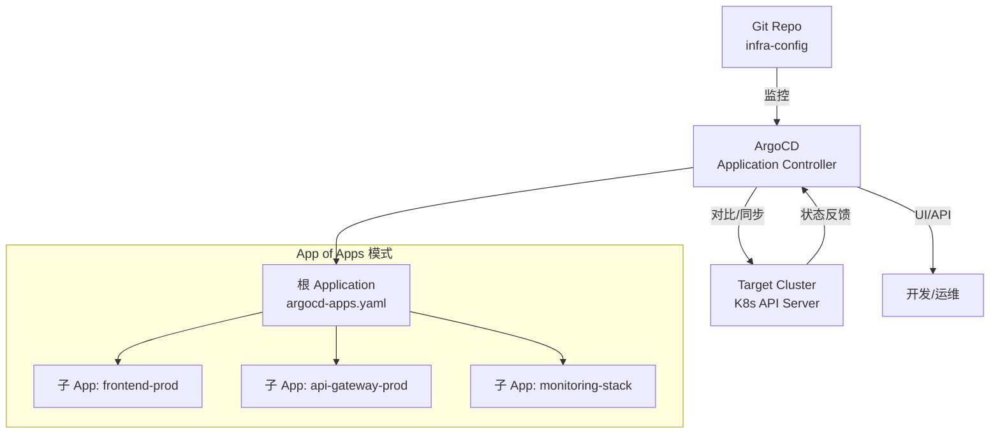

# 第 20 章 前端部署与发布体系 —— 从容器化到边缘计算与渐进式交付
作者：龙哥

## 学习目标

- 理解前端构建产物标准化的核心规范：不可变产物、内容寻址、SPA 回退与 SRI 防篡改
- 掌握生产级 Dockerfile 多阶段构建、非 Root 用户、Distroless 基础镜像、健康检查与资源限额的最佳实践
- 熟悉 Kubernetes 部署策略（RollingUpdate/Recreate）、Ingress 流量治理、ConfigMap/Secret 解耦配置、HPA/VPA 弹性伸缩及 Istio Service Mesh 金丝雀发布能力
- 理解边缘计算与边缘渲染的架构差异（Edge Runtime vs Node.js），掌握 Next.js/Nuxt Edge Functions 部署、Edge KV 状态管理、Middleware 实现 A/B 测试与个性化路由
- 掌握 GitOps 核心原则与 ArgoCD 工程化落地：声明式同步、App of Apps 模式、PreSync/PostSync Hook、自动回滚、Secret 安全管理与变更日志自动化

## 20.1 生活类比

想象前端部署发布体系是一个现代化集装箱物流与边缘仓储网络。

构建产物标准化好比给每个集装箱贴上全球唯一 RFID 芯片（内容哈希），并加装防拆封铅封（SRI）。货物（资源）一旦装箱不可篡改，客户（浏览器）可长期缓存信任；SPA 回退则是兜底配送中心，无论客户从哪个门进，最终都能找到主入口（index.html）。

容器化部署相当于标准化集装箱：Builder 阶段是装货车间（含工具、原料），Runner 阶段只运走成品箱（Distroless 极简箱），箱体贴上健康体检码（Probes）与载重限额贴（Resources Limit），非授权人员（Root）禁止驾驶。

K8s 与 Service Mesh 是智能港口调度系统：滚动更新是分批换班卸货，Ingress 是智能分拣闸机（TLS 检票、路由重写），Istio 是空中交通管制，能将 10% 航班引导至新航线（金丝雀），甚至隐形复制一份飞行数据去新机型验证（流量镜像），不影响乘客体验。

边缘计算/渲染则是社区微型前置仓：不再从中央大仓（源站）千里调拨，而是把组装生产线（SSR 渲染）搬到用户家门口（Edge 节点），利用 Edge KV 存储备好常用配料（会话/偏好），Middleware 是门口分流员，根据会员卡（Cookie）秒级决定走 VIP 通道还是普通通道（A/B 测试），实现毫秒级交付。

GitOps 好比单一账本驱动的自动化仓储：Git 仓库是唯一真实账本（期望状态），ArgoCD 是不知疲倦的核对员，时刻比对账本与实物（集群状态），一旦不符自动整修（同步/回滚），所有变更留痕可查，Secret 则是存放在金库（Vault/Sealed Secrets）的钥匙，账本里只记钥匙编号不记实物。

## 20.2 概念地图

前端部署与发布体系
├── 构建产物标准化
│   ├── 不可变产物与内容寻址哈希
│   ├── SPA 回退落地 (fallback: index.html)
│   ├── 资源完整性校验 SRI (Subresource Integrity)
│   └── Import Maps 动态依赖映射
├── 容器化部署最佳实践
│   ├── 多阶段构建
│   ├── 非 Root 用户与 Distroless/Alpine 精简镜像
│   ├── 健康检查 liveness/readiness 探针
│   └── CPU/内存 Limit/Request 资源限额
├── K8s 部署策略与 Service Mesh
│   ├── Deployment 策略
│   ├── Ingress TLS 终结与路由重写
│   ├── ConfigMap/Secret 运行时配置解耦
│   ├── HPA/VPA 弹性伸缩
│   └── Istio 金丝雀发布与流量镜像
├── 边缘计算与边缘渲染
│   ├── Edge Runtime (V8 Isolates) 与 Node.js 差异
│   ├── 地理就近 SSR 渲染降低 TTFB
│   ├── Edge KV / Durable Objects 分布式状态
│   └── Middleware 改写/重定向/A/B 测试
└── GitOps 持续交付流水线
    ├── ArgoCD 声明式同步与 App of Apps
    ├── PreSync/PostSync Hook 迁移测试
    ├── 自动回滚 (selfHeal/prune) 与健康检查
    ├── Secret 管理
    └── 变更日志自动生成

## 20.3 构建产物标准化 —— 让发布物拥有“指纹”与“防篡改锁”

### 为什么需要这个概念？

你有没有遇到过这样的场景：线上版本回滚后，用户刷新页面依然加载旧版本的 JS，导致白屏或报错？或者 CDN 被劫持注入了恶意广告代码，却无法在浏览器端拦截？这些问题的根因在于：构建产物缺乏唯一身份标识、缺乏防篡改验证机制、单页应用路由缺乏兜底入口。

传统部署直接覆盖同名文件（如 `app.js`），导致版本不可追溯、浏览器缓存失效混乱、回滚极其困难。而现代前端工程要求：产物一旦产出即不可变、内容变更即身份变更、浏览器可长期无感缓存、资源加载可自证完整性。

> "确立产物输出规范：`index-[hash].html`、静态资源长缓存、`importmap` 动态依赖、Subresource Integrity (SRI) 防篡改、SPA `fallback: index.html` 配置。"
> 
> —— 来源：《PU9Id4IPMoZ3QdxLzZUcEPBRnWO.md》（origin）

### 核心定义

#### 不可变产物与内容寻址

**不可变产物** 是指：构建产出的每一个文件，其文件名中包含该文件内容的哈希摘要（如 `index-a1b2c3d4.js`）。内容不变则哈希不变，内容一变哈希必变。

**内容寻址** 则是以哈希作为文件的唯一标识符。这带来三大收益：
1. **长缓存策略生效**：你可以安全地对带哈希的静态资源设置 `Cache-Control: max-age=31536000, immutable`，浏览器一年内不再发起请求。
2. **零停机部署**：新旧版本产物共存于服务器（文件名不同），HTML 入口原子切换，老用户加载旧版资源不报错，新用户加载新版资源。
3. **精准去重与版本追踪**：相同内容的文件在存储层面可去重，部署记录即哈希列表，回滚只需指向旧哈希。

在 Vite/Rollup 中，你只需配置输出文件名模板：

```json
// vite.config.ts
export default defineConfig({
  build: {
    rollupOptions: {
      output: {
        entryFileNames: 'assets/[name]-[hash].js',
        chunkFileNames: 'assets/[name]-[hash].js',
        assetFileNames: 'assets/[name]-[hash].[ext]'
      }
    }
  }
})
```

这个配置展示了：通过 `[hash]` 占位符，将内容指纹嵌入文件名，实现内容寻址。构建工具会在生成文件后计算哈希并重命名，HTML 模板插件会自动注入最新的文件名引用。

#### SPA 回退

单页应用（SPA）在前端路由模式下，用户刷新 `/dashboard/detail` 时，服务端若无对应文件会返回 404。**SPA 回退** 是指：服务端配置兜底规则，当请求路径不匹配任何静态文件时，返回 `index.html`，将路由控制权交还前端路由器。

Nginx 典型配置：

```nginx
location / {
  try_files $uri $uri/ /index.html;
}
```

这个配置展示了：`try_files` 按顺序尝试匹配精确文件、目录索引，最终回退到 `/index.html`。这保证了前端路由在任意深度刷新、分享链接打开时均能正常加载应用入口。

#### 资源完整性校验 (SRI)

**Subresource Integrity (SRI)** 允许浏览器在加载外部脚本/样式时，校验其内容哈希是否与 HTML 中声明的 `integrity` 属性一致。若不一致（如 CDN 被劫持篡改），浏览器拒绝执行。

```html
<script 
  src="/assets/app.a1b2c3d4.js" 
  integrity="sha384-oqVuAfXRKap7fdgcCY5uykM6+R9GqQ8K/uxy9rx7HNQlGYl1kPzQho1wx4JwY1wZ"
  crossorigin="anonymous"></script>
```

这个标签展示了：`integrity` 值为 `sha384-` 前缀 + Base64 编码的哈希值。`crossorigin="anonymous"` 告诉浏览器以匿名模式发起跨域请求（不发送 Cookie），这是 SRI 校验跨域资源的前提。SRI 是供应链安全的最后一道防线：即使 CDN 被攻破，恶意代码也无法在用户浏览器执行。

#### Import Maps

**Import Maps** 解决了“裸模块说明符”在浏览器原生 ES Module 中无法直接解析的问题（如 `import { ref } from 'vue'`）。它提供了一个运行时映射表，将包名映射到具体的带哈希 URL。

```html
<script type="importmap">
{
  "imports": {
    "vue": "/assets/vue.3.4.21.esm-browser.prod.a1b2c3d4.js",
    "vue/": "/assets/vue.3.4.21.esm-browser.prod/"
  }
}
</script>
```

这个映射展示了：浏览器遇到 `import 'vue'` 时，查表找到带哈希的精确文件 URL。这实现了**依赖版本与构建产物的解耦**——你可以在不重新打包业务代码的前提下，仅通过更新 Import Map 实现库版本热切换（前提是 API 兼容）。

### 边界条件与常见坑

| 场景 | 陷阱 | 对策 |
|------|------|------|
| HTML 入口文件 | 若 `index.html` 也加哈希（`index-a1b2c3d4.html`），用户收藏链接会失效 | HTML 通常**不加哈希**，配置 `Cache-Control: no-cache, must-revalidate`；若必须版本化，配合 Import Maps 间接引用 |
| SRI 跨域资源 | 无 `crossorigin` 或 CDN 未返回 `Access-Control-Allow-Origin` | 确保脚本标签加 `crossorigin="anonymous"`，CDN 响应头包含 `Access-Control-Allow-Origin: *` |
| Import Maps 兼容性 | Safari 旧版、Firefox 旧版不支持 | 使用 `es-module-shims` Polyfill，或在构建时将 Import Map 内联为 SystemJS/AMD 兼容代码 |

---

## 20.4 容器化部署最佳实践 —— 从“开发机环境”到“生产级标准集装箱”

### 为什么需要这个概念？

“我本机跑得好好的，部署到服务器就挂了”——这是环境差异的经典痛点。Node.js 版本、系统库、原生模块编译环境、文件权限、时区配置……任何一项不一致都可能导致故障。

容器化的核心价值是**环境标准化**。但如果你把 `node_modules`、源码、构建工具、甚至 `.git` 目录全塞进镜像，得到的将是一个 1.5GB 的“超重集装箱”：拉取慢、启动慢、攻击面大、违反最小权限原则。

生产级镜像必须做到：仅包含运行时必需产物、非 Root 用户运行、极简基础镜像、具备健康检查与资源配额。

> "编写生产级 Dockerfile：Builder 阶段安装依赖构建、Runner 阶段仅复制产物、非 root 运行、Distroless/Alpine 精简镜像、liveness/readiness 探针、CPU/内存 Limit/Request。"
> 
> —— 来源：《PU9Id4IPMoZ3QdxLzZUcEPBRnWO.md》（origin）

### 核心定义：多阶段构建

**多阶段构建** 利用 Dockerfile 多个 `FROM` 指令，将构建环境与运行环境物理隔离：

```dockerfile
# ===== Stage 1: Builder (构建环境) =====
FROM node:20-alpine AS builder
WORKDIR /app

# 1. 仅复制锁文件，利用层缓存：依赖不变则不重装
COPY package*.json ./
RUN npm ci --prefer-offline --no-audit --progress=false

# 2. 复制源码并构建
COPY . .
RUN npm run build

# ===== Stage 2: Runner (运行环境) =====
# 使用 Distroless：无 Shell、无包管理器、仅含运行时
FROM gcr.io/distroless/nodejs20-debian12
WORKDIR /app

# 3. 仅从 Builder 复制产物与运行时依赖
COPY --from=builder /app/dist ./dist
COPY --from=builder /app/node_modules ./node_modules
COPY --from=builder /app/package.json ./

# 4. 非 Root 用户（Distroless 预置 nonroot:nonroot 65532:65532）
USER nonroot:nonroot

EXPOSE 3000
CMD ["dist/server.mjs"]
```

这个 Dockerfile 展示了四个关键设计：

1. **依赖层缓存**：`COPY package*.json` 与 `RUN npm ci` 独立成层。源码变更不触发依赖重装，构建提速 5-10 倍。
2. **产物裁剪**：Runner 阶段**仅复制** `dist/`、`node_modules/`、`package.json`。源码、测试文件、构建工具、`.git` 全部丢弃，镜像体积从 ~1.2GB 降至 ~150MB。
3. **非 Root 运行**：`USER nonroot:nonroot` 确保进程以 UID 65532 运行。即使容器逃逸，攻击者也只拥有非特权用户权限。
4. **Distroless 基础镜像**：`gcr.io/distroless/nodejs20-debian12` 仅包含 Node.js 运行时及必要系统库，无 Shell、无 `apt`、`apk`、无任何包管理器。攻击面极小，CVE 漏洞扫描通常 0 高危。

### 关键性质对比：Alpine vs Debian Slim vs Distroless

| 基础镜像 | 体积 | 包管理器 | Libc | 原生模块兼容性 | 推荐场景 |
|----------|------|----------|------|----------------|----------|
| `node:20-alpine` | ~45MB | `apk` | musl | **需额外编译工具链**（`python3 make g++`） | 纯 JS 项目、体积极致追求 |
| `node:20-slim` | ~120MB | `apt` | glibc | **原生兼容** | 含原生模块（`sharp`、`bcrypt`、`canvas`） |
| `gcr.io/distroless/nodejs20-debian12` | ~90MB | **无** | glibc | **原生兼容** | **生产环境首选**：安全、体积适中、无需维护包管理器 |

> **注意**：Alpine 基于 musl libc，若项目依赖原生模块（如 `sharp` 图像处理、`bcrypt` 加密），在 Alpine 中 `npm ci` 会报错 `libc.musl-x86_64.so.1 not found`。此时必须安装构建工具链 `RUN apk add --no-cache python3 make g++`，但这会显著增加镜像体积和构建时间。**生产环境推荐直接使用 Distroless 或 Debian Slim**，避开 musl 兼容性坑。

### 健康检查与资源限额

在 Kubernetes 中，容器必须暴露两类探针：

```yaml
# deployment.yaml
livenessProbe:
  httpGet:
    path: /healthz
    port: 3000
  initialDelaySeconds: 10
  periodSeconds: 10
  failureThreshold: 3
readinessProbe:
  httpGet:
    path: /ready
    port: 3000
  initialDelaySeconds: 5
  periodSeconds: 5
  failureThreshold: 3
resources:
  limits:
    cpu: "500m"
    memory: "512Mi"
  requests:
    cpu: "100m"
    memory: "128Mi"
```

这段配置展示了：
- **Liveness Probe（存活探针）**：检测进程是否存活。失败则 K8s **杀掉容器并重启**（`RestartPolicy`）。路径 `/healthz` 应仅检查进程心跳，不依赖下游。
- **Readiness Probe（就绪探针）**：检测是否准备好接收流量。失败则 K8s **从 Service Endpoints 剔除该 Pod**，流量不再转发。路径 `/ready` 应检查数据库连接、缓存连接、依赖服务可达性。
- **Resources**：`requests` 用于调度器决策（保证最小资源），`limits` 用于 Cgroups 硬性限制（防止 OOM Kill 或 CPU 节流）。QoS 类别：Guaranteed（limits=requests）、Burstable（limits>requests）、BestEffort（无配置）。

### 边界条件与调试技巧

- **Distroless 无 Shell 怎么进容器排查？**
  使用 `kubectl debug -it <pod> --image=busybox:1.36 --target=<container>` 启动临时 Sidecar，共享 PID/Network/文件系统命名空间，在 Sidecar 中执行 `ps aux`、`netstat`、`cat /proc/<pid>/environ`。
  
- **为什么 `npm ci` 优于 `npm install`？**
  `npm ci` 要求 `package-lock.json` 存在，严格按锁文件安装，**不更新锁文件**、不解析语义化版本范围、自动清理 `node_modules` 重装。这保证了**构建的绝对可复现性**，且在 Docker 分层缓存下，锁文件未变则层命中。

- **Monorepo 锁文件同步问题**：
  pnpm/yarn workspaces 生成的根锁文件需完整复制到构建上下文。若子项目独立发布，建议在 CI 中为每个子项目生成独立的 Docker 构建上下文（含根锁文件）。

---

## 20.5 K8s 部署策略与 Service Mesh —— 让流量在版本间“平滑过渡”

### 为什么需要这个概念？

直接 `kubectl set image` 触发滚动更新，默认参数可能导致：瞬间可用副本数归零（请求失败）、新版本启动未就绪却已接入流量（502）、旧版本连接未排空即被杀（连接重置）。微服务架构下，服务间调用还需要：熔断、重试、超时控制、流量镜像验证、可观测性。

K8s 原生资源 + Istio Service Mesh 共同构成了**生产级流量治理体系**。

> "配置 RollingUpdate/Recreate 策略、Ingress TLS 终结/路由重写、ConfigMap 挂载运行时配置、Secret 管理敏感信息、HPA 基于 CPU/自定义指标弹性、Istio 金丝雀流量镜像。"
> 
> —— 来源：《PU9Id4IPMoZ3QdxLzZUcEPBRnWO.md》（origin）

### 核心定义

#### Deployment 滚动更新策略

```yaml
spec:
  strategy:
    type: RollingUpdate
    rollingUpdate:
      maxSurge: 25%        # 允许超出期望副本数的最大比例/数量
      maxUnavailable: 0    # 允许不可用副本数（0 表示全程保证满副本）
  minReadySeconds: 10      # Pod Ready 后再等 10s 才算真正可用，防止启动瞬间就绪探针通过但应用未完全初始化
  progressDeadlineSeconds: 600  # 滚动更新超时判定
```

这个配置展示了：
- `maxUnavailable: 0` + `maxSurge: 25%` = **满副本滚动更新**。旧版本全部在线的前提下，先启动新 Pod，就绪后再逐个终止旧 Pod。代价是临时需要 125% 资源配额。
- `minReadySeconds` 解决“就绪探针通过但应用预热未完成（如 JIT 编译、连接池建立）”导致的早期错误率飙升。

#### 优雅终止：PreStop Hook + 终止宽限期

```yaml
lifecycle:
  preStop:
    exec:
      command: ["/bin/sh", "-c", "sleep 15"]  # 等待 Endpoints 控制器剔除本 Pod IP
terminationGracePeriodSeconds: 30
```

这个钩子展示了：`preStop` 在 SIGTERM 发送前执行，`sleep 15` 留出时间让 kube-proxy/iptables/Envoy 更新 Endpoints，**将本 Pod 从 Service 负载均衡池移除**。随后应用收到 SIGTERM，应在 30 秒内完成连接排空、事务提交、资源释放。这是**零连接丢失发布**的关键。

#### Ingress：七层网关

```yaml
apiVersion: networking.k8s.io/v1
kind: Ingress
metadata:
  name: frontend-ingress
  annotations:
    nginx.ingress.kubernetes.io/ssl-redirect: "true"
    nginx.ingress.kubernetes.io/rewrite-target: /$2
spec:
  tls:
  - hosts: [app.example.com]
    secretName: tls-secret
  rules:
  - host: app.example.com
    http:
      paths:
      - path: /api(/|$)(.*)
        pathType: Prefix
        backend:
          service:
            name: api-gateway
            port: {number: 80}
      - path: /(/|$)(.*)
        pathType: Prefix
        backend:
          service:
            name: frontend
            port: {number: 80}
```

这个 Ingress 展示了：TLS 终结在入口层（卸载应用层 HTTPS 压力）、路径重写（`/api/users` -> 后端 `/users`）、基于 Host/Path 的多服务路由。

#### ConfigMap 与 Secret：配置与代码分离

```yaml
# configmap.yaml
apiVersion: v1
kind: ConfigMap
metadata:
  name: frontend-config
data:
  API_BASE_URL: "https://api.example.com"
  FEATURE_FLAGS: "new_ui=true,beta_api=false"
---
# secret.yaml (Base64 编码，非加密！生产需 Sealed Secrets)
apiVersion: v1
kind: Secret
metadata:
  name: frontend-secret
type: Opaque
stringData:  # 直接写明文，K8s 自动 Base64
  SENTRY_DSN: "https://xxx@sentry.io/123"
  REDIS_PASSWORD: "super-secret"
```

应用通过环境变量或挂载卷读取：
```yaml
envFrom:
- configMapRef: {name: frontend-config}
- secretRef: {name: frontend-secret}
```

这个模式展示了：**镜像构建时不包含任何环境差异配置**，同一镜像可跑 Dev/Staging/Prod，仅通过挂载不同 ConfigMap/Secret 实现环境隔离。

#### HPA/VPA：弹性伸缩

```yaml
# HPA: 基于自定义指标 (Prometheus Adapter)
apiVersion: autoscaling/v2
kind: HorizontalPodAutoscaler
metadata:
  name: frontend-hpa
spec:
  scaleTargetRef:
    apiVersion: apps/v1
    kind: Deployment
    name: frontend
  minReplicas: 3
  maxReplicas: 50
  metrics:
  - type: Pods
    pods:
      metric:
        name: http_requests_per_second
      target:
        type: AverageValue
        averageValue: "1000"  # 每个 Pod 目标 1000 QPS
  behavior:
    scaleDown:
      stabilizationWindowSeconds: 300  # 缩容冷却 5 分钟，防抖
    scaleUp:
      stabilizationWindowSeconds: 0    # 扩容即时响应
```

这个 HPA 展示了：基于**业务指标（QPS）**而非仅 CPU/内存进行扩缩容，更贴近用户体验。`behavior` 字段控制扩缩容节奏，防止抖动。

#### Istio Service Mesh：流量治理神器

Istio 通过 Sidecar (Envoy) 透明拦截 Pod 进出流量，实现**应用零侵入**的高级治理。

**金丝雀发布（权重分流）**：

```yaml
# DestinationRule 定义子集
apiVersion: networking.istio.io/v1beta1
kind: DestinationRule
metadata:
  name: frontend
spec:
  host: frontend
  subsets:
  - name: v1
    labels: {version: v1}
  - name: v2
    labels: {version: v2}
---
# VirtualService 定义流量权重
apiVersion: networking.istio.io/v1beta1
kind: VirtualService
metadata:
  name: frontend
spec:
  hosts: [frontend]
  http:
  - route:
    - destination:
        host: frontend
        subset: v1
      weight: 90
    - destination:
        host: frontend
        subset: v2
      weight: 10
```

这个配置展示了：`VirtualService` 在网格层面按权重分流，**无需修改 Deployment/Service**，新旧版本共存，流量精准控制。观测 v2 指标（错误率、延迟、业务转化）正常后，逐步调整权重至 100%。

**流量镜像（影子流量）**：

```yaml
http:
- route:
  - destination:
      host: frontend
      subset: v1
    weight: 100
  mirror:
    host: frontend
    subset: v2
  mirrorPercentage:
    value: 100.0  # 100% 镜像到 v2
```

这个配置展示了：**生产流量 100% 照常跑 v1，同时复制一份完整请求发给 v2（镜像流量不返回响应给客户端）**。v2 可真实承载生产负载进行压测、兼容性验证、日志分析，**零风险**。

**熔断与重试**：

```yaml
# DestinationRule 补充策略
trafficPolicy:
  connectionPool:
    tcp:
      maxConnections: 1000
    http:
      h2UpgradePolicy: UPGRADE
      http1MaxPendingRequests: 1000
      http2MaxRequests: 1000
  outlierDetection:  # 熔断
    consecutive5xxErrors: 5
    interval: 30s
    baseEjectionTime: 60s
    maxEjectionPercent: 50
  retryPolicy:       # 重试
    retryOn: connect-failure,refused-stream,unavailable,cancelled,retriable-status-codes
    numRetries: 3
    perTryTimeout: 2s
```

这个策略展示了：**熔断**自动剔除持续报错的上游实例（防止雪崩）；**重试**自动处理瞬时网络抖动（需业务幂等）。两者结合构建韧性调用链。

### 边界条件

- **RollingUpdate 要求 API 向后兼容**：v1/v2 同时在线时，数据库 Schema 必须兼容两版代码。迁移策略：先加字段/表（不删）、再上代码、最后清理旧字段。
- **Istio Sidecar 资源开销**：每个 Pod 额外 ~50-100MB 内存、~1-2ms 延迟。小规模应用可评估 ROI。
- **Secret 默认 Base64 非加密**：Git 存明文 Secret 违规。生产必须配合 **Sealed Secrets**（Bitnami，控制器端解密）、**External Secrets Operator**（对接 Vault/AWS Secrets Manager/GCP Secret Manager）、**HashiCorp Vault Agent Injector**。

---

## 20.6 边缘计算与边缘渲染 —— 让首屏渲染发生在“用户家门口”

### 为什么需要这个概念？

传统架构：用户（北京） -> DNS -> 源站（弗吉尼亚） -> SSR 渲染 -> HTML 传回北京。物理距离决定了 **TTFB (Time To First Byte) ≥ 200ms**（跨太平洋光纤单程 ~70ms，往返 + 服务端处理）。

**边缘渲染** 将 SSR 计算搬到 CDN 边缘节点（用户同城/同省）：用户 -> Edge 节点（SSR） -> HTML。TTFB 可降至 **< 50ms**，首屏性能质变。

但 Edge Runtime 不是 Node.js：**基于 V8 Isolates（隔离区）而非进程**，启动极快（ms 级），但**无文件系统、无原生模块、API 受限、执行时间严格限制**。

> "对比 Edge Runtime 与 Node.js Runtime 差异、部署 Next.js/Nuxt Edge Functions、地理就近渲染降低 TTFB、Edge KV 存储会话/配置、A/B 测试中间件。"
> 
> —— 来源：《PU9Id4IPMoZ3QdxLzZUcEPBRnWO.md》（origin）

### 核心定义

#### Edge Runtime vs Node.js

| 特性 | Node.js Runtime | Edge Runtime (V8 Isolates) |
|------|-----------------|----------------------------|
| 启动时间 | ~100-500ms (冷启动) | **< 5ms** |
| 进程模型 | 进程隔离 | **Isolate 隔离**（同进程多上下文） |
| 文件系统 | 完整 `fs` 模块 | **无**（只读内存文件系统） |
| 原生模块 | 支持 (NAPI) | **不支持** (`crypto`, `fs`, `net`, `child_process` 等) |
| Web APIs | 部分 (实验性) | **标准 Web APIs** (`fetch`, `crypto.subtle`, `ReadableStream`, `URL`, `Headers`) |
| 执行时限 | 无硬性限制 (受平台配置) | **严格限制**：10-50ms CPU 时间 (免费/标准层) |
| 状态持久化 | 进程内变量、本地文件 | **不可持久化**，必须外置 |
| 典型平台 | 传统服务器、K8s、Vercel Node.js Functions | Cloudflare Workers, Vercel Edge Functions, AWS Lambda@Edge, Netlify Edge Functions |

#### Next.js Edge Runtime 部署

```javascript
// app/dashboard/page.tsx
export const runtime = 'edge'  // 声明使用 Edge Runtime

import { getUserPreference } from '@/lib/edge-kv'

export default async function DashboardPage({ cookies }) {
  const theme = await getUserPreference(cookies.get('user_id'), 'theme')
  return <Dashboard theme={theme} />
}
```

```javascript
// middleware.ts (Edge Middleware)
import { NextResponse } from 'next/server'
import type { NextRequest } from 'next/server'
import { getABBucket } from '@/lib/ab-test'

export function middleware(request: NextRequest) {
  // 1. A/B 测试分桶
  const bucket = getABBucket(request.cookies.get('ab_bucket')?.value, request.ip)
  if (bucket === 'beta') {
    return NextResponse.rewrite(new URL('/beta' + request.nextUrl.pathname, request.url))
  }
  
  // 2. Bot 拦截
  if (request.headers.get('user-agent')?.includes('bot')) {
    return new NextResponse(null, { status: 403 })
  }
  
  // 3. 重写/重定向/注入 Header
  const response = NextResponse.next()
  response.headers.set('x-edge-cache', 'miss')
  return response
}

export const config = {
  matcher: ['/dashboard/:path*', '/api/:path*']
}
```

这段代码展示了：
- `export const runtime = 'edge'` 让页面组件在 Edge 节点 SSR 渲染。
- `middleware.ts` 运行在 Edge，拦截请求，**零客户端跳转**实现 A/B 测试重写、Bot 拦截、Header 注入。
- **数据库访问必须使用 HTTP 驱动**：`@vercel/postgres`、`@neondatabase/serverless`、`@planetscale/database`、`@libsql/client` (Turso)、**Upstash Redis (REST API)**。传统 TCP 连接池（`pg`、`mysql2`）在 Edge 无法工作。

#### Edge KV / Durable Objects：边缘状态

```typescript
// lib/edge-kv.ts (Cloudflare Workers KV / Vercel KV / Upstash Redis)
export async function getUserPreference(userId: string, key: string): Promise<string> {
  // KV 读取：最终一致性，跨区域复制延迟 ~几百毫秒
  const value = await kv.get(`user:${userId}:${key}`)
  return value || 'default'
}

export async function setUserPreference(userId: string, key: string, value: string) {
  await kv.put(`user:${userId}:${key}`, value, { expirationTtl: 86400 * 30 })
}
```

```typescript
// Durable Objects (Cloudflare 独有：强一致性、单线程执行、可存状态)
export class UserSession implements DurableObject {
  state: DurableObjectState
  constructor(state: DurableObjectState) { this.state = state }
  
  async fetch(request: Request) {
    const { userId, action, data } = await request.json()
    if (action === 'get') {
      return Response.json(await this.state.storage.get(userId))
    }
    if (action === 'set') {
      await this.state.storage.put(userId, data)
      return new Response('OK')
    }
  }
}
```

这对比展示了：**KV 适合读多写少、容忍最终一致性的配置/缓存**；**Durable Objects 适合需强一致、有状态的协作/会话/计数器**（如 WebSocket 连接管理、实时协作文档）。

### 关键性质与工程约束

1. **代码体积限制**：Edge Function 打包后通常 **< 1-5MB (gzip)**。依赖需精简：避免 `lodash`、`moment` 等大体积库，改用原生 API 或 `date-fns`、`es-toolkit`。
2. **执行时间预算**：CPU 时间 10-50ms。**串行调用多个外部 API 极易超时**。必须采用**并行预取 + 超时兜底**模式：

```typescript
// middleware.ts: 并行预取 + Promise.race 超时兜底
async function fetchWithTimeout(url: string, ms: number) {
  const controller = new AbortController()
  const timeout = setTimeout(() => controller.abort(), ms)
  try {
    return await fetch(url, { signal: controller.signal })
  } finally {
    clearTimeout(timeout)
  }
}

export async function middleware(request: NextRequest) {
  // 并行发起鉴权、风控、画像三个请求，各自 20ms 超时
  const [auth, risk, profile] = await Promise.allSettled([
    fetchWithTimeout(AUTH_URL, 20),
    fetchWithTimeout(RISK_URL, 20),
    fetchWithTimeout(PROFILE_URL, 20)
  ])
  
  // 任一失败/超时，降级使用默认值，不阻塞主流程
  const user = profile.status === 'fulfilled' ? await profile.value.json() : defaultUser
  // ...
}
```

3. **读己之写一致性**：Edge KV 多为最终一致性。用户修改偏好 -> 写 KV -> 立即刷新 -> 可能读到旧值。解决方案：
   - **客户端乐观更新**：前端本地状态立即更新，不等后端确认。
   - **写后读重定向到强一致存储**：写入后重定向至源站/主区域读取。
   - **使用 Durable Objects**（强一致、单线程、有状态）。

### 边界条件

- **Node.js 原生模块不可用**：`crypto.createHash` -> `crypto.subtle.digest`；`fs.readFile` -> 构建时内联或对象存储；`path.resolve` -> 字符串拼接或 `url` 模块。
- **长连接/WebSocket**：Vercel Edge Functions **不支持** WebSocket。Cloudflare Workers 通过 **Durable Objects** 支持。
- **成本模型**：按 **调用次数 + CPU 时间 + 出站流量** 计费。高频、长耗时任务（如复杂 PDF 生成、视频转码）成本可能远超源站服务器。需按业务场景评估 ROI。

---

## 20.7 GitOps 持续交付流水线 —— 用 Git 仓库作为“唯一事实来源”驱动集群收敛

### 为什么需要这个概念？

传统 CI/CD（推模式）：Jenkins/GitLab CI 拥有集群 Admin 凭证，执行 `kubectl apply`/`helm upgrade`。
- **权限过大**：CI 系统被攻破 = 集群沦陷。
- **状态漂移**：人工 `kubectl patch`、热修复、紧急扩容导致集群实际状态偏离 Git 期望状态，无审计、难复现。
- **发布流程碎片化**：构建、部署、验证、通知分散在多个脚本/平台。

**GitOps** 反转控制流：**Git 仓库 = 唯一事实来源（期望状态）**，集群内控制器（ArgoCD/Flux）**主动拉取并持续协调**，实现声明式、可审计、自愈的交付闭环。

> "落地 GitOps：ArgoCD 监控 Git 仓库声明式同步、PreSync/PostSync Hook 运行迁移/测试、自动回滚健康检查失败版本、集成 Jira/Confluence 自动生成发布说明。"
> 
> —— 来源：《PU9Id4IPMoZ3QdxLzZUcEPBRnWO.md》（origin）

### 核心定义：GitOps 四大原则

1. **声明式**：系统由一组声明式配置文件描述（K8s Manifest、Helm Values、Kustomize）。
2. **版本化**：期望状态存储在 Git，拥有完整历史、不可篡改、可回滚、可审计。
3. **拉取同步**：集群内 Agent 定期/事件驱动拉取 Git 状态，**不暴露集群凭证给外部 CI**。
4. **持续协调**：控制器持续对比实际与期望，自动修正漂移（`selfHeal`），保障收敛。

### ArgoCD 架构与 App of Apps



这个架构展示了：
- **Application Controller** 监控 Git 仓库，管理 `Application` CRD。
- **App of Apps**：根 `Application` 管理一组子 `Application`，实现**多环境、多租户、多集群的层级化管理**。每个团队只维护自己的子 Application 目录，平台团队维护根 Application。

#### 典型 GitOps 仓库结构

```text
infra-config/
├── apps/
│   ├── prod/
│   │   ├── frontend/
│   │   │   ├── kustomization.yaml
│   │   │   ├── deployment.yaml
│   │   │   ├── service.yaml
│   │   │   ├── rollout.yaml          # Argo Rollouts 资源
│   │   │   └── hpa.yaml
│   │   ├── api-gateway/
│   │   └── ...
│   └── staging/
│       └── ...
├── clusters/
│   ├── prod/
│   │   ├── argocd-apps.yaml          # 根 Application
│   │   └── cluster-config.yaml
│   └── staging/
└── base/                             # 通用基础组件
    ├── cert-manager/
    └── ingress-nginx/
```

#### kustomization.yaml：镜像标签与环境差异化

```yaml
# apps/prod/frontend/kustomization.yaml
apiVersion: kustomize.config.k8s.io/v1beta1
kind: Kustomization

namespace: prod

resources:
- deployment.yaml
- service.yaml
- rollout.yaml
- hpa.yaml

# 镜像标签管理：仅修改此处触发滚动更新
images:
- name: registry.example.com/frontend
  newTag: v2.3.1  # CI 流水线更新此字段并提交

# 通用标签
commonLabels:
  app: frontend
  env: prod
  managed-by: argocd

# 环境差异化补丁
patches:
- patch: |-
    - op: replace
      path: /spec/replicas
      value: 10
  target:
    kind: Deployment
- patch: |-
    - op: replace
      path: /spec/template/spec/containers/0/resources/limits/memory
      value: "1Gi"
  target:
    kind: Deployment
```

这个配置展示了：**Kustomize 原生无模版**，通过 `images` 字段管理镜像版本、`patches` 注入环境差异（副本数、资源限额、Feature Flags）。CI 流水线仅需 `sed` 更新 `newTag` 并 `git push`，ArgoCD 自动检测并同步。

#### ArgoCD Application 与自动同步策略

```yaml
# clusters/prod/argocd-apps.yaml (根 Application 管理子 App)
apiVersion: argoproj.io/v1alpha1
kind: Application
metadata:
  name: prod-apps
  namespace: argocd
spec:
  project: production
  source:
    repoURL: https://github.com/org/infra-config
    targetRevision: main
    path: apps/prod
  destination:
    server: https://kubernetes.default.svc
    namespace: prod
  syncPolicy:
    automated:
      prune: true           # 删除 Git 中移除的资源
      selfHeal: true        # 集群漂移自动修正
      allowEmpty: false     # 防止误删：Git 目录为空时不清空命名空间
    retry:
      limit: 5
      backoff:
        duration: 5s
        factor: 2
        maxDuration: 3m
    syncOptions:
    - CreateNamespace=true
    - PrunePropagationPolicy=foreground
    - PruneLast=true
```

这个 Application 展示了：
- `automated.prune/selfHeal`：**全自动模式**。Git 变更 -> 自动同步；集群人工改动 -> 自动回滚至 Git 状态。
- `allowEmpty: false`：防止误配导致命名空间被清空。
- `syncOptions`：创建命名空间、级联删除策略。

#### PreSync/PostSync Hook：发布流程编排

```yaml
# rollout.yaml (Argo Rollouts 资源，支持金丝雀/蓝绿)
apiVersion: argoproj.io/v1alpha1
kind: Rollout
metadata:
  name: frontend
  annotations:
    # PreSync Hook: 同步前运行数据库迁移 Job
    argocd.argoproj.io/hook: PreSync
    argocd.argoproj.io/hook-delete-policy: HookSucceeded
---
apiVersion: batch/v1
kind: Job
metadata:
  name: db-migrate-{{.Release.Revision}}
  annotations:
    argocd.argoproj.io/hook: PreSync
    argocd.argoproj.io/hook-delete-policy: HookSucceeded
spec:
  template:
    spec:
      restartPolicy: OnFailure
      containers:
      - name: migrate
        image: registry.example.com/frontend:migrate-v2.3.1
        command: ["npm", "run", "db:migrate"]
---
# PostSync Hook: 同步后运行冒烟测试
apiVersion: batch/v1
kind: Job
metadata:
  name: smoke-test-{{.Release.Revision}}
  annotations:
    argocd.argoproj.io/hook: PostSync
    argocd.argoproj.io/hook-delete-policy: HookSucceeded
spec:
  template:
    spec:
      restartPolicy: OnFailure
      containers:
      - name: smoke
        image: registry.example.com/test-runner:latest
        command: ["npm", "run", "test:smoke", "--", "--baseUrl=https://app.example.com"]
```

这个配置展示了：**Hook 将数据库迁移、冒烟测试纳入 GitOps 同步流程**。PreSync 同步前运行（阻塞同步），PostSync 同步后运行（不阻塞）。失败则同步标记 Degraded，触发告警。

#### 自动回滚与健康检查

ArgoCD 结合 Argo Rollouts 实现**基于指标的自动回滚**：

```yaml
# rollout.yaml 补充分析模版
spec:
  strategy:
    canary:
      steps:
      - setWeight: 10
      - pause: {duration: 5m}
      - setWeight: 30
      - pause: {duration: 10m}
      - setWeight: 100
      analysis:
        templates:
        - templateName: success-rate
        args:
        - name: service-name
          value: frontend
        startingStep: 1  # 从第 1 步开始分析
---
apiVersion: argoproj.io/v1alpha1
kind: AnalysisTemplate
metadata:
  name: success-rate
spec:
  args:
  - name: service-name
  metrics:
  - name: success-rate
    interval: 1m
    successCondition: result[0] >= 0.995  # 成功率 ≥ 99.5%
    failureLimit: 3
    provider:
      prometheus:
        address: http://prometheus.monitoring.svc:9090
        query: |
          sum(rate(istio_requests_total{destination_service=~"{{args.service-name}}",response_code!~"5.."}[1m])) 
          / 
          sum(rate(istio_requests_total{destination_service=~"{{args.service-name}}"}[1m]))
```

这个模版展示了：**金丝雀每阶段暂停期间，Argo Rollouts 每分钟查询 Prometheus 成功率**。连续 3 次低于 99.5% 判定失败，**自动回滚至上一稳定版本**，并标记 Rollout 为 `Degraded`。

#### Secret 管理：Git 不存明文

```bash
# 1. 安装 kubeseal (客户端) + Sealed Secrets Controller (集群端)
# 2. 获取公钥加密明文 Secret
kubeseal --controller-name=sealed-secrets --controller-namespace=kube-system \
  --format yaml < secret-plain.yaml > sealed-secret.yaml
```

```yaml
# sealed-secret.yaml (可安全提交 Git)
apiVersion: bitnami.com/v1alpha1
kind: SealedSecret
metadata:
  name: frontend-secret
  namespace: prod
spec:
  encryptedData:
    SENTRY_DSN: AgBy3...  # AES-256 加密，仅集群端控制器持有私钥可解密
    REDIS_PASSWORD: AgBy3...
  template:
    type: Opaque
    metadata:
      name: frontend-secret
      namespace: prod
```

这个流程展示了：**开发只见公钥加密明文，生成 `SealedSecret` 提交 Git**。ArgoCD 同步到集群，Sealed Secrets Controller 解密生成标准 `Secret`，应用正常挂载使用。**私钥永不离开集群**，Git 仓库泄露也无风险。

### 边界条件与规模化挑战

- **Webhook 触发即时同步**：ArgoCD 默认 3 分钟轮询 Git。配置 GitHub/GitLab Webhook -> ArgoCD Repo Server `/api/webhook`，实现**推送即同步**。需注意 Webhook 重放幂等性（ArgoCD 基于资源版本号去重）。
- **大规模集群性能**：资源数 > 10 万时，单个 Application Controller 成为瓶颈。方案：**分片** `--application-controller-shard` 或部署**多个 ArgoCD 实例**（每实例管理独立命名空间/项目），配合 `argocd-application-controller` 水平扩展。
- **Helm/Kustomize 渲染位置**：ArgoCD 支持原生 Helm/Kustomize 渲染。但复杂模版建议 **CI 预渲染生成纯 Manifest 提交 Git**（`helm template` / `kustomize build`），审计更清晰、ArgoCD 负载更低、Diff 更准确。

---

## 20.8 本章小结

这一章中我们系统学习了现代前端部署与发布体系的完整工程化实践。首先我们建立了**构建产物标准化**规范：通过不可变产物、内容寻址哈希、SPA 回退、SRI 防篡改、Import Maps 动态依赖，让每个发布物拥有唯一指纹与防篡改锁。其次我们掌握了**生产级容器化部署**：多阶段构建分离构建与运行环境，Distroless/非 Root 极简镜像，健康检查与资源配额保障 SLA。接着我们深入 **K8s 部署策略与 Service Mesh**：滚动更新参数控制、优雅终止钩子、Ingress 七层网关、ConfigMap/Secret 解耦配置、HPA/VPA 业务指标弹性、Istio 金丝雀与流量镜像零风险发布。然后我们探索了**边缘计算与边缘渲染**：V8 Isolates 极速启动、地理就近 SSR 降低 TTFB、Edge KV/Durable Objects 分布式状态、Middleware 零跳转 A/B 与个性化。最后我们落地了 **GitOps 持续交付**：ArgoCD 声明式同步、App of Apps 多环境管理、PreSync/PostSync Hook 编排迁移测试、自动回滚自愈、Sealed Secrets 加密管理、变更日志自动化。

本章我们一起学习了以下概念：

| 概念 | 解释 |
|------|------|
| 不可变产物 / 内容寻址哈希 | 文件名包含内容哈希，内容变则名变，实现长缓存与精准版本控制 |
| SPA 回退 (fallback: index.html) | 服务端兜底配置，保证前端路由刷新不 404，单页应用部署必备 |
| 资源完整性校验 SRI | HTML 引用资源附带哈希值，浏览器校验防止 CDN 劫持篡改，供应链安全关键 |
| 多阶段 Docker 构建 | Builder 阶段构建编译，Runner 阶段仅复制产物，极大缩减镜像体积与攻击面 |
| Distroless / 非 Root | 无 Shell、无包管理器的极简基础镜像 + 非特权用户，生产环境安全基线 |
| Liveness / Readiness Probe | 存活探针决定重启，就绪探针决定流量准入，实现零停机发布与自愈 |
| RollingUpdate 与 maxSurge/maxUnavailable | K8s 默认滚动更新策略参数，控制版本切换节奏与可用副本数 |
| Istio 金丝雀发布 / 流量镜像 | Sidecar 透明劫持流量，按权重分流至新版本或镜像复制流量验证，零风险发布 |
| Edge Runtime (V8 Isolates) | 边缘运行时基于隔离区而非进程，毫秒级启动、无文件系统、API 受限，适合轻量计算 |
| 边缘渲染 / 地理就近 SSR | 在 CDN 节点执行服务端渲染，物理距离极小化 TTFB，首屏性能质变 |
| Middleware (边缘中间件) | 请求入站拦截层，可重写路由、注入 Header、A/B 分桶、Bot 拦截，无需改动业务代码 |
| GitOps 核心原则 | 声明式、版本化、拉取同步、持续协调；Git 为唯一事实来源 |
| ArgoCD App of Apps | 根 Application 管理子 Application，实现多环境、多集群、多租户层级化 GitOps 管理 |
| PreSync / PostSync Hook | 同步前后运行 Job（数据库迁移、冒烟测试、通知），保障发布流程完整性 |
| 自动回滚与 SelfHeal | 健康检查失败自动回滚上一版本，集群漂移自动修正，保障 SLA |
| Secret 管理最佳实践 | Git 不存明文 Secret，配合 Sealed Secrets / External Secrets Operator 落地加密注入 |

下一章中，我们将学习前端面试体系化备战 —— 从知识图谱构建到高频手写题与系统设计实战，助力求职突围。


