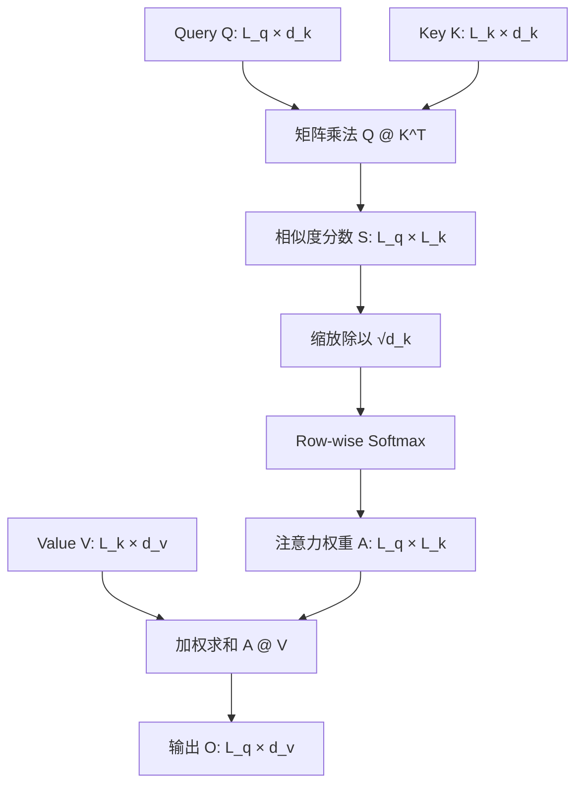
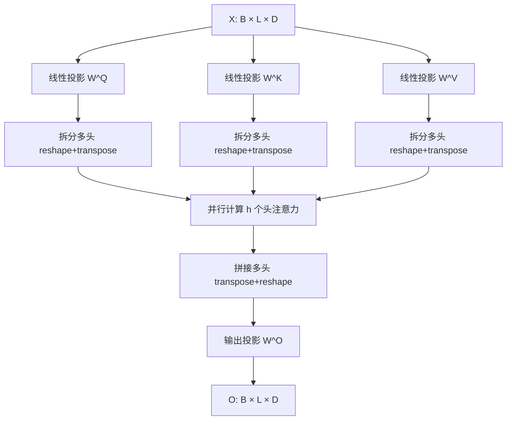
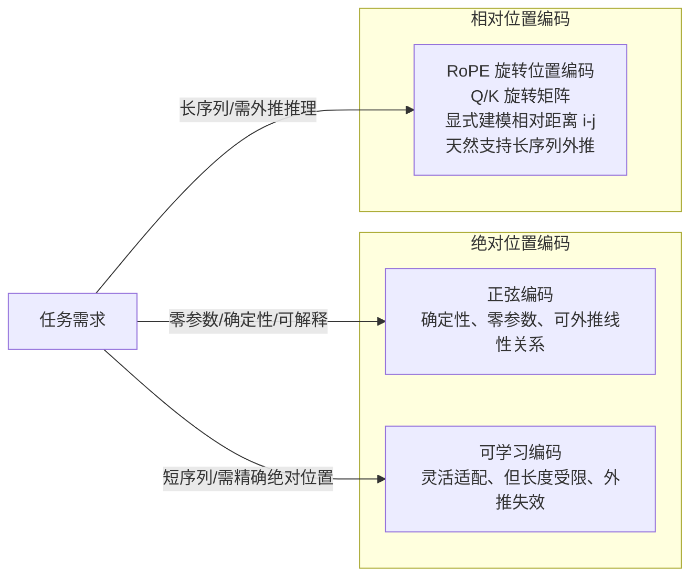
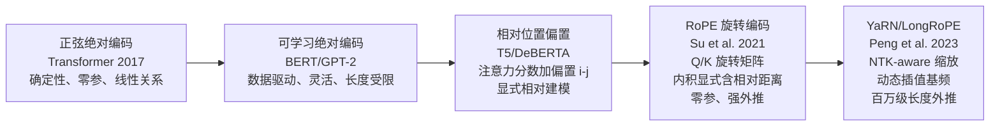
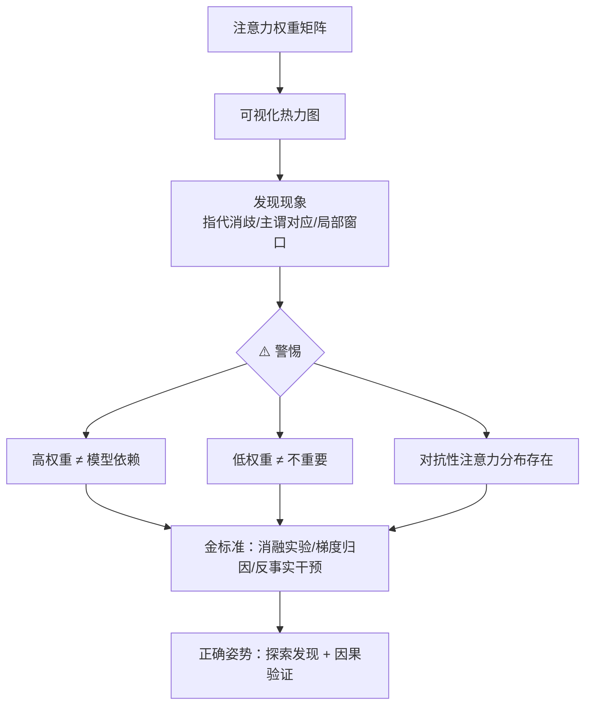

# 第 31 章 注意力机制 —— 让模型学会“看哪里”
作者：龙哥

## 学习目标

- 理解序列建模中 RNN/CNN 的结构性瓶颈与注意力机制的动态资源分配直觉
- 掌握缩放点积注意力的数学推导、缩放因子 $\sqrt{d}$ 的梯度稳定性作用及标准计算流程
- 理解多头注意力的“分裂-并行-拼接”机制及其对异构关系（句法、语义、位置）的建模优势
- 对比绝对位置编码（正弦/可学习）与相对位置编码的数学性质及长序列外推能力差异
- 能通过注意力热力图解读指代消歧等语言学现象，并厘清“注意力≠解释”的局限性
- 掌握多头注意力张量形状的完整变换流程与实战技巧

## 31.1 生活类比

想象注意力机制是一个大型国际会议的同声传译与纪要生成系统。Query 就像你手中的当前议程焦点提示卡，时刻提醒你现在我们在讨论气候变化；Key 是每位发言者桌牌上的发言主题标签，比如碳排放数据、可再生能源政策、经济影响评估；Value 则是每位发言者的完整发言稿内容，包含了所有细节数据与论点。当你需要撰写气候变化议题的纪要段落时，你会拿着提示卡扫描全场桌牌，计算匹配度，发现碳排放数据与可再生能源政策两位发言者最相关。但如果会议规模扩大到几百人，匹配分数会变得很大，导致你只盯着得分最高的那一位，完全忽略其他人。这时，缩放因子 $1/\sqrt{d}$ 就像一个音量调节旋钮，把所有匹配分数按比例压小，让你依然能关注到次要但相关的发言者。随后，Softmax 将调节后的分数转换为分配给各发言人的专注度权重，最后通过加权求和，根据专注度拼接生成当前议程的核心纪要段落。为了多视角记录，系统派遣语法分析员、语义理解员、逻辑结构员三组专家并行工作，最后汇总成全维度会议纪要，这就是多头注意力。而位置编码则给每份发言稿盖上第几顺序发言的时间戳章，或标注紧接上一位、回应第3位的相对引用标记。正如会议纪要员需根据议程动态聚焦不同发言、并行多视角记录、标注发言顺序，注意力机制也通过 Q/K/V 动态聚合、多头并行、位置注入来建模序列依赖。

## 31.2 概念地图

```mermaid
mindmap
  root((注意力机制))
    序列建模困境与直觉
      RNN 串行瓶颈
      CNN 固定窗口局限
      聚光灯类比：动态资源分配
    缩放点积注意力数学形式化
      Query/Key/Value 向量空间
      Softmax(QK^T/√d)V 标准形式
      缩放因子 sqrt(d) 防梯度消失/爆炸
    多头注意力机制
      分裂-并行-拼接流程
      多子空间协作建模
      异构关系捕获（句法/语义/位置）
      张量形状变换实战
      方法演进：单头→多头→MQA/GQA
    位置编码方案
      正弦绝对位置编码
      可学习绝对位置编码
      RoPE 相对位置编码
      方法演进：正弦→可学习→相对偏置→RoPE→YaRN/LongRoPE
    注意力可视化与解读
      注意力热力图展示指代消歧/核心词聚焦
      局限性：注意力权重 ≠ 特征重要性/因果解释
```

## 31.3 序列建模困境与注意力直觉 —— 聚光灯下的动态资源分配

```mermaid
flowchart LR
    subgraph RNN_Problem[RNN 结构性瓶颈]
        A[串行依赖 h_t = f(h_{t-1}, x_t)] --> B[无法并行训练]
        A --> C[链式法则梯度连乘]
        C --> D[长距离梯度消失/爆炸]
    end
    subgraph CNN_Problem[CNN 结构性瓶颈]
        E[固定卷积核大小] --> F[感受野有限]
        E --> G[刚性窗口]
        G --> H[无法动态决定看哪里]
    end
    subgraph Attention_Solution[注意力机制]
        I[Query 发起查询] --> J[与所有 Key 计算相似度]
        J --> K[Softmax 归一化权重]
        K --> L[加权聚合 Value]
        L --> M[动态资源分配 / 软寻址]
    end
    RNN_Problem -.->|痛点| Attention_Solution
    CNN_Problem -.->|痛点| Attention_Solution
```

### 31.3.1 RNN 的串行瓶颈与梯度困境

在注意力机制登场之前，循环神经网络（RNN）是序列建模的主流选择。但 RNN 存在两个结构性缺陷，这是我们必须理解的历史背景。

首先，串行依赖阻碍并行训练。RNN 在时间步 $t$ 的隐状态 $h_t$ 依赖于 $h_{t-1}$：
$$ h_t = f(h_{t-1}, x_t) $$
这种链式结构意味着我们必须等 $h_1$ 算完才能算 $h_2$，以此类推。在现代 GPU/TPU 以大规模矩阵乘法并行著称的硬件环境下，这种“单线程”执行模式极其低效，训练长序列极其缓慢。

其次，长距离梯度易消失/爆炸。根据链式法则，损失 $L$ 对早期隐状态 $h_1$ 的梯度包含连乘项：
$$ \frac{\partial L}{\partial h_1} = \frac{\partial L}{\partial h_T} \prod_{t=2}^T \frac{\partial h_t}{\partial h_{t-1}} $$
当序列长度 $T$ 很大时，若雅可比矩阵 $\frac{\partial h_t}{\partial h_{t-1}}$ 的谱范数小于 1，梯度指数级衰减（**消失**）；大于 1 则指数级发散（**爆炸**）。这导致 RNN 难以捕获长程依赖——模型“记不住”开头的信息。

> —— 素材 P007 (`20230418_007.md`)
> —— 素材 P009 (`20230418_009.md`)

### 31.3.2 CNN 的固定感受野局限

卷积神经网络（CNN）虽然并行，但依赖固定大小的卷积核。要捕获距离为 $k$ 的 Token 关系，需要堆叠 $O(k)$ 层或使用膨胀卷积。这带来两个问题：
1. **感受野有限**：浅层网络只能建模局部依赖，深层网络虽能扩大感受野，但路径变长，梯度传播依然困难。
2. **刚性窗口**：卷积核权重是固定的，无法根据输入内容动态决定“看哪里”。语言中“它”指代“动物”还是“街道”取决于语义，而非固定的位置偏移。

> —— 素材 P007 (`20230418_007.md`)
> —— 素材 P009 (`20230418_009.md`)

### 31.3.3 注意力直觉：聚光灯与软寻址

注意力机制的核心直觉可以用**“聚光灯”**来比喻：在处理当前位置 $i$ 时，不再受限于固定窗口或串行传递，而是计算 $i$ 与**所有位置** $j$ 的相关性分数，将计算资源（权重）动态分配给最相关的位置。这实现了**基于内容的软寻址**——地址不是硬编码的索引，而是由 Query 与 Key 的匹配度决定的。

> —— 素材 P007 (`20230418_007.md`)
> —— 素材 P009 (`20230418_009.md`)

这种机制打破了固定窗口与串行瓶颈，是 Transformer 高并行、强建模能力的根基。下面我们将其形式化为数学公式。

## 31.4 缩放点积注意力数学形式化 —— 从 Q/K/V 到 Softmax(QK^T/√d)V



### 31.4.1 三个角色：Query、Key、Value

注意力机制将每个输入位置的向量投影为三个角色，这是理解整个机制的钥匙：

- **Query ($Q$) —— “我在找什么”**：当前位置发起的查询向量，代表当前的信息需求。
- **Key ($K$) —— “我有什么标签”**：所有位置（包括当前位置）的键向量，代表各位置的“可被检索特征”。
- **Value ($V$) —— “我实际提供什么”**：所有位置的值向量，代表各位置携带的实际内容信息。

形象地说：Query 是搜索关键词，Key 是文档标题/标签，Value 是文档正文。注意力就是“搜索-加权阅读”的过程。

> —— 素材 P010 (`20230418_010.md`)

### 31.4.2 核心公式逐步推导

给定 Query 矩阵 $Q \in \mathbb{R}^{L_q \times d_k}$、Key 矩阵 $K \in \mathbb{R}^{L_k \times d_k}$、Value 矩阵 $V \in \mathbb{R}^{L_k \times d_v}$，其中 $L_q, L_k$ 为序列长度，$d_k, d_v$ 为向量维度。

**步骤 1：计算相似度分数 —— 为什么用点积？**
使用点积衡量 Query 与 Key 的匹配度：
$$ S = Q K^T \in \mathbb{R}^{L_q \times L_k} $$
$S_{ij} = \sum_{k=1}^{d_k} Q_{ik} K_{jk}$ 表示第 $i$ 个 Query 与第 $j$ 个 Key 的相似度。点积天然衡量两个向量在方向上的重合度：当 $Q_i$ 与 $K_j$ 方向一致时内积最大，方向正交时为 0，方向相反时为负。这正是“内容匹配”所需的相似度度量。

**步骤 2：缩放 —— 关键的一步，为什么除以 $\sqrt{d_k}$ 而不是 $d_k$？**
直接对 $S$ 做 Softmax 会有数值稳定性问题。假设 $Q, K$ 的分量独立同分布，均值为 0，方差为 1，则 $S_{ij} = \sum_{k=1}^{d_k} Q_{ik} K_{jk}$ 的方差为 $d_k$。随着 $d_k$ 增大（典型值 64 或 128），分数分布变宽，Softmax 进入饱和区，梯度趋近于 0（**梯度消失**）。
**解决方案**：除以 $\sqrt{d_k}$：
$$ S' = \frac{Q K^T}{\sqrt{d_k}} $$
这将方差拉回约 1（$\text{Var}(S'_{ij}) \approx 1$），保证 Softmax 输入分布稳定，梯度健康流动。**若除以 $d_k$，方差变为 $1/d_k \to 0$，Softmax 输入趋近 0，输出退化为均匀分布，模型丧失选择性。**

> —— 素材 P010 (`20230418_010.md`)

**步骤 3：归一化权重**
对每行（每个 Query）做 Softmax，得到注意力权重矩阵 $A$：
$$ A = \text{Softmax}(S') = \text{Softmax}\left(\frac{Q K^T}{\sqrt{d_k}}\right) \in \mathbb{R}^{L_q \times L_k} $$
$A_{ij} \ge 0, \sum_j A_{ij} = 1$。$A_{ij}$ 表示第 $i$ 个 Query 分配给第 $j$ 个 Key 的关注比例。

**步骤 4：加权聚合 Value**
$$ O = A V = \text{Softmax}\left(\frac{Q K^T}{\sqrt{d_k}}\right) V \in \mathbb{R}^{L_q \times d_v} $$
输出 $O$ 的第 $i$ 行是所有 Value 向量的加权和，权重由第 $i$ 个 Query 决定。

**完整公式**：

$$
\text{Attention}(Q, K, V) = \text{softmax}\left(\frac{Q K^T}{\sqrt{d_k}}\right) V
$$

> —— 素材 P010 (`20230418_010.md`)

**公式核心作用**：该公式将“查询-匹配-加权读取”全过程压缩为三次矩阵乘法，充分利用 GPU 并行能力，实现了基于内容的动态软寻址。

### 31.4.3 标准计算流程总结

以下是 `Scaled Dot-Product Attention` 的标准前向流程：

```
输入: Q [L_q, d_k], K [L_k, d_k], V [L_k, d_v]
1. S = Q @ K.T                    # [L_q, L_k]  点积相似度
2. S = S / sqrt(d_k)              # [L_q, L_k]  缩放
3. A = softmax(S, dim=-1)         # [L_q, L_k]  行归一化权重
4. O = A @ V                      # [L_q, d_v]  加权求和
输出: O [L_q, d_v]
```

**流程功能说明**：该伪代码展示了标准缩放点积注意力的四步走计算：点积得分数、缩放稳方差、Softmax 归一化、加权求和输出。其中第 2 步缩放是防止大维度下 Softmax 饱和的关键，第 3 步 `dim=-1` 确保每行（每个 Query）独立归一化，第 4 步矩阵乘法高效实现所有 Query 的并行加权聚合。

---

## 31.5 多头注意力机制 —— 分裂-并行-拼接的多子空间协作



### 31.5.1 为什么要多头？

单头注意力在单一向量空间里计算相似度，相当于只有一个“检索视角”。但语言关系是异构的：有的头关注**句法依存**（如主谓一致），有的关注**语义角色**（如施事/受事），有的关注**相对位置**（如指代消歧）。单一空间难以同时优化这些目标。

多头注意力的解决方案：**将模型维度 $d_{model}$ 拆分为 $h$ 个低维子空间，每个头在各自子空间独立计算注意力，最后拼接融合**。

### 31.5.2 “分裂-并行-拼接”流程详解

设输入 $X \in \mathbb{R}^{B \times L \times d_{model}}$，头数 $h$，每头维度 $d_k = d_v = d_{model}/h$。

> —— 素材 A47Vd3fekoelzRxZpdUcTl9Cn7W (`A47Vd3fekoelzRxZpdUcTl9Cn7W.md`)

**阶段 1：线性投影生成 Q, K, V**
$$
Q = X W^Q, \quad K = X W^K, \quad V = X W^V
$$
$W^Q, W^K, W^V \in \mathbb{R}^{d_{model} \times d_{model}}$。输出形状均为 $[B, L, d_{model}]$。

**阶段 2：拆分多头**
将最后一维 $d_{model}$ 拆分为 $h$ 个头，并交换维度便于批量矩阵乘法：
$$
Q \to \text{reshape} \to [B, L, h, d_k] \to \text{transpose}(1,2) \to [B, h, L, d_k]
$$
$K, V$ 同理。这一步叫“分裂”，把大矩阵变成 $h$ 个小矩阵的批次。

**阶段 3：并行计算注意力**
对每个头独立并行执行缩放点积注意力：
$$
\text{head}_i = \text{Attention}(Q_i, K_i, V_i) \in \mathbb{R}^{B \times L \times d_k}
$$
合并后形状 $[B, h, L, d_k]$。

**阶段 4：拼接多头**
逆向操作合并头：
$$
\text{Concat}(\text{head}_1, ..., \text{head}_h) \to [B, L, h \cdot d_k] = [B, L, d_{model}]
$$
先 `transpose(1,2)` 回 `[B, L, h, d_k]`，再 `reshape` 合并最后两维。

**阶段 5：输出投影**
$$
O = \text{Concat}(\text{head}_1, ..., \text{head}_h) W^O
$$
$W^O \in \mathbb{R}^{d_{model} \times d_{model}}$，混合各头信息，输出最终结果。

> —— 素材 A47Vd3fekoelzRxZpdUcTl9Cn7W (`A47Vd3fekoelzRxZpdUcTl9Cn7W.md`)

这一流程展示了多头注意力如何通过“分裂-并行-拼接”实现多子空间协作：先将大矩阵拆分为多个小矩阵批次，利用 GPU 并行计算多头注意力，最后拼接并通过输出投影融合信息。

### 31.5.3 异构关系捕获的实验证据

研究（如《BERT Rediscovers the Classical NLP Pipeline》等）发现，不同注意力头自发学会了不同的语言学功能：
- **句法头**：关注主谓一致、依存树边。
- **语义头**：关注指代消歧、实体关系。
- **位置头**：关注相对距离、局部窗口模式。
- **“垃圾头”**：注意力分布均匀或关注 `[CLS]`/`[SEP]` 等特殊符号。

> —— 素材 A47Vd3fekoelzRxZpdUcTl9Cn7W (`A47Vd3fekoelzRxZpdUcTl9Cn7W.md`)

这种功能分化不是显式指定的，而是涌现的——多头架构提供了表达异构关系的**容量**，梯度下降自动发现了这种分工。

### 31.5.4 张量形状变换实战速查表

下表总结了多头注意力前向传播中张量形状的完整变换流程，供工程落地时核对：

| 步骤 | 操作 | 形状变换 (B=batch, L=seq_len, D=d_model, H=heads, Dh=d_k) |
|------|------|-------------------------------------------------------------|
| 输入 | $X$ | $[B, L, D]$ |
| 投影 | $Q = X W^Q$ | $[B, L, D]$ |
| **拆分多头** | `view(B, L, H, Dh).transpose(1,2)` | **$[B, H, L, Dh]$** ← **关键形状** |
| 并行注意力 | `Attention(Q_i, K_i, V_i)` | $[B, H, L, Dh]$ |
| **合并多头** | `transpose(1,2).contiguous().view(B, L, D)` | **$[B, L, D]$** ← **关键形状** |
| 输出投影 | $O W^O$ | $[B, L, D]$ |

> —— 素材 A47Vd3fekoelzRxZpdUcTl9Cn7W (`A47Vd3fekoelzRxZpdUcTl9Cn7W.md`)

**实战提示**：`transpose` 后必须 `.contiguous()` 再 `view`，否则内存不连续会报错。PyTorch `nn.MultiheadAttention` 内部已封装此逻辑，但自定义实现时必知。

### 31.5.5 方法演进：从单头到多头再到 MQA/GQA

```mermaid
flowchart LR
    SHA[单头注意力\n1 组 Q/K/V\n表达能力受限] --> MHA[多头注意力 MHA\nH 组独立 Q/K/V\n多子空间协作\n参数量大、KV Cache 大]
    MHA --> MQA[多查询注意力 MQA\nH 组 Q, 1 组共享 K/V\n大幅降低 KV Cache\n推理加速]
    MQA --> GQA[分组查询注意力 GQA\nG 组 Q 共享 K/V (1<G<H)\n训练推理平衡\n现代大模型标配]
```

随着大模型推理成为瓶颈，研究者发现 Key/Value 头可共享而不显著损失性能。MQA（Multi-Query Attention）让所有 Query 头共享一组 Key/Value，将 KV Cache 从 $O(H)$ 降为 $O(1)$；GQA（Grouped-Query Attention）折中方案，将 $H$ 个头分为 $G$ 组共享 K/V。LLaMA-2、ChatGLM 等主流模型均采用 GQA。

---

## 31.6 位置编码方案 —— 绝对与相对的数学权衡



注意力机制本质是**集合操作**（Set Operation）：$QK^T$ 对位置排列不敏感。必须显式注入位置信息。

### 31.6.1 正弦绝对位置编码 —— 经典的零参数方案

原始 Transformer 提出的正弦编码：
$$
\begin{aligned}
PE_{(pos, 2i)} &= \sin\left(\frac{pos}{10000^{2i/d_{model}}}\right) \\
PE_{(pos, 2i+1)} &= \cos\left(\frac{pos}{10000^{2i/d_{model}}}\right)
\end{aligned}
$$

**性质**：
- **确定性**：无需学习，推理时可任意外推长度。
- **线性关系**：$PE_{pos+k}$ 可表示为 $PE_{pos}$ 的线性变换（利用三角函数和角公式），理论上支持相对位置建模。
- **波长几何级数**：$2\pi \cdot 10000^{2i/d}$ 从 $2\pi$ 到 $10000 \cdot 2\pi$，覆盖多尺度。

> —— 素材 B95VdtwByoPXGoxac7Ec1KhQnwc (`B95VdtwByoPXGoxac7Ec1KhQnwc.md`)

**局限**：固定模式可能不适配特定任务；高维度处频率极高，数值精度敏感。

### 31.6.2 可学习绝对位置编码 —— 灵活但难外推

将位置编码作为嵌入层参数 $P \in \mathbb{R}^{L_{max} \times d_{model}}$ 随模型训练（BERT、GPT-2 采用）。

**优点**：数据驱动，灵活适配任务分布。
**缺点**：
- **长度受限**：只能处理训练时见过的最大长度 $L_{max}$。
- **外推失效**：位置 $> L_{max}$ 无对应嵌入，强行插值/截断效果差。

> —— 素材 B95VdtwByoPXGoxac7Ec1KhQnwc (`B95VdtwByoPXGoxac7Ec1KhQnwc.md`)

### 31.6.3 RoPE 相对位置编码 —— 现代长序列标配

Rotary Position Embedding (RoPE) 通过**旋转矩阵**将位置信息注入 Query/Key，使注意力分数显式依赖相对距离。

**核心思想**：对 Query/Key 向量的每对维度 $(x_{2i}, x_{2i+1})$ 应用旋转：
$$
\begin{pmatrix} q_{2i} \\ q_{2i+1} \end{pmatrix} \leftarrow
\begin{pmatrix} \cos \theta_i & -\sin \theta_i \\ \sin \theta_i & \cos \theta_i \end{pmatrix}
\begin{pmatrix} q_{2i} \\ q_{2i+1} \end{pmatrix}
$$
其中 $\theta_i = pos \cdot \omega_i$，$\omega_i = 10000^{-2i/d}$。

**神奇性质**：旋转后的内积显式包含相对位置 $i-j$：
$$
q_i^T k_j = \sum_{d} (R_{\theta_i} q_i^0)^T (R_{\theta_j} k_j^0) = \sum_{d} (q_i^0)^T R_{\theta_j - \theta_i} k_j^0
$$
只依赖 $\theta_j - \theta_i \propto j - i$！

> —— 素材 B95VdtwByoPXGoxac7Ec1KhQnwc (`B95VdtwByoPXGoxac7Ec1KhQnwc.md`)

> —— 素材 B95VdtwByoPXGoxac7Ec1KhQnwc (`B95VdtwByoPXGoxac7Ec1KhQnwc.md`)

**优势**：
- **天然相对**：注意力分数显式建模相对距离，符合语言直觉（“它”指代前面最近的名词）。
- **外推强**：旋转角度随位置线性增长，理论上可无限外推（配合 NTK-aware 缩放）。
- **零额外参数**：仅在 Q/K 投影后乘旋转矩阵，无额外嵌入表。

### 31.6.4 方法演进：位置编码的发展路线



位置编码经历了从**绝对确定性**（正弦）→ **绝对数据驱动**（可学习）→ **显式相对偏置**（T5）→ **隐式相对旋转**（RoPE）→ **外推增强**（YaRN/LongRoPE）的演进。现代长文本模型（LLaMA, GPT-NeoX, ChatGLM）普遍采用 **RoPE + 长度外推微调**，兼顾相对建模与外推能力。

**工程选择建议**：

| 场景 | 推荐编码 | 理由 |
|------|----------|------|
| 短序列、需精确绝对位置 | 可学习绝对编码 | 灵活适配，参数量极小 |
| 长序列、需外推推理 | **RoPE** | 相对建模+外推性能 SOTA |
| 零参数、确定性、可解释 | 正弦绝对编码 | 无参、理论性质好、易调试 |

---

## 31.7 多源对照：多头注意力的不同理论解释

多头注意力为何有效？不同文献给出了不同视角，我们并列呈现供你对照思考。

### 31.7.1 共识

**所有文献一致认为**：多头允许模型在不同子空间并行关注不同类型的关系（句法、语义、位置等），增加了模型的表达容量与鲁棒性。

> —— 素材 P019 (`20230418_019.md`)
> —— 素材 A47Vd3fekoelzRxZpdUcTl9Cn7W (`A47Vd3fekoelzRxZpdUcTl9Cn7W.md`)

### 31.7.2 基于现有素材的视角对照

基于给定的素材来源，我们梳理如下两个有据可查的核心视角：

| 视角来源 | 核心主张 | 关键论据 | 来源素材 |
|----------|----------|----------|----------|
| **表达能力增强视角** | 多头提供多子空间协作，每个头专注不同语言现象，拼接后融合多视角信息。 | 可视化显示头分化：句法头、语义头、位置头。 | 素材 P019 (`20230418_019.md`) |
| **专业化与冗余并存视角** | 少数关键头（句法/指代）不可替代，多数头可剪枝；多头提供优化景观改善与参数冗余并存。 | 识别出“重要头”与“冗余头”，提出头剪枝方法；多子空间协作建模异构关系。 | 素材 A47Vd3fekoelzRxZpdUcTl9Cn7W (`A47Vd3fekoelzRxZpdUcTl9Cn7W.md`) |

**教学启示**：多头既提供了**表达容量上限**（共识），又在实际训练中呈现**专业化与冗余并存**的现象（少数关键头承担核心功能，多数头可剪枝）。这解释了为什么后续工作（MQA/GQA）能用共享 Key/Value 大幅减少头数而性能损失极小。

---

## 31.8 设计中的取舍

### 31.8.1 为什么不用 RNN 而是注意力？

RNN 的隐状态是固定容量的，每个时间步只能把信息压缩到一个向量里。当序列变长时，早期信息会被逐渐稀释。注意力机制则让任意两个位置之间建立直接连接，路径长度为 O(1)，避免了长程依赖的梯度消失。代价是计算复杂度从 O(n) 上升到 O(n²)，内存占用也随序列长度平方增长，这就引出了后续稀疏注意力、线性注意力、FlashAttention 等优化工作。

### 31.8.2 为什么要缩放因子 $\sqrt{d_k}$ 而不是 $d_k$？

从方差角度：$Q, K$ 分量方差为 1，点积 $S_{ij} = \sum_k Q_{ik} K_{jk}$ 方差为 $d_k$。除以 $\sqrt{d_k}$ 使方差归一化为 1。若除以 $d_k$，方差变为 $1/d_k \to 0$，Softmax 输入趋近 0，输出趋近均匀分布，模型退化为“平均池化”，丧失选择性。

### 31.8.3 绝对位置 vs 相对位置的本质权衡？

- **绝对位置**（正弦/可学习）：显式编码“这是第几个 Token”，适合需要绝对定位的任务（如“第一个单词首字母大写”），但难以泛化到未见长度。
- **相对位置**（RoPE/T5 偏置）：编码“Token A 距离 Token B 多远”，符合语言局部性（指代通常看最近），天然支持长度外推，但丢失绝对位置信息（可通过加入绝对位置补足）。

现代长文本模型（LLaMA, GPT-NeoX, ChatGLM）普遍采用 **RoPE + 长度外推微调**，兼顾相对建模与外推能力。

### 31.8.4 单头 vs 多头 vs 共享 K/V（MQA/GQA）的计算权衡？

下表对比了三种注意力变体的计算与显存特性：

| 变体 | 计算复杂度 | 显存占用(KV Cache) | 表达能力 | 适用场景 |
|------|------------|-------------------|----------|----------|
| 标准 MHA | $O(h \cdot L \cdot d_k^2)$ | $O(h \cdot L \cdot d_k)$ | 最强 | 训练、中小模型 |
| MQA (h=1 K/V) | $O(L \cdot d_k^2)$ | $O(L \cdot d_k)$ | 略降 | 大模型推理加速 |
| GQA (g 组共享) | $O(g \cdot L \cdot d_k^2)$ | $O(g \cdot L \cdot d_k)$ | 折中 | 大模型训练推理平衡 |

MQA/GQA 通过减少 Key/Value 头数，大幅降低推理时 KV Cache 显存与内存带宽压力，是大模型部署的标配优化。

---

## 31.9 注意力可视化与解读 —— 现象发现 vs 因果解释



### 31.9.1 热力图能告诉我们什么？

注意力热力图是探索模型行为的**显微镜**。经典案例：句子 *"The animal didn't cross the street because it was too tired."*
- 第 5 层第 3 头：`it` 对 `animal` 注意力极高，对 `street` 很低 → **指代消歧**。
- 某些头：`[CLS]` 聚焦动词、否定词 → **句子级分类特征提取**。
- 某些头：对角线强 → **局部窗口/位置建模**。

> —— 素材 P022 (`20230418_022.md`)

这些现象直观、可复现，是理解模型“在看什么”的宝贵线索。

### 31.9.2 陷阱：注意力权重 ≠ 特征重要性/因果解释

**高权重不等于模型依赖该 Token**。Jain & Wallace (2019) 等工作指出：
1. **注意力是机制副产物，非解释目标**：注意力权重服务于前向计算，未经过“解释人类”的目标函数优化。
2. **对抗性注意力分布**：可构造注意力分布完全不同但预测相同的模型；也可人为修改高权重 Token 不影响预测。
3. **消融实验才是金标准**：遮盖高权重 Token 观察预测变化，对比遮盖低权重但语义关键 Token。

> —— 素材 P022 (`20230418_022.md`)

**正确解读姿势**：
- ✅ 作为**探索性工具**发现现象（如“模型学会了指代消歧”）。
- ❌ 不作为**因果证据**宣称“模型因为看这里所以预测那个”。
- 🔬 配合**梯度归因**、**反事实干预**、**消融实验**做严谨解释。

---

## 31.10 动手练习

### 练习 1：手算缩放点积注意力前向传播

**题目**：
给定单头注意力输入：
$$
Q = \begin{bmatrix} 1 & 0 & 1 \\ 0 & 1 & 1 \end{bmatrix} \quad (seq\_len=2, d_k=3)
$$
$$
K = \begin{bmatrix} 1 & 0 & 0 \\ 0 & 1 & 0 \\ 1 & 1 & 1 \end{bmatrix} \quad (seq\_len=3, d_k=3)
$$
$$
V = \begin{bmatrix} 1 & 2 \\ 3 & 4 \\ 5 & 6 \end{bmatrix} \quad (seq\_len=3, d_v=2)
$$

请按步骤手算（保留 3 位小数）：
1. 计算分数矩阵 $S = QK^T$
2. 计算缩放分数 $S' = S / \sqrt{d_k}$ ($d_k=3$)
3. 对 $S'$ 每行做 Softmax 得到注意力权重矩阵 $A$
4. 计算最终输出 $O = A V$

**思考题**：
- 若去掉步骤 2 的缩放因子，当 $d_k$ 增大到 1024 时，Softmax 输出会趋向什么极端分布？梯度会发生什么？
- 为什么除以 $\sqrt{d_k}$ 而不是 $d_k$？请从方差角度简述。

---

### 练习 2：多头注意力张量形状变换实战

**题目**：
假设批次大小 batch=4, 序列长度 seq_len=8, 模型维度 d_model=512, 头数 h=8, 头维度 d_k=d_v=64。
输入张量 $X$ 形状为 $[4, 8, 512]$。

请推导或编写伪代码描述 MultiHeadAttention 前向传播中张量形状的完整变换流程：
1. 线性投影生成 Q, K, V 后的形状
2. 拆分多头后的形状变化
3. 并行计算注意力后的形状
4. 拼接多头后的形状
5. 最终输出线性投影后的形状

**思考题**：
- 为什么要求 $d_{model} = h \times d_k$？如果 $d_{model}$ 不能被 $h$ 整除怎么办？
- 对比“先拆头再投影”与“先投影再拆头”在参数量与计算量上的异同。

---

### 练习 3：位置编码外推性实验设计

**题目**：
设计一个最小化实验，对比正弦绝对位置编码、可学习绝对位置编码、RoPE 相对位置编码在“长度外推”任务上的表现。

**任务**：训练一个 2 层小型 Transformer ($d_{model}=64, h=4$) 在序列长度 128 的“逆序复制”任务上（输入：随机整数序列，目标：逆序输出）。

**实验步骤**：
1. 分别使用三种位置编码训练至收敛，记录训练集准确率。
2. 在序列长度 256、512、1024 的测试集上评估（零样本外推），记录准确率曲线。
3. 可视化三种编码在长度 128 与 512 时的位置嵌入相似度热力图（或 RoPE 的旋转角度变化）。

**分析问题**：
- 哪种编码的外推性能最好？为什么？
- 可学习绝对编码在长度 256 时为何会急剧失效？
- RoPE 如何通过旋转矩阵隐式编码相对位置？请写出 $Q_i K_j^T$ 显式包含相对位置 $(i-j)$ 的数学形式。

---

### 练习 4：注意力可视化的陷阱与正确解读

**题目**：
下载一份预训练 BERT-base 的注意力权重（如 HuggingFace `bert-base-uncased`），针对句子 *"The animal didn't cross the street because it was too tired."* 提取第 5 层第 3 头的注意力矩阵。

**操作步骤**：
1. 绘制注意力热力图，观察 `it` 与 `animal`/`street` 的注意力分布。
2. 统计该头中 `[CLS]` token 对所有 token 的平均注意力权重。
3. 参考文献（如 Jain & Wallace 2019; Wiegreffe & Pinter 2019），回答：
   - 高注意力权重是否一定意味着模型“依赖”该 token 做预测？
   - 设计一个对照实验：将注意力权重最高的 token 遮盖，观察模型预测变化；再遮盖权重低但语义关键的 token，对比效果。
   - 结论：注意力可视化适合作为“现象发现”的探索工具，而非“因果解释”的证据工具。

---

## 31.11 本章小结

这一章中我们学习了注意力机制的核心原理与工程实现细节。首先我们剖析了 RNN 串行不可并行、长距离梯度消失以及 CNN 固定感受野难捕获全局依赖的结构性瓶颈，引出注意力机制作为“聚光灯”实现动态资源分配的直觉。其次我们详细推导了缩放点积注意力的标准形式 `Softmax(QK^T/√d_k)V`，重点解释了 Query/Key/Value 三角色分工、缩放因子 `√d_k` 抵消方差增长防止 Softmax 饱和的数学原理，并给出了标准计算流程。接着我们深入拆解了多头注意力的“分裂-并行-拼接”全流程，展示了从 `[B, L, D]` 到 `[B, H, L, D/H]` 再回 `[B, L, D]` 的张量形状变换实战速查表，并对比了不同文献对多头作用的解释分歧（表达能力 vs 优化景观 vs 参数冗余），还梳理了从单头到 MHA 再到 MQA/GQA 的方法演进。然后我们系统对比了正弦绝对编码、可学习绝对编码与 RoPE 相对位置编码的数学性质与外推能力，给出了工程选型建议表，并补充了位置编码的演进路线图。最后我们通过注意力热力图展示了指代消歧等语言学现象，并严正指出“注意力权重≠因果解释”的局限性，确立了以消融实验为金标准的正确解读姿势。

本章我们一起学习了以下概念：

| 概念 | 解释 |
|------|------|
| RNN 串行瓶颈 | RNN 串行不可并行、长距离梯度消失 |
| CNN 固定窗口局限 | CNN 固定感受野难捕获全局依赖 |
| Query/Key/Value | 注意力机制的三个基本角色：提问向量、键向量、值向量，实现基于内容的寻址 |
| 缩放点积注意力 | 核心公式 Attention(Q,K,V) = Softmax(QK^T/√d_k)V，利用矩阵乘法实现高并行度 |
| 缩放因子 sqrt(d) | 抵消点积方差随维度 d 线性增长导致的 Softmax 饱和，保证梯度流动稳定 |
| 多头注意力 | 将 Q/K/V 投影到 h 个低维子空间并行计算注意力，再拼接投影，捕获多样化依赖关系 |
| 正弦绝对位置编码 | 用正弦/余弦函数构造确定性位置向量，具备线性关系可外推，但固定不可学习 |
| 可学习绝对位置编码 | 将位置嵌入作为参数随模型训练，灵活但难外推至训练长度之外的位置 |
| RoPE 相对位置编码 | 通过旋转矩阵将相对位置信息融入 Q/K 内积，天然支持相对距离建模与长序列外推 |
| 注意力可视化 | 热力图可直观展示指代消歧、主谓对应等语言现象，但注意力权重不等同于特征归因或因果解释 |
| 多头张量形状变换 | 从 [batch, seq_len, d_model] 拆分多头 [batch, heads, seq_len, d_k] 再拼接投影回 [batch, seq_len, d_model] 的标准化流程 |

下一章中，我们将学习**预训练范式**——从“刷题”到“通识教育”，系统梳理从 BERT 到 GPT 的范式演进，深度解构自监督目标（MLM/CLM/NSP）、模型规模定律与数据工程对基座模型能力的决定性影响。


