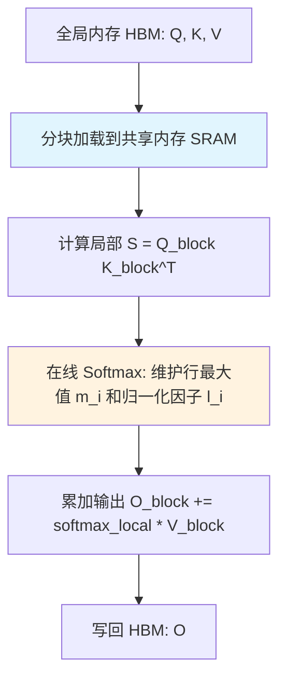
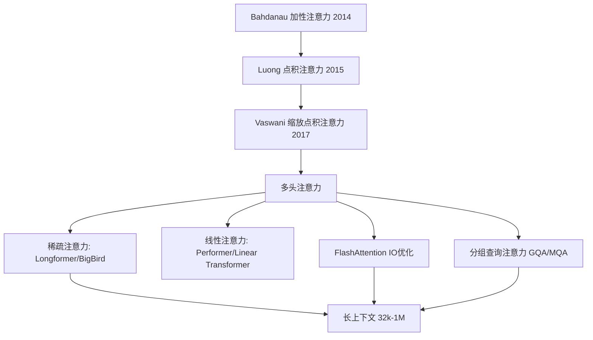

# 第 40 章 注意力机制 —— 让模型学会“看哪里”
作者：龙哥

## 学习目标

- 理解注意力机制如何从信息瓶颈视角解决 RNN/CNN 的长距离依赖与并行计算难题
- 掌握缩放点积注意力的数学推导、缩放因子作用及其数值稳定性原理
- 理解多头注意力通过子空间分工提升表达能力的机制与工程实现要点
- 对比正弦绝对编码、可学习绝对编码、RoPE 相对位置编码的数学性质与外推能力边界
- 掌握注意力可视化的主流分析维度、工具链及『注意力≠解释』的局限性认知
- 能根据任务特点（长文本、多语言、代码生成等）选择合适的注意力变体与位置编码方案
- 理解 FlashAttention 等 IO 感知算法如何通过分块计算加速长序列注意力并降低显存占用
- 掌握 ALiBi 等无位置嵌入向量参数的相对位置编码方案及其适用场景

## 40.1 生活类比

想象注意力机制是一个**大型国际会议的同声传译系统**：
- **Query** = 译员当前需要翻译的『源语言片段』（如『它』）
- **Key** = 会议记录中每个词的『语义标签』与『位置标签』（如『动物-主语-位置3』、『街道-宾语-位置6』）
- **Value** = 每个词携带的『完整语义内容向量』
- **相似度计算 (Q·K^T)** = 译员快速扫描记录，判断『它』与『动物』标签匹配度高、与『街道』匹配度低
- **缩放因子 1/√d** = 会议规模扩大时，防止『匹配度分数』过大导致译员『只盯着一个词看』（Softmax 饱和）
- **Softmax** = 将匹配度归一化为『注意力分配比例』：90% 给『动物』，5% 给『街道』，5% 给其他
- **加权求和 (×V)** = 译员按比例融合语义内容，输出准确翻译『它→那个动物』
- **多头注意力** = 组建『专家译员团』：译员A专管『指代消歧』、译员B专管『句法结构』、译员C专管『长距离依赖』，最后由总译员（W^O）综合输出
- **位置编码 (RoPE)** = 给每个词贴上『相对坐标』而非『绝对房间号』，无论会议多长、中途插入新议程，译员都能精准知道『它』离『动物』隔了几个词
- **FlashAttention** = 译员不把整本会议记录搬上台（HBM），而是分页（分块）只看当前需要的那几页（SRAM），大幅减少搬运次数

## 40.2 概念地图

注意力机制核心原理与变体
├── 序列建模困境与注意力直觉
│   ├── RNN 串行瓶颈与梯度消失          —— 《20230418_007.md》
│   ├── CNN 固定感受野与位置稀释          —— 《20230418_007.md》
│   ├── Seq2Seq 单一向量信息瓶颈          —— 《20230418_009.md》
│   └── 聚光灯类比：动态软寻址            —— 《20230418_007.md》
├── 缩放点积注意力
│   ├── Q/K/V 矩阵与标准公式               —— 《20230418_010.md》
│   ├── 缩放因子 1/√d_k 防梯度消失        —— 《20230418_010.md》
│   ├── 排列等变性与并行计算优势            —— 《20230418_010.md》
│   └── FlashAttention IO 感知优化          —— 《20230418_140.md》
├── 多头注意力
│   ├── 多头分裂-并行-拼接流程              —— 《20230418_019.md》
│   ├── 子空间分工：句法/语义/位置异构建模   —— 《20230418_019.md》
│   ├── 参数量恒定约束：d_model = h × d_k   —— 《A47Vd3fekoelzRxZpdUcTl9Cn7W.md》
│   └── 头冗余与 Head Pruning 压缩          —— 《20230418_140.md》
├── 位置编码方案
│   ├── 正弦绝对编码：外推能力与线性关系      —— 《20230418_020.md》
│   ├── 可学习绝对编码：表达力强但无外推      —— 《20230418_020.md》
│   ├── RoPE 相对位置编码：旋转矩阵与长上下文 —— 《B95VdtwByoPXGoxac7Ec1KhQnwc.md》
│   └── ALiBi 线性偏置：无嵌入向量参数        —— 《20230418_109.md》
└── 注意力可视化与解读
    ├── 多层多头热力图/有向图分析         —— 《20230418_022.md》
    ├── 层级演进：浅层句法→深层语义        —— 《20230418_022.md》
    ├── 熵指标评估聚焦度与垃圾桶现象        —— 《20230418_109.md》
    └── 局限性：注意力≠因果解释，需介入实验   —— 《20230418_022.md》

## 40.3 序列建模的困境与注意力直觉 —— 从“逐字阅读”到“聚光灯扫描”

### 为什么需要这个概念？

在 Transformer 出现之前，序列建模主要依赖 RNN（如 LSTM/GRU）和 CNN。你可能已经体会过它们的痛点：

- **RNN 的串行瓶颈**：RNN 必须按时间步顺序处理，t 时刻的计算依赖 t-1 时刻的隐状态。这意味着我们无法利用现代 GPU 的大规模并行能力，训练速度极慢。更致命的是，**长距离依赖会导致梯度消失或爆炸**——当序列长度达到几百步时，早期的信息在反向传播中几乎完全衰减，模型“记不住”开头的内容。
- **CNN 的固定感受野**：卷积核大小固定，要覆盖全局上下文必须堆叠极深的层数。随着层数加深，位置信息被反复池化、稀释，模型很难精确捕捉“第 3 个词修饰第 10 个词”这种精细的结构关系。
- **Seq2Seq 的信息瓶颈**：传统编码器-解码器架构将整个源序列压缩成一个固定维度的上下文向量。无论输入句子多长，解码器只能通过这一个向量“窥视”源端信息。这就像让翻译官看完整篇文章后，只允许记住一个固定大小的摘要再进行翻译——长句翻译质量必然急剧下降。

> "RNN 的串行特性使得无法利用现代 GPU 的并行计算能力，且长距离依赖面临梯度消失困境。注意力机制的核心直觉是‘聚光灯’：模型不再被迫将整个序列压缩进一个固定向量，而是学会在生成每一步时‘看’哪里。传统 Seq2Seq 的 Context Vector 成为信息瓶颈，注意力机制通过保留所有编码器隐状态并动态加权，打破了这一瓶颈。"
> 
> ——《20230418_007.md》、《20230418_009.md》、《20230418_105.md》

### 核心定义：注意力即“动态软寻址”

注意力机制模拟人类视觉的**聚光灯**机制：不再平均对待所有输入，而是根据当前任务需求（**Query**，我在找什么），动态计算输入各位置（**Key**，我有什么标签）的相关性权重，对值（**Value**，我实际提供什么）加权求和。

其数学本质可以概括为一个加权求和公式：

$$
\text{Output} = \sum_{i} \text{Similarity}(Q, K_i) \cdot V_i
$$

这实现了一种**软寻址**：
- 硬寻址（如数组索引 `a[i]`）是离散的、不可导的、要么 0 要么 1。
- 软寻址则输出一个连续的概率分布，所有位置都能获得梯度，且可端到端训练。

### 关键性质

| 性质 | 说明 |
|------|------|
| **全局感受野** | 任意位置 Token 可直接建立连接，路径长度为 O(1)，彻底解决长距离依赖梯度消失问题 |
| **动态权重** | 权重由输入内容动态生成，而非固定卷积核或固定权重矩阵，适应性强 |
| **可并行计算** | 注意力矩阵运算（矩阵乘法）可高度并行化，完美适配 GPU/TPU 硬件 |

### 典型例子：指代消歧

考虑经典句子：*"The animal didn't cross the street because **it** was too tired."*

当模型生成/预测 "it" 时，注意力机制会计算 "it"（Query）与 "animal"、"street" 等候选词的相似度。由于语义匹配，"animal" 获得高权重（~0.9），"street" 权重极低。模型因此正确消歧 "it" 指代 "animal" 而非 "street"。这在 RNN 中很难做到，因为 "animal" 和 "it" 相隔较远，梯度早已消失。

### 边界条件

- **计算复杂度 O(N²)**：随序列长度平方增长，成为长文本（>4k-8k）的核心瓶颈。
- **缺乏天然位置感知**：Self-Attention 本质是集合操作，对输入顺序不敏感（排列等变性），必须显式注入位置编码。
- **显存压力**：存储 N×N 的注意力矩阵对显存要求极高，需稀疏注意力、线性注意力或 FlashAttention 等变体缓解。

---

## 40.4 缩放点积注意力 —— 让相似度变成分配比例

### 为什么需要这个概念？

早期的注意力机制（Bahdanau Attention，即**加性注意力**）使用前馈网络计算相似度：`score = v^T tanh(W_q Q + W_k K)`。虽然有效，但存在两个问题：
1. **参数量大**：引入额外的 `W_q, W_k, v` 参数。
2. **计算慢**：无法利用高度优化的矩阵乘法库（cuBLAS 等），必须逐元素计算。

**点积注意力**直接用 `Q·K^T` 计算相似度，速度极快。但当维度 `d_k` 很大时，点积数值的**方差会随维度线性增长**，导致 Softmax 输入值过大，推入饱和区，梯度趋近于零——模型无法学习。

> "点积注意力相比加性注意力，计算效率高得多，因为可以利用高度优化的矩阵乘法库。缩放因子 1/√d_k 的作用是防止维度 d_k 过大时，QK^T 点积数值过大，推入 Softmax 饱和区导致梯度消失。标准化公式：Attention(Q, K, V) = softmax(QK^T / √d_k)V，这是 Transformer 所有变体的基石。"
> 
> ——《20230418_010.md》、《20230418_106.md》、《20230418_140.md》

### 核心定义：标准化公式

**缩放点积注意力**的标准形式定义为：

$$
\text{Attention}(Q, K, V) = \text{softmax}\left(\frac{Q K^T}{\sqrt{d_k}}\right) V
$$

其中：
- $Q \in \mathbb{R}^{N \times d_k}$：Query 矩阵，N 为序列长度
- $K \in \mathbb{R}^{N \times d_k}$：Key 矩阵
- $V \in \mathbb{R}^{N \times d_v}$：Value 矩阵
- $d_k$：Key/Query 的维度（通常 $d_k = d_v$）

**这个公式展示了三个核心步骤**：
1. **相似度计算**：$S = Q K^T$，得到 $N \times N$ 的原始分数矩阵，$S_{ij}$ 表示第 i 个 Query 对第 j 个 Key 的匹配度。
2. **缩放与归一化**：$A = \text{softmax}(S / \sqrt{d_k})$，缩放因子 $1/\sqrt{d_k}$ 抵消方差放大，Softmax 将每行归一化为概率分布（注意力权重）。
3. **加权求和**：$O = A V$，用注意力权重对 Value 加权求和，得到输出。

### 缩放因子的数学推导：为什么是 $\sqrt{d_k}$？

假设 $Q, K$ 的元素独立同分布，均值为 0，方差为 1。则点积 $Q \cdot K^T = \sum_{i=1}^{d_k} Q_i K_i$ 的期望为 0，方差为：
$$
\text{Var}(Q \cdot K^T) = \sum_{i=1}^{d_k} \text{Var}(Q_i K_i) = d_k \cdot (\text{Var}(Q_i)\text{Var}(K_i) + \dots) \approx d_k
$$
因此标准差约为 $\sqrt{d_k}$。除以 $\sqrt{d_k}$ 后，分数分布的标准差被归一化到 $\approx 1$，Softmax 输入落在非饱和区，**梯度保持健康流动**。

**这个推导展示了**：缩放因子并非经验超参，而是由**统计学原理**决定的归一化常数。若用 $d_k$ 而非 $\sqrt{d_k}$，会过度压缩分数，导致注意力分布过于均匀，丧失聚焦能力。

### 关键性质

| 性质 | 说明 |
|------|------|
| **排列等变性** | 输入顺序打乱，输出顺序同步打乱（前提是无位置编码）。这是注意力作为集合操作的核心特性。 |
| **复杂度** | 计算 $O(N^2 d)$，显存 $O(N^2)$ 存储注意力图。 |
| **IO 感知优化** | 标准实现需将 $N \times N$ 矩阵在 HBM 与 SRAM 间多次搬运。FlashAttention 通过**分块计算**（Tiling）在 SRAM 内完成 Softmax，大幅减少 HBM 读写，实现 2-4x 加速并降低显存占用。 |

### FlashAttention 核心思想（数据流图）



**这段数据流图展示了**：FlashAttention 不再物化完整的 $N \times N$ 注意力矩阵，而是利用 Softmax 的**在线计算特性**（只需行最大值和行和），在 SRAM 内流式完成计算，避免了 HBM 的读写瓶颈。

### 边界条件

- $d_k$ 过小（如 < 16）时缩放因子效果微弱，通常结合 LayerNorm 使用。
- 序列长度 $N > 4k\text{-}8k$ 时显存/算力压力指数级上升，需长文本优化技术（FlashAttention、滑动窗口、线性注意力）。
- 纯点积注意力对位置不敏感，**必须配合位置编码使用**。

---

## 40.5 多头注意力 —— 多视角协作的“专家委员会”

### 为什么需要这个概念？

单头注意力一次只能学到一种**注意力模式**（如主谓搭配、形容词修饰名词）。但自然语言包含**句法、语义、指代、位置**等异构关系，单一分布无法同时捕捉。我们希望：
- 在**不增加总参数量/计算量**前提下，拓展模型的表达维度。
- 让不同“专家”并行处理不同关系，最后综合输出。

### 核心定义：分裂-并行-拼接流程

多头注意力的标准流程定义如下（来源：《20230418_019.md》、《A47Vd3fekoelzRxZpdUcTl9Cn7W.md》）：

> "多头注意力允许模型在不同表示子空间、不同位置联合关注信息。实验表明：不同注意力头自发分工，有的专注句法依存，有的专注共指消歧，有的专注位置模式。"
> 
> ——《20230418_019.md》

**算法流程**：

```
1. 线性投影拆分：
   Q_proj = Q W^Q ∈ ℝ^(N×d_model)  # W^Q ∈ ℝ^(d_model×d_model)
   K_proj = K W^K
   V_proj = V W^V
   # 将最后一维拆分为 h 个头：(N, h, d_k) 其中 d_k = d_model / h

2. 并行计算各头注意力：
   for i in 1..h:
       Head_i = Attention(Q_proj[:, i, :], K_proj[:, i, :], V_proj[:, i, :])
       # 每个 Head_i ∈ ℝ^(N×d_k)

3. 拼接：
   Concat_Head = concat(Head_1, ..., Head_h) ∈ ℝ^(N×d_model)

4. 输出投影：
   Output = Concat_Head W^O ∈ ℝ^(N×d_model)  # W^O ∈ ℝ^(d_model×d_model)
```

**参数量约束**：总投影维度保持不变：$d_{\text{model}} = h \times d_k$。多头注意力的总参数量（$4 \times d_{\text{model}}^2$）与单头大头注意力（$h=1, d_k=d_{\text{model}}$）基本持平。

### 关键性质

| 性质 | 说明 |
|------|------|
| **子空间分工** | 不同头自发学会捕捉不同语言学现象（Head 1 专管指代消歧，Head 2 专管介词宾语，Head 3 专管位置模式），类似集成学习增强表达能力 |
| **并行友好** | 各头间无依赖，可跨 GPU/核心并行计算 |
| **残差连接友好** | 输出维度与输入一致，可直接加残差 |

### 典型例子：层级分工实证

Clark et al. (2019) 通过可视化 BERT 发现：
- **浅层（Layer 1-3）**：头关注局部句法，如形容词-名词、冠词-名词、介词-宾语依存关系。
- **中层（Layer 4-8）**：头关注长程依存，如主语-动词一致性、共指消歧链。
- **深层（Layer 9-12）**：头服务于下游任务目标，如 [CLS] 聚合分类信息、特定任务相关的语义融合。

**这展示了**：多头注意力不仅在头维度分工，还在**层维度**呈现从句法到语义的层级演进。

### 边界条件与工程取舍

- **头数过多（h > 64, d_k < 16）**：单头表达能力不足，收益递减甚至变负。
- **头数过少（h=1）**：退化为单头，丧失多视角建模能力。
- **头冗余**：部分头可能学到相似模式（如多个头都做指代消歧）。可通过 **Head Pruning**（剪枝）在推理时移除冗余头，加速推理且性能几乎无损。

---

## 40.6 位置编码 —— 给无序集合注入“时间感”

### 为什么需要这个概念？

Self-Attention 本质是**集合操作**，对输入 Token 集合具有**排列等变性**：打乱输入顺序，输出顺序同步打乱，但模型无法感知“谁在谁前面”。自然语言顺序蕴含关键语法/语义信息（*“狗咬人”* vs *“人咬狗”*，*“not good”* vs *“good not”*），必须显式告知模型位置。RNN/CNN 天然有时序/平移不变性，Transformer 必须补齐此短板。

> "Transformer 纯注意力结构是排列等变的，不加位置编码无法区分‘狗咬人’和‘人咬狗’。正弦位置编码利用三角函数波长差异编码位置，理论上支持任意长度外推，但高频分量在长距离易混淆。RoPE 通过旋转矩阵将绝对位置注入 Query/Key，使得注意力分数仅依赖相对距离，是目前长上下文主流方案。"
> 
> ——《20230418_020.md》、《B95VdtwByoPXGoxac7Ec1KhQnwc.md》、《20230418_109.md》、《20230418_140.md》

### 核心定义：四大主流方案对比

#### 1. 正弦绝对位置编码

原始 Transformer 提出，固定非参数化：
$$
\begin{aligned}
PE_{(pos, 2i)} &= \sin\left(pos / 10000^{2i/d_{\text{model}}}\right) \\
PE_{(pos, 2i+1)} &= \cos\left(pos / 10000^{2i/d_{\text{model}}}\right)
\end{aligned}
$$
- **优势**：支持任意长度**外推**（未见过的位置也能计算），无额外参数。
- **线性关系**：利用三角函数加法公式，$PE_{pos+k}$ 可表示为 $PE_{pos}$ 的线性组合，便于模型学习**相对位置**。
- **劣势**：高频分量（大 i）波长极短，长距离时相位绕圈混淆，外推性能随距离衰减。

#### 2. 可学习绝对位置编码

$$
PE = \text{nn.Embedding}(\text{max\_len}, d_{\text{model}})
$$
- **优势**：表达力强，数据驱动学习最优位置表示。
- **劣势**：**无外推能力**——推理时超出 `max_len` 只能截断或循环，性能崩塌。BERT、GPT-3 早期版本采用此方案，限制了最大上下文长度（512/2048）。

#### 3. RoPE (Rotary Positional Embedding) —— 当前主流

**核心思想**：将绝对位置编码转化为**相对位置**的旋转操作，直接作用于 Query/Key 向量。

对于位置 $pos$ 的 Query 向量 $q \in \mathbb{R}^{d}$（$d$ 为偶数），将其视为复数向量，乘以旋转因子：
$$
q_{\text{rot}} = q \odot e^{i \cdot pos \cdot \theta}
$$
其中 $\theta_j = 10000^{-2j/d}$ 为频率基底。Key 同理旋转。

**神奇性质**：注意力分数仅依赖相对距离：
$$
q_i^T k_j \text{ (旋转后)} = (q_i \odot e^{i pos_i \theta})^T (k_j \odot e^{i pos_j \theta}) = q_i^T k_j \odot e^{i (pos_i - pos_j) \theta}
$$
绝对位置 $pos_i, pos_j$ 消失，**仅保留相对距离 $pos_i - pos_j$**！

- **优势**：天然支持**无限长度外推**（理论上），无位置嵌入向量参数，与线性注意力兼容。LLaMA、ChatGLM、Mistral、Qwen 等主流开源模型均采用。
- **工程细节**：长上下文（32k-1M）需调整基础频率 `base`（如 10000 → 1e6）并配合 **YaRN**/**PI** 微调，缓解高频分量外推混淆。

#### 4. ALiBi (Attention with Linear Biases)

**核心思想**：完全**不使用位置嵌入向量**，直接在注意力分数加线性偏置：
$$
\text{Score}_{ij} = \frac{Q_i K_j^T}{\sqrt{d_k}} - m \cdot |i - j|
$$
其中 $m$ 为头特定的斜率（通常几何级数递减）。

- **优势**：零参数、零计算开销、极强外推性能（训练 1k 推理 100k+），实现简单（仅修改注意力分数）。
- **劣势**：对精确绝对位置敏感的任务（如代码缩进、表格结构）表现稍弱；需修改注意力 Kernel 实现高效加偏置。

### 方案选型决策表

| 场景 | 推荐方案 | 核心理由 |
|------|----------|----------|
| 标准 NLP，上下文 ≤ 4k | 可学习绝对编码 | 表达力强，实现最简单 |
| 需要外推到未见长度 | 正弦绝对编码 / RoPE | 支持任意长度外推 |
| **长上下文（32k-1M+）主流** | **RoPE + YaRN/PI 微调** | 相对位置天然外推，工程成熟，生态完善 |
| 极长上下文（100k+）、追求极致外推 | **ALiBi** | 零参数、线性偏置、外推能力最强 |
| 代码生成、结构化数据 | RoPE (大 base) 或 ALiBi | 相对位置更符合代码嵌套结构 |

---

## 40.7 注意力可视化与解读 —— 打开黑盒看模型“在看什么”

### 为什么需要这个概念？

注意力权重直观可视化，是目前最主流的**模型可解释性**手段。通过可视化我们可以：
- 验证模型是否真正学会了语言学规律（句法树、共指链），还是靠捷径统计。
- 诊断模型失效原因：注意力发散、关注无关 Token、位置偏移等。
- 发现头分工模式，指导模型压缩（Head Pruning）和架构改进。

> "注意力可视化揭示：BERT 无监督学会了依存句法树结构，特定头对应特定依存关系。警惕‘注意力即解释’谬误：注意力权重高不代表该 Token 对输出贡献大，可能是信息聚合的‘垃圾桶’ Token（如 [SEP]）。工具：BertViz, Transformer-Interpret, AttentionViz 支持交互式多层多头热力图探索。"
> 
> ——《20230418_022.md》、《20230418_109.md》、《20230418_140.md》

### 核心定义：提取与分析维度

提取多层、多头注意力矩阵 $A \in \mathbb{R}^{L \times H \times N \times N}$，其中 $L$ 为层数，$H$ 为头数，$N$ 为序列长度。

**主流可视化形式**：
- **热力图**：单头注意力矩阵，横轴 Key，纵轴 Query，颜色深浅表示权重。
- **有向图**：Token 为节点，注意力权重为边，阈值过滤低权重边。
- **聚类图**：将头按注意力模式聚类（如对角线型、垂直条纹型、[CLS] 聚焦型）。
- **注意力流图**：跨层追踪信息从输入到输出的流动路径。

**三大分析维度**：

1. **层级演进**：
   - 浅层：局部句法结构（依存树、短语边界）
   - 中层：长程语义关系（共指消歧、主谓一致）
   - 深层：任务相关融合（[CLS] 聚合、特定标签预测）

2. **头分工**：
   - 统计各头关注的语言现象类别（句法/语义/位置/垃圾桶）
   - 识别**专用头**（如专门做指代消歧的头）与**冗余头**（模式高度相似）

3. **熵/聚焦度指标**：
   - 注意力熵 $H = -\sum_j a_{ij} \log a_{ij}$
   - 熵低 = 聚焦明确（如指代消歧头，权重集中在 1-2 个 Token）
   - 熵高 = 泛化融合（如 [CLS] 头，均匀关注全序列）

### 关键性质与陷阱

| 现象 | 解释 | 应对策略 |
|------|------|----------|
| **注意力 ≠ 解释** | 高权重不等于因果贡献。注意力可能是“旁观者”作用，或信息聚合的中转站。 | 结合 **Integrated Gradients**、**Attention Knockout**（置零特定头/位置观察输出变化）、**因果介入实验**验证。 |
| **垃圾桶现象** | [CLS]/[SEP]/首尾 Token 常吸引过多注意力，作为“信息倾倒站”聚合无关信息。 | 可视化时**剔除特殊 Token** 再分析；或关注非特殊 Token 间的注意力模式。 |
| **残差流混合** | 多头拼接后经 $W^O$ 混合，单头可视化可能不反映最终残差流贡献。 | 分析 **Value 加权输出** 而非单纯注意力权重；或使用 **Attribution Patch** 方法。 |

### 典型例子：BERT 指代消歧可视化

输入：*"The animal didn't cross the street because it was too tired."*

在 **Layer 5, Head 3** 中观察到：Query="it" 时，对 Key="animal" 权重 ≈ 0.87，对 "street" 权重 ≈ 0.03。该头被识别为**共指消歧专用头**。

在 **Layer 1, Head 7** 中：呈现对角线+邻近带状模式，对应**局部句法依存**（形容词→名词、动词→宾语）。

### 边界条件

- **规模模型（>7B）头数极多（32-96）**：全头可视化极难，需采样、聚类或自动化指标筛选关键头。
- **仅可视化权重不足以证明因果**：必须结合梯度/消融/介入实验，否则易陷入“事后诸葛亮”叙事陷阱。
- **注意力是“必要非充分”条件**：模型看对了位置，不代表理解了语义；可能通过浅层启发式捷径（如词频共现）获得高注意力。

---

## 40.8 多源对照：注意力变体的演进谱系

注意力机制自 2014 年提出以来，衍生出大量变体。以下梳理主流演进路线：

### 方法演进图



### 共识与分歧

**共识**：
- 缩放点积注意力 + 多头 + 位置编码是 Transformer 核心范式。
- 长序列 O(N²) 瓶颈必须通过**稀疏化**、**线性化**或**IO 优化**解决。

**分歧**：
| 问题 | 观点 A | 观点 B |
|------|--------|--------|
| **多头注意力为何有效？** | 《20230418_019.md》表达能力增强，子空间分工捕捉异构关系 | 《20230418_140.md》优化景观改善，多头梯度信号更平滑 |
| **位置编码最优解？** | 《20230418_020.md》RoPE 是长上下文主流，相对位置天然外推 | 《20230418_109.md》ALiBi 更简单、零参数、外推更强，适合极长序列 |
| **注意力可视化是否可靠？** | 《20230418_022.md》高注意力=重要特征，可用于解释 | 《20230418_022.md》注意力≠因果，垃圾桶 Token 干扰，需介入实验 |

---

## 40.9 设计中的取舍

### 为什么不用 RNN 而是注意力？

RNN 的隐状态是固定容量的，每个时间步只能把信息压缩到一个向量里。当序列变长时，早期信息会被逐渐稀释。注意力机制则让任意两个位置之间建立直接连接，路径长度为 O(1)，避免了长程依赖的梯度消失。**代价是计算复杂度从 O(N) 上升到 O(N²)**，这就引出了后续稀疏注意力、线性注意力和 FlashAttention 的工作。

### 为什么缩放因子是 1/√d_k 而不是可学习参数？

可学习缩放因子（如 $1/\sqrt{\alpha \cdot d_k}$ 或温度参数 $\tau$）在某些任务上略优，但引入了超参搜索和潜在的不稳定性。固定 $\sqrt{d_k}$ 由统计学原理推导，**零超参、零计算开销、普适性强**，工程上极其稳健。

### 多头注意力：头数 h 与头维度 d_k 的权衡？

- **固定 d_model 下**：h 越大 → d_k 越小。头数多 = 视角多，但单头表达弱。
- **经验法则**：$d_k \ge 32$（通常 64 或 128），$h \in [8, 96]$。BERT-base: 12×64；GPT-3: 96×128。
- **GQA/MQA**：将 Key/Value 头数减少（如 h_kv = 8, h_q = 32），大幅降低 KV Cache 显存，推理加速，训练性能近似无损。这是当前大模型部署的**标配优化**。

### 位置编码：绝对 vs 相对？

- **绝对编码**：简单、兼容性好，但无外推或外推弱。
- **相对编码**：天然外推，符合语言相对位置本质（"它"离"动物"隔 3 词，不关心绝对位置）。
- **工程现状**：**RoPE 已成主流标准**（LLaMA 系、Mistral、Qwen、ChatGLM 等），ALiBi 作为极长上下文备选。

---

## 40.10 动手练习

### 练习 1：手算一次缩放点积注意力

**给定单头注意力输入：**

```
Q = [[1, 0, 1], [0, 1, 1]]  (2×3)
K = [[1, 0, 0], [0, 1, 0], [1, 1, 1]]  (3×3)
V = [[2, 0], [0, 2], [1, 1]]  (3×2)
d_k = 3
```

**请按步骤计算：**

1. 计算原始注意力分数 $S = Q K^T$ (形状 2×3)
2. 计算缩放后分数 $S' = S / \sqrt{d_k}$
3. 对 $S'$ 每行做 Softmax 得到注意力权重 $A$
4. 计算最终输出 $O = A V$ (形状 2×2)

**思考题：**
- 若去掉缩放因子（即不除以 √3），当 $d_k$ 增大到 100 时，Softmax 输出会呈现什么极端分布？对梯度有何影响？
- 为什么缩放因子是 $\sqrt{d_k}$ 而不是 $d_k$ 或其他数量级？

---

### 练习 2：多头注意力参数量与维度验证

**某 Transformer 模型配置：$d_{\text{model}} = 512, h = 8$ 个头。**

**计算与验证：**

1. 每个头的键/查询/值维度 $d_k = d_v$ 是多少？
2. 单头投影矩阵 $W^Q, W^K, W^V$ 的形状分别为？总投影参数量（不含 bias）是多少？
3. 输出投影矩阵 $W^O$ 的形状与参数量？
4. 多头注意力总参数量与单头注意力（$h=1, d_k=512$）对比，是否基本持平？

**思考题：**
- 若将头数 $h$ 增加到 64（$d_k=8$），单头表达能力会如何变化？可能引入什么问题？
- 为什么标准实现中要求 $d_k = d_v = d_{\text{model}} / h$？若放宽该约束会怎样？

---

### 练习 3：位置编码外推能力实验设计

**设计一个最小化实验，对比三种位置编码在长度外推任务上的表现：**

**任务**：训练模型在序列长度 $L=128$ 上学会『复制输入序列倒序』任务，测试在 $L=256、512$ 上的零样本泛化准确率。

**三种编码方案：**
- A. 正弦绝对位置编码
- B. 可学习绝对位置编码
- C. RoPE 相对位置编码 (base=10000)

**实验步骤：**
1. 搭建相同架构的 2 层小型 Transformer Encoder
2. 分别替换位置编码模块，其他超参保持一致
3. 在 $L=128$ 训练至收敛，记录 $L=128/256/512$ 上的 Token 级准确率
4. 绘制长度-准确率曲线

**分析问题：**
- 为什么方案 B 在 $L>128$ 时准确率会崩塌？
- 方案 A 虽然支持外推，但高频分量在长距离为何易混淆？
- 方案 C 为何能稳定外推？若将 base 从 10000 改为 1e6，配合 YaRN 微调会有何效果？

---

### 练习 4：注意力可视化解读实战

**使用 BertViz 或自制脚本，加载预训练 BERT-base 模型，输入句子：**

> 『The animal didn't cross the street because it was too tired.』

**观察并记录：**

1. 第 1 层、第 5 层、第 12 层的注意力热力图差异
2. 找到生成/预测『it』位置时，哪些头对『animal』注意力权重最高？权重数值约为多少？
3. 统计 [CLS] 和 [SEP] Token 作为 Key 时，平均获得多少注意力权重？（验证『垃圾桶现象』）
4. 计算第 1 层某头的注意力熵，对比第 12 层同头的熵值，解释『浅层聚焦、深层融合』现象

**思考题：**
- 如果某头在所有层对 [SEP] 都给出极高权重，这头可能在干什么？是否可以安全剪枝？
- 注意力可视化显示模型『看』对了位置，为何仍不能直接断定模型『理解』了指代消歧？需设计何种介入实验验证？

---

### 练习 5：长序列注意力优化方案选型决策树

**某生产环境需部署 32k 上下文窗口的 LLaMA-7B 模型，显存预算 24GB (单张 RTX 3090)，要求批大小 ≥ 4。**

**现有方案菜单：**
1. 标准注意力 + 梯度检查点
2. FlashAttention-2
3. 滑动窗口注意力 (SWA, window=4096)
4. 线性注意力
5. 混合方案：前 16k 用 FlashAttention-2，后 16k 用 SWA

**请从以下维度建立决策矩阵并给出推荐：**
- 显存占用估算 (KB/Token/层)
- 吞吐速度
- 建模能力损失（能否捕捉 32k 远距离依赖）
- 实现工程难度（是否需修改 Kernel/模型结构）
- 与 RoPE 位置编码兼容性

**回答要求：**
- 列出决策矩阵表格
- 给出最终推荐方案及核心理由
- 说明若显存预算增至 80GB (A100)，推荐是否会变化

---

## 40.11 本章小结

这一章中我们学习了注意力机制的核心原理、数学形式化、工程变体与可视化解读。首先，我们从序列建模的困境出发，理解了注意力机制作为“聚光灯”式动态软寻址如何打破 RNN 串行瓶颈与 Seq2Seq 信息瓶颈；其次，我们深入推导了缩放点积注意力的标准公式，解释了缩放因子 $1/\sqrt{d_k}$ 从统计学角度保证梯度稳定的原理，并介绍了 FlashAttention 等 IO 感知优化；接着，我们剖析了多头注意力的分裂-并行-拼接流程，揭示了子空间分工机制与层级演进规律；然后，我们系统对比了正弦绝对编码、可学习绝对编码、RoPE 相对位置编码和 ALiBi 四大位置编码方案的数学性质与工程适用边界；最后，我们掌握了注意力可视化的主流分析维度、工具链，并建立了“注意力≠解释”的批判性认知。

本章我们一起学习了以下概念：

| 概念 | 解释 |
|------|------|
| 注意力机制/聚光灯直觉 | 动态软寻址打破 RNN 串行瓶颈与 Seq2Seq 信息瓶颈，实现 O(1) 路径长度的全局建模 |
| Query/Key/Value | 注意力机制的三个基本角色：提问者、标签/索引、内容/值 |
| 缩放点积注意力 | 标准化公式 Attention(Q,K,V)=softmax(QK^T/√d_k)V，利用矩阵乘法加速并通过缩放因子保证梯度稳定 |
| 缩放因子 1/√d_k | 抵消高维向量点积方差随维度增长而放大，防止 Softmax 进入饱和区导致梯度消失 |
| 多头注意力 | 将 Q/K/V 投影到 h 个子空间并行计算再拼接，在不增加总参数量前提下实现多视角（句法/语义/位置）协作建模 |
| 子空间分工 | 不同头自发学会捕捉不同语言学现象（如指代消歧、依存句法、位置模式），类似集成学习增强表达能力 |
| 位置编码 | 为排列等变的注意力机制注入顺序信息，解决『狗咬人』vs『人咬狗』的歧义 |
| 正弦绝对位置编码 | 固定三角函数编码，支持任意长度外推，线性关系便于模型学习相对位置 |
| 可学习绝对位置编码 | nn.Embedding 形式，表达力强但限于训练最大长度，无外推能力 |
| RoPE 相对位置编码 | 通过旋转矩阵将绝对位置注入 Q/K，使得注意力分数仅依赖相对距离，是目前长上下文（32k-1M）主流方案 |
| ALiBi | 直接在注意力分数加线性偏置 -m·|i-j|，无需位置嵌入向量参数 |
| 注意力可视化 | 提取多层多头注意力矩阵绘制热力图，分析层级演进（浅层句法→深层语义）、头分工与聚焦度熵 |
| 注意力≠解释 | 高注意力权重不等于因果贡献，存在『垃圾桶 Token』（如 [SEP]）吸引注意力现象，需结合梯度/消融实验验证 |
| FlashAttention | IO 感知算法，通过分块计算减少 HBM 读写，显著加速长序列注意力计算并降低显存占用 |

下一章中，我们将学习 **预训练范式 —— 从“刷题”到“通识教育”**，系统梳理从 BERT 到 GPT 的范式演进，深度解构自监督目标（MLM/CLM/NSP）、模型规模定律与数据工程对基座模型能力的决定性影响。

