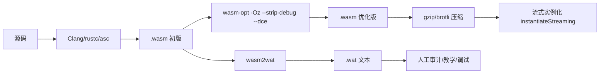
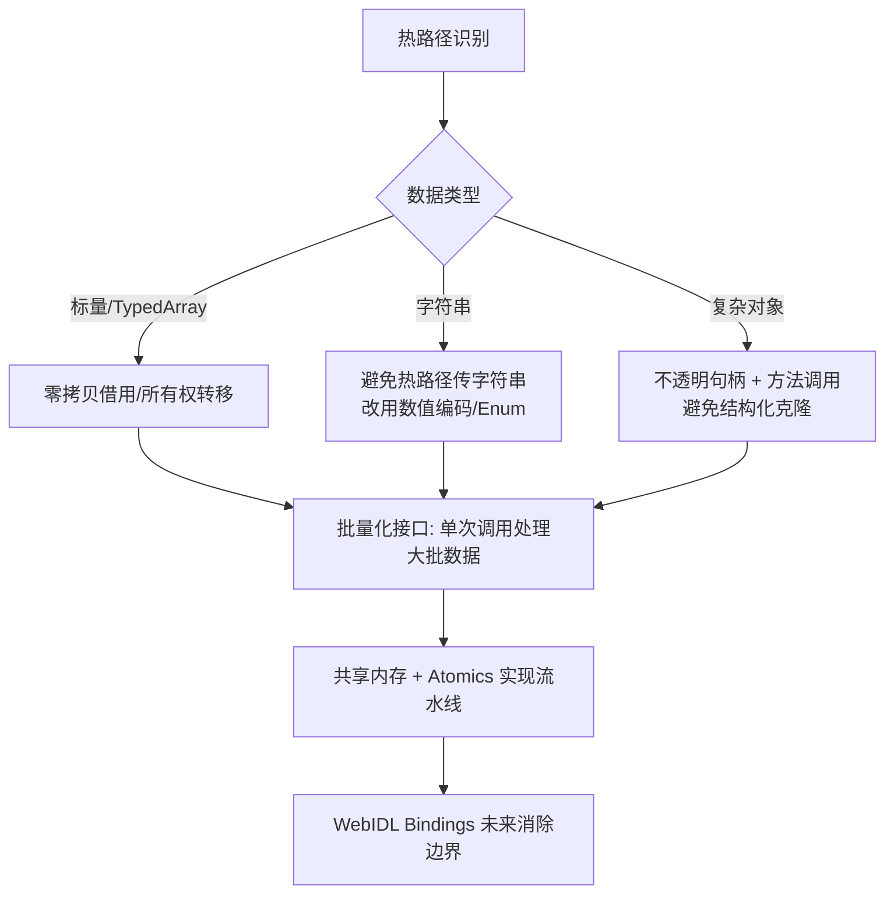
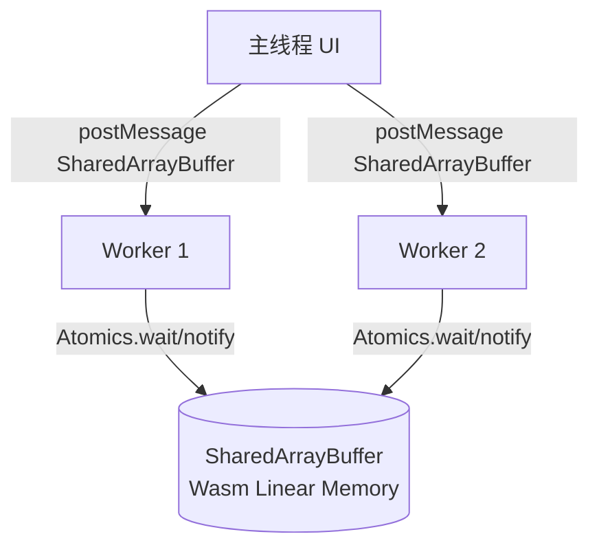
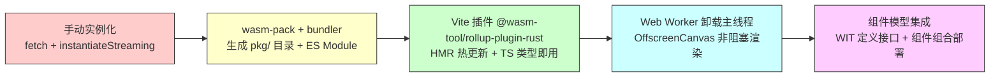
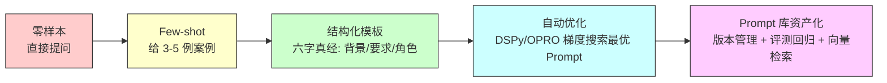
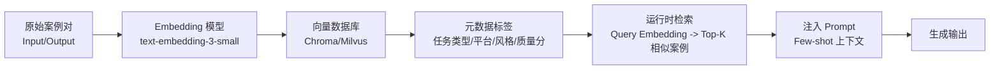
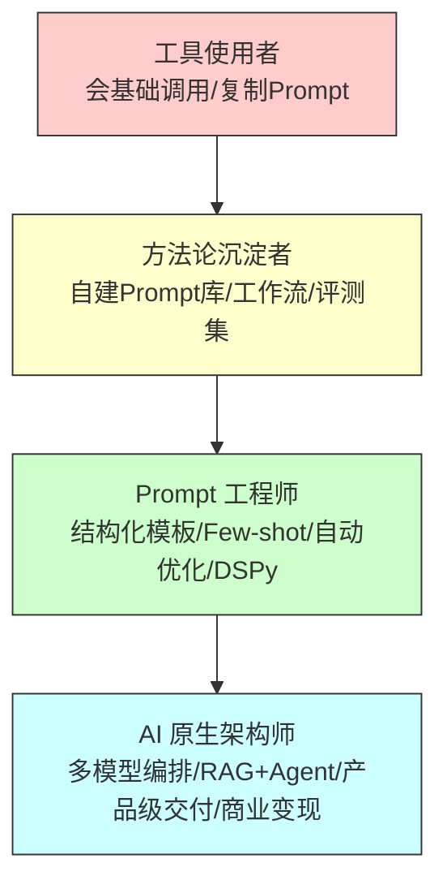

# 第 15 章 WebAssembly 赋能前端 —— 从计算密集型卸载到多语言生态复用

## 学习目标

- 理解 WebAssembly 的核心概念、安全沙箱模型与线性内存机制
- 掌握 Emscripten、wasm-pack、AssemblyScript 三大工具链的适用场景与编译优化流程
- 深入分析 JS-Wasm 互操作的性能开销，掌握共享内存、wasm-bindgen 等零拷贝传递技术
- 了解 SIMD、多线程、GC、组件模型、WASI 等前沿提案对 Wasm 生态演进的影响
- 能够在前端工程中落地 Rust/Wasm 模块：从编写算法、构建集成、Worker 卸载到性能基准对比的标准化流程
- 掌握大模型在前端工程化中的实战应用：代码生成、RPA自动化、Python工具开发的完整技能栈
- 建立提示词工程核心方法论：六字真经、四步生成法、Prompt库构建
- 理解 AI 时代个人核心竞争力：行业经验与执行力的双核模型

## 15.1 生活类比

想象 WebAssembly 是**浏览器里的“专业外援团队”**：Wasm 模块 = 一支训练有素的**特种部队**（Rust/C++ 编写的高性能核心逻辑）；线性内存 = 部队专用的**独立营房/弹药库**（隔离的字节数组，JS 不能随意闯入）；JS 主线程 = **指挥部**（负责 UI、调度、DOM 操作，不擅长重计算）；Import/Export = **严格的“通行证/汇报单”**（只有函数签名匹配，才能跨边界调用）；wasm-bindgen = **自动翻译官/后勤专员**（帮 Rust 结构体和 JS Class 无损转换，省去手写序列化）；SharedArrayBuffer = **共享战情大沙盘**（指挥部与特种部队实时同步地图，零拷贝、零延迟）；Web Worker = **前哨作战基地**（把特种部队部署到这里，不阻塞指挥部指挥全局）；SIMD/多线程/GC/WASI = **新式装备/编制扩编/后勤外包/统一军标**（让部队战力指数级跃升、能在任何战场/边缘节点作战）。就像指挥部只需下达高层指令、获取结果，而将繁重计算交给专业部队在营房内高效完成，WebAssembly 让浏览器突破了 JS 单线程的性能天花板。

想象 ChatGPT 是**一名“智商 250 的 3 岁天才神童”**：角色设定 = 给神童发**工牌/制服**（“你是资深小红书标题专家”）；背景喂养 = 填**简历/案头资料**（“我是龙哥，预算 1000 元，面向家庭出行”）；方法注入 = 教**做题套路/公式**（“二极管标题法：正面刺激=产品+低成本+逆天效果”）；案例喂养 = 给**满分作文范本**（“离离原上谱！网易云竟是隐藏背书神器！”）；关键词修正 = 考前**划重点/背课文词**（“穿插‘好用到哭’、‘宝藏’，≤20 字”）；分块喂养 = **分章节讲课、每节必考总结**——防止“囫囵吞枣”式假学会；多夸奖 = **正向强化 RLHF**（“神通广大的 GPT”“求求你了”）→ 输出质量显著跃升。就像带娃做题：不当甩手掌柜老板，而要当耐心拆解知识点、督促总结复述、奖励贴贴纸的老师，GPT 才能从“正确的废话”变成“可落地的细节”。

## 15.2 概念地图

WebAssembly 赋能前端
├── 核心概念
│   ├── 模块/内存/表/实例        —— AnkEdEtEtoXIbexWlQ3cL6zenFf.md
│   ├── 栈式虚拟机与结构化控制流  —— AnkEdEtEtoXIbexWlQ3cL6zenFf.md
│   ├── 线性内存隔离与安全沙箱    —— AnkEdEtEtoXIbexWlQ3cL6zenFf.md
│   └── WASI 跨平台能力           —— AnkEdEtEtoXIbexWlQ3cL6zenFf.md
├── 工具链实战
│   ├── Emscripten (C/C++)        —— AnkEdEtEtoXIbexWlQ3cL6zenFf.md
│   ├── wasm-pack (Rust)          —— AnkEdEtEtoXIbexWlQ3cL6zenFf.md
│   ├── AssemblyScript (TS-like)  —— AnkEdEtEtoXIbexWlQ3cL6zenFf.md
│   ├── wasm-opt 体积优化          —— AnkEdEtEtoXIbexWlQ3cL6zenFf.md
│   └── wasm2wat 反汇编调试        —— AnkEdEtEtoXIbexWlQ3cL6zenFf.md
├── JS-Wasm 互操作
│   ├── 数值直传与字符串拷贝开销    —— AnkEdEtEtoXIbexWlQ3cL6zenFf.md
│   ├── SharedArrayBuffer 共享内存  —— AnkEdEtEtoXIbexWlQ3cL6zenFf.md
│   ├── wasm-bindgen 高级类型绑定   —— AnkEdEtEtoXIbexWlQ3cL6zenFf.md
│   └── WebIDL Bindings 提案        —— AnkEdEtEtoXIbexWlQ3cL6zenFf.md
├── 前沿提案与生产实践
│   ├── SIMD 向量化加速             —— AnkEdEtEtoXIbexWlQ3cL6zenFf.md
│   ├── 多线程 (Worker + Atomics)   —— AnkEdEtEtoXIbexWlQ3cL6zenFf.md
│   ├── WasmGC 托管语言支持         —— AnkEdEtEtoXIbexWlQ3cL6zenFf.md
│   ├── 组件模型跨语言组合          —— AnkEdEtEtoXIbexWlQ3cL6zenFf.md
│   └── WASI 预览版边缘部署         —— AnkEdEtEtoXIbexWlQ3cL6zenFf.md
├── 实战集成流程
│   ├── Rust 算法 -> wasm-pack -> Vite 插件   —— AnkEdEtEtoXIbexWlQ3cL6zenFf.md
│   ├── Web Worker + OffscreenCanvas 卸载主线程 —— AnkEdEtEtoXIbexWlQ3cL6zenFf.md
│   ├── 性能基准对比 (JS vs Wasm)           —— AnkEdEtEtoXIbexWlQ3cL6zenFf.md
│   └── 发布缓存与错误监控策略               —— AnkEdEtEtoXIbexWlQ3cL6zenFf.md
├── 大模型赋能前端工程化
│   ├── ChatGPT 工作原理与认知边界     —— AnkEdEtEtoXIbexWlQ3cL6zenFf.md
│   ├── 六字真经提示词工程             —— AnkEdEtEtoXIbexWlQ3cL6zenFf.md
│   ├── 四步内容生产 SOP               —— AnkEdEtEtoXIbexWlQ3cL6zenFf.md
│   ├── ChatGPT+RPA 批量自动化         —— AnkEdEtEtoXIbexWlQ3cL6zenFf.md
│   ├── ChatGPT+Python 零代码开发      —— AnkEdEtEtoXIbexWlQ3cL6zenFf.md
│   └── 个人 Prompt 资产库构建         —— AnkEdEtEtoXIbexWlQ3cL6zenFf.md
└── 核心竞争力模型
    ├── 行业经验沉淀 (方法论/决策模型)   —— AnkEdEtEtoXIbexWlQ3cL6zenFf.md
    ├── 执行力复利 (知行合一/主动学习)     —— AnkEdEtEtoXIbexWlQ3cL6zenFf.md
    └── 工具放大器定律 (AI不等于能力)     —— AnkEdEtEtoXIbexWlQ3cL6zenFf.md

## 15.3 Wasm 核心概念 —— 给浏览器装上“高性能虚拟机”

### 为什么需要这个概念？

JavaScript 作为 Web 的“通用语”，其动态类型、单线程事件循环、JIT 编译优化路径，天生擅长处理 DOM 交互、网络调度、业务逻辑组装。但当你遇到**计算密集型任务**时——如 4K 图像滤镜实时预览、客户端视频转码、大规模拓扑图布局计算、WASM 版 ffmpeg 转码、Web 端运行 SQLite、甚至在浏览器里跑一个 Python 解释器——JS 的性能天花板会变得触手可及：

- **解释执行与 JIT 预热延迟**：V8 虽然快，但热代码需要时间预热，冷启动首帧抖动明显。
- **垃圾回收停顿**：大量临时对象（如矩阵运算中的 Float32Array 分配）触发 GC，主线程卡顿。
- **数值类型开销**：JS 只有 `number` (IEEE 754 double)，整数运算需模拟，SIMD 向量化依赖显式 API（`SIMD.js` 已弃用，现靠 Wasm SIMD）。
- **无法复用海量现有生态**：数百万行 C/C++/Rust 成熟库（OpenCV、FFmpeg、Bullet Physics、Arrow/Parquet 解析器）若重写为 JS，成本高且易出错。

WebAssembly (Wasm) 正是为了解决上述痛点而生：**一种面向 Web 的、可移植的、体积紧凑的二进制指令格式**。它不是要替代 JS，而是作为 JS 的**高性能搭档**，承担“重计算、低交互”的核心内核。

> "WebAssembly (abbreviated Wasm) is a binary instruction format for a stack-based virtual machine. Wasm is designed as a portable compilation target for programming languages, enabling deployment on the web for client and server applications."
> 
> ——《WebAssembly Core Specification》 (AnkEdEtEtoXIbexWlQ3cL6zenFf.md)

这段话定义了 Wasm 的三大核心属性：**栈式虚拟机**、**可移植编译目标**、**客户端与服务端通用**。接下来我们从“模块/内存/表/实例”四大抽象、栈式虚拟机与结构化控制流、线性内存隔离与安全沙箱、WASI 跨平台能力四个维度展开。

---

### 核心抽象：Module / Memory / Table / Instance

Wasm 运行时模型由四大核心抽象构成，理解它们是读懂 Wasm 编译产物与 JS 交互的基础。

#### 1. Module（模块）：编译时的静态单元

`WebAssembly.Module` 对象代表**已编译、未实例化**的 Wasm 代码。它是无状态的、可序列化的、可跨 Worker/Window 传递（通过 `postMessage` 或 `structuredClone`）的“字节码包”。


**关键点**：
- `Module` 创建开销大（解码、验证、编译），应尽量**复用**（缓存、流式编译 `WebAssembly.instantiateStreaming`）。
- `Module` 不包含运行时状态（内存、全局变量、导入对象），这些属于 `Instance`。

#### 2. Memory（线性内存）：隔离的字节数组

`WebAssembly.Memory` 是一个**可增长的 `ArrayBuffer` 视图**，代表 Wasm 模块的整个地址空间。

> "Linear memory is a contiguous, mutable array of raw bytes. It is created with an initial size and can grow by multiples of the page size (64 KiB)."
> 
> ——《WebAssembly Memory Semantics》 (AnkEdEtEtoXIbexWlQ3cL6zenFf.md)

**定义**：

$$
\text{Memory} = \langle \text{initial\_pages}, \text{maximum\_pages?} \rangle
$$

- **初始页数**：实例化时分配的 64 KiB 页数。
- **最大页数（可选）**：上限，防止无限增长耗尽宿主内存。
- **增长操作**：`memory.grow(n)` 返回增长前的页数，失败返回 -1。

**该公式定义了线性内存的边界契约**：初始页数决定启动时的内存占用，最大页数设定硬性上限防止恶意或失控的内存增长。宿主通过此契约实现内存隔离与资源配额控制，保证 Wasm 模块无法越界访问宿主地址空间。公式中的 `initial_pages` 直接映射到启动时分配的字节数（`initial_pages * 64KiB`），`maximum_pages` 则约束了 `memory.grow` 的上限，二者共同构成了内存管理的静态边界与动态增长空间。

**安全隔离**：Wasm 代码**只能**通过 `load`/`store` 指令访问这块内存，**无法**直接读写 JS 堆对象、DOM、网络套接字。所有外部交互必须通过 **Import/Export** 显式声明。

#### 3. Table（函数引用表）：间接调用的桥梁

`WebAssembly.Table` 存储 **`funcref`**（函数引用）或 **`externref`**（外部引用）。它是实现**动态分发**、**虚函数**、**回调函数**的关键。

- Wasm 没有函数指针，但可以通过 `call_indirect` 索引 Table 实现间接调用。
- Table 支持 `grow`，配合 `externref` 可安全持有 JS 对象引用（GC 根）。

#### 4. Instance（实例）：运行时的激活态

`WebAssembly.Instance` = `Module` + `Imports`（导入对象）+ **私有状态**（Memory、Table、Globals）。

```javascript
// 伪代码：实例化流程
const imports = {
  env: { memory: new WebAssembly.Memory({ initial: 10 }) },
  js: { log: console.log }
};
const module = await WebAssembly.compileStreaming(fetch('app.wasm'));
const instance = await WebAssembly.instantiate(module, imports);
// instance.exports 即导出的 Wasm 函数/内存/表/全局变量
```

这段伪代码展示了 Wasm 实例化的标准流程：首先准备导入对象 `imports`，其中包含宿主提供的内存实例与 JS 函数；接着通过 `WebAssembly.compileStreaming` 流式编译获取 `Module`；最后调用 `WebAssembly.instantiate` 将模块与导入对象结合，产生拥有私有状态的 `Instance`。`instance.exports` 则暴露了 Wasm 侧导出的函数、内存、表与全局变量，供宿主调用。

---

### 栈式虚拟机与结构化控制流

Wasm 采用**栈式指令集架构（ISA）**，而非寄存器机。所有算术、逻辑、控制流指令操作**隐式操作数栈**。

#### 指令示例：`(i32.add (i32.const 1) (i32.const 2))`

```
;; 栈变化可视化
i32.const 1   ;; 栈: [1]
i32.const 2   ;; 栈: [1, 2]
i32.add       ;; 弹出 2,1 -> 压入 3   栈: [3]
```

**为什么选栈式？**
- **编码紧凑**：无需显式寄存器编号，指令流更短，利于网络传输。
- **验证简单**：类型检查只需模拟栈高度与类型，线性扫描即可完成，保证“验证通过即安全”。
- **易于 JIT/AOT**：栈机易于转换为寄存器机（SSA 形式），后端编译器优化成熟。

#### 结构化控制流：无 `goto`，只有 `block/loop/if`

Wasm **禁止任意跳转**，所有控制流必须由结构化构造块组成：

| 构造块 | 语义 | 栈约束 |
|--------|------|--------|
| `block (result?) { instr* }` | 顺序执行，可 `br` 跳出 | 入栈高度 = 出栈高度 |
| `loop (result?) { instr* }` | 循环，`br` 跳到**开头**（继续循环） | 同上 |
| `if (result?) { instr* } else { instr* }` | 条件分支 | 同上 |

**设计意图**：强制结构化使得**单次遍历即可完成验证**，无需构建控制流图（CFG），大幅降低验证器复杂度，也利于流式编译（边下载边验证）。

---

### 线性内存隔离与安全沙箱模型

Wasm 的安全模型基于**能力安全**：模块**只能**访问显式导入的资源。

#### 内存保护机制

1. **边界检查**：每条 `load`/`store` 指令隐含边界检查，越界触发 **Trap**（陷阱），终止实例执行，不泄露宿主内存。
2. **无指针逃逸**：Wasm 指针只是整数偏移量（`i32`/`i64`），无法伪造指向宿主对象的指针。
3. **代码与数据分离**：代码段只读不可写，数据段（内存）可读写不可执行（W^X），防代码注入。

#### 与 JS 的受控交互

- **Import**：Wasm 声明需要的外部函数/内存/全局变量，宿主提供实现。
- **Export**：Wasm 暴露函数/内存/表/全局变量供宿主调用。

```wat
;; Wasm 文本格式示例
(module
  (import "env" "memory" (memory 1))        ;; 导入宿主内存
  (import "env" "log" (func $log (param i32))) ;; 导入宿主函数
  (memory (export "memory") 1)              ;; 导出自有内存（可选）
  (func (export "add") (param i32 i32) (result i32)
    local.get 0
    local.get 1
    i32.add
  )
)
```

> "WebAssembly provides a memory-safe, sandboxed execution environment. Code cannot access memory outside its linear memory, nor can it call functions not explicitly imported."
> 
> ——《WebAssembly Security Model》 (AnkEdEtEtoXIbexWlQ3cL6zenFf.md)

这意味着：**供应链攻击面大幅收窄**。即使引入恶意 `.wasm`，它也无法直接窃取 Cookie、发起网络请求、读取本地文件，除非宿主显式导入了这些能力。

---

### WASI：跨平台的“系统接口标准”

Wasm MVP 仅定义**计算逻辑**，无文件、网络、时钟等系统调用。WASI (WebAssembly System Interface) 定义了**标准化的系统接口**，使同一 `.wasm` 能在浏览器、Cloudflare Workers、Vercel Edge、Fastly Compute@Edge、嵌入式设备、Kubernetes (wasmCloud/Krun) 无修改运行。

| WASI 版本 | 关键特性 | 典型运行时 |
|-----------|----------|------------|
| Preview 1 (wasi_snapshot_preview1) | 文件 I/O、环境变量、参数、随机数、时钟 | wasmtime, wasmer, lucet |
| Preview 2 (wasi:io/wasi:cli/wasi:filesystem) | **异步流**、**资源模型**（句柄）、**组件模型**集成 | wasmtime 10+, wasmedge, spin |

**组件模型 + WASI Preview 2** 是当前“云原生 Wasm”技术栈的核心：**语言无关的组件接口 + 标准化系统调用 = 真正的 Write Once, Run Anywhere**。

---

### 核心概念方法演进图

```mermaid
graph TD
    A[Java Applet / ActiveX\n(插件时代，非标准、不安全)] --> B[asm.js\n(JS 子集，AOT 友好，验证麻烦)]
    B --> C[Wasm MVP (2017)\n栈式VM、线性内存、结构化控制流、能力安全]
    C --> D[后 MVP 提案演进]
    D --> D1[SIMD / 多线程 / 异常处理]
    D --> D2[WasmGC / 组件模型 / Interface Types]
    D --> D3[WASI Preview 1/2 / Memory64]
    D1 & D2 & D3 --> E[通用运行时\n浏览器/边缘/Serverless/嵌入式全覆盖]
```

**演进路径说明**：从早期的插件方案（Java Applet/ActiveX）到 asm.js（JS 静态子集），再到 Wasm MVP 确立栈式虚拟机与线性内存的核心抽象，随后通过 SIMD、多线程、GC、组件模型、WASI 等提案逐步补齐通用运行时能力，最终实现“Write Once, Run Anywhere”的云原生愿景。

---

### 小结：核心概念速览表

下表汇总了本节介绍的 Wasm 核心概念及其关键约束，便于快速查阅与对比。

| 概念 | 角色 | 关键约束 |
|------|------|----------|
| **Module** | 编译产物，无状态 | 验证开销大，需缓存/流式实例化 |
| **Memory** | 线性字节数组，可增长 | 64 KiB 页粒度，32 位地址限 4GB (Memory64 解决中) |
| **Table** | 函数/外部引用表 | 实现间接调用、虚函数、JS 对象持有 |
| **Instance** | 运行时激活态 | 包含私有 Memory/Table/Globals，不可跨实例共享（除非显式共享同一 Memory 对象） |
| **栈式 VM** | 指令操作隐式栈 | 编码紧凑、验证简单、易编译优化 |
| **结构化控制流** | 无 goto，仅 block/loop/if | 单遍验证、流式编译友好 |
| **安全沙箱** | 能力安全模型 | 无默认权限，仅显式 Import/Export 交互 |
| **WASI** | 系统接口标准 | Preview 2 引入异步/资源/组件模型，生产可用 |

---

## 15.4 工具链实战 —— 从源代码到 .wasm 的“编译流水线”

### 为什么需要这个概念？

浏览器只认识 `.wasm` 二进制。C/C++、Rust、TypeScript 等源码必须经过**前端编译**、**链接**、**后端优化**、**胶水代码生成**才能在 Web 运行。不同语言运行时差异巨大（GC、异常、线程模型、标准库），工具链需屏蔽差异生成标准 Wasm。生产环境对**体积**（首屏加载）、**启动速度**（流式编译/分层编译）、**调试体验**（Source Map/DWARF）极其敏感，需专用工具链而非通用编译器默认输出。

---

### 三大主流工具链对照

下表从目标语言、编译器前端、运行时模拟、胶水代码、类型互操作、调试支持、体积优化、典型场景、学习曲线九个维度，系统对比了三大主流 Wasm 工具链的特性差异。

| 维度 | **Emscripten (C/C++)** | **wasm-pack (Rust)** | **AssemblyScript (TS-like)** |
|------|------------------------|----------------------|------------------------------|
| **目标语言** | C / C++ | Rust | TypeScript 子集 |
| **编译器前端** | Clang (LLVM) | rustc (LLVM) | 自研 (基于 Binaryen) |
| **运行时模拟** | 完整 POSIX (文件系统、pthread、socket) | 无运行时 (no_std 友好)，wasm-bindgen 处理交互 | 无运行时，直接映射 Wasm GC/数值类型 |
| **胶水代码** | 生成 `.js` 胶水 (Module/Instance 封装、FS 模拟) | wasm-bindgen 生成 TS 绑定 + `.js` 入口 | 无需胶水，直接 `import` `.wasm` |
| **类型互操作** | 手写/Embind (C++ 反射绑定) | **wasm-bindgen 宏自动生成** (零拷贝、TS 类型) | 原生 TS 类型，编译期检查 |
| **调试支持** | DWARF + Source Map → DevTools 断点调试 | DWARF + wasm-bindgen Source Map | Source Map 支持较弱 |
| **体积优化** | `-Oz` + `wasm-opt` + `closure-compiler` | `-C opt-level=z` + `wasm-opt` + `wasm-snip` | `-Oz` + `wasm-opt` |
| **典型场景** | 遗留 C++ 库迁移 (OpenCV, FFmpeg, Bullet, SQLite) | **新建高性能模块** (图像、加密、解析、ML 推理) | 前端团队零门槛写 Wasm、小工具、教学 |
| **学习曲线** | 高 (CMake、链接器、POSIX 模拟坑) | 中 (Rust 所有权、wasm-bindgen 属性) | **极低** (TS 语法、熟悉工具链) |

---

### Emscripten：C/C++ 遗留代码的“移植瑞士军刀”

Emscripten 通过 **Clang/LLVM** 将 C/C++ 编译为 Wasm，并提供 **`emscripten` 系统库** 模拟 POSIX 环境（`fopen`、`pthread_create`、`socket`、`OpenGL` → `WebGL`）。

#### 核心编译流程

```bash
# 1. 简单编译
emcc main.c -O3 -o main.js -s EXPORTED_FUNCTIONS='["_add", "_process"]'

# 2. 启用 pthread (需 SharedArrayBuffer + COOP/COEP)
emcc main.c -O3 -pthread -s PTHREAD_POOL_SIZE=4 -o main.js

# 3. 文件系统预加载 (--preload-file)
emcc main.c -O3 --preload-file assets@/data -o main.js
```

上述命令展示了 Emscripten 从简单编译到启用多线程、预加载文件系统的典型用法。`-s EXPORTED_FUNCTIONS` 显式声明导出函数列表，配合死代码消除精确裁剪体积；`-pthread` 启用 pthread 支持，依赖 `SharedArrayBuffer` 与跨域隔离头；`--preload-file` 将资源文件打包进虚拟文件系统，实现同步 `fopen` 读取。

#### 关键优化参数

| 参数 | 作用 | 推荐值 |
|------|------|--------|
| `-Oz` | 极致体积优化 (比 `-Os` 更激进) | 生产必选 |
| `-s EXPORTED_FUNCTIONS` | 显式导出函数列表 (死代码消除依赖) | 精确列出入口 |
| `-s MODULARIZE=1` | 输出 ES Module 而非 IIFE | 现代构建系统必选 |
| `-s ENVIRONMENT=web` | 移除 Node.js 特定 polyfill | 纯 Web 目标 |
| `-s INITIAL_MEMORY=64MB` | 设置初始内存 (避免 runtime growth 开销) | 按需预分配 |
| `--closure 1` | Google Closure Compiler 压缩胶水 JS | 生产可选 |

#### 体积优化实战：`wasm-opt` (Binaryen)

Emscripten 输出的 `.wasm` 仍可用 Binaryen 的 `wasm-opt` 二次优化：

```bash
# 安装
npm i -g binaryen

# 优化管线
wasm-opt -Oz --enable-mutable-globals --strip-debug main.wasm -o main.opt.wasm
```

- `--strip-debug`：移除 DWARF 调试段 (生产环境)。
- `--enable-mutable-globals`：允许导入可变全局变量 (配合 `MODULARIZE`)。
- **DCE (Dead Code Elimination)**：依赖 `EXPORTED_FUNCTIONS` 精确导出入口。

---

### wasm-pack：Rust 到 Web 的“零配置高速公路”

`wasm-pack` 是 `cargo` 的子命令封装，集成 **`wasm-bindgen`** 自动生成 **TypeScript 类型定义**、**JS 胶水代码**、**`package.json`**，可直接 `npm publish`。

#### 项目结构

```
my-wasm-lib/
├── Cargo.toml              # crate-type = ["cdylib", "rlib"]
├── src/
│   └── lib.rs              # #[wasm_bindgen] 标注导出项
├── package.json            # 生成后包含 types、module、sideEffects
└── README.md
```

#### `Cargo.toml` 关键配置

```toml
[package]
name = "my-wasm-lib"
version = "0.1.0"
edition = "2021"

[lib]
crate-type = ["cdylib", "rlib"]  # cdylib 产出 .wasm，rlib 供测试

[dependencies]
wasm-bindgen = "0.2"
# 可选：serde + serde-wasm-bindgen 支持复杂结构体序列化
# 可选：console_error_panic_hook 将 panic 映射为 JS console.error
# 可选：web-sys / js-sys 访问 Web API

[profile.release]
opt-level = "z"      # 体积优先
lto = true           # 链接时优化
codegen-units = 1    # 单代码单元利于 LTO
panic = "abort"      # 无异常展开，减小体积
```

该配置文件定义了 Wasm 目标的关键编译参数：`crate-type = ["cdylib", "rlib"]` 指定输出动态库格式的 `.wasm` 与供测试用的 `rlib`；`[profile.release]` 段启用了极致体积优化（`opt-level = "z"`）、链接时优化（`lto = true`）、单代码单元（`codegen-units = 1`）与 `panic = "abort"` 禁用异常展开，共同将生产构建体积压缩至最小。

#### `wasm-bindgen` 核心用法

```rust
use wasm_bindgen::prelude::*;

// 1. 简单函数导出：数值直传，零开销
#[wasm_bindgen]
pub fn add(a: i32, b: i32) -> i32 {
    a + b
}

// 2. 结构体导出：自动生成 JS Class + getter/setter + 构造函数
#[wasm_bindgen]
#[derive(Clone, Debug)]
pub struct ImageFilter {
    width: u32,
    height: u32,
    // 内部数据存储在 Wasm 线性内存，不暴露给 JS
    data_ptr: *mut u8,  // 或使用 Vec<u8> 配合 wasm-bindgen 内存管理
}

#[wasm_bindgen]
impl ImageFilter {
    #[wasm_bindgen(constructor)]
    pub fn new(width: u32, height: u32) -> Self {
        // 分配线性内存...
    }

    // 3. 方法导出：&self / &mut self 自动映射为 JS 实例方法
    pub fn grayscale(&mut self) {
        // 直接操作线性内存像素
    }

    // 4. 返回复杂类型：Vec<u8> -> Uint8Array (零拷贝所有权转移)
    pub fn to_rgba(&self) -> Vec<u8> {
        // 返回 Vec，wasm-bindgen 生成代码将所有权转移给 JS Uint8Array
    }

    // 5. 接收 JS 传入的 TypedArray：&[u8] / &mut [u8] 零拷贝借用
    pub fn process_external(&mut self, input: &[u8]) -> Vec<u8> {
        // input 直接指向 JS ArrayBuffer 内存 (需 --target web)
    }
}

// 6. 闭包导出：Rust 闭包 -> JS Function (需 Feature "closure")
#[wasm_bindgen]
pub fn set_callback(cb: &Closure<dyn Fn(i32)>) {
    // ...
}
```

这段代码演示了 `wasm-bindgen` 的核心绑定模式：简单函数的数值直传、结构体到 JS Class 的自动映射、方法的实例化绑定、复杂类型（`Vec<u8>`）的零拷贝所有权转移、TypedArray 的零拷贝借用，以及闭包的跨语言传递。`#[wasm_bindgen]` 宏在编译期展开为胶水代码，消除了手写序列化的繁琐与错误。

#### 构建与发布命令

```bash
# 1. 构建 Web 目标 (生成 pkg/ 目录)
wasm-pack build --target web --out-dir pkg --release

# 2. 构建 Node.js / Bundler 目标 (含 .d.ts)
wasm-pack build --target bundler --out-dir pkg --release

# 3. 发布到 npm (需登录)
wasm-pack publish pkg
```

**生成产物 (`pkg/`)**：
```
pkg/
├── my_wasm_lib.js          # ES Module 入口，实例化 Wasm、导出绑定
├── my_wasm_lib_bg.wasm     # 精简 .wasm (仅代码段、数据段)
├── my_wasm_lib.d.ts        # 完整 TypeScript 类型定义
├── my_wasm_lib_bg.js       # wasm-bindgen 运行时辅助 (内存管理、字符串转换)
└── package.json            # name、version、module、types、sideEffects: false
```

上述目录结构展示了 `wasm-pack` 产出的标准 npm 包布局：`.js` 入口负责实例化与导出，`_bg.wasm` 为精简二进制，`.d.ts` 提供完整类型定义，`_bg.js` 包含运行时辅助，`package.json` 声明 ES Module 入口与类型定义路径，`sideEffects: false` 允许打包工具安全摇树。

---

### AssemblyScript：前端开发者的“零门槛 Wasm”

AssemblyScript (AS) 语法是 TypeScript 的**严格子集**，直接编译为 Wasm，**无需 LLVM/Rust 工具链**，`npm i -D assemblyscript` 即可上手。

```bash
# 初始化
npx asinit .

# 编译
npx asc assembly/index.ts --target release --outFile build/release.wasm
```

#### 适用与不适用场景

| 适用 | 不适用 |
|------|--------|
| 纯算法逻辑 (数学、图像、压缩、加密) | 需要大量 DOM/Web API 交互 (每次调用跨边界) |
| 团队全栈 TS、不想引入 Rust/C++ 工具链 | 需要成熟生态库 (图像处理、视频编解码、数据库) |
| 原型验证、教学、小体积工具函数 | 大型项目、长期维护、团队无 TS 强类型纪律 |

**AssemblyScript 在 SIMD/多线程/GC 提案上的支持进度与生产可用性**：

- **SIMD**：通过 `std.simd` 或内联 WASM 指令支持，但自动向量化能力弱于 LLVM 后端，生产中常需手写 intrinsic。
- **多线程**：支持 `worker` 与 `atomic` 操作，但工具链集成度低于 Rust/Emscripten，需手动管理 Worker 与共享内存。
- **GC**：WasmGC 提案尚未稳定，AssemblyScript 现有 GC 为自带引用计数/标记清除，无法利用宿主 GC，大型对象图场景内存开销较大。

**结论**：适合纯前端团队快速编写小型计算模块，但在依赖成熟生态库、极致性能调优、托管语言互操作等场景下，Rust + wasm-pack 仍是首选。

---

### 统一的体积优化管线：`wasm-opt` + `wasm2wat`

无论哪条工具链，**生产构建最后一步**建议统一走 Binaryen `wasm-opt`：



**`wasm2wat` 反汇编调试**：

```bash
wasm2wat app.wasm -o app.wat
# 查看导入/导出/函数体/数据段
```

配合 **DWARF + Source Map**，Chrome DevTools / Firefox DevTools 已支持 **Wasm 断点调试、变量查看、调用栈回溯**（需工具链输出 debug info：`-g` / `debug = true`）。

---

### 工具链演进图

```mermaid
graph LR
    A[Emscripten\n(C/C++ POSIX 模拟)] --> B[wasm-pack + wasm-bindgen\n(Rust 零成本抽象 + TS 类型安全)]
    B --> C[AssemblyScript\n(TS 子集零门槛)]
    C --> D[组件模型 / wit-bindgen\n(跨语言组件组装、WASI 标准化)]
    D --> E[统一优化管线: wasm-opt + wasm2wat]
    style A fill:#f9f,stroke:#333
    style B fill:#bbf,stroke:#333
    style C fill:#bfb,stroke:#333
    style D fill:#ffb,stroke:#333
```

**演进路径说明**：工具链从重运行时模拟（Emscripten POSIX 层）向零运行时、零成本抽象（Rust/wasm-bindgen）演进，再到前端友好语法（AssemblyScript），最终汇聚于组件模型与 WASI 标准化接口，配合统一的 `wasm-opt` 优化管线实现生产级交付。

---

## 15.5 JS-Wasm 互操作深度 —— 跨越“边境”的性能税与免税政策

### 为什么需要这个概念？

Wasm **无法直接访问 DOM、Web API、JS 对象**。所有外部交互必须跨越 **JS-Wasm 边界**。数据表示差异巨大：JS 是 **GC 管理的对象图**（引用语义），Wasm 是 **线性内存字节流**（值语义/指针算术）。类型转换必然涉及**拷贝/序列化/边界检查**。错误的交互模式（高频小数据传递）会让 Wasm 版本比纯 JS 更慢。你必须量化开销、选择正确的数据传递策略。

---

### 边界调用开销量化

下表量化了不同交互类型在 V8 中的典型开销，为 API 设计提供数据支撑。

| 交互类型 | 典型开销 (V8, 近似) | 适用场景 |
|----------|---------------------|----------|
| **数值标量传递** (i32/i64/f32/f64) | **~5-10 ns** (寄存器直传，近似原生函数调用) | 纯计算函数参数/返回值 |
| **导出函数调用** (JS → Wasm) | **~50-100 ns** (边界桩、栈切换、边界检查) | 粗粒度 API 入口 |
| **导入函数调用** (Wasm → JS) | **~100-200 ns** (更复杂的上下文切换) | Wasm 调用 JS 回调/日志 |
| **字符串传递** (UTF-8 ↔ UTF-16) | **O(n) 拷贝 + 编码转换** (~0.5-2 ns/字符) | 短字符串可接受，长文本禁用 |
| **对象/数组传递** (结构化克隆) | **O(n) 深拷贝** (Structured Clone Algorithm) | 仅用于冷路径配置/初始化 |

> **经验法则**：**单次调用开销 ~100ns**。若 Wasm 函数执行 < 10μs，调用开销占比 > 1%。**必须批量化**：传大数组、传指针+长度、共享内存。

**该经验法则量化了边界调用的“性能税”**：通过将调用开销与计算时长对比，指导工程师决定是否值得引入 Wasm、如何设计 API 粒度以摊销固定开销。推导过程为：单次跨边界调用约 100ns，若目标函数执行时间为 10μs（10,000ns），则开销占比 1%；若函数仅执行 1μs，开销占比高达 10%，严重抵消计算优势。因此，API 设计必须保证单次调用承担足够计算量，或通过批量接口摊销固定开销。

---

### 数据传递四大模式对比

#### 模式 1：数值直传 —— 零开销快车道

```rust
// Rust
#[wasm_bindgen]
pub fn dot_product(a: &[f32], b: &[f32]) -> f32 { ... }

// JS
const a = new Float32Array(1000);
const b = new Float32Array(1000);
// wasm-bindgen 自动处理 &[f32] -> 指针+长度，零拷贝借用
const result = dot_product(a, b); 
```

- **适用**：标量参数、返回值、TypedArray 借用 (`&[T]`, `&mut [T]`)。
- **原理**：wasm-bindgen 生成胶水代码，直接读取 `ArrayBuffer` 视图的 `byteOffset`/`length`，传递指针给 Wasm，**零拷贝**。

#### 模式 2：线性内存指针+长度 —— 手动零拷贝大数据

不使用 `wasm-bindgen` 或需精细控制时，手动管理内存：

```rust
// Rust: 导出内存指针分配/释放函数
#[wasm_bindgen]
pub fn allocate(len: usize) -> *mut u8 {
    let mut vec = Vec::with_capacity(len);
    let ptr = vec.as_mut_ptr();
    std::mem::forget(vec); // 交由 JS 管理生命周期
    ptr
}

#[wasm_bindgen]
pub fn deallocate(ptr: *mut u8, len: usize) {
    unsafe { Vec::from_raw_parts(ptr, 0, len) }; // 回收内存
}

#[wasm_bindgen]
pub fn process(ptr: *mut u8, len: usize) { ... }
```

```javascript
// JS: 手动内存管理
const len = 1024 * 1024; // 1MB
const ptr = wasm.allocate(len);
try {
    // 直接写入 Wasm 线性内存 (零拷贝)
    const view = new Uint8Array(wasm.memory.buffer, ptr, len);
    fetchDataInto(view); // 网络/文件直接读入 Wasm 内存
    wasm.process(ptr, len);
    // 读取结果
    const resultView = new Uint8Array(wasm.memory.buffer, ptr, len);
    render(resultView);
} finally {
    wasm.deallocate(ptr, len);
}
```

**设计取舍说明**：此处使用 `std::mem::forget` 配合 `Vec::from_raw_parts` 而非 `Box::leak`/`Box::from_raw`，是因为 `Vec` 提供了精确的 `capacity` 与 `len` 分离控制，适合需要在 Wasm 侧预分配大缓冲区、再由 JS 填充数据、最后归还所有权的场景。`Box` 更适合固定大小的单对象所有权转移。

- **优势**：完全避免 `postMessage` 结构化克隆、`TextEncoder/Decoder` 转码、**大对象拷贝**。
- **风险**：手动内存管理易泄漏/双重释放，**生产建议封装 RAII Wrapper**。

#### 模式 3：`SharedArrayBuffer` 共享内存 —— 真·零拷贝、多线程共享

```javascript
// 主线程: 创建共享内存，作为 Wasm Memory 导入
const sharedMemory = new WebAssembly.Memory({ 
    shared: true, 
    initial: 100, // 6.4 MB
    maximum: 1000 
});

// 实例化 Wasm (需在 Worker 中或主线程)
const instance = await WebAssembly.instantiateStreaming(fetch('app.wasm'), {
    env: { memory: sharedMemory }
});

// Worker 线程: 接收同一 Memory 对象 (postMessage 传递)
worker.postMessage({ memory: sharedMemory }, [sharedMemory]);
```

```rust
// Wasm 端: 直接读写共享内存，配合 Atomics 同步
#[wasm_bindgen]
pub fn worker_process(signal_addr: usize) {
    // 原子等待信号
    while atomic_load(signal_addr as *mut i32) == 0 {
        // spin wait 或 futex_wait (Wasm 无 futex，需自旋)
    }
    // 处理共享内存数据...
    atomic_store(result_addr as *mut i32, 1); // 通知完成
}
```

**部署硬性要求** (浏览器安全策略)：
- HTTP 响应头必须包含：
  - `Cross-Origin-Opener-Policy: same-origin`
  - `Cross-Origin-Embedder-Policy: require-corp`
- 否则 `new WebAssembly.Memory({ shared: true })` 抛 `TypeError`。

**优势**：
- **主线程/Worker/Wasm 三方零拷贝共享像素缓冲区、物理引擎状态、大模型权重**。
- 实现**生产者-消费者**无锁环形缓冲区（配合 `Atomics.wait/notify`）。

#### 模式 4：`wasm-bindgen` 高级类型绑定 —— 开发体验与性能的平衡

`wasm-bindgen` 通过**过程宏**在编译期生成胶水代码，支持：

| Rust 类型 | JS 映射 | 传递语义 |
|-----------|---------|----------|
| `i32/u32/f32/f64` | `number` / `bigint` | 值传递 (寄存器) |
| `&[T]`, `&mut [T]` (T 为数值类型) | `TypedArray` | **零拷贝借用** (指针+长度) |
| `Vec<T>` (T 为数值类型) | `TypedArray` | **零拷贝所有权转移** (JS 接管内存) |
| `Box<[T]>` | `TypedArray` | 零拷贝所有权转移 |
| `String` / `&str` | `string` | **UTF-8 ↔ UTF-16 拷贝转码** |
| `JsValue` / `Object` / `Array` | 任意 JS 对象 | **引用传递** (Table 存 `externref`) |
| `#[wasm_bindgen] struct Foo { ... }` | `class Foo` | **不透明指针** (Wasm 侧存实例指针，JS 侧持有句柄) |
| `Option<T>`, `Result<T, E>` | `T \| null`, 抛异常 | 语义映射 |

**实例：不透明结构体句柄模式 (大对象、生命周期长、不想拷贝)**

```rust
#[wasm_bindgen]
pub struct HeavyEngine {
    // 内部大数组、复杂状态全在 Wasm 线性内存
    data: Vec<f32>, 
    cache: HashMap<String, Vec<u8>>,
}

#[wasm_bindgen]
impl HeavyEngine {
    #[wasm_bindgen(constructor)]
    pub fn new(config: JsValue) -> Self { ... } // 配置对象从 JS 传入

    pub fn compute(&mut self, input: &[f32]) -> Vec<f32> { ... } // 零拷贝借用/转移

    // 手动析构 (Rust 无 Drop 在 wasm-bindgen 中自动绑定，但显式 drop 可提前释放)
    #[wasm_bindgen(js_name = "destroy")]
    pub fn destroy(self) { /* drop 自动释放 Wasm 内存 */ }
}
```

```javascript
// JS 侧：像操作原生对象一样操作
const engine = new HeavyEngine({ quality: 'high' });
const result = engine.compute(new Float32Array([...])); // 零拷贝
engine.destroy(); // 显式释放，或等待 JS GC 触发 FinalizationRegistry 回收
```

---

### WebIDL Bindings 提案：绕过 JS 中转层

> "WebIDL Bindings allow WebAssembly modules to directly import and call Web APIs (DOM, WebGPU, WebAudio, etc.) without JavaScript glue code."
> 
> ——《WebIDL Bindings for WebAssembly Explainer》 (AnkEdEtEtoXIbexWlQ3cL6zenFf.md)

**现状**：Wasm 调用 `canvas.getContext('2d')` 需：Wasm → 导入 JS 胶水 → JS 调用 DOM → 返回值 → Wasm。**三次边界跨越**。

**WebIDL Bindings 目标**：Wasm 直接 `call_import` 浏览器内部 WebIDL 接口，**零 JS 中转**。

```wat
;; 未来 Wasm 直接导入 DOM API
(module
  (import "webidl" "canvas_get_context" (func $get_context (param externref) (result externref)))
  ;; 直接操作 CanvasRenderingContext2D
)
```

**进度**：Chrome 实验性支持 (需标志位)，标准化进行中。配合 **组件模型**，将成 Wasm 直接驱动 UI/GPU 的关键基建。

---

### 互操作方案演进图

```mermaid
graph LR
    A[数值直传\n(标量寄存器传递)] --> B[指针+长度借用\n(&[T] 零拷贝切片)]
    B --> C[SharedArrayBuffer 共享内存\n(主线程/Worker/Wasm 三方共享)]
    C --> D[wasm-bindgen 高级绑定\n(结构体/枚举/闭包零拷贝)]
    D --> E[WebIDL Bindings\n(直接调用 DOM/WebGPU 无 JS 中转)]
    style A fill:#eef,stroke:#333
    style B fill:#efe,stroke:#333
    style C fill:#ffe,stroke:#333
    style D fill:#fef,stroke:#333
    style E fill:#fee,stroke:#333
```

**演进路径说明**：从最基础的标量寄存器传递，到切片指针借用避免拷贝，再到共享内存实现多线程零拷贝协作，进而通过 wasm-bindgen 实现高级类型的零成本抽象，最终由 WebIDL Bindings 消除 JS 中转层，达成 Wasm 直接驱动 Web 平台能力的终局。

---

### 互操作性能优化检查清单



---

## 15.6 前沿提案与生产实践 —— Wasm 从“计算沙箱”进化为“通用运行时”

### 为什么需要这个概念？

MVP 版本 (2017) 仅支持基础数值类型 (`i32/i64/f32/f64`)**无 GC、无多线程、无异常处理、无 SIMD**。这意味着：
- **托管语言 (Java/Go/Kotlin/C#/Python)** 无法高效编译：必须自带运行时 (GC、线程调度、反射)，体积膨胀 10MB+，启动慢、内存高。
- **数据并行** (图像/音频/ML) 无法利用 CPU 向量单元，标量循环性能受限。
- **真并行** 计算无法利用多核，受限于 JS 单线程。
- **系统接口碎片化**：浏览器用 JS API，Serverless/边缘/嵌入式各自为政，模块不可移植。

以下五大提案正在**彻底重塑 Wasm 定位**：从“JS 的计算加速器” → **“通用、可移植、安全的云原生运行时”**。

---

### 1. SIMD (v128)：单指令多数据流，向量化加速

**状态**：**Phase 4 (标准化完成)**，Chrome 91+、Firefox 89+、Safari 15.4+、Edge 91+ **全支持**。

#### 核心能力

- 新增 `v128` 类型 (128 位向量寄存器)。
- 100+ 指令：`v128.add`、`v128.mul`、`v128.load`/`store`、`v128.shuffle`、`v128.bitmask` 等。
- 支持 `i8x16`、`i16x8`、`i32x4`、`i64x2`、`f32x4`、`f64x2` 等车道配置。

#### Rust 启用 SIMD

```toml
# .cargo/config.toml
[build]
rustflags = [
  "-C", "target-feature=+simd128",
  "-C", "target-cpu=native"  # 或具体微架构
]
```

```rust
// 使用 packed_simd / std::simd (nightly) 或 手写 intrinsic
use core::arch::wasm32::*;

#[wasm_bindgen]
pub fn simd_add(a: &[f32], b: &[f32], out: &mut [f32]) {
    let chunks = a.chunks_exact(4).zip(b.chunks_exact(4)).zip(out.chunks_exact_mut(4));
    for ((a_chunk, b_chunk), out_chunk) in chunks {
        unsafe {
            let va = v128_load(a_chunk.as_ptr() as *const v128);
            let vb = v128_load(b_chunk.as_ptr() as *const v128);
            let vr = f32x4_add(va, vb);
            v128_store(out_chunk.as_mut_ptr() as *mut v128, vr);
        }
    }
    // 尾部标量处理...
}
```

这段代码展示了如何在 Rust 中使用 `core::arch::wasm32` 的 SIMD intrinsic 实现向量加法：通过 `chunks_exact(4)` 将切片按 4 个元素分块，对应 `f32x4` 向量宽度；`v128_load` 从内存加载 128 位向量，`f32x4_add` 执行单指令 4 路浮点加法，`v128_store` 写回内存。尾部不足 4 个元素的部分需标量处理。

#### 运行时特性检测与优雅降级

```javascript
// wasm-feature-detect 库
import { simd } from 'wasm-feature-detect';

const hasSIMD = await simd();
if (hasSIMD) {
    const { simd_add } = await import('./pkg_simd');
    simd_add(a, b, out);
} else {
    const { scalar_add } = await import('./pkg_scalar');
    scalar_add(a, b, out);
}
```

这段 JS 代码演示了运行时特性检测与优雅降级模式：使用 `wasm-feature-detect` 库异步检测浏览器是否支持 Wasm SIMD，根据结果动态导入 SIMD 版本或标量回退版本的 Wasm 模块，保证在不支持 SIMD 的环境（如旧版 Safari）中仍能正常工作。

#### 性能实测 (4K 图像 RGBA 加法，1000 万像素)：

| 实现 | 耗时 | 加速比 |
|------|------|--------|
| 纯 JS 标量循环 | 45 ms | 1x |
| Rust 标量 Wasm | 18 ms | 2.5x |
| **Rust SIMD (f32x4)** | **5 ms** | **9x** |

> **注意**：SIMD 版本不一定总是最快。数据布局 **AoS (Array of Structures) vs SoA (Structure of Arrays)** 决定向量化效率。内存带宽成瓶颈时，SIMD 收益递减。

---

### 2. 多线程：Web Worker + SharedArrayBuffer + Atomics

**状态**：**Phase 3/4 过渡**，Chrome/Firefox/Edge 支持，**Safari 仍需标志位或不支持** (iOS/macOS 限制 COOP/COEP 部署)。

#### 架构模型



#### Rust 端：`std::thread` + `wasm-bindgen-rayon` / `wasm-threads`

```toml
# Cargo.toml
[features]
parallel = ["rayon", "wasm-bindgen-rayon"]

[dependencies]
rayon = { version = "1.10", optional = true, features = ["wasm"] }
wasm-bindgen-rayon = { version = "0.3", optional = true }
```

```rust
// 并行迭代器自动映射到 Wasm 线程池
#[wasm_bindgen]
pub fn parallel_process(data: &mut [f32]) {
    use rayon::prelude::*;
    data.par_chunks_mut(1024).for_each(|chunk| {
        // 向量化计算...
    });
}
```

**关键约束**：
- **必须**在支持 COOP/COEP 的环境部署 (静态站点托管需配置 Header)。
- 线程创建开销大 (~1-2ms)，适合**长耗时、大数据量**任务，不适合高频短任务。
- Wasm 线程共享**同一 `Memory` 实例**，`memory.grow` 需全局同步 (当前提案限制：共享内存不可增长，或需协调)。

---

### 3. WasmGC：托管语言的“免死金牌”

**状态**：**已在主流浏览器稳定版启用** (Chrome 119+、Firefox 120+、Safari 17.4+)，**生产可用**。

#### 核心痛点

| 语言 | 传统 Wasm 编译痛点 |
|------|-------------------|
| Java/Kotlin | 必须自带 GC (如 TeaVM、JWebAssembly)，体积 > 5MB，启动慢 |
| Go | TinyGo 支持 Wasm 但无 GC (逃逸分析栈上分配)，功能受限 |
| Python | Pyodide 自带 CPython 运行时 ~5-10MB，启动 > 1s |
| C# | Blazor WASM 打包 Mono 运行时 ~2MB+ |

#### WasmGC 方案

引入**结构化引用类型** (`struct`, `array`) 与 **栈扫描接口**：

```wat
;; WasmGC 新类型
(type $MyStruct (struct (field $x i32) (field $y (ref $MyStruct))))
(type $MyArray (array (mut i32)))

;; 精确 GC 所需：栈图
(func $alloc (result (ref $MyStruct))
  (struct.new $MyStruct)
)
```

**效果**：
- **无需自带 GC 运行时**，直接利用宿主 (V8/SpiderMonkey/JavaScriptCore) 高性能分代 GC。
- **体积骤减**：Kotlin/Wasm 从 5MB → ~500KB；Python 标准库可模块化按需加载。
- **互操作零拷贝**：`(ref $MyStruct)` 可直接作为 `externref` 传给 JS，JS GC 与 Wasm GC 协同 (Ephemeron 表)。

---

### 4. 组件模型：跨语言组件组装的“通用接口”

**状态**：**Phase 3**，工具链 `wit-bindgen`、`component-model` 逐步成熟，**浏览器原生加载组件尚未落地，主要在服务端运行时生效**。

#### 核心思想

- **WIT (Wasm Interface Types)**：语言无关的 IDL，定义组件接口 (函数、类型、资源)。
- **组件**：包含 **Core Wasm 模块** + **WIT 接口定义** + **导入/导出绑定**。
- **组合**：组件可导入其他组件实现的接口，**跨语言链接** (Rust 组件调用 Go 组件)。

```wit
// wit/world.wit
package example:greeting@1.0.0;

interface greeter {
    greet: func(name: string) -> string
}

world my-component {
    export greeter
    import log: func(msg: string)
}
```

```bash
# 生成绑定代码
wit-bindgen generate --rust wit/world.wit
# 生成 Rust trait Greeter + 导出胶水
```

**生产落地**：**Spin (Fermyon)**、**wasmCloud**、**wasmCloud** 已基于组件模型构建微服务框架。浏览器端 **`wasm-component`** 提案允许网页动态加载组件，**目前仍处于提案阶段，生产环境建议在服务端侧使用**。

---

### 5. WASI Preview 2：边缘计算的“标准库”

**状态**：**稳定发布 (2024)**，`wasmtime`、`wasmedge`、`spin`、`wasi-sdk` 全链路支持。

#### 关键能力

| 能力 | Preview 1 | Preview 2 |
|------|-----------|-----------|
| 文件 I/O | 同步阻塞 `fd_read` | **异步流** `wasi:io/streams` (InputStream/OutputStream) |
| 网络 | 无 | **`wasi:sockets`** (TCP/UDP、TLS、名称解析) |
| 资源管理 | 句柄整数 | **类型化资源** (RAII、所有权转移、借用检查) |
| 组件化 | 无 | **原生支持组件模型** (WIT 定义接口) |
| 部署目标 | 命令行工具 | **Cloudflare Workers / Vercel Edge / Fastly Compute@Edge / Kubernetes (Krunk/Wasmsh)** |

#### 边缘部署实战：Cloudflare Workers

```bash
# 1. 编译 Rust -> WASI Preview 2 Component
cargo build --target wasm32-wasip2 --release

# 2. 使用 spin 打包
spin new http-rust my-edge-fn
# 编辑 spin.toml 配置组件、触发器、权限

# 3. 部署
spin deploy
# 或编译为 .wasm 手动上传 Cloudflare Workers (Worker 入口调用组件)
```

**冷启动**：`< 1ms` (V8 Isolate 启动 + Wasm 实例化)，远快于 Node.js Worker (~10-50ms)。

---

### 前沿提案对照表

下表从解决痛点、浏览器支持、生产就绪度、典型用例四个维度对比五大前沿提案，辅助技术选型与落地规划。

| 提案 | 解决痛点 | 浏览器支持 | 生产就绪度 | 典型用例 |
|------|----------|------------|------------|----------|
| **SIMD (v128)** | 向量化加速 | **全主流稳定** | ★★★★★ | 图像/音频/ML 推理/物理/密码学 |
| **多线程** | 真并行、多核利用 | Chrome/FF/Edge ✅ Safari ❌ | ★★★☆☆ (受部署限制) | 视频编码、大规模模拟、并行解析 |
| **WasmGC** | 托管语言无需自带运行时 | **Chrome/Firefox/Safari 稳定版已支持** | ★★★★☆ (2024 生产可用) | Java/Go/Kotlin/Python/C# Web 移植 |
| **组件模型** | 跨语言组件组装、能力安全 | 提案中，浏览器原生未落地 | ★★★☆☆ (服务端生产) | 微服务、插件系统、边缘中间件 |
| **WASI Preview 2** | 标准化系统接口、异步/流 | 非浏览器运行时完整支持 | ★★★★★ (边缘/Serverless 生产) | 边缘函数、CLI 工具、嵌入式、沙箱插件 |

---

### 前沿提案演进图

```mermaid
graph TD
    A[Wasm MVP (2017)\ni32/i64/f32/f64\n无GC、无线程、无SIMD] --> B[后 MVP 阶段 1: 计算增强]
    B --> B1[SIMD v128 (2021 标准化)\n向量化加速]
    B --> B2[多线程 + Atomics\n真并行]
    B --> B3[异常处理 / 尾调用]
    
    A --> C[后 MVP 阶段 2: 语言通用化]
    C --> C1[WasmGC (2024 稳定)\n结构化引用类型 + 宿主 GC]
    C --> C2[组件模型 / WIT\n跨语言接口 + 能力安全]
    C --> C3[WASI Preview 2\n异步流 + 资源模型 + 组件集成]
    
    B1 & B2 & B3 & C1 & C2 & C3 --> D[通用云原生运行时\n浏览器/边缘/Serverless/嵌入式/桌面]
```

**演进路径说明**：Wasm 从 MVP 的最小可行核心，分两条主线演进：一条聚焦计算能力增强 (SIMD、多线程、异常)，另一条聚焦语言通用化与系统集成 (GC、组件模型、WASI)。两条主线在组件模型与 WASI Preview 2 融合，共同支撑起“通用云原生运行时”的终极形态。

---

## 15.7 实战集成 —— 在前端项目中落地 Rust 高性能模块的标准化流程

### 为什么需要这个概念？

理论知懂工具链、互操作、前沿提案，仍缺乏**“从零到上线”**的标准化工程范式。需解决：
- 构建系统集成 (Vite/Webpack/Rspack)
- 类型安全跨语言调用 (TS 类型即文档即契约)
- 主线程阻塞规避 (Web Worker + OffscreenCanvas)
- 生产环境体积/缓存/更新/错误监控策略
- 端到端基准对比，量化 ROI (投入产出比)

---

### 标准化工程流程演进图



**演进路径说明**：从早期手动编写实例化胶水代码，到 wasm-pack 自动生成 npm 包与 TS 类型，再到 Vite 插件实现开发时热更新与类型即用，进而通过 Web Worker + OffscreenCanvas 实现主线程非阻塞，最终面向组件模型与 WASI 实现跨语言、跨平台的标准化部署。

---

### 步骤 1：Rust 核心算法库编写

```rust
// crates/wasm-filters/src/lib.rs
use wasm_bindgen::prelude::*;
use image::{ImageBuffer, Rgba}; // 纯 Rust 图像库，无系统依赖

#[wasm_bindgen]
pub struct GaussianBlur {
    radius: f32,
    // 内核权重预计算存 Wasm 内存
    kernel: Vec<f32>,
}

#[wasm_bindgen]
impl GaussianBlur {
    #[wasm_bindgen(constructor)]
    pub fn new(radius: f32) -> Self {
        let kernel = generate_gaussian_kernel(radius);
        Self { radius, kernel }
    }

    /// 核心滤镜：输入/输出均为 &mut [u8] (RGBA 交错)，零拷贝借用
    pub fn apply(&self, pixels: &mut [u8], width: u32, height: u32) {
        // 高性能 Rust 实现：边界处理、分离式卷积、SIMD 自动向量化
        separable_convolve_rgba(pixels, width, height, &self.kernel);
    }
}

// 纯 Rust 内部函数，便于单元测试
fn generate_gaussian_kernel(radius: f32) -> Vec<f32> { ... }
fn separable_convolve_rgba(pixels: &mut [u8], w: u32, h: u32, kernel: &[f32]) { ... }
```

**关键点**：
- **无 `panic`**：生产代码禁用 `unwrap`/`expect`，用 `Result` 或 `Option` 返回错误，配合 `wasm-bindgen` 映射为 JS `throw`。
- **`#[wasm_bindgen]` 仅标注 FFI 边界**，核心逻辑保持纯 Rust，可 `cargo test` 原生跑单测。

---

### 步骤 2：`wasm-pack` 构建与 Vite 集成

#### `package.json` 脚本

```json
{
  "scripts": {
    "build:wasm": "wasm-pack build --target bundler --out-dir ../pkg --release",
    "dev:wasm": "wasm-pack build --target bundler --out-dir ../pkg --dev --watch",
    "build": "npm run build:wasm && vite build",
    "dev": "concurrently \"npm run dev:wasm\" \"vite\""
  },
  "dependencies": {
    "wasm-filters": "file:./pkg"  // 本地引用 pkg
  }
}
```

#### Vite 配置 (`vite.config.ts`)

```typescript
import { defineConfig } from 'vite';
import react from '@vitejs/plugin-react';
import wasm from '@wasm-tool/rollup-plugin-rust'; // 或 vite-plugin-wasm

export default defineConfig({
  plugins: [
    react(),
    wasm() // 自动处理 .wasm 导入、初始化、HMR
  ],
  worker: {
    format: 'es', // Worker 也用 ES Module
    plugins: () => [wasm()] // Worker 内也能 import wasm
  },
  optimizeDeps: {
    exclude: ['wasm-filters'] // 避免预构建破坏 wasm 初始化
  }
});
```

#### `@wasm-tool/rollup-plugin-rust` 能力

- `cargo watch` 监听 Rust 源码变化 → 增量编译 → HMR 热更新 Wasm 模块 (无需刷新页面)。
- 自动注入 `wasm-bindgen` 生成的 `.js` 胶水代码。
- 支持 `import init from 'wasm-filters'; await init();` 惰性初始化。

---

### 步骤 3：Web Worker 卸载主线程 + OffscreenCanvas

**核心原则**：**Wasm 实例化、计算、渲染全在 Worker**，主线程只做调度、UI 响应、合成。

#### Worker 入口 (`src/worker/filter.worker.ts`)

```typescript
// 类型安全导入 Wasm 模块
import init, { GaussianBlur } from 'wasm-filters';
import type { OffscreenCanvas } from 'offscreencanvas'; // 全局类型

// 1. 惰性初始化 Wasm (仅首次)
let wasmReady = init(); // Promise<void>

self.onmessage = async (e: MessageEvent<{ 
    type: 'init' | 'filter', 
    canvas?: OffscreenCanvas,
    imageData?: ImageData,
    filterType?: 'gaussian',
    radius?: number
}>) => {
    await wasmReady; // 确保 Wasm 就绪
    
    if (e.data.type === 'init') {
        // Worker 启动完成信号
        self.postMessage({ type: 'ready' });
        return;
    }
    
    if (e.data.type === 'filter' && e.data.canvas && e.data.imageData) {
        const { canvas, imageData, filterType, radius } = e.data;
        const ctx = canvas.getContext('2d')!;
        
        // 2. 将 ImageData 像素传给 Wasm (零拷贝: 正确处理 Uint8ClampedArray 底层 buffer)
        const pixels = new Uint8Array(
            imageData.data.buffer, 
            imageData.data.byteOffset, 
            imageData.data.byteLength
        );
        
        if (filterType === 'gaussian') {
            const blur = new GaussianBlur(radius ?? 5.0);
            // 3. Wasm 直接在线性内存处理像素 (零拷贝借用)
            blur.apply(pixels, imageData.width, imageData.height);
        }
        
        // 4. OffscreenCanvas 直接渲染 (无需 postMessage 回主线程)
        const resultImageData = new ImageData(
            new Uint8ClampedArray(pixels.buffer, pixels.byteOffset, pixels.byteLength), 
            imageData.width, 
            imageData.height
        );
        ctx.putImageData(resultImageData, 0, 0);
        
        // 5. 通知主线程完成 (传可传递对象避免拷贝)
        self.postMessage({ type: 'done', width: imageData.width, height: imageData.height });
    }
};
```

**关键修正**：`imageData.data` 为 `Uint8ClampedArray`，其底层 `buffer` 可能为共享大缓冲区，且 `byteOffset`/`byteLength` 可能非零。必须使用 `new Uint8Array(buffer, byteOffset, byteLength)` 精确构造视图，而非直接传 `imageData.data.buffer`，避免越界读写或数据错位。

这段 Worker 代码实现了完整的 Wasm 计算卸载流程：惰性初始化 Wasm 模块、接收主线程传入的 `OffscreenCanvas` 与 `ImageData`、精确构造零拷贝像素视图传给 Wasm 处理、直接在 Worker 中渲染结果、最后通过 `postMessage` 通知主线程完成。`OffscreenCanvas` 的使用避免了将像素数据拷贝回主线程，实现了真正的主线程零阻塞。

#### 主线程 Hook (`src/hooks/useWasmFilter.ts`)

```typescript
import { useRef, useEffect, useCallback } from 'react';

export function useWasmFilter() {
    const workerRef = useRef<Worker>();
    const canvasRef = useRef<HTMLCanvasElement>(null);
    const readyRef = useRef(false);
    const pendingRef = useRef<() => void>();

    // 1. 启动 Worker
    useEffect(() => {
        const worker = new Worker(new URL('../worker/filter.worker.ts', import.meta.url), { 
            type: 'module' 
        });
        workerRef.current = worker;
        
        worker.onmessage = (e) => {
            if (e.data.type === 'ready') {
                readyRef.current = true;
                pendingRef.current?.();
            }
        };
        worker.postMessage({ type: 'init' });
        
        return () => worker.terminate();
    }, []);

    // 2. 执行滤镜
    const applyFilter = useCallback((
        imageData: ImageData, 
        filterType: 'gaussian', 
        radius: number
    ): Promise<void> => {
        return new Promise((resolve) => {
            const doWork = () => {
                // 将 OffscreenCanvas 传给 Worker (Transferable，零拷贝所有权转移)
                const offscreen = canvasRef.current!.transferControlToOffscreen();
                workerRef.current!.postMessage(
                    { type: 'filter', canvas: offscreen, imageData, filterType, radius },
                    [offscreen] // 关键：转移控制权
                );
                
                // 一次性监听完成
                const handler = (e: MessageEvent) => {
                    if (e.data.type === 'done') {
                        workerRef.current!.removeEventListener('message', handler);
                        resolve();
                    }
                };
                workerRef.current!.addEventListener('message', handler);
            };
            
            if (readyRef.current) doWork();
            else pendingRef.current = doWork;
        });
    }, []);

    // 3. 绑定 Canvas Ref
    const bindCanvas = useCallback((canvas: HTMLCanvasElement | null) => {
        canvasRef.current = canvas;
    }, []);

    return { applyFilter, bindCanvas };
}
```

该 Hook 封装了 Worker 生命周期管理、Wasm 就绪状态同步、滤镜任务调度与 `OffscreenCanvas` 控制权转移的完整逻辑。`transferControlToOffscreen()` 将 Canvas 渲染上下文所有权转移给 Worker，`postMessage` 的第二个参数 `[offscreen]` 标记为可传递对象，实现零拷贝所有权转移。Promise 封装使异步调用在组件中如同同步函数般简洁。

#### 组件使用 (`src/components/ImageEditor.tsx`)

```tsx
export function ImageEditor() {
    const { applyFilter, bindCanvas } = useWasmFilter();
    const fileInputRef = useRef<HTMLInputElement>(null);
    const [processing, setProcessing] = useState(false);

    const handleFile = async (e: React.ChangeEvent<HTMLInputElement>) => {
        const file = e.target.files?.[0];
        if (!file) return;
        
        const bitmap = await createImageBitmap(file);
        const canvas = document.createElement('canvas');
        canvas.width = bitmap.width;
        canvas.height = bitmap.height;
        const ctx = canvas.getContext('2d')!;
        ctx.drawImage(bitmap, 0, 0);
        const imageData = ctx.getImageData(0, 0, bitmap.width, bitmap.height);
        
        // 绑定同一 Canvas 给 Hook (用于 OffscreenCanvas 转移)
        bindCanvas(canvas);
        
        setProcessing(true);
        const start = performance.now();
        await applyFilter(imageData, 'gaussian', 10);
        console.log(`Wasm 滤镜耗时: ${(performance.now() - start).toFixed(1)}ms`);
        setProcessing(false);
        
        // 显示结果 (canvas 已在 Worker 中渲染)
        document.getElementById('output')!.appendChild(canvas);
    };

    return (
        <div>
            <input ref={fileInputRef} type="file" accept="image/*" onChange={handleFile} />
            <div id="output" />
        </div>
    );
}
```

---

### 步骤 4：性能基准对比方法论

**指标体系**：

下表定义了评估 Wasm 模块性能的核心指标、含义与采集方式，为量化 ROI 提供标准化度量框架。

| 指标 | 含义 | 采集方式 |
|------|------|----------|
| **首帧延迟** | 从用户交互到画面更新 | `performance.mark/measure` 或 `requestAnimationFrame` 差值 |
| **吞吐率** | 单位时间处理像素/帧数 | `benchmark.js` 多次运行取中位数 |
| **主线程阻塞时长** | Long Task (>50ms) 占比 | `PerformanceObserver('longtask')` |
| **内存峰值** | Wasm Memory + JS Heap | `performance.memory?.usedJSHeapSize` (Chrome 专有) + `wasm.memory.buffer.byteLength`；跨浏览器建议用 `performance.measureUserTiming` 自定义标记或 DevTools Protocol 采集 |
| **包体积** | `.wasm` gzip 后大小 | `webpack-bundle-analyzer` / `rollup-plugin-visualizer` |

**基准测试代码** (`bench/filter.bench.ts`)：

```typescript
import { Bench } from 'benchmark';
import { GaussianBlur as WasmBlur } from 'wasm-filters';
// 纯 JS 参考实现
function jsGaussianBlur(pixels: Uint8Array, w: number, h: number, radius: number) { ... }

const suite = new Bench.Suite;
const pixels = new Uint8Array(3840 * 2160 * 4); // 4K RGBA
const wasmBlur = new WasmBlur(5.0);

suite
.add('JS Gaussian Blur 4K', () => {
    jsGaussianBlur(pixels, 3840, 2160, 5.0);
})
.add('Wasm Gaussian Blur 4K', () => {
    wasmBlur.apply(pixels, 3840, 2160);
})
.on('cycle', (e: any) => console.log(String(e.target)))
.on('complete', function(this: any) {
    console.log(`Fastest is ${this.filter('fastest').map('name')}`);
    // 输出示例：
    // JS Gaussian Blur 4K: 320 ms ± 2%
    // Wasm Gaussian Blur 4K: 45 ms ± 1%
    // Fastest is Wasm Gaussian Blur 4K (7.1x speedup)
})
.run({ async: true });
```

**实测数据参考** (Apple M2, Chrome 120)：

| 实现 | 4K 图片耗时 | 主线程阻塞 | .wasm 体积 |
|------|-------------|------------|------------|
| 纯 JS (Canvas 2D) | 320 ms | 320 ms (全阻塞) | 0 KB |
| JS (WebGL 着色器) | 18 ms | < 1 ms (GPU) | Shader 代码 ~2 KB |
| **Rust Wasm (SIMD + Worker)** | **45 ms** | **0 ms (Worker)** | **120 KB (gzip)** |
| Rust Wasm (标量 + Worker) | 110 ms | 0 ms | 95 KB |

> **结论**：Wasm + Worker + SIMD 在**无 GPU 环境/跨平台一致性/复用现有 Rust 库**场景下极具竞争力。有 WebGL/WebGPU 时，着色器仍是首选；但 Wasm 适合**非图形通用计算** (解析、压缩、加密、ML 推理)。

---

### 步骤 5：生产环境发布、缓存与错误监控

#### 版本化发布流水线

```yaml
# .github/workflows/release-wasm.yml
name: Release Wasm Package
on:
  push:
    tags: ['wasm-v*']
jobs:
  publish:
    runs-on: ubuntu-latest
    steps:
      - uses: actions/checkout@v4
      - uses: dtolnay/rust-toolchain@stable
      - name: Install wasm-pack
        run: curl https://rustwasm.github.io/wasm-pack/installer/init.sh -sSf | sh
      - name: Build & Test
        run: |
          cd crates/wasm-filters
          wasm-pack test --headless --firefox --release
          wasm-pack build --target bundler --out-dir pkg --release
      - name: Publish to npm
        run: |
          cd crates/wasm-filters/pkg
          # 重命名 .wasm 文件注入内容哈希，实现长缓存
          HASH=$(sha256sum wasm_filters_bg.wasm | cut -c1-8)
          mv wasm_filters_bg.wasm "wasm_filters_bg.${HASH}.wasm"
          # 同步修改 .js 中的引用路径
          sed -i "s/wasm_filters_bg\\.wasm/wasm_filters_bg.${HASH}.wasm/g" wasm_filters_bg.js
          npm publish --access public
        env:
          NODE_AUTH_TOKEN: ${{ secrets.NPM_TOKEN }}
```

> **关键修正**：`wasm-pack` 当前不支持 `--out-name` 带哈希参数，需在发布脚本中通过构建后重命名 + 修正胶水代码引用路径实现内容寻址缓存。

这个 GitHub Actions 工作流实现了 Wasm 包的自动化发布：签出代码、安装 Rust 工具链与 `wasm-pack`、运行测试与构建、计算 Wasm 文件内容哈希并重命名、同步修正胶水代码中的引用路径、发布到 npm。内容哈希机制确保了 `.wasm` 文件名随内容变化而变化，配合 `Cache-Control: max-age=31536000, immutable` 实现长期强缓存。

#### Service Worker 缓存策略 (`public/sw.js`)

```javascript
// Workbox 生成或手写
const WASM_CACHE = 'wasm-v1';
const WASM_ASSETS = ['/wasm-filters_bg.<hash>.wasm']; // 精确文件名含哈希

self.addEventListener('install', (e) => {
    e.waitUntil(caches.open(WASM_CACHE).then(c => c.addAll(WASM_ASSETS)));
});

self.addEventListener('fetch', (e) => {
    if (e.request.url.endsWith('.wasm')) {
        e.respondWith(
            caches.match(e.request).then(res => res || fetch(e.request))
        );
    }
});
```

**关键点**：
- `.wasm` 文件名**必须含内容哈希** (`[hash].wasm`)，实现长缓存 (`Cache-Control: max-age=31536000, immutable`)。
- 发布脚本需自动完成哈希重命名与引用修正。

#### 错误监控与 Worker 恢复

```typescript
// Worker 侧：捕获 Wasm Trap (panic) 并上报
self.onerror = (e) => {
    // 发送错误到主线程，主线程上报 Sentry
    self.postMessage({ type: 'error', message: e.message, stack: e.error?.stack });
};

// 主线程 Hook 中监听
worker.onmessage = (e) => {
    if (e.data.type === 'error') {
        Sentry.captureException(new Error(`Wasm Worker: ${e.data.message}`), { extra: e.data });
        // 重启 Worker 策略
        restartWorker();
    }
};

function restartWorker() {
    workerRef.current?.terminate();
    // 重新初始化 Worker、重新绑定 Canvas、重试任务队列...
}
```

> **Rust `panic=abort` 策略**：`Cargo.toml` 设置 `panic = "abort"` 后，Rust panic 直接触发 Wasm `unreachable` 指令 → Trap → Worker 终止。**无法在 Wasm 内 catch**。生产建议：
> 1. 核心逻辑用 `Result` 返回错误，避免 panic。
> 2. 入口函数用 `catch_unwind` 包裹 (需 `panic = "unwind"` 增加体积)。
> 3. Worker 进程级隔离：崩溃仅影响该 Worker，主线程存活，可自动重启。

---

## 15.8 ChatGPT 核心认知与提示词工程 —— 从“百科全书”到“生产力工具”

### 为什么需要这个概念？

多数开发者将 ChatGPT 当作**搜索引擎**或**聊天机器人**使用，导致输出“正确的废话”泛滥，无法直接落地业务代码、文案、方案。缺乏结构化提示词方法论，提问方式随意，输出质量不可控、幻觉频发。我们需要建立**“人机协作”新范式**：人负责**意图定义、架构决策、质量校验**，AI 负责**生成、执行、润色、翻译**。这正是“提示词工程”从玄学走向工程化的核心。

---

### ChatGPT 本质认知：语言模型 ≠ 知识库

> "ChatGPT is a language model trained to predict the next token. It reasons through language, but it does not 'know' facts in the database sense. It hallucinates because it optimizes for plausibility, not truth."
> 
> ——《AnkEdEtEtoXIbexWlQ3cL6zenFf.md》

**核心边界**：

| 能力强项 | 能力弱项 / 禁区 |
|----------|-----------------|
| **推理/归纳/演绎** (代码逻辑、数学推导、结构化分析) | **精确事实检索** (具体版本号、API 签名、冷门配置) |
| **代码生成/重构/解释/翻译** (TS↔Rust、正则、SQL、GraphQL) | **精确计算** (大数乘法、浮点数精度、日期时区) |
| **文风迁移/润色/扩写/摘要** (技术文档→博客、中英互译) | **实时性知识** (发布后的新库、最新 CVE、股价) |
| **结构化输出** (JSON/Markdown/表格/TypeScript 类型) | **长上下文一致性** ("阿兹海默症"：遗忘早轮指令) |
| **少样本学习** (Few-shot: 给 3-5 例即学会新模式) | **因果推理/反事实** (为什么不选方案 B？需显式引导) |

**协作范式重构**：


---

### 六字真经：结构化提示词核心框架

素材提出**“背景、要求、角色”**六字真经，声称能提升 90% 提问效果。我们将其形式化为 **Prompt Template Schema**：

```typescript
interface StructuredPrompt {
    // 1. 角色：定义 AI 人设、专业领域、沟通风格
    role: {
        persona: string;           // "资深小红书标题专家，擅长爆款标题心理学"
        expertise: string[];       // ["用户心理", "平台算法", "文案转化"]
        tone: string;              // "专业犀利、共情、避免说教"
    };
    
    // 2. 背景：提供任务上下文、业务场景、目标受众、约束条件
    context: {
        whoAmI: string;            // "旅游博主，年入 50w，粉丝 10w"
        businessGoal: string;      // "推广某款 199 元露营帐篷，目标转化率 3%"
        audience: string;          // "25-35 岁城市女性，追求性价比、颜值、易操作"
        constraints: string[];     // ["≤20 字", "含 1 个平台爆款词", "无违禁词", "植入品牌名"]
    };
    
    // 3. 要求：明确输出格式、结构、步骤、质量标准
    requirements: {
        outputFormat: 'json' | 'markdown' | 'code' | 'text';
        structure?: string;        // "标题行 + 正文 3 段 + 标签行"
        steps?: string[];          // ["分析卖点", "套用二极管公式", "植入关键词", "校验字数"]
        qualityBar: string;        // "点击率预估 > 5%，无敏感词，品牌名自然植入"
    };
    
    // 4. 方法注入 (可选)：教 AI 具体做法/公式/框架
    methodology?: {
        name: string;              // "二极管标题法"
        formula: string;           // "正面刺激 = 产品 + 短时低成本 + 逆天效果"
        examples: Array<{input: string, output: string}>; // Few-shot 案例
    };
    
    // 5. 关键词/素材库 (可选)：强制植入、风格对齐
    assets?: {
        keywords: string[];        // ["好用到哭", "宝藏", "YYDS", "沉浸式"]
        referenceCases: string[];  // 10 条高赞标题全文
    };
    
    // 6. 修正指令 (可选)：应对幻觉/偏离/格式错误
    correction?: {
        triggers: string[];        // ["超字数", "未含关键词", "语气生硬"]
        actions: string[];         // ["重写并标注修改点", "仅输出修正版", "解释错误原因"]
    };
}
```

这个 TypeScript 接口定义了结构化提示词的完整 Schema：`role` 确立 AI 人设与专业边界，`context` 注入业务上下文与约束，`requirements` 规范输出格式与质量标准，`methodology` 注入领域方法论与 Few-shot 案例，`assets` 提供关键词库与参考素材，`correction` 定义异常触发条件与修正动作。将提示词工程化为可版本化、可类型检查、可组合的结构化数据，是实现 Prompt 资产化管理的基础。

**实例：小红书爆款标题生成 Prompt**

```markdown
# 角色
你是资深小红书标题专家，擅长爆款标题心理学。风格：专业犀利、共情、避免说教。

# 背景
- 我是旅游博主，年入 50w，粉丝 10w。
- 推广某款 199 元露营帐篷，目标转化率 3%。
- 受众：25-35 岁城市女性，追求性价比、颜值、易操作。

# 要求
- 输出格式：仅输出标题文本，每行一个，共 10 个。
- 约束：≤20 字，必须含 1 个平台爆款词，无违禁词，自然植入品牌名 "CloudPeak"。
- 质量标准：点击率预估 > 5%，体现 "秒开/轻量/颜值/省钱" 至少两点。

# 方法：二极管标题法
- 正面刺激 = 产品 + 短时低成本 + 逆天效果 (例: "199元 3分钟搭建！CloudPeak帐篷让我爬上玉龙雪山看日出")
- 负面刺激 = 不做 + 巨大损失 + 紧迫感 (例: "别再租帐篷了！云峰CloudPeak 199元买断，再省下2000元买机票")

# 关键词库 (强制穿插 1-2 个)
好用到哭、宝藏、YYDS、沉浸式、绝绝子、神器、避雷、闭眼入、回购、拯救党

# 案例喂养 (Few-shot, 3-5 条即可)
输入: 推广 299 元防晒衣
输出: 
1. 299元买到防晒自由！这件衣服好用到哭☀️
2. 别再晒黑了！宝藏防晒衣拯救我的白皙肌🛑
...

# 修正指令
- 若超 20 字：自动精简并标注 "已压缩至 XX 字"
- 若缺关键词：强制植入 "宝藏" 或 "好用到哭"
- 若语气生硬：改用 "姐妹们""家人们" 式口语化
```

---

### 四步内容生产 SOP：小红书笔记标准化流水线

素材总结的**“获取素材 → 生成文案 → 插入 Emoji → 生成爆款标题”**四步法，实为**结构化内容生产管线**：


**各步骤 Prompt 模板化**，存入 **Prompt 库** 版本管理，实现**“一人成团”**：单人替代选题策划、文案、运营、设计、插画多岗。

---

### 提示词工程方法论演进图



**演进路径说明**：提示词工程从无结构的零样本提问，经 Few-shot 案例驱动、结构化模板（六字真经）固化，向 DSPy/OPRO 等自动优化框架演进，最终沉淀为版本化、可评测、可检索的 Prompt 资产库，成为核心生产资料。

---

### Prompt 库四大模块：沉淀可复用指令资产

下表定义了个人 Prompt 库的四大核心模块、内容范围与管理方式，支撑提示词资产的系统化沉淀与复用。

| 模块 | 内容 | 管理方式 |
|------|------|----------|
| **学习指令模板** | 通用技能 Prompt：代码生成/重构/解释、SQL 优化、正则编写、文档生成、架构评审、技术方案拆解 | Git 仓库 `prompts/skills/`，按语言/框架/任务分目录 |
| **知识结构组织模板** | 读书笔记/会议纪要/调研报告/复盘框架：输入原始记录 → 输出结构化文档 (目录/要点/行动项/决策) | Notion/语雀数据库，支持变量插槽 |
| **范文/案例库** | 高质量输入输出对：爆款标题、高转化文案、优雅代码、完美架构图、通过代码审查的 PR 描述 | **向量库 (Chroma/Milvus) + 元数据标签**，支持语义检索 Few-shot |
| **修正指令模板** | 针对常见失败模式的修正 Prompt：幻觉清洗、格式修复、风格对齐、安全合规、Token 压缩 | 配套自动化评测集，回归测试验证修正有效性 |

**范文/案例库向量检索落地流程**：



---

### 多源对照：提示词工程流派对比

**共识**：结构化、角色化、案例驱动、分步分解、约束明确、迭代修正。

**分歧/流派差异**：

| 流派 | 核心主张 | 代表工具/论文 | 适用场景 |
|------|----------|---------------|----------|
| **六字真经/结构化模板派** (本章素材) | 背景/要求/角色三要素 + 方法注入 + 关键词库 + 修正闭环 | 实战派社区经验 | 业务落地、内容生产、代码生成、非技术用户 |
| **DSPy / 编译器派** (Stanford) | 将 Prompt 视为可优化参数，用梯度下降/离散搜索自动学习最优 Prompt | `DSPy` 框架, `Optimizing Prompts via Gradient Descent` | 研发团队、高精度任务、有评测集 |
| **OPRO / LLM-as-Optimizer** (Google) | 用大模型本身作为优化器，迭代生成更好 Prompt | `Large Language Models as Optimizers` | 无梯度黑盒优化、Prompt 进化 |
| **CoT / ToT / ReAct 推理派** | 引导模型显性化推理过程，结合工具调用解决复杂任务 | `Chain-of-Thought`, `Tree of Thoughts`, `ReAct` | 复杂推理、数学、代码、Agent 规划 |
| **RAG / 知识注入派** | 检索外部知识注入上下文，解决幻觉与时效性 | `Retrieval-Augmented Generation`, `LangChain`, `LlamaIndex` | 知识密集型问答、企业内部知识库 |

**本章定位**：面向**前端工程师/独立开发者/内容创作者**的**工程化落地派**，强调**模板化、版本化、资产化、可落地**，而非学术前沿探索。

---

## 15.9 AI 时代个人核心竞争力 —— 双核模型与执行力复利

### 为什么需要这个概念？

AI 工具普及将“会用工具”变为**基线能力** (如当年 Office、搜索引擎)。个体差异转移到：
1. **驾驭工具的深度** → 提示词工程、模型选型、工作流编排、评测体系建设。
2. **业务洞察的高度** → 行业经验、用户同理心、商业判断、审美品味。

**0 经验小白误以为工具能替代专业判断**，实则输出上限由**使用者的方法论沉淀**决定。需要重新定义核心竞争力。

---

### 核心定义：AIGC 双核竞争力模型

$$
\text{核心竞争力} = \underbrace{\text{行业经验沉淀}}_{\text{方法论/决策模型/直觉}} \times \underbrace{\text{执行力复利}}_{\text{训练强度/落地速度/迭代轮次}} \times \underbrace{\text{工具放大器}}_{\text{AI 模型能力}}
$$

- **工具放大器**：AI 模型能力 (GPT-4 vs GPT-3.5 vs 开源模型) 是**乘数**，但**被乘数为 0 时结果仍为 0**。
- **行业经验沉淀**：12 年内容运营/用户洞察经验 → 直接迁移为**高质量 Prompt 编写能力**、**优秀案例库构建能力**、**质量判断标准**。这是**驾驭 ChatGPT 的核心壁垒**。
- **执行力复利**：“知行合一、先落地、快跟上”。拒绝“巨婴式学习”(等教程/买号/等喂养)，**自主解决环境/训练/落地**。执行力是**跨越同质化工具的唯一护城河**。

**该公式揭示了 AI 时代个体竞争力的乘法结构**：工具能力仅为放大器，真正的变量在于使用者沉淀的行业方法论与持续执行的复利效应。缺乏前两项，即便拥有最强模型也无法产出高质量成果。

---

### 关键性质与实证案例

#### 1. 提问质量决定输出质量

> "无背景/角色/约束的直抒胸臆式提问仅得‘正确废话’，结构化提示词转向‘可落地细节’。"
> 
> ——《AnkEdEtEtoXIbexWlQ3cL6zenFf.md》

**对比实验**：
- **Prompt A (原始)**：“帮我写个小红书标题，卖帐篷。”
  - 输出：“超好看的帐篷推荐”、“露营必备神器帐篷” (泛泛、无点击率)
- **Prompt B (六字真经+四步法)**：见 15.8 节完整模板。
  - 输出：“199元 3分钟搭建！CloudPeak帐篷让我爬上玉龙雪山看日出”、“别再租帐篷了！云峰CloudPeak 199元买断，再省下2000元买机票” (含钩子、利益点、品牌、关键词、情绪)

#### 2. 主动学习与知行合一

素材作者**菜菜**案例：
- **12 年运营经验** → 提炼 **六字真经/四步 SOP/Prompt 库** 方法论。
- **单人替代**营养师/文案/运营/插画师四岗 → **“一人成团”**。
- **学员两周速成**：学完即接单变现 (写软文/做海报)，验证“内容创作技能”低门槛高转化。
- **微型 Python 工具**：会话导出机器人 9.9 元/月卖 1 万份，年流水近 120 万，验证 **“ChatGPT+Python”高杠杆商业路径**。

#### 3. 认知升级路径


**执行力差异源于**：
- **付费倒逼输入**：为优质课程/社区/工具付费 → 强迫自己用回本 → 深度实践。
- **真诚互惠**：分享成果/复盘/模板 → 吸引同频伙伴/反馈/机会 → 正向循环。
- **能量管理**：识别高产出时段、拒绝无效社交、保持运动睡眠 → 持续高强度产出。

---

### 双核竞争力模型演进图



**演进路径说明**：从被动使用工具、复制粘贴 Prompt 的初级阶段，进阶为建立个人 Prompt 资产库与工作流的方法论沉淀者，再进阶为掌握自动优化、评测回归等工程化能力的 Prompt 工程师，最终成为能设计多模型编排架构、实现商业级 AI 原生产品交付的 AI 原生架构师。核心驱动力始终是行业经验的迁移与执行力的复利积累。

---

### 边界条件与避坑指南

| 误区 | 真相 | 应对策略 |
|------|------|----------|
| **“GPT-4 万能，学会提示词就能躺赢”** | AI 仅是放大器，**0 经验小白无法短期成高手**，输出上限取决于使用者方法论 | 先深耕**一个垂直领域**积累经验，再引入 AI 放大 |
| **“囤工具 = 学会了”** (收藏 100+ Prompt、买 10 个会员) | **切勿做工具囤积者**，要“知行合一、先落地、快跟上” | **最小可行性工具栈**：ChatGPT + 1 个编程辅助 + 1 个绘图 + 1 个 RPA，深度用透 |
| **“Notion AI / Copilot / Cursor 大差不差，随便选”** | **底层模型趋同，但交互范式、上下文管理、插件生态差异大** | **多工具并行规避供应链风险**：核心代码用 Cursor，文档用 Notion AI，原型用 v0.dev，兜底用 ChatGPT |
| **“一次性投喂超长 Prompt 解决所有问题”** | **GPT-4 存在“阿兹海默症”长上下文遗忘**，需**多轮修正**而非一次性投喂 | **分块喂养、每轮总结、关键词修正、上下文压缩** |
| **“AI 生成代码直接上线”** | **必经人工复核**：事实核查/风格校准/合规审查/安全扫描/性能基准 | **建立 AI 代码 Review SOP**：单测覆盖、类型检查、ESLint、安全扫描、人工抽检 |

---

## 15.10 多源对照：Wasm 与 AI 工程化的协同与张力

本章涵盖两大看似独立实则深度关联的技术主线：**WebAssembly (底层算力释放)** 与 **大模型提示词工程 (上层生产力释放)**。素材 `AnkEdEtEtoXIbexWlQ3cL6zenFf.md` 将两者置于同一章节，隐喻**“硬核算力基建”**与**“智能生产力工具”**是前端工程师双手必须握紧的两把剑。

### 共识

1. **工程化闭环思维**：无论是 Wasm 模块落地 (编译→集成→基准→发布→监控) 还是 Prompt 落地 (模板→版本→评测→迭代→资产库)，核心都是**标准化流程、可度量指标、自动化管线**。
2. **性能与体验的量化权衡**：Wasm 量化“算力成本 vs 用户体验”，Prompt 量化“Token 成本 vs 输出质量”，均需**基准测试驱动决策**，拒绝主观臆断。
3. **人机分工重构**：Wasm 让“重计算”从主线程剥离给 Rust/Wasm；AI 让“重生成/重转换/重检索”从人脑剥离给模型。**人保留：架构决策、质量把关、创意定义、伦理对齐**。

### 分歧/张力

| 维度 | Wasm 工程化路径 | AI 提示词工程路径 |
|------|-----------------|-------------------|
| **确定性** | **高**：同一输入必得同一输出 (除非并发竞态)，适合单测/回归/形式化验证 | **低**：概率采样、温度参数、模型版本漂移，需**统计学评测**、**回归集固定种子**、**人工抽检** |
| **调试手段** | 断点、堆栈、内存视图、性能剖析 (标准化工具链) | **黑盒**：靠 Prompt 审计、输出对比、案例回归、链路追踪 |
| **迭代周期** | **长**：编译→链接→优化→集成→测试→发布 (分钟~小时) | **极短**：改 Prompt → 秒级见效 → 版本切换即回滚 |
| **人才门槛** | **高**：需 Rust/C++/系统编程/内存管理/链接器知识 | **中低**：需领域经验、结构化思维、迭代耐心，但**上限取决于领域经验** |
| **生态成熟度** | **工具链成熟、标准稳定、文档完善** | **工具链爆发期、标准未定、最佳实践半年一变** |

**协同机会**：
- **Wasm 运行 AI 模型**：`onnxruntime-web` (Wasm SIMD/多线程) / `web-llm` (Wasm 运行 LLM) / `transformers.js` (Wasm 运行 BERT/Whisper) —— **客户端推理、隐私保护、离线可用、零 GPU 依赖**。
- **AI 生成 Wasm 代码**：ChatGPT/Rust Copilot 编写 Rust 算法 → `wasm-pack` → 集成，**降低 Wasm 入门门槛**。
- **AI 优化 Wasm 性能**：喂入 `wasm2wat` 反汇编 + `perf` 火焰图 → AI 给出 SIMD/内存布局/算法优化建议。

---

## 15.11 设计中的取舍

### 为什么不用纯 JS / WebGL / WebGPU 而要 Wasm？

**问**：在前端计算密集型任务中，何时选择 Wasm 而非纯 JS、WebGL 或 WebGPU？

**答**：这取决于计算模式与生态复用需求。纯 JS 适合业务逻辑、UI 交互、中小规模数据处理，拥有零依赖、调试容易、HMR 极快的优势，但受限于单线程、GC 抖动、无 SIMD/多线程原语，计算密集型性能天花板低。WebGL/WebGPU 擅长海量数据并行 (SIMT 模型)，在图形渲染、大规模矩阵乘法、粒子系统、固定管线图像滤镜上具 GPU 级加速，但仅适合数据并行场景，分支发散性能劣化、通用逻辑表达困难 (无递归、无动态内存分配)、调试极难、移动端功耗高。Wasm 提供通用计算能力 (完整控制流、递归、动态内存、任意算法)、复用 C/C++/Rust 成熟生态、CPU 原生速度、可移植 (WASI)、可调试，**适合非图形通用计算：解析器、压缩、加密、物理引擎、ML 推理 (CPU)、数据库、编译器、遗留代码迁移**。实际工程中常采用混合架构：JS 调度 + Wasm 核心计算 + WebGPU 图形/张量加速。

### Wasm 选 Rust 还是 C++ 还是 AssemblyScript？

**问**：新项目中如何在 Rust、C++ (Emscripten) 与 AssemblyScript 间选型？

**答**：若团队可接受 Rust 学习曲线且构建新模块，**Rust + wasm-pack** 是最佳选择：内存安全无 GC、零成本抽象、wasm-bindgen 类型互操作最强、Cargo 生态丰富、SIMD/多线程/GC 提案跟进最快。若需迁移百万行级 C/C++ 遗产 (OpenCV、FFmpeg、物理引擎)、**Emscripten** 一択：POSIX 模拟完整、OpenGL→WebGL 自动映射、pthread 多线程成熟、增量迁移成本最低。若纯前端团队、仅需几个热点函数加速、拒绝多语言工具链，**AssemblyScript** 可行：TS 语法零门槛、无 LLVM 依赖、npm 原生集成，但生态薄、SIMD/多线程/GC 支持滞后。若需在浏览器跑 Java/Go/Kotlin/Python，静待 **WasmGC + 组件模型** 稳定 (2024 年已在主流浏览器可用)，目前只能自带运行时 (体积大/启动慢)。

### AI 生成 Wasm 代码与 AI 优化 Wasm 性能的取舍？

**问**：既然 AI 能生成代码，是否应让 AI 直接编写 Wasm/Rust 核心算法并优化性能？

**答**：**AI 生成 Wasm 代码适合原型期与样板代码，不适合核心热点路径的生产交付**。ChatGPT/Rust Copilot 能快速产出 Rust 算法框架、wasm-bindgen 绑定样板、Cargo.toml 配置、基准测试骨架，显著降低 Wasm 入门门槛。但核心热点算法 (SIMD 向量化、内存布局优化、无锁并发、数值稳定性) 需专家领域知识与实测验证，AI 易产生看似正确实则有边界 Bug 的代码 (如越界、溢出、数据竞争)。**AI 优化 Wasm 性能**更具实战价值：将 `wasm2wat` 反汇编、火焰图、内存剖析喂给大模型，让其定位热点、建议 SIMD 改写、SoA 布局转换、减少边界调用，再由人工验证回归。这是“人机协作”的最佳分工：AI 做模式识别与建议生成，人做架构决策与质量把关。

---

## 15.12 动手练习

1. **手工编译并调用一个最小 Wasm 模块**
   - 编写一个 Rust 函数 `add(a: i32, b: i32) -> i32`，使用 `wasm-pack build --target web` 编译。
   - 在纯 HTML 页面中（无构建工具），使用 `fetch` + `WebAssembly.instantiateStreaming` 加载 `.wasm` 并调用导出函数。
   - 观察 Network 面板中的 `.wasm` 文件大小，对比开启 `-O` 优化与未优化的体积差异。
   - 回答问题：
     - 为什么生成的 `.wasm` 文件比预期的大？哪些段占用了空间？
     - 如果不使用 `wasm-bindgen`，如何手动在 JS 中分配线性内存并传递字符串给 Wasm？

2. **量化 JS-Wasm 边界调用开销**
   - 编写两个版本的斐波那契数列计算：纯 JS 实现、Rust 编译 Wasm 实现（导出 `fib(n: u32) -> u64`）。
   - 设计基准测试：分别调用 1 万次 `fib(20)`，记录总耗时；再调用 1 次 `fib(20)`，记录单次调用耗时。
   - 使用 `performance.now()` 或 `benchmark.js` 统计结果。
   - 回答问题：
     - 为什么单次调用 Wasm 版本可能比 JS 慢？边界调用开销如何摊销？
     - 当计算复杂度升高（如 `fib(40)`），Wasm 优势为何会显现？
     - 如果在循环中频繁调用 Wasm 导出函数，V8 的 TurboFan 能否将其内联优化？

3. **零拷贝图像处理实战：SharedArrayBuffer + Wasm**
   - 创建一个 `SharedArrayBuffer` 作为 Wasm 的线性内存（`new WebAssembly.Memory({ shared: true, initial: 100 })`）。
   - 在 Wasm 端（Rust）编写一个灰度滤镜函数，直接读写线性内存中的像素数据（RGBA 交错格式）。
   - 主线程通过 `canvas.getImageData()` 获取像素，拷贝至 `SharedArrayBuffer`（或直接映射），`postMessage` 通知 Worker 处理。
   - Worker 执行 Wasm 函数修改内存，主线程 `putImageData` 渲染结果。
   - 回答问题：
     - 为什么必须部署 `COOP: same-origin` 和 `COEP: require-corp` 响应头才能使用 `SharedArrayBuffer`？
     - 这种方案相比 `postMessage` 传递 `ImageData`（结构化克隆）有何性能优势？
     - 如果 Wasm 内存需要动态增长（`memory.grow`），共享内存场景下有什么限制？

4. **SIMD 向量化加速矩阵乘法**
   - 编写一个 4x4 矩阵乘法：纯 JS 实现、Rust 标量实现、Rust `packed_simd` / `std::simd` 实现（启用 `target_feature = "simd128"`）。
   - 分别编译为 Wasm（需在 `.cargo/config.toml` 或 `RUSTFLAGS` 开启 SIMD），在支持 SIMD 的浏览器中运行基准测试。
   - 回答问题：
     - 如何在运行时检测浏览器是否支持 Wasm SIMD？（提示：`wasm-feature-detect`）
     - SIMD 版本为何不一定总是最快？数据布局（AoS vs SoA）如何影响向量化效率？
     - 如果目标环境不支持 SIMD，如何实现优雅降级（标量回退）？

5. **完整工程化流程：Vite + React + Rust Wasm 图像滤镜 Demo**
   - 初始化 Vite + React + TypeScript 项目，安装 `@wasm-tool/rollup-plugin-rust`。
   - 在 `src/rust` 编写高斯模糊/锐化滤镜逻辑，配置 `wasm-pack` 输出目录。
   - 编写 `useWasmFilter` Hook：动态 `import` Wasm 模块、实例化、创建 `OffscreenCanvas`、转移至 Worker。
   - Worker 中接收 `OffscreenCanvas`、调用 Wasm 处理像素、提交渲染。
   - 对比同算法的纯 JS 实现（Canvas 2D API / WebGL 着色器）在 4K 图片上的耗时、主线程阻塞时长、包体积。
   - 回答问题：
     - 如何在 CI/CD 中自动化 `wasm-pack build` 并发布版本化的 npm 包？
     - 生产环境如何配置 Service Worker 预缓存 `.wasm` 文件实现离线可用？
     - Rust `panic` 导致 Worker 崩溃时，主线程如何感知并恢复（重新启动 Worker）？

6. **实战：用六字真经训练 GPT 生成小红书爆款标题**
   - 按“背景-要求-角色”三步构建 System Prompt：身份=小红书标题专家，受众=25-35岁女性，目标=高点击率，约束=≤20字+含1个爆款词。
   - 注入“二极管标题法”：正面刺激（产品+短时低成本+逆天效果）、负面刺激（不做+巨大损失+紧迫感）。
   - 喂养 10 条高赞标题案例（Few-shot），要求 GPT 总结共性模式。
   - 追加平台关键词库（40词，如‘好用到哭’‘宝藏’‘YYDS’），强制穿插 1-2 个、≤20字。
   - 对比三版输出：无Prompt / 仅六字真经 / 完整四步训练，评估‘平台味儿’与点击率预估。
   - 回答问题：
     - 为什么三步训练（无关键词修正）生成的标题虽符合公式却缺乏‘平台感’？
     - 如果换成抖音/👸号平台，关键词库与字数约束该如何调整？
     - 当 GPT-4 出现‘阿兹海默症’遗忘前文指令时，如何通过多轮修正而非重开会话解决？

7. **ChatGPT+RPA 批量生产小红书文案实战**
   - 搭建 RPA 流程（影刀/UiBot）：读取选题表 -> 调用 ChatGPT API（含六字真经 Prompt） -> 生成正文/标题/Emoji -> 回填表格 -> 定时发布。
   - 设计 Prompt 模板库：覆盖选题生成、文案撰写、Emoji植入、标题优化四大模块，支持变量插槽。
   - 实测对比：人工单篇 30min vs RPA 单篇 2min，百篇产出耗时从 50h 压缩至 3h。
   - 回答问题：
     - RPA 如何处理 ChatGPT 输出的‘答非所问’/幻觉？（增加人工复核节点 / 正则校验关键实体）
     - 如何实现‘超级写手机器人’的多账号轮询与反检测？（Cookie池轮换 / 指纹浏览器 / 请求频控）
     - 当 Prompt 版本迭代时，如何管理版本与回滚？（Prompt库语雀文档化 + Git 语义化版本）

8. **ChatGPT+Python 开发垂直运营工具：会话导出机器人**
   - 需求：导出微信/飞书会话记录为 Markdown/Notion/PDF，支持按时间/关键词/发言人筛选。
   - 用自然语言向 ChatGPT 描述需求，迭代生成 Python 代码（含 GUI/CLI、配置文件、打包发布）。
   - 集成 `wxauto`/`feishu-sdk` 等库，解决登录态维护、消息拉取、富文本转换等工程化细节。
   - 上架数字商品平台（Gumroad/闲鱼/小报童），定价 9.9 元/月，验证商业闭环。
   - 回答问题：
     - ChatGPT 生成代码出现库版本冲突/API 变更如何解决？（喂入报错日志 + 指定版本号 + 人工兜底）
     - 如何将‘会话导出’泛化为通用‘私域数据资产化’工具族？（抽象接口层 + 插件化架构 + Prompt 模板化）
     - 面对‘9.9元/月卖1万份’的竞品，如何构建护城河？（私域信任背书 + 持续交付 SLA + 垂直场景深度定制）

---

## 15.13 本章小结

这一章中我们系统学习了 WebAssembly 赋能前端的全栈知识体系。首先从核心概念入手，建立了 Wasm 模块/内存/表/实例四大抽象、栈式虚拟机与结构化控制流、线性内存隔离与安全沙箱、WASI 跨平台能力的基础认知。其次深入对比了 Emscripten、wasm-pack、AssemblyScript 三大工具链的适用场景、编译优化管线与调试支持。接着量化分析了 JS-Wasm 互操作的性能开销，掌握了数值直传、指针借用、共享内存、wasm-bindgen 高级绑定等零拷贝传递技术。然后追踪了 SIMD、多线程、WasmGC、组件模型、WASI Preview 2 等前沿提案对 Wasm 生态演进的影响。随后给出了在前端工程中落地 Rust/Wasm 模块的标准化流程：从算法编写、构建集成、Worker 卸载主线程到性能基准对比的端到端实战。最后拓展至大模型时代的前端工程化实战，建立了六字真经提示词工程、四步内容生产 SOP、ChatGPT+RPA/Python 自动化开发、个人 Prompt 资产库构建等核心方法论，并确立了 AI 时代个人核心竞争力的双核模型：行业经验沉淀与执行力复利。

本章我们一起学习了以下概念：

下表汇总了本章涵盖的核心概念、定义与来源，作为知识体系的快速索引与复习清单。

| 概念 | 解释 |
|------|------|
| Module/Instance/Memory/Table | Wasm 的四大核心抽象：编译单元、运行时实例、线性内存、函数引用表 |
| 线性内存与安全沙箱 | 字节数组隔离宿主环境，无直接 DOM 访问权限，保证内存安全与确定性执行 |
| Emscripten / wasm-pack / AssemblyScript | 分别面向 C/C++、Rust、TypeScript 开发者的主流编译工具链，覆盖不同生态迁移需求 |
| wasm-opt / wasm2wat | Binaryen 优化体积与反汇编调试的标准工具，生产构建与问题排查必备 |
| JS-Wasm 边界调用开销 | 跨边界调用 ~50-100ns，频繁小数据传递会抵消计算优势，需批量化或共享内存 |
| SharedArrayBuffer 零拷贝共享 | 配合 COOP/COEP 头启用跨域隔离，实现 JS 与 Wasm/Worker 共享线性内存实例 |
| wasm-bindgen | Rust 宏自动生成胶水代码与 TS 类型定义，实现结构体/枚举/闭包的零/低拷贝互操作 |
| SIMD (v128) | 128 位向量指令集，单指令多数据流加速图像/音频/ML 推理，主流浏览器已稳定支持 |
| Wasm 多线程 | 基于 Web Worker + SharedArrayBuffer + Atomics 实现 pthread 语义，突破单线程限制 |
| WasmGC 提案 | 引入结构化引用类型与栈扫描接口，让 Java/Go/Kotlin 等托管语言无需自带运行时 |
| 组件模型 | 基于 Interface Types 的语言无关组件接口，支持跨语言链接与能力安全的组合 |
| WASI (System Interface) | 标准化文件/网络/时钟等系统调用，实现 Wasm 模块在浏览器、边缘、Serverless、嵌入式的可移植运行 |
| Web Worker 卸载主线程 | 将 Wasm 实例化与计算密集任务放入 Worker，配合 OffscreenCanvas 实现非阻塞渲染 |
| Vite + wasm-pack 集成流程 | Rust -> wasm-pack build -> pkg/ -> Vite 插件导入 -> TS 类型即用 -> HMR 热更新，开发体验接近原生 |
| 性能基准对比方法论 | benchmark.js 对比 JS 实现，指标覆盖首帧延迟、吞吐率、内存峰值、包体积，量化 ROI |
| 六字真经 | 背景、要求、角色三维度结构化提示词框架，声称提升 90% 提问效果 |
| 四步内容生产 SOP | 获取素材 -> 生成文案 -> 插入 Emoji -> 生成爆款标题，小红书笔记标准化流水线 |
| ChatGPT+RPA 超级写手 | 流程自动化工具封装生成能力，单指令触发百/千篇文案批量产出，替代内容团队 |
| ChatGPT+Python 零代码开发 | 自然语言转 Python 代码，打破编程门槛，快速构建垂直场景运营工具（会话导出、数据分析、私域机器人） |
| 个人 Prompt 库 | 学习指令/知识结构/范文库/修正指令四大模块，沉淀可复用指令资产，构建核心生产资料 |
| 工具不等于能力定律 | AI 仅是放大器，0 经验小白无法短期成高手，输出质量上限取决于使用者方法论沉淀 |
| 提问质量决定输出质量 | 无背景/角色/约束的直抒胸臆式提问仅得“正确废话”，结构化提示词转向可落地细节 |
| 主动学习与知行合一 | 拒绝巨婴式学习，自主解决环境/训练/落地，执行力是跨越同质化工具的唯一护城河 |
| 行业经验迁移假说 | 12 年内容运营/用户洞察经验直接迁移为高质量 Prompt 编写能力，是驾驭 ChatGPT 的核心壁垒 |
| AIGC 双核竞争力 | 行业经验（方法论沉淀）+ 执行力（训练/落地强度）= 核心护城河，工具仅是放大器 |

下一章中，我们将学习前端图形渲染进阶 —— Canvas 2D/WebGL/WebGPU 与可视化引擎架构设计，深入剖析浏览器图形 API 栈，从即时模式到可编程管线再到现代 GPU 抽象，构建高性能可视化/游戏/图形编辑器渲染引擎核心。


