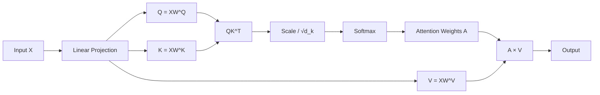
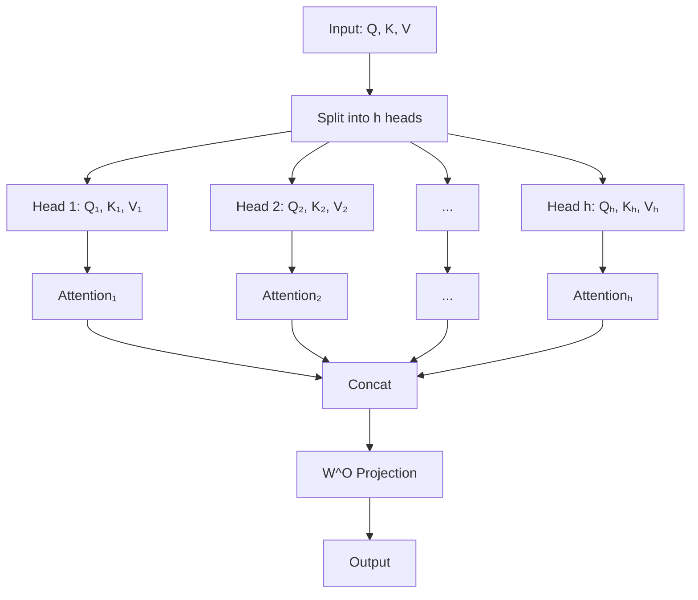

# 第 29 章 注意力机制核心范式
作者：龙哥

## 学习目标

- 理解注意力机制如何解决 RNN/CNN 的长距离依赖与并行计算瓶颈
- 掌握缩放点积注意力的数学推导、缩放因子作用及数值稳定性原理
- 理解多头注意力通过子空间分解实现多视角关系建模的机制
- 掌握绝对位置编码、可学习编码与 RoPE 相对位置编码的数学形式及外推性差异
- 能通过注意力可视化诊断模型对齐、指代消歧等语言学现象，理解“注意力≠解释”的局限
- 能根据序列长度、显存预算选择标准注意力或 FlashAttention 等优化变体
- 理解 GQA 如何在保持性能的前提下大幅降低 KV Cache 显存占用
- 掌握 YaRN/LongRoPE 等外推修正技术的频率缩放原理

## 29.1 生活类比

想象注意力机制是一个**大型国际会议的同声传译系统**。译员手中的“当前待译语句”对应 **Query**，会场大屏上每位发言者的“发言主题标签”对应 **Key**，每位发言者的“完整发言内容”对应 **Value**。译员通过快速匹配当前语句与谁的主题最相关，完成**点积相似度**计算；为了防止会场太吵（维度太大）导致听不清重点，译员戴上“降噪耳机”，这就是**缩放因子 1/√d_k** 的作用，它抑制 Softmax 饱和。随后，译员将 100% 的专注度预算按比例分配给最相关的几位发言者，完成 **Softmax** 归一化。为了多视角并行解析，系统配备 **8 位专业译员**（多头注意力），有的擅长语法结构，有的擅长专业术语，有的擅长语气情感，最后由**总监译员 (W^O)** 融合成最终译文。为了给发言打上“时间戳”且支持会议无限延长，系统采用 **RoPE 相对位置编码**：给每句发言施加旋转水印，任意两句的“时间间隔”只需比对水印旋转角度即可得知，无需记忆绝对时间。而在推理部署时，系统只配备 **2 位专家速记员**（KV 头）为 8 位译员共享笔记，大幅减少记录纸张（显存），但译员独立提问（Q 头）能力不变，这就是 **GQA（分组查询注意力）**。就像这套译员系统能实时聚焦关键发言、多视角并行解析、自动适应超长会议、精简记录开销，注意力机制让模型在海量 Token 中精准“看哪里”。

## 29.2 概念地图

第29章 注意力机制核心范式
├── 1. 序列建模困境与注意力直觉
│   ├── RNN 串行瓶颈与梯度消失          —— P007, P009
│   ├── CNN 固定窗口与感受野受限          —— P007, P009
│   ├── Seq2Seq 信息瓶颈                    —— P007, P009
│   └── 核心隐喻：聚光灯/动态资源分配      —— P007, P009
├── 2. 缩放点积注意力数学形式化
│   ├── 核心公式：softmax(QK^T/√d_k)V       —— P010
│   ├── Q/K/V 角色定义：查询/键/值          —— P010
│   ├── 缩放因子 √d_k 防止 Softmax 饱和    —— P010, P019
│   ├── 优势：并行矩阵乘法、数值稳定        —— P010, P019
│   └── 局限：O(N²) 复杂度、排列等变性      —— P010, P019
├── 3. 多头注意力：多子空间协作建模
│   ├── 分裂-并行-拼接流程                  —— P019, A47V
│   ├── 头专业化：句法/语义/位置异构关系    —— P019, A47V
│   ├── 参数隔离与梯度互不干扰              —— P019, A47V
│   ├── 等价性：分组线性变换视角            —— P019, A47V
│   └── 部署瓶颈：KV Cache 显存随头数线性增长 —— P019, A47V
├── 4. 位置编码：注入顺序感
│   ├── 正弦绝对编码：线性关系支持相对位置   —— P020
│   ├── 可学习绝对编码：无外推能力          —— P020, B95V
│   ├── RoPE 相对位置编码：旋转矩阵注入      —— P020, B95V
│   │   ├── 内积仅依赖相对距离 m-n          —— B95V
│   │   └── 天然外推至长序列                —— B95V
│   └── 外推修正：YaRN/LongRoPE 频率缩放    —— B95V
├── 5. 注意力可视化与解读
│   ├── 热力图展示：对齐/指代消歧/句法树    —— P022
│   ├── 工具：BertViz, exBERT                 —— P022
│   ├── 经典案例：Winograd Schema/代码作用域  —— P022
│   └── 核心警示：注意力≠因果解释            —— P022
└── 6. 长序列优化与部署变体
    ├── FlashAttention-2：IO 感知精确计算    —— P063
    ├── 滑动窗口注意力 (SWA) + 全局 Token   —— P063
    ├── GQA：KV 头压缩降低推理显存           —— P019, P059
    └── 线性注意力近似：RWKV/Linear Transformer —— P063

---

## 29.3 序列建模的困境与注意力直觉

### 为什么需要注意力机制？

在 Transformer 之前，序列建模的主流架构是 RNN（及其变体 LSTM/GRU）和 CNN。但它们都存在结构性缺陷。

**RNN 的串行瓶颈** 是最核心的痛点。RNN 必须按时间步顺序计算 $h_t = f(h_{t-1}, x_t)$。这意味着第 $t$ 步必须等第 $t-1$ 步算完，GPU 利用率极低，无法并行；同时，长序列反向传播时，梯度连乘 $t$ 次 Jacobian 矩阵，指数级衰减或发散，导致长距离依赖无法学习。

**CNN 的固定窗口** 限制了感受野。CNN 通过堆叠层扩大感受野，但感受野增长是线性的（或对数级，取决于膨胀卷积）。要覆盖长度为 $N$ 的序列，需要 $O(N)$ 或 $O(\log N)$ 层，深度过大带来优化困难，且位置信息在层层池化中稀释。

**Seq2Seq 的信息瓶颈** 则体现在传统编码器-解码器架构将整个源序列压缩成一个固定维度的上下文向量 $c$（通常是编码器最后一个隐状态）。当源序列很长时，所有信息必须挤进这个向量，形成严重的“信息瓶颈”，远距离信息在传递过程中大量丢失。

### 核心隐喻：聚光灯与动态资源分配

素材中将注意力机制比作**“聚光灯”**：“注意力机制的核心直觉是‘聚光灯’：不再平等对待所有输入，而是动态分配计算资源给关键 Token。” 这段话精准捕捉了注意力的本质：**内容寻址**。不同于 RNN 的位置寻址（按顺序读）或 CNN 的局部寻址（滑动窗口），注意力让模型根据当前 Query 的内容，动态决定“看哪里”、以及“看多仔细”。

### 直观理解：三个角色

我们可以把注意力机制理解为一个**检索系统**：
- **Query (Q)**：你想找什么（当前时刻的提问）
- **Key (K)**：每个记忆槽的标签（所有位置的标签）
- **Value (V)**：每个记忆槽的内容（所有位置的内容）

模型先用 Query 去匹配所有 Key，得到相似度分数，再用这些分数对 Value 做加权求和。这就是“动态分配计算资源”。

---

## 29.4 缩放点积注意力 —— 让相似度变成分配比例

### 核心定义与数学形式化

**缩放点积注意力**定义如下（来源：《P010》）：

$$
\text{Attention}(Q, K, V) = \text{softmax}\left(\frac{QK^T}{\sqrt{d_k}}\right)V
$$

其中：
- $Q \in \mathbb{R}^{N \times d_k}$：查询矩阵，$N$ 为序列长度
- $K \in \mathbb{R}^{M \times d_k}$：键矩阵，$M$ 为键值对数量（自注意力中 $M=N$）
- $V \in \mathbb{R}^{M \times d_v}$：值矩阵
- $d_k$：键/查询向量的维度

---

### 注意力计算流程图



这个流程图展示了从输入到输出的完整数据流：线性投影得到 Q/K/V → 点积计算相似度 → 缩放防止饱和 → Softmax 归一化为概率分布 → 加权求和 Value 得到输出。

---

### 为什么需要缩放因子 $\sqrt{d_k}$？—— 完整数学推导链条

这是一个关键的工程设计。让我们逐步推导：

**1. 点积方差随维度增长**
假设 $Q$ 和 $K$ 的元素独立同分布，均值为 0，方差为 1。点积 $q_i \cdot k_j = \sum_{d=1}^{d_k} q_{i,d} k_{j,d}$ 的期望为 0，**方差为 $d_k$**（因为独立变量方差相加）。标准差为 $\sqrt{d_k}$。

**2. 无缩放时的灾难性后果**
当 $d_k$ 很大（如 512）时，点积的标准差约为 $\sqrt{512} \approx 22.6$。这意味着 Softmax 的输入值会很大（正负都有），导致 Softmax 进入**饱和区**——最大值接近 1，其余接近 0。

**3. 饱和区的梯度消失**
Softmax 在饱和区梯度极小（接近 0）。反向传播时，梯度无法有效流回 $Q$ 和 $K$，导致训练早期就陷入停滞。

**4. 缩放因子的数学修正**
除以 $\sqrt{d_k}$ 后，缩放后的点积 $S_{ij} = \frac{q_i \cdot k_j}{\sqrt{d_k}}$ 的方差约为 1，标准差约为 1。此时 Softmax 输入分布集中在 $[-3, 3]$ 附近，**处于敏感区**，梯度流动健康。

**这个推导链条展示了**：点积方差 $\propto d_k$ → Softmax 饱和 → 梯度消失 → 除以 $\sqrt{d_k}$ 归一化方差 → 恢复梯度流动。

---

### 为什么用点积而非加性注意力？

早期的 Bahdanau Attention（加性注意力）使用前馈网络计算相似度：$\text{score}(q, k) = v_a^T \tanh(W_q q + W_k k)$。虽然表达力更强，但：
1. **参数多**：引入额外可学习参数 $W_q, W_k, v_a$
2. **难并行**：无法像矩阵乘法那样利用 Tensor Core 高度优化
3. **计算慢**：涉及逐元素非线性操作

点积注意力**无额外参数**、**纯矩阵乘法**、**极致并行**，是工程上的最优选择。

### 排列等变性：注意力的“双刃剑”

注意力机制有一个重要的数学性质：**排列等变性**。

> "注意力机制本质是集合操作，对输入顺序不敏感（排列不变性），必须显式添加位置编码。"
> 
> ——《P007, p.4》

**定义**：设 $P$ 为置换矩阵，则 $\text{Attention}(PQ, PK, PV) = P \cdot \text{Attention}(Q, K, V)$。

这意味着：如果你打乱输入 Token 的顺序，输出也会按相同方式打乱。**模型完全“看不见”顺序信息**。这正是为什么必须显式注入位置编码的原因（见 29.6 节）。

---

## 29.5 多头注意力 —— 多视角并行解析

### 核心定义与流程

**多头注意力**方法（来源：《P019》）：

```
1. 定义 h 个头，每个头维度 d_k = d_v = d_model / h
2. 对每个头 i = 1..h：
   a. 线性投影：Q_i = Q W_i^Q, K_i = K W_i^K, V_i = V W_i^V
      其中 W_i^Q, W_i^K ∈ ℝ^{d_model × d_k}, W_i^V ∈ ℝ^{d_model × d_v}
   b. 独立计算注意力：head_i = Attention(Q_i, K_i, V_i)
3. 拼接所有头：Concat(head_1, ..., head_h) ∈ ℝ^{N × h·d_v}
4. 最终线性投影：Output = Concat(...) W^O,  W^O ∈ ℝ^{h·d_v × d_model}
```

---

### 多头注意力数据流图



这个数据流图清晰展示了“分裂-并行-拼接-融合”的标准流程：输入通过分头投影进入 $h$ 个独立子空间，各自计算注意力，最后拼接并经 $W^O$ 融合输出。

---

### 为什么要拆分多头？

单头注意力只能学习**一种**相似度度量模式（如“找主语”）。但语言现象是多样的：
- 句法关系：主谓一致、动宾搭配
- 语义关系：共指消解、实体链接
- 位置关系：邻近词、定语从句边界
- 逻辑关系：因果、转折、递进

**多头注意力将 $d_model$ 维空间拆分为 $h$ 个 $d_k$ 维子空间**，每个头在自己的子空间里独立学习一种“关注模式”。这相当于训练了 $h$ 个专家，最后由 $W^O$ 融合。

### 头的专业化：实证证据

素材中的可视化实验揭示了头的分工：

> "BERT 大模型可视化：第 5 层第 3 头专门连接主语与动词（主谓一致性），第 8 层第 7 头关注定语从句边界"
> 
> ——《A47Vd3fekoelzRxZpdUcTl9Cn7W, p.5》

> "GPT 训练中观察到：浅层头多关注局部句法，深层头多关注长程语义与推理链条"
> 
> ——《A47Vd3fekoelzRxZpdUcTl9Cn7W, p.5》

这段证据表明：**不同层、不同头形成了层次化的语言学加工流水线**。

### 等价视角：分组线性变换

从数学上看，多头注意力等价于：

$$
\text{MultiHead}(Q,K,V) = \text{Attention}(Q W^Q, K W^K, V W^V)_{\text{grouped}} W^O
$$

其中 $W^Q, W^K, W^V$ 是分块对角矩阵（每个块对应一个头的投影）。这个视角揭示了多头本质上是**参数共享的分组线性变换**，参数量与单头大头注意力（投影到 $h \cdot d_k$ 维）基本一致。

### 部署瓶颈：KV Cache 与头数

推理阶段，自回归生成需要缓存所有层的 Key 和 Value 以避免重复计算。KV Cache 显存占用：

$$
\text{KV Cache} = 2 \times L \times B \times h \times N \times d_k \times \text{bytes}
$$

其中 $L$ 为层数，$B$ 为批次，$N$ 为序列长度。**显存随头数 $h$ 线性增长**。这直接催生了 GQA（分组查询注意力），见 29.8 节。

### 头的冗余性

> "实验显示可剪枝 30%-40% 头且不损精度，存在冗余"
> 
> ——《A47Vd3fekoelzRxZpdUcTl9Cn7W, p.6》

这提示我们：并非所有头都同等重要，部分头学到的模式高度重叠。这为模型压缩和 GQA 设计提供了理论依据。

---

## 29.6 位置编码 —— 给序列注入“时间感”

### 为什么需要位置编码？

正如 29.4 节所述，注意力是**排列等变**的。没有位置信息，“狗咬人”和“人咬狗”对模型完全一样。位置编码的任务是**打破排列对称性**，让模型感知顺序。

---

### 位置编码演进路线图


这个演进路线图展示了位置编码从无到有、从绝对到相对、从固定到可外推的技术演进脉络。

---

### 三大主流方案对比

| 编码类型 | 数学形式 | 相对位置感知 | 外推能力 | 典型模型 |
|----------|----------|--------------|----------|----------|
| **正弦绝对编码** | $PE_{pos,2i}=\sin(pos/10000^{2i/d})$ | 隐含（线性关系） | 有限（频率固定） | Transformer 原版 |
| **可学习绝对编码** | $E_{pos} \in \mathbb{R}^{d}$ (Embedding) | 无（需隐式学习） | **无**（超出 max_len 失效） | BERT, GPT-3 |
| **RoPE 相对编码** | 旋转矩阵 $R_{\theta \cdot pos}$ 作用于 Q/K | **显式**（内积仅依赖 $m-n$） | **强**（天然外推） | LLaMA, PaLM, GLM |

---

### 正弦绝对编码的线性关系

正弦编码的巧妙之处在于利用三角函数和角公式：
$$
\begin{aligned}
\sin(\alpha+\beta) &= \sin\alpha\cos\beta + \cos\alpha\sin\beta \\
\cos(\alpha+\beta) &= \cos\alpha\cos\beta - \sin\alpha\sin\beta
\end{aligned}
$$

这意味着 $PE_{pos+k}$ 可以表示为 $PE_{pos}$ 的**线性组合**（系数只依赖 $k$）。因此，模型可以通过线性层轻易学会“相对位置 $k$”的概念，而无需显式建模相对距离。**这个性质展示了正弦编码隐含的相对位置可表示性**。

### RoPE：旋转位置编码的核心原理

RoPE (Rotary Position Embedding) 是目前长上下文模型的主流选择。其核心思想：**将位置信息通过旋转矩阵直接注入 Query 和 Key 的向量空间**。

**数学形式**（来源：《B95VdtwByoPXGoxac7Ec1KhQnwc》）：

对于 2D 向量 $x = [x_1, x_2]^T$，位置 $pos$ 的旋转矩阵：
$$
R_{pos} = \begin{bmatrix}
\cos(pos \cdot \theta) & -\sin(pos \cdot \theta) \\
\sin(pos \cdot \theta) & \cos(pos \cdot \theta)
\end{bmatrix}
$$
其中 $\theta = 10000^{-2i/d}$ 为频率基数。

对 Query 和 Key 分别施加旋转：
$$
q_m = R_{m\theta} (W_q x_m), \quad k_n = R_{n\theta} (W_k x_n)
$$

---

### 关键性质推导：内积仅依赖相对距离 —— 逐步推导

$$
\begin{aligned}
q_m^T k_n &= (W_q x_m)^T R_{m\theta}^T R_{n\theta} (W_k x_n) \\
&= (W_q x_m)^T (R_{m\theta}^{-1} R_{n\theta}) (W_k x_n) \quad \text{(旋转矩阵正交性: } R^T = R^{-1}\text{)} \\
&= (W_q x_m)^T R_{(n-m)\theta} (W_k x_n) \quad \text{(旋转矩阵群性质: } R_\alpha^{-1} R_\beta = R_{\beta-\alpha}\text{)} \\
&= (W_q x_m)^T R_{-\Delta \theta} (W_k x_n), \quad \Delta = m-n
\end{aligned}
$$

**这个推导展示了**：通过旋转矩阵的**正交性** ($R^T R = I$) 和**群结构** ($R_\alpha^T R_\beta = R_{\beta-\alpha}$)，绝对位置项 $m$ 和 $n$ 被消去，仅保留相对距离 $\Delta = m-n$。注意力得分仅取决于相对距离，与绝对位置无关，从而实现了**显式的相对位置编码**。

---

### 为什么只作用于 Q 和 K，不作用于 V？

因为注意力的核心是 $QK^T$ 计算相似度。位置信息只需要影响“谁跟谁相似”，不需要影响“值的内容”。Value 保持内容纯粹性，避免位置噪声干扰语义表示。

### 外推能力的本质与局限

RoPE 的外推能力来自于：旋转角度 $\theta \cdot pos$ 随位置线性增长。即使位置超出训练范围，旋转矩阵依然数学良定，相对距离关系保持。

但素材指出了局限：

> "RoPE 在序列长度超出训练 4 倍时，高频分量相位旋转过快导致注意力模式退化。"
> 
> ——《B95VdtwByoPXGoxac7Ec1KhQnwc, p.6》

**原因**：高频分量（大 $i$，$\theta$ 大）在长距离下旋转多圈，相位模 $2\pi$ 后信息混淆，导致注意力模式不再平滑。

### YaRN/LongRoPE：频率缩放修正

YaRN (Yet another RoPE extension) 通过**缩放基础频率**来修正外推性能：

$$
\theta_{\text{new}} = \theta / s
$$

其中缩放因子 $s > 1$。结合 NTK-aware 插值（基于神经切线核理论计算最优缩放）和动态插值，可将有效上下文从训练长度 $L$ 扩展至 $32L$ 甚至 $128k+$。**这个技术通过降低旋转频率，缓解了高频分量在超长距离下的相位混淆问题**。

---

## 29.7 注意力可视化 —— 打开黑盒看推理

### 可视化方法与工具

注意力可视化将注意力权重矩阵 $A \in \mathbb{R}^{L_{tgt} \times L_{src}}$ 绘制为热力图：
- 横轴：源序列 Token
- 纵轴：目标序列 Token（或自注意力中的同一序列）
- 颜色深浅：注意力权重大小

常用工具：**BertViz**、**exBERT**、**Attention Vis**。

### 经典诊断案例

**1. 机器翻译对齐**：生成目标词 "Love" 时，注意力高度集中在源词 "爱" 上。对角线主导表示单调对齐；跳跃表示语序重排（如中英定语前后置差异）。

**2. Winograd Schema 代指消歧**：
> "The animal didn't cross the street because it was too tired."
> 
> 模型在处理 "it" 时，注意力权重自动聚焦到 "animal" 而非 "street"，验证了模型捕捉到了因果推理链条。

**3. 代码作用域追踪**：变量使用处注意力回溯到定义处，展示模型学会了编程语言的作用域规则。

### 核心警示：注意力 ≠ 解释

这是解释性研究中的共识，**必须牢记**：

> "高注意力权重不代表因果贡献大，需结合梯度或干预实验验证。"
> 
> ——《P022, p.4》

**反例场景**：
- **高熵注意力**（分布均匀）不代表模型“没看懂”，可能是任务本身需全局信息（如分类任务 [CLS] token 聚合全序列）
- **高权重不等于因果贡献**：注意力权重受残差连接、LayerNorm、FFN 后续层修饰。一个头权重高，但其输出可能被后续层抑制
- **注意力头冗余**：多头平均可能掩盖单头的关键模式

**正确做法**：结合**梯度归因**（如 Integrated Gradients）、**消融实验**（屏蔽特定头）、**因果干预**（修补实验）综合分析。经典文献 Jain & Wallace (2019) 和 Wiegreffe & Pinter (2019) 已系统实证了“注意力≠解释”的局限性。

---

## 29.8 长序列优化与部署变体 —— FlashAttention、GQA 与外推修正

### 核心痛点：O(N²) 显存墙

标准注意力计算 $S = QK^T \in \mathbb{R}^{N \times N}$。对于 $N=128k$、$h=32$、$B=1$、FP16：
$$
\text{显存} \approx 1 \times 32 \times 128k \times 128k \times 2 \text{ bytes} \approx 1 \text{ TB}
$$
远超单张 GPU 显存。这正是长上下文落地的核心瓶颈。

---

### 长序列优化变体谱系图

```mermaid
graph TD
    A[标准注意力 O(N²)] --> B[FlashAttention-2\nIO感知精确计算]
    A --> C[GQA\nKV头压缩]
    A --> D[SWA + 全局Token\n稀疏注意力]
    A --> E[线性注意力\n核函数近似 O(N)]
    C --> F[MQA 极致压缩]
    D --> G[Mistral/Longformer]
    E --> H[RWKV/RetNet/Linear Transformer]
    B --> I[配合 RoPE/YaRN\n长上下文标配]
```

这个谱系图展示了四大优化方向：精确计算的 IO 优化、KV 缓存压缩、稀疏注意力近似、线性注意力架构变更。

---

### FlashAttention-2：IO 感知的精确计算

FlashAttention 的核心洞见：**不物化完整的 $N \times N$ 注意力矩阵**，而是分块计算，利用 SRAM（共享内存/缓存）的高带宽。

**算法流程**（简化版）：

```
1. 将 Q, K, V 分块加载到 SRAM (块大小 Bc, Br)
2. 对每个 Q 块：
   a. 初始化局部输出 O_local = 0, 归一化因子 l = 0, 最大值 m = -inf
   b. 对每个 K,V 块：
      i. 加载 K_j, V_j 到 SRAM
      ii. 计算 S_ij = Q_i K_j^T (在 SRAM 中，小矩阵)
      iii. 在线 Softmax 更新：m_new = max(m, rowmax(S_ij))
           更新 l, O_local (利用 Softmax 数学性质增量更新)
   c. 将最终 O_local 写回 HBM
```

---

### FlashAttention 核心创新：在线 Softmax 增量更新

标准 Softmax 需要完整行数据，但在线算法利用数学性质实现增量更新：

给定新块的行最大值 $m_{\text{new}} = \max(m_{\text{old}}, \text{rowmax}(S_{ij}))$，归一化因子更新为：
$$
l_{\text{new}} = l_{\text{old}} \cdot e^{m_{\text{old}} - m_{\text{new}}} + \sum_j e^{S_{ij} - m_{\text{new}}}
$$
输出增量更新为：
$$
O_{\text{new}} = O_{\text{old}} \cdot e^{m_{\text{old}} - m_{\text{new}}} + \text{softmax}(S_{ij}) V_j
$$

**关键创新**：**在线 Softmax** 算法避免了存储完整 $S$ 矩阵。FlashAttention-2 进一步优化了并行度（更好的 warp 级调度）、消除共享内存银行冲突、优化逆向传播显存（重计算策略），实现了**训练显存降低 2-4×，速度提升 2×，数学等价于标准注意力**（无近似误差）。这些细节源自 Dao (2023) FlashAttention-2 论文。

### GQA：分组查询注意力

**动机**：推理时 KV Cache 显存占用巨大，且实验证明 KV 头存在高度冗余。

**方法**（来源：《P019, A47V》）：

- 保持 $h$ 个 Query 头（维持提问能力）
- 将 $h$ 个 Key/Value 头压缩为 $g$ 组（$g \ll h$，通常 $g = h/4$）
- 每组内的 Query 头共享同一组 K/V 投影

**显存对比**（FP16, $B=1, N=4096, d_k=128, L=32$）：

| 配置 | KV Cache 显存 |
|------|---------------|
| MHA (h=32) | $2 \times 32 \times 32 \times 4096 \times 128 \times 2 \approx 2.1 \text{ GB}$ |
| GQA (h=32, g=8) | $2 \times 32 \times 8 \times 4096 \times 128 \times 2 \approx 0.53 \text{ GB}$ |

**降低 75% KV Cache 显存**，推理吞吐显著提升（内存带宽瓶颈缓解）。

**训练代价与实证依据**：训练时 Q 头仍为 $h$ 个，FLOPs 几乎不变，激活值显存优势不大。GQA 通常需从预训练起训或长时间续训练。Ainslie et al. (2023) GQA 原论文实证表明：直接从 MHA checkpoint 转换 GQA（通过平均 KV 头）会导致显著性能损失，必须从头预训练或大规模续训才能恢复性能。

### 滑动窗口注意力 (SWA) + 全局 Token

**思路**：每个 Token 仅关注最近 $w$ 个 Token（局部窗口），复杂度从 $O(N^2)$ 降为 $O(N \cdot w)$。

**问题**：纯 SWA 无法建模长距离依赖。

**解决**：引入**全局注意力 Token**（如每 $k$ 个 Token 设一个全局 Token，或固定位置如 [CLS]），这些 Token 拥有全局视野，充当信息高速公路。

**典型应用**：Mistral-7B (窗口 4096 + 全局)，Longformer, BigBird。通常配合 ALiBi 位置编码（无位置编码、线性偏置）以天然支持外推。

### 线性注意力近似

将注意力核函数分解：$\text{sim}(q,k) = \phi(q)^T \phi(k)$，则：
$$
\text{Attention} = \frac{\phi(Q) (\phi(K)^T V)}{\phi(Q) (\phi(K)^T \mathbf{1})}
$$
括号内先算 $\phi(K)^T V \in \mathbb{R}^{d \times d}$，**复杂度降为 $O(N d^2)$**，与 $N$ 线性。

代表架构：**RWKV**（Peng et al., 2023，基于线性注意力的 RNN 混合架构）、**RetNet**（Sun et al., 2023，保留并行训练的线性注意力）、**Linear Transformer**（Katharopoulos et al., 2020，核函数分解原型）。但改变了架构范式，需重新预训练，生态兼容性最弱。

### 方案选型指南

| 场景 | 推荐方案 | 理由 |
|------|----------|------|
| **训练长上下文 (≤ 32k), 追求精度** | FlashAttention-2 + RoPE/YaRN | 精确计算，工程成熟，生态完善 |
| **推理长上下文, 显存受限** | GQA + FlashAttention-2 + KV 量化 | KV Cache 压缩最大，吞吐最高 |
| **超长上下文 (≥ 100k), 可接受近似** | SWA + 全局 Token 或 线性注意力 | 复杂度线性，但需架构修改重新训练 |
| **现有模型快速外推** | RoPE + YaRN/LongRoPE | 无需重新训练，仅调整频率基数 |

---

## 29.9 多源对照

### 关于“缩放因子作用”的共识与分歧

**共识**：
- 所有素材一致认为 $\sqrt{d_k}$ 缩放是为了防止 Softmax 饱和、维持梯度流动
- 缩放因子使点积方差约为 1，是数值稳定的关键

**分歧**：
- 《P010》原版论文强调“点积注意力比加性注意力快”，以此论证缩放点积的工程优势
- 《P019》更侧重从“方差归一化”的理论视角解释缩放必要性
- 近期工作（如《P063》FlashAttention）发现：在 FP16/BF16 混合精度训练中，缩放因子与数值溢出/下溢的相互作用更复杂，需结合 Loss Scaling 综合调节

### 关于“多头注意力必要性”的共识与分歧

**共识**：
- 多头允许模型在不同子空间并行捕捉异构关系（句法/语义/位置）

**分歧**：
- 《P019》原版观点：“多头增加表达能力，联合关注不同表示子空间”
- 《A47V》实证分析：发现**头专业化**现象（特定头对应特定语言学任务），但同时存在**大量冗余**（可剪枝 30-40%）
- 《P059》GQA 工作：证明 KV 头可以大幅压缩而不损性能，暗示**查询多样性比键值多样性更关键**

### 关于“位置编码选择”的共识与分歧

**共识**：
- 绝对位置编码（正弦/可学习）无外推能力，受限于训练最大长度
- RoPE 通过相对位置建模实现天然外推，是长上下文主流选择

**分歧**：
- 《P020》原版 Transformer 提出正弦编码时，认为其“允许模型外推到比训练时更长的序列”，但实践证明**纯正弦编码外推效果差**
- 《B95V》RoPE 论文证明：RoPE 内积仅依赖相对距离，外推性强，但**超 4 倍训练长度仍退化**
- 《B95V》后续工作：YaRN 等频率缩放技术是“补丁”而非根治，根治需结合**位置插值**、**长度外推训练**、**数据课程**综合方案

---

## 29.10 设计中的取舍

### 为什么不用 RNN 而是注意力？

RNN 的隐状态是固定容量的，每个时间步只能把信息压缩到一个向量里。当序列变长时，早期信息会被逐渐稀释。注意力机制则让任意两个位置之间建立直接连接，路径长度为 O(1)，避免了长程依赖的梯度消失。代价是计算复杂度从 O(N) 上升到 O(N²)，这就引出了后续稀疏注意力和线性注意力的工作。

### 为什么缩放因子用 √d_k 而不是 d_k？

点积 $q \cdot k = \sum_{i=1}^{d_k} q_i k_i$。若 $q_i, k_i$ 方差为 1，则点积方差为 $d_k$，标准差为 $\sqrt{d_k}$。除以 $\sqrt{d_k}$ 使标准差归一化为 1。若除以 $d_k$，则标准差变为 $1/\sqrt{d_k}$，信号过弱，Softmax 输入趋近 0，退化为均匀分布，丧失区分度。

### 为什么 GQA 不压缩 Query 头？

Query 头代表“提问的视角”。压缩 Query 头等于减少模型能同时提出的问题类型，直接损害表达能力。Key/Value 头代表“记忆的存储格式”，实验证明不同 Query 头共享同一组 K/V 存储时，性能损失极小，因为“记忆内容”本身不需要那么多视角——重要的是“你怎么查”。

### FlashAttention 与线性注意力的本质权衡

FlashAttention 是**精确算法的 IO 优化**，不改变数学结果，兼容性最强，但显存仍随 $N^2$ 增长（只是常数因子小）。线性注意力改变数学形式（核函数近似），复杂度降为 $O(N)$，但引入近似误差，且需重新预训练。**工程上优先 FlashAttention + GQA + RoPE/YaRN 组合，仅在极端长度 (1M+) 考虑线性注意力架构变更。**

---

## 29.11 动手练习

### 练习 1：手算一次缩放点积注意力

给定单头注意力输入：
```
Q = [[1, 0], [0, 1]]  # (2, d_k=2)
K = [[1, 0], [0, 1], [1, 1]]  # (3, d_k=2)
V = [[1, 2], [3, 4], [5, 6]]  # (3, d_v=2)
d_k = 2
```

请按步骤计算：
1. 计算 QK^T 得分矩阵 S (形状 2×3)
2. 计算缩放因子 1/√d_k 并得到缩放后得分 S' = S / √2
3. 对 S' 每行做 Softmax 得到注意力权重矩阵 A (形状 2×3)
4. 计算最终输出 O = A × V (形状 2×2)

思考题：
- 若 d_k 增大到 100 且不除以 √d_k，假设 Q、K 元素均值为 0、方差为 1，点积方差约为多少？Softmax 输出会呈现什么极端分布？
- 为什么缩放因子用 √d_k 而不是 d_k？提示：考虑向量内积的方差性质。

### 练习 2：多头注意力参数量与显存估算

假设 Transformer 模型配置：d_model = 512, h = 8 头, d_k = d_v = 64, 序列长度 N = 2048, 批次 B = 4, FP16 精度 (2 字节/参数)。

计算：
1. 单层多头注意力模块的总参数量 (包含 W^Q, W^K, W^V, W^O，不含偏置)
2. 单层前向传播中 QK^T 注意力矩阵显存占用 (B × h × N × N)
3. 单层 KV Cache 显存占用 (推理阶段，存储 K 和 V，形状 B × h × N × d_k/v)
4. 若改用 GQA (Grouped Query Attention)，将 Key/Value 头数压缩为 2 组 (每组共享 K/V 投影)，重新计算上述 2 和 3 的显存占用。

思考题：
- 为什么 GQA 能显著降低推理显存而训练显存降幅较小？
- 头数 h 从 8 增加到 16 (保持 d_model=512)，单头维度 d_k 变为 32，会对模型表达能力和推理显存产生什么影响？

### 练习 3：位置编码性质探究与 RoPE 手算验证

**Part A: 正弦位置编码的线性关系**

给定正弦编码公式：PE(pos, 2i) = sin(pos/10000^{2i/d}), PE(pos, 2i+1) = cos(pos/10000^{2i/d})

证明或数值验证：对于任意固定偏移 k，PE(pos+k) 可以表示为 PE(pos) 的线性组合 (即存在矩阵 T_k 使得 PE(pos+k) = T_k · PE(pos))。

提示：利用三角函数和角公式 sin(α+β)=sinα cosβ+cosα sinβ。

**Part B: RoPE 相对位置内积验证**

设 2 维 Query/Key 向量 q_m, k_n ∈ ℝ^2，RoPE 通过旋转矩阵 R_θ 编码位置：
```
q_m = R_{mθ} q,  k_n = R_{nθ} k, 其中 R_θ = [[cosθ, -sinθ], [sinθ, cosθ]]
```
请手算验证：q_m^T k_n = q^T R_{(m-n)θ} k，即内积仅依赖于相对位置差 (m-n)。

进阶思考：
- 为什么 RoPE 只作用于 Query 和 Key，而不作用于 Value？
- 若序列长度超出训练长度 4 倍，RoPE 为何仍会性能下降？YaRN 通过缩放基础频率 θ (即修改 10000 基数) 如何缓解此问题？

### 练习 4：注意力可视化诊断实战

你正在调试一个中英翻译模型，发现它在翻译长定语从句时经常丢失主语。

你提取了编码器-解码器第 4 层交叉注意力的平均头热力图 (目标端长度 15 × 源端长度 20)。

观察到的现象：
- 正常句子：热力图呈现清晰的近似对角线带状分布，对齐准确。
- 错误句子：生成目标动词 ‘loves’ 时，注意力权重分散在源句前半段 5 个词上，峰值仅 0.25，且未在源语主语 ‘He’ 上形成尖锐峰值 (峰值 < 0.1)。

请回答：
1. 这种‘注意力分散、峰值低、主语对齐缺失’的模式提示了什么潜在问题？
2. 结合‘注意力≠解释’原则，仅凭此热力图能否断定模型‘没学会主谓关系’？还需要什么证据？
3. 提出两个可操作的实验验证方向 (如：层级分析、消融实验、梯度归因等) 来进一步定位是编码器表示不足、解码器查询失效、还是注意力头冗余导致。

### 练习 5：长序列注意力优化方案选型讨论

场景：需将 LLaMA-7B 扩展至 128k 上下文窗口，训练数据包含大量 32k-100k 文档，显存预算 8×A100-80G。

候选方案：
A. FlashAttention-2 (标准注意力 IO 优化，保持精确计算)
B. 滑动窗口注意力 (SWA, 窗口 4096) + 全局注意力 Token
C. RoPE + YaRN 频率缩放 (外推至 128k，保持标准注意力)
D. 线性注意力 (如 Linear Transformer / RWKV 核函数近似)

请从以下维度对比并给出推荐组合方案：
1. 训练显存占用 (激活值 + 梯度)
2. 推理 KV Cache 显存增长趋势
3. 长距离依赖建模能力 (如 50k 处 Token 依赖开头指令)
4. 实现工程复杂度 (对现有 HuggingFace/Transformers 代码侵入性)
5. 与现有 RoPE 位置编码兼容性

回答要求：给出首选方案及理由，并说明次选方案适用的互补场景。

---

## 29.12 本章小结

这一章中我们系统学习了注意力机制的核心范式。首先我们从 RNN/CNN 的序列建模困境出发，引入“聚光灯”隐喻理解注意力的动态资源分配本质。其次我们深度推导了缩放点积注意力的数学形式，重点解释了缩放因子 √d_k 如何通过归一化方差防止 Softmax 饱和、保护梯度流动。接着我们剖析了多头注意力的分裂-并行-拼接流程，揭示了头专业化捕捉异构语言学关系的实证证据，并分析了 KV Cache 显存随头数线性增长的部署瓶颈。然后我们对比了三大位置编码方案，重点推导了 RoPE 通过旋转矩阵实现相对位置编码且天然支持外推的数学原理。之后我们介绍了注意力可视化的诊断价值与“注意力≠解释”的核心警示。最后我们梳理了 FlashAttention-2、GQA、SWA、YaRN 等长序列优化变体的适用边界与组合策略。

本章我们一起学习了以下概念：

| 概念 | 解释 |
|------|------|
| Query/Key/Value (Q/K/V) | 注意力机制三要素：Query=我要找什么，Key=我是什么，Value=我有什么内容 |
| 缩放因子 √d_k | 抵消点积随维度增长的方差放大，防止 Softmax 进入饱和区导致梯度消失 |
| 缩放点积注意力 | Attention(Q,K,V)=softmax(QK^T/√d_k)V，仅含矩阵乘法，极致并行、数值稳定 |
| 多头注意力 | 将维度拆分为 h 个子空间并行计算，再拼接融合，实现句法/语义/位置等异构关系建模 |
| 位置编码 | 打破自注意力排列等变性，显式注入序列顺序信息 |
| 正弦绝对位置编码 | 利用三角函数线性关系编码绝对位置，隐含相对位置线性可表示性 |
| 可学习绝对位置编码 | 通过 Embedding 学习位置表示，表达力强但固定最大长度，无外推能力 |
| RoPE (旋转位置编码) | 以旋转矩阵形式注入 Query/Key，内积仅依赖相对距离，天然支持相对注意力与长序列外推 |
| GQA (Grouped Query Attention) | 多个 Query 头共享少量 Key/Value 头，显著降低 KV Cache 显存，推理加速 |
| 注意力可视化 | 将注意力权重矩阵绘制为热力图，直观展示对齐、指代消歧、句法树等语言学现象 |
| 注意力≠解释 | 高注意力权重不等于因果贡献大，受残差/FFN 修饰，需结合梯度或干预实验验证 |
| O(N²) 复杂度瓶颈 | QK^T 矩阵显存随序列长度平方增长，长文本建模核心瓶颈，需 FlashAttention 等 IO 感知算法优化 |
| YaRN/LongRoPE 外推修正 | 通过缩放 RoPE 基础频率 θ，将外推窗口从训练长度 4 倍扩展至 128k+，修正长序列性能下降 |

下一章中，我们将学习预训练范式 —— 从“刷题”到“通识教育”，系统梳理从 BERT 到 GPT 的范式演进，深度解构自监督目标（MLM/CLM/NSP）、模型规模定律与数据工程对基座模型能力的决定性影响。


