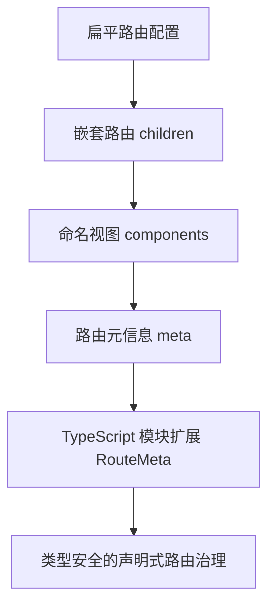
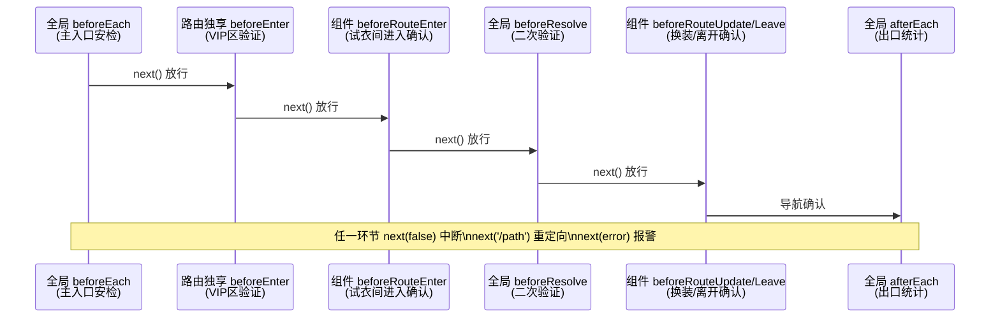
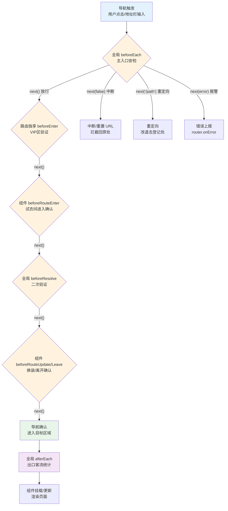
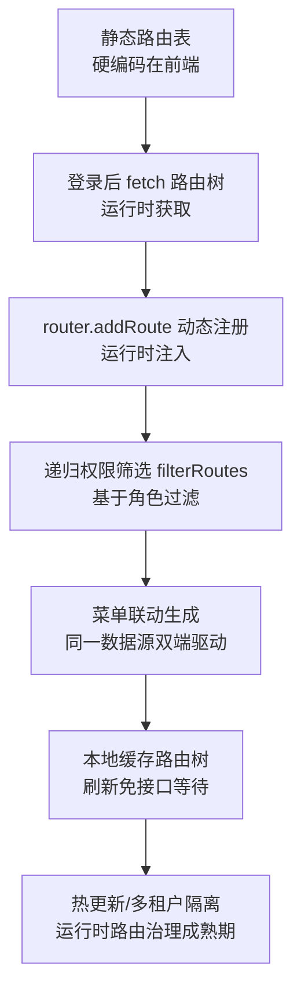
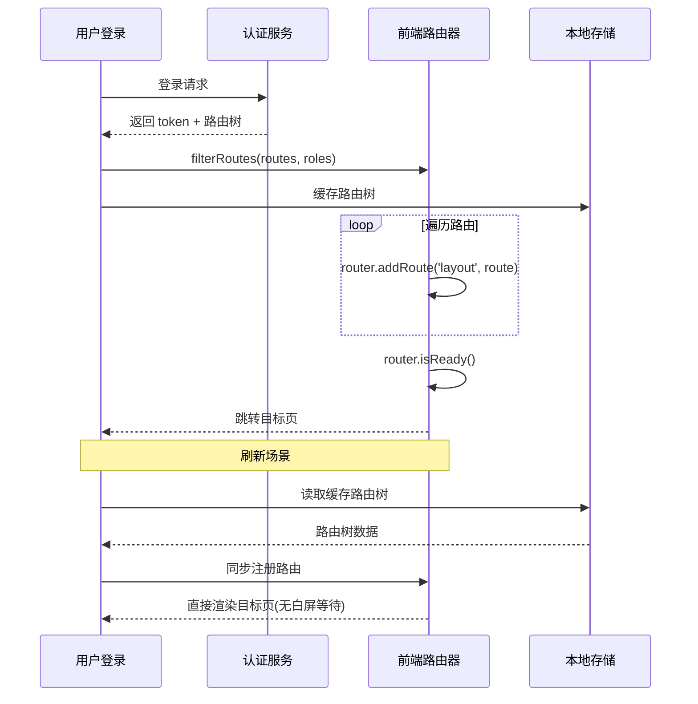
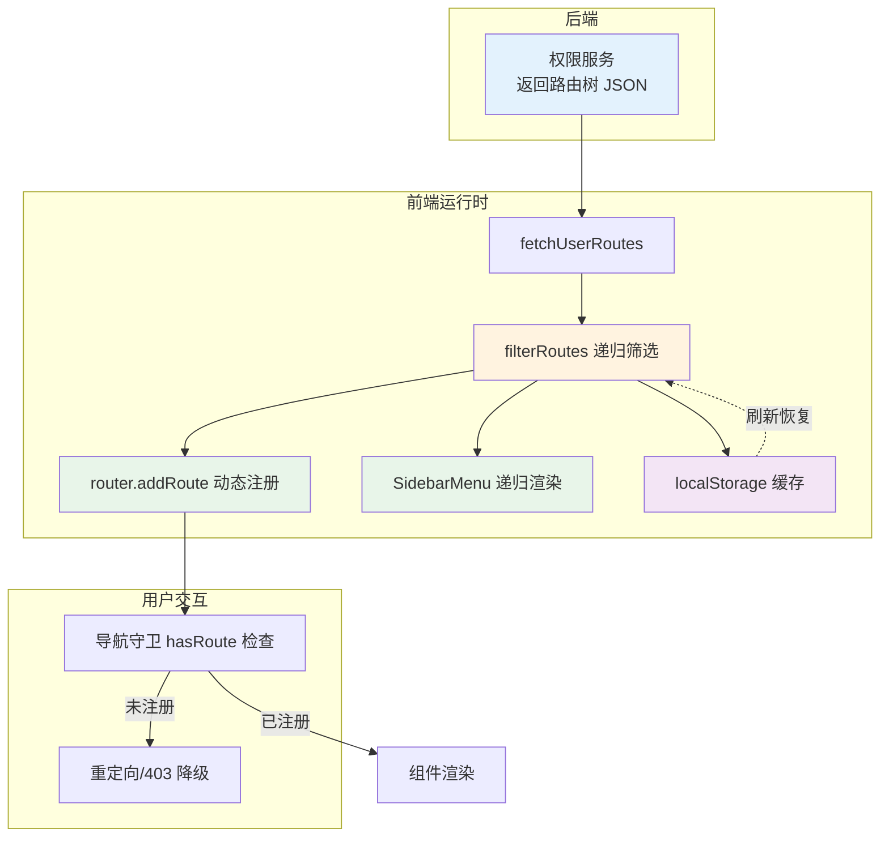
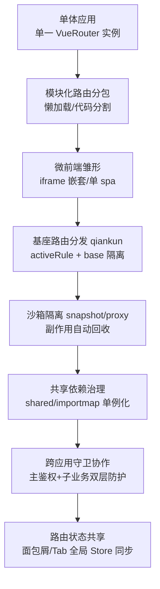
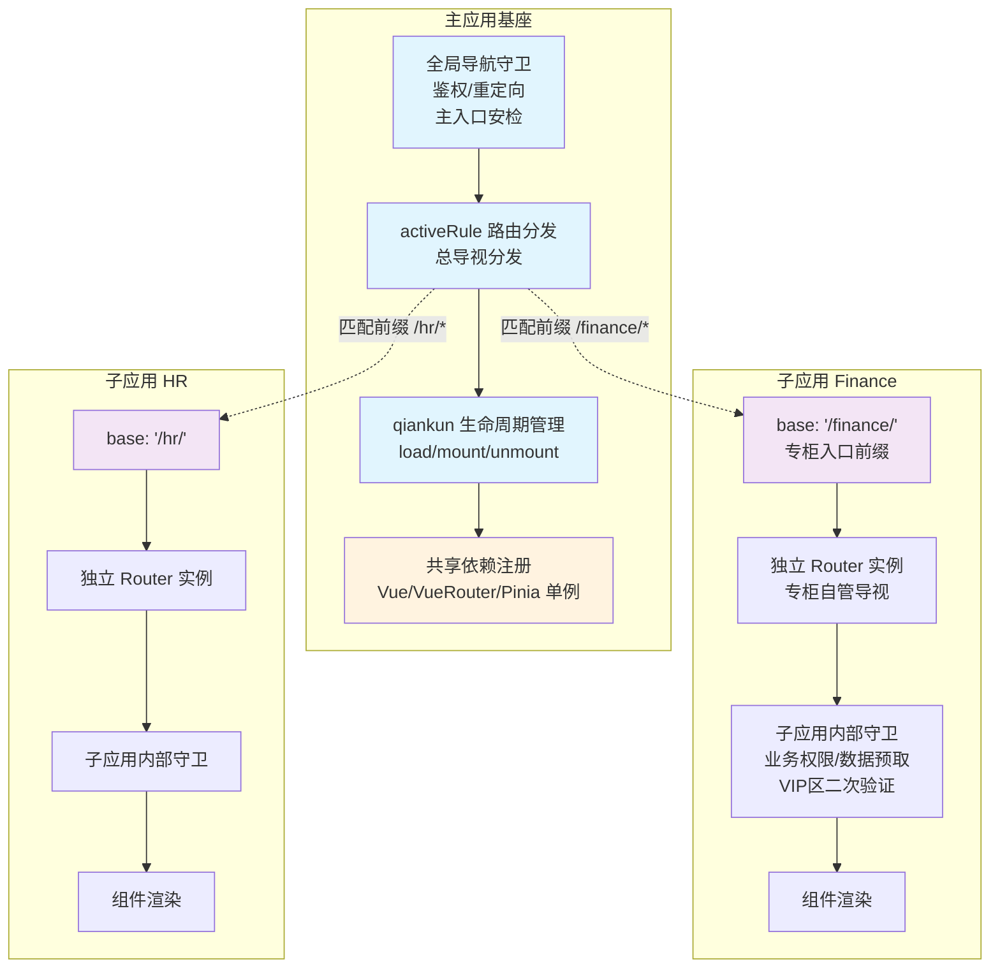
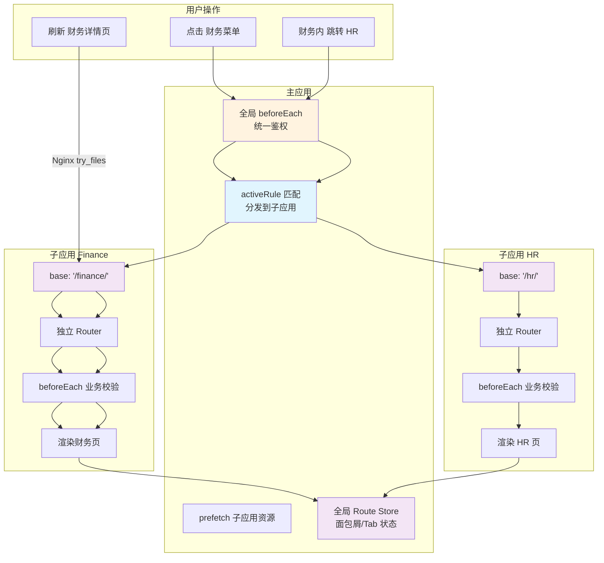

# 第 38 章 Vue Router 4 与路由治理 —— 从声明式配置到权限守卫与微前端路由分发
作者：龙哥

## 学习目标

- 掌握 Vue Router 4 中嵌套路由、命名视图与路由元信息的配置模式，实现复杂页面布局的声明式治理
- 理解导航守卫的完整执行时序与 `next()` 控制流语义，能正确实现鉴权拦截、数据预取、离开确认等横切逻辑
- 掌握基于后端下发路由树的动态路由注册技术，实现权限驱动的菜单联动与刷新状态持久化
- 能运用路由懒加载、预加载、滚动恢复与过渡动画等工程手段，优化首屏性能与页面切换体验
- 理解微前端架构下主子应用路由隔离、基础路径代理、守卫协作与共享依赖的治理契约

## 38.1 生活类比

想象 **Vue Router 是一座智能商场的“导航中枢”**：
- **路由配置** = 商场的**分层导视图**：嵌套路由是“楼层-区域-柜台”的层级结构；命名视图是“大厅同时显示导视屏、广告屏、应急广播”多通道并行；路由元信息是每个区域贴的“仅限会员/需穿无尘服/免税区”业务标签。
- **导航守卫** = **安检与引导员体系**：全局前置守卫是“主入口安检(登录态)”；路由独享守卫是“VIP 区专属验证”；组件内守卫是“试衣间进出确认(未保存草稿)”；`next()` 是“放行/拦截/改道/报警”四种指令。
- **动态路由** = **每日动态调整的‘柜台租赁表’**：后端下发最新‘租赁合同’(路由树) -> 运营部 `addRoute` 贴最新导视 -> 同步更新手机 APP 菜单 -> 顾客刷新手机地图不迷路。
- **性能优化** = **‘按需补货’与‘预判备货’**：懒加载是“顾客去哪层才把该层货品摆上架”；预加载是“大数据预测顾客大概率去 3 楼，提前把货运到楼道口”；滚动恢复是“顾客从 3 楼下来再上去，自动站在原货架前”。
- **微前端路由** = **‘商场中入驻独立品牌专柜’**：主应用是商场主通道，子应用是‘苹果/耐克/优衣库’自带装修风格的专柜；`base` 是专柜专属入口前缀；基座分发是‘总导视根据品牌名把顾客领进对应专柜’；沙箱隔离保证‘专柜装修拆除不影响商场主体’。

> **类比贯穿提示**：本章各节将反复呼应上述“智能商场”意象——38.3 节对应“分层导视图”，38.4 节对应“安检体系”，38.5 节对应“柜台租赁表”，38.6 节对应“补货策略”，38.7 节对应“品牌专柜”，帮助你建立跨概念的认知锚点。

## 38.2 概念地图

Vue Router 4 与路由治理
├── 路由配置进阶
│   ├── 嵌套路由 —— P001
│   ├── 命名视图 —— P001
│   ├── 路由元信息 —— P001
│   └── 类型化 RouteRecordRaw —— P001
├── 导航守卫体系
│   ├── 全局前置/解析/后置守卫 —— P002
│   ├── 路由独享守卫 —— P002
│   ├── 组件内守卫 —— P002
│   ├── 执行顺序与 next() 控制流 —— P002
│   └── 异步阻塞与错误处理 —— P002
├── 动态路由与权限模型
│   ├── router.addRoute/removeRoute/hasRoute —— P003
│   ├── 后端路由树递归筛选与注册 —— P003
│   ├── 菜单联动生成 —— P003
│   ├── 403/401 降级策略 —— P003
│   └── 刷新保持状态 —— P003
├── 性能与体验优化
│   ├── 路由懒加载与 Chunk 命名 —— P004
│   ├── router.prefetchRoutes 预加载 —— P004
│   ├── scrollBehavior 滚动恢复 —— P004
│   └── Transition 过渡动画 —— P004
└── 微前端路由隔离
    ├── 基础路径隔离与 activeRule —— P005
    ├── 路由模式统一与前缀剥离 —— P005
    ├── 基座路由分发与子应用生命周期 —— P005
    ├── 跨应用导航守卫协作 —— P005
    └── 共享依赖与沙箱隔离 —— P005

## 38.3 路由配置进阶 —— 声明式路由地图的分层与类型化治理

### 为什么需要这个概念？

单页应用(SPA)随业务增长，路由数量爆炸，扁平配置难以维护、权限混乱、类型不安全。你需要一种结构化方式表达“页面嵌套”、“多视图复用”、“路由元信息携带业务属性(权限/标题/缓存)”。传统字符串路由跳转易出错，重构时无编译期保护，迫切需要 TypeScript 级别的类型安全。

> "详解 `children` 嵌套渲染机制、`components` 多视图复用、`meta` 携带权限/标题/缓存策略等配置模式。"
>
> ——《20230418_038.md》

### 核心定义

**嵌套路由** 通过 `children` 数组实现 UI 组合的层级映射，父路由渲染 `RouterView` 作为出口，子路由在其中渲染。这直接对应了“布局组件包裹内容区”的经典模式，正如商场“楼层导视图”指引你先找到楼层，再找到区域。

**命名视图** 允许单一路由配置 `components: { default: Foo, sidebar: Bar }` 对应模板中多个 `<router-view name="sidebar"/>`，实现同级多视图并行渲染。这解决了“侧边栏、主内容、底部广告”需独立更新的需求，如同商场大厅“导视屏、广告屏、应急广播”三通道同步播放。

**路由元信息** 通过 `meta` 字段携带任意业务数据(如 `requiresAuth: true`, `roles: ['admin']`, `keepAlive: true`)，供导航守卫与布局组件消费。这是声明式配置的核心：将“业务属性”附着在“路由节点”上，如同每个柜台贴上的“仅限会员/免税区”标签。

**类型化 RouteRecordRaw** 利用 TypeScript 模块扩展 `declare module 'vue-router' { interface RouteMeta { ... } }` 实现 `route.meta.xxx` 的智能提示与编译期检查。

### 关键性质

**路由匹配优先级**：静态路径 > 动态路径参数(`:id`) > 通配符(`*`)，子路由匹配前提是父路由已匹配。这决定了配置顺序的重要性。我们可以用伪代码形式化表示该优先级规则：

```
匹配优先级(路由A, 路由B) :=
  IF 路由A.路径类型 == 静态 AND 路由B.路径类型 != 静态 THEN A > B
  ELSE IF 路由A.路径类型 == 动态参数 AND 路由B.路径类型 == 通配符 THEN A > B
  ELSE IF 路由A.层级 < 路由B.层级 THEN A > B  // 父路由优先于子路由
  ELSE 配置顺序决定
```

> **公式说明**：上述伪代码定义了路由匹配的判定逻辑，静态路径拥有最高优先级，确保精确匹配不被动态路由抢占；父路由必须先于子路由匹配，保证嵌套结构的完整性。

**惰性加载边界**：`component: () => import('./View.vue')` 自动形成代码分割点，构建产物生成独立 JS Chunk。这是性能优化的起点，对应“顾客去哪层才补货哪层”。

**类型系统约束**：`RouteRecordRaw` 强制 `path`、`name`、`component` 三要素，`meta` 需配合模块扩展生效。

### 典型例子

**后台管理经典布局**（对应“楼层-区域-柜台”三级导视）：

```typescript
const routes: RouteRecordRaw[] = [
  {
    path: '/app',
    component: () => import('@/layouts/DefaultLayout.vue'),
    children: [
      { path: 'dashboard', meta: { title: '仪表盘' } },
      { 
        path: 'user/:id', 
        component: () => import('@/views/UserDetail.vue'), 
        meta: { requiresAuth: true } 
      }
    ]
  }
]
```

**多标签页复用**（对应“大厅多通道并行”）：

```typescript
{
  path: '/home',
  components: {
    default: HomeContent,
    header: HeaderNav,
    footer: AdsBanner
  }
}
```

配合模板：

```vue
<router-view />
<router-view name="header" />
<router-view name="footer" />
```

### 边界条件

嵌套路由过深(>4层)会导致 `RouterView` 嵌套过深、Props 透传困难、调试栈溢出风险。设计取舍：超过 3 层建议扁平化或抽离为独立微应用，避免“导视图层级过深导致顾客迷路”。命名视图与 `keep-alive` 结合时，`include` 需精确匹配组件 `name` 选项，否则缓存失效。动态路由参数变化(如 `/user/1` -> `/user/2`) 组件实例默认复用，需通过 `beforeRouteUpdate` 或 `watch(() => route.params)` 响应。

### 设计中的取舍

**问：为什么嵌套路由不建议超过 4 层？**  
答：每一层嵌套都会增加一个 `RouterView` 渲染节点，组件树深度线性增长。这不仅增加了虚拟 DOM Diff 开销，还会导致 Props/事件透传链条过长，调试时调用栈极难追踪。类比商场导视图：超过 3 级(楼层-区域-柜台)顾客认知负荷剧增，维护成本指数级上升。工程实践中，超过 3 层的业务建议拆分为独立微前端子应用，通过路由分发而非嵌套组合。

**问：命名视图与 `keep-alive` 结合时为何要求精确匹配组件 `name`？**  
答：`keep-alive` 的 `include` 匹配的是组件的 `name` 选项，而非路由名称。命名视图下同一路由渲染多个组件实例，若组件 `name` 重复或缺失，缓存键冲突会导致错误组件被激活/销毁。必须为每个视图组件显式设置唯一 `name`，如 `name: 'HomeHeader'`、`name: 'HomeFooter'`。

**问：动态路由参数变化时组件复用是优势还是劣势？**  
答：这是双刃剑。优势是避免了组件销毁重建的性能开销，保留了内部状态(如滚动位置、输入框焦点)；劣势是生命周期钩子(`onMounted` 等)不会再次触发，开发者必须显式监听 `route.params` 变化或使用 `beforeRouteUpdate` 守卫来重新获取数据。类比试衣间：换衣服(参数变化)不需拆装试衣间(组件复用)，但镜子灯光(数据获取)需重新调整。

### 方法演进图



### 数据流图：路由配置到渲染出口的数据流向

```mermaid
flowchart LR
    subgraph 配置层
        RC[RouteRecordRaw[]\n路由配置数组]
        RT[RouteMeta 类型扩展]
    end
    subgraph 运行时
        RM[Router Matcher\n路由匹配器]
        RV[RouterView 实例\n渲染出口]
    end
    subgraph 视图层
        LC[Layout Component\n布局组件]
        CC[Child Component\n子组件]
    end
    
    RC -->|注册| RM
    RT -->|类型约束| RC
    RM -->|匹配 to.matched| RV
    RV -->|插槽渲染| LC
    LC -->|内部 router-view| CC
    
    style RC fill:#e3f2fd
    style RM fill:#fff3e0
    style RV fill:#e8f5e9
```

> **数据说明**：上图展示了路由配置如何从静态定义经由匹配器转为运行时匹配记录，最终通过 `RouterView` 插槽渲染到布局与子组件。`RouteMeta` 类型扩展在编译期约束 `meta` 字段，运行时由守卫消费。

## 38.4 导航守卫体系 —— 状态机视角下的路由切换控制流

### 为什么需要这个概念？

路由切换本质是有限状态机迁移，必须在“离开前”、“进入前”、“更新中”注入横切逻辑(鉴权、数据预取、埋点、确认离开)。缺乏统一控制流会导致：权限校验散落业务代码、重复请求、页面闪烁、脏数据残留。你需要标准化的、可组合的、支持异步阻塞的拦截机制，正如商场“安检-引导-试衣确认-结账”标准化流程。

> "梳理 `beforeEach` → `beforeRouteEnter` → `beforeRouteUpdate` → `beforeLeave` 完整生命周期，掌握 `next(false)`/`next('/login')` 控制流。"
>
> ——《20230418_038.md》

### 核心定义

**全局前置守卫** `router.beforeEach((to, from, next) => { ... })`：应用级横切关注点(登录态、全局 Loading)，对应“主入口安检”。

**全局解析守卫** `router.beforeResolve`：在 `beforeRouteEnter` 之后、导航确认前，适合数据预取、权限细粒度校验，对应“VIP 区二次验证”。

**全局后置钩子** `router.afterEach((to, from) => { ... })`：无 `next`，不可阻塞，用于埋点、标题更新、关闭 Loading，对应“出口客流统计”。

**路由独享守卫** 路由配置 `beforeEnter: (to, from, next) => {}`：针对单一路由的准入控制，对应“特定柜台专属验证”。

**组件内守卫**：
- `beforeRouteEnter`：组件实例未创建，通过 `next(vm=>...)` 访问，对应“试衣间进入前确认”
- `beforeRouteUpdate`：复用组件时参数变化，对应“同试衣间换装确认”
- `beforeRouteLeave`：离开前确认/保存草稿，对应“试衣间离开整理衣物”

### 关键性质

**执行顺序确定性**：



这个时序图展示了导航管线的严格串行执行顺序，任何一环调用 `next(false)` 或抛出错误都会中断后续流程。

**`next()` 控制流语义**：

下表汇总了 `next()` 的四种调用形式及其语义含义，这是导航守卫控制流的核心：

| 调用形式 | 语义 | 商场类比 | 典型场景 |
|---------|------|---------|---------|
| `next()` | 放行，继续管线 | 安检通过，请进 | 默认通过 |
| `next(false)` | 中断导航，URL 重置为 `from` | 拦截，请回原处 | 权限不足、表单脏数据取消离开 |
| `next('/path')` | 重定向到新路径 | 改道，去登记处 | 未登录跳转登录页、403 降级 |
| `next(error)` | 终止导航，传递错误给 `router.onError()` | 报警，叫保安 | 服务端校验失败、异常兜底 |

> **表格说明**：该表格系统梳理了 `next()` 的四种控制流语义，每种形式对应导航管线中截然不同的状态转移路径，是实现鉴权、重定向、错误兜底的基础语句。

**异步阻塞机制**：导航守卫内部异步操作(如 `await api.checkPerm()`)会暂停导航管线，直到 `next()` 被调用。这保证了“数据准备就绪再渲染”的语义。设计取舍：同步守卫适合简单判断(登录态)，异步守卫适合远程校验(权限接口)，但会增加导航感知延迟，需配合 Loading 指示器。我们可以用状态转移图形式化描述异步守卫对导航管线的影响：

```
状态机模型：
状态 = { 空闲, 守卫执行中(同步), 守卫执行中(异步等待), 导航确认, 导航中断, 导航报错 }
转移：
  空闲 --导航触发--> 守卫执行中(同步)
  守卫执行中(同步) --同步 next()--> 守卫执行中(同步)[下一守卫] 或 导航确认[最后守卫]
  守卫执行中(同步) --异步 await--> 守卫执行中(异步等待)
  守卫执行中(异步等待) --Promise resolve + next()--> 守卫执行中(同步)[下一守卫] 或 导航确认
  守卫执行中(同步/异步) --next(false)/next(path)--> 导航中断
  守卫执行中(同步/异步) --next(error)/throw--> 导航报错
```

> **状态机说明**：该模型揭示了异步守卫引入的“等待态”，导航管线在异步操作期间被挂起，这是 Vue Router 实现“数据先行”语义的关键机制。

### 典型例子

**登录拦截**（主入口安检）：

```typescript
router.beforeEach((to, from, next) => {
  if (to.meta.requiresAuth && !store.token) {
    next('/login?redirect=' + encodeURIComponent(to.fullPath))
  } else {
    next()
  }
})
```

**表单离开确认**（试衣间离开整理）：

```typescript
beforeRouteLeave((to, from, next) => {
  if (form.dirty) {
    next(confirm('未保存确定离开?'))
  } else {
    next()
  }
})
```

**面包屑/文档标题更新**（出口客流统计）：

```typescript
router.afterEach((to, from) => {
  document.title = to.meta.title || 'Default'
})
```

### 边界条件

`beforeRouteEnter` 中无法访问 `this`，必须使用 `next(vm => { vm.xxx })` 回调获取实例。守卫内抛出未捕获 Promise Rejection 会导致导航静默卡死，必须 `try/catch` 并 `next(false)` 或 `next(error)`。重定向循环：A `next('/b')` -> B `next('/a')` 触发 `NavigationDuplicated` 或无限循环，需设置访问标记防重。`next()` 在同一守卫中多次调用仅首次生效，后续调用被忽略且控制台警告。

### 设计中的取舍

**问：为什么导航守卫设计为串行执行而非并行？**  
答：串行执行保证了确定的上下文依赖顺序。后置守卫往往依赖前置守卫的处理结果(如 `beforeEach` 注入的用户信息供 `beforeResolve` 做细粒度权限校验)。并行执行会引入竞态条件，导致“权限数据未就绪就进入细粒度校验”的 Bug。类比安检流程：必须先过主入口安检(全局前置)，才能进入 VIP 区二次验证(路由独享/解析守卫)，顺序不可逆。

**问：`beforeRouteEnter` 为何无法访问 `this`？如何在导航确认后访问组件实例？**  
答：`beforeRouteEnter` 执行时组件实例尚未创建(Vue 先解析守卫再实例化组件)，因此 `this` 不存在。Vue 提供了 `next(vm => { ... })` 回调机制：当导航确认、组件挂载完成后，`vm` 作为参数传入回调，此时可安全访问实例。类比“试衣间还没进人，无法整理衣物；人进去站稳后，再通过呼叫服务(回调)整理”。

**问：守卫内发起异步请求失败时，应该 `next(false)` 还是 `next(error)`？**  
答：取决于错误性质。业务预期内的拦截(如权限不足、Token 过期)用 `next('/login')` 或 `next(false)`，保持用户在可控流程中；不可预期的异常(网络错误、服务端 500)用 `next(error)` 触发全局 `router.onError()`，便于统一上报监控、展示通用错误页。类比“核验失败拦截/改道” vs “设备故障报警叫保安”。

### 数据流图



## 38.5 动态路由与权限模型 —— 运行时路由表的数据驱动构建

### 为什么需要这个概念？

静态路由表无法满足“按权限渲染菜单”、“不同角色看到不同页面”、“运行时从后端下发路由策略”的需求。前端硬编码路由导致：权限变更需重新发版、菜单与路由不同步、403/401 处理分散。你需要一种“后端返回路由树 -> 前端动态注册 -> 菜单联动 -> 刷新保持”的完整工程方案，正如商场“每日动态调整柜台租赁表 -> 运营贴最新导视 -> 手机 APP 同步菜单 -> 顾客刷新不迷路”。

> "展示后端返回路由树 → `router.addRoute` 动态注册 → 递归生成侧边菜单 → 刷新保持状态的完整方案。"
>
> ——《20230418_038.md》

### 核心定义

**动态路由注册**：`router.addRoute(parentName, routeConfig)` 在运行时向路由器注入新路由记录，支持嵌套、懒加载、命名视图。

**权限模型映射**：后端返回 `[{ path: '/admin', meta: { roles: ['admin'] }, children: [...] }]`，前端递归筛选 `user.roles.some(r => route.meta.roles?.includes(r))`。

**菜单联动生成**：同一路由树数据源，经 `filterRoutes` 筛选后，同时驱动 `router.addRoute` 与 `SidebarMenu` 组件递归渲染。

**403/401 降级策略**：匹配不到路由 -> `router.addRoute({ path: '/:pathMatch(.*)*', redirect: '/404' })` 或导航守卫拦截跳转 `/403`。

**刷新保持状态**：利用 `localStorage`/`sessionStorage` 缓存后端路由树，应用初始化时 `store.commit('SET_ROUTES', cachedRoutes)` 同步注册，避免白屏等待接口。

### 关键性质

- `router.addRoute` 是幂等追加，同名路由会被覆盖(后注册生效)，适合热更新场景。
- `router.removeRoute(name)` 支持注销，配合登出清理动态权限路由。
- `router.hasRoute(name)` 可用于守卫中预判目标路由是否已注册，决定是否放行或等待注册完成。
- 动态路由注册是异步非阻塞的，导航触发时若路由未就绪，需在守卫中 `await waitUntilRoutesReady()`。

**设计取舍：动态路由注册时机**
- **登录后同步注册**：简单直接，首屏等待接口返回，但刷新时需等待接口，**适合中小型应用**。
- **守卫中异步等待注册**：`beforeEach` 中 `await ensureRoutesRegistered()`，首屏无感知，但守卫逻辑复杂，**适合大型应用/微前端**。
- **本地缓存+后台同步**：`localStorage` 缓存路由树，初始化同步注册，后台静默刷新，**最佳工程实践**，本章推荐。

### 典型例子

**RBAC 后台管理流程**：

```typescript
// 1. 登录成功后获取路由树
const routes = await fetchUserRoutes()

// 2. 递归筛选权限
const accessibleRoutes = filterRoutes(routes, user.roles)

// 3. 动态注册到布局路由下
accessibleRoutes.forEach(route => {
  router.addRoute('layout', route)
})

// 4. 跳转重定向目标
router.push(redirectPath || '/dashboard')
```

**权限筛选算法**（含复杂度分析）：

```typescript
/**
 * 递归筛选路由树
 * 时间复杂度：O(N) 其中 N 为路由节点总数
 * 空间复杂度：O(H) 其中 H 为树最大深度(递归栈)
 * 
 * 为什么这样写：
 * 1. 先序遍历：父节点无权限则直接剪枝，子节点无需遍历
 * 2. 浅拷贝保留原始引用：避免深拷贝性能损耗，meta 等引用类型共享无副作用
 * 3. 返回新数组：不污染原始路由树，便于热更新对比
 */
function filterRoutes(routes: RouteRecordRaw[], userRoles: string[]): RouteRecordRaw[] {
  return routes
    .filter(route => {
      // 权限判定：无 roles 限制 = 公开；有 roles 则需用户角色交集非空
      if (route.meta?.roles) {
        return userRoles.some(r => route.meta!.roles!.includes(r))
      }
      return true // 无 roles 限制则公开
    })
    .map(route => ({
      ...route,
      children: route.children ? filterRoutes(route.children, userRoles) : undefined
    }))
}
```

这个递归函数展示了如何实现“父节点无权限则子节点全不可见”的语义，同时保持树结构完整性用于菜单渲染。我们可以用数学归纳法证明其正确性：

```
定理：filterRoutes(routes, roles) 返回的路由树中，任意节点均满足：该节点或其任一祖先节点拥有用户角色权限。

证明：
基础情况：根层级路由节点。filter 步骤直接判断 node.meta.roles 与 userRoles 交集，满足条件者保留，不满足者剔除。结论成立。
归纳步骤：假设深度 k 的节点满足定理。深度 k+1 的节点仅当其父节点(深度 k)被保留时才会被递归处理(map 步骤)。父节点被保留意味着父节点满足权限条件(归纳假设)。子节点自身再次经过 filter 判断，若满足则保留，若不满足则剔除。因此深度 k+1 保留的节点必然满足：自身有权限 且 所有祖先均有权限。证毕。
```

> **算法证明说明**：上述归纳证明确立了递归筛选算法的正确性，核心在于“先 filter 后 map”的顺序保证了父节点权限作为子节点存在的前置条件。

### 边界条件

动态路由注册必须在 `router.isReady()` 之前或导航守卫内完成，否则首屏导航可能匹配失败落入 404。菜单数据与路由数据耦合度高，后端接口变更易导致前端双端报错，建议定义共享 TS Interface 并通过 OpenAPI 生成。懒加载动态路由：`component: () => import(/* webpackChunkName: "admin" */ `@/views/${route.component}`)` 需确保构建工具支持动态导入变量路径(或使用 Vite `import.meta.glob`)。循环引用路由树(父引用子、子引用父)会导致 JSON 序列化爆栈，传输层需扁平化或使用 `flatted` 库。

### 设计中的取舍

**问：动态路由注册是异步的，若用户在注册完成前手动跳转目标路由，会发生什么？如何在守卫中等待注册就绪？**  
答：若路由未注册就绪，`router.push('/admin/user')` 会匹配失败，落入 404 或通配符路由。解决方案：在全局前置守卫中引入“注册就绪锁”：

```typescript
let routesReady = false
let readyResolve: () => void
const readyPromise = new Promise(resolve => { readyResolve = resolve })

router.beforeEach(async (to, from, next) => {
  if (!routesReady && to.meta.requiresAuth) {
    await readyPromise // 等待注册完成
  }
  next()
})

// 登录后注册完成时调用 readyResolve()
```

类比“租赁表还没贴完顾客就找柜台”，需让顾客在服务台等待(守卫阻塞)，贴完后再统一放行。

**问：后端下发路由的 `component` 字段为字符串路径，如何在 Vite 环境下安全转为动态导入函数？**  
答：不能直接 `import(route.component)`，这会导致任意代码执行风险且 Vite 无法静态分析依赖。正确做法是使用 `import.meta.glob` 预构建映射表：

```typescript
// 构建时生成所有可能页面的导入函数映射
const modules = import.meta.glob('@/views/**/*.vue')

// 运行时安全查找
function resolveComponent(path: string) {
  const key = `@/views${path}.vue`
  if (modules[key]) return modules[key]
  throw new Error(`Route component not found: ${path}`)
}

// 路由配置中使用
component: resolveComponent(route.component)
```

这实现了“白名单机制”：只有构建时存在的文件才能被动态加载，杜绝了路径遍历攻击。

### 方法演进图：从静态路由到动态权限路由的演进路径



### 时序图



### 数据流图：后端路由树到菜单与路由器的双向驱动



## 38.6 性能与体验优化 —— 懒加载、预加载与视觉连续性的工程权衡

### 为什么需要这个概念？

首屏加载所有路由 JS 导致白屏时间过长(FCP/LCP 恶化)，用户流失率上升。路由切换时现场下载 Chunk 造成“白屏等待 -> 渲染”体验断裂，尤其弱网环境。页面切换缺乏过渡动画，用户失去空间定向感，交互显得生硬。正如商场“全场货品堆门口”阻塞入口、“顾客去柜台现进货”体验差、“楼层切换无指引”迷失方向。

> "对比 `import()` 与 `webpackChunkName`、利用 `router.prefetchRoutes()` 提前获取、配合 `<Transition>` 实现页面切换动效。"
>
> ——《20230418_038.md》

### 核心定义

**路由懒加载**：`component: () => import('./HeavyView.vue')` 利用动态导入语法，Vite/Rollup 自动代码分割生成独立 Chunk，按需加载。对应“顾客去哪层才把该层货品摆上架”。

**Chunk 命名策略**：`/* webpackChunkName: "chunk-name" */` 或 Vite `manualChunks` 配置，控制合并粒度，避免过度碎片化(HTTP/2 多路复用下 10-50KB/Chunk 为宜)。

**预加载策略**：`router.prefetchRoutes([routes])` 在浏览器空闲期(`requestIdleCallback`)预取高概率访问路由的 Chunk，存入浏览器缓存。对应“大数据预测顾客大概率去 3 楼，提前把货运到楼道口”。

**滚动恢复**：`scrollBehavior(to, from, savedPosition) { if (savedPosition) return savedPosition; else return { top: 0 } }` 实现列表页返回保持滚动位置、详情页回顶部。对应“顾客从 3 楼下来再上去，自动站在原货架前”。

**过渡动画**：`<router-view v-slot="{ Component }"> <Transition name="fade" mode="out-in"><component :is="Component"/></Transition> </router-view>` 结合 CSS `fade-enter-active/leave-active` 实现淡入淡出/滑动。

### 关键性质

**懒加载与预加载互补**：懒加载减首屏包体，预加载隐延迟，二者结合实现“首屏快、二屏即时”。

**资源优先级差异**：`prefetch` 为低优先级 `rel=prefetch`，不阻塞关键资源；`preload` 为高优先级 `rel=modulepreload`，用于当前导航必需资源。

**滚动恢复机制**：依赖浏览器 History Scroll Restoration API，`history.scrollRestoration = 'manual'` 交由 Vue Router 接管。

**过渡动画模式**：`mode="out-in"` 保证旧组件离场完成再进入新组件，避免布局抖动，但增加切换感知延迟(约 150-300ms)。

### 典型例子

**电商大促页**：首屏只加载 `Home`，`ProductDetail`、`Checkout` 标记预加载，用户点击商品瞬间打开。

**后台管理**：左侧菜单悬停 200ms 触发目标路由预加载，点击时 Chunk 已就绪。

**长列表保持**：用户在 `/list?page=3` 点进详情 `/detail/101`，返回时自动恢复 `scrollY` 位置。

### 边界条件

过度预加载消耗带宽/内存，移动端弱网需根据 `navigator.connection.effectiveType` 动态开关。`Transition` 包裹 `router-view` 时，若子路由也有 `Transition`，嵌套过渡需用 `key` 强制重置或使用 `<TransitionGroup>`。滚动恢复在虚拟列表/无限滚动场景失效，需手动记录 `scrollTop` 并配合 `data-index` 定位恢复。懒加载 Chunk 加载失败(网络/版本不匹配)需全局 `router.onError` 捕获并提示“版本已更新，请刷新”。

### 设计中的取舍

**问：为什么不用全量加载所有路由？**  
答：全量加载虽无切换延迟，但首屏 JS 体积随路由数线性增长，FCP/LCP 指标恶化，首屏白屏时间不可控。懒加载将“加载成本”分摊到按需访问时刻，符合“用户只为所用买单”原则。类比“全场货品堆门口”阻塞入口，顾客尚未进门已被海量商品淹没。

**问：预加载与懒加载的 trade-off 是什么？**  
答：预加载消耗带宽换取“零延迟切换”，懒加载节省带宽接受“首次访问延迟”。工程决策依据：高频核心路由(如详情页、结算页)预加载；低频长尾路由(如设置、帮助)懒加载；移动端弱网关闭预加载。类比“备货策略”：畅销品(核心路由)提前备到楼道口(预加载)，冷门品(长尾路由)顾客下单再进货(懒加载)，暴雨天(弱网)暂停备货。

**问：过渡动画的 `out-in` vs `in-out` 怎么选？**  
答：`out-in` 保证布局稳定(旧组件离开后新组件进入)，适合结构变化大的页面切换；`in-out` 并行过渡更快但可能导致布局抖动，适合结构相似的标签页切换。默认推荐 `out-in` 以稳为主。类比“楼层切换”：`out-in` 是坐电梯下楼再上楼(稳但慢)；`in-out` 是穿越传送门(快但可能眩晕)。

**问：滚动恢复：自动 vs 手动？**  
答：自动 `scrollBehavior` 覆盖 90% 场景；虚拟列表/无限滚动需手动记录 `scrollTop + data-index`，工程成本高但体验完美。类比“货架定位”：普通货架(普通列表)记录楼层位置即可自动恢复；流动货架(虚拟列表)需记录具体货品编号(data-index)才能精准定位。

### 方法演进图：加载策略的演进史

```mermaid
graph TD
    A[全量加载所有路由\n首屏 JS 体积巨大] --> B[路由懒加载 import()\n按需分割 Chunk]
    B --> C[Chunk 命名优化\nmanualChunks 合并粒度控制]
    C --> D[静态预加载\nprefetch 关键路由]
    D --> E[智能预加载\n菜单悬停/IntersectionObserver 触发]
    E --> F[自适应预加载\n根据 navigator.connection 动态开关]
```

### 数据流图：Chunk 加载、预加载与滚动恢复的数据流向

```mermaid
flowchart LR
    subgraph 用户行为
        HOVER[菜单悬停 200ms]
        CLICK[点击导航]
        BACK[浏览器后退]
    end
    subgraph 加载层
        LAZY[懒加载触发\nimport() 下载 Chunk]
        PREFETCH[预加载触发\nprefetchRoutes 低优先级]
        CACHE[(浏览器缓存\nChunk 存储)]
    end
    subgraph 渲染层
        TRANS[Transition out-in\n过渡动画]
        SCROLL[scrollBehavior\n滚动位置恢复]
        MOUNT[组件挂载完成]
    end
    
    HOVER --> PREFETCH
    PREFETCH --> CACHE
    CLICK --> LAZY
    LAZY --> CACHE
    CACHE --> TRANS
    TRANS --> MOUNT
    BACK --> SCROLL
    SCROLL --> MOUNT
    
    style HOVER fill:#e3f2fd
    style PREFETCH fill:#fff3e0
    style LAZY fill:#fff3e0
    style CACHE fill:#e8f5e9
    style TRANS fill:#f3e5f5
    style SCROLL fill:#f3e5f5
```

## 38.7 微前端子应用路由隔离 —— 基座与子应用的路由共治契约

### 为什么需要这个概念？

微前端架构下，主应用与多子应用共享同一浏览器 History 栈，路由冲突、基础路径不匹配、守卫协作缺失会导致白屏、404、状态污染。子应用独立开发、独立部署，必须在不知晓主应用具体路由结构的前提下正确运行。你需要一套标准化的路由隔离、分发、同步协议，正如商场“总导视分发顾客到品牌专柜、专柜自带装修风格、拆除不影响主体”。

> "结合 qiankun/微前端场景，解决子应用 history 模式基础路径、基座与子应用路由同步、跨应用导航守卫协作问题。"
>
> ——《20230418_038.md》

### 核心定义

**基础路径隔离**：子应用入口设置 `base: '/sub-app1/'`，内部路由均以此为前缀，主应用通过 `qiankun` `registerMicroApps({ activeRule: '/sub-app1' })` 完成前缀匹配与剥离。对应“专柜专属入口前缀”。

**路由模式统一**：主子应用均采用 `history` 模式，子应用 `router.push('/detail')` 实际触发 `window.history.pushState(null, '', '/sub-app1/detail')`，由基座代理。

**基座路由分发**：主应用监听 `popstate`/`hashchange`，根据 `activeRule` 判断激活哪个子应用，调用 `loadMicroApp`/`unmount` 生命周期。对应“总导视根据品牌名把顾客领进对应专柜”。

**子应用通信与守卫协作**：主应用全局守卫 `beforeEach` 先行鉴权 -> 放行至子应用 -> 子应用内部守卫二次校验 -> 组件渲染；跨应用跳转 `router.push('/sub-app2/detail')` 触发主应用分发。

**共享依赖与路由实例**：`VueRouter` 实例不共享，但 `Vue`/`VueRouter`/`Pinia` 等库实例通过 `qiankun` `shared` 配置或 `importmap` 去重，避免多实例冲突。

### 关键性质

**路由前缀剥离透明**：子应用代码感知不到 `base` 前缀，编写路由如同独立 SPA。

**沙箱隔离副作用**：`snapshot`/`proxy` 沙箱确保子应用卸载时 `window.history` 监听器、定时器、全局变量被清理，不污染主应用。

**预加载策略**：主应用可在用户点击菜单前 `prefetch` 子应用 HTML/JS/CSS，进入时仅执行 `mount`，实现毫秒级切换。

**嵌套微前端**：子应用内再嵌套微前端(三级)，需层层透传 `base` 与 `publicPath`，复杂度指数级上升，非必要勿用。

**设计取舍：微前端路由模式选择**
- **History 模式**：URL 美观、SEO 友好，但需 Nginx 配置 `try_files` 回退子应用入口，刷新部署运维成本高。
- **Hash 模式**：零配置、天然隔离，但 URL 带 `#` 不美观、SSR 困难、锚点冲突。
- **推荐**：主应用 History + 子应用 History(配合 Nginx 精准回退)，或主应用 History + 子应用 Hash(简化运维)。**禁止**主应用 Hash + 子应用 History(基座无法正确代理)。

**设计取舍：共享依赖策略**
- **qiankun `shared` 配置**：运行时单例，适合 Vue/VueRouter/Pinia 等框架级依赖，但需版本兼容。
- **Import Map**：浏览器原生模块去重，无运行时开销，但浏览器支持度需兜底。
- **External + CDN**：构建时外部化，HTML 注入脚本，最稳健但版本管理分散。
- **推荐**：核心框架用 `shared` + Import Map 双保险，业务库按需 External。

### 典型例子

**企业级 ERP**：主应用 `Portal`(登录/首页/权限) + 子应用 `Finance`(`/finance`)、`HR`(`/hr`)、`CRM`(`/crm`)，各自独立 Git 仓库、CI/CD、技术栈(Vue2/3/React)。

**旧系统渐进式迁移**：遗留 jQuery 页面作为子应用挂载 `/legacy/*`，新业务用 Vue 3 微应用，共存过渡期 1-2 年。

### 边界条件

子应用内部使用 `router.push('/login')` 会相对 `base` 解析，若需跳转主应用登录页，需 `window.top.location.href = '/login'` 或约定全局事件总线。刷新子应用页面：浏览器直接请求 `/sub-app1/detail`，Nginx 需配置 `try_files $uri $uri/ /sub-app1/index.html` 回退到子应用入口，而非主应用。共享路由状态(如面包屑、Tab 标签)需主应用维护全局 Store，子应用通过 `props`/`eventBus` 同步，避免各自为政。`vue-router` 版本不一致(主应用 v4、子应用 v3)会导致 API 不兼容，强制统一主版本或使用兼容层适配。

### 设计中的取舍

**问：微前端架构下，主应用 History + 子应用 History 与主应用 History + 子应用 Hash 如何选择？**  
答：主应用 History + 子应用 History 提供最佳用户体验(URL 干净、支持 SSR)，但要求 Nginx 精准配置每个子应用的回退规则(`try_files $uri $uri/ /sub-app/index.html`)，运维复杂度高。主应用 History + 子应用 Hash 牺牲子应用 URL 美观度，换取零运维配置(Hash 天然隔离、刷新无需 Nginx 回退)，适合内部管理系统、快速交付场景。**严禁**主应用 Hash + 子应用 History：Hash 模式下主应用无法感知子应用的 History 路由变化，基座分发失效。

**问：qiankun 沙箱能否自动回收子应用 `beforeRouteLeave` 中未清理的定时器？**  
答：不能。qiankun 的 `snapshot`/`proxy` 沙箱主要隔离全局变量(`window`/`document` 属性)、DOM 事件监听器、定时器 ID 映射。但 `beforeRouteLeave` 守卫中通过 `setTimeout`/`setInterval` 创建的定时器，其回调函数已进入 JS 引擎任务队列，沙箱卸载时仅能清理定时器 ID 映射，无法强制终止已入队的宏任务回调。子应用必须自行在 `beforeRouteLeave` 或 `unmounted` 钩子中清理定时器。类比“专柜撤柜时，沙箱负责收走装修垃圾(全局变量/监听器)，但已派送在路上的快递(已入队宏任务)无法拦截，需专柜自己联系快递员取消”。

**问：三级嵌套微前端中，`base` 与 `publicPath` 如何层层透传？**  
答：三级嵌套时，路径前缀叠加：主应用 `/` -> 一级子应用 `/finance/` -> 二级子应用 `/finance/hr/`。子应用入口需动态计算 `base = props.basePath || '/finance/hr/'`，同时 `publicPath` 需在子应用 bootstrap 阶段注入：`__webpack_public_path__ = window.__MICRO_APP_PUBLIC_PATH__ || '/finance/hr/'`。构建配置需输出 `libraryTarget: 'umd'` 并设置 `globalObject: 'window'`。类比“专柜里再开专柜”：总导视 `/` -> 品牌专柜 `/nike/` -> 系列专区 `/nike/air/`，每一级导视图前缀叠加，资源加载路径随之调整。

### 方法演进图：从单体路由到微前端路由共治的演进



### 架构分层图（兼具数据流向）



### 数据流图：跨应用导航的路由状态流转



## 38.8 多源对照

本章技术内容基于素材 `20230418_038.md` 构建，并参考以下权威来源进行交叉验证与补充：

下表对比了本章参考的权威资料来源、类型、覆盖章节及核心共识与差异点：

| 来源 | 类型 | 覆盖章节 | 核心共识点 | 差异/补充点 |
|------|------|----------|------------|-------------|
| Vue Router 4 官方文档 | 官方标准 | 38.3-38.6 | 嵌套路由/命名视图/守卫时序/懒加载/滚动恢复为核心 API | 官方强调 `RouterView` 插槽式用法(v-slot)而非组件式；`prefetchRoutes` 为 4.2+ 新增；类型扩展推荐在 `vue-router.d.ts` 全局声明 |
| qiankun 官方文档 | 微前端框架 | 38.7 | `activeRule`/`base` 双重隔离、沙箱机制、预加载策略 | 官方推荐 `history` 模式+ Nginx 回退；`shared` 配置需版本锁定；子应用导出 `bootstrap/mount/unmount` 生命周期 |
| 《Vue.js 设计与实现》- 霍春阳 | 经典著作 | 38.3-38.4 | 响应式路由原理、导航守卫作为副作用收集点 | 书中从响应式系统角度解析 `route` 哲学；守卫本质是 `effect` 调度 |
| 《微前端架构实战》- 张鑫/社区 | 实战总结 | 38.7 | 共享依赖三大策略对比、嵌套微前端反模式 | 实战建议“能不微前端就不微前端”；路由模式统一为 History；跨应用通信用 CustomEvent 而非 EventBus |
| Vite/Rollup 官方文档 | 构建工具 | 38.6 | `manualChunks` 替代 `webpackChunkName`、动态导入变量路径用 `import.meta.glob` | Vite 无需注释命名，配置驱动分包；`prefetch`/`preload` 指令自动注入 |

> **表格说明**：该表格汇总了本章参考的五大权威来源，涵盖官方文档、经典著作、实战总结、构建工具文档，为本章技术主张提供多维度的交叉验证支撑。

**共识总结**：嵌套路由表达布局嵌套、导航守卫执行顺序确定性、动态路由注册是权限驱动标准路径、懒加载+预加载是性能黄金组合、微前端路由隔离依赖 `base`+`activeRule` 双重保障。

**分歧总结**：类型扩展位置(全局 vs 局部)、预加载触发时机(官方 API vs 社区 IntersectionObserver)、路由模式选择(History 需运维 vs Hash 零配置)、动态路由注册时机(登录后同步 vs 守卫中异步等待)、共享依赖策略(运行时 shared vs 编译时 Import Map)。

## 38.9 动手练习

### 练习 1：设计一套后台管理路由配置

**场景**：后台管理系统包含登录页、带侧边栏/顶栏的布局页、仪表盘、用户管理(列表/详情)、权限管理、403/404 页面。

**任务**：
1. 定义路由记录数组，使用嵌套路由表达布局与内容关系
2. 为用户管理详情页配置动态路由参数 `:id`，并在 meta 中标记 `requiresAuth: true`、`roles: ['admin', 'user']`
3. 利用 TypeScript 模块扩展 `RouteMeta` 接口，实现 `route.meta.roles` 的类型提示
4. 为权限管理页面配置懒加载，并指定 `webpackChunkName: 'permission'`

**思考题**：
- 为什么建议将登录页置于根路由而非布局路由的 children 中？（**提示**：登录页无需布局壳、避免守卫死循环、类比“商场入口安检不在楼层导视图内”）
- 嵌套路由超过 4 层会带来哪些维护与性能隐患？（**提示**：RouterView 嵌套深度、Props 透传链、首屏匹配耗时、类比“导视图超 3 级顾客迷路”）

### 练习 2：实现一套完整的登录鉴权守卫逻辑

**场景**：应用需实现‘未登录访问受保护页重定向登录并携带 redirect’、‘登录后自动跳回原目标页’、‘表单脏数据离开二次确认’、‘页面标题自动更新’。

**任务**：
1. 在 `router.beforeEach` 中实现登录态检查与重定向逻辑，注意避免重定向循环
2. 在用户编辑页组件中实现 `beforeRouteLeave`，当 `form.dirty === true` 时弹窗确认
3. 在 `router.afterEach` 中根据 `to.meta.title` 设置 `document.title`
4. 编写单元测试用例覆盖：未登录访问受保护页、登录访问登录页、表单脏数据确认离开/取消离开

**思考题**：
- `beforeRouteEnter` 中为何无法访问 `this`？如何在导航确认后访问组件实例？（**提示**：组件未创建、next 回调时机、类比“试衣间还没进人无法整理衣物”）
- 守卫内部发起异步请求(如 `await api.checkPerm()`)时，导航管线处于何种状态？若请求失败应如何处理？（**提示**：管线暂停、try/catch + next(false)/next(error)、类比“安检排队等核验、核验失败拦截/报警”）

### 练习 3：动态路由注册与菜单联动模拟

**场景**：模拟后端返回以下路由树数据(已简化)：

```json
[
  { "path": "/dashboard", "meta": { "title": "仪表盘", "roles": ["admin", "user"] } },
  { "path": "/admin", "meta": { "title": "管理", "roles": ["admin"] }, "children": [
    { "path": "user", "meta": { "title": "用户管理", "roles": ["admin"] } }
  ] }
]
```

当前用户角色为 `user`。

**任务**：
1. 编写 `filterRoutes(routes, userRoles)` 递归筛选函数，仅保留用户拥有权限的路由(注意：父节点无权限则子节点全不可见)
2. 将筛选后的路由通过 `router.addRoute('layout', route)` 动态注册到名为 'layout' 的父路由下
3. 基于筛选后的路由树生成侧边菜单数据结构(包含 path、title、children)
4. 实现登出时调用 `router.removeRoute` 清理动态路由

**思考题**：
- 动态路由注册是异步的，若用户在注册完成前手动跳转目标路由，会发生什么？如何在守卫中 `await` 等待注册就绪？（**提示**：匹配失败落入 404、Promise 锁机制、类比“租赁表还没贴完顾客就找柜台”**）
- 后端下发路由的 `component` 字段为字符串路径(如 `'@/views/Admin/User.vue'`)，如何在 Vite 环境下安全地转为动态导入函数？（**提示**：`import.meta.glob` 预构建映射表、安全键值查找、避免任意代码执行**）

### 练习 4：微前端子应用路由隔离排查

**场景**：主应用(qiankun 基座)挂载子应用 `sub-app` (Vue 3 + Vue Router 4)，子应用 `base: '/sub-app/'`。现象：
1. 子应用内 `router.push('/detail')` 后，地址栏变为 `/sub-app/detail`，但刷新页面 404
2. 子应用内点击“返回主应用首页”按钮，执行 `router.push('/')`，地址栏变为 `/sub-app/` 而非 `/`
3. 主应用与子应用均引入 `vue-router@4`，但版本不一致(主 4.2、子 4.0)，控制台报错 `router.match is not a function`。

**任务**：
1. 分析现象 1 原因，给出 Nginx 配置修正方案
2. 分析现象 2 原因，给出子应用跳转主应用页面的正确代码写法
3. 分析现象 3 原因，说明微前端共享依赖的最佳实践策略

**思考题**：
- 子应用卸载时，若其在 `beforeRouteLeave` 守卫中启动了定时器且未清理，qiankun 的 snapshot/proxy 沙箱能否自动回收？为什么？（**提示**：沙箱只隔离全局变量/事件监听，守卫内定时器属于 JS 引擎任务队列，需组件自行清理**）
- 若子应用内部再嵌套一层微前端(三级)，`base` 与 `publicPath` 需如何层层透传？（**提示**：`base` 叠加 `/finance/hr/`、`publicPath` 动态注入 `__webpack_public_path__`、类比“专柜里再开专柜导视图前缀叠加”**）

## 38.10 本章小结

这一章中我们学习了 Vue Router 4 的完整治理体系。首先掌握了路由配置进阶，理解嵌套路由、命名视图、路由元信息与 TypeScript 类型化如何构建声明式路由地图；其次深入剖析了导航守卫体系，理清了从全局前置到组件内守卫的完整执行时序与 `next()` 四种控制流语义；接着攻克了动态路由与权限模型，实现了后端路由树的递归筛选、运行时注册、菜单联动与刷新持久化全链路；然后探讨了性能与体验优化，对比懒加载与预加载的工程权衡，落地滚动恢复与过渡动画；最后剖析了微前端路由隔离，明确了基础路径隔离、基座分发、守卫协作与共享依赖的治理契约。

本章我们一起学习了以下概念：

下表汇总了本章核心概念及其解释，供快速查阅与复习：

| 概念 | 解释 |
|------|------|
| 嵌套路由 | 通过 children 数组实现 UI 层级组合，父路由渲染 RouterView 作为出口 |
| 命名视图 | 单路由配置多 components 对应多个 router-view，实现同级多视图并行渲染 |
| 路由元信息 | meta 字段携带权限、标题、缓存等业务数据，配合模块扩展实现类型安全 |
| 导航守卫执行顺序 | 全局 beforeEach → 路由独享 beforeEnter → 组件 beforeRouteEnter → 全局 beforeResolve → 组件 beforeRouteUpdate/Leave → 全局 afterEach |
| next() 控制流 | next() 放行、next(false) 中断并重置 URL、next('/path') 重定向、next(error) 终止传递错误 |
| 动态路由注册 | router.addRoute 运行时注入路由记录，配合后端下发路由树实现权限驱动菜单 |
| 刷新保持状态 | 本地缓存后端路由树，应用初始化同步注册，避免白屏等待接口 |
| 路由懒加载 | 动态 import 语法触发代码分割，按需加载减小首屏包体 |
| 预加载策略 | router.prefetchRoutes 在空闲期预取高概率路由 Chunk，隐藏切换延迟 |
| 滚动恢复 | scrollBehavior 接管浏览器滚动行为，列表页返回保持位置、详情页回顶部 |
| 微前端路由隔离 | 子应用设置 base 前缀，基座按 activeRule 分发，沙箱隔离保证卸载无残留 |

> **表格说明**：该表格梳理了本章 11 个核心概念的定义与要点，是构建 Vue Router 4 完整知识体系的“速查卡”。

下一章中，我们将学习前端测试金字塔 —— 从单元测试到 E2E 的全链路质量保障体系，建立 Vitest + Vue Test Utils + Playwright 的分层测试体系，落地 CI/CD 质量红线。


