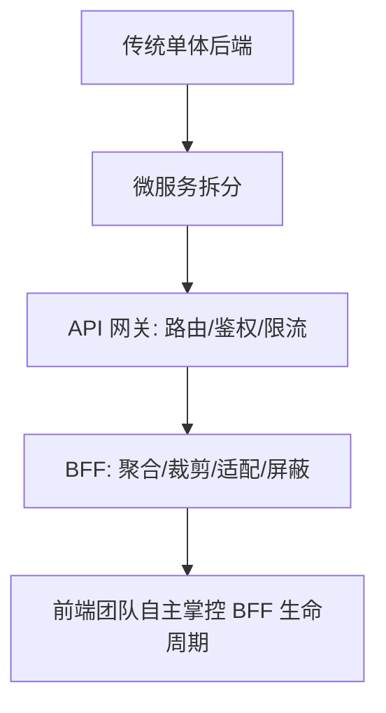
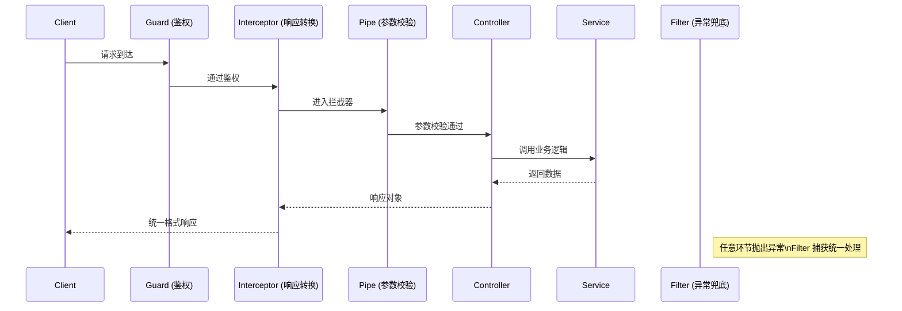
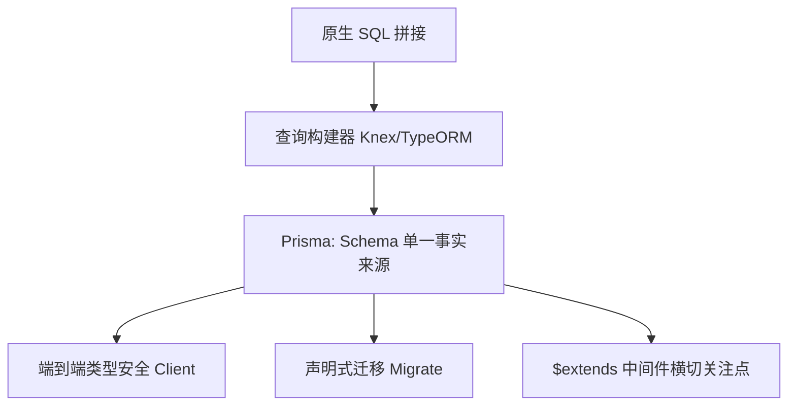
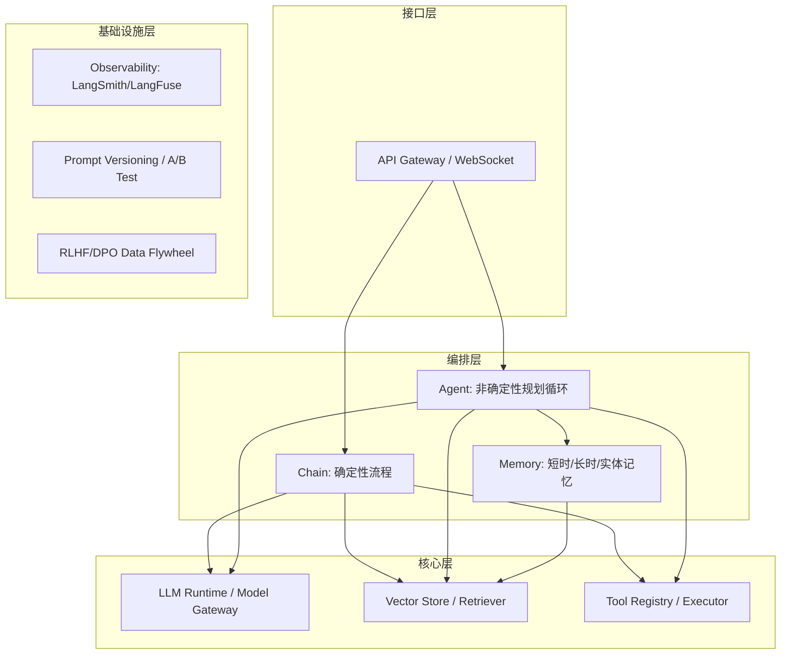
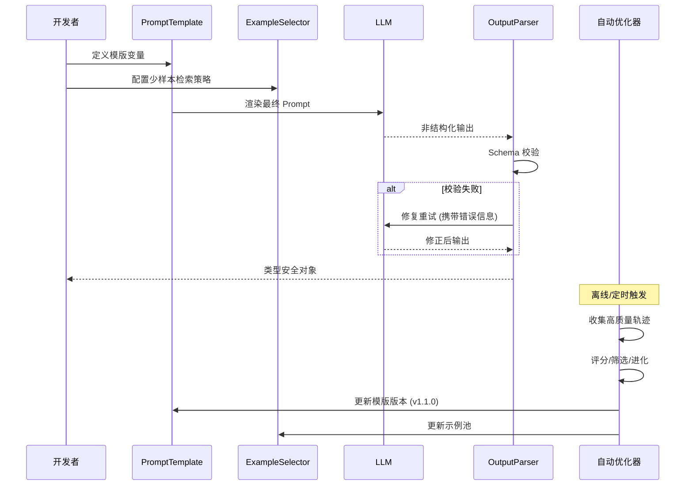
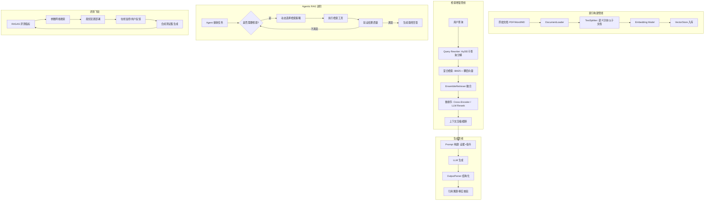
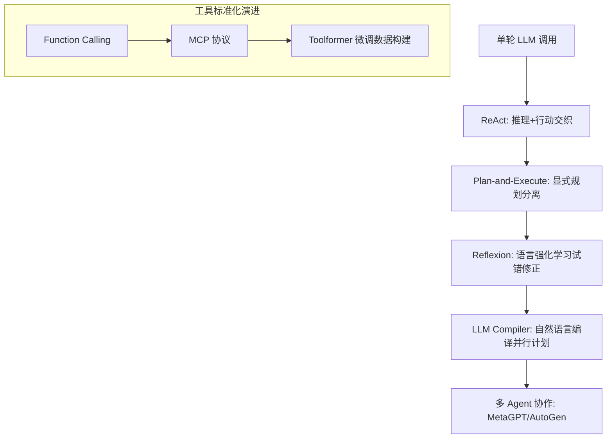
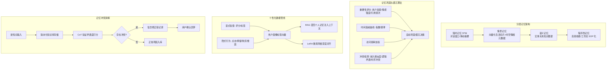

# 第 44 章 Node.js 服务端开发与 BFF 模式 —— 前端工程师的全栈进阶路径
作者：龙哥

## 学习目标

- 理解 BFF 架构的核心价值与适用边界，区别于传统 API 网关
- 掌握 NestJS 模块化架构、依赖注入、装饰器驱动的三层开发模式与 AOP 切面编程
- 熟练运用 Prisma Schema 建模、类型安全查询、迁移管理及中间件扩展（软删除/多租户）
- 建立生产级部署运维体系：Docker 多阶段构建、PM2 集群模式、存活/就绪双探针、结构化日志与 Prometheus 监控
- 设计支持 SSR/SSG/ISR/CSR 混合渲染的全栈应用骨架，实现前后端类型共享与认证态同构
- 理解 AI 原生应用架构的核心范式转变：从 API 封装到推理引擎内核
- 掌握提示工程体系化方法：模版化、版本化、结构化输出与自动优化流程
- 构建生产级 RAG 系统：模块化管线、多路召回重排序、评测数据飞轮与 Agentic RAG 架构
- 设计具备规划、记忆、工具使用能力的 LLM Agent 认知架构
- 建立分层记忆与个性化系统：STM/LTM 架构、用户画像动态构建、记忆冲突消解机制
- 搭建 AI 系统可观测性与数据飞轮：全链路追踪、分层评测体系、RLHF/DPO 闭环工程

## 44.1 生活类比

想象 BFF 是一位**专属管家**，NestJS 是**管家的标准化作业手册**，Prisma 是**管家的智能档案系统**，Docker/PM2 是**管家的工作站与值班表**，全栈骨架则是**管家服务的标准化套餐菜单**：

- **BFF (专属管家)**：前端（少爷）只需向管家提出一个需求（"备晚餐"），管家自动协调厨房（商品服务）、酒窖（价格服务）、花园（推荐服务）、账房（库存服务），将食材洗切好（裁剪字段）、按少爷口味摆盘（适配多端），端上桌时只呈现最终菜品（聚合响应）。少爷完全不知道后院有多少厨师、菜谱怎么变，只认管家这一个接口。
- **NestJS (标准化作业手册)**：管家不靠脑补干活，而是遵循一套严谨的《管家作业手册》：模块化分工（@Module：厨房组/酒窖组/账房组）、依赖注入（@Injectable：需要调料自动送达、需要账本自动递上）、AOP 切面（Guard：验明身份；Interceptor：记录菜单变更；Pipe：食材入库前验收；Filter：打碎盘子统一善后）、文档自动生成（新厨师入职直接读手册即懂流程）。
- **Prisma (智能档案系统)**：管家查阅档案（数据库）时，不再手写复杂的检索单（SQL），而是对着档案目录（Schema）说："给我这位少爷的所有订单，只要未取消的，按时间倒序，带上商品详情"。系统自动生成类型安全的检索代码，重构档案结构时，所有旧检索单自动报废提醒（编译报错），支持软删除（标记作废而非销毁）、多租户隔离（不同少爷互不可见档案）。
- **Docker/PM2 (工作站与值班表)**：管家上班前换上标准工装（Distroless 镜像，轻量无多余工具）、持证上岗（非 root 用户）、配备克隆分身术（PM2 集群模式利用多核）、设定过劳保护线（内存超限自动重启）、建立心跳检测（/health/liveness 存活，/health/readiness 准备好接单）、所有操作留痕结构化日志（Winston JSON）并上报监控大屏。
- **全栈骨架 (标准化套餐菜单)**：根据场景提供不同套餐：SEO 重的页面走 SSR（现做现端）、静态内容走 SSG（中央厨房预制）、半动态走 ISR（定时翻新预制菜）、高交互后台走 CSR（自助餐台）。菜单（类型定义）前厨房共享，少爷点菜（请求）前厨房对账无歧义，认证身份（Cookie/JWT）前厨房同步通行。
- **AI 原生应用 (智能管家进化版)**：传统管家只会执行固定指令，AI 原生管家拥有**大脑**(LLM 推理/规划)、**记忆库**(长短期记忆)、**工具箱**(Function Calling/MCP)、**自主决策能力**。遇到复杂需求（"帮我筹办一场生日派对"），它会自主拆解任务、调用工具(订蛋糕/订场地/发邀请)、根据反馈修正计划、在预算内完成闭环。
- **提示工程 (管家的标准沟通协议)**：不再靠"玄学咒语"与管家对话，而是制定**结构化沟通协议**：角色设定(你是资深活动策划)、任务拆解(分步骤执行)、输出约束(JSON 格式/预算范围)、版本管理(每次迭代留痕)、自动优化(根据反馈调整提示词)。管家按协议办事，产出稳定可预期。
- **RAG 系统 (管家的外挂知识库)**：管家遇到不懂的专业问题(如"这款红酒的最佳醒酒时间")，不再瞎猜，而是查阅**专业酒窖数据库**(向量检索)、**重排序筛选**最相关条目、**生成引用来源**的准确回答。知识库持续更新，管家越用越懂。
- **Agent 架构 (管家的自主执行闭环)**：面对"帮我搬家"这种复杂目标，管家不再逐条等待指令，而是：**规划**(拆解任务)->**行动**(联系搬家公司/打包/转网)->**观察反馈**(物品清点/损坏理赔)->**修正**(调整后续步骤)。形成 ReAct/Plan-and-Execute 闭环。
- **记忆系统 (管家的长期陪伴档案)**：管家记住少爷的**偏好**(不吃香菜/喜欢硬床)、**习惯**(早起跑步/睡前阅读)、**重要日期**(纪念日/过敏史)。通过分层记忆(工作记忆/情景记忆/语义记忆)与自动巩固/遗忘机制，实现"越用越懂、千人千面"的个性化服务。
- **可观测性与数据飞轮 (管家的绩效考核与成长体系)**：每次服务全程**留痕**(Trace/Span)、**评分**(用户满意度/任务完成率)、**复盘**(失败原因分析)-> 纳入**训练集**(SFT/DPO)-> 管家能力**迭代升级**-> 形成"服务越多、能力越强"的正向飞轮。

## 44.2 概念地图

第 44 章：Node.js 服务端开发与 BFF 模式
├── 1. BFF 架构价值
│   ├── 核心职责：聚合下游、裁剪字段、适配多端、屏蔽变更  —— [20230418_044.md]
│   ├── 部署模式：一前端一 BFF，前端团队掌控生命周期  —— [20230418_044.md]
│   ├── 关键性质：聚合性、裁剪性、适配性、稳定性、权责清晰  —— [20230418_044.md]
│   └── 边界条件：不含核心业务逻辑、防超级单体、团队/服务规模阈值、契约测试  —— [20230418_044.md]
├── 2. NestJS 企业级开发
│   ├── 核心三元组：@Module/@Injectable/@Controller  —— [20230418_044.md]
│   ├── 依赖注入：IOC 容器、生命周期管理、构造函数注入、循环依赖解决  —— [20230418_044.md]
│   ├── AOP 切面：Guard/Interceptor/Pipe/Filter 覆盖请求全生命周期  —— [20230418_044.md]
│   ├── 文档生成：@nestjs/swagger + DTO 装饰器 -> OpenAPI 3.0 零成本维护  —— [20230418_044.md]
│   ├── 平台无关：Express/Fastify 适配器，支持 HTTP/GraphQL/WebSocket/gRPC  —— [20230418_044.md]
│   └── 边界条件：过度设计风险、循环依赖陷阱、高并发性能损耗、学习曲线  —— [20230418_044.md]
├── 3. Prisma ORM 实战
│   ├── 核心组件：Schema（单一事实来源）、Client（类型安全查询）、Migrate（版本化迁移）  —— [20230418_044.md]
│   ├── 端到端类型安全：Schema -> Client 方法全链路 TS 推导  —— [20230418_044.md]
│   ├── 声明式迁移：migrate dev/deploy/reset 生命周期管理  —— [20230418_044.md]
│   ├── 关联查询：include/select 嵌套过滤排序极简语法  —— [20230418_044.md]
│   ├── 中间件扩展：$extends 实现软删除/审计/多租户横切逻辑  —— [20230418_044.md]
│   ├── 连接池与事务：engine-adapter 管理池、交互式/批量事务 ACID 保障  —— [20230418_044.md]
│   └── 边界条件：大批量写入性能、高级 SQL 支持度、迁移文件膨胀、Serverless 冷启动  —— [20230418_044.md]
├── 4. 部署与运维工程化
│   ├── Docker 多阶段构建：Builder/Runner 分离、Distroless/Alpine、非 root、<100MB  —— [20230418_044.md]
│   ├── PM2 集群模式：instances:max 利用多核、max_memory_restart 防 OOM、零停机 reload  —— [20230418_044.md]
│   ├── 健康检查双探针：/health/liveness (存活) + /health/readiness (依赖就绪)  —— [20230418_044.md]
│   ├── 可观测性三件套：Winston JSON 日志 + Prometheus /metrics + OpenTelemetry 链路追踪  —— [20230418_044.md]
│   └── 边界条件：Distroless 排查难、集群模式内存不共享、探针轻量化、指标基数爆炸防范  —— [20230418_044.md]
├── 5. 全栈应用骨架
│   ├── 渲染模式矩阵：SSR/SSG/ISR/CSR 按页面粒度配置  —— [20230418_044.md]
│   ├── 类型共享机制：Monorepo shared-types 包 / tsconfig project references 直接引用  —— [20230418_044.md]
│   ├── 数据获取统一抽象：BFF 暴露 Server Actions/API Routes，前端 fetch 统一调用  —— [20230418_044.md]
│   ├── 认证态同构：Cookie/JWT 服务端解析注入上下文，客户端水合复用  —— [20230418_044.md]
│   ├── 开发体验：TurboRepo/Nx 管道、并行 dev、热更新类型同步、共享 Lint 配置  —— [20230418_044.md]
│   └── 边界条件：ISR 部署平台依赖、类型共享版本漂移、Edge Runtime 兼容性、水合不匹配防范  —— [20230418_044.md]
├── 6. AI 原生应用架构
│   ├── 范式转变：LLM 作为操作系统内核、推理引擎/决策中枢  —— [20230418_105.md] [20230418_136.md]
│   ├── 核心抽象层：Chain、Agent、Memory 解耦设计、LangChain/LangGraph 落地  —— [20230418_105.md] [20230418_106.md]
│   ├── 工程化落地模式：流式输出、异步编排、可观测性、版本管理、MVA 架构蓝图  —— [20230418_109.md] [20230418_140.md]
│   └── 边界条件：模型幻觉、上下文窗口限制、Token 成本控制、合规护栏  —— [20230418_105.md] [20230418_109.md]
├── 7. 提示工程体系化
│   ├── 提示词即代码：PromptTemplate、ExampleSelector、动态少样本、A/B 测试版本控制  —— [20230418_105.md] [20230418_106.md]
│   ├── 结构化输出与类型安全：OutputParser、Pydantic 集成、修复重试机制  —— [20230418_105.md] [20230418_110.md]
│   ├── 提示自动优化：DSPy/OPRO 编译流程、少样本自动构筑、指令自进化  —— [20230418_136.md] [20230418_140.md]
│   └── 边界条件：Token 窗口压缩、提示注入防御、版本漂移治理  —— [20230418_105.md] [20230418_110.md]
├── 8. RAG 系统工程化
│   ├── 模块化管线：DocumentLoader/Transformer -> VectorStore/Retriever -> Generator 标准化接口  —— [20230418_106.md] [20230418_109.md]
│   ├── 高级检索策略：BM25+向量混合检索、Cross-Encoder/LLM 重排序、多查询扩展、查询路由分解  —— [20230418_106.md] [20230418_110.md]
│   ├── 评测与数据飞轮：RAGAS/ARES 指标体系、合成测试集生成、在线反馈驱动自动化迭代  —— [20230418_109.md] [20230418_136.md]
│   ├── Agentic RAG：检索器封装为 Tool、Agent 自主决策检索/改写/验证  —— [20230418_136.md] [20230418_140.md]
│   └── 边界条件：检索延迟、上下文窗口溢出、幻觉残留、合规脱敏  —— [20230418_106.md] [20230418_110.md]
├── 9. Agent 架构与规划推理
│   ├── 认知架构范式：ReAct -> Plan-and-Execute -> Reflexion 迁移演进与适用边界  —— [20230418_105.md] [20230418_136.md]
│   ├── 工具生态标准化：Function Calling、MCP 协议、Toolformer 范式、权限控制  —— [20230418_106.md] [20230418_110.md]
│   ├── 长程规划与任务分解：MCTS/ToT 树搜索、DAG 任务图并行、LLM Compiler 编译执行计划  —— [20230418_109.md] [20230418_140.md]
│   ├── 多 Agent 协作编排：MetaGPT/ChatDev 流程标准化、AutoGen 群聊、辩论反思机制  —— [20230418_136.md] [20230418_140.md]
│   └── 边界条件：规划幻觉、工具调用失败率、Token 消耗失控、死循环风险  —— [20230418_105.md] [20230418_109.md]
├── 10. 记忆与个性化系统
│   ├── 分层记忆架构：STM/LTM/情景/语义/程序性记忆、重要性评分/时间衰减/访问频率巩固遗忘算法  —— [20230418_105.md] [20230418_109.md]
│   ├── 个性化建模：用户画像动态构建、偏好向量、RAG 召回个人记忆、提示词注入/LoRA 微调对齐  —— [20230418_110.md] [20230418_136.md]
│   ├── 记忆冲突消解：新旧知识矛盾检测、版本化知识库、信念修正链、用户确认回环  —— [20230418_106.md] [20230418_140.md]
│   └── 边界条件：隐私合规、存储成本、模型遗忘曲线、个性化过拟合  —— [20230418_105.md] [20230418_110.md]
└── 11. 可观测性、评测与数据飞轮
    ├── 全链路可观测性：Trace/Span 标准化、LangSmith/LangFuse 落地、成本核算/瓶颈定位/异常告警  —— [20230418_105.md] [20230418_109.md]
    ├── 分层评测体系：单元级/系统级/业务级金字塔策略、RAGAS/MT-Bench、A/B 测试自动化流水线  —— [20230418_110.md] [20230418_136.md]
    └── 数据飞轮架构：高质量轨迹采样 -> 标注 -> 偏好数据 -> SFT/DPO -> 灰度发布 -> 线上收集闭环  —— [20230418_136.md] [20230418_140.md]

## 44.3 BFF 架构价值 —— 前端专属的后端聚合层

### 为什么需要这个概念？

- 传统 API 网关只做路由转发，无法满足前端对数据裁剪、聚合、适配的差异化需求
- 微服务拆分导致前端需调用十几个下游接口，首屏加载慢、请求瀑布流严重
- 移动端、Web 端、小程序对同一业务数据结构需求不同，后端难以维护多套接口
- 内部微服务架构频繁变更（拆分/合并/字段变更）直接冲击前端开发效率

### 核心定义

- **BFF（Backend for Frontend）**：为特定前端应用（或同类客户端）定制的后端服务层
- **核心职责**：聚合下游微服务、裁剪/转换字段、适配多端差异、屏蔽内部架构变更
- **部署模式**："一个前端应用对应一个 BFF 服务"，由前端团队掌控生命周期

> "BFF（Backend for Frontend）架构的核心价值在于：聚合下游微服务、裁剪字段、适配多端、屏蔽内部架构变更。"
> 
> ——《[20230418_044.md]》

> "对比传统 API 网关与 BFF 差异，阐述“一个前端应用对应一个 BFF 服务”如何降低前端协调成本。"
> 
> ——《[20230418_044.md]》

### 关键性质

- **聚合性**：将 N 个下游 RPC/HTTP 调用合并为 1 个前端请求，消灭瀑布流
- **裁剪性**：仅返回前端所需字段，减少 60%+ 网络传输量
- **适配性**：同一 BFF 通过参数/Header 区分端类型，返回差异化数据结构
- **稳定性**：下游微服务变更时，仅修改 BFF 适配层，前端代码零变更
- **权责清晰**：前端团队拥有 BFF 代码仓库所有权，需求响应从 "跨团队协调" 变为 "自主迭代"

### 核心定义与推导

**BFF 聚合延迟计算公式**：

$$T_{bff} = \max(T_{svc_1}, T_{svc_2}, ..., T_{svc_n}) + T_{agg} + T_{serialization}$$

其中：
- $T_{svc_i}$：第 i 个下游服务的调用耗时（并行调用时取最大值）
- $T_{agg}$：聚合层内存中数据合并、字段裁剪、格式转换的 CPU 耗时（通常 < 5ms）
- $T_{serialization}$：响应序列化耗时

**推导说明**：
1. 传统前端直连微服务时，总耗时为串行求和 $\sum T_{svc_i}$ 或瀑布流累加
2. BFF 通过服务端并行聚合，将时间复杂度从 $O(N)$ 降为 $O(1)$（以最慢下游为准）
3. 网络传输量从 $\sum Size_{full\_response}$ 降为 $Size_{trimmed\_response}$，典型裁剪率 60%+
4. 引入 BFF 增加一跳网络延迟（客户端->BFF），但消除了客户端到多个下游的多跳延迟

### 典型例子

- **电商商品详情页**：原需调用商品基础、价格、库存、评论、推荐 5 个服务，BFF 聚合为 1 个接口，仅返回当前端口所需 12 个字段
- **多端适配**：Web 端返回完整 SEO 字段，App 端返回精简字段+图片 CDN 域名，小程序返回去富文本化纯文本

### 边界条件

- BFF 不应包含核心业务逻辑（如下单扣库存、风控决策），仅做编排与转换
- 避免 BFF 变成 "超级单体"：严禁在 BFF 中硬编码复杂业务规则，复杂逻辑下沉至领域服务
- 团队规模 < 5 人或微服务 < 3 个时，引入 BFF 收益不足以覆盖运维成本
- 需建立 BFF 与下游服务的契约测试，防止下游变更导致 BFF 运行时故障

> "BFF 不应包含核心业务逻辑，仅做编排与转换；避免 BFF 变成“超级单体”。"
> 
> ——《[20230418_044.md]》

### 方法演进图



## 44.4 NestJS 企业级开发 —— 模块化、依赖注入与装饰器驱动的标准化骨架

### 为什么需要这个概念？

- Node.js 原生 http 模块、Express/Koa 缺乏统一架构规范，大型项目极易退化成 "面条代码"
- 缺乏统一的模块边界定义、依赖管理、配置管理、异常处理、接口文档生成机制
- TypeScript 虽然提供类型，但缺乏运行时装饰器元编程能力支撑的框架级抽象
- 团队协作需要强约束的目录结构、命名规范、分层架构强制隔离

### 核心定义

- **NestJS**：基于 TypeScript、装饰器、依赖注入（DI）、模块化设计的企业级 Node.js 框架
- **核心三元组**：`@Module`（模块边界）、`@Injectable`（服务提供者）、`@Controller`（路由控制器）
- **运行时容器**：IOC 容器管理所有 Provider 的生命周期（单例/请求级/瞬态），实现控制反转

> "NestJS 企业级开发：模块化架构、依赖注入、守卫/拦截器/管道、Swagger 文档自动生成。"
> 
> ——《[20230418_044.md]》

> "实战 @Module/@Injectable/@Controller 三层架构、JWT 守卫鉴权、全局异常过滤器、DTO 校验管道、OpenAPI 文档零成本维护。"
> 
> ——《[20230418_044.md]》

### 关键性质

- **模块化架构**：按业务领域划分 Module，通过 imports/exports 控制依赖图，天然支持代码分割与懒加载
- **依赖注入**：构造函数注入 + `@Inject` 装饰器，支持接口编程、循环依赖解决（前向引用/模块引用）、动态模块配置
- **AOP 切面编程**：Guard（守卫/鉴权）、Interceptor（拦截器/响应转换/缓存）、Pipe（管道/校验/转换）、Filter（过滤器/异常处理）四大切面覆盖请求全生命周期
- **文档零成本**：`@nestjs/swagger` 结合 DTO 类装饰器自动生成 OpenAPI 3.0 规范文档，代码即文档
- **平台无关**：适配器模式支持 Express/Fastify 底层切换，同一代码库可跑 HTTP、GraphQL、WebSocket、gRPC、MQTT

> "平台无关：适配器模式支持 Express/Fastify 底层切换，同一代码库可跑 HTTP、GraphQL、WebSocket、gRPC、MQTT。"
> 
> ——《[20230418_044.md]》

### 核心定义与推导

**DI 容器解析复杂度分析**：

设 $M$ 为模块数，$P$ 为 Provider 总数，$E$ 为依赖边数。

- **启动阶段扫描复杂度**：$O(P + E)$ —— 拓扑排序构建依赖图
- **单次请求实例化复杂度**：$O(P_{request})$ —— 仅实例化 REQUEST 作用域的 Provider 子图
- **循环依赖检测**：Tarjan 算法 $O(P + E)$，编译期/启动期完成

**推导说明**：
1. NestJS 启动时构建完整依赖图，对 Singleton 作用域的 Provider 仅实例化一次，后续请求直接复用
2. REQUEST 作用域会在每次请求创建子容器，仅实例化该作用域内的 Provider，性能开销可控
3. 循环依赖通过 `forwardRef()` 延迟解析，本质是将强依赖边转为弱引用，运行时通过代理对象解决

### 典型例子

- **标准三层架构**：Controller 接收请求 -> Service 处理业务逻辑 -> Repository 操作数据库，各层通过接口解耦
- **全局异常过滤器**：捕获 HttpException/Prisma错误/未知错误，统一返回 `{ code, message, timestamp, path }` 标准格式
- **JWT 守卫 + 角色装饰器**：`@UseGuards(JwtAuthGuard, RolesGuard) @Roles('admin')` 实现声明式 RBAC

### 边界条件

- 过度设计风险：简单 CRUD 接口不必强行套三层，可直接在 Service 操作 Repository
- 循环依赖陷阱：Module 间循环依赖需用 `forwardRef()` 打破，Provider 循环依赖建议重构拆分公共模块
- 性能开销：DI 容器启动扫描、装饰器元数据反射、拦截器链调用在超高并发（>10k QPS）场景下有微弱损耗
- 学习曲线：装饰器、元数据反射、自定义 Provider、动态模块等进阶概念对初学者门槛较高

### 数据流图



## 44.5 Prisma ORM 实战 —— 类型安全的数据库访问层与迁移管理

### 为什么需要这个概念？

- 传统 SQL 拼接/查询构建器缺乏端到端类型安全，重构极易引入运行时 Bug
- 手写迁移脚本易出错、难回滚、团队协作冲突频发
- 复杂关联查询（嵌套 include、过滤器）手写极其繁琐且易错
- 连接池配置不当导致生产环境连接泄漏、OOM、响应抖动

### 核心定义

- **Prisma**：下一代 TypeScript ORM，核心组件为 Prisma Schema（声明式数据建模）、Prisma Client（类型安全查询客户端）、Prisma Migrate（版本化迁移工具）
- **Schema 单一事实来源**：定义模型、枚举、关联、索引、复合主键，自动生成 TS 类型

> "数据库与 ORM 实战：Prisma Schema 定义、迁移管理、事务与关联查询优化。"
> 
> ——《[20230418_044.md]》

> "演示 schema.prisma 建模、关联关系、迁移命令、中间件软删除、$queryRaw 复杂 SQL、连接池配置防泄漏。"
> 
> ——《[20230418_044.md]》

### 关键性质

- **端到端类型安全**：从 Schema 到 Client 方法（`findMany`、`create`、`update`、`$queryRaw`）全链路 TS 推导，重构时编译器即报错
- **声明式迁移**：`prisma migrate dev` 对比 Schema 差异自动生成 SQL 迁移文件，支持回滚、基线对齐、生产环境 `migrate deploy`
- **关联查询极简**：`include: { posts: { where: { published: true }, orderBy: { createdAt: 'desc' } } }` 一行搞定多表连接+嵌套过滤+排序
- **中间件扩展**：`$extends` 实现软删除（自动加 `where.deletedAt: null`）、审计日志、多租户隔离等横切逻辑复用
- **连接池内置**：基于 engine-adapter 管理连接池，配置 `connection_limit`、`pool_timeout` 防泄漏，Serverless 环境自动适配
- **事务支持**：交互式事务 `$transaction(async (tx) => {...})` 与批量操作事务，自动回滚、隔离级配置

> "端到端类型安全：从 Schema 到 Client 方法全链路 TS 推导，重构时编译器即报错。"
> 
> ——《[20230418_044.md]》

### 核心定义与推导

**Prisma 类型推导机制**：

```
schema.prisma (DSL)
    │
    ▼ Prisma CLI (prisma generate)
    │
    ├──► @prisma/client/index.d.ts
    │       ├── Model Types: User, Post, Comment (interface)
    │       ├── Input Types: UserCreateInput, UserWhereUniqueInput (interface)
    │       ├── Output Types: UserGetPayload<{ include: { posts: true } }> (type)
    │       └── Client Methods: prisma.user.findMany() -> Promise<User[]>
    │
    ▼ TypeScript Compiler
    │
    ├──► 编译期类型检查：参数不匹配、字段拼写错误、include 结构不合法即报错
    │
    ▼ 运行时
    │
    ├──► Query Engine 生成参数化 SQL
    │
    ▼ 结果映射
    │
    └──► 返回强类型对象 (符合 UserGetPayload<...>)
```

**推导说明**：
1. Schema 变更 → `prisma generate` → 类型定义自动更新 → TS 编译即报错，实现**编译期即数据库契约校验**
2. `$queryRaw` 配合 `TypedSQL` 可将原生 SQL 结果映射为强类型，覆盖 ORM 不支持的高级查询

### 典型例子

- **schema.prisma** 定义 User/Post/Comment 三模型、一对多/多对多关联、@@index 复合索引
- **软删除中间件**：
```typescript
const prisma = new PrismaClient().$extends({
  query: {
    $allModels: {
      async $allOperations({ args, query }) {
        if (args.where) args.where.deletedAt = null;
        return query(args);
      }
    },
    user: {
      delete: async ({ args, query }) => {
        return query({ ...args, data: { deletedAt: new Date() } });
      }
    }
  }
});
```
- **复杂报表查询**：`$queryRaw` 编写原生 SQL 配合 `TypedSQL` 获得类型安全结果映射

### 边界条件

- 大批量写入（>1万行）性能不如原生批量 INSERT，需用 `createMany(skipDuplicates: true)` 或原生 SQL
- 复杂多表 JOIN、窗口函数、CTE、物化视图等高级 SQL 特性 Prisma Client 覆盖不全，必须用 `$queryRaw`
- Schema 变更频繁的早期项目，迁移文件会极多，需定期 `prisma migrate reset` 或 `db pull` 同步
- Serverless 冷启动场景，Prisma Engine 启动延迟 ~100-300ms，建议配合预热或使用边缘连接池

### 方法演进图



## 44.6 部署与运维工程化 —— Docker 多阶段构建、PM2 集群、健康检查与可观测性三件套

### 为什么需要这个概念？

- 开发环境与生产环境差异导致 "在我机器上能跑" 的部署事故频发
- 单进程 Node.js 无法利用多核 CPU，内存限制（V8 默认 1.4GB）易 OOM 重启
- 缺乏标准化健康检查，K8s 无法感知应用真实存活/就绪状态，滚动部署易丢流量
- 日志格式不统一、指标未暴露，故障排查依赖 `grep` 日志，MTTR 极长

### 核心定义

- **生产级部署标准**：Docker 多阶段构建（Builder/Runner 分离）+ 非 root 用户 + Distroless/Alpine 基础镜像
- **进程管理**：PM2 集群模式（`instances: max`）充分利用多核，内存超限自动重启，零停机重载
- **健康检查**：`/health/liveness`（进程存活）+ `/health/readiness`（依赖就绪：DB/Redis/下游可达）分离
- **可观测性三件套**：Winston 结构化 JSON 日志 + Prometheus 指标暴露（`/metrics`）+ OpenTelemetry 分布式链路追踪

> "部署与运维：Docker 多阶段构建、PM2 集群模式、健康检查、日志聚合与 Prometheus 监控。"
> 
> ——《[20230418_044.md]》

> "编写生产级 Dockerfile、PM2 生态配置文件、`/health` 存活/就绪探针、Winston 结构化日志、Prometheus 指标暴露。"
> 
> ——《[20230418_044.md]》

### 关键性质

- **镜像精简**：多阶段构建剔除 node_modules/devDependencies/源码，最终镜像 < 100MB，减少攻击面、加速拉取
- **安全加固**：非 root 用户（UID 10001）、只读根文件系统、移除 shell/package manager、启用 seccomp/AppArmor
- **零停机发布**：PM2 `reload` 信号量平滑重启 + K8s `preStop` hook 延迟终止 + Ingress 连接排空
- **资源治理**：K8s `resources.limits/requests` 绑定 PM2 `max_memory_restart`，防止 OOM Kill 导致 Pod 重启风暴
- **结构化日志**：统一 `{ timestamp, level, traceId, spanId, service, message, context }` 格式，接入 ELK/Loki 全文检索

> "多阶段构建剔除 node_modules/devDependencies/源码，最终镜像 < 100MB，减少攻击面、加速拉取。"
> 
> ——《[20230418_044.md]》

### 核心定义与推导

**Docker 镜像大小优化公式**：

$$Size_{final} = Size_{base\_distroless} + Size_{dist} + Size_{prisma\_engine} + Size_{node\_modules\_prod}$$

其中：
- $Size_{base\_distroless} \approx 30\text{MB}$ (gcr.io/distroless/nodejs20-debian12)
- $Size_{dist}$：编译产物，通常 5-20MB
- $Size_{prisma\_engine}$：查询引擎二进制，约 10-15MB
- $Size_{node\_modules\_prod}$：仅 production 依赖，通过 `npm ci --omit=dev` 控制在 30-50MB

**对比**：传统单阶段 `node:20-alpine` 镜像含完整工具链、devDependencies、源码，典型大小 500MB-1GB+。

**推导说明**：
1. 多阶段构建将构建时依赖（TypeScript、Prisma CLI、测试框架）留在 Builder 阶段，不进入最终镜像
2. Distroless 基础镜像仅包含运行时必要库，无 shell、包管理器，攻击面极小
3. 非 root 用户 + 只读根文件系统满足安全合规基线

### 典型例子

- **Dockerfile**：
```dockerfile
FROM node:20-alpine AS builder
WORKDIR /app
COPY package*.json ./
RUN npm ci
COPY . .
RUN npm run build && prisma generate

FROM gcr.io/distroless/nodejs20-debian12 AS runner
WORKDIR /app
USER 10001
COPY --from=builder /app/dist ./dist
COPY --from=builder /app/node_modules/.prisma/client ./node_modules/.prisma/client
ENTRYPOINT ["node", "dist/main.js"]
```

- **PM2 ecosystem.config.js**：
```javascript
module.exports = {
  apps: [{
    name: 'bff',
    script: 'dist/main.js',
    instances: 'max',
    exec_mode: 'cluster',
    max_memory_restart: '500M',
    env: { NODE_ENV: 'production' }
  }]
}
```

- **NestJS Terminus 健康检查**：
```typescript
@Get('liveness')
@HealthCheck()
liveness() {
  return this.health.check([
    () => this.prisma.$queryRaw`SELECT 1`
  ]);
}

@Get('readiness')
@HealthCheck()
readiness() {
  return this.health.check([
    () => this.prisma.$queryRaw`SELECT 1`,
    () => this.redis.ping(),
    () => this.httpService.get('http://downstream-service/health').toPromise()
  ]);
}
```

### 边界条件

- Distroless 镜像无 shell，排查需用 `kubectl debug` 临时挂载 busybox 或 `crictl` 操作容器运行时
- PM2 集群模式下全局变量/内存缓存不共享，必须用 Redis/外部存储替代进程内状态
- 健康检查端点必须极轻量（<10ms），禁止包含复杂业务逻辑或大量下游调用，否则导致误判
- Prometheus 指标基数爆炸风险：严禁在 Label 中使用高基数字段（如 userId、requestId、timestamp）

### 数据流图

```mermaid
graph TD
    subgraph Docker多阶段构建
        A[Builder阶段: 完整工具链] --> B[编译产物 dist/]
        B --> C[Runner阶段: Distroless]
        C --> D[非root用户 + 仅运行时依赖]
    end
    
    subgraph PM2集群模式
        D --> E[Master进程]
        E --> F[Worker 1]
        E --> G[Worker 2]
        E --> H[Worker N]
        F --> I[max_memory_restart 监控]
        G --> I
        H --> I
    end
    
    subgraph 健康检查
        J[K8s Liveness Probe] --> K[/health/liveness]
        L[K8s Readiness Probe] --> M[/health/readiness]
        K --> N{进程存活?}
        M --> O{DB/Redis/下游就绪?}
    end
    
    subgraph 可观测性三件套
        P[Winston JSON日志] --> Q[ELK/Loki]
        R[Prometheus /metrics] --> S[Grafana告警]
        T[OpenTelemetry Trace] --> U[Jaeger/Zipkin]
    end
```

## 44.7 全栈应用骨架 —— 统一类型共享的 SSR/SSG/ISR 混合渲染架构

### 为什么需要这个概念？

- 纯 SPA 首屏白屏、SEO 差、TTFB 长，纯 SSR 服务端压力大、缓存复杂
- 前后端类型定义重复维护，接口变更导致前端运行时崩溃，缺乏编译期保障
- 不同页面对 SEO/实时性/交互性要求不同，单一渲染模式无法全覆盖
- 缺乏标准化骨架，每个新项目重复造轮子（认证、请求、路由、UI、部署）

### 核心定义

- **全栈骨架**：前端框架 + BFF 框架 + 共享类型包 组成的 Monorepo 工程模版
- **渲染模式矩阵**：SSR（动态数据、SEO）、SSG（静态内容、极致性能）、ISR（增量静态再生、半动态）、CSR（高交互、后台管理）
- **类型共享机制**：`packages/shared-types` 发布为内部 npm 包，或通过 `tsconfig` `project references` 直接引用 BFF 的 DTO/Entity 类型

> "实战：从零搭建支持 SSR/SSG/ISR 的全栈应用骨架。"
> 
> ——《[20230418_044.md]》

> "整合 Next.js/Nuxt 3 或 Vite SSR + NestJS BFF，实现首屏服务端渲染、静态生成、增量静态再生、统一类型共享。"
> 
> ——《[20230418_044.md]》

> "渲染模式矩阵：SSR（动态数据、SEO）、SSG（静态内容、极致性能）、ISR（增量静态再生、半动态）、CSR（高交互、后台管理）。"
> 
> ——《[20230418_044.md]》

### 关键性质

- **渲染策略按页面/组件粒度配置**：Next.js `getServerSideProps`/`getStaticProps`/`revalidate`、Nuxt `routeRules`
- **数据获取统一抽象**：BFF 暴露统一的 Server Actions / API Routes，前端统一通过 `fetch`/`axios` 调用，SSR/CSR 代码复用
- **认证态同构**：Cookie-based Session/JWT 在服务端解析注入 Request 上下文，客户端水合复用，避免水合不匹配
- **开发体验**：TurboRepo/Nx 管道编排、`dev` 并行启动前后端、热更新保持类型同步、共享 ESLint/Prettier 配置
- **部署产物**：前端输出 `.next`/`.output` + BFF 输出 Docker 镜像，独立版本、独立发布、独立回滚

### 核心定义与推导

**渲染模式选择决策树**：

```
                    ┌─────────────────────┐
                    │  需要 SEO / 首屏直出？ │
                    └──────────┬──────────┘
                               │
              ┌────────────────┴────────────────┐
              ▼                                 ▼
           是 (SEO 关键)                      否 (内部/后台/高交互)
              │                                 │
              ▼                                 ▼
    ┌─────────────────────┐           ┌─────────────────────┐
    │ 数据更新频率？       │           │ 交互复杂度？         │
    └──────────┬──────────┘           └──────────┬──────────┘
               │                                 │
    ┌──────────┴──────────┐           ┌─────────┴─────────┐
    ▼                     ▼           ▼                   ▼
  高频/实时             低频/定期    高 (复杂表单/图表)   低 (展示型)
    │                     │           │                   │
    ▼                     ▼           ▼                   ▼
  SSR                  ISR          CSR                 SSG
(每次请求渲染)        (增量再生)    (纯客户端渲染)      (构建时生成)
    │                     │           │                   │
    ▼                     ▼           ▼                   ▼
  无缓存/              边缘缓存      静态资源缓存        CDN 长期缓存
  私有缓存              HTML +       + API 响应缓存      HTML
                        revalidate
```

**决策矩阵表**：以下是渲染模式选择的综合对照表，供团队按页面粒度决策参考：

| 页面类型 | SEO 需求 | 数据实时性 | 交互复杂度 | 推荐渲染模式 | 缓存策略 |
|----------|----------|------------|------------|--------------|----------|
| 登录/注册页 | 低 | 高 | 高 | CSR | 无缓存/静态资源缓存 |
| 官网首页 | 高 | 中(每日更新) | 中 | ISR (revalidate: 86400) | 边缘缓存 HTML |
| 博客详情页 | 高 | 低(静态) | 低 | SSG | CDN 长期缓存 |
| 用户仪表盘 | 低(私密) | 高(实时) | 高 | SSR | 无缓存/私有缓存 |
| 后台管理列表 | 低(内部) | 高 | 高 | CSR | API 响应缓存 |

### 典型例子

- **电商首页**：ISR `revalidate: 60` 静态生成商品列表，边缘缓存 HTML，60 秒后后台重新生成
- **用户中心**：SSR 实时渲染订单/收货地址，保证隐私数据不走 CDN
- **博客详情**：SSG 构建时预渲染 Markdown 为 HTML，零服务端开销
- **后台管理**：CSR 纯前端路由，减少服务端资源占用

### 边界条件

- ISR 需要支持边缘存储/持久化缓存的部署平台，传统 K8s 需额外配置共享存储卷或迁移至 Vercel/Netlify/Cloudflare
- 类型共享要求前后端同仓或严格的包发布流程，跨仓库版本漂移会导致类型失效
- SSR 节点需具备完整 Node.js 运行时，Edge Runtime 不支持 `fs`/`crypto` 等原生模块，第三方库兼容性需测试
- 水合不匹配是 SSR 最大坑：严禁在服务端渲染随机数、当前时间、浏览器专有 API，需用 `useEffect` 延迟渲染

## 44.8 AI 原生应用架构 —— 从“调用模型”到“工程化系统”

### 为什么需要这个概念？

- 传统软件工程将 LLM 视为外部 API，忽略其作为推理引擎的核心地位，导致架构松散、能力受限
- 缺乏标准化的 Chain/Agent/Memory 抽象，记忆管理、工具调用、规划推理各自为政，难以复用与组合
- 生产级应用缺乏流式输出、异步编排、可观测性、版本管理等非功能性能力支撑

### 核心定义

- **AI 原生应用**：以大模型为核心推理引擎，构建具备记忆、规划、工具使用与自我进化能力的复杂智能系统
- **核心抽象三层**：Chain（确定性流程编排）、Agent（非确定性规划循环）、Memory（状态持久化与上下文管理）
- **工程化落地模式（MVA）**：分层架构（接口层/编排层/核心层/基础设施层），解决流式输出、异步编排、可观测性、版本管理、回滚

> "范式转变：LLM 作为操作系统内核，帮助企业向内要效率、向外要增量。"
> 
> ——《[20230418_105.md]》 《[20230418_136.md]》

> "核心抽象层：Chain、Agent 与 Memory 的解耦设计，三者协作构成应用骨架。"
> 
> ——《[20230418_105.md]》 《[20230418_106.md]》

> "工程化落地模式：从原型到生产的最小可行性架构 (MVA)，基于 LangChain/LangGraph 的分层架构参考实现蓝图。"
> 
> ——《[20230418_109.md]》 《[20230418_140.md]》

### 关键性质

- **范式转变**：LLM 从‘聊天机器人’升级为‘推理引擎/决策中枢’，实现‘模型即内核’的架构跃迁
- **解耦设计**：Chain 定义标准化流程，Agent 引入规划循环，Memory 解决上下文窗口与长期状态持久化，三者协作构成应用骨架
- **非功能性需求内置**：流式输出(SSE/WebSocket)、异步编排、结构化日志、分布式追踪、提示词版本管理与灰度发布

### 核心定义与推导

**MVA 分层架构初始化伪代码**：

```python
# MVA (Minimum Viable Architecture) 核心分层初始化
class MVARuntime:
    def __init__(self, config: MVAConfig):
        # 基础设施层
        self.model_gateway = ModelGateway(config.models)  # 统一模型接入、路由、熔断
        self.vector_store = VectorStore(config.vector_db)  # 向量检索基础设施
        self.tool_registry = ToolRegistry(config.tools)    # 工具注册发现、权限控制
        self.observability = ObservabilityStack(config.tracing)  # LangSmith/LangFuse
        
        # 核心层
        self.memory_manager = MemoryManager(
            stm=ConversationBufferMemory(),
            ltm=VectorStoreMemory(self.vector_store),
            entity=EntityMemory()
        )
        
        # 编排层
        self.chain_registry = ChainRegistry()  # 确定性流程编排
        self.agent_executor = AgentExecutor(
            planner=PlanAndExecutePlanner(),
            tools=self.tool_registry,
            memory=self.memory_manager,
            max_iterations=config.max_agent_steps
        )
        
        # 接口层
        self.api_gateway = APIGateway(
            streaming=True,  # SSE/WebSocket 流式输出
            auth=JWTAuth(),
            rate_limiter=TokenBucketLimiter()
        )
    
    async def execute(self, request: UserRequest) -> AsyncGenerator[StreamChunk, None]:
        # 1. 路由到 Chain 或 Agent
        if request.is_deterministic:
            chain = self.chain_registry.get(request.chain_id)
            async for chunk in chain.astream(request.input, config={"callbacks": [self.observability]}):
                yield chunk
        else:
            async for chunk in self.agent_executor.astream(request):
                yield chunk

# Chain 接口契约
class Chain(Protocol):
    async def astream(self, input: Dict, config: RunnableConfig) -> AsyncIterator[Any]: ...
    def invoke(self, input: Dict) -> Any: ...

# Agent 接口契约  
class Agent(Protocol):
    async def aplan(self, task: str) -> Plan: ...
    async def aexecute(self, plan: Plan) -> AsyncIterator[ActionResult]: ...
    async def areflect(self, trajectory: List[Step]) -> Reflection: ...

# Memory 接口契约
class Memory(Protocol):
    def load(self, session_id: str) -> Context: ...
    def save(self, session_id: str, context: Context): ...
    def search(self, query: str, k: int) -> List[MemoryItem]: ...
```

**代码功能说明**：
上述伪代码展示了 MVA（最小可行性架构）的分层初始化与执行入口。基础设施层统一了模型网关、向量存储、工具注册中心和可观测性栈；核心层组装了整合短时/长时/实体记忆的 MemoryManager；编排层注册了确定性流程 ChainRegistry 与非确定性规划循环 AgentExecutor（含规划器、工具、记忆、最大步数限制）；接口层暴露支持流式输出、认证、限流的 APIGateway。`execute` 方法根据请求类型分发到 Chain 或 Agent，统一返回异步生成器实现流式响应。这种分层设计将基础设施、核心能力、编排逻辑、对外接口清晰分离，便于独立演进、测试与替换。

### 典型例子

- **LangChain 核心组件**：LLMChain(顺序/并行/分支)、AgentExecutor(规划/工具/记忆)、ConversationBufferMemory/VectorStoreMemory
- **LangGraph 状态机编排**：节点/边/条件分支/检查点/人工介入节点，支持循环、分支、并行、暂停恢复
- **生产级分层**：API Gateway -> 编排服务 -> Agent Runtime -> 模型网关 -> 向量库/工具注册中心/追踪系统

### 边界条件

- 模型幻觉与不确定性：需引入 RAG/工具验证/人工审核兜底，不可完全依赖 LLM 单次输出
- 上下文窗口限制：长对话需记忆压缩/检索式历史/滑动窗口，Token 成本随上下文线性增长
- Token 成本控制：模型级联(小模型过滤/大模型精排)、语义缓存、Prompt 压缩、流式计费
- 合规护栏：提示注入防御、PII 脱敏、输出内容审核、审计日志、数据驻留合规

### 架构分层图



## 44.9 提示工程体系化 —— 从“玄学咒语”到“结构化编程”

### 为什么需要这个概念？

- 提示词管理混乱：散落在代码/配置/文档中，版本不可控、难以复用、效果难复现
- 缺乏结构化输出保障：LLM 非结构化输出导致下游解析脆弱、频繁报错
- 依赖人工调参：迭代周期长、依赖经验、无法建立数据飞轮实现自动化优化

### 核心定义

- **提示工程体系化**：将提示工程重构为软件工程化的‘自然语言编程’范式，覆盖模版管理、少样本选择、结构化输出解析、自动优化流程
- **核心组件**：PromptTemplate（参数化模版）、ExampleSelector（动态少样本）、OutputParser（结构化解析）、Optimizer（自动优化器）

> "引入 PromptTemplate 与 ExampleSelector 机制，实现提示词与业务逻辑解耦、动态少样本检索、A/B 测试版本控制。"
> 
> ——《[20230418_105.md]》 《[20230418_106.md]》

> "详解 JsonOutputParser、PydanticOutputParser 及修复重试机制，实现‘自然语言输入 -> 类型安全对象输出’的编程契约。"
> 
> ——《[20230418_105.md]》 《[20230418_110.md]》

> "介绍将提示优化视为离散优化/梯度下降问题的前沿方法论，覆盖少样本自动构筑、指令自进化、提示词编译器概念。"
> 
> ——《[20230418_136.md]》 《[20230418_140.md]》

### 关键性质

- **提示词即代码**：与业务逻辑解耦、动态少样本检索、A/B 测试版本控制，落地‘提示词即配置/代码’工程规范
- **结构化输出与类型安全**：JsonOutputParser/PydanticOutputParser + 修复重试机制，实现‘自然语言输入 -> 类型安全对象输出’编程契约
- **提示自动优化**：将提示优化视为离散优化/梯度下降问题，覆盖少样本自动构筑、指令自进化、提示词编译器概念，建立数据飞轮

### 核心定义与推导

**PromptTemplate 渲染流程伪代码**：

```python
# PromptTemplate 核心渲染流程
class PromptTemplate:
    def __init__(
        self,
        template: str,
        input_variables: List[str],
        partial_variables: Optional[Dict] = None,
        example_selector: Optional[ExampleSelector] = None,
        version: str = "1.0.0"
    ):
        self.template = template
        self.input_variables = input_variables
        self.partial_variables = partial_variables or {}
        self.example_selector = example_selector
        self.version = version
    
    def format(self, **kwargs) -> PromptValue:
        # 1. 合并 partial_variables 与运行时变量
        all_vars = {**self.partial_variables, **kwargs}
        
        # 2. 动态少样本检索
        if self.example_selector:
            examples = self.example_selector.select_examples(all_vars)
            all_vars["examples"] = examples
        
        # 3. 模版渲染 (Jinja2 / f-string / LangChain 格式)
        rendered = self._render_template(self.template, all_vars)
        
        return PromptValue(text=rendered, metadata={"version": self.version, "vars": all_vars})

# OutputParser 修复重试机制
class RetryOutputParser(OutputParser):
    def __init__(
        self,
        parser: OutputParser,
        retry_chain: Chain,
        max_retries: int = 3
    ):
        self.parser = parser
        self.retry_chain = retry_chain
        self.max_retries = max_retries
    
    async def aparse(self, completion: str) -> Any:
        last_error = None
        for attempt in range(self.max_retries):
            try:
                return self.parser.parse(completion)
            except OutputParserException as e:
                last_error = e
                # 4. 修复重试：将错误信息反馈给 LLM 让其自我修正
                fix_prompt = f"""
                之前的输出解析失败：{e}
                原始输出：{completion}
                期望格式：{self.parser.get_format_instructions()}
                请修正输出，仅返回修正后的 JSON：
                """
                completion = await self.retry_chain.ainvoke({"prompt": fix_prompt})
        
        raise OutputParserException(f"修复重试 {self.max_retries} 次后仍失败: {last_error}")

# DSPy 优化循环伪代码
class DSPyOptimizer:
    def __init__(self, metric: Callable, trainset: List[Example]):
        self.metric = metric
        self.trainset = trainset
    
    def compile(self, student_program: Module, teacher_program: Module) -> Module:
        # 1. 生成候选提示词/少样本
        candidates = self._generate_candidates(student_program)
        
        # 2. 在训练集上评分
        scored = [(c, self._evaluate(c, self.trainset)) for c in candidates]
        
        # 3. 选择最优 (OPRO: 用 LLM 作为优化器提示进化)
        best = max(scored, key=lambda x: x[1])[0]
        
        # 4. 返回编译后的程序 (提示词固化为参数)
        return best
```

**代码功能说明**：
上述伪代码演示了提示工程体系化的三大核心组件实现。`PromptTemplate.format` 负责合并静态/动态变量，调用 `ExampleSelector` 动态检索少样本示例，最后由模版引擎渲染生成带版本元数据的 `PromptValue`，实现了提示词的参数化、版本化与动态组装。`RetryOutputParser.aparse` 实现了结构化输出的修复重试机制：解析失败时，自动构造包含错误信息、原始输出与格式要求的修复提示词，调用 `retry_chain` 让 LLM 自我修正，循环直至成功或达最大重试次数，保障了“自然语言输入 -> 类型安全对象输出”的工程契约。`DSPyOptimizer.compile` 体现了提示自动优化的编译器思路：在训练集上对候选提示词/少样本组合进行评分筛选，并可引入 OPRO 让 LLM 作为优化器进化指令，最终将最优提示词固化为可部署的程序模块，形成数据飞轮闭环。

### 典型例子

- **LangChain PromptTemplate + FewShotPromptTemplate**：变量插值、动态示例选择、版本化管理
- **PydanticOutputParser + RetryOutputParser**：Schema 校验、格式修复、类型安全保障
- **DSPy/OPRO 自动优化流程**：训练集构建 -> 少样本/指令优化 -> 评分筛选 -> 版本迭代，实现提示词持续自动化进化

### 边界条件

- Token 窗口压缩：长上下文需裁剪/摘要/检索式压缩，避免超限截断
- 提示注入防御：指令层级隔离、输入清洗、输出监控、沙箱执行
- 版本漂移治理：语义化版本、变更日志、回滚策略、兼容性测试矩阵

### 时序图



## 44.10 RAG 系统工程化 —— 从“召回文档”到“知识计算”

### 为什么需要这个概念？

- 朴素 RAG 存在‘召回不全、排序不准、幻觉高、无评测’四大痛点，无法支撑生产级知识智能应用
- 缺乏标准化管线接口，组件耦合度高，难以替换优化检索/生成策略
- 无自动化评测与数据飞轮，迭代依赖主观判断，无法量化改进效果

### 核心定义

- **模块化 RAG**：标准化 Pipeline 接口，支持索引/检索/生成组件热插拔，覆盖混合检索、父子文档、HyDE 等高级策略
- **高级检索**：BM25+向量混合召回、Cross-Encoder/LLM 重排序、多查询扩展/分解/路由，显著提升精度与召回上界
- **评测与数据飞轮**：RAGAS/ARES 指标体系(忠实度/答案相关性/上下文精确率/召回率)、合成测试集生成、在线反馈驱动自动化迭代
- **Agentic RAG**：检索器封装为 Tool，Agent 自主决策检索策略，解决复杂多跳问答与动态知识获取

> "定义标准化 RAG Pipeline 接口：DocumentLoader/Transformer -> VectorStore/Retriever -> Generator，支持混合检索、父子文档、假设性文档嵌入等高级策略即插即用组装。"
> 
> ——《[20230418_106.md]》 《[20230418_109.md]》

> "攻克‘召回不全、排序不准’核心难点：实现 BM25+向量混合检索、Cross-Encoder/LLM 重排序、多查询扩展、查询路由与分解。"
> 
> ——《[20230418_106.md]》 《[20230418_110.md]》

> "建立‘可测量即可优化’的评测体系：引入忠实度、答案相关性、上下文精确度/召回率等核心指标，结合合成测试集生成与在线人工反馈，驱动持续自动化优化。"
> 
> ——《[20230418_109.md]》 《[20230418_136.md]》

### 关键性质

- **解耦组装**：DocumentLoader/Transformer -> VectorStore/Retriever -> Generator 标准化接口，即插即用
- **检索增强**：混合召回解决语义/关键词互补、重排序解决 Top-K 噪声、查询重写解决模糊/多跳/会话依赖
- **可测量即可优化**：指标驱动参数调优(分块大小/Top-K/重排序模型/提示词)、合成数据加速实验周期
- **从固定流程到自主决策**：Agent 根据任务动态选择检索时机/策略/验证方式，突破静态管线局限

### 核心定义与推导

**模块化 RAG Pipeline 接口定义**：

```python
# 标准化 Pipeline 接口 (Runnable 协议)
from typing import Protocol, List, Dict, Any, AsyncIterator
from langchain_core.documents import Document
from langchain_core.runnables import Runnable

class DocumentLoader(Runnable[Source, List[Document]]):
    """文档加载器：从数据源加载原始文档"""
    async def ainvoke(self, source: Source) -> List[Document]: ...

class TextTransformer(Runnable[List[Document], List[Document]]):
    """文档转换器：分块、元数据提取、父子文档构建"""
    async def ainvoke(self, docs: List[Document]) -> List[Document]: ...

class VectorStore(Runnable[List[Document], None]):
    """向量存储：嵌入向量化入库"""
    async def ainvoke(self, docs: List[Document]) -> None: ...

class Retriever(Runnable[str, List[Document]]):
    """检索器：查询 -> Top-K 文档"""
    async def ainvoke(self, query: str) -> List[Document]: ...

class Generator(Runnable[Dict[str, Any], str]):
    """生成器：上下文 + 查询 -> 回答"""
    async def ainvoke(self, input: Dict) -> str: ...

# 混合检索融合算法
class HybridRetriever(Retriever):
    def __init__(
        self,
        sparse_retriever: Retriever,  # BM25
        dense_retriever: Retriever,   # 向量
        fusion: str = "rrf",          # Reciprocal Rank Fusion
        k: int = 60
    ):
        self.sparse = sparse_retriever
        self.dense = dense_retriever
        self.fusion = fusion
        self.k = k
    
    async def ainvoke(self, query: str) -> List[Document]:
        # 并行检索
        sparse_docs, dense_docs = await asyncio.gather(
            self.sparse.ainvoke(query),
            self.dense.ainvoke(query)
        )
        
        if self.fusion == "rrf":
            return self._reciprocal_rank_fusion(sparse_docs, dense_docs)
        elif self.fusion == "weighted":
            return self._weighted_score_fusion(sparse_docs, dense_docs)
    
    def _reciprocal_rank_fusion(self, docs1: List, docs2: List) -> List[Document]:
        """RRF: score = 1/(k + rank)"""
        scores = defaultdict(float)
        doc_map = {}
        
        for rank, doc in enumerate(docs1):
            key = doc.metadata.get("doc_id", doc.page_content[:100])
            scores[key] += 1.0 / (self.k + rank + 1)
            doc_map[key] = doc
        
        for rank, doc in enumerate(docs2):
            key = doc.metadata.get("doc_id", doc.page_content[:100])
            scores[key] += 1.0 / (self.k + rank + 1)
            doc_map[key] = doc
        
        # 按融合分数排序
        sorted_keys = sorted(scores.keys(), key=lambda x: scores[x], reverse=True)
        return [doc_map[k] for k in sorted_keys]

# RAGAS 核心指标计算公式
class RAGASMetrics:
    @staticmethod
    def faithfulness(answer: str, contexts: List[str]) -> float:
        """
        忠实度：生成内容是否完全基于检索上下文
        F = |{claims in answer supported by contexts}| / |{all claims in answer}|
        """
        claims = extract_claims(answer)  # LLM 抽取声明
        supported = 0
        for claim in claims:
            if any(entails(ctx, claim) for ctx in contexts):  # NLI/蕴含判断
                supported += 1
        return supported / len(claims) if claims else 1.0
    
    @staticmethod
    def answer_relevance(question: str, answer: str) -> float:
        """
        答案相关性：回答是否解决用户问题
        AR = mean(cos_sim(emb(question), emb(generated_question_i)))
        通过反向生成问题评估
        """
        generated_questions = generate_questions_from_answer(answer, n=3)
        sims = [cosine_similarity(embed(question), embed(gq)) for gq in generated_questions]
        return sum(sims) / len(sims)
    
    @staticmethod
    def context_precision(question: str, contexts: List[str], ground_truth: str) -> float:
        """
        上下文精确率：检索结果中相关文档的比例 (按排名加权)
        CP = sum_{k=1}^n (P(k) * rel(k)) / sum_{k=1}^n rel(k)
        """
        relevant = [is_relevant(ctx, ground_truth) for ctx in contexts]
        if not any(relevant): return 0.0
        
        precision_at_k = []
        relevant_count = 0
        for k, rel in enumerate(relevant, 1):
            if rel: relevant_count += 1
            precision_at_k.append(relevant_count / k)
        
        return sum(p * r for p, r in zip(precision_at_k, relevant)) / sum(relevant)
    
    @staticmethod
    def context_recall(contexts: List[str], ground_truth: str) -> float:
        """
        上下文召回率：地真值所需信息被检索覆盖的比例
        CR = |{claims in ground_truth covered by contexts}| / |{all claims in ground_truth}|
        """
        gt_claims = extract_claims(ground_truth)
        covered = sum(1 for claim in gt_claims if any(entails(ctx, claim) for ctx in contexts))
        return covered / len(gt_claims) if gt_claims else 1.0
```

**代码功能说明**：
上述代码定义了模块化 RAG 的标准化 Pipeline 接口（基于 LangChain `Runnable` 协议），使各组件可通过 LCEL 灵活组装。`HybridRetriever` 实现了 BM25 稀疏检索与稠密向量检索的并行融合，采用无需训练的 RRF（倒数排名融合）算法，公式 $score = \sum \frac{1}{k + rank_i}$ 有效融合两路排名。`RAGASMetrics` 实现了四大核心评测指标：Faithfulness（忠实度）通过声明级蕴含验证防幻觉；Answer Relevance（答案相关性）采用反向生成问题法评估针对性；Context Precision/Recall（上下文精确率/召回率）从排序感知与覆盖度两个维度量化检索质量。这些标准化接口与指标构成了“可测量即可优化”的工程基座，支撑参数网格搜索、合成数据加速实验与在线持续迭代。

### 典型例子

- **LangChain 模块化 RAG**：Runnable 接口串联加载/分块/嵌入/检索/生成，支持 LangSmith 追踪评测
- **高级检索组合**：BM25Retriever + FAISSRetriever -> EnsembleRetriever -> CohereRerank/LLMRerank -> ContextualCompressionRetriever
- **评测闭环**：RAGAS 评估 -> 合成数据生成 -> 参数网格搜索 -> 最优配置部署 -> 在线监控 -> 持续迭代

### 边界条件

- 检索延迟与上下文窗口：大规模向量检索 P99 延迟、长上下文填充 Token 消耗、流式生成背压
- 幻觉残留风险：检索相关但生成错误、证据链断裂、需引用来源溯源与人工复核兜底
- 合规与脱敏：租户数据隔离、敏感字段掩码、检索结果权限过滤、审计日志追溯

### 数据流图



## 44.11 Agent 架构与规划推理 —— 从“单轮调用”到“自主执行闭环”

### 为什么需要这个概念？

- 单轮 LLM 调用无法完成复杂多步任务，缺乏规划、记忆、工具使用、错误恢复能力
- 现有 Agent 范式(ReAct/Plan-and-Execute/Reflexion)适用边界不清，工具调用非标准化
- 长程规划易发散幻觉，多 Agent 协作缺乏标准通信协议与编排框架

### 核心定义

- **Agent 认知架构**：Planning(规划)、Memory(记忆)、Tool Use(工具使用)、Environment(环境反馈)四大模块解耦协作
- **核心范式演进**：ReAct(交织推理行动) -> Plan-and-Execute(显式规划分离) -> Reflexion(语言强化学习试错修正)
- **工具标准化**：Function Calling(OpenAI)、MCP(Model Context Protocol)、Toolformer(微调数据构建)
- **长程规划**：MCTS/ToT 树搜索、DAG 任务图并行执行、LLM Compiler 自然语言编译并行计划
- **多 Agent 协作**：MetaGPT/ChatDev(软件流程标准化)、AutoGen(群聊/代理代理)、辩论反思机制

> "对比三大主流 Agent 范式：ReAct 交互式推理行动、Plan-and-Execute 显式规划与执行分离、Reflexion 引入语言强化学习实现试错修正。"
> 
> ——《[20230418_105.md]》 《[20230418_136.md]》

> "构建工程化工具层：OpenAI Function Calling 协议规范、Model Context Protocol (MCP) 统一接口、工具注册发现与权限控制。"
> 
> ——《[20230418_106.md]》 《[20230418_110.md]》

> "解决复杂目标下的规划失效：引入 MCTS/ToT 树搜索增强推理、DAG 任务图并行执行、LLM Compiler 将自然语言指令编译为并行执行计划。"
> 
> ——《[20230418_109.md]》 《[20230418_140.md]》

### 关键性质

- **范式适用边界**：ReAct 适合短链路/探索型，Plan-and-Execute 适合长链路/确定性，Reflexion 适合高风险/需修正
- **工具生态治理**：统一 Schema 定义、注册发现、版本管理、权限控制、调用审计，避免工具野生增长
- **规划增强**：树搜索提供回溯/分支探索、DAG 并行提升吞吐、Compiler 将指令编译为可执行计划
- **协作模式**：角色扮演专业化、消息传递标准化、辩论机制缓解幻觉、动态拓扑适应复杂度

### 核心定义与推导

**ReAct 循环伪代码**：

```python
# ReAct: Reasoning + Acting 交织循环
class ReActAgent:
    def __init__(self, llm: LLM, tools: List[Tool], memory: Memory, max_steps: int = 10):
        self.llm = llm
        self.tools = {t.name: t for t in tools}
        self.memory = memory
        self.max_steps = max_steps
    
    async def run(self, task: str) -> str:
        trajectory = []
        
        for step in range(self.max_steps):
            # 1. 构造包含轨迹的提示词
            prompt = self._build_react_prompt(task, trajectory)
            
            # 2. LLM 推理：Thought + Action + Action Input
            response = await self.llm.ainvoke(prompt)
            thought, action_name, action_input = self._parse_response(response)
            
            # 3. 记录推理
            trajectory.append(Step(thought=thought, action=action_name, input=action_input))
            
            # 4. 执行工具 (Observation)
            if action_name == "Finish":
                return action_input.get("answer", "")
            
            if action_name not in self.tools:
                observation = f"Error: Unknown tool '{action_name}'"
            else:
                try:
                    observation = await self.tools[action_name].ainvoke(action_input)
                except Exception as e:
                    observation = f"Tool Error: {str(e)}"
            
            trajectory[-1].observation = observation
            
            # 5. 早停检查
            if self._should_early_stop(trajectory):
                break
        
        # 达到最大步数仍未完成
        return "Max steps reached. Last observation: " + trajectory[-1].observation

# Plan-and-Execute: 显式规划分离
class PlanAndExecuteAgent:
    def __init__(self, planner: Planner, executor: Executor, memory: Memory):
        self.planner = planner
        self.executor = executor
        self.memory = memory
    
    async def run(self, task: str) -> str:
        # Phase 1: Planning (生成结构化计划 DAG)
        plan = await self.planner.aplan(task)  # Plan(steps=[Step(id, tool, args, dependencies)])
        
        # Phase 2: Execution (按拓扑序并行执行)
        results = {}
        for step in plan.topological_order():
            # 等待依赖完成
            dep_results = {dep: results[dep] for dep in step.dependencies}
            step_input = self._resolve_args(step.args, dep_results)
            
            # 执行步骤
            result = await self.executor.aexecute(step.tool, step_input)
            results[step.id] = result
            
            # 检查点：人工介入/状态持久化
            await self.memory.save_checkpoint(plan.id, step.id, results)
        
        # Phase 3: Synthesis (汇总生成最终答案)
        return await self.synthesize(task, plan, results)

# MCTS/ToT 树搜索规划步骤
class MCTSPlanner:
    def __init__(self, llm: LLM, simulation_depth: int = 3, n_simulations: int = 10):
        self.llm = llm
        self.simulation_depth = simulation_depth
        self.n_simulations = n_simulations
    
    async def aplan(self, task: str) -> Plan:
        root = MCTSNode(state=task, parent=None)
        
        for _ in range(self.n_simulations):
            # Selection: UCT 选择最有潜力节点
            node = self._select(root)
            
            # Expansion: 生成子节点 (候选动作/子任务)
            if not node.is_terminal:
                children = await self._expand(node)
                node.children = children
            
            # Simulation: 快速模拟到终止状态评估价值
            value = await self._simulate(node)
            
            # Backpropagation: 更新路径上节点统计
            self._backpropagate(node, value)
        
        # 选择最优路径生成 Plan
        best_path = self._extract_best_path(root)
        return Plan.from_path(best_path)
    
    async def _simulate(self, node: MCTSNode) -> float:
        # 轻量级模拟：用小模型/启发式评估而非完整执行
        prompt = f"Task: {node.state}\nEvaluate success probability (0-1):"
        return float(await self.llm.ainvoke(prompt))
```

**代码功能说明**：
上述伪代码展示了三大主流 Agent 范式的核心循环实现。`ReActAgent.run` 实现了“推理-行动-观察”交织循环：每步构造含历史轨迹的提示词 → LLM 输出 Thought/Action/Action Input → 解析执行工具 → 记录 Observation → 循环直到 Finish 或达最大步数。`PlanAndExecuteAgent.run` 将规划与执行显式分离：Planner 先生成结构化 Plan（DAG，含步骤依赖） → Executor 按拓扑序并行执行（依赖就绪即可运行） → 检查点持久化 → 最后合成答案。`MCTSPlanner.aplan` 引入蒙特卡洛树搜索增强规划：Selection(UCT) 选最有潜力节点 → Expansion 生成候选子任务 → Simulation 轻量评估价值 → Backpropagation 更新统计 → 提取最优路径为 Plan。这种显式规划+树搜索的机制显著缓解了长链路任务中的规划幻觉与发散问题。

### 典型例子

- **ReAct 代码生成 Agent**：思考->工具调用(文件读写/终端/搜索)->观察->继续思考，直到完成
- **Plan-and-Execute 旅行规划**：先生成全程行程规划(结构化 JSON)，再按步骤执行工具调用(订票/订酒店/导航)
- **MetaGPT 软件公司**：Product Manager/Architect/Engineer/QA 角色分工，遵循 SOP 产出 PRD/代码/测试/文档

### 边界条件

- 规划幻觉与发散：长链路规划易产生逻辑跳跃/无效步骤，需引入状态验证/人工检查点/回溯机制
- 工具调用失败率：网络/权限/参数错误导致调用中断，需重试策略/降级方案/熔断器/人工兜底
- Token 消耗失控：规划+工具调用+多轮对话 Token 指数级增长，需预算控制/模型级联/上下文压缩
- 死循环风险：Agent 自我强化错误路径，需最大步数/人工介入/异常检测/看门狗机制

### 方法演进图



## 44.12 记忆与个性化系统 —— 从“无状态推理”到“持续进化的数字孪生”

### 为什么需要这个概念？

- LLM 无状态、上下文窗口有限、缺乏长期个性化，导致每次对话重头开始、无法建立深度连接
- 缺乏标准化记忆架构，长期对话上下文溢出、一致性漂移、隐私合规风险
- 个性化停留在提示词注入层面，缺乏用户画像动态构建与记忆冲突消解机制

### 核心定义

- **分层记忆架构**：借鉴认知科学建立短时记忆(对话窗口)、情景记忆(向量化经历)、语义记忆(抽象知识图谱)、程序性记忆(技能/流程)四层模型
- **记忆巩固与遗忘**：基于重要性评分、时间衰减、访问频率的自动巩固算法，模拟人类遗忘曲线
- **个性化建模**：从显式反馈/隐式行为抽取画像标签，构建动态画像向量，RAG 召回个人记忆 + 提示词注入/LoRA 微调深度对齐
- **记忆冲突消解**：新旧知识矛盾检测、版本化知识库、CoT 验证信念修正、用户确认回环机制

> "借鉴认知科学建立四层记忆模型：短时记忆(对话窗口)、情景记忆(向量化经历)、语义记忆(抽象知识图谱)、程序性记忆(技能/流程)。"
> 
> ——《[20230418_105.md]》 《[20230418_109.md]》

> "实现‘千人千面’：从显式反馈/隐式行为中抽取用户画像标签，构建动态画像向量，结合 RAG 召回个人相关记忆。"
> 
> ——《[20230418_110.md]》 《[20230418_136.md]》

> "解决长期记忆中的矛盾与过时：设计新旧知识冲突检测、版本化知识库、信念修正链、用户确认回环机制。"
> 
> ——《[20230418_106.md]》 《[20230418_140.md]》

### 关键性质

- **认知科学映射**：记忆分层对应大脑海马体/新皮层/前额叶功能，巩固算法模拟睡眠重放与突触修剪
- **动态演化**：用户画像随交互持续更新，记忆网络拓扑自适应调整，支持概念漂移与新知识吸收
- **工程化落地**：向量库分层存储(热/温/冷)、增量索引更新、近似最近邻检索、隐私计算(联邦/差分隐私/TEE)

### 核心定义与推导

**四层记忆接口定义**：

```python
from abc import ABC, abstractmethod
from dataclasses import dataclass
from typing import List, Dict, Any, Optional
from datetime import datetime
import numpy as np

@dataclass
class MemoryItem:
    id: str
    content: str
    embedding: np.ndarray
    metadata: Dict[str, Any]  # timestamp, importance, access_count, source, etc.
    memory_type: str  # "stm" | "episodic" | "semantic" | "procedural"

class MemoryLayer(ABC):
    @abstractmethod
    async def add(self, item: MemoryItem) -> str: ...
    
    @abstractmethod
    async def search(self, query: str, k: int, filters: Dict = None) -> List[MemoryItem]: ...
    
    @abstractmethod
    async def update(self, item_id: str, updates: Dict) -> bool: ...
    
    @abstractmethod
    async def consolidate(self, items: List[MemoryItem]) -> List[MemoryItem]: ...

# STM: 短时记忆 (滑动窗口 + 摘要压缩)
class ShortTermMemory(MemoryLayer):
    def __init__(self, max_tokens: int = 4000, summarizer: LLM = None):
        self.buffer: List[MemoryItem] = []
        self.max_tokens = max_tokens
        self.summarizer = summarizer
    
    async def add(self, item: MemoryItem) -> str:
        self.buffer.append(item)
        await self._maybe_compress()
        return item.id
    
    async def _maybe_compress(self):
        total_tokens = sum(estimate_tokens(m.content) for m in self.buffer)
        if total_tokens > self.max_tokens:
            # 保留最近 30%，其余摘要压缩移入情景记忆
            keep = int(len(self.buffer) * 0.3)
            to_compress = self.buffer[:-keep]
            self.buffer = self.buffer[-keep:]
            
            if to_compress and self.summarizer:
                summary = await self.summarizer.ainvoke(
                    "Summarize: " + "\n".join(m.content for m in to_compress)
                )
                # 返回压缩项供情景记忆存储
                return [MemoryItem(content=summary, ...)]
        return []

# 重要性评分 / 时间衰减 / 访问频率 巩固算法
class ConsolidationEngine:
    def __init__(
        self,
        importance_weight: float = 0.5,
        decay_rate: float = 0.01,      # 指数衰减率
        frequency_weight: float = 0.3,
        threshold: float = 0.6
    ):
        self.w_i = importance_weight
        self.w_d = decay_rate
        self.w_f = frequency_weight
        self.threshold = threshold
    
    def compute_retention_score(self, item: MemoryItem, now: datetime) -> float:
        """
        保留分数 = w_i * importance + w_f * log(1 + access_count) - w_d * time_decay
        time_decay = hours_since_creation * decay_rate
        """
        hours_elapsed = (now - item.metadata["timestamp"]).total_seconds() / 3600
        time_decay = hours_elapsed * self.w_d
        
        importance = item.metadata.get("importance", 0.5)
        access_count = item.metadata.get("access_count", 0)
        frequency_bonus = self.w_f * np.log1p(access_count)
        
        score = self.w_i * importance + frequency_bonus - time_decay
        return max(0.0, min(1.0, score))
    
    def should_consolidate(self, item: MemoryItem, now: datetime) -> bool:
        return self.compute_retention_score(item, now) >= self.threshold
    
    def should_forget(self, item: MemoryItem, now: datetime) -> bool:
        return self.compute_retention_score(item, now) < 0.1  # 低分遗忘

# 记忆冲突消解算法
class ConflictResolver:
    def __init__(self, llm: LLM, embedding_model: Embeddings):
        self.llm = llm
        self.embedder = embedding_model
    
    async def detect_conflicts(self, new_item: MemoryItem, existing: List[MemoryItem]) -> List[Conflict]:
        conflicts = []
        for exist in existing:
            # 1. 嵌入相似度检测潜在冲突
            sim = cosine_similarity(new_item.embedding, exist.embedding)
            if sim > 0.85:
                # 2. CoT 逻辑矛盾验证
                contradiction = await self._verify_contradiction(new_item, exist)
                if contradiction:
                    conflicts.append(Conflict(
                        new_item=new_item,
                        existing_item=exist,
                        type=contradiction.type,
                        severity=contradiction.severity,
                        reasoning=contradiction.reasoning
                    ))
        return conflicts
    
    async def _verify_contradiction(self, new: MemoryItem, old: MemoryItem) -> Optional[Contradiction]:
        prompt = f"""
        新知识：{new.content}
        旧知识：{old.content}
        时间：新={new.metadata['timestamp']}, 旧={old.metadata['timestamp']}
        
        请逐步推理：
        1. 两者是否描述同一实体/事件？
        2. 核心属性是否矛盾？
        3. 是否为更新/修正关系？还是真实冲突？
        4. 严重程度：低(偏好变化)/中(事实更新)/高(逻辑矛盾)
        
        输出 JSON: {{"has_conflict": bool, "type": "update|correction|contradiction", "severity": "low|medium|high", "reasoning": "..."}}
        """
        result = await self.llm.ainvoke(prompt)
        return parse_json(result)
    
    async def resolve(self, conflict: Conflict, user_confirm: bool = True) -> Resolution:
        if conflict.type == "update":
            # 版本化：旧知识归档，新知识生效
            return Resolution(action="version_archive", new_version=new_item, old_version=conflict.existing_item)
        
        elif conflict.type == "correction":
            # 信念修正链：记录修正历史
            return Resolution(action="belief_revision", chain=BeliefRevisionChain(...))
        
        elif conflict.type == "contradiction" and user_confirm:
            # 用户确认回环
            user_choice = await self._ask_user(conflict)
            return Resolution(action="user_resolved", choice=user_choice)
        
        return Resolution(action="keep_both", reason="low_severity_or_no_user_feedback")
```

**代码功能说明**：
上述代码实现了分层记忆架构的核心工程组件。`MemoryLayer` 统一了四层记忆的 `add/search/update/consolidate` 接口，`ShortTermMemory` 采用滑动窗口 + 摘要压缩策略：超出 Token 预算时保留最近对话，历史压缩为摘要推入情景记忆。`ConsolidationEngine` 基于重要性、时间衰减、访问频率三因子计算保留分数 $S = w_i \cdot I + w_f \cdot \log(1+f) - w_d \cdot \Delta t$，据此驱动自动巩固（高分晋升至长时层）与遗忘（低分淘汰）。`ConflictResolver` 通过嵌入相似度过滤潜在冲突，再引入 CoT 提示词让 LLM 逐步推理验证矛盾类型（更新/修正/逻辑冲突）与严重度，最后采取版本化归档、信念修正链记录或用户确认回环等差异化消解策略，保障长期记忆的一致性与可信度。

### 典型例子

- **对话式 AI 陪伴**：记住用户偏好(咖啡/作息/过敏)、重要事件(生日/纪念日/创伤)、技能习惯(写作风格/编码规范/沟通模式)
- **个性化编程助手**：学习代码库规范/团队习惯/个人风格，RAG 召回历史决策/最佳实践，LoRA 微调生成风格一致代码
- **长期任务协作**：项目级记忆(需求/架构/决策/坑点)、跨会话上下文传递、知识资产沉淀与复用

### 边界条件

- 隐私合规红线：GDPR/数据本地化/用户删除权/最小化收集，需联邦学习/本地向量化/差分隐私技术保障
- 存储成本与检索延迟：向量量化(PQ/OPQ)、冷热分层(SSD/对象存储)、ANN 索引参数调优(M/efConstruction/efSearch)
- 模型遗忘与过拟合：长期微调灾难性遗忘、个性化 LoRA 干扰通用能力、需定期重训/合并/回放缓解
- 回声室效应：过度个性化导致视野狭窄，需多样性采样/反事实注入/定期画像重置/用户主动纠偏

### 架构分层图



## 44.13 可观测性、评测与数据飞轮 —— 让 AI 系统‘可看、可测、可优化’

### 为什么需要这个概念？

- AI 应用是‘黑盒’：无法追踪推理链路、量化效果、归因故障、迭代优化，阻碍生产级落地
- 缺乏标准化评测体系：主观打分不可复现、无自动化回归、无法支撑数据驱动决策
- 无数据飞轮闭环：用户交互数据沉睡、无法转化为训练数据、模型能力停滞不前

### 核心定义

- **全链路可观测性**：标准化 Trace/Span 格式，记录输入/输出/Token/延迟/错误/成本，支持成本核算、瓶颈定位、异常告警、复现调试
- **分层评测体系**：单元级(组件测试)、系统级(离线基准 RAGAS/MT-Bench)、业务级(在线 A/B 测试/用户指标)，金字塔策略自动化回归
- **数据飞轮架构**：高质量轨迹采样 -> 专家/模型标注 -> 偏好数据构建(SFT/DPO) -> 模型迭代 -> 灰度发布 -> 线上收集，实现‘用得越多、懂得越多’

> "实现 LLM 应用的‘显微镜’：标准化 Trace 格式，嵌套 Span 记录 Chain/Agent/Tool/RAG 每一步执行细节。"
> 
> ——《[20230418_105.md]》 《[20230418_109.md]》

> "构建金字塔评测策略：单元级(Prompt/Tool/Retriever 组件测试)、系统级(RAGAS/MT-Bench 离线基准)、业务级(在线 A/B 测试、用户留存/任务完成率)。"
> 
> ——《[20230418_110.md]》 《[20230418_136.md]》

> "设计数据飞轮核心管道：高质量轨迹采样 -> 专家/模型标注 -> 偏好数据构建(SFT/DPO) -> 模型迭代 -> 灰度发布 -> 线上收集。"
> 
> ——《[20230418_136.md]》 《[20230418_140.md]》

### 关键性质

- **显微镜级追踪**：嵌套 Span 记录 Chain/Agent/Tool/RAG 每一步执行细节，Token/成本/延迟逐步透明
- **指标驱动迭代**：忠实度/相关性/精确率/召回率/胜率/留存率/GMV 等核心指标，CI/CD 集成自动化回归阻断
- **自我进化闭环**：RLHF/DPO 偏好学习、合成数据增强、模型级联路由、灰度发布策略、线上指标监控联动

### 核心定义与推导

**Trace/Span 数据结构定义**：

```python
from dataclasses import dataclass, field
from typing import Dict, Any, List, Optional
from datetime import datetime
import uuid

@dataclass
class Span:
    span_id: str = field(default_factory=lambda: uuid.uuid4().hex)
    trace_id: str = ""
    parent_span_id: Optional[str] = None
    name: str = ""                    # "Chain.rag_retrieve" / "Agent.plan" / "Tool.search"
    kind: str = "internal"            # "llm" | "tool" | "retriever" | "chain" | "agent"
    start_time: datetime = field(default_factory=datetime.utcnow)
    end_time: Optional[datetime] = None
    
    # 输入输出
    input: Dict[str, Any] = field(default_factory=dict)
    output: Dict[str, Any] = field(default_factory=dict)
    
    # LLM 专用指标
    token_usage: TokenUsage = field(default_factory=TokenUsage)
    model_name: str = ""
    model_params: Dict = field(default_factory=dict)  # temperature, max_tokens
    
    # 状态
    status: str = "running"           # "success" | "error" | "timeout"
    error: Optional[str] = None
    
    # 标签 (低基数!)
    tags: Dict[str, str] = field(default_factory=dict)  # {"user_tier": "premium", "chain_type": "rag"}
    
    @property
    def latency_ms(self) -> float:
        if self.end_time:
            return (self.end_time - self.start_time).total_seconds() * 1000
        return 0

@dataclass
class TokenUsage:
    prompt_tokens: int = 0
    completion_tokens: int = 0
    total_tokens: int = 0
    estimated_cost_usd: float = 0.0

@dataclass
class Trace:
    trace_id: str = field(default_factory=lambda: uuid.uuid4().hex)
    root_span: Span = None
    spans: Dict[str, Span] = field(default_factory=dict)
    metadata: Dict[str, Any] = field(default_factory=dict)  # user_id, session_id, version
    
    def add_span(self, span: Span):
        span.trace_id = self.trace_id
        self.spans[span.span_id] = span
        if span.parent_span_id is None:
            self.root_span = span
```

**DPO 偏好损失函数**：

$$\mathcal{L}_{DPO}(\pi_\theta; \pi_{ref}) = -\mathbb{E}_{(x, y_w, y_l) \sim \mathcal{D}} \left[ \log \sigma \left( \beta \log \frac{\pi_\theta(y_w|x)}{\pi_{ref}(y_w|x)} - \beta \log \frac{\pi_\theta(y_l|x)}{\pi_{ref}(y_l|x)} \right) \right]$$

其中：
- $x$：提示词/上下文
- $y_w$：偏好回答 (chosen)，$y_l$：拒绝回答
- $\pi_\theta$：待优化策略模型，$\pi_{ref}$：参考模型 (通常为 SFT 模型)
- $\beta$：KL 散度约束系数，控制偏离参考模型程度

**推导说明**：
1. DPO 直接在偏好数据上优化策略，避免 RLHF 中奖励模型训练的复杂性与不稳定性
2. 损失函数等价于最大化 $\frac{\pi_\theta(y_w|x)/\pi_{ref}(y_w|x)}{\pi_\theta(y_l|x)/\pi_{ref}(y_l|x)}$ 的 sigmoid，即让偏好回答相对概率增大
3. $\beta$ 越大，约束越弱，模型偏离 SFT 越远；典型值 0.1-0.5

**数据飞轮管道伪代码**：

```python
class DataFlywheel:
    def __init__(
        self,
        sampler: TrajectorySampler,
        annotator: Annotator,          # 专家/模型/混合标注
        preference_builder: PreferenceBuilder,
        trainer: DPOTrainer,
        deployer: CanaryDeployer,
        monitor: OnlineMonitor
    ):
        self.sampler = sampler
        self.annotator = annotator
        self.preference_builder = preference_builder
        self.trainer = trainer
        self.deployer = deployer
        self.monitor = monitor
    
    async def run_cycle(self) -> FlywheelResult:
        # 1. 高质量轨迹采样 (生产环境)
        #    策略：错误全采 + 成功按比例(1%) + 关键路径全采 + 低分样本过采样
        trajectories = await self.sampler.sample(
            rules=[
                SamplingRule(filter="status=error", rate=1.0),
                SamplingRule(filter="status=success", rate=0.01),
                SamplingRule(filter="latency_p99", rate=1.0),
                SamplingRule(filter="user_feedback<3", rate=1.0),
            ],
            max_samples=10000
        )
        
        # 2. 标注 -> 偏好数据构建 (chosen/rejected pairs)
        annotated = await self.annotator.annotate(trajectories)
        preference_data = self.preference_builder.build(annotated)
        # 格式: [{"prompt": x, "chosen": y_w, "rejected": y_l}, ...]
        
        # 3. DPO 训练
        new_model = await self.trainer.train(
            base_model=current_model_ref,
            preference_data=preference_data,
            beta=0.1,
            epochs=3
        )
        
        # 4. 离线评测 (RAGAS/MT-Bench/自动化验收)
        eval_results = await self.offline_evaluate(new_model)
        if not eval_results.pass_threshold:
            return FlywheelResult(status="failed", reason="offline_eval_failed", metrics=eval_results)
        
        # 5. 灰度发布 (10% 流量)
        deployment = await self.deployer.deploy(
            model=new_model,
            traffic_split=0.1,
            duration_hours=24,
            success_criteria={
                "error_rate": "< 1%",
                "latency_p99": "< 5s",
                "user_satisfaction": "> 4.0"
            }
        )
        
        # 6. 线上监控决策
        online_metrics = await self.monitor.observe(deployment)
        if online_metrics.meets_criteria:
            await self.deployer.promote_to_full(deployment)
            return FlywheelResult(status="promoted", new_model=new_model, metrics=online_metrics)
        else:
            await self.deployer.rollback(deployment)
            return FlywheelResult(status="rolled_back", metrics=online_metrics)
```

**代码/公式功能说明**：
`Trace/Span` 数据结构标准化了全链路追踪格式：每个组件执行创建嵌套 Span，记录输入/输出/Token/延迟/错误/成本，Tags 仅用低基数字段便于聚合查询，形成可视化的调用树。DPO 损失函数直接优化偏好概率比，无需奖励模型，工程落地更简、更稳，$\beta$ 控制偏离 SFT 模型的程度。`DataFlywheel.run_cycle` 实现了数据飞轮闭环：采样（规则/模型/人工混合策略，错误全采/成功低采/关键路径全采） → 标注 → 偏好对构建 → DPO 训练 → 离线评测门控 → 灰度发布（流量分桶/指标监控） → 达标全量/失败回滚 → 新模型产生新轨迹，循环往复。该管道将用户交互数据转化为模型能力迭代的燃料，实现“用得越多、懂得越多”的自我进化。

### 典型例子

- **LangSmith/LangFuse 落地**：Trace 树可视化、延迟/Token 瀑布图、错误堆栈溯源、Prompt 版本对比、数据集版本管理
- **RAGAS/ARES 评测**：忠实度(生成内容是否基于上下文)、答案相关性(是否回答问题)、上下文精确率/召回率(检索质量)
- **数据飞轮实战**：用户会话 -> 失败案例挖掘 -> 专家修正 -> DPO 训练 -> 灰度 10% -> 指标达标 -> 全量发布 -> 持续收集

### 边界条件

- 追踪开销与采样率：高并发下全量追踪性能损耗，需智能采样(错误全采/成功按比例/关键路径全采)
- 评测数据污染：训练集/测试集泄露导致指标虚高，需哈希去重/时间切分/固定提示词种子/独立评测环境
- 飞轮伦理与偏见：用户数据隐私、奖励模型偏见放大、合成数据分布漂移、需人工审核把关/多样性约束/公平性监控

### 数据流图



```mermaid
graph TD
    subgraph 全链路可观测性
        A[用户请求] --> B[Trace 创建]
        B --> C[Span: Chain 编排]
        C --> D[Span: Agent 规划]
        D --> E[Span: Tool 调用]
        E --> F[Span: RAG 检索]
        F --> G[Span: LLM 生成]
        G --> H[响应返回]
        H --> I[指标上报: Token/延迟/成本/错误]
    end
    
    subgraph 分层评测金字塔
        J[单元级: Prompt/Tool/Retriever 组件测试]
        K[系统级: RAGAS/MT-Bench 离线基准]
        L[业务级: A/B 测试/用户留存/GMV]
        J --> K
        K --> L
    end
    
    subgraph 数据飞轮闭环
        M[生产环境轨迹] --> N[高质量采样: 规则/模型/人工]
        N --> O[偏好数据构建: DPO/SFT 格式]
        O --> P[模型训练/量化/部署]
        P --> Q[灰度发布: 流量分桶/指标监控]
        Q --> R{指标达标?}
        R -->|是| S[全量发布]
        R -->|否| T[自动回滚/人工介入]
        S --> M
        T --> M
    end
    
    subgraph 成本治理
        U[Token 实时监控] --> V[模型级联路由]
        V --> W[语义缓存命中优化]
        W --> X[预算告警]
    end
```

## 44.14 多源对照

本章整合了传统全栈工程（BFF/NestJS/Prisma/部署）与 AI 原生应用工程（Agent/RAG/记忆/评测）两大技术体系。以下是关键概念在两个体系中的对照与共识：

### 共识

| 维度 | 传统全栈工程 (BFF/NestJS) | AI 原生应用工程 (Agent/RAG) | 共识要点 |
|------|---------------------------|----------------------------|----------|
| **架构分层** | Controller -> Service -> Repository | Interface -> Orchestration -> Core Runtime | **分层解耦是通用原则**，上层不直接依赖底层实现细节 |
| **类型安全** | Prisma Schema -> Client 全链路 TS | Pydantic/Zod Schema -> OutputParser 结构化输出 | **Schema 即契约，编译期/运行时双重保障** |
| **配置管理** | ConfigService + 环境变量 + 动态模块 | PromptTemplate 版本化 + 环境变量注入 | **配置与代码分离，支持多环境动态加载** |
| **可观测性** | Winston + Prometheus + OpenTelemetry | LangSmith/LangFuse Trace + Token/成本指标 | **结构化日志 + 指标 + 链路追踪三位一体** |
| **部署模式** | Docker 多阶段 + PM2 集群 + K8s 探针 | 模型网关 + Agent Runtime + 向量库集群 | **不可变基础设施 + 滚动发布 + 健康检查** |
| **扩展机制** | NestJS Guard/Interceptor/Pipe/Filter | LangChain Callback/Runnable/Tool Wrapper | **AOP/中间件模式横切关注点** |

### 分歧

| 维度 | 传统全栈工程 | AI 原生应用工程 | 分歧本质 |
|------|--------------|----------------|----------|
| **确定性** | 追求**强确定性**：同输入必得同输出 | 拥抱**概率性**：同输入可能得不同输出，需重试/投票/验证 | 核心计算单元从确图灵机变为概率推理引擎 |
| **状态管理** | 无状态 Service + 外部数据库 | 内建 Memory 模块 + 向量库 + 上下文窗口 | 状态从“外挂”变为“内核原语” |
| **错误处理** | Try-Catch + 统一异常过滤器 | 重试策略 + 降级兜底 + 人工介入检查点 | 错误从“异常”变为“预期内的不确定性分支” |
| **测试策略** | 单元/集成/E2E 确定性断言 | 评测基准 + 红队测试 + A/B 实验 + 主观评分 | 从“通过/失败”变为“分布对比/指标达标” |
| **优化目标** | QPS/延迟/资源利用率 | Token成本/幻觉率/任务完成率/用户满意度 | 从“系统性能”扩展到“智能体效用” |
| **版本管理** | 代码语义化版本 + 接口契约测试 | 提示词版本 + 模型版本 + 数据集版本 + 评测基准版本 | **多维版本矩阵**替代单一代码版本 |

## 44.15 设计中的取舍

### 为什么不用传统 API 网关而是 BFF？

API 网关定位于基础设施层，解决的是**横切关注点**（鉴权、限流、路由、熔断），面向所有客户端通用。BFF 定位于业务聚合层，解决的是**特定前端的差异化需求**（字段裁剪、多端适配、下游编排）。将聚合逻辑放入网关会导致网关膨胀为“超级单体”，违背单一职责；放入 BFF 则由前端团队自主迭代，职责清晰、变更敏捷。Trade-off：引入 BFF 增加了一层部署运维成本，需权衡团队规模与微服务数量。

### 为什么 NestJS 选择装饰器 + DI 而非函数式中间件链？

装饰器提供了**声明式的元数据**，使框架能在运行时进行依赖图分析、自动生成文档、实现 AOP 切面织入。函数式中间件链（如 Koa/Express）虽灵活但缺乏结构化约束，大型项目易退化为“洋葱模型地狱”。Trade-off：装饰器依赖 TypeScript 实验特性，增加了编译复杂度和学习门槛；DI 容器启动扫描带来微小性能开销。

### Prisma 为什么不完全替代原生 SQL？

Prisma 以**开发体验与类型安全**为核心优势，牺牲了部分**极致性能与高级 SQL 表达力**。对于 95% 的 CRUD 与关联查询，Prisma 足够且更安全；对于复杂报表、窗口函数、大批量导入，`$queryRaw` 兜底原生 SQL 是务实选择。Trade-off：接受 ORM 的抽象泄漏边界，在边界处显式降级而非强行封装。

### 为什么要区分 Liveness 与 Readiness 两种探针？

Liveness 仅判断**进程是否存活**（是否需要 Kill 重启），Readiness 判断**是否能服务流量**（依赖是否就绪）。混用会导致：依赖暂时不可用时 Pod 被 Kill（误判存活），或进程卡死但依赖正常时仍接流量（误判就绪）。Trade-off：增加了健康检查端点的实现复杂度，但换取了 K8s 滚动部署的零停机保障。

### AI 原生应用中，为什么要将检索器封装为 Tool 而非固定管线步骤？

固定管线（Index -> Retrieve -> Generate）假设**每次交互都需要检索**，且检索策略固定。Agentic RAG 让 Agent 根据任务**自主决策**是否检索、用何种策略、如何验证结果。这对多跳问答、条件性知识获取、动态工具选择至关重要。Trade-off：引入 Agent 决策的不确定性与 Token 开销，需通过规划约束与评测兜底。

### 记忆系统中，为什么要分四层而非统一向量库？

统一向量库无法区分**时效性**、**抽象层级**、**访问频率**与**隐私敏感度**。短时记忆需毫秒级读写、情景记忆需时空元数据、语义记忆需图谱推理、程序性记忆需结构化流程执行。分层存储允许差异化索引策略（热数据 HNSW、冷数据磁盘/对象存储）、差异化巩固/遗忘算法。Trade-off：增加了架构复杂度与跨层一致性维护成本。

## 44.16 动手练习

### 练习 1：BFF 聚合接口设计与契约测试

**场景**：电商商品详情页，需聚合 4 个下游微服务：
1. 商品基础信息服务 (GET /api/v1/goods/{id})
2. 价格服务 (POST /api/v1/prices/batch, body: {ids: []})
3. 库存服务 (GET /api/v1/stocks/{skuId})
4. 评论汇总服务 (GET /api/v1/comments/summary?goodsId={id})

**任务**：
1. 设计 BFF 聚合接口 GET /bff/goods/detail/{id} 的输入输出契约 (TypeScript Interface)，仅返回 Web 端所需 10 个字段。
2. 编写 NestJS Controller + Service 伪代码，展示如何使用 Promise.all 并行聚合、异常隔离（某服务降级不影响主流程）、统一错误码映射。
3. 设计契约测试策略：如何在 CI 中验证下游服务变更不破坏 BFF 聚合契约？

**思考题**：
- 如果价格服务响应超时 (P99 > 500ms)，BFF 应该如何降级？（提示：熔断/缓存/兜底数据）
- 如何防止 BFF 变成“超级单体”？划定 BFF 与领域服务的职责边界清单。

### 练习 2：NestJS 实战：实现一个通用的 RBAC 权限守卫与动态模块配置

**目标**：实现基于 JWT + 角色的声明式权限控制，支持模块级动态配置密钥与白名单路由。

**任务**：
1. 定义 JwtAuthGuard：继承 AuthGuard('jwt')，结合 Reflector 读取 @Public() 装饰器跳过鉴权。
2. 定义 RolesGuard：匹配 @Roles('admin', 'operator') 装饰器与 JWT payload 中的 roles 字段。
3. 设计 AuthModule.forRootAsync({ useFactory, inject: [ConfigService] }) 动态模块，支持从配置中心加载 JWT secret、token 过期时间、白名单路由前缀。
4. 编写 AppModule 导入 AuthModule.forRootAsync(...) 的完整装配代码。

**思考题**：
- Guard、Interceptor、Pipe、Filter 的执行顺序是怎样的？如果在 Guard 抛出异常，Filter 能捕获吗？
- 循环依赖场景：AuthModule 需要引用 UserModule 验证用户状态，UserModule 又需要引用 AuthModule 校验 Token，如何用 forwardRef 打破？

### 练习 3：Prisma 进阶：软删除中间件、事务一致性与连接池调优

**给定 Schema 模型**：
```prisma
model User {
  id        String   @id @default(cuid())
  email     String   @unique
  deletedAt DateTime?
  posts     Post[]
}

model Post {
  id        String   @id @default(cuid())
  title     String
  published Boolean  @default(false)
  author    User     @relation(fields: [authorId], references: [id])
  authorId  String
}
```

**任务**：
1. 编写 Prisma Client `$extends` 中间件，实现全模型软删除：所有查询自动附加 `where: { deletedAt: null }`，删除操作转为 `update { deletedAt: now() }`。
2. 实现“创建用户并发布首篇文章”的交互式事务，要求：若文章标题重复 (唯一索引冲突) 则回滚用户创建，并抛出自定义业务异常。
3. 针对 Serverless 环境 (如 Vercel Edge Functions)，配置 Prisma 连接池参数：`connection_limit`、`pool_timeout`、`idle_timeout`，解释各参数对冷启动延迟与连接复用的影响。

**思考题**：
- `$extends` 中间件与数据库级触发器/RLS (Row Level Security) 实现软删除/多租户的优劣势对比？
- 如何在不修改业务代码的前提下，为特定高频查询开启缓存 (如 Redis)？提示：利用 `$extends` query 扩展点。

### 练习 4：生产级 Dockerfile 与 PM2 生态配置实战

**基于 NestJS + Prisma 项目，编写完整的生产级部署配置**：

1. **Dockerfile 多阶段构建**：
   - Builder 阶段：安装所有依赖 (含 devDependencies)、运行 `prisma generate`、`npm run build`。
   - Runner 阶段：基于 `gcr.io/distroless/nodejs20-debian12`，创建非 root 用户 (UID 10001)、仅复制 `dist/`、`node_modules/.prisma/client/`、`package.json`、`prisma/schema.prisma`。
   - 配置 ENTRYPOINT 与 CMD 启动 PM2。

2. **PM2 ecosystem.config.js**：
   - cluster 模式，`instances: 'max'`，`max_memory_restart: '512M'`。
   - `env_production: NODE_ENV=production, LOG_LEVEL=info`。
   - 优雅关闭：监听 SIGINT/SIGTERM，关闭 Prisma `$disconnect()`。

3. **NestJS Terminus 健康检查端点**：
   - `/health/liveness`: 仅检查进程存活。
   - `/health/readiness`: 检查 Prisma `$queryRaw` `SELECT 1`、Redis ping、下游核心微服务 `/health` 可达。

**思考题**：
- Distroless 镜像无 shell，生产环境排查内存泄漏时，如何获取 heap snapshot？
- PM2 集群模式下，如何实现定时任务 (Cron) 仅在单实例执行？

### 练习 5：全栈骨架：渲染模式决策矩阵与类型共享落地

**项目**：企业级中后台 + 官网营销页混合应用。页面清单：
- 登录/注册页 (SEO 不重要、高交互)
- 官网首页 (SEO 关键、内容半动态、每日更新)
- 博客详情页 (SEO 关键、内容静态、Markdown 源文件)
- 用户仪表盘 (私密数据、实时性强、高交互图表)
- 后台管理-用户列表 (内部系统、复杂筛选/分页、高交互)

**任务**：
1. 为每个页面分配渲染模式 (SSR/SSG/ISR/CSR)，填写决策矩阵表 (维度：SEO 需求、数据实时性、交互复杂度、缓存策略、部署平台要求)。
2. 设计 Monorepo 目录结构，包含 `apps/web` (Next.js)、`apps/bff` (NestJS)、`packages/shared-types`、`packages/ui`、`packages/eslint-config`。
3. 实现类型共享：BFF 的 `UserDto` 定义在 `apps/bff/src/user/dto/user.dto.ts`，如何通过 `tsconfig` `project references` 让 `apps/web` 直接 `import { UserDto } from '@my-org/shared-types'` 而无需发布 npm 包？
4. 编写 Next.js `middleware.ts` 实现认证态同构：解析 Cookie 中的 JWT，注入请求头 `x-user-id` 传给 BFF，客户端水合复用 user 对象避免闪烁。

**思考题**：
- ISR 页面部署在传统 K8s (非 Vercel) 时，如何实现增量静态再生的持久化缓存与多副本一致性？
- 当 BFF 修改 `UserDto` 增加字段但未部署前端时，前端编译会报错吗？如何制定前后端类型版本兼容策略？

### 练习 6：AI 原生应用：从原型到生产的 MVA 架构落地

**场景**：基于 LangChain/LangGraph 构建一个具备记忆、工具调用、规划能力的智能客服 Agent。

**任务**：
1. 设计核心抽象层：定义 Chain(确定性流程)、Agent(非确定性规划循环)、Memory(短时/长时/实体记忆)的接口契约与数据结构。
2. 实现提示词工程化：构建 PromptTemplate 版本管理、ExampleSelector 动态少样本、PydanticOutputParser 结构化输出与修复重试机制。
3. 集成 RAG 管线：DocumentLoader -> TextSplitter -> VectorStore -> Retriever -> Generator，配置 BM25+向量混合检索、Cross-Encoder 重排序、查询重写路由。
4. 编排 Agent 执行循环：实现 ReAct/Plan-and-Execute 范式、Function Calling 工具调用、MCTS 树搜索规划、人工介入检查点。
5. 配置可观测性：LangSmith Trace 采样、Token/延迟/成本仪表盘、异常告警规则。

**思考题**：
- 如何防止 Agent 陷入工具调用死循环？设计最大步数、Token 预算、人工兜底机制。
- RAG 检索延迟对 Agent 规划的影响？异步检索、流式生成、降级策略。
- 提示词版本漂移如何治理？语义版本号、回滚策略、A/B 测试流水线。

### 练习 7：RAG 系统：从文档摄入到评测飞轮的完整实现

**数据源**：企业内部 10 万份 PDF/Word/Markdown 文档（含表格、图片、代码片段）。

**任务**：
1. 实现模块化摄入管线：解析(PDF/表格/代码) -> 语义分块(父子文档/层级切分) -> 嵌入向量化 -> 向量库入库，支持增量更新与删除。
2. 构建高级检索器：混合检索(BM25+稠密向量)、查询重写(HyDE/子查询分解)、多索引路由、Cross-Encoder/LLM 重排序、上下文压缩。
3. 建立评测体系：基于 RAGAS 实现忠实度、答案相关性、上下文精确率/召回率指标，生成合成测试集，接入 CI/CD 自动化回归。
4. 进化为 Agentic RAG：将检索器封装为 Tool，Agent 自主决策“是否检索/检索什么/如何验证”，解决多跳问答。
5. 配置数据飞轮：高质量轨迹采样 -> 专家/模型标注 -> DPO 偏好数据 -> 模型迭代 -> 灰度发布 -> 线上收集闭环。

**思考题**：
- 多模态文档(表格/图表/图片)如何有效索引与检索？ColPali/多模态嵌入/OCR+文本融合。
- 如何平衡检索召回率与生成延迟？自适应 Top-K、缓存热点查询、流式生成。
- 企业级权限隔离如何在 RAG 中落地？租户级向量库、元数据过滤、行级安全(RLS)。

### 练习 8：Agent 系统：长程规划、工具生态与多智能体协作

**目标**：构建一个能自主完成“技术方案调研与文档生成”复杂任务的 Agent 系统。

**任务**：
1. 对比 ReAct、Plan-and-Execute、Reflexion 三大范式在该任务上的适用性，给出选型建议。
2. 实现工具生态标准化：定义 Function Calling Schema、MCP 服务端/客户端、工具注册发现、权限控制、并行/重试策略。
3. 设计长程规划机制：任务分解 DAG、MCTS/ToT 树搜索、LLM Compiler 编译并行执行计划、状态检查点与回溯。
4. 构建多 Agent 协作拓扑：Planner/Researcher/Writer/Critic 角色分工、AutoGen 群聊通信、辩论/反思机制缓解幻觉、动态组网。
5. 集成记忆系统：工作记忆(上下文窗口)、情景记忆(向量检索)、语义记忆(知识图谱)、程序性记忆(技能库)、冲突消解算法。

**思考题**：
- 如何评估 Agent 任务完成质量？过程奖励模型(PRM)、自动化验收用例、人工偏好标注。
- 工具调用失败率高时的容错策略？重试/降级/替代工具/人工介入触发条件。
- 多 Agent 通信开销与一致性如何权衡？消息压缩、共享状态存储、最终一致性模型。

### 练习 9：记忆与个性化：构建用户画像动态演化的长期陪伴型智能体

**场景**：AI 陪伴助手需在数月跨度内保持用户偏好一致性、记忆重要事件、随时间演化人设。

**任务**：
1. 实现四层记忆架构：短时记忆(滑动窗口/摘要压缩)、情景记忆(向量化生活切片+时间/地点/情绪元数据)、语义记忆(实体关系图谱抽取)、程序性记忆(高频技能/工作流 SOP 化)。
2. 设计记忆巩固与遗忘算法：重要性评分(用户反馈/情感强度/引用频次)、时间衰减曲线(指数/幂律)、访问频率加权、冲突检测(嵌入相似度/逻辑矛盾/时序冲突)。
3. 用户画像动态构建：显式反馈(评分/标签)、隐式行为(点击/停留/购买/搜索) -> 画像标签向量 -> RAG 召回个人记忆注入上下文/LoRA 微调风格对齐。
4. 记忆冲突消解机制：新旧知识版本管理、CoT 验证矛盾度、用户确认回环、信念修正链记录。

**思考题**：
- 隐私合规下的个性化数据最小化收集？联邦学习/本地向量化/差分隐私/用户授权粒度控制。
- 长期记忆存储成本与检索延迟的工程优化？向量量化(PQ/HNSW)、冷热分层存储、近似最近邻(ANN)索引调优。
- 个性化过拟合导致的“回声室效应”如何缓解？多样性采样、反事实注入、定期画像重置、用户主动纠偏界面。

### 练习 10：AI 系统运维：可观测性栈、分层评测与数据飞轮自动化

**目标**：为生产环境 AI 原生应用建立完整的运维与迭代基础设施。

**任务**：
1. 部署全链路追踪栈：LangSmith/LangFuse 集成、标准化 Trace 格式(输入/输出/Token/延迟/错误/成本)、嵌套 Span 覆盖 Chain/Agent/Tool/RAG 每一步。
2. 建立分层评测体系：单元级(Prompt/Tool/Retriever 组件测试)、系统级(RAGAS/MT-Bench 离线基准)、业务级(在线 A/B 测试、用户留存/任务完成率/GMV)、自动化回归流水线。
3. 实现数据飞轮管道：高质量轨迹采样(规则/模型/人工) -> 偏好数据构建(DPO/SFT 格式) -> 模型训练/量化/部署 -> 灰度发布(流量分桶/指标监控) -> 线上收集闭环。
4. 成本治理：Token 用量实时监控、模型级联路由(小模型过滤/大模型精排)、语义缓存命中率优化、预算告警。

**思考题**：
- 如何防止评测数据污染模型训练？哈希去重、时间切分、提示词固定种子、独立评测集。
- 生产环境模型回滚策略？蓝绿部署、金丝雀流量镜像、自动化熔断指标(错误率/延迟/拒答率)。
- 数据飞轮中合成数据与真实数据的比例与质量控制？自我指令生成、奖励模型过滤、人工抽检、分布对齐监控。

## 44.17 本章小结

这一章中我们学习了从传统全栈工程到 AI 原生应用工程的完整技术栈。首先，我们剖析了 BFF 架构如何作为前端专属的后端聚合层，解决微服务拆分带来的请求瀑布流、多端适配与下游变更冲击问题。其次，我们深入 NestJS 的模块化架构、依赖注入容器与 AOP 切面编程，建立了企业级 Node.js 服务的标准化骨架。接着，我们掌握了 Prisma ORM 的声明式建模、端到端类型安全查询、迁移管理与中间件扩展模式。然后，我们构建了生产级部署运维体系：Docker 多阶段构建精简镜像、PM2 集群模式利用多核、双探针健康检查保障零停机发布、可观测性三件套实现全链路透明。随后，我们设计了支持 SSR/SSG/ISR/CSR 混合渲染的全栈应用骨架，通过 Monorepo 类型共享与认证态同构实现前后端协同开发。在此基础上，我们跨越到 AI 原生应用领域，确立了 LLM 作为推理引擎内核的架构范式，系统讲解了 Chain/Agent/Memory 核心抽象、提示工程体系化、RAG 系统工程化、Agent 认知架构演进、分层记忆与个性化系统、可观测性评测与数据飞轮闭环。最后，通过对比传统工程与 AI 工程的共识与分歧，明确了从确定性系统向概率性智能系统演进的核心取舍。

本章我们一起学习了以下概念：

| 概念 | 解释 |
|------|------|
| BFF (Backend for Frontend) | 为特定前端定制的后端聚合层：聚合下游、裁剪字段、适配多端、屏蔽内部变更，前端团队自主掌控 |
| NestJS 核心三元组 | @Module 定义边界、@Injectable 提供服务、@Controller 处理路由，构成模块化/依赖注入/装饰器驱动的企业级标准架构 |
| 依赖注入 (DI) 与 IOC 容器 | 运行时容器管理 Provider 生命周期（单例/请求级/瞬态），通过构造函数注入实现控制反转，支持接口编程与循环依赖解决 |
| AOP 切面四大件 | Guard(鉴权/守卫)、Interceptor(响应转换/缓存)、Pipe(校验/转换)、Filter(异常处理)覆盖请求全生命周期横切关注点 |
| Prisma Schema 单一事实来源 | 声明式定义模型/关联/索引/枚举，单一来源自动生成 TS 类型、Client 查询方法与迁移 SQL |
| 端到端类型安全 | 从 Schema 到 Client (findMany/create/update/$queryRaw) 全链路 TypeScript 推导，重构时编译期即报错 |
| 声明式迁移 | prisma migrate dev 对比 Schema 差异自动生成 SQL 迁移文件，支持生产环境 migrate deploy 与回滚 |
| $extends 中间件模式 | 在 Client 层注入横切逻辑：软删除自动加 where.deletedAt=null、审计日志、多租户隔离，复用性强 |
| Docker 多阶段构建 | Builder 阶段编译构建，Runner 阶段仅复制产物至 Distroless/Alpine 非 root 环境，镜像 <100MB，安全加固 |
| PM2 集群模式 | instances:max 充分利用多核 CPU，max_memory_restart 防 OOM，reload 实现零停机重载 |
| 双探针健康检查 | Liveness 探针判断进程存活，Readiness 探针判断依赖就绪 (DB/Redis/下游)，配合 K8s 滚动部署零丢流量 |
| 可观测性三件套 | Winston 结构化 JSON 日志 (含 traceId/spanId) + Prometheus /metrics 指标暴露 + OpenTelemetry 分布式链路追踪 |
| 渲染模式矩阵 (SSR/SSG/ISR/CSR) | 按页面粒度选择：SSR 动态 SEO、SSG 极致性能、ISR 半动态增量再生、CSR 高交互后台，统一骨架灵活切换 |
| 类型共享机制 | Monorepo shared-types 包或 tsconfig project references 直接引用 BFF DTO/Entity，实现前后端编译期类型契约 |
| 认证态同构 | 服务端解析 Cookie/JWT 注入 Request 上下文，客户端水合复用，避免水合不匹配，实现 SSR/CSR 无缝认证 |
| AI 原生应用架构 | LLM 从聊天机器人升级为推理引擎/决策中枢，核心抽象为 Chain/Agent/Memory，工程化落地需解决流式输出、异步编排、可观测性、版本管理 |
| 提示工程体系化 | 将提示词重构为软件工程化的自然语言编程范式：模版化/版本化管理、结构化输出/类型安全、自动优化流程(DSPy/OPRO) |
| RAG 系统工程化 | 模块化管线(索引/检索/生成解耦)、高级检索(混合召回/重排序/查询重写)、评测数据飞轮(RAGAS/ARES)、Agentic RAG(检索即工具) |
| Agent 认知架构 | ReAct/Plan-and-Execute/Reflexion 范式演进、Function Calling/MCP 工具标准化、MCTS/ToT 树搜索规划、多 Agent 协作编排 |
| 分层记忆与个性化 | STM/LTM/情景/语义/程序性记忆四层架构、重要性/时间衰减/访问频率巩固算法、用户画像动态构建与偏好对齐、记忆冲突消解与一致性维护 |
| 可观测性与数据飞轮 | 全链路 Trace/Span 标准化、单元/系统/业务三层评测金字塔、RLHF/DPO 偏好数据飞轮闭环、LangSmith/LangFuse/RAGAS 落地 |

下一章中，我们将学习前端工程化效能平台 —— 从脚手架、组件平台、低代码到研发度量体系的系统化建设，实现“以工具替人工、以平台促规范、以数据驱决策”。


