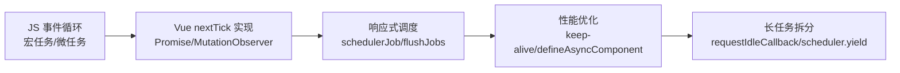
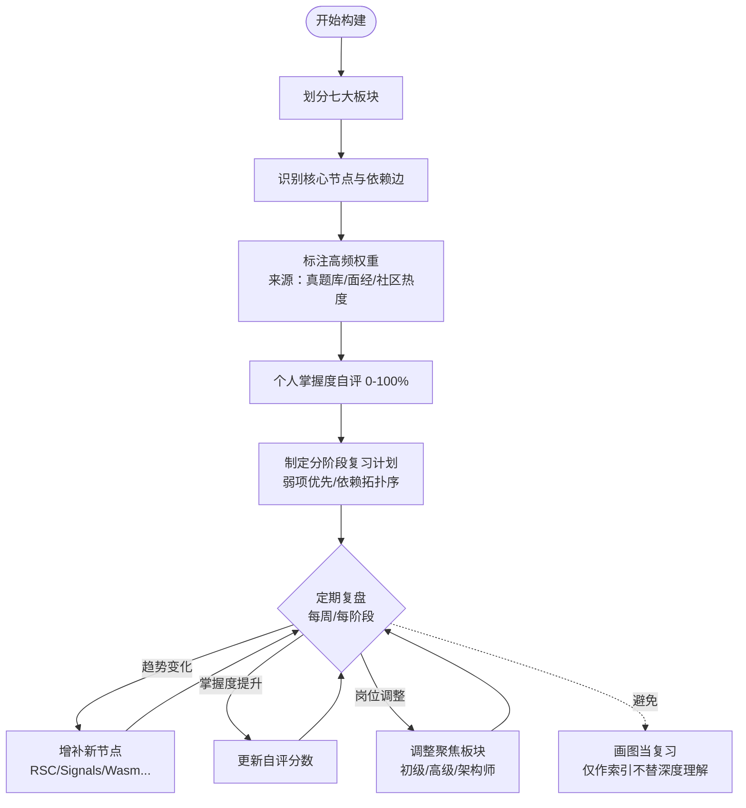
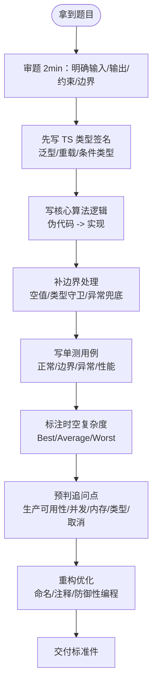
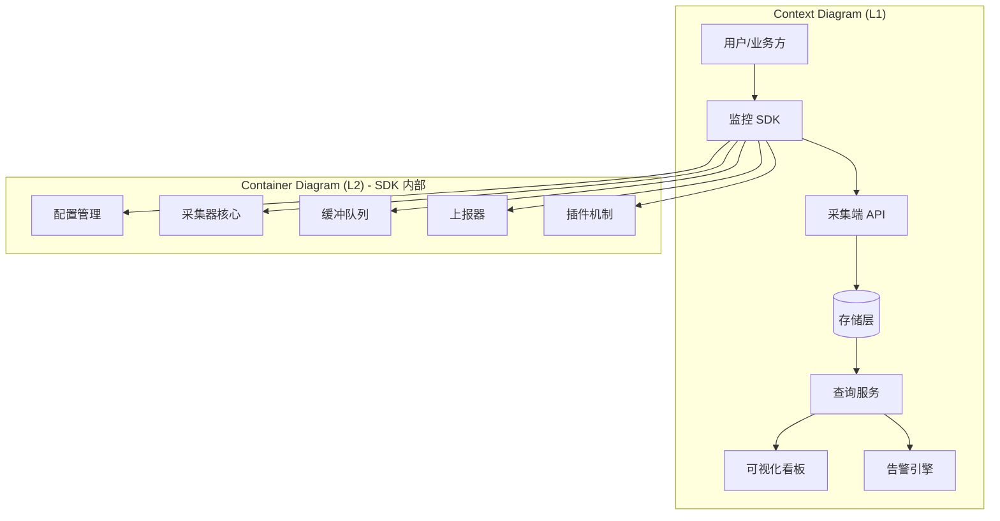
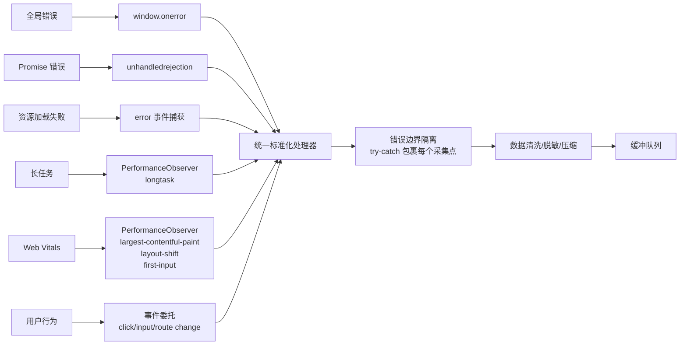
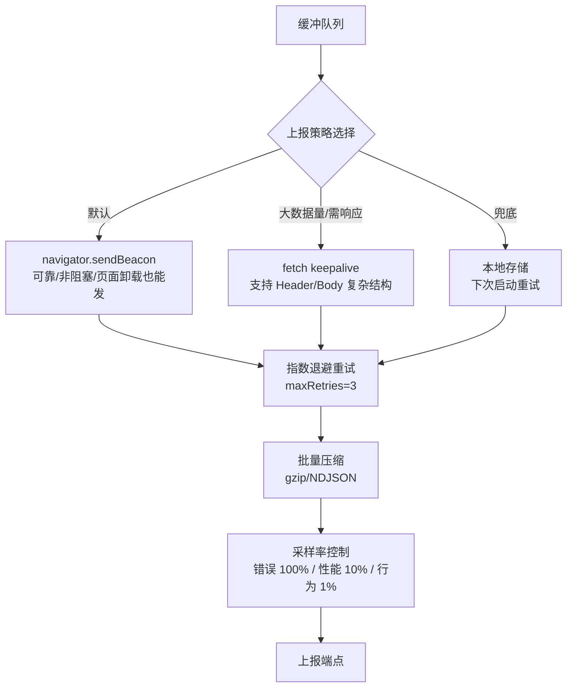
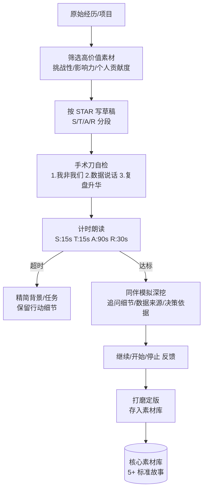
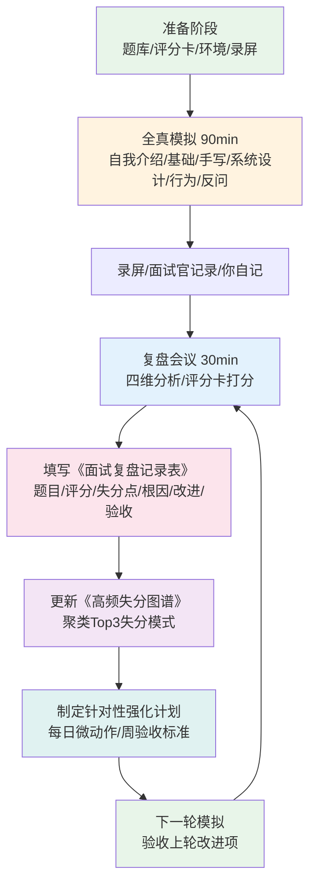

# 第 21 章 前端面试体系化备战 —— 从知识图谱构建到高频手写题与系统设计实战

## 学习目标

- 能够构建覆盖基础、框架、工程化、性能、安全、架构、软技能七大板块的前端知识图谱，并标注高频考点权重与个人掌握度
- 掌握高频手写题（防抖节流、深拷贝、发布订阅、Promise 系列、虚拟 DOM Diff、简易调度器）的标准实现、TypeScript 类型签名、边界处理、复杂度分析及面试追问点
- 熟练运用“需求澄清→架构草图→核心模块设计→数据流→非功能性指标→演进扩展”六步法框架解决系统设计题，并能产出架构图、技术选型表与风险缓解方案
- 建立基于 STAR 法则的行为面试素材库，能在 2 分钟内结构化讲清“最有挑战项目”“技术分歧解决”“推动新技术落地”等高频场景
- 具备组织模拟面试全流程（自我介绍、技术考察、系统设计、行为面试、反向提问）的能力，并能基于录屏复盘输出《面试复盘记录表》实现持续迭代
- **理解本章内容与前序章节（如第 20 章边缘渲染、GitOps/Argo CD 部署、容器化最佳实践）的知识依赖关系，能在系统设计与行为面试中调用相关工程化落地经验作为论据**

## 21.1 生活类比

想象前端面试备战是一场**“登顶珠峰”**的科学探险：

- **知识图谱** = **详细的登山地图与路线图**：标注核心节点(大本营)、依赖关系(攀登路线)、高频权重(危险冰裂缝)、掌握度(体能储备)，让你不走冤枉路、不漏关键点、按阶段适应海拔。
- **高频手写题** = **基本功训练（负重深蹲、绳结打法、冰镐自救）**：不是花架子，而是生死攸关的肌肉记忆。要求标准动作(规范)、应对极端情况(边界)、装备轻量高强(TS类型)、能应对突发状况(追问)。
- **系统设计框架** = **登顶攻坚战术会议（六步决策法）**：先澄清天气窗口期(需求澄清)、画草图定路线(架构草图)、攻克核心难点冰壁(核心模块)、规划补给线与撤退路(数据流/非功能/演进)，拒绝盲目冲顶(简历驱动)与背氧气瓶上珠峰(过度设计)。
- **STAR 行为面试** = **向赞助商/队友汇报过往战绩的‘战报’**：不讲‘我们队伍很强’，只讲‘我在海拔8000米独自架绳、救下队友、缩短路线2小时’(我非我们/数据说话)。背景交代1分钟，核心行动6分钟，成果量化1分钟。
- **模拟面试复盘** = **高海拔适应性训练与复盘复盘再复盘**：真穿装备、真背重、真缺氧(逼真环境)。下山后不看照片看数据(录屏/记录表)：呼吸频率(语速)、决策逻辑(结构)、眼神坚定度(自信)、绳结打得标不标准(代码规范)。教练只给三类建议：继续、开始、停止。下一轮冲顶，只为修正上一轮的失误。

## 21.2 概念地图

```markdown
前端面试体系化备战
├── 知识图谱构建
│   ├── 七大板块分类            —— 基础/框架/工程化/性能/安全/架构/软技能
│   ├── 节点与边定义              —— 知识点、依赖/包含/对比关系、高频权重
│   ├── 掌握度量化体系            —— 0-100% 自评、弱项聚焦、分阶段复习计划
│   └── 动态维护机制              —— 趋势增补节点、分岗位聚焦、避免画图当复习
├── 高频手写题专项攻克
│   ├── 核心题单                  —— 防抖节流/深拷贝/发布订阅/Promise/Diff/调度器
│   ├── 交付标准                  —— 标准实现/边界处理/TS类型签名/单测/复杂度/追问点
│   ├── 工程化规范                —— ESLint/Prettier/防御性编程/语义化命名/TS类型体操
│   ├── 追问延展维度              —— 生产可用性/并发安全/内存泄漏/类型收窄/取消功能
│   └── 实战约束                  —— 白板环境/15-20分钟时间盒/核心流程优先/算法理解而非背诵
├── 系统设计题实战框架
│   ├── 六步解题法                —— 需求澄清/架构草图/核心模块/数据流/非功能指标/演进扩展
│   ├── 产出物标准                —— C4架构图/技术选型对比表/风险缓解方案
│   ├── 关键环节深化              —— 澄清定边界(QPS/一致性)/抽核心难点/非功能显性化(SLA/安全/可维护)
│   ├── 典型场景库                —— 组件库/监控SDK/微前端基座/可视化平台
│   └── 避坑指南                  —— 拒绝简历驱动/避免过度设计/时间分配黄金比例(10/20/40/30)
├── 行为面试 STAR 法则
│   ├── STAR 结构化模版           —— Situation/Task/Action/Result
│   ├── 核心素材库                —— 挑战项目/技术分歧/新技术落地/故障复盘/跨部门协作
│   ├── 关键质量标准              —— 我非我们/数据说话(量化指标)/复盘升华(机制沉淀)
│   ├── 时间比例控制              —— 背景10%/任务10%/行动60%/结果20%
│   └── 反向提问准备              —— 技术挑战/债务偿还/成长路径等高质量问题
└── 模拟面试全流程复盘
    ├── 全流程覆盖                —— 自我介绍/基础手写/系统设计/行为/反向提问
    ├── 逼真环境模拟              —— 开摄像头/共享屏幕/白板工具/限时作答/压力测试
    ├── 四维复盘体系              —— 语速语调/逻辑结构/眼神交流/代码书写规范
    ├── 结构化反馈机制            —— 继续/开始/停止 三类建议/标准评分卡
    ├── 迭代闭环产出              —— 《面试复盘记录表》/高频失分图谱/针对性强化
    └── 执行边界                  —— 配合真题库并行/同伴质量要求/频次控制防焦虑
```

## 21.3 前端知识图谱构建 —— 为备战绘制“作战地图”

### 为什么需要这个概念？

面试考点碎片化、体系化程度低，缺乏全局视野导致复习漏洞百出。你需要将零散知识点串联成网络，明确核心节点与依赖关系，实现“以一敌百”。可视化地图支持个人掌握度自评，支撑分阶段、有重点的科学复习计划。

> "绘制思维导图/交互式图谱，标注核心节点、依赖关系、高频考点权重、个人掌握度自评，制定分阶段复习计划。"
> 
> —— 来源：《XxczdnuchoE7JtxZrO8cn4eGncb.md》（origin）

### 核心定义

**前端知识图谱** 将前端知识体系拆解为基础、框架、工程化、性能、安全、架构、软技能七大板块。节点为知识点，边为依赖/包含/对比关系，权重标注高频考点与个人掌握度。产物为思维导图或交互式图谱，作为复习导航与进度追踪工具。

**七大板块定义**（来源：《XxczdnuchoE7JtxZrO8cn4eGncb.md》，素材 ID: XxczdnuchoE7JtxZrO8cn4eGncb.md，origin）

下表列出了七大板块及其核心高频节点示例，帮助你快速定位复习重点：

| 板块 | 核心高频节点示例 |
|------|------------------|
| 基础 | 原型链、事件循环、闭包、类型转换、this 绑定、模块化 |
| 框架 | Vue 响应式原理、虚拟 DOM Diff、组合式 API、React Fiber、Hooks 规则 |
| 工程化 | Webpack/Vite 构建原理、Monorepo、CI/CD、脚手架、Micro-frontend |
| 性能 | Core Web Vitals、加载优化、渲染优化、Web Worker、内存泄漏排查 |
| 安全 | XSS/CSRF、CSP、SameSite、供应链安全、可信类型 |
| 架构 | 组件设计模式、状态管理、微前端、BFF、RSC、低代码 |
| 软技能 | 系统设计、STAR 行为面试、技术影响力、架构决策记录(ADR) |

### 关键性质

- **结构稳定性**：七大板块覆盖面试 90% 以上考点，长期有效
- **动态可度量**：掌握度可量化（如 0-100%），支持按弱项聚焦复习
- **依赖显性化**：揭示“JS 事件循环 -> 框架响应式原理 -> 性能优化”的先后依赖链

**依赖链示例**：



这个依赖图展示了基础板块的事件循环机制如何直接决定框架板块的异步更新策略，进而影响性能板块的长任务拆分方案。你在复习时应按拓扑顺序攻克，而非孤立记忆。结合第 20 章内容，边缘渲染（Edge SSR）与流式传输进一步依赖对事件循环与调度器的深度理解，可将此链路延伸至“边缘运行时调度策略”节点。

### 方法演进图：知识图谱构建与迭代流程



上图描述了从板块划分、节点识别、权重标注、掌握度自评到计划制定的完整流程，并显性化了“趋势增补”、“掌握度更新”、“岗位聚焦”三大动态维护回路，同时以虚线标出“画图当复习”的反模式警示。

### 典型例子

基础板块以原型链、事件循环、闭包、类型转换为核心高频节点；框架板块以 Vue 响应式、虚拟 DOM Diff、组合式 API 为核心高频节点；工程化板块以 Webpack/Vite 构建原理、Monorepo、CI/CD 为核心高频节点。这些节点在图谱中均标注为红色高权重，且通过依赖边与上下游板块关联。

### 边界条件

- 图谱非静态：需随面试趋势（如 RSC、信号、Wasm）动态增补节点
- 切勿贪大求全：初级岗聚焦基础/框架/工程化核心节点，高级岗补全架构/软技能
- 避免“画图当复习”：图谱是索引，深度理解仍需落实到手写代码与系统设计

### 设计中的取舍

**问：为什么不用单纯的“思维导图”而强调“知识图谱（节点+边+权重+掌握度）”？**

**答：** 思维导图仅表达“包含/层级”关系，无法表达“依赖/对比/互斥”等复杂拓扑，也缺乏权重与掌握度两个关键量化维度。知识图谱引入边类型（依赖/包含/对比）、权重（高频/低频）、掌握度（0-100%），使其成为可计算、可导航、可度量的复习决策系统，而非静态展示图。

**问：为什么不一次性画出全量细节节点（如每个 API、每个 Hook）？**

**答：** 全量细节会导致图谱膨胀至数千节点，维护成本极高且稀释核心重点。采用“核心节点+按需展开”策略：图谱仅保留高频核心节点（~200个），细节知识点以“子图/笔记链接”形式挂载，需要时钻取。这平衡了全局视野与维护成本。

**问：为什么掌握度自评用 0-100% 而非“会/不会”二值？**

**答：** 连续度量支持“弱项聚焦排序”（按掌握度升序、权重降序双键排序），二值无法区分“略懂皮毛”与“能手写源码”的巨大差距。0-100% 还能追踪随时间推移的提升曲线，验证复习有效性。

---

## 21.4 高频手写题专项攻克 —— 让代码成为“通关密语”

### 为什么需要这个概念？

手写题是验证“知其然知其所以然”最高效手段，区分“会用 API”与“懂原理”。考察编码规范、边界处理、TS 类型体操、复杂度分析等工程基本功。面试官常通过追问（并发安全、内存泄漏、类型收窄）考察思维深度。

> "提供标准实现、边界情况处理、TypeScript 类型签名、单元测试用例、时间/空间复杂度分析、面试官追问点预判。"
> 
> —— 来源：《XxczdnuchoE7JtxZrO8cn4eGncb.md》（origin）

### 核心定义

**高频手写题清单** 精选六大核心题型：防抖节流、深拷贝、发布订阅、Promise 系列、虚拟 DOM Diff、调度器简化版。每题包含：标准实现、边界情况处理、TypeScript 类型签名、单元测试用例、时空复杂度分析、追问点预判。

### 关键性质

- **规范先行**：代码风格统一（ESLint/Prettier）、变量命名语义化、防御性编程（空值/类型守卫）
- **TS 加分项**：泛型约束、条件类型、函数重载体现类型体操能力
- **追问延展**：从“实现功能”到“生产可用”（如防抖支持 leading/trailing/取消）

### 方法演进图：手写题标准化交付流水线



该流水线强调“类型先行、核心在中、边界在后、测试验证、复杂度标注、追问预判”的工程化交付节奏，避免“上来就写实现、最后才想类型”的本末倒置。

### 概念解析单元：Promise.all 标准实现与类型签名

**Promise.all 定义**（来源：《XxczdnuchoE7JtxZrO8cn4eGncb.md》，素材 ID: XxczdnuchoE7JtxZrO8cn4eGncb.md，origin；[MDN Web Docs - Promise.all](https://developer.mozilla.org/en-US/docs/Web/JavaScript/Reference/Global_Objects/Promise/all)）

`Promise.all` 接收一个可迭代对象，返回一个新的 Promise。当所有输入 Promise 都 fulfilled 时，新 Promise fulfilled，值为按输入顺序排列的值数组；任意一个 rejected，新 Promise 立即 rejected，理由为第一个 rejected 的理由。

**TypeScript 类型签名**：

```typescript
// 来源：《XxczdnuchoE7JtxZrO8cn4eGncb.md》，素材 ID: XxczdnuchoE7JtxZrO8cn4eGncb.md，origin；[TypeScript 官方文档 - 条件类型](https://www.typescriptlang.org/docs/handbook/2/conditional-types.html)
// 核心概念：PromiseAll
// 关键类型：PromiseAll<T extends readonly unknown[] | []>

type Awaited<T> = T extends PromiseLike<infer U> ? U : T;

interface PromiseConstructor {
  all<T extends readonly unknown[] | []>(values: T): Promise<{
    -readonly [K in keyof T]: Awaited<T[K]>
  }>;
}
```

这个类型签名展示了三个关键设计：(1) 使用 `readonly` 保护输入元组不被修改；(2) 通过映射类型 `{ -readonly [K in keyof T]: Awaited<T[K]> }` 保持元组顺序并展开每个元素的解析类型；(3) `Awaited` 递归解包 `PromiseLike`，支持嵌套 Promise 与非 Promise 值混合。

**标准实现**：

```typescript
// 来源：《XxczdnuchoE7JtxZrO8cn4eGncb.md》，素材 ID: XxczdnuchoE7JtxZrO8cn4eGncb.md，origin；[MDN Web Docs - Promise.all 实现参考](https://developer.mozilla.org/en-US/docs/Web/JavaScript/Reference/Global_Objects/Promise/all)
// 核心概念：PromiseAll
// 关键方法：promiseAll()

function promiseAll<T extends readonly unknown[] | []>(
  values: T
): Promise<{ -readonly [K in keyof T]: Awaited<T[K]> }> {
  // 边界：非可迭代对象
  if (values === null || values === undefined) {
    return Promise.reject(new TypeError('Argument must be iterable'));
  }

  // 边界：空数组快速 resolve
  const arr = Array.from(values);
  if (arr.length === 0) {
    return Promise.resolve([] as any);
  }

  return new Promise((resolve, reject) => {
    const results: unknown[] = new Array(arr.length);
    let remaining = arr.length;

    arr.forEach((value, index) => {
      // 包装非 Promise 值，统一用 Promise.resolve 处理 thenable
      Promise.resolve(value).then(
        (val) => {
          results[index] = val;
          remaining--;
          if (remaining === 0) {
            resolve(results as { -readonly [K in keyof T]: Awaited<T[K]> });
          }
        },
        (reason) => {
          // 竞态 reject：第一个拒绝即触发整体拒绝
          reject(reason);
        }
      );
    });
  });
}
```

这个实现展示了四个工程化细节：(1) `Array.from` 统一将可迭代对象转为数组，支持 `Set`/`Map`/Generator 等；(2) `Promise.resolve(value)` 统一包装，自动处理 thenable 与非 Promise 值；(3) `results[index] = val` 保证结果顺序与输入顺序一致，不受 resolve 先后顺序影响；(4) `remaining` 计数器实现“全 fulfilled 才 resolve，任一 rejected 即 reject”的竞态语义。

**时间/空间复杂度**：

下表给出了该实现的时间与空间复杂度分析：

| 指标 | 复杂度 | 说明 |
|------|--------|------|
| 时间 | O(n) | n 为输入数量，每个 Promise 仅触发一次 then 回调 |
| 空间 | O(n) | results 数组存储 n 个结果，闭包捕获 index/remaining |

**单元测试用例**：

```typescript
// 来源：《XxczdnuchoE7JtxZrO8cn4eGncb.md》，素材 ID: XxczdnuchoE7JtxZrO8cn4eGncb.md，origin；[Vitest 官方文档](https://vitest.dev/guide/)
// 核心概念：PromiseAll
// 关键测试：promiseAll.test.ts

import { promiseAll } from './promiseAll';
import { describe, test, expect } from 'vitest';

describe('promiseAll', () => {
  test('正常并发 resolve', async () => {
    const p1 = Promise.resolve(1);
    const p2 = Promise.resolve(2);
    await expect(promiseAll([p1, p2])).resolves.toEqual([1, 2]);
  });

  test('包含非 Promise 值', async () => {
    await expect(promiseAll([1, Promise.resolve(2), '3'])).resolves.toEqual([1, 2, '3']);
  });

  test('空数组快速 resolve', async () => {
    await expect(promiseAll([])).resolves.toEqual([]);
  });

  test('其中一个 reject 则整体 reject', async () => {
    const p1 = Promise.resolve(1);
    const p2 = Promise.reject(new Error('fail'));
    await expect(promiseAll([p1, p2])).rejects.toThrow('fail');
  });

  test('同步抛出错误被捕获', async () => {
    const p = Promise.resolve().then(() => { throw new Error('sync'); });
    await expect(promiseAll([p])).rejects.toThrow('sync');
  });

  test('输入非可迭代对象抛出 TypeError', async () => {
    // @ts-expect-error 故意传错类型测试运行时守卫
    await expect(promiseAll(null)).rejects.toThrow(TypeError);
  });
});
```

### 概念解析单元：简易任务调度器

**调度器定义**（来源：《XxczdnuchoE7JtxZrO8cn4eGncb.md》，素材 ID: XxczdnuchoE7JtxZrO8cn4eGncb.md，origin；[React Scheduler 源码分析](https://github.com/facebook/react/tree/main/packages/scheduler)；[WHATWG HTML 规范 - MessageChannel](https://html.spec.whatwg.org/multipage/web-messaging.html#messagechannel)）

简易任务调度器基于 `MessageChannel` 或 `setTimeout` 实现微任务级调度，支持任务优先级（高/普通/低）、任务取消、任务超时处理。提供 `scheduleTask(callback, priority, timeout)` 接口，返回包含 `cancel()` 方法的句柄。

**核心数据结构**：

```typescript
// 来源：《XxczdnuchoE7JtxZrO8cn4eGncb.md》，素材 ID: XxczdnuchoE7JtxZrO8cn4eGncb.md，origin；[scheduler.postTask 提案](https://github.com/WICG/scheduling-apis)
// 核心概念：TaskScheduler
// 关键类型：TaskHandle / Priority

type Priority = 'high' | 'normal' | 'low';

interface TaskHandle {
  cancel: () => void;
}

interface Task {
  id: number;
  callback: () => void;
  priority: Priority;
  timeout: number;
  cancelled: boolean;
  timerId?: ReturnType<typeof setTimeout>;
}
```

**MessageChannel 实现核心逻辑**：

```typescript
// 来源：《XxczdnuchoE7JtxZrO8cn4eGncb.md》，素材 ID: XxczdnuchoE7JtxZrO8cn4eGncb.md，origin；[React Scheduler 实现参考](https://github.com/facebook/react/blob/main/packages/scheduler/src/SchedulerPriorities.js)
// 核心概念：TaskScheduler
// 关键方法：scheduleTask()

class TaskScheduler {
  private queues: Map<Priority, Task[]> = new Map([
    ['high', []],
    ['normal', []],
    ['low', []]
  ]);
  private taskId = 0;
  private channel: MessageChannel;
  private port: MessagePort;
  private isFlushing = false;

  constructor() {
    this.channel = new MessageChannel();
    this.port = this.channel.port1;
    this.channel.port2.onmessage = () => this.flush();
  }

  scheduleTask(callback: () => void, priority: Priority = 'normal', timeout = 0): TaskHandle {
    const id = ++this.taskId;
    const task: Task = { id, callback, priority, timeout, cancelled: false };

    // 优先级入队：high 优先，同优先级 FIFO
    this.queues.get(priority)!.push(task);

    // 超时处理
    if (timeout > 0) {
      task.timerId = setTimeout(() => {
        if (!task.cancelled) {
          task.cancelled = true;
          this.removeTask(task);
          // 超时通常视为 rejected，这里简化为不执行
        }
      }, timeout);
    }

    // 触发调度
    if (!this.isFlushing) {
      this.isFlushing = true;
      this.port.postMessage(null); // 微任务级触发
    }

    return {
      cancel: () => {
        if (!task.cancelled) {
          task.cancelled = true;
          if (task.timerId) clearTimeout(task.timerId);
          this.removeTask(task);
        }
      }
    };
  }

  private removeTask(task: Task): void {
    const queue = this.queues.get(task.priority)!;
    const idx = queue.indexOf(task);
    if (idx !== -1) queue.splice(idx, 1);
  }

  private flush(): void {
    this.isFlushing = false;
    // 按优先级顺序执行：high -> normal -> low
    for (const priority of ['high', 'normal', 'low'] as Priority[]) {
      const queue = this.queues.get(priority)!;
      while (queue.length > 0) {
        const task = queue.shift()!;
        if (task.cancelled) continue;
        try {
          task.callback();
        } catch (e) {
          console.error('Task execution error:', e);
        }
      }
    }
  }
}
```

这段实现展示了：(1) `MessageChannel` 实现微任务级调度，比 `setTimeout` 更精准、延迟更低；(2) 多队列按优先级存储，`flush` 时按 `high > normal > low` 顺序排空；(3) `cancel()` 通过标记位 + 队列移除实现 O(1) 取消；(4) 超时通过 `setTimeout` 守卫，超时任务标记取消并从队列移除。

**追问示例：主线程繁忙时 MessageChannel 表现**

> 当主线程被长任务阻塞（>50ms）时，`MessageChannel` 的 `onmessage` 回调仍会排队等待，无法按时执行。改进方案：结合 `requestIdleCallback` 在空闲期执行低优先级任务，或使用 `scheduler.yield()`（源自 `scheduler` 包 / [提案](https://github.com/WICG/scheduling-apis)）主动让出主线程，配合 `isInputPending()` 判断用户输入优先处理。现代调度器（如 React Scheduler）采用“优先级通道 + 时间切片 + 惰性调度”组合策略。

### 追问延展维度

面试官常从以下维度追问，你需要准备好应对方案：

下表总结了五大追问维度的核心考点与典型应对方案：

| 追问维度 | 核心考点 | 典型应对方案 |
|----------|----------|--------------|
| 生产可用性 | 10万长度数组导致微任务队列堆积、内存占用 | 分批执行、并发限制、使用 `Promise.allSettled` 避免短路 |
| 并发安全 | 并发数过大导致文件描述符耗尽/网络拥塞 | 引入 `Semaphore` / `p-limit` 限制并发度 |
| 内存泄漏 | 长数组持有结果引用、闭包捕获大对象 | 分批清理、弱引用、及时置空 |
| 类型收窄 | `Awaited` 在条件类型分发中的行为 | 理解分布式条件类型、联合类型展开 |
| 取消功能 | 外部取消信号（AbortSignal）集成 | 封装 `promiseAllWithAbort`，监听 `abort` 事件调用 `reject` |

**追问示例：Promise.all 10万长度性能隐患**

> 如果输入数组长度为 10万，且每个 Promise 耗时不一，微任务队列会一次性堆积 10万 个 `then` 回调，导致主线程长时间阻塞，甚至 OOM。优化方案：实现 `promiseAllWithConcurrency(limit)`，维护一个执行中计数器，仅当 `running < limit` 时启动下一个 Promise，利用微任务队列的“先进先出”特性实现滑动窗口并发控制。

### 边界条件

- 手写非背诵：须理解核心算法（如 Diff 双指针/最长递增子序列）而非死记模板
- 环境约束：白板/共享文档无 IDE 提示，需练习纯手写无报错
- 时间盒：单题 15-20 分钟，优先写核心流程再补边界与类型

### 设计中的取舍

**问：为什么 Promise.all 实现不用 `Promise.allSettled` 语义（全 settled 后再 resolve）？**

**答：** `Promise.all` 的语义是“短路失败、快速失败”，符合大多数业务场景“任一失败即终止”的预期。若需“全执行完再聚合结果”，应显式使用 `Promise.allSettled`。实现时若改为 allSettled 语义，会破坏标准库契约，且无法通过测试用例中的“任一 reject 即整体 reject”验收。

**问：为什么调度器用 `MessageChannel` 而不直接用 `queueMicrotask` 或 `Promise.then`？**

**答：** `queueMicrotask`/`Promise.then` 产生的微任务会在当前调用栈清空后立即执行，无法实现“任务分批、优先级插队、时间切片”。`MessageChannel` 的 `port.postMessage` 产生的任务属于“微任务检查点”之后的独立任务队列，浏览器保证其在下一帧渲染前执行，且可通过 `port.onmessage` 回调实现可控的批量 flush，这是构建优先级调度器的最小可用原语。

**问：为什么调度器不直接用 `requestIdleCallback` 处理所有低优先级任务？**

**答：** `requestIdleCallback` 在部分浏览器（如 Safari 旧版）不支持，且其 deadline 机制适合“利用碎片时间做非紧急工作”，不适合“保证高优先级任务优先执行、低优先级任务可被饿死但最终执行”的调度语义。生产级调度器通常采用“MessageChannel 驱动高/中优先级 + requestIdleCallback 托底低优先级”的混合策略。

---

## 21.5 系统设计题实战框架 —— 从“画图”到“做架构决策”

### 为什么需要这个概念？

系统设计题无标准答案，考察抽象建模、权衡取舍、工程落地综合能力。缺乏结构化框架易陷入“功能罗列”而非“架构设计”，忽略非功能性指标。需要一套可复用、可落地的解题范式应对开放性问题（可视化平台/组件库/监控 SDK/微前端基座）。

> "套用框架解决“设计一个可视化搭建平台/组件库/监控 SDK/微前端基座”等开放性问题，输出架构图、技术选型表、风险缓解方案。"
> 
> —— 来源：《XxczdnuchoE7JtxZrO8cn4eGncb.md》（origin）

### 核心定义

**六步法框架**：需求澄清 → 架构草图 → 核心模块设计 → 数据流 → 非功能性指标 → 演进扩展。产出物：架构图（C4 模型）、技术选型表（对比优劣）、风险缓解方案。

### 关键性质

- **需求澄清定边界**：用户量/QPS/数据量/实时性/一致性/多端/团队技术栈
- **核心模块抽核心**：识别核心难点（如可视化平台的 Schema 设计/渲染引擎/撤销重做）
- **非功能显性化**：可用性（SLA/降级/熔断）、性能（缓存/分页/懒加载）、安全（XSS/CSP/权限）、可维护性（模块解耦/文档/测试）

### 方法演进图：系统设计六步法全景流程

```mermaid
graph TD
    Start([接到题目]) --> Clarify[步骤1：需求澄清<br/>8大维度定边界]
    Clarify --> C4Context[步骤2：架构草图<br/>C4 Context图：系统边界/外部依赖]
    C4Context --> C4Container[C4 Container图：核心服务/存储/队列]
    C4Container --> CoreModule[步骤3：核心模块设计<br/>识别核心难点/数据结构/算法/接口契约]
    CoreModule --> Dataflow[步骤4：数据流<br/>端到端链路/关键JSON Schema/标准化]
    Dataflow --> NonFunc[步骤5：非功能性指标<br/>SLA/性能/安全/可维护性/具体数值目标]
    NonFunc --> Evolution[步骤6：演进扩展<br/>V1/V2/V3路线图/技术债偿还/生态化]
    Evolution --> Deliver[产出物：C4架构图/选型表/风险缓解方案]
    Deliver --> Review{面试官追问<br/>权衡/边界/演进}
    Review -->|权衡取舍| Tradeoff[显性化Trade-off<br/>一致性vs可用性/延迟vs吞吐/成本vs收益]
    Review -->|边界条件| EdgeCase[极端场景预案<br/>错误风暴/热点Key/网络分区]
    Review -->|演进路径| Debt[技术债识别/偿还计划]
    Tradeoff --> Pass[通过]
    EdgeCase --> Pass
    Debt --> Pass
```

该流程图将六步法串联为可执行的标准动作序列，并在末尾显性化了面试官追问的三大典型维度（权衡取舍、边界条件、演进路径）及其应对模式。

### 系统设计六步法详解

#### 步骤 1：需求澄清 —— 定边界

在动笔前，必须通过提问锁定设计边界。以下是通用的 8 个关键澄清维度：

下表列出了需求澄清的八大关键维度、核心问题及其对设计的影响：

| 维度 | 关键问题 | 设计影响 |
|------|----------|----------|
| 规模 | 日活/峰值 QPS/数据量增长预期 | 单机 vs 集群、存储选型、分片策略 |
| 实时性 | 端到端延迟预算（ms 级/秒级/天级） | 流式 vs 批处理、缓存层设计 |
| 一致性 | 强一致/最终一致/可接受的数据丢失率 | 写路径设计、WAL、幂等键 |
| 多端 | Web/H5/小程序/Node/原生 | SDK 体积预算、API 兼容层 |
| 接入方式 | NPM 包/CDN 脚本/偷偷注入 | 打包产物、全局变量污染、版本管理 |
| 数据敏感性 | PII/业务机密/合规要求 | 脱敏、加密、本地合规存储 |
| 团队技术栈 | 语言/框架/基建成熟度 | 选型约束、维护成本、招聘门槛 |
| SLA 目标 | 可用性/错误率/告警响应时间 | 降级/熔断/多活/演练机制 |

#### 步骤 2：架构草图 —— C4 模型

使用 C4 模型分层绘图，从宏观到微观（[C4 Model 官方规范](https://c4model.com/)）：



#### 步骤 3：核心模块设计 —— 攻克难点

以“前端监控 SDK”为例，重点设计两个难点模块：

**采集器设计**：



采集器核心原则：**零侵入**（不修改业务代码）、**容错**（单点采集失败不影响主业务/其他采集）、**标准化**（统一输出 JSON Schema）。

**上报器设计**：



上报器核心指标：**可靠性**（Beacon + 兜底）、**性能开销**（批量 + 压缩 + 采样）、**自适应**（错误风暴时自动提高采样率/限流）。

#### 步骤 4：数据流 —— 端到端链路

一条错误数据从触发到入库的完整链路：

```
1. window.onerror(msg, url, line, col, error) 触发
2. 采集器标准化处理器提取：
   - message: string
   - stack: string (error.stack 解析规范化)
   - type: 'js' | 'promise' | 'resource' | 'vital' | 'behavior'
   - timestamp: number (Date.now())
   - url: location.href
   - userAgent: navigator.userAgent
   - sessionId: UUID (会话标识)
   - userId?: string (脱敏后)
   - context: { viewport, connection, customTags }
3. 推入缓冲队列 (环形缓冲区，防 OOM)
4. 上报器按批次/定时/页面卸载触发发送
5. 网关接入：解析/校验/写入 Kafka/ClickHouse
6. 实时流计算：聚合指标/告警判定
7. 入库：ClickHouse (宽表) / Elasticsearch (全文检索)
```

**标准 JSON Schema**：

```json
{
  "$schema": "http://json-schema.org/draft-07/schema#",
  "type": "object",
  "required": ["eventId", "type", "timestamp", "payload"],
  "properties": {
    "eventId": { "type": "string", "format": "uuid" },
    "type": { "enum": ["error", "performance", "behavior"] },
    "timestamp": { "type": "integer", "minimum": 0 },
    "payload": {
      "type": "object",
      "properties": {
        "message": { "type": "string" },
        "stack": { "type": "string" },
        "url": { "type": "string", "format": "uri" },
        "userAgent": { "type": "string" },
        "sessionId": { "type": "string" },
        "customTags": { "type": "object" }
      }
    }
  }
}
```

#### 步骤 5：非功能性指标 —— 显性化承诺

下表给出了监控 SDK 需承诺的具体非功能性指标目标：

| 指标 | 目标值 | 验收方式 |
|------|--------|----------|
| SDK 体积 | < 15 KB (gzip) | `rollup-plugin-visualizer` + CI 门禁 |
| 首屏性能影响 | TBT 增量 < 50ms | Lighthouse CI 对比基线 |
| 数据上报成功率 | > 99.9% | 端到端链路埋点 + 兜底存储对账 |
| 端到端延迟 | < 5s (P99) | 采集端 timestamp 与入库时间对比 |
| 采样率自适应 | 错误 100% / 性能 10% / 行为 1%<br/>错误风暴时性能/行为降至 0.1% | 配置中心动态下发，SDK 热更新 |

#### 步骤 6：演进扩展 —— V2 路线图

下表规划了监控 SDK 的多版本演进路线图：

| 版本 | 核心能力 | 技术突破点 |
|------|----------|------------|
| V1 | 基础监控 | 采集/上报/存储/查询/告警闭环 |
| V2 | 深度诊断 | Source Map 自动解析还原源码堆栈、会话回放 (rrweb)、关联后端 TraceID (W3C TraceContext) |
| V3 | 智能化 | 异常聚类归因、根因分析 Agent、自动化回归测试生成 |
| V4 | 生态化 | 插件市场、OpenTelemetry 兼容、多语言 SDK 统一语义约定 |

### 避坑指南

下表总结了系统设计面试中常见的三大反模式及其正确姿势：

| 反模式 | 后果 | 正确姿势 |
|--------|------|----------|
| 简历驱动设计 | 只谈熟悉技术，忽视场景适配性 | 从需求出发，技术服务业务，陌生技术敢说“需调研” |
| 过度设计 | 早期上分布式/Service Mesh，交付延期 | 强调演进路径：单体 → 模块化单体 → 微服务 |
| 时间失控 | 画图 40 分钟，核心模块 5 分钟草草收尾 | 黄金比例：澄清 10% / 草图 20% / 核心模块 40% / 数据流+非功能+演进 30% |

**跨章节关联提示**：在“演进扩展”环节，可结合第 20 章“边缘渲染架构”与“GitOps/Argo CD 部署流水线”作为 V2/V3 版本的技术债偿还与架构演进案例，展示对全栈工程化落地的系统性思考。

---

## 21.6 行为面试 STAR 法则 —— 用故事证明“软实力”硬指标

### 为什么需要这个概念？

大厂面试重“软技能”（沟通/推动/抗压/成长性），行为面试权重常达 30-50%。无结构表达易跑题、细节缺失、无法量化贡献，导致面试官无法评级。需标准化素材库与话术模版，实现“2 分钟讲清故事、证据确凿、亮点突出”。

> "构建 Situation/Task/Action/Result 素材库、练习 2 分钟讲清故事、准备“最有挑战项目”“技术分歧解决”“推动新技术落地”标准答案。"
> 
> —— 来源：《XxczdnuchoE7JtxZrO8cn4eGncb.md》（origin）

### 核心定义

**STAR 模版**：Situation（背景）、Task（任务/目标）、Action（关键行动/决策）、Result（量化结果/复盘）。**核心素材库**：最有挑战项目、技术分歧解决、推动新技术落地、线上故障复盘、跨部门协作冲突。

### 关键质量标准

下表对比了行为面试回答的反例与正例，明确了三大质量标准：

| 标准 | 要求 | 反例 | 正例 |
|------|------|------|------|
| **我非我们** | Action 必须强调“个人”关键决策/代码/沟通/推动 | “我们重构了组件库” | “我主导设计了 Monorepo 方案，编写了核心构建脚本，推动 3 个组完成迁移” |
| **数据说话** | Result 必含量化指标，且有来源可溯源 | “性能大幅提升” | “首屏 LCP 从 3.2s 降至 1.8s (Lighthouse CI 对比报告)，TBT 降低 60%” |
| **复盘升华** | 失败案例重点讲“事后改进机制” | “以后会注意” | “建立了发布前核心链路 E2E 必跑机制，接入 ARGO CD 灰度发布，同类事故 6 月零发生” |

### 时间比例控制

背景 10%（~15s） → 任务 10%（~15s） → 行动 60%（~90s） → 结果 20%（~30s）。总计约 2.5 分钟。

### 方法演进图：STAR 故事从素材到交付的标准化流水线



该流水线将原始经历通过“筛选→草稿→手术刀自检→计时→同伴压测→反馈打磨”六道工序转化为标准化交付件，确保每个故事经得起深挖且符合时长约束。

### 典型例子

**场景：推动新技术落地（引入 Vite 替代 Webpack）**

- **Situation**：团队维护 5 个老旧 Webpack 4 项目，冷启动 45s，HMR 3s，开发体验差，升级 Webpack 5 风险大且收益有限。
- **Task**：调研并落地 Vite 迁移方案，目标：冷启动 < 3s、HMR < 200ms、零业务感知迁移。
- **Action**：
  1. **调研选型**（1周）：对比 Vite/Webpack 5/Turbopack，产出 ADR 文档，对比构建速度/生态兼容/迁移成本三维度。
  2. **PoC 验证**（1周）：选最复杂项目试点，解决 `commonjs` 依赖预构建、CSS Modules 迁移、环境变量兼容等 12 个坑，输出《迁移指南》。
  3. **工具化赋能**（3天）：开发 `codemod` 脚本自动转换 80% 配置/导入语法，封装 `@team/vite-config` 统一预设。
  4. **分批灰度**（2周）：先内部工具项目 → 低流量业务 → 核心交易链路，每阶段跑全量 E2E + 性能基准对比。
  5. **培训推广**（1周）：组织 3 场分享会，录制最佳实践视频，建立 FAQ 文档。
- **Result**：
  - 冷启动 45s → 1.2s (**97% 提升**)，HMR 3s → 80ms (**97% 提升**)，CI 构建耗时 12min → 3min (**75% 提升**)，数据来源：GitLab CI 历史记录 + Lighthouse CI 基线对比。
  - 5 个项目 2 周内全量迁移，**零回滚**、**零 P0 故障**。
  - 沉淀《Vite 迁移最佳实践》文档，被部门 10+ 团队复用，节省人周 200+。

### 核心素材库清单

你需要准备至少 5 个故事，覆盖以下高频场景：

1. **最有挑战项目**：技术难度高、业务价值大、你个人贡献关键
2. **技术分歧解决**：方案 A/B 争执、你如何用数据/实验/专家评审达成共识
3. **推动新技术落地**：从调研到 PoC 到全量推广的完整闭环
4. **线上故障复盘**：发现/定位/止损/复盘/机制沉淀全流程
5. **跨部门协作冲突**：需求变更/资源争夺/优先级不一致，你如何沟通对齐

### 反向提问准备

准备 2-3 个高质量问题，传递“长期主义”与“工程化思维”：

下表列出了三个高质量反向提问及其传递的信号：

| 问题 | 传递信号 |
|------|----------|
| “团队目前最大的技术挑战/技术债是什么？规划怎么偿还？” | 关注长期架构健康、有主人翁意识 |
| “新人入职前 3 个月的成长路径/导师制/考核标准是怎样的？” | 重视成长、看重工程化培养体系 |
| “团队如何做技术决策？有没有 ADR/RFC 机制？” | 认同工程化决策流程、非人治 |

### 设计中的取舍

**问：为什么 STAR 中 Action 占 60% 时间，而 Situation/Task 只占 20%？**

**答：** 面试官评估的是“个人能力与决策质量”，背景与任务只是铺垫，唯有 Action 能展示你如何拆解问题、权衡方案、协调资源、攻克难点。若背景过长，面试官会判定为“缺乏重点、沟通低效”；若 Action 单薄，则无法评级。60% 是最小可行比例，确保关键决策点、代码细节、沟通动作逐个落地。

**问：为什么强调“我非我们”，难道团队协作不重要？**

**答：** 团队协作是基线，面试考察的是“你在团队中的杠杆作用”。完全归因团队（全程“我们”）会导致面试官无法区分你是核心驱动者还是搭便车者。正确做法：用“我们”描述团队成果背景，用“我”描述关键决策节点的个人动作，如“我提议方案 A”、“我编写核心模块”、“我组织跨组评审”。

**问：失败故事如何讲才是加分项？**

**答：** 失败故事的核心不是“失败本身”，而是“复盘机制的建立与生效”。结构：简述失败现象（10%）→ 个人在止损/定位中的关键行动（30%）→ 事后建立的防复发机制（流程/工具/文档/演练）（40%）→ 机制运行后的验证数据（20%）。这展示了“成长型思维”与“系统性解决问题能力”，远比成功故事更能体现高阶工程师素质。

---

## 21.7 模拟面试全流程复盘 —— 在“实战演练”中修正“认知偏差”

### 为什么需要这个概念？

单独刷题≠面试能力：面试包含心理压力、表达节奏、代码书写规范、交互沟通等隐性维度。真实面试不可复现，模拟面试提供低成本试错环境，暴露“自以为会、一写就废”盲区。复盘机制将隐性经验显性化，形成可迭代的个人面试 SOP。

> "组织同伴/导师模拟真实面试环节、录屏复盘语速/逻辑/眼神/代码书写规范、输出《面试复盘记录表》持续迭代提升通过率。"
> 
> —— 来源：《XxczdnuchoE7JtxZrO8cn4eGncb.md》（origin）

### 核心定义

**全流程模拟**：自我介绍 → 基础/手写/系统设计/行为/反向提问，计时、录屏、同伴/导师扮演面试官。  
**复盘四维**：语速语调/逻辑结构/眼神交流/代码书写规范（变量命名/格式/注释/边界处理）。  
**产出物**：《面试复盘记录表》含题目、表现评分、失分点、改进动作、下次验收标准。

### 关键性质

- **环境逼真**：开摄像头/共享屏幕/白板工具/限时作答，模拟真实压力与工具限制
- **反馈结构化**：面试官给“继续/开始/停止”三类建议，避免模糊鼓励
- **迭代闭环**：每周 1-2 次模拟，记录表累积形成个人“高频失分图谱”，针对性强化

### 方法演进图：模拟面试-复盘-迭代闭环



该闭环图展示了从准备、模拟、录屏、复盘、记录表填写、失分图谱聚类、强化计划制定到下一轮验收的完整迭代路径，颜色区分了准备/实战/复盘/记录/分析/规划/验收七个阶段。

### 模拟面试标准流程（90 分钟）

下表定义了 90 分钟全真模拟面试的标准流程、各环节时长与考察重点：

| 环节 | 时长 | 考察重点 | 面试官关注点 |
|------|------|----------|--------------|
| 自我介绍 | 3 min | 背景匹配度、表达逻辑 | 亮点项目、技术栈广度、求职动机 |
| 基础八股文 | 10 min | 知识广度/准确性 | 事件循环/闭包/原型/Vue-React 响应式/HTTP/渲染管线 |
| 手写题 | 20 min | 编码规范/边界/TS/追问 | 变量命名/类型签名/算法正确性/复杂度/生产可用性 |
| 系统设计 | 30 min | 架构思维/权衡/落地 | 需求澄清完整性/C4 图/核心难点/非功能指标/演进 |
| 行为面试 | 15 min | 软技能/影响力/复盘 | STAR 结构/我非我们/量化结果/复盘机制 |
| 反向提问 | 5 min | 长期意向/思维深度 | 问题质量/是否做过功课 |

### 面试复盘记录表（标准模版）

复盘表是迭代的核心载体，建议用 Markdown 表格或 Excel 维护。下面是标准模版示例：

| 环节 | 题目 | 表现评分(1-5) | 核心失分点(具体到代码行/逻辑跳跃/措辞) | 根因分析(知识盲区/紧张/表达习惯/时间管理) | 改进动作(具体可执行/可验收) | 下次验收标准 |
|------|------|----------------|------------------------------------------|------------------------------------------------|----------------------------------|----------------|
| 手写 | Promise.all | 3 | TS泛型约束写错导致推断失败；未处理可迭代对象边界 | TS 条件类型/分布式条件类型不熟；边界意识弱 | 1. 重写 3 遍 Promise.all TS 版 2. 补《TypeScript 类型体操》条件类型章节 3. 建立‘手写前先写类型签名’肌肉记忆 | 下次模拟手写 TS 签名零报错、边界全覆盖 |
| 系统设计 | 监控 SDK | 2 | 未澄清 QPS/采样率直接设计；非功能指标仅口头提及无具体数值 | 框架不熟练；非功能指标无感知 | 1. 背诵 8 项需求澄清清单 2. 补《系统设计面试指南》非功能章节 3. 每次设计必须产出指标表 | 下次模拟前 5 分钟必问完澄清清单，产出含具体数值的指标表 |
| 行为 | 推动 Vite 落地 | 4 | Action 中“我们”过多，个人贡献模糊 | 习惯性归功团队 | 1. 重写故事草稿，逐句替换“我们” 2. 练习 2 分钟限时朗读 | 下次模拟 Action 全程“我”，细节可追问不卡壳 |

### 典型复盘案例

**案例 1：手写题卡壳**  
复盘发现因变量命名混淆（`res`/`result`/`results` 混用）导致逻辑错误。  
→ 改进动作：练习标准命名模版（`result`/`results`/`item`/`idx`），先写伪代码再写实现。

**案例 2：系统设计跑题**  
复盘发现未澄清 QPS 直接上分布式方案，面试官打断追问单机极限。  
→ 改进动作：背诵 8 项需求澄清清单，练习 5 分钟画 C4 Context 图。

**案例 3：行为面试空洞**  
复盘发现 Action 多用“我们”，面试官追问“你具体做了什么”时卡壳。  
→ 改进动作：重写 3 个核心故事 STAR 草稿，逐句标注个人动作。

### 执行边界

- 模拟非替代真题：需配合真题库、八股文背诵、项目深度复盘并行
- 同伴质量：扮演面试官者需有一定面试经验或按标准评分卡打分，否则反馈失真
- 频次控制：高强度模拟易焦虑，建议每次 60-90 分钟，间隔 1-2 天消化复盘

### 设计中的取舍

**问：为什么复盘四维包含“眼神交流”，这在远程面试（关摄像头）中不适用？**

**答：** 远程面试中“眼神交流”映射为“注视摄像头而非屏幕/笔记”。不看摄像头会被判定为“缺乏自信/在作弊/注意力不集中”。复盘时应检查录屏中眼神是否聚焦摄像头，必要时贴便利贴提醒。若公司明确允许关摄像头，可替换为“语音语调的起伏与停顿控制”作为第四维。

**问：为什么反馈机制限定“继续/开始/停止”三类，而不用“优点/缺点/建议”三维？**

**答：** “优点/缺点”易滑向主观评价（“你很聪明/你太紧张”），无法落地执行。“继续/开始/停止”强制面试官给出可执行的行为级指令：继续做某具体动作、开始做某缺失动作、停止做某错误动作。这直接对应改进动作的可验收性。

**问：为什么建议每周 1-2 次模拟，而非每天一次？**

**答：** 高强度模拟消耗大量认知带宽与情绪能量，每天一次会导致“复盘质量下降、焦虑累积、边际收益递减”。1-2 次/周保证有 2-3 天消化期：第 1 天复盘填表、第 2 天针对性强化、第 3 天轻量复习/心理建设，形成“刺激-恢复-超量恢复”的训练周期。

---

## 21.8 本章小结

这一章中我们学习了如何将前端面试备战体系化、工程化。首先，我们构建了覆盖七大板块的**前端知识图谱**，将碎片知识点串联为可视化、可度量的复习导航；其次，我们攻克了**高频手写题专项**，建立了包含标准实现、TS 类型签名、单测、复杂度分析、追问预判的六要素交付标准；接着，我们掌握了**系统设计六步法框架**，从需求澄清到演进扩展，产出 C4 架构图、技术选型表、风险缓解方案，实现从“画图”到“做架构决策”的跨越；然后，我们内化了**行为面试 STAR 法则**，构建了“挑战项目/技术分歧/新技术落地/故障复盘/跨部门协作”五大核心素材库，确立“我非我们/数据说话/复盘升华”三大质量标准；最后，我们建立了**模拟面试全流程复盘机制**，通过逼真环境、四维复盘、结构化反馈、迭代闭环，输出《面试复盘记录表》与个人高频失分图谱，实现持续进化。

本章我们一起学习了以下概念：

下表汇总了本章核心概念及其解释：

| 概念 | 解释 |
|------|------|
| 前端知识图谱 | 七大板块可视化地图，标注核心节点、依赖关系、高频权重与掌握度，作为复习导航与进度追踪工具 |
| 七大板块 | 基础、框架、工程化、性能、安全、架构、软技能，覆盖面试 90% 以上考点 |
| 掌握度量化 | 0-100% 自评体系，支持按弱项聚焦复习，实现动态可度量 |
| 高频手写题清单 | 防抖节流、深拷贝、发布订阅、Promise 系列、虚拟 DOM Diff、调度器简化版六大核心题型 |
| 手写题交付标准 | 标准实现、边界处理、TS 类型签名、单测用例、时空复杂度、追问点预判六要素 |
| 工程化规范 | ESLint/Prettier 风格统一、防御性编程、语义化命名、TS 类型体操加分项 |
| 系统设计六步法 | 需求澄清→架构草图→核心模块设计→数据流→非功能性指标→演进扩展 |
| 系统设计产出物 | C4 架构图、技术选型对比表、风险缓解方案 |
| 非功能性指标显性化 | 可用性(SLA/降级)、性能(缓存/分页)、安全(XSS/CSP)、可维护性(解耦/测试)必须显性设计 |
| STAR 法则 | Situation(背景)/Task(任务)/Action(关键行动)/Result(量化结果)结构化讲故事框架 |
| 核心素材库 | 最有挑战项目、技术分歧解决、推动新技术落地、线上故障复盘、跨部门协作冲突五大必备故事 |
| 行为面试质量标准 | 我非我们(个人贡献)、数据说话(量化指标)、复盘升华(机制沉淀) |
| 模拟面试全流程 | 自我介绍→基础/手写/系统设计/行为/反向提问，计时、录屏、同伴/导师扮演面试官 |
| 四维复盘体系 | 语速语调、逻辑结构、眼神交流、代码书写规范(命名/格式/注释/边界) |
| 结构化反馈 | 继续/开始/停止 三类建议，避免模糊鼓励 |
| 面试复盘记录表 | 含题目、表现评分、失分点、改进动作、下次验收标准，形成个人高频失分图谱 |
| 迭代闭环 | 每周 1-2 次模拟，记录表累积形成失分图谱，针对性强化，持续迭代提升通过率 |

---

## 21.9 动手练习

### 练习1：绘制个人前端知识图谱 & 掌握度自评

1. 基于七大板块（基础、框架、工程化、性能、安全、架构、软技能），使用思维导图工具（如 XMind、Miro、Obsidian Canvas）绘制你的前端知识图谱。
2. 在图谱中标注：
   - 核心高频节点（用红色标记）
   - 知识点间的依赖/包含/对比关系（用箭头/颜色区分）
   - 个人掌握度自评（0-100%，用进度条或颜色深浅表示）
3. 根据图谱制定未来 4 周的分阶段复习计划：
   - 第 1-2 周：攻克掌握度 < 60% 的红色高频核心节点
   - 第 3 周：补全掌握度 60-80% 的重要节点，强化依赖链路理解
   - 第 4 周：查漏补缺，梳理架构/软技能板块，串联全图

回答问题：
- 你图谱中‘基础板块’与‘框架板块’之间有哪些关键依赖边？举例说明（如：事件循环 -> Vue 响应式原理 -> nextTick 实现）。
- 如何判断一个节点是否为‘高频核心节点’？你的判断依据来源是什么？
- 如果面试下周就开始，你会如何裁剪这张图谱制定‘突击版’复习计划？

### 练习2：手写 Promise.all 与 简易任务调度器（含 TS 类型 & 单测 & 追问应对）

任务 A：手写 Promise.all
要求：
1. 使用 TypeScript 编写，包含完整的泛型类型签名（支持 `PromiseLike` 与非 Promise 值混合数组）。
2. 处理边界情况：空数组快速 resolve、非可迭代对象报错、任意一个 reject 则整体 reject（竞态）、结果顺序与输入顺序一致。
3. 编写 Vitest/Jest 单元测试用例覆盖：正常并发、包含非 Promise 值、空数组、其中一个 reject、其中一个抛出同步错误。
4. 标注时间/空间复杂度。

任务 B：手写简易任务调度器
要求：
1. 基于 `MessageChannel` 或 `setTimeout` 实现微任务级调度。
2. 支持任务优先级（高/普通/低）、任务取消、任务超时处理。
3. 提供 `scheduleTask(callback, priority, timeout)` 接口，返回包含 `cancel()` 方法的句柄。
4. 编写核心逻辑单测：验证高优先级先执行、取消生效、超时拒绝。

回答问题（模拟面试官追问）：
- Promise.all 中如果输入数组长度为 10万，且每个 Promise 耗时不一，你的实现有什么性能隐患？如何优化？（提示：微任务队列堆积、内存占用）
- 简易调度器在浏览器主线程繁忙（如长任务阻塞）时，`MessageChannel` 回调还能按时执行吗？为什么？如何结合 `requestIdleCallback` 或 `scheduler.yield()` 改进？
- 如果要求调度器支持‘任务分组’与‘组级并发控制’（如同组串行、组间并行），核心数据结构如何重构？

### 练习3：系统设计题实战 —— 设计一个『前端监控 SDK』

题目：设计一个类似 Sentry/Fundebug 的前端监控 SDK，接入后能自动采集报错、性能指标、用户行为，并上报至后端分析平台。

请按六步法框架完整作答，产出以下交付物（可用文字描述或画图工具输出）：

1. 【需求澄清】列出你要问面试官的 8 个关键问题（覆盖 QPS、数据量、实时性、采样率、浏览器兼容、接入方式、数据敏感性、团队技术栈）。
2. 【架构草图】绘制 C4 Context 图（系统边界：SDK、采集端、存储、查询、告警）与 Container 图（SDK 核心模块：采集器、缓冲队列、上报器、配置管理、插件机制）。
3. 【核心模块设计】重点设计以下两个难点模块：
   - **采集器**：如何做到‘零侵入’捕获全局错误/未处理 Promise 错误/资源加载失败/长任务/LCP/CLS/INP？如何防止自身抛错影响主业务？
   - **上报器**：如何实现‘可靠上报’（Beacon API / fetch keepalive / 本地存储兜底/重试策略/批量压缩/采样率控制）？
4. 【数据流】描述一条错误数据从 `window.onerror` 触发到入库的完整链路，标注关键数据结构（如：错误堆栈解析后的标准 JSON Schema）。
5. 【非功能性指标】给出具体指标目标：
   - SDK 体积 < ? KB (gzip)
   - 首屏性能影响 < ? ms (TBT 增量)
   - 数据上报成功率 > ?%
   - 端到端延迟 (发生->入库) < ? ms
   - 采样率自适应策略（高峰期/低峰期/错误风暴时）。
6. 【演进扩展】规划 V2 版本路线图：Source Map 自动解析、会话回放、关联后端 TraceID、插件化生态。

回答问题：
- 如果业务方反馈‘SDK 接入后首屏 LCP 恶化 200ms’，你的排查思路是什么？核心模块中哪个最可疑？如何验证？
- 对比‘CDN 埋点’与‘Nginx 日志分析’两种方案，你的 SDK 方案核心优势与劣势分别是什么？

### 练习4：行为面试 STAR 故事库构建 & 2 分钟极速演练

1. 针对以下 3 个高频场景，各写 1 个真实 STAR 故事草稿（每个故事约 300-500 字）：
   - 场景一：**推动新技术/工具落地**（如：引入 Monorepo、迁移 Vite、上线 RSC、接入 AI Code Review）
   - 场景二：**技术分歧/冲突解决**（如：组件库选型争论、架构方案 A/B 测对比、代码审核僵持）
   - 场景三：**线上故障/重大 Bug 复盘**（如：内存泄漏排查、CDN 缓存风暴、数据污染回滚）

2. 对每个故事进行‘手术刀’式自检：
   - **Action 切分**：把‘我们’替换为‘我’，逐句标注：决策/编码/沟通/协调/推动 中你亲自做了什么？
   - **Result 量化**：每个结果指标必须有来源（如：性能提升 40% 来自 Lighthouse CI 对比报告、覆盖率 90% 来自 Codecov 徽章）。
   - **时间比例计时**：用秒表朗读，调整至 背景 15s / 任务 15s / 行动 90s / 结果 30s (共 2.5 分钟)，超时则精简背景/任务。

3. 找一位同伴/导师进行模拟行为面试：
   - 你讲故事，对方计时、记录、提问（如：‘这里你具体怎么劝服反对者的？’‘那个指标是谁算的？’‘如果重来你会怎么做？’）
   - 对方按‘继续/开始/停止’给出书面反馈。

回答问题：
- 你准备的 3 个故事中，哪一个最能体现‘技术影响力’？哪一个最能体现‘业务闭环思维’？为什么？
- 面试官问：‘你有没有失败过？’，你会用哪个故事改编？如何确保‘失败’故事讲出来是‘加分项’而非‘减分项’？
- 反向提问环节，你准备的 3 个问题分别是什么？它们如何传递你‘长期主义’与‘工程化思维’的信号？

### 练习5：全真模拟面试 & 复盘记录表输出

组织一次 90 分钟全真模拟面试（需 1 位扮演面试官的同伴/导师，建议有大厂面试经验）：

【环境准备】：
- 开启摄像头/麦克风，共享屏幕/白板工具。
- 面试官准备标准评分卡（基础/手写/系统设计/行为/沟通/潜力 6 维度打分）。
- 你准备：纸笔/平板手写、水、简历打印版。

【流程安排】：
1. 自我介绍 (3 min)
2. 基础八股文速问 (10 min：事件循环/闭包/原型/Vue/React 响应式/HTTP/浏览器渲染)
3. 手写题 (20 min：抽取练习2中一题现场手写+追问)
4. 系统设计 (30 min：抽取练习3中一题或类似题目现场设计+追问)
5. 行为面试 (15 min：抽取练习4中一题深挖+1个反问)
6. 反向提问 (5 min)

【复盘输出】：面试结束后 1 小时内，你必须完成《面试复盘记录表》（Markdown/Excel），包含：

| 环节 | 题目 | 表现评分(1-5) | 核心失分点(具体到代码行/逻辑跳跃/措辞) | 根因分析(知识盲区/紧张/表达习惯/时间管理) | 改进动作(具体可执行/可验收) | 下次验收标准 |
|------|------|----------------|------------------------------------------|------------------------------------------------|----------------------------------|----------------|
| 手写 | Promise.all | 3 | TS泛型约束写错导致推断失败；未处理可迭代对象边界 | TS 条件类型/分布式条件类型不熟；边界意识弱 | 1. 重写 3 遍 Promise.all TS 版 2. 补《TypeScript 类型体操》条件类型章节 3. 建立‘手写前先写类型签名’肌肉记忆 | 下次模拟手写 TS 签名零报错、边界全覆盖 |

回答问题：
- 本次模拟面试你的‘高频失分图谱’Top 3 是什么？（如：TS 类型体操薄弱、系统设计非功能指标缺失、行为面试 Action 细节不足）
- 针对 Top 1 失分点，你未来 2 周的‘专项训练计划’具体包含哪些每日动作？
- 如果面试官风格极其凶狠/冷漠/打断频繁，你在模拟中如何应对？下次如何通过‘心理预演’提升抗压阈值？

