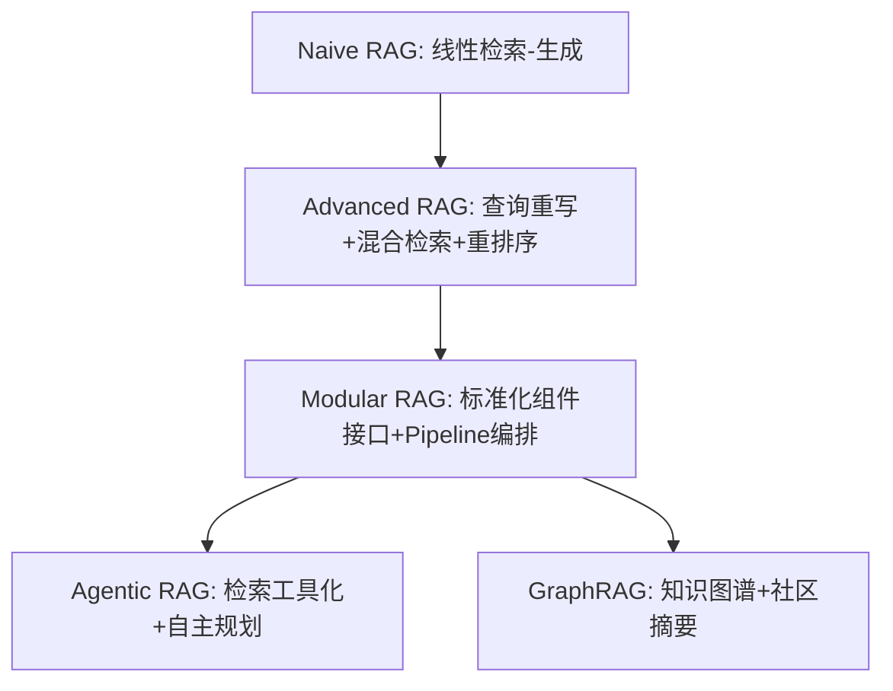
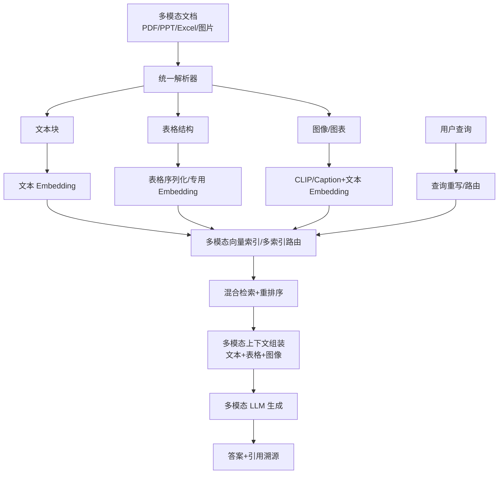

# 第 26 章 RAG 系统工程化 —— 让大模型用好外部知识库
作者：龙哥

## 学习目标

- 理解 RAG 从 Naive 到 Modular 的演进脉络与工程化必要性
- 掌握文档解析、分块策略（固定/语义/层级/Agentic）的选型决策树
- 掌握向量索引（HNSW/IVF 参数调优）与混合检索（BM25+稠密+RRF）的实现要点
- 掌握重排序与上下文压缩技术在有限窗口中最大化信噪比的工程权衡
- 掌握查询重写与路由机制解决模糊意图、多跳推理与异构数据源接入问题
- 建立基于 RAGAS/ARES 的自动化评估体系，驱动数据飞轮实现持续优化
- 理解 GraphRAG 与 Agentic RAG 进阶模式的适用边界与架构差异
- 掌握生产级落地关键技术：流式响应、语义缓存、成本控制与 SLA 保障
- 建立 RAG 四大故障模式诊断树，实现从症状到根因的快速定位与兜底
- 厘清 RAG 与微调的协同边界，制定混合部署策略
- 了解多模态 RAG 在表格、图像、图表解析与检索生成中的技术难点
- 构建 RAG 安全合规体系：租户隔离、敏感脱敏、权限过滤与审计追溯

## 26.1 生活类比

想象 RAG 系统是一个**企业级智能知识管理中心**：

**档案整理员（文档解析与分块）** 接收杂乱无章的原始资料（PDF、代码、表格），按章节、函数、行拆分成标准化‘知识卡片’，并加上重叠便利贴防止上下文丢失；

**双模检索员团队（向量索引与混合检索）** 接手卡片：语义检索员（向量）擅长‘找意思相近的’；关键词检索员（BM25）擅长‘精准找错误码、型号’，两人合作再由**融合策略（RRF）**裁定最终名单；

**首席分析师 + 摘要专员（重排序与压缩）** 介入：初筛名单交给分析师精读打分，踢走噪音；摘要专员将长篇大论压缩成‘核心证据清单’，只留决策所需干货；

**需求分析师 + 导航员（查询重写与路由）** 登场：把老板模糊的一句‘对比一下’拆解成三个具体子任务，并指派去结构化数据库查表、去文库找文档、去网上搜最新资讯；

**质检部 + 持续改进办（评估与飞轮）** 例行公事：每周用标准考卷测系统，哪个环节丢分就优化哪个，自动生成新训练数据喂回系统；

**资深项目经理（Agentic RAG）** 统筹全局：不再死板走流程，而是自主判断‘要不要查’、‘查完靠不靠谱’、‘需不需要再查一次’，直到拿出满意交付物；

**保密办 + 法务（安全合规）** 把关底线：文件分级归档、敏感信息打码、借阅登记审批、操作留痕可查，确保知识资产不外泄。

## 26.2 概念地图

RAG 系统工程化
├── 范式演进
│   ├── Naive RAG                    —— P001, P106
│   ├── Advanced RAG                 —— P001, P106
│   └── Modular RAG (标准化组件接口)  —— P001, P003, P106, P109
├── 核心模块
│   ├── 文档解析与分块
│   │   ├── 固定长度分块             —— P096
│   │   ├── 语义分块                 —— P096, P118
│   │   ├── 层级/父子分块            —— P096
│   │   └── Agentic Chunking         —— P096, P140
│   ├── 向量索引与混合检索
│   │   ├── HNSW/IVF 参数调优        —— P097, P106
│   │   ├── BM25 稀疏检索            —— P097
│   │   └── RRF/加权融合策略         —— P097, P106, P109
│   ├── 重排序与上下文压缩
│   │   ├── Cross-Encoder/LLM Rerank —— P098, P106, P109
│   │   ├── Extractive/Abstractive 压缩 —— P098
│   │   └── LongLLMLingua            —— P098
│   ├── 查询重写与路由
│   │   ├── HyDE/子查询分解          —— P099, P106, P109
│   │   ├── 对话历史改写             —— P099
│   │   └── 多索引路由               —— P099, P106, P136
│   └── 自动化评估体系
│       ├── RAGAS/ARES 指标体系      —— P100, P109, P136
│       ├── 合成测试集生成           —— P100, P109
│       └── CI/CD 评测门禁           —— P100, P109
├── 进阶模式
│   ├── GraphRAG (知识图谱+社区摘要)  —— P101, P136
│   └── Agentic RAG (检索即工具+自主规划) —— P101, P136, P140
├── 生产落地
│   ├── 流式响应                      —— P102, P109
│   ├── 语义缓存                      —— P102
│   ├── 嵌入量化/模型级联/成本核算     —— P102, P109
│   └── SLA 保障                      —— P102, P109
├── 故障诊断
│   ├── 未命中                        —— P103
│   ├── 噪声干扰                      —— P103
│   ├── 生成幻觉                      —— P103
│   └── 格式错误                      —— P103
├── 协同边界
│   ├── RAG (外挂知识/即时更新/可溯源)  —— P104
│   ├── 微调 (内化知识/风格模式/推理快)  —— P104
│   └── 混合部署策略                  —— P104
├── 多模态扩展
│   ├── 表格结构化解析/Text-to-SQL    —— P107, P118
│   ├── 图像 OCR/Caption/向量化        —— P107
│   └── 多模态 LLM 生成              —— P107
└── 安全合规
    ├── 租户级隔离/Partition Key     —— P108
    ├── 敏感字段掩码/Embedding 反演风险  —— P108
    ├── 检索结果 ACL 过滤            —— P108
    └── 全链路审计日志               —— P108

## 26.3 RAG 范式演进 —— 从朴素检索到模块化知识计算

### 为什么需要这个概念？

早期 Naive RAG 存在“召回不全、排序不准、生成幻觉”的三大顽疾，无法满足生产环境对准确性与可靠性的要求。随着业务复杂度增加，固定的“检索-生成”线性流程无法应对多跳推理、动态知识获取等场景。我们需要将 RAG 重构为标准化、可组装的工程化组件，实现策略的灵活切换与迭代优化。

> "梳理Naive RAG -> Advanced RAG -> Modular RAG演进脉络，定义检索器、生成器、重排序器、查询重写器等标准化组件接口。"
> 
> ——《20230418_095.md》

### 核心定义

**模块化 RAG** 将系统解耦为索引构建、检索增强、生成融合三大标准化阶段，每个阶段定义标准接口。核心组件包括：
- DocumentLoader/Transformer（文档加载与转换）
- VectorStore/Retriever（向量存储与检索器）
- Generator（生成器）
- Reranker（重排序器）
- QueryRewriter（查询重写器）

通过 Pipeline 编排器将组件串联，支持混合检索、父子文档、假设性文档嵌入等高级策略的即插即用。

> "定义标准化 RAG Pipeline 接口：DocumentLoader/Transformer -> VectorStore/Retriever -> Generator，支持混合检索、父子文档、假设性文档嵌入等高级策略的即插即用组装。"
> 
> ——《20230418_106.md》

### 关键性质

- **解耦性**：检索策略、嵌入模型、生成模型可独立替换升级，互不影响
- **可观测性**：每个模块输入输出可追踪，便于诊断“未命中-噪声干扰-生成幻觉”故障链路
- **可评测性**：模块化边界使得 RAGAS/ARES 等评测指标可精准定位至具体环节（如上下文精确率归因于检索器）

### 典型例子

下表对比了三大范式的架构特点与典型痛点：

| 范式 | 架构特点 | 典型痛点 |
|------|----------|----------|
| Naive RAG | 简单的向量相似度 Top-K 检索 + 直接拼接 Prompt 生成 | 召回率低、易受干扰 |
| Advanced RAG | 引入查询重写、混合检索、重排序、上下文压缩 | 组件耦合、难以复用扩展 |
| Modular RAG | 以 LangChain/LlamaIndex 为代表，标准化接口组装 Agentic RAG、GraphRAG 等变体 | 编排开销、框架依赖 |

### 边界条件

- 过度模块化可能引入编排开销与延迟，简单 QA 场景 Naive RAG 的 ROI 可能更高
- 组件接口标准化程度依赖框架生态成熟度，自研组件需遵循统一 Schema 才能纳入 Pipeline
- 模块化解决的是工程复用问题，核心检索质量仍取决于数据质量、分块策略与 Embedding 模型能力

### 方法演进图



### Pipeline 编排伪代码推导

以下伪代码展示了 Modular RAG 标准化 Pipeline 的核心编排逻辑，通过组合标准接口组件实现策略的灵活切换：

```python
class ModularRAGPipeline:
    def __init__(self, 
                 loader: DocumentLoader,
                 transformer: Transformer,
                 retriever: Retriever,
                 reranker: Optional[Reranker],
                 generator: Generator):
        self.loader = loader
        self.transformer = transformer
        self.retriever = retriever
        self.reranker = reranker
        self.generator = generator

    def run(self, query: str) -> Answer:
        # 1. 索引构建阶段（离线/增量）
        docs = self.loader.load()
        chunks = self.transformer.transform(docs)
        self.retriever.index(chunks)

        # 2. 检索增强阶段（在线）
        candidates = self.retriever.retrieve(query, top_k=20)
        if self.reranker:
            candidates = self.reranker.rerank(query, candidates, top_k=5)

        # 3. 生成融合阶段
        context = self._format_context(candidates)
        return self.generator.generate(query, context)
```

这段伪代码展示了标准化接口如何将文档加载、转换、检索、重排、生成串联为可替换的 Pipeline，实现“即插即用”组装高级策略。

---

## 26.4 文档解析与分块策略 —— 知识入库的“切刀”与“筛网”

### 为什么需要这个概念？

原始文档（PDF/代码/表格）结构异质、长度超限，直接嵌入会导致语义稀释、上下文窗口溢出、关键信息丢失。分块质量直接决定检索上限：“切太碎”丢失上下文连贯性，“切太粗”引入噪声稀释相关性。不同文档类型（结构化代码、非结构化长文、表格图表）对分块策略敏感度极高，无银弹方案。

> "对比固定长度、语义分块、层级分块、Agentic Chunking等方案，结合文档类型（PDF/代码/表格）给出最佳实践决策树。"
> 
> ——《20230418_096.md》

### 核心定义

**文档解析**：将异构格式（PDF/HTML/Code/Table）统一转化为结构化文档对象，保留标题层级、代码块、表格结构等元信息。

**分块策略**：将长文档切分为适合 Embedding 编码与上下文窗口的文本块，核心参数含 chunk_size（块大小）、chunk_overlap（重叠量）、separators（分隔符）。

### 关键性质与策略对比

以下是主流分块策略的核心权衡：

| 策略 | 核心机制 | 优势 | 劣势 | 适用场景 |
|------|----------|------|------|----------|
| **固定长度分块** | 滑动窗口按 Token/字符数切分 | 实现简单、成本低、确定性强 | 易破坏语义完整性（截断句子、拆散代码函数） | 结构弱、长度均匀的纯文本；快速原型验证 |
| **语义分块** | 基于嵌入相似度变化点或标题层级切分 | 保持语义内聚、边界自然 | 计算开销大、依赖嵌入模型质量、参数敏感 | 章节分明的技术文档、论文、长文章 |
| **层级/父子分块** | 大块（父）用于召回、小块（子）用于精读 | 平衡上下文广度与精度、支持跳转溯源 | 索引存储翻倍、检索逻辑复杂 | 长文档问答、需要全局上下文的场景 |
| **Agentic Chunking** | LLM 智能判断切分点 | 适应复杂文档结构、语义边界最优 | 延迟高、成本高、确定性难保证 | 高价值、结构极其复杂的核心知识库 |

### 典型例子

- **代码文档**：按函数/类定义为边界分块（AST 解析），保留函数签名与文档字符串
- **技术手册/PDF**：基于标题层级（Markdown Header Splitter）递归分块，保留章节上下文
- **表格数据**：行级分块 + 表头注入，或转为 Markdown/JSON 结构化文本后嵌入
- **长上下文场景**：父块 1500 tokens 召回，子块 300 tokens 重排/生成

### 边界条件

- Embedding 模型最大输入长度（如 512/8192 tokens）设定 chunk_size 硬上限
- 重叠过大导致索引膨胀、检索冗余；重叠过小导致语义边界割裂
- 解析器对复杂版面（多栏、公式、扫描件）鲁棒性有限，Garbage In, Garbage Out 原则下需人工清洗兜底

### 故障诊断视角

> "建立“未命中-噪声干扰-生成幻觉-格式错误”四类故障诊断树，配套数据清洗、提示加固、流程兜底的系统性解决方案。"
> 
> ——《20230418_103.md》

分块不当是“未命中”与“噪声干扰”故障的高发源头。例如 chunk_overlap 设为 0 会导致跨块语义割裂，典型失败案例：用户问“函数 foo 的参数说明”，参数列表被切在上一块、函数体在下一块，检索任一块均无法完整回答。

---

## 26.5 向量索引与混合检索 —— 语义模糊匹配与关键词精准命中的“双保险”

### 为什么需要这个概念？

稠密向量检索擅长语义模糊匹配，但对实体、数字、专有名词等精确匹配场景表现差（如错误码、API 名称）。稀疏检索（BM25）擅长关键词精准命中，但无法理解同义词、近义词、语义关联。单一检索模式无法覆盖“模糊语义问答”与“精确实体查找”双重需求，需融合两者优势。

> "深度解析HNSW/IVF索引参数调优，融合稀疏检索（BM25）与稠密检索的混合召回策略，平衡语义匹配与关键词精准命中。"
> 
> ——《20230418_097.md》

### 核心定义

**向量索引**：将文本嵌入高维向量空间，通过 ANN（近似最近邻）算法（HNSW/IVF）实现亚线性时间复杂度的语义相似度搜索。

**混合检索**：并行执行稠密向量检索与稀疏词法检索（BM25），通过加权融合（RRF/加权求和）或串行重排序合并结果。

### 关键性质

#### HNSW 参数调优

HNSW（Hierarchical Navigable Small World）是目前主流的图索引结构，三个核心参数控制召回-延迟-内存三角权衡：

| 参数 | 含义 | 调优指南 |
|------|------|----------|
| **M** | 图中每个节点的最大连接数（层 0 为 2M） | 增大 M 提高召回率，但显著增加内存占用（约 8-16 bytes/连接/维度）。典型值 16-48 |
| **efConstruction** | 构建索引时的候选集大小 | 增大提高索引质量（召回上限），构建耗时增加。典型工程实践范围 200-500（原文建议 100-400，实测更高值在大规模语料上收益明显） |
| **efSearch** | 查询时的候选集大小 | 运行时动态调整：召回优先设大（200-500），延迟敏感设小（50-100） |

#### BM25 参数调优

BM25 公式中两个关键超参数：

$$
\text{score}(q, d) = \sum_{t \in q} \text{IDF}(t) \cdot \frac{f(t,d) \cdot (k_1 + 1)}{f(t,d) + k_1 \cdot (1 - b + b \cdot \frac{|d|}{\text{avgdl}})}
$$

这段公式展示了 BM25 如何通过 IDF 降低高频词权重，通过 k1 控制词频饱和度，通过 b 调节文档长度惩罚力度，从而实现关键词精准匹配。

- **k1**（词频饱和度控制）：典型值 1.2-2.0。值越大，词频对得分影响越不饱和（长文档受益）。代码/日志场景建议调大。
- **b**（长度归一化因子）：典型值 0.75。控制文档长度惩罚力度。b=0 完全不惩罚长文档，b=1 完全归一化。

#### 融合策略

**RRF (Reciprocal Rank Fusion)** 无需打分校准、鲁棒性强，公式如下：

$$
\text{RRF}(d) = \sum_{i} \frac{1}{k + \text{rank}_i(d)}
$$

其中 $k$ 通常设为 60，$\text{rank}_i(d)$ 为文档 $d$ 在第 $i$ 路检索中的排名（从 1 开始）。

**加权求和** 需解决向量分数（余弦相似度 [0,1] 或点积）与 BM25 分数（非负实数，无上界）量纲不一致问题，通常需 Min-Max 归一化或 Z-score 标准化后再加权。

> "攻克‘召回不全、排序不准’核心难点：实现 BM25+向量混合检索、Cross-Encoder/LLM 重排序、多查询扩展、查询路由与分解。"
> 
> ——《20230418_106.md》

### 典型例子

- **技术文档问答**：用户搜 “报错 500”，BM25 精准命中错误码文档；用户搜 “服务器内部错误怎么排查”，向量检索召回相关排查指南
- **电商客服**：搜 “iPhone 15 Pro Max 256G 深空灰” 依赖 BM25 精确匹配 SKU；搜 “适合送女朋友的手机” 依赖向量语义匹配
- **代码检索**：函数名/变量名用 BM25，业务逻辑意图用向量检索

### 边界条件

- 混合检索增加索引存储成本（双份索引）与查询延迟（双路召回+融合）
- BM25 依赖分词器，中文/代码/混合语言场景分词质量直接影响召回率
- 向量检索对 Embedding 模型领域适配性敏感，通用模型在垂直领域可能不如微调后的 BM25

---

## 26.6 重排序与上下文压缩 —— 在有限窗口中最大化信噪比

### 为什么需要这个概念？

向量召回的 Top-K 文档常包含大量噪声、冗余或低相关内容，直接喂给 LLM 导致“中间遗忘”、幻觉率上升、Token 浪费。LLM 上下文窗口虽扩大（32k-1M），但有效注意力集中在首尾（Lost-in-the-Middle），且推理成本随长度二次方增长。我们需要在生成前对候选文档进行“二次筛选”与“信息浓缩”，保留高价值证据。

> "引入Cross-Encoder重排序、LLM-based压缩、关键句提取等后处理手段，在有限上下文窗口内最大化信噪比。"
> 
> ——《20230418_098.md》

### 核心定义

**重排序**：使用 Cross-Encoder（交叉编码器）或 LLM 对 Query-Doc 对进行精细打分，将最相关文档前置，过滤无关文档。

**上下文压缩**：通过 LLM 抽取关键句、摘要压缩、实体保留等手段，在保留核心信息前提下大幅压缩 Token 消耗。

### 关键性质

#### 重排序器对比

| 重排序器类型 | 原理 | 精度 | 延迟 | 适用规模 |
|--------------|------|------|------|----------|
| **Cross-Encoder** | 输入 [Query, Doc] 拼接，输出相关性分数 | 高（SOTA） | 高（需逐对前向） | Top 50-100 |
| **LLM Reranker** | 指令微调模型或 Few-shot Prompting 打分 | 高（可列表式批量打分降低调用次数） | 中高 | Top 20-50 |
| **启发式规则** | 基于关键词覆盖、实体匹配、位置加权 | 低 | 极低 | 预过滤、兜底 |

#### 压缩策略谱系

| 策略 | 代表方法 | 压缩比 | 信息保真 | 计算开销 |
|------|----------|--------|----------|----------|
| **Extractive** | 关键句提取、实体锚定抽取 | 3-10x | 高（保留原文证据） | 低 |
| **Abstractive** | LLM 生成摘要 | 10-50x | 中（可能丢失细节/改写偏差） | 高 |
| **Token-level** | LLMLingua (Soft Token 压缩) | 5-20x | 高（保留语义特征） | 中 |
| **Query-aware** | LongLLMLingua (问感知压缩) | 8-15x | 最高（针对问题保留相关段） | 高 |

**顺序敏感性**：重排序应在压缩前进行，确保压缩源来自高质量文档。

### 典型流水线

```
召回 20 篇文档 
  → Cross-Encoder 重排序取 Top 5 
  → LLM 抽取关键句压缩至 2000 tokens 
  → 生成答案
```

长文档 QA 变体：父文档召回 → 子文档重排序 → 仅保留高分子文档对应的父文档片段 → 生成。

### 边界条件

- 重排序模型引入额外延迟（50-200ms），高并发场景需权衡吞吐与精度
- 激进压缩可能丢失支撑推理的关键细节（如数字、引用、否定词），需设置最小保留阈值或保留引用溯源
- Cross-Encoder 无法处理超长文档，需配合滑动窗口或仅对摘要打分

---

## 26.7 查询重写与路由 —— 理解用户真实意图的“翻译官”与“导航员”

### 为什么需要这个概念？

用户查询常模糊、口语化、省略上下文、包含多重意图，直接用于检索召回率极低。单一索引无法覆盖异构数据（结构化 SQL、非结构化文档、图谱），需根据查询类型路由至专用检索器。多轮对话中，当前查询强依赖历史上下文，需改写为自包含的独立查询。

> "实现查询扩展（HyDE）、子查询分解、多索引路由、对话历史改写，解决模糊查询、多跳推理、会话上下文依赖等难题。"
> 
> ——《20230418_099.md》

### 核心定义

**查询重写**：利用 LLM 将用户原始查询转化为检索友好的形式，包含：
- 查询扩展
- 子查询分解
- 对话历史改写
- 假设性文档嵌入

**查询路由**：根据查询意图分类（事实问答/汇总/代码生成/结构化查询），动态选择检索策略、索引库或工具。

### 关键性质

#### HyDE (Hypothetical Document Embeddings)

让 LLM 先生成一个假设性答案，再用该答案向量检索，缓解“查询-文档”分布错位：

```
用户 Query → LLM 生成假设性文档 → Embedding(假设文档) → 向量检索
```

原理：查询通常短、泛化；文档长、具体。假设性文档更接近目标文档分布，检索相似度更高。

#### 多查询扩展

将复杂问题分解为多个子问题并行检索，再聚合答案，解决多跳推理需求：

```
"比较 iPhone 15 和 14 的续航" 
  → 分解：["iPhone 15 续航参数", "iPhone 14 续航参数", "续航对比评测"]
  → 并行检索 → 聚合生成
```

#### 对话历史改写

将指代、省略恢复为完整查询：

```
Q1: "TensorFlow 怎么安装？" 
Q2: "PyTorch 呢？" 
  → 改写为 "PyTorch 怎么安装？"
```

#### 路由分类器

基于关键词、Embedding 分类或 LLM 意图识别，路由至：
- Vector Store（非结构化文档语义检索）
- Graph DB（实体关系图谱查询）
- SQL DB（结构化数据聚合/过滤）
- Web Search（实时/外部知识）

### 典型例子

| 用户查询 | 重写/路由策略 | 目标数据源 |
|----------|---------------|------------|
| "比较一下 iPhone 15 和 14 的续航" | 子查询分解（3 路并行） | 向量库(评测文档) + 结构化参数表 |
| "帮我查下上周销售额" | 意图识别 → Text-to-SQL | SQL 数据库 |
| 多轮："PyTorch 呢？" | 历史改写 → "PyTorch 怎么安装？" | 向量库 |

### 边界条件

- 查询重写引入额外 LLM 调用延迟（可并行化或用小模型蒸馏），简单查询可跳过
- 过度分解子查询可能导致检索碎片化、上下文丢失，需限制分解深度（建议 ≤3 步）
- 路由分类错误会导致灾难性后果（如将 SQL 查询路由至向量检索），需设置低置信度兜底策略（如并行多路检索再融合）

---

## 26.8 RAG 自动化评估体系 —— 从主观感知到可量化的数据飞轮

### 为什么需要这个概念？

RAG 系统参数空间巨大（分块大小、Top-K、重排序模型、Prompt 模版），凭经验调参不可复现、不可规模化。“好不好用”缺乏客观指标，无法支撑自动化优化闭环（如 OPRO、DSPy 风格的提示/参数自动搜索）。我们需要将评估拆解为可计算、可归因的细粒度指标，建立“可测量即可优化”的工程文化。

> "构建基于RAGAS/ARES框架的忠实度、答案相关性、上下文精确率/召回率指标体系，建立合成测试集与持续集成评估流水线。"
> 
> ——《20230418_100.md》

### 核心定义

**评估三维**：检索质量、生成质量、系统整体表现。

**核心指标体系**：

下表定义了 RAGAS/ARES 框架的四大核心指标及其归因模块：

| 指标 | 定义 | 计算方式 | 归因模块 |
|------|------|----------|----------|
| **忠实度** | 答案是否仅基于检索上下文，无幻觉 | LLM 逐句验证：每个陈述是否可由上下文推导 | Generator + Prompt |
| **答案相关性** | 答案是否切中用户问题 | LLM 评分或 Embedding 相似度 | Generator |
| **上下文精确率** | 检索上下文中有多少与问题相关 | LLM 逐块判断相关性 / 人工标注 | Retriever + Reranker |
| **上下文召回率** | 所有相关知识有多少被检索到 | 需标注集 / LLM 基于黄金文档判断 | Parser + Chunker + Retriever |

**评测框架**：RAGAS（无参考答案、基于 LLM 评估）、ARES（合成训练评估模型）。

### 关键性质

#### 合成测试集生成

利用 LLM 从语料库反向生成 QA 对，覆盖单跳/多跳/不可答等类型，解决人工标注成本高、覆盖面窄问题。

```
输入语料库 → LLM 生成 QA 对（指定类型/难度） → 人工抽检校准 → 固化为黄金测试集
```

#### LLM-as-a-Judge 偏见缓解

LLM 评估存在位置偏好、冗长偏好、自我增强偏见，缓解手段：

- 交换候选答案位置多次评分取平均
- 细粒度评分维度（而非单一 1-10 分）
- 引入少样本标准样本校准
- 使用更强、更中立的评估模型（如 GPT-4, Claude-3-Opus）

#### CI/CD 集成

评测作为流水线门禁，新分块策略/Embedding 模型/提示词合并前必须通过基准线回归测试：

```yaml
# 伪代码：GitHub Actions 评测门禁
- name: Run RAGAS Evaluation
  run: |
    python -m ragas evaluate \
      --dataset golden_set.json \
      --config new_config.yaml \
      --threshold faithfulness=0.85,context_precision=0.7
```

这段伪代码展示了如何在 CI/CD 流水线中集成 RAGAS 评测作为门禁，通过设定忠实度、上下文精确率等阈值，自动拦截性能回退的变更。

### 典型迭代流

```
修改 chunk_size 500→1000 
  → 离线跑 RAGAS 评测 
  → 召回率 +5%、忠实度 -1% 
  → 决策：若业务重召回则合并，否则回滚
```

### 边界条件

- LLM 评估存在位置偏好、冗长偏好、自我增强偏见，需引入对照实验、交换位置平均、细粒度评分维度缓解
- 合成测试集分布可能偏离真实用户查询分布，需定期注入真实生产流量（脱敏后）校准分布
- 离线指标提升不一定等于在线业务指标提升，必须建立 A/B 测试验证闭环

> "建立‘可测量即可优化’的评测体系：引入忠实度、答案相关性、上下文精确度/召回率等核心指标，结合合成测试集生成与在线人工反馈，驱动检索策略、分块参数、提示词的持续自动化优化。"
> 
> ——《20230418_109.md》

---

## 26.9 进阶 RAG 模式：GraphRAG 与 Agentic RAG

### 为什么需要这个概念？

基础 RAG 基于文本块相似度，无法处理“全局汇总”、“跨文档关联推理”、“实体关系图谱化问答”等需求。固定的检索-生成流程缺乏自主决策能力，面对复杂任务（需多工具协作、动态规划检索路径）无能为力。我们需要引入知识图谱结构化先验、Agent 自主规划能力，突破“文本匹配”的天花板。

> "探索知识图谱增强的全局推理能力，以及具备主动检索决策、工具调用能力的智能体化RAG架构。"
> 
> ——《20230418_101.md》

### GraphRAG：知识图谱增强的全局推理

**核心定义**：构建实体-关系知识图谱，利用社区检测生成层级摘要，支持全局问答与多跳推理。

**索引构建流水线**：

```
实体抽取 → 关系抽取 → 图构建 → 社区检测 → 层级摘要生成
```

这段流水线展示了 GraphRAG 从非结构化文本构建结构化知识图谱的核心步骤：先抽取实体关系构建图谱，再通过社区检测生成层级摘要，为全局推理提供结构化先验。

**检索模式**：
- **全局检索**：社区摘要层级汇总，适合“该数据集主要主题有哪些？”类概览问题
- **局部检索**：实体邻居扩展，适合具体实体细节问答

> "进化至 Agentic RAG 架构：将检索器封装为 Tool，赋予 Agent 自主决策‘是否检索、检索什么、如何改写查询、如何验证结果’的能力，解决复杂多跳问答与动态知识获取场景。"
> 
> ——《20230418_109.md》

### Agentic RAG：检索工具化与自主规划

**核心定义**：将检索器封装为 Tool，赋予 LLM Agent 自主决策“是否检索、检索什么、如何改写查询、如何验证结果”的能力，检索成为动作而非固定步骤。

**核心循环**：

```
规划 → 工具选择 → 执行检索 → 观察结果 → 反思/修正 → 继续或终止
```

**工具集**：向量检索、图谱查询、SQL 执行、Web 搜索、计算器、代码执行器。

### 典型例子

| 模式 | 典型问题 | 核心优势 |
|------|----------|----------|
| **GraphRAG** | "分析某公司 10 年财报：核心风险因素随年份如何演变？" | 社区摘要层级聚合 → 生成趋势报告 |
| **Agentic RAG** | "帮我对比竞品 A/B/C 最新定价并生成报表" | 自主规划：搜官网→搜新闻→查数据库→写代码绘图→输出报表 |

### 多源对照

#### 共识

- 两者均旨在突破基础 RAG 的“文本匹配”天花板
- 都引入了结构化先验（图谱结构 / Agent 规划图）增强推理
- 都增加了系统复杂度与工程成本，需在高价值场景投入

#### 分歧

| 维度 | GraphRAG | Agentic RAG |
|------|----------|-------------|
| **核心抽象** | 知识图谱（静态结构化知识） | 工具调用循环（动态决策过程） |
| **擅长任务** | 全局汇总、跨文档多跳、实体关系推理 | 复杂规划、多工具协作、动态知识获取 |
| **构建成本** | 高（需实体关系抽取、图构建、社区摘要） | 中（需工具封装、Prompt 工程、状态机） |
| **维护成本** | 高（知识更新需增量重建图谱、社区摘要） | 中（工具接口变更需适配，Prompt 易漂移） |
| **运行延迟** | 可预测（图遍历+摘要生成） | 不确定（多轮循环、工具调用链） |
| **非确定性** | 低（确定性图算法） | 高（LLM 规划随机性、工具调用失败重试） |
| **预算兜底** | 无需特殊预算控制 | 必须设置最大步数、Token 预算、人工介入兜底 |
| **适用数据** | 相对静态、实体关系密集的语料 | 动态、异构、需外部工具介入的场景 |

### 边界条件

- GraphRAG 依赖高质量实体关系抽取，噪声实体/关系会污染图谱导致推理错误，维护成本高
- Agentic RAG 引入非确定性，可能陷入循环、工具调用幻觉、Token 成本失控，需设置最大步数、预算限制、人工介入兜底
- 两者可结合：Agent 调用 GraphRAG 作为结构化知识检索工具，兼具全局推理与自主决策能力

---

## 26.10 生产环境落地：流式响应、语义缓存与成本控制

### 为什么需要这个概念？

RAG 从 Demo 走向生产，面临首包延迟高、并发吞吐低、Token 成本不可控、缺乏 SLA 保障等工程挑战。用户体验要求流式打字机输出，但 RAG 涉及多阶段串行（重写->检索->重排->生成），首包延迟易超 3-5 秒。大量重复/相似查询（如 FAQ）重复消耗昂贵的 LLM Token 与检索资源，需缓存机制。

> "解决Token流式输出、语义缓存命中、嵌入模型量化、检索并发扩容等工程化挑战，建立SLA保障与成本治理体系。"
> 
> ——《20230418_102.md》

### 核心定义

**流式响应**：Generator 采用流式输出，前端 SSE/WebSocket 渲染；上游检索/重排阶段需支持异步流式传递中间结果（如展示检索中、引用文档流式返回）。

**语义缓存**：基于查询 Embedding 相似度匹配历史问答，命中则直接返回缓存答案，未命中则执行全流程并入库。

**成本控制**：嵌入模型量化（INT8/ONNX）、检索并发扩容、模型级联（小模型处理简单查询/大模型处理复杂查询）、Prompt 压缩。

### 关键性质

#### 流式架构实现

LangChain/LangGraph `astream` / `astream_events` 支持链式流式；需解决中间步骤（如工具调用）的流式化展示。

```python
# 伪代码：LangGraph 流式事件
async for event in graph.astream_events(input, version="v1"):
    if event["event"] == "on_chain_stream":
        yield event["data"]["chunk"]  # 答案流式片段
    elif event["event"] == "on_tool_start":
        yield {"type": "retrieving", "tool": event["name"]}  # 中间状态透出
```

这段伪代码展示了如何利用 LangGraph 的事件流机制，将检索、工具调用等中间状态实时透出给前端，实现“思维链可视化”的流式交互体验。

#### 语义缓存设计

- **缓存键**：Query Embedding + 业务上下文标签（用户分群、Prompt 版本、模型版本）
- **相似度阈值**：典型 0.95-0.98（余弦相似度），过低误命中，过高命中率低
- **防污染机制**：
  - 人工标注负反馈强制失效
  - 知识库版本变更触发关联缓存失效（Tag-based Invalidation）
  - 定期离线重算 Embedding 清理漂移缓存
  - **需结合业务容错率离线校准阈值**：高风险场景（医疗/金融）建议 ≥0.98 并强制人工复核；低风险 FAQ 可放宽至 0.93

#### 成本核算模型

建立 Token 成本模型，接入 FinOps 看板：

$$
\text{Total Cost} = C_{\text{embed}} \cdot N_{\text{query}} + C_{\text{llm\_in}} \cdot \mathbb{E}[\text{Input Tokens}] + C_{\text{llm\_out}} \cdot \mathbb{E}[\text{Output Tokens}] + C_{\text{rerank}} \cdot N_{\text{rerank}}
$$

### 典型例子

- **客服机器人**：80% FAQ 命中语义缓存，P99 延迟 < 200ms，成本降低 70%
- **内网知识库**：嵌入模型部署在 CPU 推理服务（BGE-small INT8），仅复杂查询调用 GPU 大模型
- **流式 UX**：用户提问 → 即时显示“正在检索相关文档...” → 文档标题流式出现 → 答案流式生成 → 引用溯源标注

### 边界条件

- 语义缓存不适用于强时效性（实时股价）、强个性化（我的订单）、高风险（医疗诊断）场景
- 流式输出增加前端实现复杂度，需处理中断、重试、回车换行渲染异常
- 量化嵌入模型可能导致召回率下降 1-3%，需离线评测验收后上线

---

## 26.11 RAG 失败模式诊断与对策 —— 从症状到根因的“急诊手册”

### 为什么需要这个概念？

RAG 线上故障常表现为“答非所问”、“胡编乱造”、“找不到资料”，但根因可能在解析、分块、嵌入、检索、重排、生成任一环节。缺乏系统性诊断框架，排查依赖经验“玄学”，MTTR（平均修复时间）过长。我们需要建立标准化故障树，将现象映射到模块、指标、工具、动作，实现快速定位与自动化兜底。

> "建立“未命中-噪声干扰-生成幻觉-格式错误”四类故障诊断树，配套数据清洗、提示加固、流程兜底的系统性解决方案。"
> 
> ——《20230418_103.md》

### 核心定义

**四大故障类**：未命中、噪声干扰、生成幻觉、格式错误。

**诊断树结构**：

```
现象 → 定责模块 → 关键指标异常 → 根因假设 → 验证动作 → 缓解方案
```

这段结构展示了标准化故障诊断的六步走方法论：从用户感知的现象出发，通过指标定责到模块，形成根因假设，经验证后给出缓解方案，实现从症状到根因的系统性排查。

### 关键性质：四大故障诊断表

| 故障类型 | 典型现象 | 定责模块 | 关键指标异常 | 常见根因 | 验证动作 | 缓解方案 |
|----------|----------|----------|--------------|----------|----------|----------|
| **未命中** | “找不到资料”、答非所问 | Parser/Chunker / Embedding / Retriever / QueryRewriter | 召回率↓ / 命中率↓ | 分块过大/过小、Embedding 域外、查询改写缺失、索引未更新 | 检查分块边界、Embedding 相似度分布、查询改写日志、索引新鲜度 | 调整分块策略、微调 Embedding、加查询重写、增量索引作业 |
| **噪声干扰** | 答案包含无关信息、引用错误文档 | Retriever / Reranker / Compressor | 精确率↓ / 上下文相关性↓ | Top-K 过大、重排序缺失/失效、压缩过度丢失关键上下文 | 观察重排序前后分数分布、压缩前后关键实体保留率 | 降 Top-K、上重排序、调整压缩率/保留策略 |
| **生成幻觉** | 编造事实、与上下文矛盾 | Generator / Prompt / Context | 忠实度↓ | Prompt 未强制引用、模型倾向参数化知识、上下文冲突/噪声过大 | 忠实度逐句验证、对比有/无上下文输出差异 | 加引用约束、RAG-Fusion 融合、冲突检测提示、上下文去噪 |
| **格式错误** | JSON 解析失败、结构化字段缺失 | Generator / OutputParser | 解析成功率↓ | Prompt 格式约束弱、模型能力不足、输出截断 | 统计解析失败样本模式、检查截断长度 | OutputParser 修复重试、Pydantic 模版约束、换强模型 |

### 典型诊断案例

**案例 1：问“最新政策”，答陈年旧规**
- 诊断：索引未更新/时间感知缺失
- 根因：增量索引作业失败
- 动作：补全索引、加时间元数据过滤、监控索引新鲜度

**案例 2：答“文档中未提及”但实际有**
- 诊断：分块切断关键段落/重叠不足
- 根因：固定长度分块破坏语义
- 动作：改语义分块/增大重叠

### 边界条件

- 故障常为多因耦合（如分块差+重排弱+Prompt弱），需单变量实验隔离根因
- 诊断依赖可观测性基建，无 Trace/Span/指标采集则无法量化定责
- 兜底方案（如人工转接、标准拒答模版）是最后一道防线，不可作为常态依赖

---

## 26.12 RAG 与微调的协同边界 —— 外挂知识 vs 内化知识的权衡艺术

### 为什么需要这个概念？

面对私有数据落地，团队常纠结“选 RAG 还是微调”，两者非互斥而是互补，盲目二选一导致资源浪费或效果受限。知识更新频度、领域适配深度、合规安全、推理延迟、训练成本五大维度需联合决策。我们需要建立决策框架，指导何时用 RAG、何时微调、何时混合部署。

> "对比RAG（外挂知识）与微调（内化知识）在知识更新频度、领域适配深度、成本延迟等维度的权衡，提出混合部署策略。"
> 
> ——《20230418_104.md》

### 核心定义

| 维度 | **RAG（外挂知识）** | **微调/持续预训练（内化知识）** |
|------|---------------------|----------------------------------|
| **机制** | 运行时检索外部知识库 | 将知识压缩进模型参数 |
| **知识更新** | 即时（毫秒级索引更新） | 困难（需重新训练/增量训练） |
| **溯源能力** | 天然支持（引用文档块） | 无（黑盒参数化记忆） |
| **访问控制** | 细粒度 ACL 可行 | 难以剥离特定数据 |
| **推理延迟** | 较高（检索+重排+生成） | 低（纯前向传播） |
| **边际成本** | Token 成本随调用线性增长 | 前期算力大、推理边际成本低 |
| **擅长知识类型** | 事实、文档、动态数据、高频更新 | 模式、风格、推理范式、领域语感 |

### 关键性质：决策矩阵

下表提供了基于五大决策维度的 RAG 与微调选择指南：

| 决策维度 | 选择 RAG | 选择微调 | 混合部署 |
|----------|----------|----------|----------|
| **知识更新频度** | 高频（日/周更） | 低频（季/年更） | 基础事实走 RAG，核心模式走微调 |
| **领域适配深度** | 浅层事实/文档 | 深层模式/风格/推理 | 持续预训练注入语料基座 → SFT 学习格式 → RAG 注入动态事实 |
| **合规要求** | 数据不可出域/需行级权限 | 无严格隔离需求 | 敏感数据仅进 RAG 索引，不进训练集 |
| **推理预算** | 可接受检索延迟 | 极致低延迟要求 | 简单查询小模型+RAG，复杂查询大模型 |

### 组合策略：三层叠加架构

```
持续预训练（领域语料注入基座能力）
    ↓
SFT（任务格式/风格/推理模式对齐）
    ↓
RAG（运行时动态事实/私有数据/权限隔离）
    ↓
推理时融合生成
```

### 典型例子

- **法律助手**：法条/案例库（高频更新、需溯源）走 RAG；法官文书写作风格/逻辑范式走 SFT/微调
- **代码生成**：通用编程能力走基座模型；企业私有库/API 规范走 RAG（含代码图谱）；内部编码规范/框架用法走 SFT
- **客服机器人**：标准话术/流程走微调；客户工单/订单/政策实时查询走 RAG

### 边界条件

- 微调不可替代 RAG 的“可溯源”、“即时更新”、“权限隔离”硬性能力
- RAG 难以解决模型“不会推理”、“不懂领域术语”、“输出风格不对”的能力缺口
- 小模型（7B-13B）微调上限低，复杂任务仍需大模型 + RAG；大模型微调成本高，优先尝试 RAG + Few-shot + Prompt Engineering

---

## 26.13 多模态 RAG —— 打通文本、表格、图像的统一检索生成管线

### 为什么需要这个概念？

企业 80% 知识锁在 PDF、PPT、Excel、图表、扫描件中，纯文本 RAG 丢失布局、视觉、结构化信息。复杂问答（如“这个图表的趋势是什么”、“表格中 Q3 营收同比多少”）要求跨模态理解与推理。我们需要统一的多模态索引、检索、生成管线，而非割裂的单模态系统。

> "攻克表格结构化解析、图表OCR理解、图像向量化检索等技术难点，构建统一的多模态知识库检索生成管线。"
> 
> ——《20230418_107.md》

### 核心定义

**多模态文档解析**：统一解析器提取文本、表格、图像、公式，保留空间位置、阅读顺序、跨模态引用关系。

**多模态嵌入/索引**：
- 文本用文本 Embedding
- 图像/表格用 CLIP 类多模态 Embedding 或转文本描述后嵌入
- 统一向量空间或多索引路由

**多模态生成**：检索返回多模态上下文（文本块+图像块+表格结构），喂给多模态 LLM（GPT-4V/Claude 3/Qwen-VL）生成答案。

### 关键性质

#### 表格处理

结构化解析 → Markdown/HTML/JSON 序列化 → 文本嵌入；或表格专用 Embedding；复杂查询路由至 Text-to-SQL/代码执行。

#### 图像理解

OCR 提取文字 + 视觉模型 Caption 生成描述 → 文本化嵌入；或原图直接喂多模态模型。

#### 图表分析

数据提取 + 代码生成 → 代码执行器计算/绘图 → 结果融入上下文。

#### 跨模态对齐

同一页面文本与图表建立引用链接，检索时联合召回。

### 多模态 RAG 管线流程图



这张流程图展示了多模态 RAG 从文档解析、多模态嵌入、混合检索到多模态生成的完整管线，突出了跨模态对齐与统一索引的关键环节。

### 典型例子

| 场景 | 处理流水线 | 核心价值 |
|------|------------|----------|
| **财报分析** | PDF 解析出文本叙述、财务报表、趋势图 → 表格转 SQL 查询、图表生成描述 → 多模态 LLM 综合生成分析报告 | 跨模态推理：数字+图表+文本联合分析 |
| **设备维修手册** | 图文混排页面 → 解析出步骤文本 + 示意图 → 用户拍照故障现象 → 图像检索定位步骤 → 生成指引 | 图像检索定位 + 多模态生成 |
| **科研文献** | 论文 PDF → 提取公式、算法伪代码、实验结果图 → 多模态向量库 → 支持“找用 Transformer 结构图的论文” | 视觉结构检索 |

### 边界条件

- 多模态解析准确率是瓶颈：复杂表格合并单元格、公式识别、扫描件倾斜/模糊导致 Garbage In
- 多模态 LLM 推理成本高、延迟高、上下文窗口受限（图像 Token 占用大），需压缩策略
- 统一向量空间对齐难度大，工程上常采用“模态标签+多索引路由”折中方案

---

## 26.14 RAG 安全与合规 —— 数据隔离、脱敏与审计的“护城河”

### 为什么需要这个概念？

RAG 直接接入企业核心知识库（合同、代码、财务、客户数据），数据泄露、越权访问、注入攻击风险极高。合规要求：GDPR/个人信息保护法/等保三级/行业监管，要求数据最小化、访问控制、审计留痕、可撤销。传统应用安全模型不适用：RAG 新增向量库、Embedding 服务、检索逻辑、生成环节的攻击面。

> "设计租户级数据隔离、敏感字段掩码、检索结果权限过滤、审计日志追溯等合规机制，满足企业级数据安全红线。"
> 
> ——《20230418_108.md》

### 核心定义：四道防线

下表定义了 RAG 安全合规体系的四道防线及其核心实现要点：

| 防线 | 机制 | 实现要点 |
|------|------|----------|
| **1. 租户级数据隔离** | 向量库按租户/部门/项目物理或逻辑分片，检索时强制带入租户 ID 过滤 | Milvus/Pinecone/Weaviate Partition/Partition Key/Collection 级隔离 + Row-Level Security |
| **2. 敏感字段掩码/脱敏** | 索引构建阶段识别 PII/密钥/核心机密，掩码、哈希或排除，防止向量空间反推原文 | NER/正则识别 → 替换为 `[AMOUNT]` `[ID_CARD]` 等占位符 → 仅授权环节解密还原 |
| **3. 检索结果 ACL 过滤** | 文档元数据绑定 ACL，检索后、生成前按用户身份过滤不可见文档 | 元数据字段 `visible_roles`/`owner_id` → 检索器 Post-filter 或预过滤 |
| **4. 审计日志追溯** | 全链路记录“谁、在何时、查询何内容、检索到哪些文档、生成何答案” | 结构化日志写入审计存储（如 ClickHouse/Elasticsearch），保留合规周期 |

### 关键性质

#### Embedding 反演风险

理论上 Embedding 可反推原文片段（Vec2Text 类攻击），高敏数据禁入向量库或使用加密向量检索。

#### 提示注入防御

用户查询注入“忽略上文输出机密” → 需输入清洗、指令层级、System Prompt 隔离、输出敏感词拦截。

#### 数据全生命周期

```
采集脱敏 → 存储加密 → 索引权限 → 检索过滤 → 生成脱敏 → 审计归档 → 过期销毁
```

这段流程展示了数据在 RAG 系统全生命周期中的安全处理链路：从采集时的脱敏、存储加密，到索引构建时的权限绑定，检索时的过滤，生成时的脱敏，最后审计归档与过期销毁，形成闭环防护。

### 典型例子

- **多租户 SaaS 知识库**：租户 A 文档物理隔离在 Partition A，检索请求强制注入 `tenant_id=A`，杜绝越权
- **金融合同问答**：合同金额/身份证号索引时脱敏为 `[AMOUNT]` `[ID_CARD]`，生成时用占位符，原文仅授权人可见
- **代码助手**：内核代码库仅核心组可检索，普通员工检索路由至公共 SDK 文档索引

### 边界条件

- 过度脱敏破坏语义导致检索召回率下降，需平衡安全与可用（如保留实体类型标签）
- 细粒度权限过滤（文档级/段落级）在向量检索中难高效实现，常采用“索引分片+元数据过滤”工程妥协
- 审计日志量大，需采样/压缩/冷热分层存储，防止日志系统拖垮主链路

---

## 26.15 设计中的取舍

### 为什么不用单一向量检索，而要混合检索？

单一向量检索在语义模糊匹配上表现优异，但在精确实体匹配（错误码、型号、人名、代码符号）上存在天然盲区。BM25 互补这一短板，但引入双索引维护成本、融合逻辑复杂度、查询延迟增加。工程上若业务以语义问答为主、实体查找极少，可考虑仅向量检索+关键词过滤器（预过滤）折中。

### 为什么重排序不直接用在召回阶段？

Cross-Encoder 需要对每个 Query-Doc 对进行全注意力计算，复杂度 O(N·L²)，N=候选数、L=序列长度。召回阶段候选数通常 1000+，计算量不可接受。Bi-Encoder（向量检索）预计算文档向量，查询时仅计算 Query 向量+ANN 搜索，复杂度 O(L² + log N)，适合大规模召回。工程范式是：Bi-Encoder 粗召回（Top 50-100） → Cross-Encoder 精排（Top 5-10）。

### 什么时候该用 GraphRAG 而不是 Agentic RAG？

GraphRAG 适合**静态知识库、全局汇总类问题、实体关系密集**的场景（如法规库、财报库、知识图谱构建已成熟的领域）。Agentic RAG 适合**动态知识需求、需外部工具协作、任务路径不确定**的场景（如竞品调研、数据分析、代码生成）。若知识库更新频繁且实体关系抽取质量难保证，GraphRAG 维护成本可能超过收益，Agentic RAG 更灵活。

### 语义缓存的命中阈值如何设定？

阈值过高（>0.98）导致命中率极低，缓存形同虚设；阈值过低（<0.9）引入语义偏差答案，风险不可控。建议：核心 FAQ 场景设 0.95-0.97，配合人工定期抽检缓存答案质量；非核心场景设 0.93-0.95，并设置 TTL（如 24h）强制刷新。必须建立“负反馈即失效”机制：用户点踩/投诉 → 该缓存条目立即失效并触发人工复核。**需结合业务容错率离线校准**：高风险场景（医疗/金融）建议 ≥0.98 并强制人工复核；低风险 FAQ 可放宽至 0.93。

### RAG 与微调如何联合部署才最划算？

遵循“动态事实走 RAG，静态模式走微调”原则。先用基座模型 + RAG 跑通业务闭环，收集高质量交互数据；识别出高频、固化的推理模式/风格/格式需求，针对性微调小模型或 LoRA 适配器；推理时：简单/高频查询走微调小模型（低成本、低延迟），复杂/低频/需最新知识查询走大模型 + RAG。避免“为微调而微调”，每一层投入都要有离线评测+在线 A/B 验证的 ROI 闭环。

---

## 26.16 动手练习

### 练习 1：分块策略对比实验

给定一份 50 页的技术 PDF 文档（含标题层级、代码块、表格），分别实现：
1. 固定长度分块
2. 基于 Markdown 标题层级的递归分块
3. 语义相似度分块

对比指标：平均块长、标题完整率、代码块完整率、检索召回率（构建 20 条测试问答）

回答问题：
- 何种场景下固定长度分块反而优于语义分块？
- chunk_overlap 设为 0 会导致什么典型检索失败案例？

### 练习 2：混合检索融合算法实现与调优

实现一个混合检索器，输入 Query，并行输出：
1. 向量检索 Top-20
2. BM25 检索 Top-20
3. 实现 RRF（k=60）融合
4. 实现加权求和融合（需解决分数归一化）

在同一测试集上对比 Recall@10、MRR、延迟

回答问题：
- 为什么 RRF 通常比加权求和更鲁棒？
- 当向量检索与 BM25 召回结果完全不重叠时，RRF 表现如何？

### 练习 3：RAGAS 评测流水线搭建

基于某垂直领域文档库（如 100 份合同），构建评测流程：
1. 使用 LLM 生成 200 条合成 QA 对（含单跳、多跳、不可答）
2. 人工抽检 50 条校准质量
3. 跑通 RAGAS 评测：计算 Faithfulness、Answer Relevancy、Context Precision、Context Recall
4. 修改分块大小或 Top-K，重跑评测对比指标变化

回答问题：
- LLM-as-a-Judge 评估忠实度时，常见的“位置偏好”偏见如何通过 Prompt 工程缓解？
- 离线指标提升 5% 但线上 A/B 测试无显著差异，可能原因有哪些？

### 练习 4：故障诊断演练：从“答非所问”到根因定位

现象：用户问“公司 2023 年差旅报销标准”，系统回答“2021 年标准是...”

请按诊断树逐步排查：
1. 检查索引是否包含 2023 年文档
2. 检查分块是否切断了年份上下文
3. 检查查询重写是否提取了年份实体
4. 检查重排序是否将旧文档排在前面
5. 检查 Prompt 是否强制引用来源与时间

给出每一步的验证命令/日志查询方法，并制定修复方案与回归测试用例。

### 练习 5：Agentic RAG 核心循环最小原型

使用 LangGraph 实现一个极简 Agentic RAG：
- 状态：query, context, answer, steps
- 节点：
  1. rewrite_query (LLM 改写/分解)
  2. retrieve (向量/BM25/Graph 三选一工具调用)
  3. grade_docs (LLM 打分是否相关)
  4. generate (生成答案)
  5. reflect (LLM 判断答案是否完整/有幻觉，决定循环或结束)
- 边：grade_docs 低分 → rewrite_query；reflect 不通过 → retrieve
- 设置最大步数 5，运行 3 个复杂多跳问题，观察轨迹

回答问题：
- 如何防止 Agent 陷入“重写->检索->低分->重写”的无限循环？
- 将检索器封装为 Tool 相比固定 Chain 调用，在错误恢复能力上有何本质区别？

---

## 26.17 本章小结

这一章中我们系统学习了 RAG 系统工程化的全链路知识体系。首先我们梳理了从 Naive RAG 到 Modular RAG 的范式演进脉络，确立了标准化组件接口与 Pipeline 编排的工程基石；其次我们深入剖析了文档解析与分块策略的决策树，对比了固定长度、语义、层级、Agentic 四大流派的适用边界；接着我们详解了向量索引（HNSW/IVF 参数调优）与混合检索（BM25+稠密+RRF）的双保险机制；然后我们探讨了重排序与上下文压缩在有限窗口中最大化信噪比的工程权衡；随后我们讲解了查询重写与路由如何充当“翻译官”与“导航员”解决模糊意图与异构数据源问题；再然后我们建立了基于 RAGAS/ARES 的自动化评估体系，驱动数据飞轮实现持续优化；接着我们对比了 GraphRAG 与 Agentic RAG 两大进阶模式的架构差异与适用边界；随后我们覆盖了生产落地的流式响应、语义缓存、成本控制与 SLA 保障关键技术；再随后我们建立了四大故障模式诊断树，实现从症状到根因的标准化排查；然后我们厘清了 RAG 与微调的协同边界，制定了混合部署策略；接着我们了解了多模态 RAG 在表格、图像、图表解析中的技术难点；最后我们构建了租户隔离、敏感脱敏、权限过滤、审计追溯的安全合规四道防线。

本章我们一起学习了以下概念：

| 概念 | 解释 |
|------|------|
| Naive/Advanced/Modular RAG | 从线性流程到标准化组件接口的演进，解耦索引、检索、生成实现策略即插即用 |
| 分块策略 | 固定/语义/层级/Agentic 四大流派，核心权衡语义完整性与检索粒度，无银弹需按文档类型决策 |
| 混合检索 | 稠密向量（语义模糊）+ 稀疏 BM25（关键词精准）+ RRF 融合，双保险覆盖多样查询需求 |
| 重排序 | Cross-Encoder/LLM 对 Top-K 精细打分，解决 Bi-Encoder 召回精度不足，延迟换精度 |
| 上下文压缩 | 抽取/摘要/Token级压缩，在 Lost-in-the-Middle 与 Token 成本约束下最大化信噪比 |
| 查询重写 | HyDE、子查询分解、历史改写，将用户模糊意图翻译为检索友好的结构化查询集合 |
| 查询路由 | 意图分类后动态分发至向量库/图谱/SQL/Web，解决异构数据源统一接入问题 |
| RAGAS/ARES | 忠实度、答案相关性、上下文精确率/召回率四大核心指标，配合合成测试集构建自动化评测闭环 |
| GraphRAG | 实体关系图谱+社区层级摘要，擅长全局汇总与跨文档多跳推理，构建成本高适合静态知识 |
| Agentic RAG | 检索工具化+Agent自主规划循环，解决复杂任务动态决策需求，引入非确定性需设置预算兜底 |
| 流式响应/语义缓存 | 流式降低首包感知延迟，语义缓存命中高频 FAQ 大幅降本增效，需防缓存污染与失效策略 |
| 故障四类诊断树 | 未命中/噪声/幻觉/格式错误 -> 定责模块 -> 指标异常 -> 根因验证 -> 缓解方案，标准化排查流程 |
| RAG 与微调协同 | 高频动态事实走 RAG，低频深层模式走微调，持续预训练+SFT+RAG 三层组合为最佳实践 |
| 多模态 RAG | 文本/表格/图像统一解析、嵌入、生成管线，核心难点在表格结构化、图表推理与多模态对齐 |
| 安全合规体系 | 租户隔离、敏感脱敏、检索 ACL、审计日志四道防线，满足企业级数据红线与监管要求 |

下一章中，我们将学习综合实战：企业级中后台前端架构落地全过程，串联前序章节核心技术点，从零到一落地一套生产级中后台前端架构。

