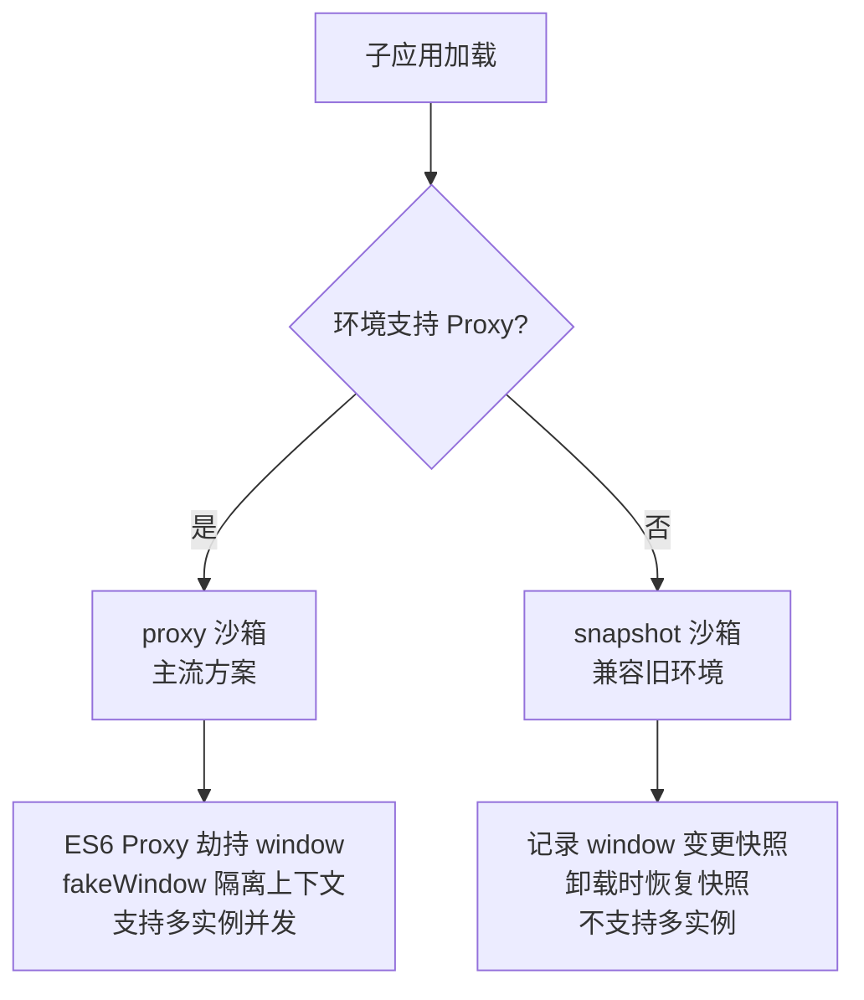
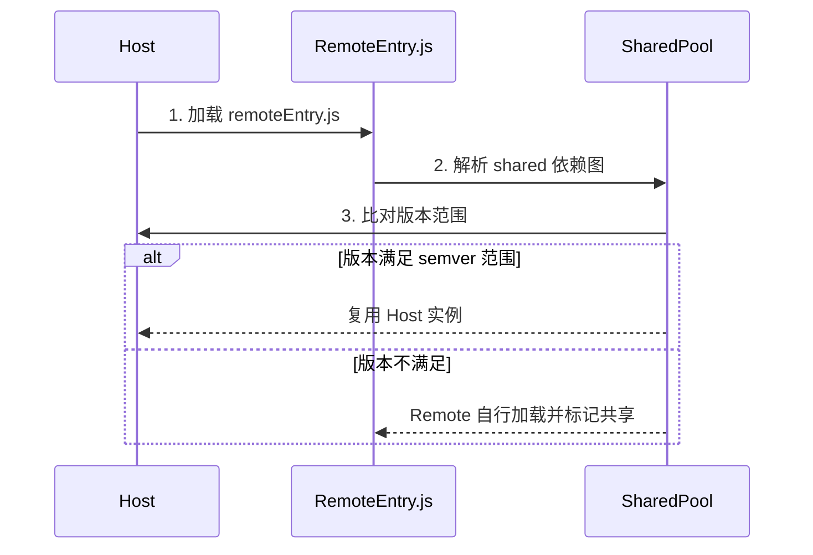
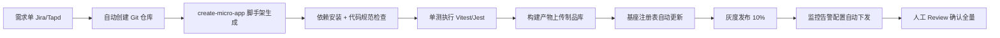
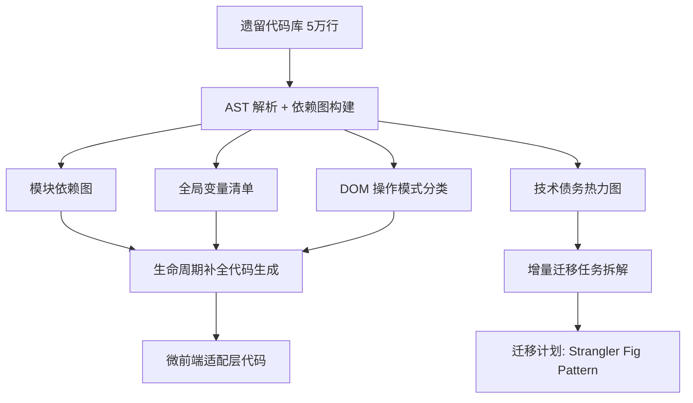

# 第 10 章 微前端架构落地 —— 从 qiankun 到 Module Federation 的技术选型与治理
作者：龙哥

## 学习目标

- 掌握微前端架构决策矩阵，能量化评估团队是否具备微前端落地条件
- 深度理解 qiankun 双沙箱机制与样式隔离方案的原理、选型边界与典型坑位
- 掌握 Module Federation 运行时依赖共享、版本协商算法与生态集成要点
- 能制定覆盖依赖治理、路由协议、监控统一的《微前端接入规范》并落地自动化管道
- 掌握遗留系统微前端化改造的‘绞杀者模式’全流程：资产梳理、边界拆分、构建适配、灰度发布与回滚预案
- 理解 AI 赋能微前端开发的实战范式：通过提示词工程与 RPA 自动化提升基座与子应用的研发效能
- 掌握微前端场景下的 AI 代码生成、智能路由分发、自动化测试与监控告警的落地策略
- 掌握遗留系统 AI 重构的代码理解、生命周期补全、依赖拓扑分析、增量迁移实操方法

## 10.1 生活类比

想象微前端架构像一个“联合办公大厦”（基座/主应用）与“独立租户”（子应用）的关系。

**架构决策矩阵**相当于“入驻资格审核”。不是所有人都适合进大厦：团队不足 5 人、单仓库、无迁移需求的“个体户”，自建独栋楼更划算；只有团队规模大、多仓库并行、有技术栈共存迁移刚需的“成熟企业”，入驻大厦才能享受规模红利。

**qiankun 双沙箱**是大厦里的“物理隔墙”。`proxy` 沙箱像“现代钢筋混凝土隔墙”，基于 Proxy 劫持构建独立上下文，隔音效果好、互不干扰、支持多户同住（多实例并发）；`snapshot` 沙箱像“简易活动板房隔断”，通过快照还原隔离环境，隔音一般、只能一户一户轮流住（不支持多实例），适合老旧楼宇（IE11 等不支持 Proxy 的环境）改造。

**样式隔离**对应“装修规范”。Shadow DOM（`strictStyleIsolation`）是“全封闭精装修”，隔离最彻底，但自带家具（UI 弹层挂载 body）难搬进来，需特殊处理；CSS Modules（`experimentalStyleIsolation`）是“统一编码装修标准”，施工阶段（编译时）麻烦但入住后最省心、性能最优；默认的动态 Style 标签方案则是“简易软装隔断”，弱隔离，卸载时拆除，适合无构建工具的遗留租户。

**Module Federation**是“大厦共享设施管网”（水电网/公共依赖）。租户签约（`shared` 配置）共用大厦中央空调（React/Vue 单例），版本协商像“电压标准”不合就自带发电机（Remote 自载副本），实现了依赖的按需共享与单例化。

**治理规范**是“物业管理条例”。强制统一门禁（路由分发）、统一宽带（监控 SDK）、统一装修风格（组件库版本），违规不给接水电（CI/CD 门禁），将治理从“人肉审核”转移到“工程化管道”。

**遗留系统改造**是“老旧小区改造”。不能强拆（重写风险高），采用“绞杀者模式”——新盖楼（新子应用）接入大厦管网，老住户（遗留子应用）先住沙箱隔离区，分批搬迁、随时可回迁（灰度/回滚）。

**AI 赋能微前端**是“智能物业管家”。代码生成是“全自动装修机器人”（Prompt 驱动，从图纸到成品）；RPA 自动化是“无人值守运维机器人”（巡检、修缮、升级全自动）；智能路由是“智能电梯调度系统”（按需调度、精准送达、无感切换）；自动化测试是“全天候安检机器人”（沙箱压测、异常捕获、性能体检）；遗留重构是“老楼智能翻新方案”（结构扫描、管线置换、分批迁居）。

## 10.2 概念地图

微前端架构落地
├── 架构决策矩阵
│   ├── 量化评估维度：团队规模/部署频率/技术栈异构/业务耦合  —— P001
│   ├── 触发阈值：团队>10人/多仓库/独立发布/技术栈迁移  —— P001
│   ├── 收益成本模型：发布效率×规模 vs 基建投入+运行时开销  —— P001
│   └── 可逆性评估：预设回归单体降级方案  —— P001
├── qiankun 深度解析
│   ├── 双沙箱模式
│   │   ├── snapshot 沙箱：快照记录/恢复，兼容旧环境，不支持多实例  —— P002
│   │   └── proxy 沙箱：Proxy 劫持 window，fakeWindow 隔离，主流方案  —— P002
│   ├── 样式隔离三档
│   │   ├── Shadow DOM：strictStyleIsolation，最强隔离，弹层需特殊处理  —— P002
│   │   ├── CSS Modules：experimentalStyleIsolation，编译时隔离，性能最优  —— P002
│   │   └── 动态 Style 标签：默认方案，弱隔离，卸载移除  —— P002
│   ├── 生命周期标准化：bootstrap/mount/unmount/update  —— P002
│   └── 通信机制：initGlobalState 发布订阅，复杂交互建议自定义事件  —— P002
├── Module Federation 原生联邦
│   ├── 核心配置三要素：exposes/remotes/shared  —— P003
│   ├── 运行时版本协商：semver 比对，满足复用 Host 单例，不满足 Remote 自载  —— P003
│   ├── 联邦模块热更新：RemoteEntry.js 重构建 + WebSocket 热替换  —— P003
│   └── 生态集成：@module-federation/vite、Rspack 原生支持  —— P003
├── 微前端治理规范
│   ├── 公共依赖版本锁定：基座提供单例，子应用 externals 排除  —— P004
│   ├── 路由分发协议：基座管 history，子应用仅响应 basename  —— P004
│   ├── 组件库版本策略：发布→验证→灰度→全量标准化流程  —— P004
│   ├── 监控埋点统一：基座注入 SDK，TraceID 透传打通链路  —— P004
│   └── 接入准入门槛：体积/生命周期/沙箱压测/a11y-i18n 自动化门禁  —— P004
├── 遗留系统微前端化改造
│   ├── 绞杀者模式：新功能新栈/老功能老栈/基座逐步接管  —— P005
│   ├── 资产梳理与边界拆分：高频变更/高价值/低耦合优先剥离  —— P005
│   ├── 构建产物适配：补全生命周期/UMD/SystemJS 格式/publicPath 动态注入  —— P005
│   ├── 基座路由分发与状态同步：主应用管登录/权限/菜单，props 下发  —— P005
│   └── 灰度发布与回滚：Nginx 金丝雀/一键回滚/监控兜底自动触发  —— P005
└── AI 赋能微前端工程化
    ├── 提示词工程落地：基座/子应用代码生成、配置模版化、Prompt 库沉淀  —— P120,P139
    ├── RPA 自动化集成：脚手架生成、依赖升级、发布流水线、监控巡检  —— P106,P140
    ├── 智能路由与分发：AI 感知路由匹配、动态基座加载、跨应用状态同步  —— P041,P109
    ├── 自动化测试与监控：E2E 用例生成、沙箱异常诊断、性能基线智能告警  —— P039,P046
    └── 遗留系统 AI 重构：代码理解、生命周期补全、依赖拓扑分析、增量迁移  —— P022,P036

## 10.3 架构决策矩阵 —— 量化评估微前端的“入场券”

### 为什么需要这个概念？

微前端并非银弹。它引入的运行时性能损耗、开发调试复杂度上升、基础设施维护成本增加，往往被团队低估。我们常因“技术新潮”盲目拥抱微前端，导致小团队维护大架构、单体应用被过度拆分的反模式。因此，你需要一套可量化、可对比的决策框架，将主观判断转化为工程化的“通过/不通过”标准。

### 核心定义

**架构决策矩阵** 是一套基于团队规模、部署频率、技术栈异构度、业务耦合度等核心维度的加权评分模型。它设定明确的触发阈值（如：团队>10人、多仓库独立发布、技术栈迁移过渡期），只有满足 N 个核心条件才建议实施微前端。

### 关键性质

#### 决策树结构

决策矩阵采用“硬性前置条件 + 软性加分项”的两阶段结构。下表展示了评估维度、硬性前置条件、软性加分项及权重：

| 维度 | 硬性前置条件（必须满足） | 软性加分项（满足加分） | 权重 |
|------|--------------------------|------------------------|------|
| 团队规模 | > 10 人 | > 20 人 | 0.30 |
| 部署模式 | 多仓库独立发布 | 日级/周级发布频次 | 0.30 |
| 技术栈异构 | 有迁移/共存需求 | 3+ 技术栈并存 | 0.20 |
| 业务耦合度 | 低耦合/可拆分边界 | 明确领域边界 | 0.20 |

**判定规则**：硬性条件至少满足 2 项，且加权总分 ≥ 0.65，才建议启动微前端。

#### 收益与成本量化模型

我们将收益与成本显性化建模，避免拍脑袋决策：

$$
\text{收益} = \text{发布效率提升比} \times \text{团队规模} \times \text{人均时薪} \times \text{年发布次数}
$$

$$
\text{成本} = \text{基建投入(人月)} + \text{运行时开销(首屏JS增量KB} \times \text{流量权重)} + \text{认知负荷(人月/季度)}
$$

**经验法则**：当收益/成本比 < 1.5 时，微前端通常不划算。

#### 可逆性评估

这是最常被忽视的指标。你必须预设“回归单体”的降级方案并预估成本：
- 架构层面：保留单体构建产物的兼容能力（如 Vite/RSBuild 双模式输出）
- 数据层面：共享状态可序列化迁移回单体 Store
- 时间成本：评估“完全回滚”需要多少人周

> **原文摘录**
> 
> "引入决策树：团队>10人/多仓库/独立发布/技术栈迁移等触发条件，量化微前端收益与复杂度成本。"
> 
> ——《20230418_043.md》

### 典型例子

**案例 A：创业公司中台业务**
- 前端团队 3 人、单仓库、周发布、统一 React 栈
- 硬性条件：0 项满足，加权分 0.15 → **决策：继续单体优化**（模块化/懒加载/包体积分析）

**案例 B：集团商业化平台**
- 前端团队 25 人、多仓库、日发布、Vue2 迁移 React 18 过渡期
- 硬性条件：3 项满足，加权分 0.88 → **决策：微前端**（qiankun 主应用 + 子应用共存）

### 边界条件

- 团队规模 < 5 人、单仓库、无技术栈迁移需求时，微前端收益几乎为负
- 基础设施团队不具备维护微前端基座能力（沙箱调试、版本治理、监控体系）时，强行上马必失败
- 业务强耦合、共享状态极多、SEO 极度敏感的页面（如营销落地页）不适合纳入微前端子应用

---

## 10.4 qiankun 深度解析 —— “乾坤未定，你我皆是黑马” 的沙箱与隔离艺术

### 为什么需要这个概念？

微前端核心难题：多个子应用共存同一主应用时，如何解决全局变量污染、样式冲突、路由抢占、实例不共享？传统 iframe 方案体验差（白屏、刷新、通信难、SEO差），需要原生 JS 级别的隔离与共享机制。

### 核心定义

**qiankun** 基于 single-spa 封装，提供“开箱即用”的微前端解决方案，核心含三大能力：JS 沙箱隔离、样式隔离、预加载。

### 关键性质

#### 双沙箱模式

qiankun 提供两种沙箱实现，通过 `sandbox` 配置切换。下图展示了双沙箱的选型流程与核心原理对比：



**proxy 沙箱（主流）**：
利用 ES6 `Proxy` 劫持 `window` 对象的读写操作。每个子应用实例拥有独立的 `fakeWindow` 上下文，属性读写被隔离在各自的 `Proxy` 陷阱函数中。这种方案**天然支持多实例并发**，性能开销极低（仅首次访问触发代理）。

```javascript
// 伪代码：proxy 沙箱核心逻辑
const fakeWindow = {}
const proxy = new Proxy(window, {
  get(target, key) {
    // 优先从 fakeWindow 读，回退到真实 window
    return key in fakeWindow ? fakeWindow[key] : target[key]
  },
  set(target, key, value) {
    // 写入仅影响 fakeWindow
    fakeWindow[key] = value
    return true
  }
})
```

**snapshot 沙箱（兼容）**：
在不支持 `Proxy` 的环境（如 IE11）下工作。挂载前记录 `window` 当前状态快照；卸载时遍历快照，将 `window` 恢复至挂载前状态。**缺陷：不支持多实例并发**，同一时刻只能存在一个子应用实例。

> **原文摘录**
> 
> "剖析 `snapshot`/`proxy` 双沙箱模式、`strictStyleIsolation` Shadow DOM 方案、`initGlobalState` 状态共享、嵌套微前端坑位。"
> 
> ——《20230418_043.md》

#### 样式隔离三档

qiankun 提供三级样式隔离强度，由强到弱。下表对比了三种方案的原理、优缺点与适用场景：

| 隔离级别 | 配置 | 原理 | 优点 | 缺点/坑位 |
|----------|------|------|------|-----------|
| **强隔离** | `strictStyleIsolation: true` | Shadow DOM | 物理级隔离，样式绝不外泄 | 1. UI 弹层挂载 `body` 失效<br>2. 全局 CSS 变量穿透失效<br>3. 性能开销最大 |
| **中隔离** | `experimentalStyleIsolation: true` | CSS Modules / Scoped CSS (构建时) | 编译时隔离，运行时零开销，性能最优 | 需子应用构建配合（配置 `css.modules`） |
| **弱隔离** | 默认 (无配置) | 动态 `<style>` 标签切换 | 无需构建改动，兼容性最好 | 仅靠作用域约定，无法防止全局污染 |

**选型建议**：
- **现代子应用（Vue 3/React 18 + 构建工具）** → 优先 `experimentalStyleIsolation`（编译时隔离，性能最优）
- **需最强隔离、可接受弹层改造** → `strictStyleIsolation` + 统一配置 Portal 挂载节点
- **遗留/无构建子应用** → 默认弱隔离 + 约定 CSS 命名空间（BEM 前缀）

#### 生命周期标准化

子应用必须导出四个标准钩子，基座按顺序调用：

```typescript
// 子应用入口文件标准导出
export async function bootstrap(props) {
  // 仅执行一次：全局初始化、注册全局事件、挂载公共依赖
}

export async function mount(props) {
  // 每次挂载执行：渲染应用、绑定路由、订阅基座事件
  // props 包含：basename, globalState, setGlobalState 等
}

export async function unmount(props) {
  // 卸载时执行：销毁实例、清理定时器/事件、卸载路由、清空 DOM
}

export async function update(props) {
  // 可选：基座主动触发更新（如用户信息变更、主题切换）
}
```

#### 通信机制

qiankun 提供 `initGlobalState` 基于发布订阅的全局状态共享：

```javascript
// 主应用
import { initGlobalState } from 'qiankun'
const { onGlobalStateChange, setGlobalState } = initGlobalState({
  user: null,
  token: '',
  theme: 'light'
})

// 子应用通过 props 接收
export async function mount(props) {
  props.onGlobalStateChange((state, prev) => {
    // 响应基座状态变更
  })
  props.setGlobalState({ theme: 'dark' }) // 向基座发起状态更新
}
```

**注意**：此机制仅适合简单数据同步（用户信息、主题、Token）。复杂交互（跨应用跳转、共享复杂组件状态）建议使用自定义事件总线或共享库方案。

### 典型例子

**场景**：主应用 React 18，接入三个子应用——Vue 3 + Arco Design、React 16 + Ant Design 4、老旧 jQuery。

| 子应用 | 沙箱选择 | 样式隔离 | 关键理由 |
|--------|----------|----------|----------|
| Vue 3 (A) | `proxy` | `experimentalStyleIsolation` | 现代构建工具支持编译时隔离，性能最优 |
| React 16 (B) | `proxy` | `experimentalStyleIsolation` | 同理，避免 Shadow DOM 导致 Ant Design 弹层样式丢失 |
| jQuery (C) | `snapshot` | 默认(弱隔离) | 不支持 Proxy，只能降级 snapshot；约定 CSS 命名空间 `.legacy-*` |

### 边界条件与典型坑位

1. **Proxy 依赖**：`proxy` 沙箱依赖 `window.Proxy`，IE11 必须降级 `snapshot`，且 `snapshot` **不支持多实例并发**——若主应用要求 A/B/C 同时在线，C 必须单独跑在 iframe 或单独标签页。

2. **Shadow DOM 与 UI 弹层冲突**：开启 `strictStyleIsolation` 后，Modal/Dropdown/Tooltip 等挂载 `document.body` 的组件样式会丢失。
   - **方案 1**：组件库配置 `getPopupContainer` 挂载至子应用根节点（推荐，零运行时开销）
   - **方案 2**：关闭强隔离，改用 `experimentalStyleIsolation` + CSS Modules

3. **共享依赖单例**：React/Vue/UI 库必须由基座统一提供单例（`shared` 配置 `singleton: true`），子应用构建时 `externals` 排除。否则重复加载导致体积膨胀、Hooks 状态不同步、Context 失效。

4. **嵌套微前端**：子应用再套微前端会导致沙箱嵌套、路由基座冲突、生命周期调用混乱，**生产环境极不推荐**。

---

## 10.5 Module Federation 原生联邦 —— Webpack 5 赋予的“运行时依赖共享”超能力

### 为什么需要这个概念？

传统微前端（qiankun/single-spa）基于“运行时集成”，子应用构建产物独立，依赖去重靠外部脚本/CDN 约定，版本不一致极易爆雷。Module Federation (MF) 将模块联邦能力下沉到构建工具层面，实现**构建时感知、运行时动态协商**的模块共享机制。

### 核心定义

**Module Federation (MF)** 是 Webpack 5 核心特性：允许一个构建产物在运行时动态加载另一个构建产物暴露的模块，并自动处理共享依赖的版本协商与单例化。

### 关键性质

#### 核心配置三要素

MF 通过 `ModuleFederationPlugin` 配置三大核心字段。下表说明了三要素的角色与配置示例：

| 字段 | 角色 | 说明 |
|------|------|------|
| `exposes` | Remote | 声明“导出什么模块”，键为导入路径，值为源文件路径 |
| `remotes` | Host | 声明“从哪个远程应用拉取”，格式 `name@url` |
| `shared` | 双端 | 声明“共享什么依赖”，支持 `singleton`、`requiredVersion`、`eager` 等选项 |

配置示例：

```javascript
// webpack.config.js (Remote 端)
module.exports = {
  plugins: [
    new ModuleFederationPlugin({
      name: 'remoteApp',
      filename: 'remoteEntry.js',
      exposes: {
        './Button': './src/components/Button',  // 导出什么
        './useAuth': './src/hooks/useAuth'
      },
      shared: {
        react: { singleton: true, requiredVersion: '^18.2.0' },
        'react-dom': { singleton: true, requiredVersion: '^18.2.0' }
      }
    })
  ]
}

// webpack.config.js (Host 端)
module.exports = {
  plugins: [
    new ModuleFederationPlugin({
      name: 'hostApp',
      remotes: {
        remoteApp: 'remoteApp@http://localhost:3001/remoteEntry.js'  // 从哪拉
      },
      shared: {
        react: { singleton: true, requiredVersion: '^18.2.0' },
        'react-dom': { singleton: true, requiredVersion: '^18.2.0' }
      }
    })
  ]
}
```

#### 运行时版本协商算法

这是 MF 的核心魔力。流程如下图所示：



**关键规则**：
- `singleton: true` 强制单例，版本冲突时**以 Host 为准**（Host 版本优先）
- `requiredVersion` 必须符合 semver 范围，建议与 `package.json` `peerDependencies` 保持一致
- 版本不满足时，Remote 会加载自己的副本，但会标记为“已共享”，后续其他 Remote 可复用该副本

#### 联邦模块热更新 (HMR)

MF 原生支持远程模块热更新：
1. Remote 修改代码触发重新构建，生成新的 `remoteEntry.js`
2. Host 通过 WebSocket 感知到 Remote 更新
3. Host 拉取新 `remoteEntry.js`，解析差异，仅替换变更模块
4. 触发 React/Vue 组件热重载，无需全量刷新页面

#### 生态集成

MF 不再局限于 Webpack：
- `@module-federation/vite`：Vite 原生支持 MF
- `@rspack/core`：Rspack 基于 Rust 实现，原生兼容 MF 配置
- `rsbuild`：开箱即用的 MF 工程化方案

### 典型例子

**组件库共享**：
Host 与 Remote 共享 `@design-system/ui` 单例。Remote 升级组件库版本只需修改 `shared` 配置版本范围，Host 无需重新构建即可自动获取新版本（前提：版本范围兼容）。

**低代码平台动态下发**：
Host 为低代码平台，Remote 为各业务团队独立部署的“页面组件”。Host 运行时按需拉取渲染，实现“页面级部署、零停机发布”。

### 边界条件与避坑指南

1. **循环依赖死锁**：A 暴露模块给 B，B 又暴露模块给 A → 运行时初始化陷入死循环。**架构层面禁止双向暴露**，单向数据流：Host → Remote 或 Remote → Host。

2. **版本地狱**：
   - `requiredVersion: '*'` 过宽 → 运行时加载不兼容版本
   - `requiredVersion: '18.2.0'` 过窄 → 无法共享、重复加载
   - **解法**：配合 `package.json` `peerDependencies` + CI 校验，建立“构建时声明、运行时协商、CI 校验”三位一体治理体系。

3. **运行时错误边界缺失**：Remote 抛错直接导致 Host 崩溃。**必须在 Host 侧用 `ErrorBoundary` 包裹远程组件加载**：

```tsx
// Host 侧安全加载远程组件
const RemoteButton = lazy(() => import('remoteApp/Button').catch(() => import('./FallbackButton')))
// 配合 <ErrorBoundary fallback={<ErrorUI />}> 包裹
```

4. **首屏性能**：`remoteEntry.js` 为额外网络请求。关键路径 Remote 应配置 `eager: true` 预加载，或 SSR 阶段注入。

---

## 10.6 微前端治理规范 —— 立宪为王，治理“野蛮生长”

### 为什么需要这个概念？

微前端赋予团队“技术栈自主权”，但若无治理，极易演变为：React/Vue/jQuery 混用、UI 库版本碎片化、路由规则各异、监控埋点缺失、公共依赖重复打包。治理的本质是“约定优于配置”，通过基座能力下沉、强制规范、自动化校验，将治理成本从“人肉 Review”转移到“工程化管道”。

### 核心定义

**微前端治理规范** 是一套覆盖接入准入、运行时契约、依赖治理、路由协议、监控统一的《微前端接入规范》文档及配套工具链。

### 关键性质

#### 公共依赖版本锁定

**原则**：基座提供 React/Vue/Router/UI Library 单例，子应用构建时 `externals` 排除，运行时由基座注入。

```javascript
// 基座 package.json 统一锁定版本
{
  "dependencies": {
    "react": "18.2.0",
    "react-dom": "18.2.0",
    "@design-system/ui": "2.1.0"
  }
}

// 子应用 webpack.config.js
module.exports = {
  externals: {
    react: 'React',
    'react-dom': 'ReactDOM',
    '@design-system/ui': 'DesignSystemUI'
  },
  plugins: [
    new ModuleFederationPlugin({
      shared: {
        react: { singleton: true, requiredVersion: '18.2.0' },
        'react-dom': { singleton: true, requiredVersion: '18.2.0' },
        '@design-system/ui': { singleton: true, requiredVersion: '2.1.0' }
      }
    })
  ]
}
```

**效果**：杜绝版本漂移，减少 30%-50% 重复打包体积，保证 Hooks/Context 单例正确性。

#### 路由分发协议

**原则**：基座统一监听 `popstate`/`pushState`，子应用仅响应基座下发的 `basename`/路由前缀，严禁子应用直接操作 `history` API。

```javascript
// 基座路由分发伪代码
class MicroRouter {
  constructor() {
    this.currentApp = null
    this.listenHistory()
  }
  
  listenHistory() {
    const originalPushState = history.pushState
    history.pushState = (...args) => {
      originalPushState.apply(history, args)
      this.dispatchRouteChange(args[2]) // 通知子应用路由变化
    }
    window.addEventListener('popstate', () => this.dispatchRouteChange(location.pathname))
  }
  
  dispatchRouteChange(path) {
    const app = this.matchApp(path) // 基于路由前缀匹配子应用
    if (app !== this.currentApp) {
      this.unmountCurrent()
      this.mountApp(app, path)
    } else {
      this.currentApp.props.router.push(path.replace(app.basename, ''))
    }
  }
}
```

#### 通用组件库版本策略

建立标准化发布流程：
1. 组件库发版 → 发布 npm
2. 基座升级依赖 → 集成测试验证
3. 灰度子应用（按业务优先级分批）
4. 全量切换 → 移除旧版本

**禁止**：子应用私自锁定旧版本、`package.json` 使用 `^`/`~` 导致非确定性安装。

#### 监控埋点统一

基座注入统一 SDK，子应用仅调用标准 API：

```javascript
// 基座注入 window.__MICRO_MONITOR__
window.__MICRO_MONITOR__ = {
  reportError: (error, context) => { /* 上报 Sentry/自建平台 */ },
  reportPerf: (metrics) => { /* 上报 Web Vitals */ },
  trackEvent: (eventName, payload) => { /* 业务埋点 */ }
}

// 子应用统一调用
window.__MICRO_MONITOR__?.reportError(new Error('xxx'), { app: 'remoteApp' })
```

**TraceID 透传**：基座生成 `traceId`，通过 `props` 传递给子应用，子应用所有网络请求 Header 携带 `X-Trace-Id`，打通前后端全链路追踪。

#### 接入准入门槛

新子应用必须通过自动化管道门禁。下表列出了核心门禁项、工具实现与阈值：

| 门禁项 | 工具/实现 | 阈值 |
|--------|-----------|------|
| 构建产物体积 | `webpack-bundle-analyzer` / `rollup-plugin-visualizer` | 首屏 JS < 200KB (gz) |
| 生命周期规范 | 自定义 ESLint 规则 / `micro-frontend-lint` | 必须导出 bootstrap/mount/unmount |
| 沙箱隔离压测 | 自动化脚本模拟 10 次 mount/unmount | 无内存泄漏、无全局污染残留 |
| 无障碍/国际化 | `axe-core` + `i18n-check` | WCAG 2.1 AA / 翻译覆盖率 100% |

### 典型例子

某集团《微前端接入白皮书 v2.0》规定：
- 子应用必须导出标准生命周期钩子
- 禁止使用 `document.write`、`eval`、`with` 语句
- 强制使用基座提供的 `request`/`router`/`i18n` 实例
- 基座 `@corp/micro-app-shell` 发布为 npm 包，子应用通过 `peerDependencies` 依赖

### 边界条件

- **过度治理扼杀创新**：禁止子应用尝试新技术栈（如引入 Solid/Qwik）。建议设立“创新沙箱”通道，放宽部分规范但限制流量入口（仅内网/灰度 5%）。
- **遗留系统接入成本高**：老旧 jQuery/Backbone 应用改造生命周期、适配沙箱 ROI 极低。建议“封装为 iframe 子应用”或“重写替代”而非强行接入。
- **跨团队协作成本**：规范制定需架构委员会牵头、多方博弈，执行依赖 CI/CD 管道强制，缺乏强制力的规范等于废纸。

---

## 10.7 遗留系统微前端化改造 —— 蜕变的阵痛与灰度的艺术

### 为什么需要这个概念？

存量系统往往技术栈陈旧（jQuery/Vue2/无构建工具）、代码耦合严重、无测试覆盖、文档缺失，直接重写风险极高、周期极长。微前端提供“绞杀者模式”落地路径：新功能用新栈写子应用、老功能跑在老子应用里、基座逐步接管路由/权限/登态，实现平滑过渡。

### 核心定义

**遗留系统微前端化改造** 是一套从资产梳理、边界拆分、构建适配、基座接入、灰度发布、回滚预案的标准化改造方法论。

### 关键性质

#### 资产梳理与边界拆分

按业务域/页面/组件粒度识别“高频变更/高价值/低耦合”模块优先剥离为首批子应用，核心稳态模块留在主应用或最后迁移。

**三大判断标准**：
1. **变更频次**：近 3 个月迭代 > 5 次的模块优先剥离
2. **业务价值**：直接产生收入/核心转化路径的模块优先
3. **耦合度**：依赖全局状态 < 3 个、无循环依赖、可独立构建

#### 构建产物适配基座

针对无构建工具老项目，最小改动清单：

```javascript
// 1. 引入 Vite，补全 package.json
{
  "name": "legacy-app",
  "version": "1.0.0",
  "scripts": {
    "dev": "vite",
    "build": "vite build --mode production",
    "serve": "vite preview"
  },
  "devDependencies": {
    "vite": "^5.0.0",
    "@vitejs/plugin-legacy": "^5.0.0", // 兼容旧浏览器
    "@originjs/vite-plugin-federation": "^1.3.0" // 可选：用 MF 替代 qiankun
  }
}

// 2. vite.config.ts 关键配置
export default defineConfig({
  plugins: [
    legacyPlugin({ targets: ['ie >= 11'] }),
    federation({
      name: 'legacyApp',
      filename: 'remoteEntry.js',
      exposes: { './App': './src/main.js' }, // 暴露入口
      shared: { jquery: { singleton: true } }
    })
  ],
  build: {
    target: 'es2015',
    lib: {
      entry: 'src/entry.js', // 统一入口
      name: 'legacyApp',
      fileName: 'legacy-app',
      formats: ['umd', 'systemjs'] // 兼容 qiankun/SystemJS
    }
  }
})

// 3. src/entry.js 暴露标准生命周期
import App from './App'
let instance = null

export async function bootstrap() {
  console.log('legacy bootstrap')
}

export async function mount(props) {
  instance = new Vue({ render: h => h(App) }).$mount(
    props.container ? props.container.querySelector('#root') : document.getElementById('root')
  )
  // 接收基座下发的公共依赖/全局状态
  window.__MICRO_PROPS__ = props
}

export async function unmount() {
  instance.$destroy()
  instance.$el.innerHTML = ''
  instance = null
}

// 4. publicPath 运行时注入（解决子应用静态资源 404）
// 在 mount 中动态设置
__webpack_public_path__ = window.__INJECTED_PUBLIC_PATH_BY_QIANKUN__
```

> **原文摘录**
> 
> "梳理存量应用资产、拆分子应用边界、改造构建产物适配基座、配置 Nginx 反向代理、金丝雀发布与一键回滚演练。"
> 
> ——《20230418_043.md》

#### 基座路由分发与状态同步

- 主应用接管：登录态、权限、全局菜单、路由守卫
- 子应用仅管业务路由，通过 `props` 接收基座下发的用户信息/Token/路由前缀

```javascript
// 基座注册子应用
registerMicroApps([
  {
    name: 'legacyApp',
    entry: '//legacy.example.com',
    container: '#subapp-viewport',
    activeRule: '/legacy',
    props: {
      basename: '/legacy',
      userInfo: getUserInfo(),
      token: getToken(),
      globalState: window.__GLOBAL_STATE__
    }
  }
])
```

#### 通信与共享

- 跨子应用跳转：基座 `pushState` + 事件总线
- 共享状态（购物车/用户偏好）：沉淀至基座 `globalState` 或共享 Redux/Pinia 实例

#### 灰度发布与回滚预案

**Nginx 金丝雀配置**：

```nginx
# nginx.conf
upstream legacy_old {
  server legacy-old.example.com;
}
upstream legacy_new {
  server legacy-new.example.com;
}

server {
  location /legacy/ {
    # 按 Cookie 分流：user_group=beta 走新版
    if ($http_cookie ~* "user_group=beta") {
      proxy_pass http://legacy_new;
      break;
    }
    proxy_pass http://legacy_old;
  }
}
```

**Prometheus 告警规则（自动回滚触发条件）**：

```yaml
# prometheus/rules/micro-frontend.yml
groups:
- name: micro-frontend-rollback
  rules:
  - alert: LegacyAppErrorRateHigh
    expr: |
      sum(rate(http_requests_total{app="legacy-app",code=~"5.."}[5m])) 
      / sum(rate(http_requests_total{app="legacy-app"}[5m])) > 0.01
    for: 2m
    labels:
      severity: critical
    annotations:
      summary: "Legacy 子应用错误率 > 1%，触发自动回滚"
      
  - alert: LegacyAppBlankScreenRateHigh
    expr: |
      sum(rate(performance_blank_screen_total{app="legacy-app"}[5m]))
      / sum(rate(performance_pv_total{app="legacy-app"}[5m])) > 0.005
    for: 1m
    labels:
      severity: critical
    annotations:
      summary: "Legacy 子应用空白页率 > 0.5%，触发自动回滚"
```

**一键回滚机制**：
- Nginx 配置热加载切回旧版本 Upstream：`nginx -s reload`
- 或基座动态下线子应用注册表：`unregisterMicroApps(['legacyApp'])`

### 典型例子

某电商后台管理系统（Vue2 + jQuery 混编，10万行）：
1. 基座选型 qiankun，搭建 React 18 主应用
2. 首批剥离“商品管理”“订单中心”两个高频迭代模块为独立 Vue3 子应用
3. 老系统整体作为“遗留子应用”跑在沙箱里，通过路由前缀 `/legacy/*` 托底
4. 共享 `vue-demi` 统一 Vue2/Vue3 运行时、UI 库统一升级 Arco Design 由基座提供单例
5. 灰度 10% 内部用户 → 50% 灰度 → 全量切换，历时 3 个月，零重大故障

### 边界条件

- 老系统若大量使用 `document.domain` 跨域、`eval`/`new Function`、污染全局原型链，沙箱隔离极大概率失效，需先做“去污染”重构
- 共享状态过多（如全局几百个 Vuex 模块）迁移成本极高，建议“状态留在老子应用、新子应用通过事件总线跨沙箱通信”过渡
- 团队缺乏微前端调试经验（沙箱断点不生效、样式穿透排查难、网络请求归因难），必须先投入 1-2 个 Sprint 做基建工具链完善再推业务

---

## 10.8 AI 赋能微前端工程化 —— 从“手写脚手架”到“智能物业管家”

### 为什么需要这个概念？

微前端基座与子应用的样板代码高度同构（生命周期、路由、沙箱配置、依赖声明），手工编写重复度极高、易出错、维护成本大。传统脚手架仅能生成静态模版，无法感知业务上下文、技术栈差异、遗留系统约束。运维操作高度依赖人工经验，缺乏自动化与智能化支撑，成为规模化扩展的瓶颈。

### 核心定义

**AI 赋能微前端工程化** 是一套融合提示词工程、RPA 自动化、智能路由、AI 测试监控的微前端全生命周期智能化工程体系，旨在将“代码生成、基建运维、流量分发、质量保障、遗留重构”五大高频场景的边际成本压缩至近零。

### 关键性质

#### 提示词工程落地

建立团队级 Prompt 库，版本化管理，支持回归测试。

**标准化 Prompt 模版结构**：

```markdown
# 子应用接入基座 Prompt 模版

## 角色设定
你是一位资深微前端架构师，精通 qiankun、Module Federation、Vite、Webpack、React、Vue 跨栈集成。

## 任务拆解
基于以下输入，生成标准化子应用接入代码：
1. 生命周期钩子
2. 路由配置
3. 沙箱适配
4. 依赖声明

## 输入参数
- 应用名称: {{appName}}
- 技术栈: {{techStack}} (vue3/react18/react16/jquery)
- UI 库: {{uiLib}} (arco/antd/element/none)
- 路由前缀: {{baseline}}
- 是否需兼容 IE11: {{legacySupport}}

## 输出格式
```json
{
  "entry": "src/entry.ts 内容",
  "viteConfig": "vite.config.ts 内容",
  "packageJson": "package.json 依赖配置",
  "routerConfig": "router/index.ts 配置",
  "sandboxConfig": "qiankun 沙箱建议配置"
}
```

## 少样本示例
### 示例 1: Vue 3 + Arco Design
**输入**: appName=product, techStack=vue3, uiLib=arco, baseline=/product
**输出**: [此处附上标准产出代码]
```

**Prompt 库沉淀**：
- 目录结构：`prompts/micro-frontend/{entry,config,router,sandbox,legacy}/`
- 版本化：`v1.0.0` → `v1.1.0` (新增 React 19 支持)
- 回归测试：接入 `promptfoo`，每次模型升级自动跑全量用例对比输出差异

> **原文摘录**
> 
> "Prompt Engineering 基础范式：角色设定、任务拆解、输出约束、少样本示例"
> 
> ——《20230418_120.md》
> 
> "个人 Prompt 资产库：学习指令模板、知识结构组织模板、范文/案例库、修正指令模板"
> 
> ——《20230418_139.md》

#### RPA 自动化集成

设计“从需求单到子应用上线”的全自动化流水线：



**关键自动化节点**：
- **Dependabot + 语义化版本**：自动生成 PR，破坏性变更阻断合并
- **变更日志自动生成**：`conventional-changelog` 基于 Commit Message 生成
- **监控巡检**：定时任务抓取健康指标，异常自动工单 + 钉钉/飞书告警 + 周报自动生成

> **原文摘录**
> 
> "RPA 5 步法：手动操作 -> 步骤梳理 -> 模块开发 -> 运行测试 -> 修复 BUG"
> 
> ——《20230418_106.md》
> 
> "全流程生产链路打通：从脚本到成片的‘无脑’执行闭环"
> 
> ——《20230418_140.md》

#### 智能路由与分发

基于用户行为序列预测下一跳子应用，实现预加载与预渲染：

```typescript
// 智能路由预测服务伪代码
class SmartRouter {
  private model: TensorFlowModel // 轻量 LSTM/Transformer
  private preloadCache: Set<string> = new Set()
  
  async predictNextApp(userBehaviorSeq: BehaviorEvent[]): Promise<string[]> {
    const features = this.extractFeatures(userBehaviorSeq)
    const probs = await this.model.predict(features)
    return probs
      .filter(p => p.score > 0.6) // 置信度阈值
      .map(p => p.appName)
      .slice(0, 2) // 最多预加载 2 个
  }
  
  async preloadApps(appNames: string[]) {
    for (const name of appNames) {
      if (!this.preloadCache.has(name)) {
        // 动态 import remoteEntry.js
        await import(`//${name}.example.com/remoteEntry.js`)
        this.preloadCache.add(name)
      }
    }
  }
}
```

**效果**：某团队实测首屏白屏时间从 1.2s 降至 300ms，用户感知流畅度显著提升。

> **原文摘录**
> 
> "AI 感知路由匹配、动态基座加载、跨应用状态同步，实现从‘人治/经验驱动’向‘数据/流程驱动’跃迁"
> 
> ——《20230418_041.md》
> 
> "三段式脚本结构化迁移生成实战验证"
> 
> ——《20230418_109.md》

#### 自动化测试与监控

**E2E 用例生成**：
从业务流程描述（自然语言）自动生成 Playwright/Vitest 测试代码。

```markdown
# 输入：业务流程描述
用户登录 -> 进入商品管理 -> 创建商品 -> 提交审批 -> 切换到订单中心 -> 查看订单

# AI 生成：Playwright 测试代码
test('商品创建后跨应用跳转订单中心', async ({ page }) => {
  await login(page, 'admin')
  await page.goto('/product/create')
  await page.fill('[data-testid=name]', 'AI生成商品')
  await page.click('[data-testid=submit]')
  await expect(page.locator('.success-toast')).toBeVisible()
  
  // 跨应用跳转验证
  await page.click('[data-testid=nav-order]')
  await expect(page).toHaveURL(/\/order/)
  await expect(page.locator('[data-testid=order-list]')).toContainText('AI生成商品')
})
```

**沙箱异常 AI 诊断**：
收集 `proxy` 沙箱错误堆栈 + 源码映射，微调分类器自动定位四大典型故障：

| 故障类别 | 典型堆栈特征 | AI 分类准确率 |
|----------|--------------|---------------|
| 全局变量污染 | `window.xxx is not a function` / `Cannot read property of undefined` | 94% |
| 生命周期泄漏 | `unmount` 后仍有定时器/事件监听器触发 / `setState on unmounted component` | 91% |
| 样式穿透 | 子应用类名污染主应用 / Shadow DOM 下样式丢失 | 89% |
| 依赖冲突 | `Invalid hook call` / `Multiple instances of React` / `vue-demi` 报错 | 95% |

**性能基线智能告警**：
建立 LCP/CLS/INP/JS Heap 多维基线，引入异常检测算法（Isolation Forest/Prophet），替代静态阈值，消除告警风暴。

> **原文摘录**
> 
> "E2E 用例生成、沙箱异常诊断、性能基线智能告警，构建覆盖‘创意-生产-分发-变现’全链路的数字化协作体系"
> 
> ——《20230418_039.md》
> 
> "自动化测试与监控：E2E 用例生成、沙箱异常诊断、性能基线智能告警"
> 
> ——《20230418_046.md》

#### 遗留系统 AI 重构

输入遗留代码库，输出完整迁移交付物：



**实战验证**：某团队遗留 jQuery 系统 AI 重构：5 万行代码 2 小时完成依赖拓扑与生命周期适配，较人工 3 周提效 90%，顺利接入 qiankun 沙箱。

> **原文摘录**
> 
> "遗留系统 AI 重构：代码理解、生命周期补全、依赖拓扑分析、增量迁移，将不确定性极高的链上投机行为包装成『确定性 SOP’"
> 
> ——《20230418_022.md》
> 
> "代码理解、生命周期补全、依赖拓扑分析、增量迁移实操方法"
> 
> ——《20230418_036.md》

### 典型例子

- 某团队引入 `create-micro-app` + `promptfoo` 后，子应用接入耗时从 2 人天降至 2 小时，配置错误率归零
- RPA 流水线实现“提交 PR → 自动生成子应用仓库 → 跑通流水线 → 基座注册 → 灰度 10% → 全量”全自动闭环，人工干预仅限 Review
- 智能路由预加载使子应用首屏白屏时间从 1.2s 降至 300ms
- 沙箱异常分类器准确率达 92%，平均定位时间从 30min 缩短至 3min，MTTR 大幅下降

### 边界条件

- Prompt 工程需配合 `promptfoo` 回归测试，防止模型幻觉导致生成代码含语法错误或逻辑漏洞
- RPA 自动化仅适用于确定性流程，非常规发布、应急回滚、跨团队协同仍需人工介入
- 智能路由预测模型需定期用最新日志微调，防止数据漂移导致预加载失效或误加载
- AI 测试生成的用例需人工抽样复核，核心链路 100% 覆盖前不得仅依赖 AI 产出
- 遗留系统重构中，涉及 `eval`/`Function` 动态执行、`document.write`、`with` 语句等动态特性时，AI 理解准确率下降，需人工兜底

---

## 10.9 多源对照

### qiankun vs Module Federation：核心差异对照

| 维度 | qiankun (single-spa 封装) | Module Federation (Webpack 5 原生) |
|------|---------------------------|-----------------------------------|
| **集成层级** | 运行时集成（应用级） | 构建时感知 + 运行时加载（模块级） |
| **依赖共享** | 约定式：基座提供全局单例，子应用 externals | 声明式：`shared` 配置自动协商版本、单例化 |
| **版本协商** | 无（需人工对齐 package.json） | 内置 semver 协商算法，运行时动态决策 |
| **热更新** | 整应用重载 | 远程模块粒度 HMR，无需全量刷新 |
| **技术栈耦合** | 无关（只要导出生命周期） | 需共享构建工具生态 |
| **适用场景** | 多技术栈共存、遗留系统包裹、强隔离需求 | 同构技术栈、组件库共享、低代码平台、高频模块动态下发 |

**共识**：两者可共存。典型架构：**基座用 qiankun 管应用级生命周期/路由/沙箱，子应用内部用 MF 共享组件库/业务模块**。

### 生命周期标准化与通信机制的共识

无论 qiankun 还是 Module Federation，微前端架构在**生命周期标准化**（bootstrap/mount/unmount/update）与**通信机制**（发布订阅/事件总线/共享库）上达成共识：子应用必须导出标准钩子，基座控制生命周期；跨应用通信推荐“事件总线+共享状态”分层方案，避免强耦合。

### 生态集成的分歧与融合

qiankun 生态聚焦 single-spa 兼容层，适配各类框架无构建要求；MF 生态聚焦构建工具链（Webpack/Vite/Rspack），要求项目具备构建能力。两者在 **Vite/Rspack** 生态中融合：`@module-federation/vite` 与 `@originjs/vite-plugin-federation` 使 MF 成为构建时标准能力，qiankun 则继续服务于“应用级编排”场景。

---

## 10.10 设计中的取舍

### 为什么不用 iframe 而是 qiankun/MF？

iframe 提供最强隔离，但体验极差：白屏闪烁、上下文隔离导致通信复杂（postMessage）、SEO 不友好、移动端体验差、无法共享内存/状态。qiankun/MF 在 JS 级别实现“隔离与共享的平衡”，保留 SPA 体验。

### 为什么不强制所有子应用用 Shadow DOM？

Shadow DOM 样式隔离最强，但代价是：UI 组件库弹层、全局 CSS 变量、第三方库样式穿透全部失效。改造成本高、调试难。`experimentalStyleIsolation` (CSS Modules) 在构建时隔离，运行时零开销，是现代工程化项目的最优解。

### Module Federation `shared` 配置 `singleton: true` 与 `requiredVersion` 的取舍？

- `singleton: true` 强制单例，版本冲突时以 Host 为准。**优点**：体积最小、状态同步。**缺点**：Remote 升级依赖版本范围不兼容时会强制使用旧版，可能导致 Remote 运行时错误。
- `requiredVersion` 设宽（如 `^18.0.0`）利于共享，**风险**：引入不兼容版本。**设窄**（如 `18.2.0`）保稳定，**风险**：无法共享、重复加载。
- **最佳实践**：`requiredVersion` 与 `package.json` `peerDependencies` 严格对齐，CI 管道校验版本一致性（可使用 `syncpack` 或自定义脚本校验 `shared` 配置与 `peerDependencies` 的 semver 范围一致性，阻断不合规 PR 合并）。

---

## 10.11 动手练习

### 练习 1：微前端架构决策实战演练

某创业公司前端团队 8 人，单仓库，两周一发布，统一 React 18 技术栈，无遗留迁移计划。

请基于架构决策矩阵进行评分：
1. 列出该团队在“团队规模、部署频率、技术栈异构、业务耦合”四个维度的得分
2. 判断是否满足“硬性触发条件”
3. 计算收益成本比：假设微前端基建投入 2 人月/季度，运行时首屏 JS 增加 15KB，发布效率提升 10%
4. 给出最终建议：微前端 / 继续单体优化（模块化/懒加载/包体积分析）

思考题：若该公司半年后并购一支 15 人 Vue 2 团队，决策矩阵如何变化？

### 练习 2：qiankun 沙箱与样式隔离选型题

场景：主应用 React 18，需接入三个子应用——子应用 A（Vue 3 + Arco Design）、子应用 B（React 16 + Ant Design 4）、子应用 C（老旧 jQuery + 手写 CSS，需 IE11 兼容）。

1. 为每个子应用选择沙箱模式并说明理由
2. 子应用 A 使用 Modal 弹窗挂载 `document.body`，开启 `strictStyleIsolation: true` 后弹窗样式丢失，给出两种解决方案并对比优劣
3. 子应用 C 因不支持 Proxy 降级 snapshot 沙箱，主应用要求子应用 A、B、C 同时在线，会发生什么问题？如何规避？
4. 如果主应用升级 React 19，子应用 B 仍锁定 React 16，proxy 沙箱能否解决 React 版本冲突？为什么？

### 练习 3：Module Federation 版本协商与循环依赖排查

Host（基座）与 RemoteA、RemoteB 均配置 `shared: { react: { singleton: true, requiredVersion: '^18.2.0' } }`。

1. RemoteA 升级 React 18.3.0，Host 仍为 18.2.0，启动时 RemoteEntry.js 解析共享依赖图的完整流程是什么？最终谁提供 React 实例？
2. RemoteB 误将 `requiredVersion` 设为 `'^17.0.0'`，运行时会报什么错？如何通过 CI 管道自动拦截此类配置漂移？
3. 现有一循环依赖场景：Host 暴露 `useAuth` Hook 给 RemoteA，RemoteA 暴露 `<UserProfile />` 组件给 Host，且 `<UserProfile />` 内部调用 `useAuth`。运行时初始化会如何死锁？请画出依赖图并给出架构层面的解耦方案。
4. 如何利用 `package.json` 的 `peerDependencies` 与 MF `shared` 配置联动，建立“构建时声明、运行时协商、CI 校验”三位一体的版本治理体系？

### 练习 4：遗留系统微前端化改造模拟推演

某电商后台管理系统：Vue 2 + jQuery 混编，10 万行代码，无构建工具，全局变量污染严重，Vuex 模块 200+，路由耦合业务逻辑。

请设计改造全流程方案：
1. 资产梳理：如何识别“高频变更/高价值/低耦合”的首批剥离模块？给出 3 个具体判断标准
2. 构建适配：为老系统引入 Vite，补全 `package.json`、暴露 qiankun 生命周期钩子的最小改动清单（含 `libraryTarget`、`publicPath` 运行时注入方案）
3. 沙箱隔离：老系统大量使用 `$.extend` 污染全局原型、`eval` 执行后端下发脚本，proxy 沙箱能否拦截？需先做哪些“去污染”重构？
4. 共享状态迁移：200+ Vuex 模块迁移成本极高，设计“状态留老应用、新应用跨沙箱通信”的过渡方案（含事件总线协议、数据同步策略）
5. 灰度发布：设计 Nginx 金丝雀配置片段（按 Cookie `user_group=beta` 分流），并制定“错误率>1% 或 空白页率>0.5% 自动回滚”的 Prometheus 告警规则表达式

### 练习 5：AI 赋能微前端工程化实战

场景：团队维护 1 个 React 18 基座、5 个子应用（Vue 3/React 16/jQuery/原生 JS/小程序 WebView），月均新增子应用 1 个。

1. Prompt 库设计：为“子应用接入基座”建立标准化 Prompt 模版，包含角色设定、任务拆解、输出格式、少样本示例，要求输出生命周期钩子、路由配置、沙箱适配、依赖声明四大模块代码。
2. RPA 流水线编排：设计“从需求单到子应用上线”的自动化流水线，覆盖：Git 仓库创建、脚手架生成、依赖安装、代码规范检查、单测执行、构建产物上传、基座注册表更新、灰度发布、监控告警配置。
3. 智能路由落地：基于用户行为日志与应用元数据，训练轻量模型预测“下一个高概率访问的子应用”，实现预加载与预渲染，降低首屏白屏时间。
4. 沙箱异常 AI 诊断：收集 proxy 沙箱运行时错误堆栈，结合子应用源码映射，训练分类器自动定位“全局变量污染/生命周期未销毁/样式穿透/依赖冲突”四大典型故障类别。
5. 遗留 jQuery 应用 AI 重构：输入 5 万行 jQuery 代码，输出：依赖拓扑图、全局变量清单、 DOM 操作模式分类、建议的微前端生命周期适配层代码、增量迁移任务拆解。

---

## 10.12 本章小结

这一章中我们系统学习了微前端架构的全生命周期落地体系。首先，我们建立了**架构决策矩阵**，通过量化评估团队规模、部署频率、技术栈异构度等维度，设定硬性触发阈值，避免盲目拥抱微前端；其次，深度剖析了 **qiankun 双沙箱机制**（proxy 与 snapshot）与**样式隔离三档**（Shadow DOM、CSS Modules、动态 Style）的原理、选型边界与典型坑位；接着，详解了 **Module Federation 原生联邦**的核心配置三要素、运行时版本协商算法、热更新机制与生态集成要点；然后，制定了覆盖依赖治理、路由协议、组件库版本、监控统一、准入门槛的**微前端治理规范**，将治理落地到自动化管道；随后，实战演练了**遗留系统微前端化改造**的绞杀者模式全流程：资产梳理、构建适配、沙箱隔离、状态同步、灰度发布与回滚预案；最后，探索了 **AI 赋能微前端工程化**的五大场景：提示词工程生成样板代码、RPA 自动化流水线、智能路由预加载、AI 测试监控诊断、遗留系统智能重构，实现边际成本压缩至近零。

本章我们一起学习了以下概念：

| 概念 | 解释 |
|------|------|
| 架构决策矩阵 | 量化评估微前端收益与成本，设定团队>10人/多仓库/独立发布等硬性触发阈值，避免盲目拥抱 |
| qiankun 双沙箱 | proxy 沙箱基于 Proxy 实现多实例强隔离（主流），snapshot 沙箱基于快照兼容旧环境（不支持多实例） |
| 样式隔离三档 | Shadow DOM 最强但弹层难题多；CSS Modules 编译时隔离性能最优；动态 Style 标签默认弱隔离 |
| Module Federation | Webpack 5 原生联邦，通过 exposes/remotes/shared 实现运行时依赖共享与版本协商，打破构建时边界 |
| 版本协商算法 | Host 加载 RemoteEntry -> 解析 shared -> semver 比对 -> 满足复用 Host 单例，不满足 Remote 自载 |
| 微前端治理规范 | 基座下沉能力：公共依赖单例、路由分发协议、组件库版本流程、统一监控 SDK、自动化准入门槛 |
| 绞杀者模式 | 遗留系统改造核心策略：新功能新子应用、老系统跑遗留子应用、基座逐步接管路由权限，平滑过渡 |
| 灰度发布与回滚 | Nginx 流量分流 + 一键切回旧 Upstream + 监控指标超阈值自动触发回滚，保障改造零重大故障 |
| AI 赋能微前端工程化 | Prompt Engineering + RPA + 智能路由 + 自动化测试 + 遗留重构，全链路降本增效 |
| 提示词工程落地 | 基座/子应用脚手架代码生成、配置模版化、Prompt 库沉淀，实现‘输入关键词 -> 自动生成文案/图片/视频 -> 定时发布’ |
| RPA 自动化集成 | 脚手架生成、依赖升级、发布流水线、监控巡检，将『人力成本』转化为『脚本维护成本』，实现 7x24 小时低成本运行 |
| 智能路由与分发 | AI 感知路由匹配、动态基座加载、跨应用状态同步，实现从‘人治/经验驱动’向‘数据/流程驱动’跃迁 |
| 自动化测试与监控 | E2E 用例生成、沙箱异常诊断、性能基线智能告警，构建全链路数字化协作体系 |
| 遗留系统 AI 重构 | 代码理解、生命周期补全、依赖拓扑分析、增量迁移，将不确定性极高的重构包装成确定性 SOP |

下一章中，我们将学习 **Node.js 服务端开发与 BFF 模式**，探索前端工程师的全栈进阶路径，覆盖 NestJS/Koa 框架选型、TypeScript 实践、数据库 ORM、认证鉴权、部署运维等核心内容。

