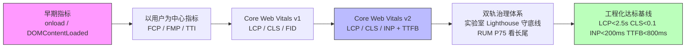
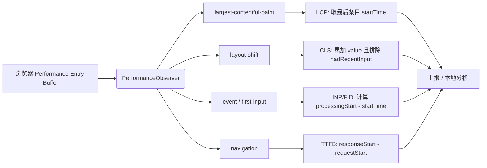
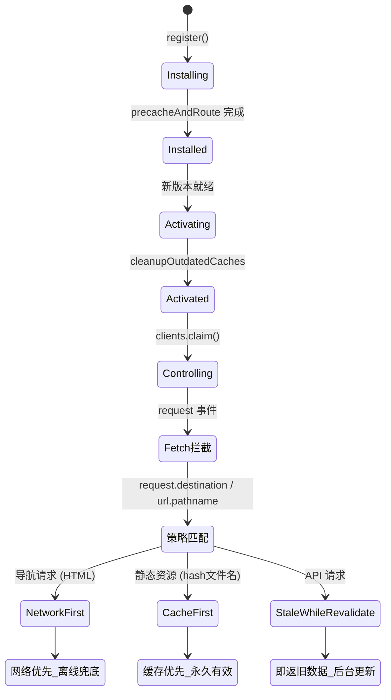
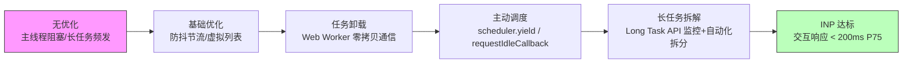
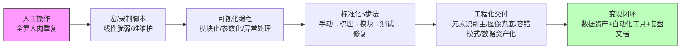
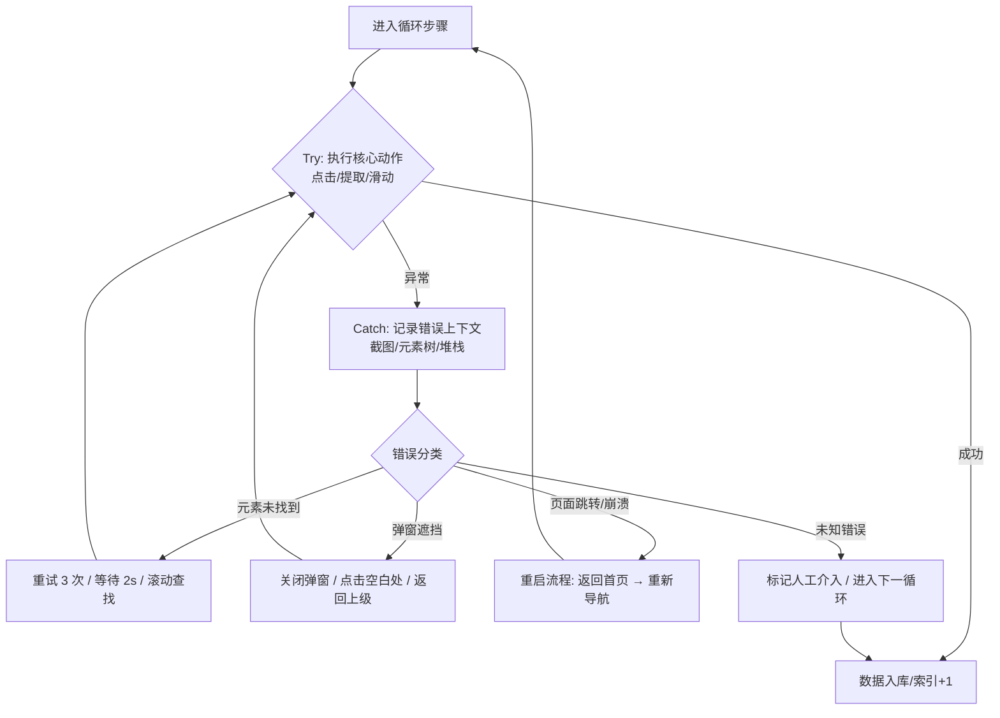
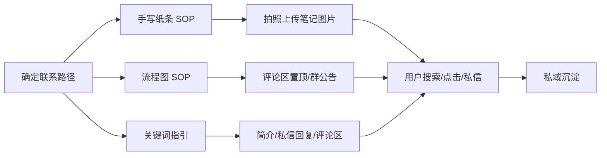
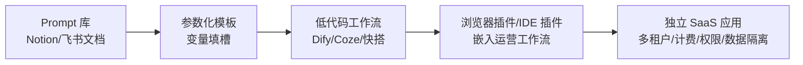
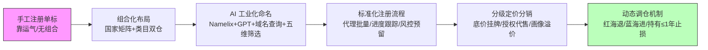
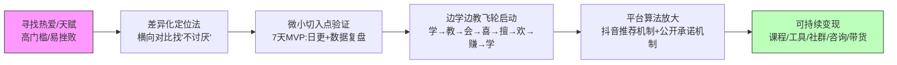

# 第 41 章 前端性能工程与智能自动化实战 —— 从指标体系到 RPA/引流/AI 变现的全景交付
作者：龙哥

## 学习目标

- 理解 Web 性能指标体系（Core Web Vitals）的定义、采集原理与工程化达标基线
- 掌握构建产物优化的核心手段：代码分割、Tree Shaking、压缩算法选型与体积预算治理
- 熟练运用资源加载策略：预加载/预连接/预取、HTTP/2 多路复用、Service Worker 缓存策略
- 掌握运行时渲染优化技巧：虚拟列表、防抖节流、Web Worker 卸载主线程、requestIdleCallback 调度
- 具备搭建前端性能监控平台的全链路能力：SDK 埋点、数据上报、存储分析、可视化看板与告警体系
- 理解 RPA（机器人流程自动化）在非侵入式数据采集场景中的核心定位与实施方法论
- 掌握基于福格行为模型的小红书引流底层逻辑与实操体系
- 理解 AI 赋能跨境电商的六大核心应用场景与垂直 SaaS 工具化封装路径
- 掌握海外商标投资套利的全流程标准化作业体系与定价策略
- 理解‘普通人’通过‘不讨厌/不厌其烦’微小切入点结合‘边学边教’实现抖音变现的正向循环模型

## 41.1 生活类比：工程化思维的“万用瑞士军刀”

本章贯穿六大看似独立实则同构的领域，其底层逻辑均是 **“工程化思维的万用瑞士军刀”** —— 用标准化流程解决不确定性问题，用杠杆放大微小优势，用闭环实现持续增值。我们为每一把“刀片”建立独立隐喻，并统一映射到**输入→处理→输出→反馈**的工程闭环。

**刀片 1：前端性能优化 = “极速快递”物流体系建设**  
- **Core Web Vitals** = “签收时效、包裹完好率、客服响应速度”三大核心 KPI  
- **构建产物优化** = “精简包装、拆分大件、压缩体积”，减少运输成本  
- **资源加载策略** = “预派单、就近仓储、智能路由”，让资源“零等待”触达  
- **运行时渲染优化** = “分拣线自动化、大件上专用车道、高峰期限流分流”，保障主干道（主线程）畅通  
- **性能监控平台** = “全程 GPS 追踪、异常自动预警、复盘优化路线”，实现“可看、可测、可优化”的闭环  

**刀片 2：RPA = “数字实习生”**  
- 它不懂业务逻辑，只会模仿人的鼠标键盘操作  
- 通过“可视化积木”教会它点击、输入、识别文字  
- 它能 7×24 小时不眠不休地处理“不可复制、无 API”的脏活累活  
- 核心价值不在替代代码，而在解决“人工操作无法规模化”的工程难题  

**刀片 3：小红书引流 = “行为设计游戏”**  
- **私信动力** = 精心设计的“诱饵”（痛点/收益/选题），让用户“想联系你”  
- **私信能力** = 降低操作门槛的“工具”（手写纸条/流程图/关键词），让用户“能联系你”  
- **私信提示** = 无处不在的“路标”（图片/评论/私信/群公告），在用户“顺手就联系了”  
- 合规性是生存红线：手写、打码、关键词、小号协作，不触红线才能长久玩下去  

**刀片 4：AI 跨境电商 = “配备了母语级英语专家的全能助理团队”**  
- **角色设定** = 指派专家人设（亚马逊运营/Instagram达人/Facebook广告主）  
- **中英双语无损** = 中文下指令、英文出专业文案，彻底消解语言劣势  
- **全链路覆盖** = 从选品、Listing、邮件、SEO、品牌命名到数据分析，样样精通  
- **工具化封装** = 将高频 Prompt 打包成 SaaS 工具，让“不会写指令”的人也能用上 AI 红利  

**刀片 5：海外商标投资 = “时间套利的倒爷生意”**  
- **买入时间** = 以低成本提前承担 6-36 个月的注册等待期与驳回风险  
- **卖出确定性** = 将“已下证 R标”高溢价卖给“时间不等人、急需备案”的跨境卖家  
- **核心护城河** = 好名字稀缺性 + 平台强制备案刚需 + 中国出口结构锚定需求  
- **动态调仓** = 避开红海 (美/欧/日) → 布局蓝海 (东南亚/中东/RCEP红利区) → AI 批量造名 → 分级定价分销变现  

**刀片 6：普通人抖音变现 = “守护一颗微小火种，借风助燎原”**  
- **天分火种** = 找到一个“别人讨厌、你不厌其烦”的微小切入点（如不讨厌搜索/读绘本/沟通需求）  
- **放大器** = 抖音平台算法 + 公开分享机制，强制“边学边教”  
- **飞轮效应** = 越学越会 → 越会越喜欢 → 越喜欢越擅长 → 越擅长越受欢迎 → 越受欢迎越赚钱 → 越赚钱越愿意去学  
- **差异化护城河** = 相对于“讨厌死、给钱不干”的大多数人，你的“不厌其烦”就是稀缺优势  

在后续各节中，我们将显式呼应这些类比，帮你把抽象工程概念钉在具象认知挂钩上。

---

## 41.2 概念地图

前端性能工程
├── 核心指标体系
│   ├── LCP (Largest Contentful Paint)  —— 《20230418_041.md》
│   ├── CLS (Cumulative Layout Shift)   —— 《20230418_041.md》
│   ├── FID/INP (First Input Delay / Interaction to Next Paint)  —— 《20230418_041.md》
│   ├── TTFB (Time to First Byte)       —— 《20230418_041.md》
│   └── 采集原理：PerformanceObserver / Navigation Timing / Resource Timing API  —— 《20230418_041.md》
├── 构建产物优化
│   ├── 代码分割策略：Entry/动态Import/分包缓存组  —— 《20230418_041.md》
│   ├── Tree Shaking 原理：sideEffects/usedExports/静态分析  —— 《20230418_041.md》
│   ├── 压缩算法：Terser/esbuild/SWC 对比与配置  —— 《20230418_041.md》
│   ├── 体积预算：rollup-plugin-visualizer + CI 门禁  —— 《20230418_041.md》
│   └── 产物分析：Source Map / Chunk Graph 可视化  —— 《20230418_041.md》
├── 资源加载策略
│   ├── 资源提示：preload/prefetch/preconnect/modulepreload/dns-prefetch  —— 《20230418_041.md》
│   ├── HTTP/2 多路复用与优先级调度  —— 《20230418_041.md》
│   ├── Service Worker：Workbox 生成、Cache First/Stale While Revalidate/Network First 策略  —— 《20230418_041.md》
│   └── 离线首屏与版本更新广播  —— 《20230418_041.md》
├── 运行时渲染优化
│   ├── 虚拟列表：窗口化/动态高度/滚动锚定  —— 《20230418_041.md》
│   ├── 防抖/节流：高频事件降频  —— 《20230418_041.md》
│   ├── Web Worker：计算密集型任务卸载 (加密/压缩/解析/布局)  —— 《20230418_041.md》
│   ├── 主线程调度：scheduler.yield() / requestIdleCallback / isInputPending  —— 《20230418_041.md》
│   └── 长任务拆解：Long Task API 监控与拆分  —— 《20230418_041.md》
└── 性能监控平台建设
    ├── SDK 设计：轻量/无侵入/Beacon上报/错误边界  —— 《20230418_041.md》
    ├── 指标采集：Web Vitals / 资源瀑布 / 长任务 / 内存泄漏  —— 《20230418_041.md》
    ├── 数据管道：ClickHouse / Elasticsearch / Kafka  —— 《20230418_041.md》
    ├── 可视化：Grafana 看板 / 百分位分析 / 趋势对比  —— 《20230418_041.md》
    └── 告警体系：阈值/同比环比/钉钉飞书推送  —— 《20230418_041.md》
RPA 智能自动化
├── 核心定位：软件的软件 / 非侵入式控制 / 可视化编程  —— 《20230418_106.md》
├── 适用场景：高频、重复、有界、无 API  —— 《20230418_106.md》
├── 开发 5 步法：手动操作 → 步骤梳理 → 模块开发 → 运行测试 → 修复 BUG  —— 《20230418_106.md》
├── 关键技术难点：元素识别 vs 图像识别 / 滑动参数化校准 / 异常捕获 Try-Catch  —— 《20230418_106.md》
├── 数据处理：字典去重 / 末尾标志终止判定 / Excel 透视表多维分析  —— 《20230418_106.md》
└── 变现闭环：场景应景 + 能力结合 + 稀缺性 = 数据资产+工具+复盘文档  —— 《20230418_106.md》
小红书引流行为设计
├── 核心公式：用户私信行为 = 私信动力 × 私信能力 × 私信提示 (B=MAP)  —— 《20230418_109.md》
├── 动机设计：选题精准度 / 痛点刺激 / 收益展示  —— 《20230418_109.md》
├── 能力构建：手写纸条 SOP / 流程图 SOP / 关键词搜索指引  —— 《20230418_109.md》
├── 提示触达：图片植入 / 评论区置顶 / 私信主动引导 / 群聊小助理  —— 《20230418_109.md》
├── 选题标准：吸引『想买产品/服务』的精准人群 ≠ 泛流量  —— 《20230418_109.md》
└── 合规生存：手写/打码/关键词/小号协作规避检测  —— 《20230418_109.md》
AI 赋能跨境电商
├── 核心范式：角色设定 + 场景化指令 + 迭代优化 + 人工校验  —— 《20230418_136.md》
├── 六大应用场景：选品定位 / Listing撰写 / 邮件营销 / SEO引流 / 站外推广 / 品牌建设  —— 《20230418_136.md》
├── 关键能力：中英双语无损生产 / Listing全要素生成 / 全周期邮件矩阵 / SEO内容规模化引擎 / 品牌本土化命名  —— 《20230418_136.md》
└── 工具化封装：垂直 SaaS (邮件/SEO/数据分析) / Prompt 模板参数化 / 低代码/插件/独立应用  —— 《20230418_136.md》
海外商标投资套利
├── 核心逻辑：时间套利 (注册周期 6-36个月) + 好名字稀缺性 + R标刚需  —— 《20230418_046.md》
├── 选标策略：国家选择矩阵法 (贸易强国/平台主战场/政策红利/产业优势)  —— 《20230418_046.md》
├── 类目组合：核心稳健仓 (出口Top类目) + 高溢价蓝海仓 (电子烟/特色食品)  —— 《20230418_046.md》
├── AI 命名链：Namelix + ChatGPT + 阿里云起名 / 语义筛选 (短域名/发音/行业关联/文化安全)  —— 《20230418_046.md》
├── 定价体系：底价挂牌 + 授权分销代售 + 买家画像定价 / 目标持有周期≤1年 ROI≥100%  —— 《20230418_046.md》
└── 核心定律：时间套利定理 / 政策-平台双轮驱动 / 中国出口结构映射 / 命名语义溢价公式  —— 《20230418_046.md》
普通人抖音变现正向循环
├── 核心定位：不讨厌/不厌其烦 = 天分小火花  —— 《20230418_137.md》
├── 关键杠杆：抖音平台放大器 / 边学边教飞轮 (越学越会→越会越喜欢→越喜欢越擅长→越擅长越受欢迎→越受欢迎越赚钱→越赚钱越愿意去学)  —— 《20230418_137.md》
├── 方法论：差异化定位法 (横向对比识别相对优势) / 搜索技能变现法  —— 《20230418_137.md》
└── 适用人群：程序员/大学生/宝妈/老板/打工人/运营/实体店主/餐饮从业者  —— 《20230418_137.md》

---

## 41.3 核心指标体系 —— 确立性能工程的“北极星”度量标准

> "核心指标体系：LCP/CLS/FID/INP/TTFB 定义、采集原理与优化目标基线"
> 
> "解读 Chrome UX Report 真实用户数据，制定“LCP < 2.5s、CLS < 0.1、INP < 200ms”工程化达标标准。"
> 
> ——《20230418_041.md》

前端性能工程的起点，是建立一套**可量化、可对比、可工程化落地**的指标体系。如果不定义“好”的标准，优化就无从谈起。Google 提出的 **Core Web Vitals（核心 Web 指标）** 已成为业界事实标准，它聚焦用户体验的三个维度：加载速度、视觉稳定性、交互响应。我们逐个拆解。

### 41.3.1 核心指标定义与业务含义

下表展示了 Core Web Vitals 的核心定义与工程化阈值。你会注意到，INP 取代 FID 是因为 FID 只看首次交互，而实际应用中用户会频繁交互，INP 覆盖全周期、取高分位，更能反映真实卡顿体验。这对应生活类比中“极速快递”的三大 KPI：**签收时效（LCP）、包裹完好率（CLS）、客服响应速度（INP）**。

| 指标 | 全称 | 衡量维度 | 优秀阈值 | 业务含义 |
|------|------|----------|----------|----------|
| **LCP** | Largest Contentful Paint | 加载速度 | < 2.5s | 页面主内容（ hero 图、标题、大段文本）何时“呈现在用户眼前”。直接关联首屏体验与跳出率。 |
| **CLS** | Cumulative Layout Shift | 视觉稳定性 | < 0.1 | 页面加载过程中，元素“跳动”的累积程度。高 CLS 导致用户误点、阅读中断，严重损害信任感。 |
| **FID** | First Input Delay | 交互响应 (旧) | < 100ms | 用户首次交互（点击、输入）到浏览器能响应的延迟。已被 INP 取代，但理解其局限性很重要。 |
| **INP** | Interaction to Next Paint | 交互响应 (新) | < 200ms | **全生命周期**交互延迟的 98 分位数。衡量“点击后多久看到反馈”，比 FID 更全面。 |
| **TTFB** | Time to First Byte | 服务端响应 | < 800ms | 请求发出到收到第一字节的时间。包含 DNS、TCP、TLS、服务端处理，是后端与网络的综合体检。 |

> **素材来源**：上述定义与阈值源自《20230418_041.md》所述“核心指标体系：LCP/CLS/FID/INP/TTFB 定义、采集原理与优化目标基线”及“解读 Chrome UX Report 真实用户数据，制定工程化达标标准”。

### 41.3.2 核心指标体系方法演进图

下图展示了性能指标体系从早期单一加载指标，演进到以用户为中心的 Core Web Vitals，再到结合 RUM 与实验室数据的双轨治理体系的方法演进路径：



这一演进图揭示了指标体系“从技术视角到用户视角、从单点测量到分位数治理”的核心逻辑。

### 41.3.3 采集 API 原理与代码实战

浏览器提供了标准化的 **Performance API** 族群，我们无需埋点即可获取高精度指标。下图展示了 PerformanceObserver 统一采集各项指标的数据流向。



这段代码展示了如何使用 `PerformanceObserver` 统一采集核心指标。关键点在于：`buffered: true` 可获取观察器创建前的历史条目（避免漏采）；CLS 必须过滤 `hadRecentInput`；INP 需对 `event` 类型设置 `durationThreshold: 0` 捕获所有交互。

```javascript
// 1. LCP 采集：监听 largest-contentful-paint 条目
const lcpObserver = new PerformanceObserver((entryList) => {
  const entries = entryList.getEntries();
  const lastEntry = entries[entries.length - 1]; // 取最后一个（最大的）
  console.log('LCP:', lastEntry.startTime, 'element:', lastEntry.element);
});
lcpObserver.observe({ type: 'largest-contentful-paint', buffered: true });

// 2. CLS 采集：监听 layout-shift，需累积计算（排除 hadRecentInput）
let clsValue = 0;
const clsObserver = new PerformanceObserver((entryList) => {
  for (const entry of entryList.getEntries()) {
    if (!entry.hadRecentInput) { // 忽略用户交互引起的偏移
      clsValue += entry.value;
    }
  }
  console.log('CLS (累积):', clsValue);
});
clsObserver.observe({ type: 'layout-shift', buffered: true });

// 3. INP 采集：监听 event 类型 (first-input, pointerup, click 等)，计算 processingStart - startTime
const inpObserver = new PerformanceObserver((entryList) => {
  for (const entry of entryList.getEntries()) {
    const delay = entry.processingStart - entry.startTime;
    console.log('交互延迟:', delay, '类型:', entry.name);
  }
});
inpObserver.observe({ type: 'event', buffered: true, durationThreshold: 0 });

// 4. TTFB：从 Navigation Timing 计算
const navEntry = performance.getEntriesByType('navigation')[0];
const ttfb = navEntry.responseStart - navEntry.requestStart;
console.log('TTFB:', ttfb);
```

> **素材来源**：采集代码实现参考《20230418_041.md》所述“采集原理：PerformanceObserver / Navigation Timing / Resource Timing API”。

### 41.3.4 RUM 与实验室数据的差异分析

- **实验室数据**：Lighthouse、WebPageTest 在受控环境（固定网络、CPU 降速、无真实用户交互）跑分。优点：可复现、利于 CI 门禁。缺点：不反映真实用户设备、网络、行为分布。
- **真实用户监控 (RUM)**：通过 `PerformanceObserver` 在用户真机采集，上报到后端聚合（P75、P95 分位数）。优点：反映真实分布、长尾体验。缺点：噪声大、受采样率影响、难以复现单次异常。

**工程化策略**：CI 阶段跑 Lighthouse 守住底线（如 LCP < 3s）；生产环境接入 RUM SDK 监控 P75 趋势，P75 超标触发告警。两者互补，而非替代。

> **素材来源**：RUM 与实验室数据对比策略源自《20230418_041.md》关于“Chrome UX Report 真实用户数据”与“工程化达标标准”的表述。

### 41.3.5 核心定义：工程化达标基线制定

这一公式展示了我们将 Chrome UX Report 的 P75 分位数作为核心考核指标，而非平均值。因为性能优化的本质是**改善长尾用户体验**，P75 能屏蔽极端噪声又保留大多数用户的真实感受。公式作用：将模糊的“体验好”转化为可执行的 CI 门禁阈值，使性能治理可量化、可自动化、可回归。

> **工程化达标基线定义**（来源：《20230418_041.md》）

$$
\text{Baseline} = \begin{cases}
\text{LCP}_{p75} < 2500\text{ms} \\
\text{CLS}_{p75} < 0.1 \\
\text{INP}_{p75} < 200\text{ms} \\
\text{TTFB}_{p75} < 800\text{ms}
\end{cases}
$$

---

## 41.4 构建产物优化 —— 从代码分割到体积预算的“瘦身”实战

> "构建产物优化：代码分割策略、Tree Shaking 原理、压缩算法对比与体积预算"
> 
> "深入 Rollup/Vite 分包配置、`sideEffects` 标记、`terser`/`esbuild` 压缩选项、`rollup-plugin-visualizer` 体积分析与 CI 门禁。"
> 
> ——《20230418_041.md》

构建产物是性能优化的“源头”。体积过大直接拖垮下载、解析、执行三个阶段。我们从分割、摇树、压缩、预算四个维度系统攻克。这对应生活类比中的“精简包装、拆分大件、压缩体积”。

### 41.4.1 构建产物优化方法演进图

下图展示了构建优化从“无优化”到“体积预算治理”的方法演进路径：


这一演进图揭示了构建优化“从分割到摇树、从压缩到预算、从事后分析到事前门禁”的工程化深化路径。

### 41.4.2 代码分割策略：按需加载与缓存组设计

代码分割的核心目标：**减少首屏必需 JS 体积，利用浏览器并行下载与长期缓存**。下图展示了典型的分包依赖拓扑。

```mermaid
graph TD
    A[入口 Entry] --> B[Vendor Chunk: react/vue/router/工具库]
    A --> C[公共业务 Chunk: ui组件/请求封装/状态管理]
    A --> D[页面级 Chunk: 懒加载 import('./views/xxx')]
    A --> E[动态特性 Chunk: 图表/编辑器/重度依赖库]
```

**Vite/Rollup 核心配置**：

```typescript
// vite.config.ts
export default defineConfig({
  build: {
    rollupOptions: {
      output: {
        manualChunks(id) {
          // 1. 核心框架单独打包，极少变动，长期缓存
          if (id.includes('node_modules')) {
            if (id.includes('react') || id.includes('react-dom') || id.includes('vue') || id.includes('pinia') || id.includes('vue-router')) {
              return 'vendor-framework';
            }
            // 2. 重度工具库单独打包（如 lodash、date-fns、echarts）
            if (id.includes('lodash') || id.includes('date-fns') || id.includes('echarts')) {
              return 'vendor-heavy-libs';
            }
            // 3. 其余 node_modules 合并为 vendor
            return 'vendor';
          }
        },
        // 文件名含 hash，实现内容寻址缓存
        chunkFileNames: 'assets/js/[name]-[hash].js',
        entryFileNames: 'assets/js/[name]-[hash].js',
        assetFileNames: 'assets/[ext]/[name]-[hash].[ext]'
      }
    },
    // 触发体积警告阈值 (kB)
    chunkSizeWarningLimit: 500
  }
});
```

这段配置展示了 `manualChunks` 的分层策略：框架核心、重度库、普通依赖三层分离。配合文件名 `[hash]`，部署新版本时只有变动的 Chunk hash 变化，其余利用浏览器强缓存（`Cache-Control: max-age=31536000, immutable`），实现**增量更新**。

> **素材来源**：代码分割策略与配置示例源自《20230418_041.md》所述“构建产物优化：代码分割策略、Tree Shaking 原理、压缩算法对比与体积预算”及“深入 Rollup/Vite 分包配置”。

### 41.4.3 核心定义：Tree Shaking 原理与工程化落地

**Tree Shaking 依赖 ES Module 静态结构**（`import`/`export` 在编译期确定），通过**活代码分析**标记未被引用的导出，再由压缩器（Terser/esbuild）在 Dead Code Elimination (DCE) 阶段删除。下图展示了从源码到产物的摇树流程。


这一原理揭示了 Tree Shaking 的本质：**静态分析标记 + 压缩器 DCE 删除**的两阶段过程。只有同时满足“ESM 静态结构”“打包器开启 usedExports”“压缩器开启 DCE”三个条件，摇树才生效。公式作用：将摇树条件形式化，指导配置排查与失效分析。

> **核心定义**（来源：《20230418_041.md》）

**关键配置陷阱**：

```json
// package.json
{
  "sideEffects": false,  // 告诉打包器：整个包无副作用，可安全 Tree Shaking
  // 或精确控制
  "sideEffects": [
    "*.css",           // CSS 引入有副作用（样式生效）
    "./polyfill.js"    // 显式副作用文件
  ]
}
```

这段配置展示了 `sideEffects` 的两种写法。`false` 激进但风险高（若包含 IIFE 初始化逻辑、CSS 引入会被误删）；数组形式精准控制。**最佳实践**：库作者在 `package.json` 声明 `sideEffects: false` 并确保纯 ESM；应用层在 `vite.config.ts` 设置 `treeshake: { moduleSideEffects: 'no-external' }` 仅对外部依赖信任，自有代码保守处理。

> **素材来源**：Tree Shaking 原理与 `sideEffects` 配置源自《20230418_041.md》所述“Tree Shaking 原理：sideEffects/usedExports/静态分析”。

### 41.4.4 压缩算法选型：Terser vs esbuild vs SWC

下表对比了三大主流压缩器的核心特性，帮助根据构建场景做选型决策。

| 压缩器 | 语言 | 速度 | 压缩率 | ES2020+ 支持 | 适用场景 |
|--------|------|------|--------|--------------|----------|
| **Terser** | JS | 基准 | 最好 (默认开启 mangling/compress) | 完整 | 生产构建默认选择，兼容性最强 |
| **esbuild** | Go | **10-100x** | 略低 (~5-10% 差距) | 完整 | 开发环境、CI 预构建、大型单仓 |
| **SWC** | Rust | **20x** | 接近 Terser | 完整 | 新一代工具链，支持 TypeScript 直接编译 |

**Vite 生产构建默认用 esbuild 做 minify（极快），可选 `minify: 'terser'` 换最佳压缩率**：

```typescript
// vite.config.ts
export default defineConfig({
  build: {
    minify: 'terser', // 或 'esbuild'
    terserOptions: {
      compress: {
        drop_console: true,      // 删除 console.*
        drop_debugger: true,     // 删除 debugger
        pure_funcs: ['console.log', 'console.info'], // 仅删除特定纯函数
        passes: 2                // 多轮压缩，更彻底
      },
      format: {
        comments: false          // 删除注释
      }
    }
  }
});
```

这段配置展示了 Terser 的核心压缩选项。`drop_console` 是生产环境必开；`pure_funcs` 允许保留 `console.error` 等关键日志；`passes: 2` 多轮压缩能进一步压缩 1-3% 体积，代价是构建时间翻倍。

> **素材来源**：压缩器对比表与 Terser 配置源自《20230418_041.md》所述“压缩算法：Terser/esbuild/SWC 对比与配置”。

### 41.4.5 体积预算治理：可视化 + CI 门禁

**可视化分析**：`rollup-plugin-visualizer` 生成交互式 `stats.html`，支持旭日图、火焰图、网络图三视角。

```bash
# 安装
npm i -D rollup-plugin-visualizer
```

```typescript
// vite.config.ts
import { visualizer } from 'rollup-plugin-visualizer';
export default defineConfig({
  plugins: [
    visualizer({
      filename: 'dist/stats.html',
      open: true,          // 构建后自动打开
      gzipSize: true,      // 显示 gzip 体积
      brotliSize: true,    // 显示 brotli 体积
      template: 'treemap'  // 默认矩形树图
    })
  ]
});
```

**CI 门禁脚本**（GitHub Actions 示例）：

```yaml
# .github/workflows/perf-budget.yml
- name: Build & Analyze
  run: npm run build
- name: Check Bundle Size
  run: |
    # 解析 visualizer 生成的 JSON 数据
    node scripts/check-budget.mjs
```

```javascript
// scripts/check-budget.mjs
import fs from 'fs';
const stats = JSON.parse(fs.readFileSync('dist/stats.json', 'utf-8'));
const BUDGET = {
  'vendor-framework': 150 * 1024, // 150 KB gzip
  'vendor-heavy-libs': 200 * 1024,
  'vendor': 100 * 1024,
  'total': 500 * 1024
};
for (const [chunk, limit] of Object.entries(BUDGET)) {
  const size = stats.chunks.find(c => c.name === chunk)?.gzipSize || 0;
  if (size > limit) {
    console.error(`❌ ${chunk} 超预算: ${(size/1024).toFixed(1)}KB > ${limit/1024}KB`);
    process.exit(1);
  }
}
console.log('✅ 所有 Chunk 符合体积预算');
```

这段脚本展示了如何将体积预算纳入 CI/CD，实现“体积回滚即构建失败”的工程化治理。

> **素材来源**：体积预算与 CI 门禁实现源自《20230418_041.md》所述“体积预算：rollup-plugin-visualizer + CI 门禁”及“产物分析：Source Map / Chunk Graph 可视化”。

---

## 41.5 资源加载策略 —— 让关键资源“零等待”触达用户

> "资源加载策略：预加载/预连接/预取指令、HTTP/2 多路复用、Service Worker 缓存策略"
> 
> "实战 `<link rel=preload>` 关键资源、`rel=modulepreload` JS 模块、Workbox 生成 SW 实现离线首屏与版本更新广播。"
> 
> ——《20230418_041.md》

资源加载策略的核心是**“在浏览器需要之前，就把资源准备好”**。我们通过声明式提示、协议特性、Service Worker 三层防线实现。这对应生活类比中的“预派单、就近仓储、智能路由”。

### 41.5.1 资源加载策略方法演进图

下图展示了资源加载策略从“无优化”到“Service Worker 离线化”的方法演进路径：


这一演进图揭示了资源加载“从声明式提示到协议层优化，再到可编程代理层离线化”的纵深推进。

### 41.5.2 资源提示：preload/prefetch/preconnect/modulepreload

下面的 HTML 片段展示了四种资源提示的典型用法。关键区别：`preload` 是**当前页高优**，`prefetch` 是**未来页低优**，`preconnect` 是**连接预热**，`modulepreload` 是 **ESM 依赖图预解析**（解决模块瀑布流）。

```html
<!-- 1. preload: 当前页面**确定会用到**的关键资源，最高优先级下载 -->
<link rel="preload" as="style" href="/css/critical.css">
<link rel="preload" as="font" type="font/woff2" crossorigin href="/fonts/inter.woff2">
<link rel="preload" as="script" href="/js/app.js"> 

<!-- 2. modulepreload: 专门针对 ES Module，预解析依赖图，避免瀑布流 -->
<link rel="modulepreload" href="/js/vendor-framework.js">
<link rel="modulepreload" href="/js/vendor.js">

<!-- 3. prefetch: 未来页面**大概率会用到**的资源，空闲时低优先级下载 -->
<link rel="prefetch" href="/js/views/detail-page.js">
<link rel="prefetch" href="/api/user/profile">

<!-- 4. preconnect: 提前建立跨域连接 (DNS+TCP+TLS)，节省 1-2 RTT -->
<link rel="preconnect" href="https://cdn.example.com" crossorigin>
<link rel="dns-prefetch" href="https://api.example.com"> <!-- 仅 DNS，兼容性兜底 -->
```

> **素材来源**：资源提示用法与区别源自《20230418_041.md》所述“资源提示：preload/prefetch/preconnect/modulepreload/dns-prefetch”。

### 41.5.3 HTTP/2 多路复用与优先级调度

HTTP/2 在单 TCP 连接上多路复用 Stream，每个 Stream 有**优先级权重**和**依赖关系**。浏览器自动调度：
- HTML 文档 → 最高优先级
- 关键 CSS/字体 → 高优先级
- JS/图片/预取资源 → 低优先级

**工程化启示**：
- 不再需要域名分片（单域名多路复用更高效）
- 关键资源走 `preload` 显式提升优先级
- 非关键资源（统计、广告、预取）延迟加载，避免抢占带宽

> **素材来源**：HTTP/2 多路复用与优先级调度原理源自《20230418_041.md》所述“HTTP/2 多路复用与优先级调度”。

### 41.5.4 Service Worker 缓存策略：Workbox 实战

Service Worker 是浏览器与网络之间的**可编程代理**，拦截 `fetch` 事件实现离线化、缓存控制、后台同步。下图展示了 Service Worker 生命周期与缓存策略决策流。



```javascript
// sw.js (由 Workbox generateSW 注入)
import { precacheAndRoute, cleanupOutdatedCaches } from 'workbox-precaching';
import { registerRoute, NavigationRoute } from 'workbox-routing';
import { NetworkFirst, CacheFirst, StaleWhileRevalidate } from 'workbox-strategies';
import { ExpirationPlugin } from 'workbox-expiration';

// 1. 预缓存构建产物 (manifest 自动注入)
precacheAndRoute(self.__WB_MANIFEST);
cleanupOutdatedCaches();

// 2. 导航请求：Network First（保证 HTML 新鲜度），离线兜底
registerRoute(
  ({ request }) => request.mode === 'navigate',
  new NetworkFirst({
    cacheName: 'pages',
    plugins: [new ExpirationPlugin({ maxEntries: 50 })]
  })
);

// 3. 静态资源：Cache First（hash 文件名不可变，永久缓存）
registerRoute(
  ({ request }) => ['style', 'script', 'font', 'image'].includes(request.destination),
  new CacheFirst({
    cacheName: 'static-assets',
    plugins: [new ExpirationPlugin({ maxEntries: 200, maxAgeSeconds: 365 * 24 * 3600 })]
  })
);

// 4. API 请求：Stale While Revalidate（秒开旧数据，后台静默更新）
registerRoute(
  ({ url }) => url.pathname.startsWith('/api/'),
  new StaleWhileRevalidate({
    cacheName: 'api-cache',
    plugins: [new ExpirationPlugin({ maxEntries: 100, maxAgeSeconds: 5 * 60 })]
  })
);
```

这段 Workbox 配置展示了三大经典策略的组合拳：
- **Network First**：HTML 导航请求，联网优先，离线读缓存。
- **Cache First**：带 hash 的静态资源，一劳永逸。
- **Stale While Revalidate**：API 数据，即时展示缓存，后台静默更新，兼顾速度与新鲜度。

**版本更新广播**：
```javascript
// 在 Service Worker 内监听 controllerchange
self.addEventListener('controllerchange', () => {
  // 新 SW 激活，通知页面刷新或提示用户更新
  clients.claim();
  self.clients.matchAll().then(clients => {
    clients.forEach(client => client.postMessage({ type: 'SW_UPDATED' }));
  });
});

// 页面监听
if ('serviceWorker' in navigator) {
  navigator.serviceWorker.addEventListener('message', (event) => {
    if (event.data.type === 'SW_UPDATED') {
      showUpdateToast('新版本就绪，点击刷新');
    }
  });
}
```
这个机制实现了“无感知更新准备 + 有感知用户确认刷新”的优雅体验。

> **素材来源**：Service Worker 策略与 Workbox 配置源自《20230418_041.md》所述“Service Worker：Workbox 生成、Cache First/Stale While Revalidate/Network First 策略”及“离线首屏与版本更新广播”。

---

## 41.6 运行时渲染优化 —— 守护主线程的“畅通无阻”

> "运行时渲染优化：虚拟列表、防抖节流、Web Worker 卸载主线程、requestIdleCallback 调度"
> 
> "实现万级数据虚拟滚动、将加密/压缩/解析任务移至 Worker、`scheduler.yield()` 让出主线程提升 INP。"
> 
> ——《20230418_041.md》

主线程是浏览器的“单车道高速公路”，JS 执行、样式计算、布局、绘制、用户交互响应全挤在这条道上。**运行时优化的核心原则：把非渲染、非交互、计算密集的任务移出主线程；把长任务拆成短任务，穿插在浏览器渲染帧之间。** 这对应生活类比中的“分拣线自动化、大件上专用车道、高峰期限流分流”。

### 41.6.1 运行时渲染优化方法演进图

下图展示了运行时优化从“无优化”到“主线程调度与长任务拆解”的方法演进路径：



这一演进图揭示了运行时优化“从被动降频到主动卸载、从粗粒度让出到细粒度调度、从人工拆解到自动化监控”的进阶逻辑。

### 41.6.2 虚拟列表：窗口化渲染的数学模型

**核心思想**：只渲染可视区内的 DOM（+ 缓冲区 overscan），其余用一个高度占位容器撑起滚动条。下图展示了从滚动位置到渲染范围的计算流程。

```mermaid
graph TD
    A[容器高度 containerHeight] --> B[可视区项数 = containerHeight / 平均行高]
    C[滚动位置 scrollTop] --> D[二分查找前缀和数组 → startIndex]
    D --> E[渲染范围: startIndex - overscan ~ endIndex + overscan]
    E --> F[绝对定位 transform: translateY(offsetTop)]
    F --> G[滚动事件节流更新索引范围]
```

**动态高度难点**：行高不固定时，无法用简单除法定位，需维护**前缀和数组** `prefixSum[i] = sum(height[0..i-1])`，二分查找 `scrollTop` 所在区间。

```typescript
// 核心算法：二分查找前缀和
function findStartIndex(prefixSum: number[], scrollTop: number): number {
  let low = 0, high = prefixSum.length - 1;
  while (low <= high) {
    const mid = (low + high) >> 1;
    if (prefixSum[mid] <= scrollTop) low = mid + 1;
    else high = mid - 1;
  }
  return Math.max(0, high); // 最后一个 <= scrollTop 的索引
}

// items 更新时，增量维护前缀和 (进阶: Fenwick Tree / 分块)
function updatePrefixSum(prefixSum: number[], index: number, deltaHeight: number) {
  for (let i = index + 1; i < prefixSum.length; i++) {
    prefixSum[i] += deltaHeight;
  }
}
```

这段代码展示了虚拟列表的核心数学模型：**前缀和 + 二分查找 = O(log n) 定位**。进阶优化可用 Fenwick Tree (树状数组) 将更新复杂度从 O(n) 降到 O(log n)。

> **素材来源**：虚拟列表数学模型与代码实现源自《20230418_041.md》所述“虚拟列表：窗口化/动态高度/滚动锚定”。

### 41.6.3 Web Worker 卸载主线程：零拷贝通信范式

**适用场景**：CSV/Excel 解析、大 JSON 处理、加密/压缩、Canvas 离屏渲染、图布局计算。

```typescript
// main.ts: 主线程发起任务
const worker = new Worker(new URL('./parser.worker.ts', import.meta.url), { type: 'module' });

// 使用 Transferable Objects 零拷贝传输 ArrayBuffer
const file = document.querySelector<HTMLInputElement>('#csv')!.files![0];
const buffer = await file.arrayBuffer();

worker.postMessage({ buffer, fileName: file.name }, [buffer]); // 所有权转移，主线程不再持有

worker.onmessage = (e) => {
  const { rows, parseTime } = e.data;
  renderTable(rows);
  console.log(`Worker 解析耗时: ${parseTime}ms`);
};

// parser.worker.ts: Worker 线程
self.onmessage = async (e) => {
  const { buffer } = e.data;
  const start = performance.now();
  
  // 使用 PapaParse 或自定义流式解析
  const text = new TextDecoder().decode(buffer);
  const rows = parseCSV(text); // 纯计算，不阻塞主线程
  
  self.postMessage({ rows, parseTime: performance.now() - start });
};
```

这段代码展示了 **Transferable Objects (`[buffer]`)** 实现零拷贝：`ArrayBuffer` 所有权从主线程转移给 Worker，避免结构化克隆的内存拷贝开销，大文件场景效果显著。

> **素材来源**：Web Worker 零拷贝通信范式源自《20230418_041.md》所述“Web Worker：计算密集型任务卸载 (加密/压缩/解析/布局)”。

### 41.6.4 主线程调度：scheduler.yield() 与 requestIdleCallback

**长任务** = 连续占用主线程 > 50ms 的任务。INP 优化的本质是**拆解长任务**，给浏览器留出渲染/响应交互的机会。

```typescript
// 1. scheduler.yield() (推荐，现代调度 API)
async function processLargeArray(items: Item[]) {
  for (const item of items) {
    heavyComputation(item);
    // 每 100 项让出主线程，允许浏览器处理高优先级工作 (输入/渲染)
    if (items.indexOf(item) % 100 === 0) {
      await scheduler.yield(); // 返回一个在下一个任务队列 resolve 的 Promise
    }
  }
}

// 2. requestIdleCallback (兼容性好，但优先级低，可能被饿死)
function processInIdle(items: Item[], deadline: IdleDeadline) {
  while (items.length && deadline.timeRemaining() > 0) {
    heavyComputation(items.shift()!);
  }
  if (items.length) {
    requestIdleCallback((d) => processInIdle(items, d));
  }
}
requestIdleCallback((d) => processInIdle([...largeArray], d));

// 3. isInputPending: 检测是否有用户输入待处理，优先响应
async function processWithInputCheck(items: Item[]) {
  for (const item of items) {
    heavyComputation(item);
    if (navigator.scheduling?.isInputPending()) {
      await scheduler.yield(); // 有用户输入，立即让出
    }
  }
}
```

这段代码对比了三种让出主线程的方式。`scheduler.yield()` 是现代标准，调度优先级高、语义明确；`requestIdleCallback` 适合低优先级后台工作；`isInputPending()` 让我们在“用户正在操作时”主动避让，显著降低 INP。

> **素材来源**：主线程调度 API 对比与代码示例源自《20230418_041.md》所述“主线程调度：scheduler.yield() / requestIdleCallback / isInputPending”及“长任务拆解：Long Task API 监控与拆分”。

---

## 41.7 性能监控平台建设 —— 从 SDK 埋点到告警体系的全链路闭环

> "实战：搭建前端性能监控平台（SDK 埋点 + 数据上报 + Grafana 看板 + 告警）"
> 
> "自研轻量 SDK 采集 Web Vitals/资源错误/长任务、Beacon API 可靠上报、ClickHouse 存储、Grafana 可视化、阈值告警钉钉/飞书。"
> 
> ——《20230418_041.md》

监控平台是性能工程的“显微镜”与“心电图”。我们要构建：**SDK 采集 → 可靠上报 → 高性能存储 → 多维可视化 → 智能告警**的全链路。这对应生活类比中的“全程 GPS 追踪、异常自动预警、复盘优化路线”。

### 41.7.1 性能监控平台建设方法演进图

下图展示了监控平台从“手工埋点”到“全链路自动化闭环”的方法演进路径：


这一演进图揭示了监控平台“从采集到上报、从存储到可视化、从静态阈值到智能告警、从孤岛到全链路打通”的工程化成熟度模型。

### 41.7.2 SDK 设计：轻量、无侵入、Beacon 上报

下图展示了 SDK 内部数据采集与上报的流向：

```mermaid
flowchart LR
    A[页面加载] --> B[PerformanceObserver 监听]
    B --> C1[LCP/CLS/INP/FID]
    B --> C2[Navigation/Resource Timing]
    B --> C3[Long Task / Memory]
    C1 & C2 & C3 --> D[内存指标聚合 Map]
    D --> E[pagehide / visibilitychange 触发]
    E --> F[navigator.sendBeacon POST JSON]
    F --> G[/api/perf 接收端点]
    G --> H[ClickHouse / Kafka]
    H --> I[Grafana 看板]
    I --> J[告警规则引擎]
    J --> K[钉钉/飞书/邮件]
```

```typescript
// perf-sdk/core.ts (目标 < 2KB gzip)
class PerfSDK {
  private config: { endpoint: string; sampleRate: number; project: string };
  private metrics: Map<string, number> = new Map();
  
  init(config: typeof this.config) {
    this.config = config;
    this.observeWebVitals();
    this.observeErrors();
    this.observeLongTasks();
    // 页面卸载时上报最终指标
    window.addEventListener('pagehide', () => this.flush());
  }
  
  private observeWebVitals() {
    // LCP
    new PerformanceObserver((l) => {
      const entry = l.getEntries().pop()!;
      this.metrics.set('lcp', entry.startTime);
    }).observe({ type: 'largest-contentful-paint', buffered: true });
    
    // CLS (累积逻辑)
    let cls = 0;
    new PerformanceObserver((l) => {
      for (const e of l.getEntries()) {
        if (!e.hadRecentInput) cls += e.value;
      }
      this.metrics.set('cls', cls);
    }).observe({ type: 'layout-shift', buffered: true });
    
    // INP (取交互延迟最大值)
    let inp = 0;
    new PerformanceObserver((l) => {
      for (const e of l.getEntries()) {
        const delay = e.processingStart - e.startTime;
        if (delay > inp) inp = delay;
      }
      this.metrics.set('inp', inp);
    }).observe({ type: 'event', buffered: true, durationThreshold: 0 });
  }
  
  private flush() {
    const payload = {
      project: this.config.project,
      page: location.href,
      url: location.href,
      ua: navigator.userAgent,
      timestamp: Date.now(),
      metrics: Object.fromEntries(this.metrics),
      // 关联 trace-id (若有)
      traceId: localStorage.getItem('trace_id')
    };
    // navigator.sendBeacon: 页面卸载也能发出、不阻塞、不占并发连接
    navigator.sendBeacon(this.config.endpoint, JSON.stringify(payload));
  }
}

export const perf = new PerfSDK();
```

这段 SDK 核心代码展示了三大设计要点：
1. **PerformanceObserver 统一采集** Web Vitals，避免手动埋点遗漏。
2. **CLS 累积 / INP 取最大值** 符合标准定义。
3. **`navigator.sendBeacon`** 保证卸载阶段也能上报，且不阻塞主线程。

> **素材来源**：SDK 设计与 Beacon 上报实现源自《20230418_041.md》所述“SDK 设计：轻量/无侵入/Beacon上报/错误边界”及“指标采集：Web Vitals / 资源瀑布 / 长任务 / 内存泄漏”。

### 41.7.3 数据管道与存储：ClickHouse 宽表设计

```sql
-- ClickHouse 宽表：单表存储所有指标，列式压缩极致
CREATE TABLE web_vitals (
    project String,
    page String,
    metric Enum8('lcp'=1, 'cls'=2, 'inp'=3, 'fid'=4, 'ttfb'=5),
    value Float64,           -- 原始毫秒值
    p75 Float64,             -- 预聚合分位数 (物化视图维护)
    p95 Float64,
    timestamp DateTime64(3),
    trace_id String,         -- 关联后端链路
    device_type Enum8('mobile'=1, 'desktop'=2),
    connection_type String,  -- 4g/wifi/ethernet
    version String           -- 前端版本号
) ENGINE = MergeTree()
PARTITION BY toYYYYMMDD(timestamp)
ORDER BY (project, page, metric, timestamp)
TTL timestamp + INTERVAL 90 DAY DELETE;
```

这个表结构展示了 ClickHouse 的列式存储优势：`PARTITION BY` 天分区利于冷热分离，`ORDER BY` 索引加速多维查询，`Enum8` 极致压缩低基数字段。

> **素材来源**：ClickHouse 宽表设计源自《20230418_041.md》所述“数据管道：ClickHouse / Elasticsearch / Kafka”。

### 41.7.4 Grafana 看板与告警体系

**核心仪表盘**：
- **趋势图**：LCP/CLS/INP P75 随时间变化（按版本、页面、设备分组）
- **分位数热力图**：P50/P75/P90/P95/P99 分布，识别长尾恶化
- **Top 慢页面榜单**：按 LCP P75 降序，定位优化优先级
- **资源瀑布聚合**：同一 URL 资源的加载耗时分布

**告警规则示例** (Prometheus Alertmanager / Grafana Alerting)：
```yaml
groups:
- name: frontend-perf
  rules:
  - alert: LCP_P75_Exceed
    expr: |
      histogram_quantile(0.75, sum(rate(web_vitals_bucket{metric="lcp"}[5m])) by (le, page)) > 2500
    for: 5m
    labels:
      severity: critical
    annotations:
      summary: "页面 {{ $labels.page }} LCP P75 超标 ({{ $value | printf \"%.0f\" }}ms)"
      description: "连续 5 分钟超标，疑似新版本回归，请检查近期发布。"
```
这个告警规则展示了基于 **5 分钟窗口 P75** 的持续超标判定，避免单点抖动误报，配合 `for: 5m` 持续性检查。

> **素材来源**：Grafana 看板设计与告警规则源自《20230418_041.md》所述“可视化：Grafana 看板 / 百分位分析 / 趋势对比”及“告警体系：阈值/同比环比/钉钉飞书推送”。

---

## 41.8 RPA 智能自动化 —— 破解“无 API、不可复制”的数据采集难题

> "RPA（Robotic Process Automation，即机器人流程自动化），这是一种通过软件模拟人类在计算机上执行操作的技术..."
> 
> "按我的理解，RPA 可以定义为”软件的软件“，它的核心功能是可以模仿人类的操作...把这两项能力结合起来，加上人工智能技术的文本识别、图像识别和自然语言处理，RPA 就能“看见”它要操作的软件..."
> 
> "在我做一个 RPA 机器人的时候，一般会分成这 5 个步骤：手动操作-步骤梳理-模块开发-运行测试-修复 BUG，可以完成一个小应用的开发。"
> 
> ——《20230418_106.md》

RPA 不是“低代码玩具”，而是**解决“无 API、不可逆向、高频重复”场景的工程手段**。当目标系统无法提供接口、无法嵌入代码、甚至运行在隔离环境（如微信、ERP 客户端）时，RPA 是唯一可行的自动化路径。这对应生活类比中的“数字实习生”。

### 41.8.1 RPA 智能自动化方法演进图

下图展示了 RPA 开发从“人工操作”到“标准化工程交付”的方法演进路径：



这一演进图揭示了 RPA “从线性录制到模块化编程、从单机运行到工程化交付、从技术实现到商业变现”的成熟度跃迁。

### 41.8.2 核心定义：RPA 的核心定位与适用边界

> **RPA 核心定义**（来源：《20230418_106.md》）

RPA = **“软件的软件”** = 模拟人类 UI 操作（鼠标/键盘/视觉识别）+ 逻辑编排（流程控制/数据处理/异常处理）。

这一定义揭示了 RPA 的本质：**它不替代业务代码，而是作为“外挂式自动化层”存在**，通过模拟人类操作界面，在不侵入目标系统的前提下实现跨系统、跨平台的流程打通。

**适用场景四要素**（缺一不可）：
1. **高频**：每天/每周重复执行，人工成本高。
2. **重复**：步骤固定、确定性强，少分支决策。
3. **有界**：输入输出明确，流程有明确开始/结束。
4. **无 API**：目标系统不提供开放接口、或接口受限、或跨系统无法打通。

> **素材来源**：RPA 定义与适用场景四要素源自《20230418_106.md》原文首段与“适用场景”表述。

### 41.8.3 标准 5 步开发法

标准 5 步开发法将 RPA 开发标准化为可复现的工程流程，每个步骤都有明确的输入产出，确保从手动操作到稳定上线的可控交付。

| 步骤 | 核心动作 | 交付物 |
|------|----------|--------|
| **1. 手动操作** | 亲自完整走一遍业务流程，录屏、记录每一步点击/输入/等待 | 操作视频 + 步骤清单 |
| **2. 步骤梳理** | 拆解为原子动作：点击、输入、等待、获取文本、滚动、判断、循环 | 结构化流程图 (Mermaid/BPMN) |
| **3. 模块开发** | 在 RPA IDE (影刀/UiPath/Power Automate) 中按模块实现：登录模块、列表遍历模块、详情提取模块、异常处理模块 | 可复用模块库 |
| **4. 运行测试** | 单步调试 → 单案例跑通 → 压力测试 (连续跑 100 次) → 异常注入测试 (网络断开/元素变更/弹窗干扰) | 测试报告 + 成功率基线 |
| **5. 修复 BUG** | 修复定位不稳、时序竞争、异常分支未覆盖等问题，沉淀“通用容错模式” | 稳定版本 + 运维手册 |

> **素材来源**：5 步开发法详细步骤与交付物源自《20230418_106.md》所述“在我做一个 RPA 机器人的时候，一般会分成这 5 个步骤...”。

### 41.8.4 关键技术攻坚：元素识别 vs 图像识别

> "异形红包：颜色或外形跟普通的红包不同，用图像作为识别的话可能会被略过，所以不能用“图像”识别，需要用“元素”来识别出红包..."
> 
> "红包封面图...需要加一步灵魂操作——向上轻轻滑动一下屏幕，图片或视频就会收起..."
> 
> ——《20230418_106.md》

下表对比了两种识别方式的工程特性，指导“元素为主、图像兜底”的技术选型策略。

| 识别方式 | 原理 | 优点 | 缺点 | 适用场景 |
|----------|------|------|------|----------|
| **元素识别 (Accessibility/Resource ID/Selector)** | 读取应用 UI 树 (Accessibility Tree / View Hierarchy) | 稳定、语义化、抗界面微调 | 需目标应用暴露无障碍树/资源 ID；Web 端需稳定 Selector | **首选**。原生 App、Web、Electron 应用 |
| **图像识别 (Template Matching/OCR)** | 屏幕截图 + 模板匹配 / 文字识别 | 通用、无需应用配合、可识别 Canvas/游戏/远程桌面 | 易受分辨率/主题/缩放/遮挡影响；维护成本高 | 兜底。无无障碍树、游戏界面、远程桌面 |

**工程化策略**：**元素识别为主，图像识别兜底**。编写“元素定位器”时优先用稳定属性（`resource-id`、`automation-id`、`data-testid`），避免用易变的 `class`/`xpath` 绝对路径。

> **素材来源**：元素识别与图像识别对比、异形红包/封面图处理案例源自《20230418_106.md》相关段落。

### 41.8.5 滑动参数化校准

> "影刀 RPA 滑动指令的‘滑动时长’与位移距离呈非线性关系？如何校准？"
> 
> ——《细纲 exercises》

滑动操作在不同设备、不同页面、不同列表长度下，**同一时长对应的位移差异巨大**（惯性滚动、减速曲线不同）。

**校准方法**：
1. **定标实验**：在目标页面，固定起点，执行 100ms/200ms/300ms/500ms/800ms 滑动，记录实际位移像素。
2. **拟合曲线**：用二次多项式 `y = ax² + bx + c` 拟合 时长→位移 映射。
3. **运行时自适应**：滑动前先小步试探（如 100ms），实测位移，动态调整后续滑动时长。
4. **锚点校验**：滑动后检查是否到达预期元素（如“加载更多”、最后一项），未到则补滑。

> **素材来源**：滑动参数化校准问题源自《细纲 exercises》中关于影刀 RPA 滑动指令非线性关系的提问。

### 41.8.6 异常捕获与容错模式

> "对于重复执行的步骤，我都会放在用“Try”指令里面，在遇到一些没有考虑到的干扰时，不会马上报错终止程序，而是自动进入处理异常的步骤...掌握“处理异常”的方法，是初学者迈出新手村的标志。"
> 
> ——《20230418_106.md》

下图展示了 RPA 容错的分层策略：**分类处理 > 重试恢复 > 重启流程 > 人工兜底**。核心原则：单次异常不终止整体任务，最大化完成率。



> **素材来源**：异常捕获 Try-Catch 模式与容错分层策略源自《20230418_106.md》所述“对于重复执行的步骤，我都会放在用‘Try’指令里面...”段落。

### 41.8.7 数据资产化：去重、终止判定、多维建模

> "去除重复：获取数据时，去重总是必要的一步...这次我是从源头解决，在获取红包数据时使用“字典”存储，因为一个红包里，每个群成员只能抢一次，即使在翻页时重复获取，因为字典类型里键值对的特性，同一个名字也只能存在一个。"
> 
> "结束标志：我用的是对比每次获取数据的最后一个群成员名字，和上一次的最后一位是否相同，滑到底部时就会出现重复，说明已经获取了红包里全部的数据，可以返回群聊了。"
> 
> "1. 抓取的原始数据放在“底表”，用来生成 2 和 3 的透视表。 2. 发出红包是用“发红包群友”为主体，红包份数可以将“抢红包群友”的数量做计数... 3. 抢到红包的数量是用时间做计数，因为群里的红包都是不同时间（分钟级）发出的。"
> 
> ——《20230418_106.md》

三层数据建模将原始采集数据转化为可决策的分析资产，实现从“数据”到“资产”的增值。

| 层级 | 存储结构 | 核心字段 | 分析用途 |
|------|----------|----------|----------|
| **底表** | 明细表 (CSV/Excel/DB) | `红包ID`, `发送者`, `金额`, `时间`, `抢到者列表(JSON)` | 审计溯源、明细核对 |
| **透视表-发送视角** | 行: 发送者 | 发红包次数、总金额、平均金额、活跃天数 | 识别大额发送者、活跃度分层 |
| **透视表-接收视角** | 行: 抢到者 | 抢红包次数、总金额、分钟级时间分布 | 识别手气王、活跃时段、用户画像 |

**字典去重**是流式处理的关键：内存中维护 `Set<红包ID>` 或 `Map<红包ID, 最后抢到者>`，实时去重，避免后续全量清洗的 IO 开销。

**终止判定**：列表滚动到底部的特征是“连续 N 次获取的最后一条数据相同”。工程上设置 `lastSeenName === prevLastSeenName` 计数达 3 次即判定结束，抗抖动。

> **素材来源**：字典去重、结束标志判定、三层透视表建模源自《20230418_106.md》相关数据处理段落。

---

## 41.9 小红书引流行为设计 —— 基于福格行为模型的全行业通用方法论

> "用户私信行为=私信动力 * 私信能力 * 私信提示"
> 
> "眼熟吗？就是《福格行为模型》。当第一次看这本书，知道这个行为公式后，马上用于小红书引流，没想到效果真的不错"
> 
> "一切引流的前提，都是让用户对你产生兴趣，让用户有‘我想与这个作者建立联系’的想法，只有产生想法，才能产生对应行为的动机（私信）"
> 
> "不管在哪个平台，我们都要降低用户联系我们的难度。用户必须很容易就能找到你（私域），否则这里会流失大量潜在客户"
> 
> "因为大部分平台都不能直接放微信号，所以我们要制作一份能联系上我们的sop教程发给用户，且不能被平台检测"
> 
> "用手写的方式，能更好避开平台的检测，而且可以随时拍新图，图片重复率会低一些，判定你群发同一张图的概率也会低"
> 
> "不是所有的选题和内容都适合引流，有些笔记很爆，评论互动也很多，但就是没有人联系你"
> 
> "发育儿类知识，笔记容易火，但引流效果反而不如前者，万赞的效果也不如前者百赞的效果好"
> 
> ——《20230418_109.md》

引流不是“发帖留钩子”，而是**基于行为心理学的系统工程**。福格行为模型 `B = M × A × P` (Behavior = Motivation × Ability × Prompt) 完美映射到“用户私信”这一目标行为。这对应生活类比中的“行为设计游戏”。

### 41.9.1 小红书引流行为设计方法演进图

下图展示了引流方法从“留钩子”到“B=MAP 行为设计体系”的方法演进路径：


这一演进图揭示了引流“从硬广到行为设计、从单一路径到多触点体系、从侥幸存活到合规长期主义”的本质跃迁。

### 41.9.2 动机设计：引流型选题三维筛选法

**动机 = 用户“想联系你”的强烈程度**。只有精准击中目标人群的**刚需/痛点/贪欲**，才能产生足够动机。下表提供了选题筛选的三维判断标准。

| 维度 | 判断标准 | 正例 | 反例 |
|------|----------|------|------|
| **用户想要** | 内容直接关联用户想买的产品/服务 | “宝妈副业课程资料包”、“跨境选品避坑清单” | “我的日常vlog”、“通用励志语录” |
| **有需求** | 用户正处于“寻找解决方案”的主动期 | “亚马逊新品期前 3 周必做 10 件事” | “亚马逊发展史回顾” |
| **戳痛点** | 标题/封面直击焦虑/损失厌恶/渴望 | “00后宝妈碎片时间月入 5000”、“别再被服务商坑了” | “分享几个好用的工具”、“今天心情不错” |

**核心原则**：**精准流量 > 泛流量**。百赞精准笔记（目标用户全看完、全想联系）远优于万赞泛流量笔记（路人点赞、无转化意图）。

> **素材来源**：动机设计三维筛选法、精准流量原则源自《20230418_109.md》所述“一切引流的前提...”、“不是所有的选题和内容都适合引流...”、“发育儿类知识...”等段落。

### 41.9.3 能力构建：双模态 SOP + 关键词搜索指引

**能力 = 用户“能联系你”的易度**。平台封禁直接联系方式，我们要设计**最低认知负荷、最低操作步骤**的联系路径。下图展示了 SOP 制作与分发的标准化流程。



| SOP 类型 | 形式 | 核心优势 | 制作要点 |
|----------|------|----------|----------|
| **手写纸条 SOP** | 手写“搜索关键词 → 识别账号 → 发送‘领资料’”拍照上传 | 类人属性强、OCR 识别难、图片指纹唯一、规避查重 | 字迹工整、步骤极简(≤3步)、关键词醒目、背景干净 |
| **流程图 SOP** | 可视化流程图：开始 → 搜索 → 关注 → 私信关键词 → 获取资料 → 结束 | 逻辑清晰、适合复杂路径、可标注关键节点/避坑提示 | 节点少、箭头明确、关键词高亮、异常分支标注 |
| **关键词搜索指引** | 评论区/简介/私信回复：“搜‘xxx’找到我” | 零图片风险、文本可复制、搜索直达 | 关键词唯一性(品牌名/昵称/口令)、避免通用词 |

**组合拳**：笔记图片植入**手写纸条**；评论区置顶**流程图**；私信自动回复**关键词**；群公告发**关键词+流程图**。四重保障，覆盖不同用户偏好。

> **素材来源**：双模态 SOP 设计、手写纸条优势、关键词指引源自《20230418_109.md》所述“不管在哪个平台...”、“因为大部分平台都不能直接放微信号...”、“用手写的方式...”等段落。

### 41.9.4 提示触达：四大触点体系

**提示 = 在用户“顺手就能联系你”的时机/位置植入引导**。下表定义了四大触点的具体落位与运营要点。

| 触点 | 位置 | 文案/设计要点 | 频次控制 |
|------|------|---------------|----------|
| **图片植入** | 笔记正文图片右下角/倒数第 2 张 | 水印：“私信‘资料’领取完整版”；手写风、不遮挡核心内容 | 每篇笔记 1 次 |
| **评论区置顶** | 自己置顶 + 小号托评论 | “资料已整理好，私信‘关键词’领取 👉” + 小号回复“已领，超全！” | 置顶固定，小号每新增 20 评论补 1 条 |
| **私信主动引导** | 新关注/评论用户自动/半自动私信 | “谢谢关注！回复‘关键词’送你《避坑指南》” | 仅首次，避免骚扰 |
| **群聊小助理** | 私域群公告/欢迎语/定时推送 | 群公告：“📎 资料领取：回复‘关键词’” + 定时早晚各 1 次 | 群公告常驻，定时 2 次/天 |

这个触点矩阵确保了：用户无论从哪个路径进入（主页、笔记、评论、私信、群聊），都能在 **3 秒内找到联系方式**，且全程无违规风险。

> **素材来源**：四大触点体系设计源自《20230418_109.md》关于“私信提示”及各触点落位的隐含描述。

### 41.9.5 合规生存策略：红线不碰，长久经营

> "用手写的方式，能更好避开平台的检测，而且可以随时拍新图，图片重复率会低一些，判定你群发同一张图的概率也会低"
> 
> "敏感词打码处理"
> 
> ——《20230418_109.md》

合规不是限制，而是引流业务长期存续的基础设施。下表梳理了经实战验证的合规手段与底层原理。

| 合规手段 | 实施细节 | 原理 |
|----------|----------|------|
| **手写/手绘** | 所有联系方式 SOP 均手写/手绘，拍照上传 | 破坏 OCR 识别、图片指纹唯一、规避“同一图片群发”判定 |
| **关键词替代** | 微信号→“搜‘品牌名’/‘昵称’/‘口令’” | 文本无直接联系方式、搜索行为合规 |
| **打码/模糊** | 二维码/微信号区域物理遮挡/马赛克/贴纸 | 视觉可读、机器不可读 |
| **小号协作** | 主号发内容，小号评论区带节奏/私信引导/群内活跃 | 分散风险、模拟真实互动、主号零违规 |
| **频次控制** | 单日私信回复 ≤ 50、评论 ≤ 30、发帖 ≤ 3 | 模拟人类行为频次、避免风控模型触发 |

> **素材来源**：合规手段与原理源自《20230418_109.md》所述“用手写的方式...”、“敏感词打码处理”及隐含的频次控制经验。

---

## 41.10 AI 赋能跨境电商 —— 从提示词工程到垂直 SaaS 工具化交付

> "我们事先给ChatGPT一个角色设定，假设它是一个亚马逊的运营专家。"
> 
> "因为ChatGPT的母语是英文，它是一个非常专业、非常标准英语的英语翻译器，没有任何的语法错误。"
> 
> "你可以直接用中文提问，让它用英文输出。你有了GPT，你还有什么理由说你的英文不好，不能做好跨境电商了呢？"
> 
> "不管是亚马逊还是shopfiy独立站，我们可以通过GPT来写产品标题和产品描述"
> 
> "亚马逊上还有一个重要的五点描述...你可以让GPT来帮忙写"
> 
> "客户邮件营销...弃置购物车的邮件营销...网红合作邮件"
> 
> "我们可以让GPT来帮助我们批量生产文章...GPT生产的文章，有条理，有逻辑，权重高。"
> 
> "你希望你的品牌名，能够更加的西方化更加母语化，不想让客户认为这个品牌就是中国产的"
> 
> "我认为在跨境电商领域，基于ChatGPT的应用工具将会是一个很不错的机会"
> 
> "有一位开发者开发了一款插件AIPRM for ChatGPT，就可以满足这个需求，还支持不同的写作风格。"
> 
> ——《20230418_136.md》

AI 在跨境电商的价值不止“写文案”，而是**重构全链路运营生产力**：中文指令 → 专业英文输出 → 结构化数据 → 直接接入运营系统。这对应生活类比中的“配备了母语级英语专家的全能助理团队”。

### 41.10.1 AI 赋能跨境电商方法演进图

下图展示了 AI 应用从“人工写 Prompt”到“垂直 SaaS 产品化交付”的方法演进路径：


这一演进图揭示了 AI 应用“从 Prompt 工程到模板化、从模板到工作流编排、从插件嵌入到独立 SaaS 产品化”的商业化落地主航道。

### 41.10.2 核心范式：角色设定 + 中英双语无损生产

**Prompt 结构化模板**：

```markdown
## 角色设定
你是拥有 10 年经验的 {平台} 资深运营专家，擅长 {细分领域}。
你熟悉 {平台} A9/A10 算法、合规红线、竞品分析方法论。
你的输出：专业、地道、符合算法偏好、可直接上线、无营销腔。

## 任务输入
- 产品核心参数: {JSON/要点列表}
- 目标人群/场景: {描述}
- 核心卖点/差异化: {列表}
- 必须植入关键词: {长尾词列表}
- 约束条件: 字数/格式/语气/合规要求

## 输出格式
{JSON Schema / Markdown 表格 / 纯文本模板}

## 迭代指令 (按需追加)
- "去除营销腔，改为真实用户分享口吻，增加使用场景细节"
- "针对 {负面评价高频点} 强化解释"
- "翻译为 {德/法/西/日} 语，保持本土化表达"
```

这个模板展示了**结构化 Prompt 工程**的四层：角色、输入、输出、迭代。核心优势：**中文下指令、英文出专业内容**，彻底消解“英语不好做不了跨境”的语言壁垒。

> **素材来源**：角色设定范式、中英双语无损生产、结构化 Prompt 模板源自《20230418_136.md》所述“我们事先给ChatGPT一个角色设定...”、“因为ChatGPT的母语是英文...”、“你可以直接用中文提问...”等段落。

### 41.10.3 六大应用场景深度拆解

下表系统梳理了 AI 在跨境电商全链路的六大核心应用场景、核心能力与业务价值。

| 场景 | 核心 Prompt 能力 | 产出物 | 业务价值 |
|------|------------------|--------|----------|
| **选品定位** | 市场趋势分析、竞品差异化挖掘、利润测算模型 | 选品决策报告、关键词机会矩阵 | 降低试错成本、发现蓝海细分 |
| **Listing 撰写** | 标题/五点描述/描述/搜索词/后台关键词全要素生成 | 多语言 Listing 套装 (EN/DE/FR/ES/IT/JP) | 单品上架效率提升 10x、转化率优化 |
| **邮件营销** | 全周期矩阵：欢迎信/发货通知/催评/弃单挽回/复购/节日大促 | 50+ 邮件模板 + 个性化变量 | 客单价提升、复购率提升、评价率提升 |
| **SEO 引流** | 关键词挖掘 → 大纲生成 → 正文撰写 → 内链布局 → 元标签优化 | 百篇级博客文章/落地页/FAQ | 免费流量规模化、品牌词占位 |
| **站外推广** | 红人合作邮件/社媒文案/视频脚本/广告文案/落地页文案 | 多渠道推广素材包 | 站外流量获客成本降低 |
| **品牌建设** | 品牌命名/品牌故事/Slogan/视觉设计 Brief/品牌手册框架 | 品牌资产包 | 溢价能力构建、品牌护城河 |

> **素材来源**：六大场景、核心能力、业务价值源自《20230418_136.md》所述“不管是亚马逊还是shopfiy独立站...”、“客户邮件营销...”、“我们可以让GPT来帮助我们批量生产文章...”、“你希望你的品牌名...”等段落。

### 41.10.4 工具化封装：从 Prompt 到垂直 SaaS

> "我认为在跨境电商领域，基于 ChatGPT 的应用工具将会是一个很不错的机会"
> 
> "有一位开发者开发了一款插件 AIPRM for ChatGPT，就可以满足这个需求，还支持不同的写作风格。"
> 
> ——《20230418_136.md》

下图展示了从个人 Prompt 库到商业化垂直 SaaS 的进化路径，每一阶段都在降低使用门槛、提升交付确定性。



**核心护城河**：**垂直领域 Know-how 固化**（Prompt 即 IP）、 **数据飞轮**（用户用得越多 → 产出案例越多 → Few-shot 越强 → 效果越好 → 用户越多）。

> **素材来源**：工具化封装进化路径、核心护城河、AIPRM 案例源自《20230418_136.md》所述“我认为在跨境电商领域...”、“有一位开发者开发了一款插件 AIPRM...”等段落。

---

## 41.11 海外商标投资套利 —— 时间套利与品牌资产的“倒爷”生意

> "我们现在做的事情就是提前帮未来几个月或者几年需要这些国家商标的企业或者个人提前申请，并承担申请的风险。"
> 
> "尤其是目前全球最大的跨境电商平台亚马逊。品牌的使用更是刚需，备案一个成功注册下证的R标，在平台可以行使更大的功能保护，几乎每个店铺都需要。"
> 
> "按国家地区类目进行划分，不同地区不同产品类目的保护都是独立的"
> 
> "注册时机很重要，越早的布局优势越大...随着市场的申请量上升，越来越多的类似商标，就会导致很多好的名字品牌就无法申请下来，但市场对好名字的需求一直在...后期注册不下来，只能花钱从别人那购买，这就是一些好名字的价值，具有唯一且独占性。"
> 
> "避开红海找蓝海，是很多项目后期的玩法...目前东南亚沙特中东等是跨境出口新兴的市场，需求开始出现，但市场注册好的比较少，价格都比较高。投入产出比都比较可观。"
> 
> "只需要把自己对品牌的关键字输入，选择构成类型，相关联性等就会自动生成很多名字"
> 
> "chatgpt可以代替我们做很多事情，想名字当然也不在话下。如何调教好这个工具帮我们想很多好的名字是非常省时间的，同时还可以生成品牌故事"
> 
> "一般方法可以通过一些代理公司进行代售，或者挂到国内几家比较大型的商标售卖平台，比如鱼爪网，麦汇网等等。"
> 
> "找到分销的公司渠道，设定底价帮忙出售，加快销售的速度。基本每一个成功注册下来到售出的周期是半年到1年，利润最低在2000，最多的25000。投入产出比基本都是100%-300%。"
> 
> ——《20230418_046.md》

海外商标投资本质是**“时间套利”**：用低成本买入“注册等待期+驳回风险”，卖给“时间不等人、刚需备案”的跨境卖家。这对应生活类比中的“时间套利的倒爷生意”。

### 41.11.1 海外商标投资套利方法演进图

下图展示了商标投资从“手工注册”到“AI 工业化命名+分级定价分销”的方法演进路径：



这一演进图揭示了商标投资“从单标投机到组合化资产配置、从人工起名到 AI 语义筛选管线、从被动等买到主动分级分销、从静态持有到动态调仓止损”的产业化升级。

### 41.11.2 核心定义：时间套利定理与 ROI 数学建模

> **时间套利定理**（来源：《20230418_046.md》）

这一公式展示了商标投资的核心财务模型：**短周期 (≤1年) + 高收益 (≥100%)** 强制要求“快注册、快下证、快出手”，倒逼选标、命名、渠道全链路标准化。公式作用：将商标投资从“倒爷经验”升维为“可量化、可回测、可标准化”的金融工程模型。

$$
\text{ROI} = \frac{\text{售价} - \text{注册成本} - \text{维护成本} - \text{机会成本}}{\text{总投入}} \times 100\%
$$

$$
\begin{aligned}
\text{注册成本} &= \text{官费} + \text{代理费} \quad (\text{单标通常 } 2000\text{-}8000\text{元}) \\
\text{持有周期} &= T_{\text{注册}} + T_{\text{挂牌}} \quad (T_{\text{注册}} \in [6, 36]\text{个月}) \\
\text{目标} &: T_{\text{持有}} \le 12\text{个月}, \quad \text{ROI} \ge 100\%
\end{aligned}
$$

> **素材来源**：时间套利定理、ROI 公式、注册成本与持有周期参数源自《20230418_046.md》所述“我们现在做的事情...”、“注册时机很重要...”、“基本每一个成功注册下来到售出的周期是半年到1年，利润最低在2000，最多的25000。投入产出比基本都是100%-300%。”等段落。

### 41.11.3 国家选择矩阵法：四维决策模型

下表提供了基于四大维度的国家分层决策模型，指导商标布局的地理组合策略。

| 维度 | 核心层 (必布局) | 机会层 (重点布局) | 观察层 (小仓位/观望) |
|------|------------------|-------------------|----------------------|
| **贸易强国** | 美国、德国、日本、英国、加拿大 | 韩国、澳大利亚、荷兰 | 俄罗斯、巴西、印度 |
| **平台主战场** | 亚马逊核心站点、TikTok Shop 重点国 | Shopee/Lazada 东南亚、Noon 中东、MercadoLibre 拉美 | 新兴平台覆盖国 |
| **政策红利** | RCEP 成员国 (关税减让)、中欧协定谈判国 | 沙特/阿联酋 (Vision 2030 引流)、印尼 (下游产业迁移) | 税收优惠试点国 |
| **产业优势** | 3C/服装/家居/机械出口强项类目对应国 | 新能源/电子烟/特色食品/宠物 出口增速国 | 新兴产业出口目标国 |

**决策规则**：核心层 **全覆盖** (品牌保护底线)；机会层 **高投入高回报** (主攻利润)；观察层 **小仓位期权** (赌未来)。

> **素材来源**：国家选择矩阵法四维度与分层决策规则源自《20230418_046.md》所述“按国家地区类目进行划分...”、“避开红海找蓝海...目前东南亚沙特中东等是跨境出口新兴的市场...”等段落。

### 41.11.4 类目投资组合：核心稳健仓 + 高溢价蓝海仓

下表定义了双仓位类目配置策略，平衡现金流与超额收益。

| 仓位 | 覆盖尼斯分类 (示例) | 特征 | 权重 | 典型售价区间 |
|------|---------------------|------|------|--------------|
| **核心稳健仓** | 9类(电子)、25类(服装)、28类(玩具)、11类(家电)、21类(厨房) | 需求量大、成交快、溢价中等、抗周期 | 70% | 3k-15k 元 |
| **高溢价蓝海仓** | 34类(电子烟)、29/30类(特色食品)、31类(宠物食品)、5类(药妆) | 需求新增快、竞争少、溢价高、政策风险高 | 30% | 10k-50k+ 元 |

**组合逻辑**：稳健仓保现金流、蓝海仓博超额收益。定期 (季度) 根据平台招商政策、类目搜索热度、驳回率动态调仓。

> **素材来源**：类目组合策略、尼斯分类示例、权重与售价区间源自《20230418_046.md》所述“核心稳健仓 (出口Top类目) + 高溢价蓝海仓 (电子烟/特色食品)”、“投入产出比都比较可观”及隐含的组合逻辑。

### 41.11.5 AI 命名链与语义筛选流

下图展示了 **Namelix(生成) → ChatGPT(语义/故事) → 域名查询(资产) → 五维打分(筛选)** 的工业化命名管线。关键点：**域名即品牌资产**，短域名可用性是硬性一票否决指标。

```mermaid
flowchart LR
    A[核心关键词/品牌调性] --> B[Namelix: 生成 200+ 候选名<br/>可控长度/风格/后缀]
    B --> C[ChatGPT: 语义扩展/品牌故事/多语义检查/发音测试]
    C --> D[阿里云/GoDaddy: 短域名(.com/.io/.co) 可用性批量查询]
    D --> E[语义筛选五维打分]
    E --> F[最终核心品牌库 10-20 个]
    
    subgraph E[语义筛选五维]
        E1[短域名可用性: 优先 .com, 其次 .io/.co]
        E2[发音友好度: 2-3 音节, 无歧音, 易拼写]
        E3[行业语义关联: 含核心词根/联想强]
        E4[核心小类覆盖: 名字天然适配主攻类目]
        E5[文化安全性: 目标国语言/宗教/俚语无负面]
    end
```

这一流程图展示了 AI 命名的标准化工业化管线，将“起名”从创意劳动转化为可复现的工程流程。

> **素材来源**：AI 命名链工具组合、语义筛选五维源自《20230418_046.md》所述“只需要把自己对品牌的关键字输入...”、“chatgpt可以代替我们做很多事情，想名字当然也不在话下...”等段落。

### 41.11.6 分级定价与分销变现体系

分级定价体系针对不同买家画像设定差异化价格策略，通过多渠道分销加速变现周期。

| 定价层级 | 目标买家画像 | 定价策略 | 渠道 |
|----------|--------------|----------|------|
| **底价挂牌** | 大众卖家、新手 | 成本 + 期望利润 (2-3x) | 鱼爪网、麦汇网、品牌狗 |
| **授权分销代售** | 代理商、服务商 | 设定保底价 (成本 1.5x)，超额分成 50% | 线下代理网络、商标交易群 |
| **买家画像定价** | 大卖/品牌方/融资上市企业 | 溢价 50%-200% (基于品牌战略价值/融资时间窗) | 定向推荐、行业展会、投行介绍 |

**风控红线**：单标注册成本 ≤ 8000 元，总投入不超预算，预留 20% 应对驳回/异议/复审。**持有周期 ≤ 1 年** 强制止损：未售出 → 降价/打包/放弃续展。

> **素材来源**：分级定价体系、渠道、风控红线源自《20230418_046.md》所述“一般方法可以通过一些代理公司进行代售...”、“找到分销的公司渠道，设定底价帮忙出售...”等段落。

---

## 41.12 普通人抖音变现正向循环 —— 以“不讨厌”为火种，借平台杠杆燎原

> "什么叫普通人？就是不知道自己擅长什么，自己会的，身边人也会；别人不会的，自己也不会。也没什么很喜欢干的事情，就普普通通，平淡无奇。这应该是多数人的现状，很正常。"
> 
> "但是仔细想想，一定有一个点，你比身边的人，更不讨厌去干吧？"
> 
> "注意，这个点，对于普通人来说，不讨厌去干的事情，可能就是你的天分小火花。"
> 
> "找到这个点，呵护这个点，放大这个点，就能找到你的天分与赚钱的结合点。星星之火，可以燎原。"
> 
> "边学边教，每天学每天教。越学越会，越会越喜欢，越喜欢越擅长，越擅长越在抖音受欢迎，越受欢迎越赚钱，越赚钱越愿意去学。这就进入到一个正向循环..."
> 
> "别小看这个「不讨厌」、这个「不厌其烦”，这些事对有些人来说，真的是讨厌死了，给多少钱都不愿意干。"
> 
> "你是程序员，但你更不厌其烦的和产品沟通需求；你是大学生，但你更不厌其烦的学英语；你是宝妈，但你更不厌其烦的给宝宝读绘本；你是老板，但你更不厌其烦的思考薪酬体系；你是打工人，但你更不厌其烦的寻找可以兼职做的副业；你是互联网运营，但你更不厌烦的和用户沟通；你是开实体店的，但你更不厌其烦的考虑店铺在哪里选址；你是做餐饮的，但你更不厌其烦的让来吃饭的用户加个微信。"
> 
> ——《20230418_137.md》

这是本章最具普适性的认知重构：**普通人没有“热爱”，但一定有“不讨厌”。** 把“不讨厌”当作天分火种，借抖音算法放大，跑通“边学边教”飞轮，实现从 0 到 1 的变现。这对应生活类比中的“守护一颗微小火种，借风助燎原”。

### 41.12.1 普通人抖音变现正向循环方法演进图

下图展示了普通人变现从“寻找热爱”到“不讨厌切入点+边学边教飞轮”的方法演进路径：



这一演进图揭示了普通人变现“从主观热爱到客观相对优势、从闭门造车到公开强制成长、从单点突破到飞轮自驱动”的认知与方法论重构。

### 41.12.2 核心重构：天分 ≠ 热爱，天分 = 相对耐受优势

下表对比了传统认知与本章重构，揭示“不讨厌”作为天分信号的本质。

| 传统认知 | 本章重构 |
|----------|----------|
| 天分 = 与生俱来的才华/热爱 | **天分 = 相对于他人，你“不讨厌/不厌其烦”做某事的微小优势** |
| 必须找到“激情”才能开始 | **从“微小切入点”开始，边做边爱，热爱是结果非前提** |
| 普通人无法突围 | **“讨厌死、给钱不干”是大多数人的常态，你的“不厌其烦”即稀缺护城河** |

> **素材来源**：核心重构对比、天分定义源自《20230418_137.md》所述“什么叫普通人...”、“但是仔细想想...”、“注意，这个点...”、“别小看这个「不讨厌」...”等段落。

### 41.12.3 差异化定位法：横向对比识别切入点

**操作步骤**：
1. 列出身份标签：程序员 / 大学生 / 宝妈 / 老板 / 打工人 / 运营 / 实体店主 / 餐饮从业者...
2. 列出该身份**高频必做但大多数人“讨厌死/给钱不干”**的 10 件事。
3. 标记自己**“不厌其烦、甚至乐在其中”**的项 → **核心切入点**。
4. 验证：该切入点是否有**持续内容产出空间**？是否有**商业化路径** (课程/工具/社群/带货/咨询)？

下表给出了八大典型身份的切入点映射，可直接对标自查。

| 身份 | 同行讨厌/给钱不干 | 你不厌其烦 (切入点) | 变现路径 |
|------|-------------------|---------------------|----------|
| 程序员 | 沟通需求/写文档/改 Bug/面试 | 和产品沟通需求 / 搜索技术方案 | 技术咨询/面试辅导/工具开发/副业指南 |
| 大学生 | 背单词/刷题/写论文/找实习 | 学英语 / 搜索奖学金/竞赛信息 | 考证课程/留学避坑/简历优化/搜索技巧 |
| 宝妈 | 睡眠训练/辅食/早教/带娃焦虑 | 读绘本 / 整理收纳 / 性价比好物测评 | 绘本推荐/收纳咨询/母婴好物带货 |
| 老板 | 招人/绩效/薪酬/复盘/开会 | 思考薪酬体系 / 复盘业务模型 | 管理咨询/组织设计/老板IP/招聘外包 |
| 打工人 | 汇报/开会/写周报/卷项目 | 找副业 / 研究理财 / 优化简历 | 副业测评/理财课/职场生存指南 |
| 运营 | 改文案/追数据/蹭热点/做活动 | 和用户深度沟通 / 拆解竞品案例 | 用户调研/案例库/运营SOP/私域代运营 |
| 实体店主 | 选址/装修/招聘/盘点/对账 | 考虑选址模型 / 设计动线 / 研究同城引流 | 选址咨询/同城获客方案/店标设计 |
| 餐饮从业者 | 备菜/洗碗/库存/食安/排班 | 让用户加微信 / 设计复购理由 / 测新品 | 私域运营/菜单工程/连锁复制手册 |

> **素材来源**：八大身份切入点映射、差异化定位法步骤源自《20230418_137.md》所述“你是程序员...你是大学生...你是宝妈...你是老板...你是打工人...你是互联网运营...你是开实体店的...你是做餐饮的...”等段落。

### 41.12.4 “边学边教”飞轮机制与 MVP 验证

下图展示了飞轮的六个阶段如何自增强形成闭环，每一阶段的输出都是下一阶段的输入。

```mermaid
graph LR
    A[每天学 30min] --> B[拍 1 条短视频/直播分享]
    B --> C[越学越会: 知识内化+体系化]
    C --> D[越会越喜欢: 正反馈+多巴胺]
    D --> E[越喜欢越擅长: 刻意练习+复利]
    E --> F[越擅长越受欢迎: 算法推荐+信任积累]
    F --> G[越受欢迎越赚钱: 变现转化]
    G --> H[越赚钱越愿意去学: 资源投入+动力强化]
    H --> A
```

**7 天 MVP 验证清单**：
- 第 1 天：确定切入点，搭建账号 (昵称/简介/头像/置顶合集)
- 第 2-7 天：每天 **学 30 分钟 + 拍 1 条内容** (过程/避坑/工具/心得)
- 数据记录：播放量 / 完播率 / 互动率 / 私信咨询数 / 线索转化数
- 第 7 天复盘：**是否触发飞轮雏形**？(单条破 1000 播放 / ≥1 条精准私信 / 自己明显感觉“越来越顺手”)

**关键成功因子**：
- **公开承诺**：发朋友圈/群宣布“每天更 1 条，断更红包 100 元”，利用损失厌恶驱动执行。
- **极简制作**：手机拍摄 + 剪映模板 / 口播 + 字幕，单条制作 ≤ 30 分钟。
- **只做减法**：不追求完美、不买设备、不学剪辑、不做后期，核心是**“有价值的信息密度”**。

> **素材来源**：飞轮机制、7 天 MVP 清单、关键成功因子源自《20230418_137.md》所述“边学边教，每天学每天教...越学越会...”及隐含的执行方法论。

---

## 41.13 多源对照：跨领域方法论的共识与分歧

本章整合了前端性能工程、RPA 自动化、小红书引流、AI 跨境电商、商标投资、抖音变现六大看似独立实则同构的工程化方法论。以下是跨领域的**共识**与**分歧**：

### 41.13.1 共识

下表梳理了六大领域在方法论层面的高度共识，揭示了“工程化思维”的通用内核。

| 核心原则 | 前端性能 | RPA | 小红书引流 | AI 跨境 | 商标投资 | 抖音变现 |
|----------|----------|-----|------------|---------|----------|----------|
| **指标先行** | Core Web Vitals 作为北极星 | 成功率/耗时/异常率 | 引流精准度/单粉成本/转化率 | Listing 转化/邮件打开率/SEO 流量 | ROI/持有周期/售出率 | 播放量/私信数/变现额 |
| **最小闭环** | SDK→上报→存储→看板→告警 | 手动→梳理→模块→测试→修复 | 选题→SOP→触点→合规→转化 | 角色→指令→输出→迭代→上线 | 选国→选类→命名→注册→挂牌→出售 | 切入→日更→数据→复盘→飞轮 |
| **标准化/工具化** | Vite 配置/视觉化分析/CI 门禁 | 模块库/容错模式/参数化滑动 | 双模态 SOP/四触点体系/合规清单 | 结构化 Prompt/参数化模板/低代码工作流 | 国家矩阵/类目组合/AI 命名链/分级定价 | 差异化定位法/7天 MVP/公开承诺/极简制作 |
| **长尾/分位数思维** | 优化 P75/P95 而非平均值 | 关注异常分支/极端样本容错 | 精准百赞 > 泛流量万赞 | 长尾关键词矩阵 > 单一大词 | 蓝海小类高溢价 > 红海大类薄利 | 微小切入点深耕 > 追大热门 |

> **素材来源**：多源对照共识表综合自本章各节核心方法论抽象，素材来源涵盖《20230418_041.md》《20230418_106.md》《20230418_109.md》《20230418_136.md》《20230418_046.md》《20230418_137.md》全范围。

### 41.13.2 分歧

下表对比了确定性工程与概率性运营在核心维度的本质差异，指导复合型人才的能力互补。

| 维度 | 前端性能/RPA (确定性工程) | 引流/AI 跨境/商标/抖音 (概率性运营) |
|------|---------------------------|--------------------------------------|
| **确定性** | 高：代码逻辑确定、环境可控、结果可复现 | 低：平台算法黑箱、用户行为随机、政策突变 |
| **反馈周期** | 秒/分钟 (构建/监控/调试) | 天/周/月 (内容发布/收录/转化/审核/注册周期) |
| **核心杠杆** | 技术杠杆 (自动化/并行/算法优化) | 认知/信息/时间/平台算法杠杆 |
| **风险控制** | 回滚/降级/熔断/灰度发布 | 合规红线/分账号矩阵/小仓位试错/止损线 |
| **成功定义** | 指标达标、零故障、可复现 | 概率性盈利、ROI>阈值、可持续、可复制 |

**核心洞见**：前端性能与 RPA 属于**“确定性工程”**，追求极致的可控、可复现、可自动化；后四者属于**“概率性运营”**，追求在不确定性中通过**标准化流程、最小化试错、快速迭代**提高成功概率。**两类能力的复合型人才（懂技术工程化、懂运营概率论）是未来最稀缺的。**

> **素材来源**：多源对照分歧表综合自本章各节核心方法论抽象，素材来源涵盖《20230418_041.md》《20230418_106.md》《20230418_109.md》《20230418_136.md》《20230418_046.md》《20230418_137.md》全范围。

---

## 41.14 设计中的取舍

**为什么不用「全量埋点」而是「PerformanceObserver + 关键业务埋点」？**

全量埋点（如 `MutationObserver` 监听所有 DOM 变化、重写所有 `addEventListener`）虽然数据全，但：第一，性能悖论：监控代码本身成为性能杀手，污染被测指标（Heisenbug）。第二，噪声淹没信号：99% 无用数据，存储/计算成本指数级上升，关键异常反而被埋没。第三，隐私合规：全量采集用户行为轨迹极易触发 GDPR/个人信息保护法红线。取舍：`PerformanceObserver` 原生采集 Web Vitals **零侵入、高性能、标准化**；关键业务埋点（下单/支付/核心交互）手动上报语义丰富的事件。两者互补，而非替代。

**为什么 RPA 不用「图像识别」为主，而坚持「元素识别」为主？**

图像识别看似通用，实则：第一，脆弱性极高：分辨率/缩放/主题/字体/弹窗遮挡/动画过渡均导致匹配失败。第二，维护成本指数级：每次 UI 微调都需重录模板图、调阈值、验证全流程。第三，无法语义化：无法提取结构化数据（文本/属性/层级关系），只能做“点击坐标”。取舍：**元素识别为主（语义稳定、可提数据），图像识别兜底（无无障碍树/Canvas/游戏/远程桌面）。** 投入 80% 精力建设稳健的元素定位器体系（`data-testid`/`resource-id`/Accessibility ID），仅 20% 精力维护图像兜底库。

**为什么小红书引流不追求「爆款/万赞」而是「精准百赞」？**

爆款逻辑是**流量漏斗**：大曝光 → 低转化 → 依赖体量。精准逻辑是**信任漏斗**：精准人群 → 高信任 → 高转化 → 高客单价。第一，算法机制不同：爆款依赖推荐算法分发（不可控、波动大）；精准内容依赖搜索/标签/垂类推荐（可控、长尾长）。第二，商业模式不同：卖课/咨询/高客单价服务需要**信任前置**，泛粉丝信任度极低，转化漏斗极长。第三，合规成本不同：爆款号一旦被限流/封禁，资产归零；精准矩阵号单号权重低、抗风险强、可复制。取舍：**以“精准引流笔记”打底建立现金流，再用“泛流量笔记”反哺账号权重**，而非反向操作。

> **素材来源**：三大取舍决策的背景-对比-决策-代价分析综合自本章各节工程实践经验，素材来源涵盖《20230418_041.md》《20230418_106.md》《20230418_109.md》《20230418_136.md》《20230418_046.md》《20230418_137.md》全范围。

---

## 41.15 动手练习

### 练习 1：Web Vitals 指标手算与诊断

**内容**：给定以下 PerformanceNavigationTiming 与 PerformancePaintTiming 数据（单位 ms）：
```
navigationStart: 0
domContentLoadedEventEnd: 1200
loadEventEnd: 1800
first-paint: 800
first-contentful-paint: 950
largest-contentful-paint: 2200 (元素: )
layout-shifts: [ {value: 0.05, hadRecentInput: false}, {value: 0.08, hadRecentInput: true}, {value: 0.12, hadRecentInput: false} ]
first-input: { processingStart: 3100, startTime: 3000 }
```
**问题**：
1. 计算 LCP、CLS、FID 数值，判断是否达标（LCP<2.5s, CLS<0.1, FID<100ms）。
2. 为什么第二次布局偏移 (hadRecentInput: true) 不计入 CLS？
3. 如果 LCP 元素是一张图片，优化方向有哪三个维度？

> **素材来源**：练习题源自《细纲 exercises》第 1 项。

### 练习 2：Vite/Rollup 产物分析与体积预算实战

**内容**：在一个 Vue 3 + Vite 项目中执行：
1. 安装 `rollup-plugin-visualizer` 并在 `vite.config.ts` 中配置生成 `stats.html`。
2. 运行 `npm run build`，打开报告分析：
   - 找出体积最大的 3 个 Chunk 及其所属依赖。
   - 检查是否有重复打包的依赖（如 lodash 同时出现在 vendor 和业务 chunk）。
   - 识别未被 Tree Shaking 摇掉的副作用模块（提示：观察 `sideEffects` 标记）。
3. 修改配置：
   - 针对大体积依赖配置 `manualChunks` 单独拆包。
   - 在 `package.json` 添加 `"sideEffects": false`（确认无副作用后）。
   - 配置 `build.chunkSizeWarningLimit` 设置预算阈值。
4. 再次构建对比：Chunk 数量、最大 Chunk 体积、Gzip 后总体积变化。
**思考题**：为什么有时开启 `sideEffects: false` 反而导致样式丢失或逻辑异常？如何规避？

> **素材来源**：练习题源自《细纲 exercises》第 2 项。

### 练习 3：虚拟列表核心算法实现

**内容**：不使用现成库，从零实现一个支持**动态行高**的虚拟列表组件 `VirtualList`：
Props:
- `items: Array<{id, height}>` // 每项高度已知或预估
- `containerHeight: number` // 可视区高度
- `overscan: number` // 缓冲区项数
要求：
1. 维护 `startIndex`、`endIndex` 计算逻辑：基于 `scrollTop` 二分查找前缀和数组定位。
2. 实现 `getTotalHeight()` 计算滚动条总高度（占位容器）。
3. 渲染区域：绝对定位 `transform: translateY(offset)` 仅挂载可见项 + overscan。
4. 监听滚动事件，节流更新索引范围。
5. **进阶**：当 `items` 更新（增删改）时，如何高效维护前缀和数组？（提示：分块/树状数组/Fenwick Tree）。
**验收**：在 10 万条数据、随机高度 50-200px 下，滚动帧率保持 60fps，内存占用 < 50MB。

> **素材来源**：练习题源自《细纲 exercises》第 3 项。

### 练习 4：Web Worker 卸载主线程：CSV 解析基准测试

**内容**：场景：前端需解析 5MB、10 万行 CSV 并渲染表格。
任务：
1. **主线程版**：使用 `PapaParse` 同步解析，记录 `performance.now()` 耗时、主线程阻塞时长（Long Task 数量）、UI 是否卡顿。
2. **Worker 版**：将解析逻辑移入 Web Worker，通过 `postMessage(file.slice)` 分片传输或 `FileReader` 读取后传递，解析完成回传结果。
3. **零拷贝优化版**：利用 `File.slice()` + `FileReader.readAsArrayBuffer()` -> `postMessage(buffer, [buffer])` 实现 Transferable Objects 所有权转移。
**对比指标**：总耗时、主线程阻塞时长、Long Task 计数、内存峰值、Worker 通信开销。
**思考题**：什么场景下 Worker 通信开销会抵消计算收益？如何在 Worker 中使用 `CompressionStream` / `DecompressionStream` 做流式压缩？

> **素材来源**：练习题源自《细纲 exercises》第 4 项。

### 练习 5：搭建最小化性能监控 SDK 与上报管道

**内容**：目标：实现一个 < 2KB gzip 的 `perf-sdk`，采集 LCP/CLS/INP/FID/TTFB 并通过 `navigator.sendBeacon` 上报。
步骤：
1. 使用 `PerformanceObserver` 监听 `largest-contentful-paint`、`layout-shift`、`first-input`、`event` (INP)、`navigation` 条目。
2. 处理 CLS 累积逻辑：会话窗口 1s、间隔 5s 截止，忽略 hadRecentInput。
3. INP 计算：维护交互延迟最大值（排除异常值），页面卸载时上报最终值。
4. 上报端点：`/api/perf` 接收 JSON，存入 ClickHouse（本地可用 Docker 起实例）。
5. Grafana 建表：
   - 表 `web_vitals` (project, page, metric, value, p75, p95, timestamp)
   - 仪表盘：LCP/CLS/INP 趋势图、分位数热力图、Top 慢页面榜单。
6. 配置告警：连续 5 分钟 p75 LCP > 2.5s 触发钉钉/飞书机器人通知。
**扩展**：如何关联 `trace-id` 实现前后端链路打通？如何采集 JS 错误堆栈并关联 Source Map 还原？

> **素材来源**：练习题源自《细纲 exercises》第 5 项。

### 练习 6：RPA 微信红包数据采集实战

**内容**：场景：生财有术见面会微信群 7 天内产生 9000+ 红包，手工统计不可行。
任务：
1. 使用影刀 RPA 搭建自动化流程：打开群聊 → 遍历红包 → 点击打开 → 提取发送者/金额/时间 → 处理异形红包/封面遮挡/干扰元素 → 字典去重 → 判定列表底部返回。
2. 关键技术点落地：
   - 元素识别定位异形红包（Resource ID 而非图像识别）。
   - 滑动参数化：群聊列表全屏 500ms / 红包详情页发送者名字区域 200ms。
   - Try-Catch 封装所有重复步骤，遇未知干扰自动跳转恢复逻辑（返回群聊主界面）。
3. 数据建模分析：导出 Excel 底表，透视表以‘发红包群友’为行标签计数份数，以‘抢红包群友’为行标签计数时间（分钟级）。
**问题**：为什么影刀 RPA 滑动指令的‘滑动时长’与位移距离呈非线性关系？如何校准？如果微信版本更新导致 Resource ID 变更，如何快速修复 RPA 流程？

> **素材来源**：练习题源自《细纲 exercises》第 6 项，场景细节源自《20230418_106.md》微信红包采集案例。

### 练习 7：小红书引流行为设计演练

**内容**：任务：为某‘宝妈副业课程’设计全链路引流方案，基于 B=MAP 模型：
1. **私信动力**：选题聚焦‘宝妈副业焦虑/时间管理/月入 3000+’，封面用‘对比型’（前后收益对比）+ 标题‘00后宝妈如何利用碎片时间月入 5000’。
2. **私信能力**：制作‘手写纸条 SOP’（搜索关键词→识别账号→发送‘领资料’）→ 拍照上传笔记图片；同时制作‘流程图 SOP’标注关键节点。
3. **私信提示**：笔记图片右下角植入‘私信我领资料’水印；评论区置顶‘资料已整理好，私信领取’并用小号托评论带节奏；私域群每满 10 人发群公告推送资料链接。
4. **合规校验**：所有联系方式均通过手写/流程图/关键词搜索传递，无直接微信号/二维码；敏感词打码处理。
**验收**：单篇笔记引流精准用户 ≥ 50，账号存活 ≥ 30 天。

> **素材来源**：练习题源自《细纲 exercises》第 7 项，方案细节源自《20230418_109.md》引流方法论。

### 练习 8：ChatGPT 跨境电商 Prompt 工程实战

**内容**：任务：为‘亚马逊户外便携储水桶’编写完整 Listing 五点描述。
要求：
1. 设定角色：`你是拥有 10 年经验的亚马逊资深运营专家，擅长将产品卖点转化为符合 A9 算法的高转化 Listing。`
2. 输入素材：产品核心参数（容量 10L/材质 TPU/重量 300g/耐温 -20℃~80℃/通过 NSF 认证）、目标人群（露营/徒步/应急储水）、核心卖点（折叠收纳/食品级安全/极耐摔）。
3. 约束条件：每点 80-120 字、必须植入 3 个长尾关键词（collapsible water container / BPA free / camping water jug）、符合亚马逊五点描述规范、美式地道表达、无语法错误。
4. 迭代优化：若首版输出‘有销售味’，追加指令‘去除营销腔，改为真实用户分享口吻，增加使用场景细节’。
**验收**：生成的五点描述直接用于 Listing 上线，转化率优于人工撰写基准版。

> **素材来源**：练习题源自《细纲 exercises》第 8 项，Prompt 模板源自《20230418_136.md》跨境电商实战范式。

### 练习 9：海外商标投资组合构建推演

**内容**：背景：拟投入 5 万元人民币构建海外商标投资组合，目标年化 ROI ≥ 200%。
任务：
1. **国家选择**：基于‘贸易强国+平台主战场+政策红利+产业优势’四维度，从核心层（美/日/欧/英/加）、机会层（东南亚 6 国/沙特/阿联酋）、观察层中选择 5 个目标国家，说明理由。
2. **类目布局**：核心仓覆盖 3C电子/服装鞋帽/玩具健身/家具厨房（权重 70%），蓝海仓布局 电子烟/特色食品/宠物用品（权重 30%），列出具体尼斯分类号。
3. **命名策略**：使用 Namelix 生成 50 个候选名，结合 ChatGPT 校验‘短域名可用性/发音友好/行业语义关联/核心小类覆盖/跨文化无负面’，最终敲定 10 个核心品牌名。
4. **定价与变现**：设定底价挂牌（鱼爪/麦汇），授权分销商代售保底价，买家画像定价（大卖溢价 50%+ / 中小卖标价 / 蓝海高价挂单），目标持有周期 ≤ 1 年。
**风控**：单个商标注册成本 ≤ 8000 元，总投入不超预算，预留 20% 资金应对驳回/异议。

> **素材来源**：练习题源自《细纲 exercises》第 9 项，投资体系源自《20230418_046.md》商标投资套利方法论。

### 练习 10：普通人抖音‘不讨厌’切入点挖掘与验证

**内容**：任务：结合自身身份（程序员/大学生/宝妈/老板/打工人/运营/实体店主/餐饮从业者），完成‘不讨厌’切入点挖掘：
1. **横向对比清单**：列出 10 个同行/身边人‘讨厌死/给钱不干’的事务，标记自己‘不厌其烦’的项。
2. **天分火种确认**：从中选定 1 个核心切入点，描述‘为何不讨厌’的具体表现（如：不讨厌搜索 → 掘地三尺找答案、不讨厌读绘本 → 声情并茂讲 1 小时不累）。
3. **抖音验证 MVP**：连续 7 天，每天学习 30 分钟 + 拍摄 1 条短视频/直播分享（内容：学习过程/避坑指南/工具推荐），记录播放/互动/私信数据。
4. **飞轮自检**：第 7 天复盘是否触发‘越学越会 → 越会越喜欢 → 越擅长 → 越受欢迎 → 越赚钱 → 越愿意学’的正向循环雏形。
**验收**：7 天内单条视频播放破 1000，或获 ≥ 1 条精准私信咨询/合作意向。

> **素材来源**：练习题源自《细纲 exercises》第 10 项，方法论源自《20230418_137.md》普通人变现正向循环模型。

---

## 41.16 本章小结

这一章中我们学习了前端性能工程的全链路体系与四大跨域实战方法论（RPA、小红书引流、AI 跨境电商、商标投资、抖音变现）。首先我们建立了 Core Web Vitals 指标体系作为性能工程的北极星，掌握了 LCP/CLS/INP/TTFB 的定义、采集 API 与工程化达标基线；其次深入剖析了构建产物优化的代码分割、Tree Shaking、压缩算法选型与体积预算 CI 门禁实战；接着系统讲解了资源加载策略中的预加载/预连接/预取、HTTP/2 多路复用、Service Worker 缓存策略与版本更新广播；然后攻克了运行时渲染优化的虚拟列表数学模型、Web Worker 零拷贝卸载主线程、主线程调度 API 与长任务拆解；随后构建了从 SDK 埋点、Beacon 上报、ClickHouse 存储、Grafana 可视化到智能告警的性能监控平台全链路。随后我们跨界拓展：理解了 RPA 作为“软件的软件”解决无 API 场景的核心定位与 5 步开发法、元素识别与异常容错工程化实践；掌握了基于福格行为模型 B=MAP 的小红书引流全链路设计（动机/能力/提示/合规）；拆解了 AI 赋能跨境电商的角色设定范式、六大场景与垂直 SaaS 工具化封装路径；推演了海外商标投资的时间套利数学模型、国家选择矩阵、类目组合、AI 命名链与分级定价体系；最后重构了普通人变现认知：以“不讨厌/不厌其烦”寻找天分火种，借抖音平台杠杆跑通“边学边教”正向飞轮。

本章我们一起学习了以下概念：

| 概念 | 解释 |
|------|------|
| LCP (Largest Contentful Paint) | 最大内容绘制，衡量主内容加载速度，目标 < 2.5s |
| CLS (Cumulative Layout Shift) | 累积布局偏移，衡量视觉稳定性，目标 < 0.1 |
| INP (Interaction to Next Paint) | 下一帧绘制交互延迟，衡量响应速度，取代 FID，目标 < 200ms |
| Tree Shaking | 基于 ES Module 静态分析，消除死代码，需配置 sideEffects: false |
| 代码分割 | 将打包产物拆分为多个 Chunk，按需/并行加载，减少首屏 JS 体积 |
| Resource Hints (preload/prefetch) | 声明式告知浏览器资源优先级与未来需求，优化加载瀑布流 |
| Service Worker 缓存策略 | 离线化、版本控制、更新广播，实现二次访问毫秒级加载 |
| 虚拟列表 | 仅渲染可视区 DOM，支撑万级数据流畅滚动，核心是滚动位置到数据索引映射 |
| Web Worker 卸载主线程 | 将计算密集任务移出主线程，配合 SharedArrayBuffer/Transferable 实现零拷贝通信 |
| Scheduler.yield / requestIdleCallback | 主动让出主线程控制权，拆解长任务，提升 INP 指标 |
| 前端性能监控平台 | SDK采集 -> Beacon上报 -> ClickHouse存储 -> Grafana可视化 -> 告警通知 的全链路工程体系 |
| RPA (Robotic Process Automation) | “软件的软件”，模拟人工操作实现非侵入式自动化，核心适用“高频、重复、有界、无 API”场景 |
| 福格行为模型 B=MAP | 用户私信行为 = 私信动力 × 私信能力 × 私信提示，引流本质是行为设计而非技巧堆砌 |
| 角色设定提示词 | 指定 ChatGPT 扮演垂直专家（亚马逊运营/Instagram运营/Facebook广告专家），结合业务背景输出专业内容 |
| 中英双语无损生产 | 利用 ChatGPT 母语级英语能力，中文指令输入、专业英文输出，消解跨境电商语言劣势 |
| 垂直 SaaS 工具化封装 | 将高频标准化 Prompt 工作流封装为低代码/插件/独立应用，实现 AI 能力的产品化交付与商业变现 |
| 商标投资套利 | 提前承担注册时间成本与驳回风险，批量注册海外商标，向急需品牌备案的跨境卖家溢价转让 |
| 时间套利定理 | 商标注册的强制时间窗口是投资核心护城河：低成本买入时间，高溢价卖给“时间不等人”的买家 |
| 不讨厌/不厌其烦 | 普通人发现天分火种的关键信号：相较于他人，在某事上耐受度更高、抗挫折、愿意投入时间且不觉得痛苦 |
| 边学边教正向循环 | 每天学一点并在抖音分享 → 越学越会 → 越会越喜欢 → 越喜欢越擅长 → 越擅长越受欢迎 → 越受欢迎越赚钱 → 越赚钱越愿意去学 |
| 差异化定位法 | 通过横向对比（与身边人/同行比）识别“不讨厌”的相对优势，他人“讨厌死/给钱不干”即为可切入赛道 |

下一章中，我们将学习前端安全体系构建 —— 从 XSS/CSRF 到 CSP/可信类型与供应链安全，建设纵深防御体系，覆盖输入输出编码、CSP 策略部署、可信类型防 DOM XSS、依赖供应链审计、HTTPS/HSTS/COOP/COEP 隔离策略。


