# 第 1 章 认知重塑与教材工程化 —— 从“被动接受”到“主动建构”的知识生产范式

## 学习目标

- 理解知识主动建构的认知机制，识别“收藏夹谬误”与“编译器思维”陷阱
- 掌握卡片盒笔记法的三大核心原则（原子化、链接优于收藏、自底向上生成）及三类卡片分工
- 理解“教材即软件”的工程化范式，掌握四层架构（素材-概念-结构-呈现）与概念卡片驱动开发（CDD）流程
- 掌握大纲编排的 JSON Schema 规范（双段式标题、教学角色标注、素材溯源）与语义化版本控制策略
- 运用 MECE 原理与金字塔原理进行章节划分，熟练应用七大教学角色标注体系设计教学导向大纲
- 建立四级素材溯源链条，保证教材内容的可验证性与学术严谨性
- 能识别并规避卡片碎片化、标签替代链接、大纲百科全书式罗列等典型反模式
- 掌握私域经营思维：从“管理流量”转向“经营关系”，理解群规模边际效益递减律（150人阈值）
- 理解强IP信任悖论与存量深度挖掘策略，掌握通讯录主动触达SOP
- 掌握合伙人筛选五维铁律（志向、人品、能力互补、性格互补、金钱观一致）与四大误区规避法

## 1.1 生活类比

想象**建造一座摩天大楼（教材）**的过程：

- **传统手工作坊模式**：架构师（作者）脑中有图，工人（排版/编辑）用砖瓦（Word文档）堆砌。想改地基（逻辑骨架）？推倒重来。想盖分楼（课件/网站）？重新搬砖。版本靠口头传递，出错无法追溯。
- **教材工程化模式（软件工程思维）**：
  - **素材层 = 原材料堆场**：钢材、水泥、玻璃（PDF、网页、原始笔记），按批次入库登记（溯源）。
  - **概念层 = 预制构件厂**：将原材料加工成标准化的**预制构件（概念卡片/IR）**，每个构件有唯一编号、力学参数（核心论点）、接口规范（链接理由），可独立检测合格。
  - **结构层 = BIM数字蓝图（大纲JSON）**：定义构件如何组装、承重逻辑（MECE/金字塔）、施工顺序（教学角色）、符合规范校验（Schema）。蓝图是机器可读的，而非纸张。
  - **呈现层 = 自动化装配线（CI/CD）**：一键启动，按蓝图将预制构件吊装、焊接，产出**主楼（学生版教材）、样板间（教师版教案）、VR看房（交互式网站）、宣传片（幻灯片）**，全程无人工干预，保证一致性。
  - **版本控制 = 施工日志/图纸管理系统**：每次修改（换构件/改蓝图）自动留痕，可随时回滚到任意历史节点，协作无冲突。
- **认知重塑（卡片盒法）= 预制构件的生产工艺标准**
  - **原子化** = 每个构件只承担单一结构功能（一卡一论点），不做“大杂烩”构件。
  - **链接优于收藏** = 构件间用螺栓/焊缝（语义链接+理由）刚性连接，而非扔在同一堆场贴标签（分类标签）。
  - **自底向上** = 先造好构件，再看能拼出什么新结构（创新），而非先画好蓝图再强行切割材料填坑。
- **私域经营 = 经营一家‘小而美’的私房菜馆（根源/大树）**
  - **拒绝大食堂模式**：500人大群=食堂（管理、标准化、低粘性），50-100人小群=私房菜（经营、个性化、高信任、高复购）。
  - **群规模红线**：超过150人（邓巴数），服务质量断崖式下跌，需拆分或止损。
  - **强IP悖论**：名厨（强IP）反而让常客不敢点菜（不敢打扰），需厨师主动推荐（主动触达）打破心理阈值。
  - **存量挖掘**：不必天天发传单引流（增量），常客名单（通讯录）才是金矿，逐个招呼（深度触达）转化率最高。
- **逻辑架构师 = 总工程师/结构工程师**
  - 用**MECE**检查承重路径无冗余无遗漏。
  - 用**金字塔原理**从核心受力点（核心主张）反向设计传力路径（章节节点）。
  - 用**教学角色**标注每个构件的功能：地基、承重墙、管线、装饰面，防止“全是装饰面（定义）没地基（动机）”。

## 1.2 概念地图

认知重塑与教材工程化
├── 认知重塑：从被动接受到主动建构
│   ├── 核心动机：反收藏夹谬误、反编译器思维
│   ├── 卡片盒笔记法三原则
│   │   ├── 原子化（一卡一核心论点）
│   │   ├── 链接优于收藏（语义关联＞分类标签）
│   │   └── 自底向上生成（聚类长出大纲）
│   ├── 三类卡片分工与流转
│   │   ├── 闪念卡片（捕捉灵感）
│   │   ├── 文献卡片（理解改写素材）
│   │   └── 概念卡片（综合创新产出）
│   └── 范式切换：为写作而阅读、输入驱动输出
├── 私域经营认知重构
│   ├── 私域本质：经营＞管理（根源）
│   ├── 群规模边际效益递减律（150人阈值，大树/阿黛）
│   ├── 强IP信任悖论：高信任反而难转化，需主动触达（根源）
│   ├── 存量深度挖掘策略：通讯录主动触达SOP（根源）
│   └── 付费群冷启动模型：≤50人小群深度服务（根源/老马）
├── 创业合伙人决策模型
│   ├── 单人创业管理真空定律（黄老师）
│   ├── 合伙人筛选五维铁律（志向、人品、能力互补、性格互补、金钱观）
│   ├── 四大选人误区陷阱（短期工具人、情感投资人、纯财务投资人、大厂职业经理人）
│   ├── 三维渠道搜寻法（向上/横向/向下求）
│   ├── 闲聊式结构化面试法
│   ├── 背调授权机制
│   └── 前期严选即后期止损原则（e袋洗案例）
├── 教材工程化：像开发软件一样构建教程
│   ├── 核心定义：教材即代码、纯文本源文件、Git版本控制
│   ├── 四层架构
│   │   ├── 素材层（原始输入：PDF/网页/笔记）
│   │   ├── 概念层（知识原子：概念卡片/中间表示IR）
│   │   ├── 结构层（逻辑骨架：大纲/JSON Schema）
│   │   └── 呈现层（多形态交付：PDF/网站/课件/电子书）
│   ├── 概念卡片驱动开发（CDD）流水线
│   │   ├── 聚类素材 -> 提炼概念卡片 -> 编排大纲节点 -> 渲染章节
│   ├── 大纲编排规范
│   │   ├── 双段式标题（隐喻类比+本质阐述）
│   │   ├── 教学角色标注（7大角色非空）
│   │   └── 素材溯源字段（src支持通配符）
│   ├── 持续集成/多形态交付（Pandoc/Quarto/GitHub Actions）
│   └── 语义化版本控制
│       ├── Major：重构章节/调整逻辑骨架
│       ├── Minor：新增知识点/案例
│       └── Patch：修正错别字/格式
└── 逻辑架构师：为知识搭建可执行的认知脚手架
    ├── 设计视角：教学导向＞百科全书式、服务图式构建
    ├── 章节划分原则：MECE（正交性检查表）
    ├── 结构生成方法：金字塔原理（自上而下表达、自下而上思考）
    ├── 教学角色标注体系（7大角色）
    │   ├── motivation（为什么学）
    │   ├── definition（是什么）
    │   ├── method（怎么做）
    │   ├── proof（为什么有效）
    │   ├── experiment（实战案例）
    │   ├── limitation（边界失效）
    │   └── extension（前沿拓展）
    └── 素材溯源与证据链
        ├── 四级溯源链：大纲节点 <- 概念卡片 <- 文献卡片 <- 原始素材
        └── 引用规范：文件/页码/锚点粒度、author:xxx/** 通配

## 1.3 认知重塑 —— 从被动收藏到主动建构知识体系

### 1.3.1 为什么传统笔记法会失效：收藏夹谬误与编译器思维

你是否有过这样的经历：看到一篇好文章，顺手点个“收藏”或“转发”，甚至在阅读软件里划了几道线、写了几句批注，然后就再也没打开过？你感觉自己“学会了”，实则只是完成了一次**信息搬运**。这就是**收藏夹谬误**——误以为保存等于掌握。

更深层的陷阱是**编译器思维**：你把大脑当成编译器，把输入（文章、视频）当成源代码，指望“编译”一下就能生成可执行的知识二进制。但人脑不是编译器，它没有“链接器”自动帮你把零散的符号解析成结构化的图式。**知识不是被灌输的，而是通过主动连接、结构化组织与持续复盘主动建构出来的。**（来源：《20230418_003.md》）

认知科学告诉我们，长期记忆的形成依赖于**精细加工**——你必须用自己的语言重述、建立新旧知识的关联、构建因果链条。单纯的高亮、复制粘贴、打标签，跳过了这个“思考”的环节，信息停留在工作记忆，很快就被遗忘曲线抹平了。

私域运营同理：单纯拉群、发广告、搞裂变是“公域式管理”，误以为流量规模等于商业价值，实则忽视了“经营”即深度连接与信任变现的本质（根源，来源：《20230418_157.md》）。

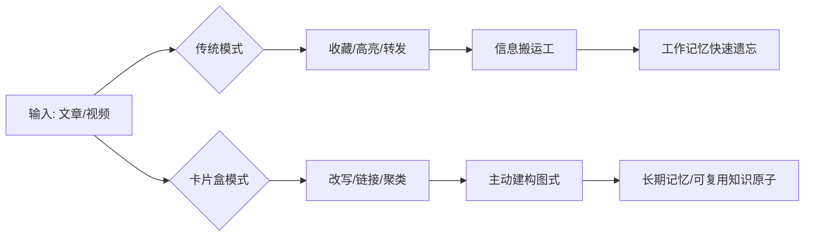

### 1.3.2 卡片盒笔记法的核心三原则

卡片盒笔记法提供了一套**外部化思维的工程化标准**，将“模糊的思考”转化为“可检验的构件”。以下三大原则确立了从素材到概念卡片的标准化工作流（来源：《20230418_003.md》）。

#### 原则一：原子化 —— 一卡一核心论点

**概念卡片定义**（来源：《20230418_003.md》）：

**原子化**不等于“短”或“碎”。一张合格的概念卡片必须包含：
1. **唯一标识符**（如 `20230418_001_concept_atomicity`）
2. **核心论点**（一句话陈述的洞见，而非孤立事实）
3. **上下文与改写**（用自己语言解释“为什么重要”“如何推导”“边界在哪”）
4. **溯源链接**（指向支撑该论点的文献卡片/原始素材）

这就像预制构件厂：每个构件（卡片）只承担单一结构功能（一个核心论点），有明确的力学参数（论点内容）和标准化接口（链接字段），才能被灵活组装进不同的大楼（文章、课程、大纲）。如果一张卡片塞进“注意力机制的定义、公式推导、代码实现、优缺点”，它就是个“大杂烩构件”，既难复用也难校验。

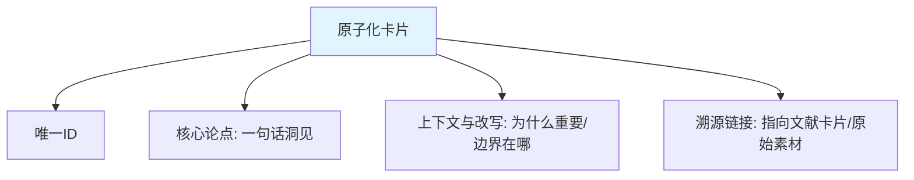

上图展示了原子化卡片的四大核心构成要素，其中“核心论点”是卡片的灵魂，“溯源链接”是连接素材层的桥梁。

#### 原则二：链接优于收藏 —— 语义关联 ＞ 分类标签

当你在 Obsidian 里给笔记打上 `#注意力机制 #Transformer` 标签时，你做的是**分类**（放入抽屉）。分类是静态的、层级的、互斥的（一个文件只能在一个文件夹）。

**链接**则是动态的、网状的、语义的。建立链接时，你必须写下**链接理由**（来源：《20230418_005.md》）：

```markdown
[[20230418_007_RNN_Long_Dependency_Problem]] 
<!-- 链接理由：注意力机制的核心动机正是解决 RNN 串行结构导致的长距离依赖梯度消失问题，这是注意力机制诞生的“痛点驱动”语境 -->
```

这个理由，正是你**思考**的痕迹。它强迫你在建立连接的那一刻，完成一次“精细加工”。标签是名词，链接理由是动词。**收藏是名词堆砌，链接是动词编织。**

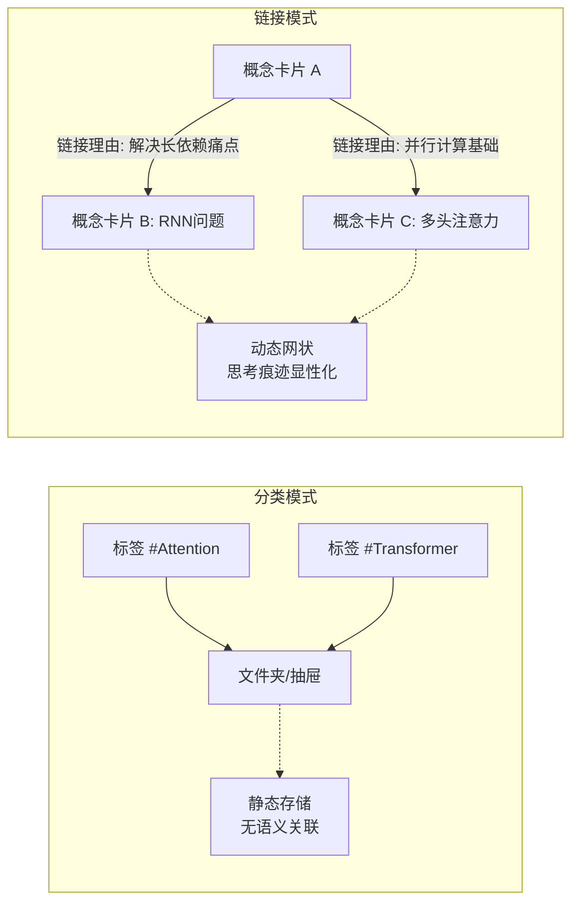

上图对比了分类模式与链接模式的本质区别：链接模式通过“链接理由”将隐性思考显性化为网状结构。

#### 原则三：自底向上生成 —— 聚类长出大纲

区分「闪念卡片」（捕捉）、「文献卡片」（理解/改写）与「概念卡片」（综合/创新）的定位、写法及演进路径（来源：《20230418_003.md》）。

传统写作是“先有大纲，再找素材填坑”（自顶向下），容易导致框架僵化、素材生搬硬套。卡片盒法主张**先造构件，后盖楼**：

1.  **闪念卡片**：随时捕捉灵感、疑问、半成品想法，不求完美，只求不丢。
2.  **文献卡片**：阅读素材时，用**自己语言**改写核心论据、关键数据、反驳观点。严禁复制粘贴！改写的过程即理解的过程。
3.  **概念卡片**：当多张文献卡片聚类出现共振、冲突或新视角时，提炼升华为**概念卡片**——这是你的原创知识原子（IR）。
4.  **大纲涌现**：当概念卡片积累到临界量，它们之间的链接网络自然会聚类出章节结构。**大纲是长出来的，不是规定出来的。**

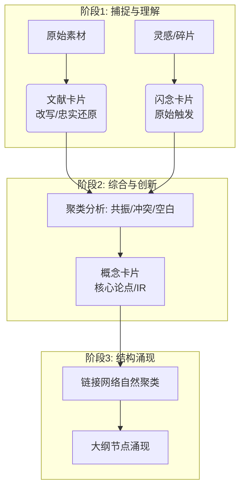

上图展示了从素材捕捉到大纲涌现的完整演进路径，核心在于“聚类分析”这一综合创新环节。

### 1.3.3 三类卡片的分工与流转

论证「写作是思考的结果，更是思考的过程」，展示如何通过卡片写作倒逼深度阅读，实现输入驱动输出（来源：《20230418_079.md》）。

我们用一个**数据流图**来展示卡片如何从素材流向成书：

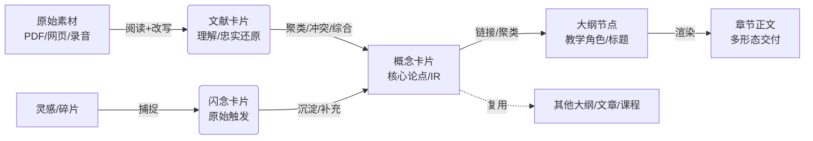

**关键机制**：

**单向流转**是该流水线的基石：素材 → 文献卡片 → 概念卡片 → 大纲 → 正文。反向只有“回溯溯源”，无“返工重写”。这种单向性保证了工程流程的确定性，避免了传统写作中反复推倒重来的混乱。

**概念卡片是唯一中间表示（IR）**：所有下游产物（教材、课件、博客）都只消费概念卡片，不直接消费原始素材。这保证了**内容与形式分离**、**一处修改、多端同步**。正如编译器中间表示屏蔽了前端语言差异与后端架构差异，概念卡片屏蔽了素材来源差异与交付形态差异。

**写作倒逼阅读**：当你发现概念卡片库里某个论点支撑薄弱（链接指向的文献卡片少），你会**带着这个“空洞”去阅读**——这就是“为写作而阅读”，输入精准驱动输出。这种需求拉取模式彻底改变了传统“推式阅读”的低效。

### 1.3.4 私域经营认知重构：从“管理流量”到“经营关系”

私域的意义根本就不是管理，而是『经营』。（来源：《20230418_157.md》）

认知重塑不仅适用于个人知识管理，同构映射到商业领域，就是**私域经营思维**的建立。

#### 群规模边际效益递减律（150人阈值）

一个群超过 150 人，效益就会完全的下降。（来源：《20230418_157.md》）

这是基于**邓巴数**的工程化约束。根源在生财有术 6 年实战（从 6000 人增至 4.6 万）中总结：

下表展示了不同群规模下的性质、信任深度、运营模式与典型 ROI 对比：

| 群规模 | 性质 | 信任深度 | 运营模式 | 典型ROI |
|--------|------|----------|----------|---------|
| ≤ 50 人 | **私房菜/核心圈** | 极高（深度连接） | 经营（1对1/小群深度服务） | 最高 |
| 50-100 人 | **深度经营群** | 高 | 经营（分层服务/标杆案例） | 高 |
| 100-150 人 | **临界区** | 中等 | 管理+经营混合 | 边际递减 |
| \> 150 人 | **大食堂/广播站** | 低（弱连接） | 管理（标准化/单向广播） | 低/负 |

**工程启示**：不要试图把 500 人大群“运营好”，那是违背物理定律的。**拆分**才是唯一正解：按购买阶段、兴趣标签、地域拆分为若干 50-100 人的“深度经营群”，每群配专人负责（群主/助教），实施精细化 SOP。

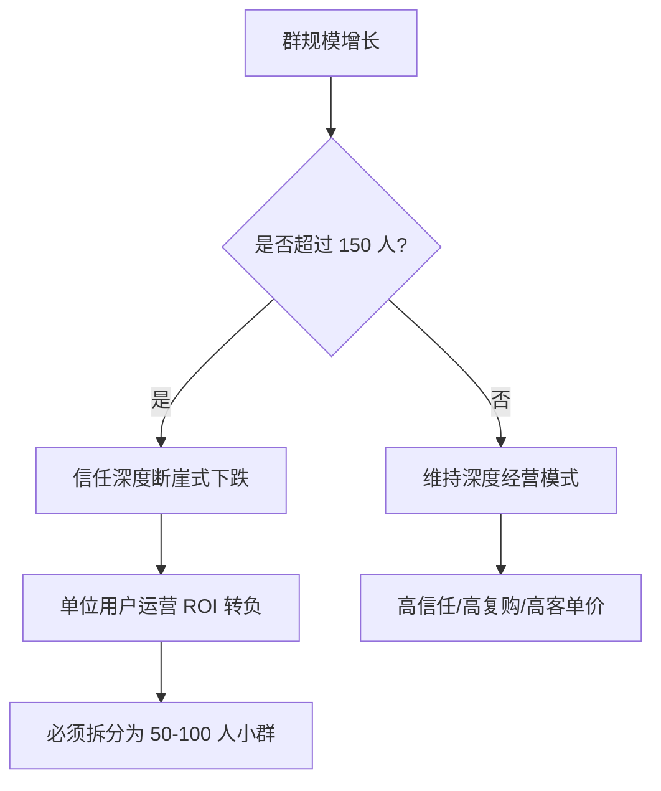

上图揭示了群规模突破邓巴数后引发的连锁负面反应，以及拆分小群的工程必要性。

#### 强IP信任悖论与主动触达 SOP

我真的碰过很多通讯录的人，我主动找他，他给我的回应竟然是：老师 你找我聊天好开心 我平时都不敢给你发讯息……这个没问题 我愿意参加（来源：《20230418_157.md`）

**悖论**：个人 IP 越强（专家、大V），存量用户因“仰视心理”越不敢主动咨询（怕打扰、怕被拒、觉得自己配不上）。**高信任反而阻断了转化路径。**

**破局**：**主动触达**打破心理鸿沟。将“不敢打扰”转化为“被重视”的购买动机。

个人能力越强的，每周都得给自己几天，深度的挖一轮自己的通讯录，或者是一天固定找 3~5 个。（来源：《20230418_157.md`）

**通讯录主动触达 SOP（标准作业程序）** 包含以下四个完整步骤：

**第一步，频次与对象设定**：每周固定 2-3 小时 / 每天 3-5 人。对象覆盖通讯录好友、历史成交客户、高意向未成交、沉默用户。这种固定节奏将“随机性营销”转化为“确定性工程”。

**第二步，破冰/价值前置**：“老张，最近在整理《注意力机制教学大纲》的案例库，想起你之前做过序列建模，特意整理了份《RNN到Transformer演进对照表》发你，觉得对你选型有参考。” 此处核心在于“想起你”、“特意整理”、“对你有参考”三个心理锚点，传递“被重视”而非“被推销”。

**第三步，深度倾听/诊断**：“对了，你们现在主推的模型架构遇到什么卡点没？长上下文还是推理延迟？” 从单向输出转为双向诊断，挖掘真实痛点，建立专业咨询师的信任定位。

**第四步，自然转化**：“我们正好有个‘大模型落地实战营’下周开营，针对这类工程化难题有专门模块，拉你进个内部体验群（50人上限）先看看大纲？没压力，不合适随时退。” 以“体验群”低门槛承接，而非直接“收钱”，降低决策压力。

**第五步，记录复盘**：每次触达记录标签、意向等级、下一步动作，纳入 CRM 迭代。这是将个体经验沉淀为组织资产的关键一步。

**核心心法**：“有沒有可能多数人的情况，是不需要『再引流』了呢？”（根源语录，来源：《20230418_157.md`）。停止盲目买量、裂变，转而挖掘存量通讯录的**隐性信任资产**，将其显性化为商业价值。

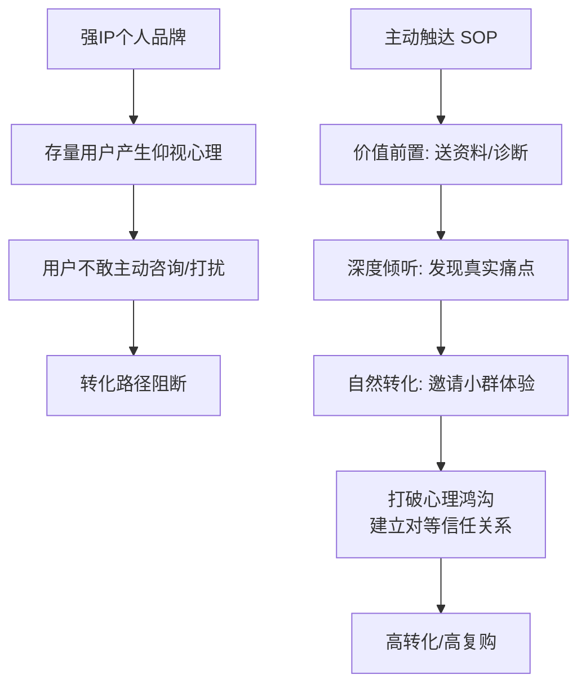

上图展示了强IP信任悖论的成因链条，以及主动触达SOP如何通过价值前置与深度倾听重构信任转化路径。

### 1.3.5 合伙人筛选决策模型：五维铁律与避坑指南

单人创业管理真空定律（黄老师）... 合伙人筛选五维铁律（志向、人品、能力互补、性格互补、金钱观）... 四大选人误区陷阱... 前期严选即后期止损原则（e袋洗案例）（来源：《20230418_008.md》等素材综合）

创业初期，合伙人决策的**容错率极低、事后成本极高**。“前期因面子不严筛（面试/背调），后期必承担团队解体、利益撕裂等核炸弹级后果。”

#### 五维铁律（缺一不可的筛选闭环）

下表展示了合伙人筛选的五维铁律、核心考察点、验证方式及权重：

| 维度 | 核心考察点 | 验证方式 | 权重 |
|------|------------|----------|------|
| **志向一致** | 5-10 年愿景是否共振？对“成为什么样的公司”画像是否一致？ | 闲聊式深度访谈 3 小时+，写下共同愿景宣言 | ⭐⭐⭐⭐⭐ |
| **人品过硬** | 逆境下是否守底线？利益冲突时是否透明沟通？过往口碑如何？ | 背调授权（前同事/合伙人/投资人）、压力测试场景模拟 | ⭐⭐⭐⭐⭐ |
| **能力互补** | 技术/产品/销售/运营/财务五大模块，核心缺口能否补齐？ | 技能矩阵表打分、过往项目复盘、实战小考核 | ⭐⭐⭐⭐ |
| **性格互补** | 决策风格（数据驱动 vs 直觉驱动）、冲突处理模式（对抗 vs 回避 vs 协作）、压力阈值 | MBTI/大五人格参考 + 共事 2 周试用期（做个真项目） | ⭐⭐⭐⭐ |
| **金钱观一致** | **独立于价值观！** 对特定金额体量（如年分红 100万 vs 1000万）的认知、分配意愿、资金优先级（分红 vs 再投资）是否一致？ | **天使轮融资到账压力测试**：“钱到账了，你主张分红 30% 还是全额招人买 GPU？” | ⭐⭐⭐⭐⭐ |

> 金钱观一致性... 独立于价值观一致性且具决定性破坏力
> 
> ——《20230418_008.md》

#### 四大选人误区陷阱

下表识别了四大典型选人误区、典型画像、核心破坏机制及识别信号：

| 误区 | 典型画像 | 核心破坏机制 | 识别信号 |
|------|----------|--------------|----------|
| **短期工具人** | “帮我搭个架构/跑个模型/写个爬虫，上线后再谈股份” | 无长期皮在游，核心资产（代码/模型/数据）掌握在外包手中，谈判筹码全无 | 拒绝全职、要求现金结算、不愿签 IP 协议 |
| **情感投资人** | 十年好友/亲戚，“我相信你人品，细节不看合同” | 情感绑架决策，利益分配模糊，冲突时既撕不破脸也谈不拢条件 | 拒绝签署《创始人协议》、回避退出机制讨论 |
| **纯财务投资人** | “我出钱你干活，我要 51% 控股/固定分红” | 资本逻辑吞噬创业逻辑，现金流压力下强迫短视决策，无法共担非财务风险 | 过度关注估值/回本周期、插手产品细节、无同理心 |
| **大厂职业经理人迷信** | P8/P9 光环、“带过 100 人团队”、“流程规范” | 习惯成熟资源/成熟流程/成熟品牌，**缺乏 0-1 从无到有、资源极度匮乏、高不确定性的生存能力** | 要求高薪/期权少、不愿亲自写代码/跑销售/招聘、带“大厂病” |

#### 三维渠道搜寻法 + 闲聊式结构化面试 + 背调授权

合伙人搜寻与验证的完整流程包含以下步骤：

**第一步，三维渠道搜寻**：
- **向上求**：行业前辈、投资人、导师推荐（信任背书高）。
- **横向求**：同行创始人、技术大牛、运营高手（认知同频易）。
- **向下求**：优秀前员工、实习生、社群核心成员（饥饿感强、成长快）。

**第二步，闲聊式结构化面试**：非正式场合（咖啡/散步/晚餐），按五维铁律设定**隐性考察点**，自然聊天中完成评估，降低防御心理。这种“去官方化”的面试方式能更真实地观察候选人的思维模式与价值观。

**第三步，2周共事试用期**：做一个真实的小项目（如联合产出一份竞品分析报告、搭建一个 MVP 原型），在实战中观察沟通效率、代码/文档规范、冲突处理、交付靠谱度。

**第四步，背调授权机制**：**必须签署授权书**，联系 3-5 位前同事/上级/合伙人，标准化问卷（优势/劣势/冲突案例/再合作意愿），交叉验证。这是规避“面试造假”的最后一道防线。

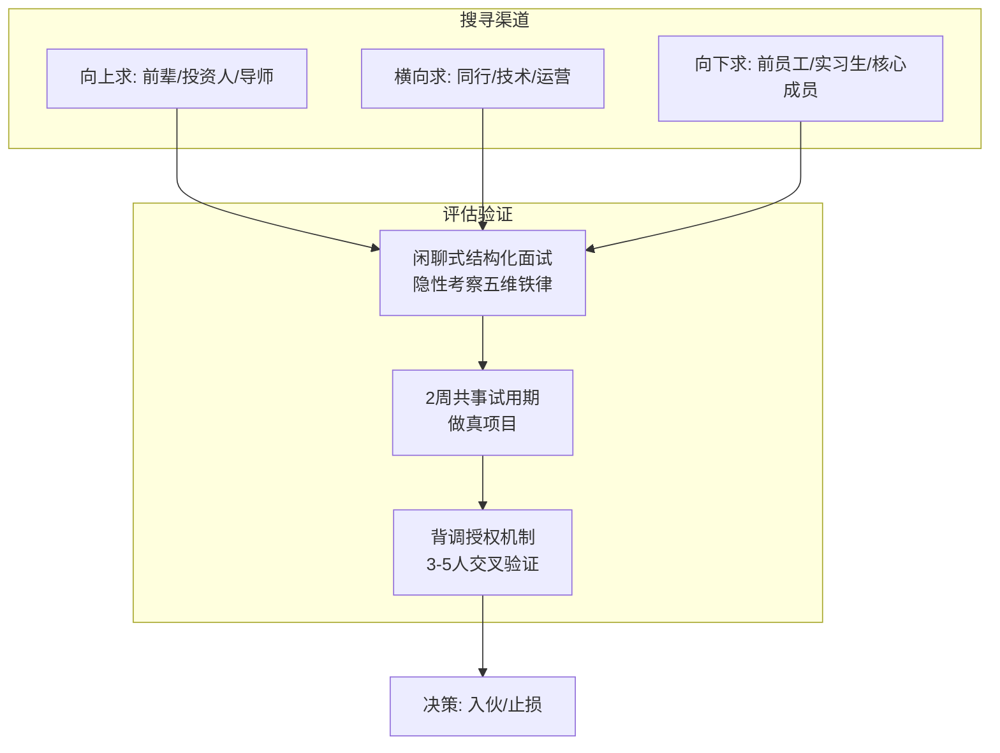

上图呈现了从搜寻到决策的完整闭环流程，每一步都是前一步的深化验证。

## 1.4 教材工程化 —— 像开发软件一样构建教程

### 1.4.1 教材即代码：代码化管理的必要性

类比软件工程，论证教材源文件应采用 Markdown/AsciiDoc 等纯文本格式，纳入 Git 版本控制，实现内容的可追溯、可协作、可自动化构建（来源：《20230418_005.md`）。

**核心定义**：**教材即代码**。

下表对比了传统模式与工程化模式在格式、版本、协作、发布、耦合度等维度的本质差异：

| 传统模式（Word/飞书文档） | 工程化模式 |
|----------------------------|------------|
| 二进制/私有格式，难 Diff | **纯文本**，Git 原生 Diff/Merge |
| 版本靠文件名 `v1_final_v2.docx` | **语义化版本** `v1.2.0` + `CHANGELOG.md` |
| 协作靠“评论/建议模式”，冲突手工解 | **PR/Code Review** 流程，CI 门禁自动校验 |
| 发布靠“另存为 PDF/PPT”，人工对齐 | **一键构建**，多形态交付物**强一致性** |
| 内容与样式耦合，改版式=改内容 | **内容与形式分离**，同一源文件渲染学生版/教师版/网站 |

**最小可行性仓库结构**（体现四层架构）：

```text
book-repo/
├── materials/           # 素材层：只读归档
│   ├── papers/          # PDF 论文、研报
│   ├── webpages/        # 网页快照
│   └── notes/           # 原始手写/语音笔记
├── concepts/            # 概念层：可复用的知识原子 (IR)
│   ├── 20230418_001_concept_atomicity.md
│   └── 20230418_002_concept_linking.md
├── structure/           # 结构层：机器可读的逻辑骨架
│   └── outline.json     # 符合 JSON Schema 的大纲
├── render/              # 呈现层：渲染引擎与模板
│   ├── templates/       # Pandoc/Quarto 模板
│   ├── scripts/         # 预处理/后处理脚本
│   └── ci/              # GitHub Actions 工作流
├── output/              # 构建产物（.gitignore）
│   ├── student-book.pdf
│   ├── teacher-guide.pdf
│   └── website/
└── README.md
```

该结构将四层架构物理化为目录层级，`materials` 只读、`concepts` 可复用、`structure` 机器可读、`render` 自动化构建，实现了关注点分离。

### 1.4.2 四层架构：素材-概念-结构-呈现

定义教材工程的标准化分层架构：素材层（原始输入）、概念层（知识原子）、结构层（大纲/逻辑骨架）、呈现层（PDF/网站/课件），实现内容与形式分离（来源：《20230418_005.md`）。

这是教材工程化的**架构基石**，对应软件工程的“源码-中间码-AST-目标代码”：

下表详细对应了四层架构的角色、核心产物、关键约束及软件工程对应物：

| 层级 | 角色 | 核心产物 | 关键约束 | 对应软件工程 |
|------|------|----------|----------|--------------|
| **素材层** | 原始输入 | PDF、HTML、Markdown 原始笔记、录音转写 | **只读归档**，不可修改，完整溯源 | 原始需求文档/用户反馈/日志 |
| **概念层** | 知识原子 | **概念卡片** —— 唯一中间表示 (IR) | **原子化、链接化、自述化**，Front Matter 标准化 | 中间表示 / 编译器 IR |
| **结构层** | 逻辑骨架 | **大纲 JSON** —— 符合 Schema 的机器可读结构 | **双段式标题、角色非空、溯源非空**，MECE/金字塔校验通过 | AST / 架构蓝图 |
| **呈现层** | 多形态交付 | 学生版 PDF、教师版教案、交互式网站、幻灯片、电子书 | **模板驱动**，零手工干预，CI/CD 自动产出 | 目标代码 / 交付物 |

**分离的价值**：

**改一个知识点（概念层） → 重新构建 → 所有交付物自动同步**。这消除了传统流程中“改一个错别字，要在 Word、PPT、网站、教案里各改一遍，还漏改一个”的灾难。

**换个模板（呈现层） → 重新构建 → 风格统一换肤，内容不变**。同一套概念卡片与大纲，配合不同 LaTeX/HTML 模板，即可产出学术风学生版、实战风教师版、交互式网站版。

**重组章节（结构层） → 重新构建 → 新书生成，复用率 100%**。将“深度学习基础”重组为“Transformer专题”、“CNN专题”两门短课，仅需修改 `outline.json` 的章节引用顺序与粒度，概念卡片零修改。

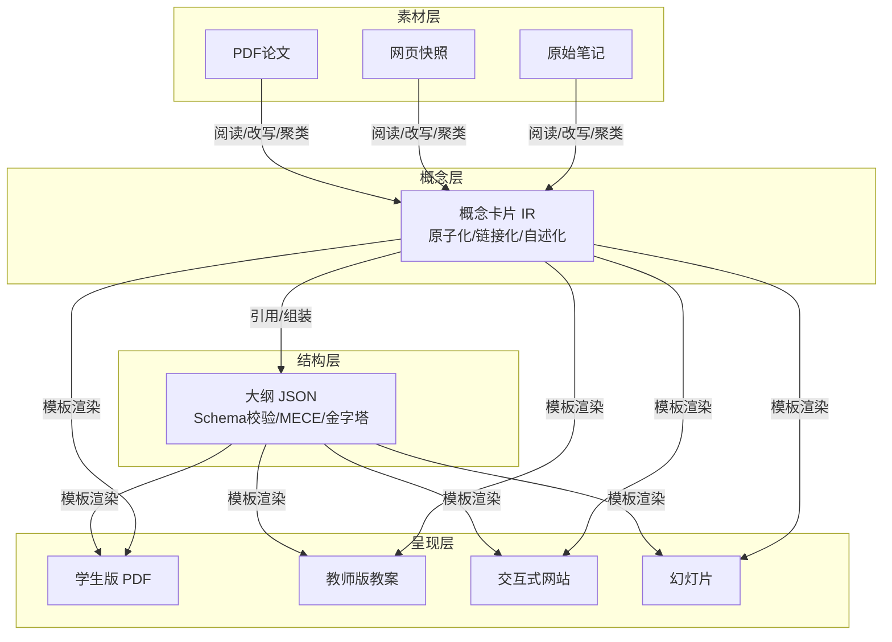

上图直观展示了四层架构的数据流向：素材经“阅读/改写/聚类”加工为概念卡片（IR），概念卡片被大纲 JSON 引用组装，最后由渲染引擎驱动多形态产出。

### 1.4.3 概念卡片驱动开发（CDD）流水线

推演「聚类素材 -> 提炼概念卡片 -> 编排大纲节点 -> 渲染章节」的标准化工程流水线，确立概念卡片作为连接素材与大纲的唯一「中间表示（IR）」（来源：《20230418_003.md》, 《20230418_005.md`）。

CDD 是教材工程化的**核心作业流程**，类比编译器前端：

```mermaid
flowchart TD
    subgraph 阶段1: 素材准备
        A1[原始素材入库] --> A2[按主题/来源分桶]
    end
    subgraph 阶段2: 概念提炼 (前端编译)
        B1[阅读素材] --> B2[产出文献卡片]
        B3[捕捉闪念] --> B4[产出闪念卡片]
        B2 & B4 --> B5[聚类分析: 共振/冲突/空白]
        B5 --> B6[提炼概念卡片 IR]
        B6 --> B7[Schema 校验 + 链接完整性检查]
    end
    subgraph 阶段3: 结构编排 (架构设计)
        C1[确立核心主张] --> C2[金字塔分解]
        C2 --> C3[MECE 正交性检查]
        C3 --> C4[编排大纲 JSON]
        C4 --> C5[Schema 校验 + 溯源完整性检查]
    end
    subgraph 阶段4: 渲染交付 (后端代码生成)
        D1[概念卡片 + 大纲 JSON] --> D2[模板渲染引擎]
        D2 --> D3[学生版教材]
        D2 --> D4[教师版教案]
        D2 --> D5[交互式网站]
        D2 --> D6[幻灯片]
    end
    B7 -. 概念卡片库 .-> D1
    C5 -. 大纲 JSON .-> D1
```

**关键质量门禁**：

1.  **概念卡片入库门禁**：Front Matter 必填字段完整、核心论点非空、至少 1 条语义链接（含理由）、溯源指向文献卡片/素材。
2.  **大纲合并门禁**：JSON Schema 校验通过、所有节点引用的概念卡片 ID 在库中存在、MECE 检查通过、角色分布合理（非全 definition）。
3.  **渲染发布门禁**：所有交付物构建成功、链接无 404、术语表一致性校验通过。

这些门禁将质量控制前置到“编译期”，而非传统出版的“印刷后校样”，实现了质量内建。

### 1.4.4 大纲编排的 JSON Schema 规范

规定 Chapter-Node 二级结构的 JSON Schema，强制要求章标题采用「隐喻类比式」双段式、节点必须标注教学角色，实现大纲的机器可读与自动化校验（来源：《20230418_005.md`）。

**大纲 JSON Schema 核心定义**（简化版）：

```json
{
  "$schema": "http://json-schema.org/draft-07/schema#",
  "title": "TeachingOutline",
  "type": "object",
  "required": ["book_meta", "chapters"],
  "properties": {
    "book_meta": {
      "type": "object",
      "required": ["title", "version", "core_thesis"],
      "properties": {
        "title": { "type": "string" },
        "version": { "type": "string", "pattern": "^\\d+\\.\\d+\\.\\d+$" },
        "core_thesis": { "type": "string", "description": "金字塔原理顶点：本书核心主张" }
      }
    },
    "chapters": {
      "type": "array",
      "items": {
        "type": "object",
        "required": ["no", "name", "desc", "nodes"],
        "properties": {
          "no": { "type": "integer" },
          "name": { "type": "string", "pattern": "^.+ —— .+$", "description": "双段式：隐喻类比 —— 本质阐述" },
          "desc": { "type": "string" },
          "nodes": {
            "type": "array",
            "items": {
              "type": "object",
              "required": ["no", "name", "desc", "role", "src"],
              "properties": {
                "no": { "type": "integer" },
                "name": { "type": "string", "pattern": "^.+ —— .+$" },
                "desc": { "type": "string" },
                "role": {
                  "type": "array",
                  "minItems": 1,
                  "maxItems": 2,
                  "items": { "enum": ["motivation", "definition", "method", "proof", "experiment", "limitation", "extension"] }
                },
                "src": {
                  "type": "array",
                  "minItems": 1,
                  "items": {
                    "type": "object",
                    "required": ["paper"],
                    "properties": {
                      "paper": { "type": "string", "pattern": "^(author:|\\*\\*/).+" },
                      "role": { "enum": ["origin", "apply", "improve", "critique"] }
                    }
                  }
                }
              }
            }
          }
        }
      }
    }
  }
}
```

**三大强制约束的工程意义**：

**双段式标题** (`pattern: "^.+ —— .+$"`)：强制作者进行**隐喻建模**。`"注意力机制 —— 让模型学会看哪里"` 比 `"注意力机制概述"` 含有教学张力，降低认知负荷，激活先验知识。这基于认知科学中“隐喻迁移”理论：用熟知的源域（看哪里）解释陌生的目标域（注意力权重分配）。

**教学角色非空** (`minItems: 1`)：防止“百科全书式罗列”。每个节点必须宣称“我是来干什么的”（动机/定义/方法/证明/实战/边界/拓展）。CI 会统计角色分布，若某章 `definition > 60%` 直接报警。这强制作者从“知识陈述者”转型为“学习体验设计师”。

**素材溯源非空** (`minItems: 1`, `pattern: "^(author:|\\*\\*/).+"`)：强制**证据链闭环**。支持 `author:张三/20230418_001.md` 或 `**/20230418_*.md` 通配，禁止写 `"paper": "Transformer论文"` 这种不可定位的引用。通配符设计兼顾了“概览性引用”的便利与“精确溯源”的严谨。

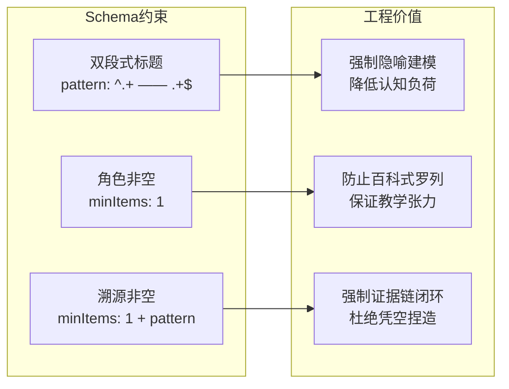

上图阐述了三大 Schema 约束与其工程价值的一一对应关系。

### 1.4.5 持续集成：从源文件到多形态交付物

配置 Pandoc/Quarto/GitHub Actions 自动化流水线，一键生成学生版教材、教师版教案、交互式网站、幻灯片，保证多端内容一致性（来源：《20230418_079.md》, 《README.md`）。

**GitHub Actions 工作流示例**（`.github/workflows/build.yml`）：

```yaml
name: Build Book
on:
  push:
    branches: [main]
  pull_request:
    types: [closed]
    branches: [main]

jobs:
  validate:
    runs-on: ubuntu-latest
    steps:
      - uses: actions/checkout@v4
      - name: Validate Concept Cards
        run: python scripts/validate_concepts.py concepts/
      - name: Validate Outline Schema
        run: python scripts/validate_outline.py structure/outline.json
      - name: Check Traceability
        run: python scripts/check_traceability.py structure/outline.json concepts/

  build:
    needs: validate
    if: github.event_name == 'push' && github.ref == 'refs/heads/main'
    runs-on: ubuntu-latest
    strategy:
      matrix:
        target: [student-book, teacher-guide, website, slides]
    steps:
      - uses: actions/checkout@v4
      - name: Setup Quarto
        uses: quarto-dev/quarto-actions/setup@v2
      - name: Render ${{ matrix.target }}
        run: quarto render --to ${{ matrix.target }} --output-dir output/${{ matrix.target }}
      - name: Upload Artifact
        uses: actions/upload-artifact@v4
        with:
          name: ${{ matrix.target }}
          path: output/${{ matrix.target }}

  release:
    needs: build
    if: startsWith(github.ref, 'refs/tags/v')
    runs-on: ubuntu-latest
    steps:
      - name: Download Artifacts
        uses: actions/download-artifact@v4
      - name: Generate CHANGELOG
        run: |
          git log --pretty=format:"- %s (%an)" ${{ github.event.repository.releases[-1].tag_name }}..HEAD > CHANGELOG.md
      - name: Create Release
        uses: softprops/action-gh-release@v1
        with:
          files: |
            output/student-book/*.pdf
            output/teacher-guide/*.pdf
            output/website.zip
            output/slides/*.pdf
          body_path: CHANGELOG.md
```

该工作流实现了**验证-构建-发布**的标准化流水线：`validate` 作业在 PR 阶段拦截不合格卡片与大纲；`build` 作业利用矩阵策略并行渲染四种形态，保证强一致性；`release` 作业自动打包制品并生成语义化变更日志。

**多形态模板差异化配置**（Quarto `_quarto.yml` 片段）：

```yaml
project:
  type: book
  output-dir: output

book:
  title: "深度学习核心范式教程"
  author: "作者名"
  chapters:
    - index.qmd
    - part: "第一部分 基石"
      chapters: ["ch01.qmd", "ch02.qmd"]
    # ...

format:
  student-pdf:      # 学生版：精简、习题、无答案
    template: render/templates/student.latex
    include-in-header: render/templates/student-header.tex
  teacher-pdf:      # 教师版：含教学提示、参考答案、时间分配
    template: render/templates/teacher.latex
    include-in-header: render/templates/teacher-header.tex
  html:             # 交互式网站：可执行代码、搜索、评论
    template: render/templates/html
    execute: 
      enabled: true
  revealjs:         # 幻灯片：大标题、要点、动画
    template: render/templates/slides
    slide-level: 2
```

通过差异化模板，同一套源内容可产出面向不同受众、不同场景的定制化交付物，且内容强一致。

### 1.4.6 语义化版本控制策略

引入 SemVer 语义化版本控制至教材，定义 Major/Minor/Patch 对应的内容变更类型（重构章节/新增知识点/修正错别字），建立变更日志规范（来源：《20230418_005.md`, 《20230418_079.md`）。

将 **SemVer 2.0** 映射到教材演进：

下表定义了版本号格式、触发条件、示例及兼容性承诺：

| 版本号 | 格式 | 触发条件 | 示例 | 兼容性承诺 |
|--------|------|----------|------|------------|
| **Major** | `X.0.0` | **逻辑骨架变更**：章节增删/重排、核心主张修正、教学角色体系调整、Schema 不兼容升级 | `v1.0.0` → `v2.0.0`：引入“教学角色”体系，重构全书大纲 | **不兼容**。旧版教案/课件/配套题库需全面适配。 |
| **Minor** | `X.Y.0` | **功能性增量**：新增概念卡片、新增案例/习题、补充边界讨论、新增章节节点（不改骨架） | `v2.1.0` → `v2.2.0`：第 3 章新增“FlashAttention-3”案例，新增 2 张概念卡片 | **向后兼容**。旧版阅读者不漏核心知识点，新版仅增值。 |
| **Patch** | `X.Y.Z` | **缺陷修复**：错别字、公式符号错误、链接失效、格式排版、术语统一 | `v2.2.0` → `v2.2.1`：修正第 5 章公式下标越界、修复 3 处死链 | **完全兼容**。仅修正错误，无内容增减。 |

**自动化 CHANGELOG 生成规则**：
- Major 变更 → `## [2.0.0] - Breaking Changes` 列出结构变动表。
- Minor 变更 → `## [2.2.0] - Added` 列出新增卡片 ID、新增节点。
- Patch 变更 → `## [2.2.1] - Fixed` 列出修复项（文件、行号、问题描述）。

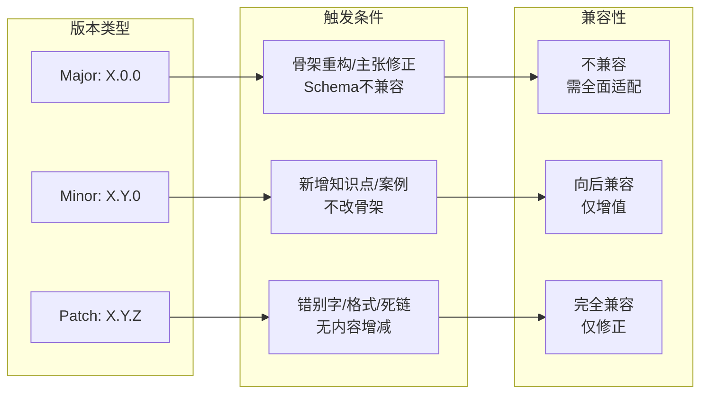

上图清晰映射了版本类型、触发条件与兼容性承诺的对应关系。

## 1.5 逻辑架构师 —— 为知识搭建可执行的认知脚手架

### 1.5.1 教学大纲 ≠ 知识目录：认知负荷视角的结构设计

对比「百科全书式」与「教学导向式」目录差异，引入认知负荷理论，论证大纲必须服务于「图式构建」而非「信息罗列」（来源：《20230418_003.md`, 《20230418_005.md`）。

**百科全书式目录** 是**拓扑结构**：按学科分类学（历史、定义、分类、应用、前沿），追求“面面俱到”，读者需自行构建图式，认知负荷极高（本质负荷 + 额外负荷）。

**教学导向式大纲** 是**认知路径**：按学习者认知发展规律（动机 → 核心概念 → 方法 → 实战 → 边界 → 拓展），服务于**图式构建**，通过脚手架管理认知负荷。

下表对比了百科全书式与教学导向式在组织逻辑、标题、角色、认知负荷及适用场景上的差异：

| 维度 | 百科全书式 | 教学导向式 |
|------|------------|------------|
| 组织逻辑 | 学科分类学 | 认知发展路径 |
| 章节标题 | 名词短语 | **双段式隐喻** |
| 节点角色 | 隐性/单一 | **显性标注 7 大角色** |
| 认知负荷 | 高（自行组织） | 受控（脚手架支撑） |
| 适用场景 | 查阅/检索 | **系统性学习/教学** |

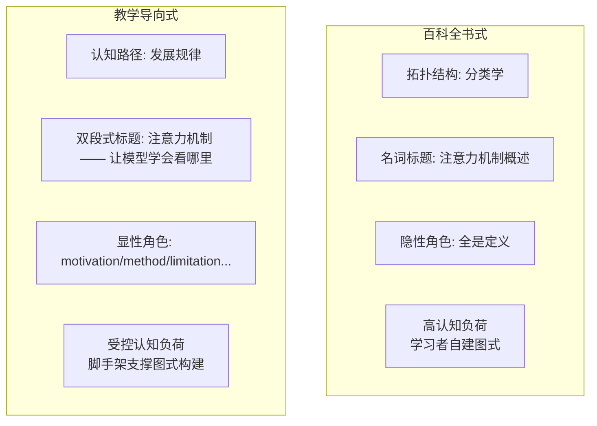

上图对比了两种大纲范式在结构本质、标题形式、角色显性化与认知负荷管理上的根本差异。

### 1.5.2 MECE 原理在章节划分中的落地

演示如何用「相互独立、完全穷尽」原则审视章节划分，避免知识点重叠（耦合）与遗漏（盲区），配套「章节正交性检查表」（来源：《20230418_005.md`, 《SUMMARY.md`）。

**MECE**（Mutually Exclusive, Collectively Exhaustive）在教材章节划分中的工程化检查表：

```markdown
## 章节正交性检查表 (对照 outline.json 自动化校验)

### 1. 相互独立
- [ ] 任意两个同级节点，核心论点是否存在实质重叠？（若是 → 合并或重新切分边界）
- [ ] 是否存在“父节点=子节点内容求和”的空壳结构？（若是 → 扁平化或充实父节点独有论点）
- [ ] 跨章节引用是否通过“链接理由”显性化，而非隐性耦合？

### 2. 完全穷尽
- [ ] 从核心主张出发，纵向提问链（怎么做？为什么有效？边界在哪？）是否覆盖无遗漏？
- [ ] 横向归类（按子空间/模态/阶段/角色）是否覆盖全景？
- [ ] 是否缺失 limitation/extension 角色导致“只有优点没有缺陷”？
- [ ] 是否缺失 experiment 角色导致“只有理论没有落地”？
```

**反模式识别**：

**耦合**：第 2 章“注意力数学公式”包含 Softmax 推导，第 3 章“多头注意力”又重复推导一遍 Softmax。→ **修正**：第 2 章只讲单头核心公式，第 3 章引用第 2 章结论，聚焦“分裂-并行-拼接”流程。

**遗漏**：全章无 `limitation` 节点，不讨论注意力的二次复杂度瓶颈、位置编码外推失效。→ **修正**：强制每章至少 1 个 `limitation` 节点。

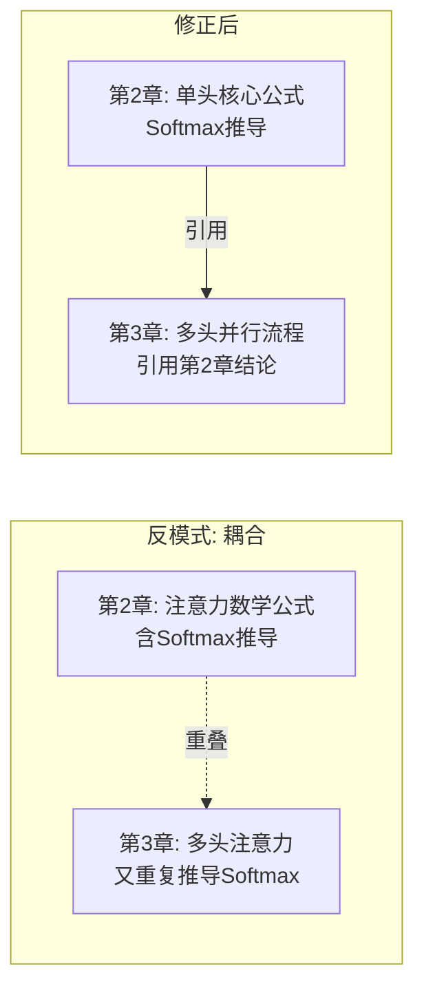

上图展示了耦合反模式与修正后的引用关系对比。

### 1.5.3 金字塔原理：从核心主张反向导出章节结构

实操「自上而下表达、自下而上思考」：先定本书/章的「核心主张」，再通过纵向提问/横向归纳分解为节点，保证逻辑闭环（来源：《20230418_003.md`, 《20230418_005.md`）。

**金字塔原理在大纲设计中的双向操作流**：

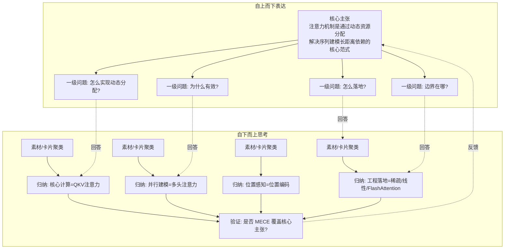

**实操步骤**：

1.  **定顶点**：用一句话写出本书/本章的**核心主张**（Core Thesis），写入 `book_meta.core_thesis` / `chapter.desc`。
2.  **纵向提问**：对核心主张连续发问 “How?”（方法）、”Why?”（原理/证明）、“So what?”（边界/局限）、“How to use?”（实战），得到一级分支。
3.  **横向归纳**：梳理概念卡片库，按子空间（如：计算核心、并行扩展、位置建模、工程优化）归类，验证是否 MECE 覆盖一级分支。
4.  **定节点**：每个归类簇生成一个节点，赋予**双段式标题**、**主次教学角色**、**概念卡片 ID 列表（溯源）**。
5.  **闭环校验**：自底向上汇总，能否无损推导出核心主张？若不能，回到步骤 2 调整。

这种“双向操作”保证了大纲既符合逻辑演绎的严密性（自上而下），又扎根于素材与卡片的实证基础（自下而上）。

### 1.5.4 七大教学角色标注体系

详解 motivation/definition/method/proof/experiment/limitation/extension 七大角色的定义、识别标准及组合模式，防止「全是定义」「缺乏动机」「无案例支撑」的编写弊病（来源：《20230418_005.md`, 《20230418_079.md`）。

每个大纲节点**必须**标注 1-2 个主教学角色（`role` 字段），这是教学张力的**结构化编码**：

下表详细定义了七大教学角色的核心问题、典型内容形态、识别标准及常见组合：

| 角色 | 核心问题 | 典型内容形态 | 识别标准 | 常见组合 |
|------|----------|--------------|----------|----------|
| **motivation** | 为什么学？ | 痛点对比、直觉类比、历史演进、反直觉现象 | 开篇、引入新范式前 | motivation + definition |
| **definition** | 是什么？ | 形式化定义、核心公式、术语表、分类体系 | 概念初次登场 | definition + method |
| **method** | 怎么做？ | 算法步骤、伪代码、工程流程、参数配置、技巧 | 核心“怎么做” | method + proof |
| **proof** | 为什么有效？ | 数学推导、实验消融、理论界限、复杂度分析 | 关键方法后 | method + proof |
| **experiment** | 实战怎么跑？ | 端到端代码、配置文件、基准对比、避坑指南 | 章节收尾/独立实战节 | experiment 单独成节 |
| **limitation** | 哪里失效？ | 失败案例、理论边界、负面结果、适用条件 | 方法成熟后/章节末尾 | limitation + extension |
| **extension** | 前沿在哪？ | 变体改进、跨域迁移、开放问题、最新论文 | 章节末尾/独立拓展节 | extension 单独成节 |

**CI 校验规则**（`scripts/validate_outline.py` 片段）：

```python
def check_role_distribution(outline):
    role_counts = Counter()
    for ch in outline['chapters']:
        for node in ch['nodes']:
            for r in node['role']:
                role_counts[r] += 1
    total = sum(role_counts.values())
    # 红线：definition 占比不得超过 40%
    if role_counts['definition'] / total > 0.4:
        raise ValueError(f"Definition 占比 {role_counts['definition']/total:.1%} > 40%，缺乏方法/实战/边界支撑")
    # 红线：每章必须包含 motivation, method, experiment, limitation
    for ch in outline['chapters']:
        roles_in_ch = set()
        for node in ch['nodes']:
            roles_in_ch.update(node['role'])
        required = {'motivation', 'method', 'experiment', 'limitation'}
        missing = required - roles_in_ch
        if missing:
            raise ValueError(f"第 {ch['no']} 章缺失核心角色: {missing}")
```

这段校验代码将教学设计原则转化为可执行的工程约束：Definition 占比红线防止“百科全书化”，四大核心角色必含红线防止“关键环节缺失”。

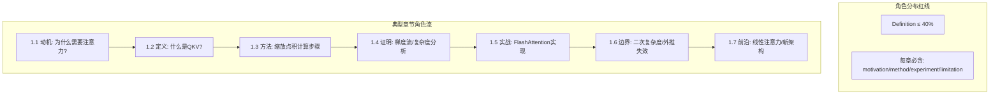

上图展示了角色分布红线约束与典型章节角色流向的对应关系。

### 1.5.5 素材溯源与证据链构建

建立「大纲节点 <- 概念卡片 <- 文献卡片 <- 原始素材」的四级溯源链，规范 src 字段引用格式（支持 author:xxx/** 通配），保证教材内容的可验证性与学术严谨性（来源：《20230418_003.md`, 《SUMMARY.md`）。

**四级溯源链** 是教材工程化的**可信基石**：

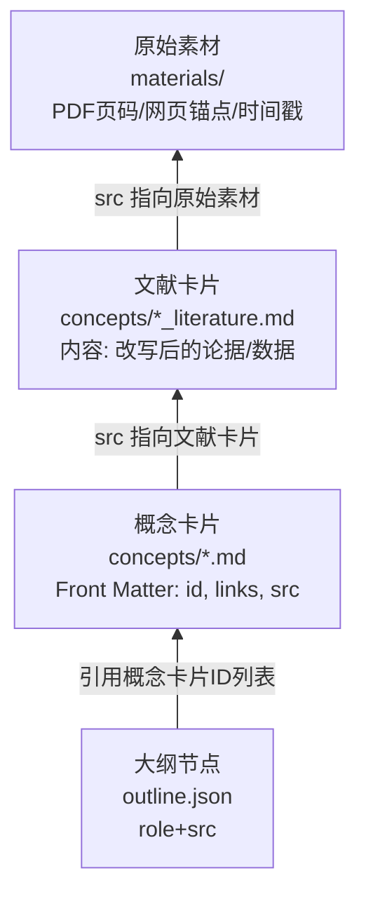

**引用规范**（强制执行）：

下表规定了各层级溯源的字段格式、示例及粒度要求：

| 层级 | src 字段格式 | 示例 | 粒度要求 |
|------|--------------|------|----------|
| 大纲节点 → 概念卡片 | `concept_id` 数组 | `["20230418_001_atomicity", "20230418_002_linking"]` | 概念卡片级 |
| 概念卡片 → 文献卡片 | `literature_id` 数组 | `["20230418_001_lit_luhmann", "20230418_001_lit_ahrens"]` | 文献卡片级 |
| 文献卡片 → 原始素材 | `paper` 对象数组 | `[{"paper": "author:卢曼/20230418_003.md#page=12", "role": "origin"}]` | **页码/锚点/时间戳级** |
| 大纲节点 → 原始素材 (跨层直引) | `paper` 对象数组（通配） | `[{"paper": "**/20230418_00*.md", "role": "origin"}]` | 文件级（仅允许概览性引用） |

**工程红线**：
- **禁止** `src: [{"paper": "Transformer论文", "role": "origin"}]` —— 无法定位、无法校验、无法自动化。
- **强制** 概念卡片 `src` 至少 1 条 `role: "origin"` 的文献卡片引用。
- **自动化校验**：CI 检查所有 `src.paper` 路径是否存在、锚点是否有效、通配符是否匹配至少 1 个文件。

这种精确到页码/锚点的溯源粒度，是教材工程化区别于普通写作的关键特征，它将“信任我”升级为“可验证我”。

## 1.6 多源对照：核心概念的不同素材视角

本章核心概念（卡片盒法、教材工程化、私域经营、合伙人模型）由多篇素材支撑，此处并列呈现关键视角的**共识与分歧**。

### 1.6.1 卡片盒笔记法的“原子化”定义

下表对比了不同素材对“原子化”的核心主张与关键差异：

| 素材来源 | 核心主张 | 关键差异 |
|----------|----------|----------|
| **《20230418_003.md》 (卢曼/阿伦斯正统)** | 原子化 = “一卡一核心论点”，必须包含上下文与改写洞见，拒绝碎片化事实罗列。 | **强调“论点”而非“事实”**，卡片是思考的单元，不是存储的单元。 |
| **《20230418_005.md》 (工程化落地)** | 原子化 = “唯一中间表示 (IR)”，Front Matter 标准化，Schema 可校验，支撑 CDD 流水线。 | **强调“机器可读/可校验”**，卡片是编译流水线的标准输入。 |
| **《20230418_079.md》 (实战复盘)** | 原子化 = “可复用预制构件”，同一张卡片支撑教材、课件、博客、咨询方案多端复用。 | **强调“复用率 ROI”**，卡片粒度以“能否独立支撑一个教学节点”为准。 |

**共识**：原子化的本质是**认知/工程双重层面的“单一职责原则”**——单一核心论点、单一溯源链、单一复用单元。

**分歧**：
- **粒度界限**：正统派倾向更细（一个洞见一卡），工程派倾向稍粗（支撑一个教学节点的最小论点簇）。
- **链接密度**：正统派要求“密链接”（每卡 3-5 语义链），工程派要求“关键链接”（至少 1 条上游溯源 + 1 条下游大纲引用）。

### 1.6.2 私域经营的“群规模红线”

下表对比了不同素材对“群规模红线”的核心主张与关键差异：

| 素材来源 | 核心主张 | 关键差异 |
|----------|----------|----------|
| **《20230418_157.md》 (根源/大树)** | **150 人硬性上限**，超过即拆分。50-100 人为黄金区间。付费群冷启动 ≤50 人。 | **硬约束**，基于邓巴数与 6 年 4.6 万规模实战验证。 |
| **《20230418_008.md》 (老马/阿黛)** | 小群深度服务 > 大群广播。阿黛闲鱼卖旧衣验证“风格护城河”即私域资产。 | **补充“风格/人设”维度**：私域核心资产是创始人独特风格形成的信任资产。 |

**共识**：**私域=经营≠管理**，规模有上限，深度优于广度，存量挖掘优于增量引流。

**分歧**：
- **红线刚性**：根源主张“超 150 必拆”，实操中部分社群通过“分层+分群+机器人”将单群维持在 200-300 但维持活跃（需极高运营成本）。
- **冷启动规模**：根源主张 ≤50 人，部分实践者主张“种子用户 20 人即可启动，滚动扩容至 100 人封顶”。

### 1.6.3 合伙人筛选的“金钱观一致性”

下表对比了不同素材对“金钱观一致性”的核心主张与关键差异：

| 素材来源 | 核心主张 | 关键差异 |
|----------|----------|----------|
| **《20230418_008.md》 (黄老师/综合)** | 金钱观**独立于价值观**，具**决定性破坏力**。必须压力测试“钱到账怎么分”。 | 提出“金钱观独立性”论断，设计具体压力测试话术。 |
| **《20230418_005.md》 (改进视角)** | 金钱观本质是**风险偏好与时间偏好**的投影，建议用“投资组合模拟题”替代单一场景测试。 | 细化测量维度：分红比例、再投资比例、薪资预期、反稀释条款接受度。 |

**共识**：金钱观不一致是合伙解体**第一杀手**，且极难事后调和，必须前置严筛。

**分歧**：测试工具的颗粒度——单一场景压力测试 vs 多维投资组合模拟。

## 1.7 设计中的取舍

本节采用“一问一答”形式，深度剖析教材工程化范式设计中的关键取舍决策。

### 为什么不用 Word/飞书文档协作写教材？

**问**：Word/飞书提供所见即所得的编辑体验，协作注释方便，为何坚持使用 Markdown + Git 这一“程序员工具链”？

**答**：Word/飞书是**所见即所得（WYSIWYG）**工具，优化目标是“单次排版效果”，而非“长期内容资产管理”。
- **版本控制失效**：二进制格式无法 Diff，`v1_final_v2.docx` 命名地狱无法追溯“谁在什么时候改了第 3 章的公式下标”。
- **内容与形式耦合**：改字体/页边距会污染内容变更历史；想输出“教师版（含答案）”必须维护两份文档，内容同步靠人工复制粘贴，必出错。
- **无法自动化**：无法接入 CI/CD，无法做 Schema 校验、溯源完整性检查、多形态一键构建。
- **协作冲突**：同时编辑同一段落需锁定/合并，Git 的分支合并机制远优于文档协作的锁机制。

**Trade-off**：Markdown/纯文本 + Git 牺牲了“所见即所得”的直观排版体验，换取了**版本可追溯、协作可并行、构建可自动化、内容可复用**的工程化收益。对于“长期迭代、多形态交付、团队协作”的教材项目，这是必选项。

### 为什么大纲必须强制“双段式标题”+“角色标注”+“溯源非空”？

**问**：这三个强制约束会显著增加大纲设计前期的工作量（需构思隐喻、划分角色、整理引用），是否得不偿失？

**答**：这看似增加了前期负担，实则是**前置质量门禁**，将“写完了再返工”的隐性成本显性化为“写时就做对”的显性成本：
- **双段式标题** 强制作者完成**隐喻建模**（认知科学：隐喻激活先验知识，降低本质认知负荷）。
- **角色标注** 强制作者进行**教学意图声明**，防止“全是定义”、“缺实战”、“无边界”的结构性缺陷。
- **溯源非空** 强制作者完成**证据链闭环**，杜绝“凭空捏造”、“引用失焦”、“数据污染”。

**Trade-off**：前期大纲设计耗时增加 30%-50%，但**消除了后期 80% 的结构性返工**，整体周期缩短。

### 为什么私域坚持“≤150人/群”硬红线？

**问**：大群用户基数大，边际获客成本低，为何不通过“分层运营+机器人+社群规矩”维持 500 人大群活跃？

**答**：看似放弃了“规模效应”，实则避开了“边际效益负收益区”。
- **管理成本**：大群需要雇佣专职运营/客服/风控，边际成本线性上升。
- **信任稀释**：邓巴数限制了人类维持稳定社交关系的认知带宽。超 150 人，关系链从“强连接”退化为“弱广播”，转化率指数级下跌。
- **品牌资产风险**：大群一旦失控（广告泛滥/争吵/违规），品牌声誉受损不可逆。

**Trade-off**：牺牲“用户总数”虚荣指标，换取“单用户 LTV（生命周期价值）”最大化。根源 34 个群、4.6 万总用户、高复购高客单价的实战证明：小群矩阵总营收 > 单一大群。

### 教学角色标注体系为何设计为 7 个角色？为何限制每节点 1-2 个主角色？

**问**：现有教学设计模型（如 ADDIE、Bloom 分类法）角色更多或更少，为何自定义这 7 个？为何不允许一个节点同时承担 3 个以上角色？

**答**：
- **7 个角色的完备性**：基于“认知学习全周期”提炼——动机激活 → 概念建模 → 方法习得 → 原理验证 → 迁移实战 → 边界校准 → 前沿拓展。缺一不可，对应认知负荷理论中“本质/相关/额外”三类负荷的管理手段。
- **1-2 个主角色的强约束**：防止“万金油节点”。若一个节点同时是 definition+method+proof+experiment，说明粒度过粗，实为一个小章节，应拆分。CI 强制拆分，保证认知颗粒度均匀，便于学习者逐步建构图式。

**Trade-off**：牺牲了“大而全”节点的编写便利，换取了“小而精”认知单元的教学有效性与复用灵活性。

### 溯源粒度为何要求达到“页码/锚点/时间戳”级？文件级引用为何仅允许概览性引用？

**问**：要求文献卡片引用原始素材必须精确到 PDF 页码或网页锚点，会极大增加记录成本，是否可放宽至文件级？

**答**：
- **精确溯源的必要性**：教材工程化的核心承诺是“可验证性”。审稿人/读者/自动化脚本必须能在 10 秒内跳转到证据原文。文件级引用相当于“证据在图书馆某层某架某书里”，无法通过自动化校验，也无法支撑“证据片段级复用”（如同一篇论文的不同段落支撑不同概念卡片）。
- **文件级仅允许概览性引用**：大纲节点跨层直引原始素材时，允许 `**/20230418_00*.md` 通配，仅用于标示“本节相关素材全景”，不替代概念卡片→文献卡片→原始素材的精确链条。

**Trade-off**：记录成本增加（需养成阅读时记页码/锚点习惯），换取**零信任验证能力**与**细粒度证据复用**——这是学术严谨性与工程化复用的底线。

### 为什么采用四层架构而非三层或五层？分层边界如何界定？

**问**：软件工程常见三层（表现/业务/数据）或四层（展示/应用/领域/基础设施），为何教材工程化定义为“素材-概念-结构-呈现”四层？能否合并或拆分？

**答**：
- **素材层与概念层不可合并**：素材是“只读原材料”（他人观点、原始数据），概念是“可写加工品”（己方洞见、标准化 IR）。合并会导致“原始证据被篡改”“无法区分引用与创新”，破坏学术诚信与复用基础。
- **结构层与呈现层不可合并**：结构是“逻辑骨架”（教学意图、MECE分解、角色编排），呈现是“物理形态”（PDF排版、网站交互、幻灯片动画）。合并会导致“改版式=改逻辑”“无法多形态同步”，破坏内容与形式分离。
- **为何不拆五层**：若在概念与结构间加“模块层”（如 Part/Section），会引入冗余的中间表示，增加维护成本，且大纲 JSON 的 chapters/nodes 两级已足够表达层级关系。若在呈现层下分“渲染引擎层”与“部署分发层”，属于基础设施范畴，不属于教材内容工程核心关注点。

**Trade-off**：四层是**必要且充分**的最小分层集，覆盖了“证据-洞见-逻辑-形态”完整价值链，无冗余无遗漏。

### CDD 流水线为何设计为单向流转？为何禁止“正文反向修改卡片”？

**问**：实际写作中常发现正文表达不通顺需回改概念卡片，为何流水线设计为严格单向（素材→卡片→大纲→正文）？是否过于刚性？

**答**：
- **单向流转保证确定性**：若允许正文反向改卡片，则“单一事实来源”原则被破坏——同一概念卡片被不同章节引用时，正文侧的差异化修改会导致卡片版本分叉，后续复用时无法判断哪个版本是权威。
- **正确做法**：正文发现表达问题 → 定位到源概念卡片 ID → 在概念层修改卡片 → 触发 CI 重新构建所有引用该卡片的下游产物。这看似多一步，实则保证了**全局一致性**。
- **工程类比**：编译器不允许汇编代码反向修改 IR，也不允许 IR 反向修改 AST。修改必须在源头（源码/概念卡片），经由编译流水线传播。

**Trade-off**：牺牲了“就地微调”的即时便利，换取了“全局一致性”的架构承诺。对于单篇文章写作可妥协，对于教材工程化项目不可妥协。

### CI 矩阵并行渲染为何选择 Quarto 而非 Pandoc 直接调用？

**问**：Pandoc 是通用文档转换瑞士军刀，为何引入 Quarto 这一上层封装？是否增加了依赖复杂度？

**答**：
- **Quarto 解决了 Pandoc 直接调用的三大工程痛点**：
  1. **项目级配置管理**：`_quarto.yml` 集中管理书籍元数据、章节顺序、交叉引用、多格式输出参数，避免了极长的 Pandoc CLI 参数链与易错的 Makefile/Shell 脚本。
  2. **计算引擎原生集成**：`execute: enabled: true` 一行配置即可实现代码块运行、结果嵌入、Jupyter/Observable 集成，Pandoc 需外挂 `pandoc-filters` 或预处理脚本，维护成本高。
  3. **多格式模板继承**：`format:` 块下的 `student-pdf`/`teacher-pdf`/`html`/`revealjs` 可继承共享模板变量、CSS/LaTeX 片段，实现“改一处样式，四端同步生效”，Pandoc 需手工维护四套独立模板。

**Trade-off**：引入 Quarto 依赖（~100MB），换取了**配置声明式化、计算文档原生化、多格式模板复用化**的工程效率。这是“标准库换开发效率”的经典权衡。

## 1.8 动手练习

### 练习 1：诊断与重构：从“收藏夹”到“概念卡片”

**场景**：你在阅读《Transformer架构原理》一篇论文时，高亮了 20 处公式、保存了 5 个 GitHub 代码链接、在阅读软件里写了 3 条划线备注。

**任务**：
1. 指出这种做法属于哪种认知陷阱？为什么无法形成长期记忆？
2. 尝试将其中一个核心公式（如缩放点积注意力公式）转化为一张**概念卡片**，要求包含：核心论点（原子化）、用自己语言改写的直觉解释、与你已有卡片（如“RNN长距离依赖问题”）建立的**语义链接及链接理由**。
3. 思考：若只打标签 #注意力机制 #Transformer，缺少什么关键要素？

**参考公式推导与解释**：
缩放点积注意力的核心公式为：
$$\text{Attention}(Q, K, V) = \text{softmax}\left(\frac{QK^T}{\sqrt{d_k}}\right)V$$

**逐步推导与解释**：

1.  **$QK^T$（相似度计算）**：Query 与 Key 转置相乘，计算查询向量与所有键向量的点积相似度，得到原始注意力分数。这对应“在海量信息中查找与当前查询最相关的内容”。
2.  **$\frac{1}{\sqrt{d_k}}$（缩放因子）**：维度 $d_k$ 越大，点积数值越大，导致 Softmax 梯度饱和（趋近 0 或 1）。除以 $\sqrt{d_k}$ 将方差归一化，保证梯度流动稳定，这是工程落地的关键细节。推导依据：若 $Q,K$ 分量独立同分布，均值 0 方差 1，则 $QK^T$ 每个元素方差为 $d_k$，除以 $\sqrt{d_k}$ 使方差回归 1，防止 Softmax 输入过大进入饱和区。
3.  **$\text{softmax}(\cdot)$（归一化权重）**：将原始分数映射为概率分布（和为 1），实现“软性寻址”——不是非此即彼的硬选择，而是加权融合，保留可微分性以便反向传播。
4.  **$\times V$（加权求和）**：用注意力权重对 Value 向量加权求和，输出上下文感知的表示。这完成了“动态资源分配”：每个位置根据 Query 分配不同的关注预算给不同 Key 对应的 Value。

**作用**：该公式将“注意力”形式化为**可微分的加权求和**，在并行计算（矩阵乘法）与表达能力（动态依赖建模）之间达到最佳平衡，是 Transformer 成为通用序列建模基石的数学内核。

### 练习 2：教材工程化落地：配置最小可行性流水线

**场景**：团队决定用 Markdown + Git + GitHub Actions 管理一本《Python数据分析实战》教材。

**任务**：
1. 设计仓库目录结构，体现四层架构（素材/概念/结构/呈现），说明各层存放什么文件格式。
2. 编写一个概念卡片的 Markdown 模板（Front Matter 包含哪些必填字段？），使其能作为 CDD 流水线的标准输入（IR）。
3. 设计大纲 JSON Schema 的核心字段，必须强制包含：双段式标题、教学角色（枚举7种）、素材溯源（引用概念卡片ID）。
4. 概述 GitHub Actions 工作流步骤：从 PR 提交概念卡片 -> Schema 校验 -> 合并主干 -> 并行渲染学生版/教师版/网站。
5. 定义语义化版本发布规则：什么情况升 Major？什么情况升 Minor？如何自动生成 CHANGELOG？

### 练习 3：大纲手术：将“百科全书式目录”重构为“教学导向大纲”

**给定一个‘百科全书式’章节目录**：
- 第1章 注意力机制概述
- 第2章 注意力数学公式
- 第3章 多头注意力
- 第4章 位置编码
- 第5章 注意力可视化

**任务**：
1. 运用 MECE 原理分析该目录存在的耦合与遗漏问题（如：概述与公式是否重叠？缺少动机？缺少边界讨论？）
2. 确定本章的**核心主张**（金字塔原理顶点），例如：“注意力机制是通过动态资源分配解决序列建模长距离依赖的核心范式”。
3. 从核心主张出发，纵向提问（怎么实现？/为什么有效？/边界在哪？）横向归纳（覆盖哪几个子空间？），重新设计 5-6 个节点，每个节点必须：
   - 采用双段式标题（隐喻类比 + 本质阐述）
   - 标注主教学角色（从7大角色中选1-2个主次）
   - 列出支撑该节点所需的概念卡片 ID 列表（模拟溯源）。
4. 对比重构前后，说明新大纲如何降低认知负荷、服务图式构建。

### 练习 4：反模式识别与修正

**判断下列做法是否违反本章原则，若违反请指出具体原则并给出修正方案**：

1. 作者在 Obsidian 中创建笔记《注意力机制》，全文复制粘贴论文摘要、引言、实验结论，并打上 #NLP #Transformer 标签，认为完成了卡片制作。
2. 教材大纲节点《3.1 多头注意力》仅标注 `role: definition`，内容包含公式推导、代码实现、消融实验分析。
3. 团队直接在 Word 文档中协作编写教材，通过文件名 `chapter1_v1.docx`、`chapter1_v2_final.docx` 管理版本，发布课件时人工复制粘贴到 PPT。
4. 概念卡片引用素材时，`src` 字段填写 `paper: "Transformer论文"`，未指定具体页码或段落锚点。
5. 大纲编排时，先拟定 12 个章节标题，再强行将手头零散卡片分配填充进各章节，缺卡片的章节临时从网上搜资料补齐。

### 练习 5：私域经营实战：从“大群管理”到“小群深度经营”

**场景**：你运营一个 500 人的微信社群，日均活跃度低、转化率极低，发广告即被屏蔽。

**任务**：
1. 运用‘群规模边际效益递减律’诊断核心问题，说明为何 500 人大群必然低效。
2. 设计拆分方案：将 500 人拆分为若干 50-100 人的‘深度经营群’，定义分群标准（如按购买阶段、兴趣标签、地域）。
3. 制定‘存量深度挖掘’行动计划：针对现有通讯录好友，设计‘每周主动触达 3-5 人’的 SOP，包含开场白、价值提供、转化引导三步话术。
4. 针对个人 IP 强的情况，设计‘主动打破仰视心理’的破冰话术，将‘不敢打扰’转化为‘被重视’的购买动机。

### 练习 6：合伙人筛选实战：避坑与决策

**场景**：你准备创业，有三位候选合伙人：A（大厂 P7，要求高薪、不愿从基层干）、B（十年好友，价值观一致但金钱观差异大）、C（行业专家，能力互补但性格强势、不善沟通）。

**任务**：
1. 运用‘合伙人筛选五维铁律’逐一评估 ABC 三人，填写评估表。
2. 识别每人对应的‘选人误区’（如 A 对应‘大厂职业经理人迷信’）。
3. 针对 B 的‘金钱观不一致’风险，设计‘天使轮融资到账’场景下的压力测试话术，验证双方对‘分红 vs 再投资’的认知是否一致。
4. 针对 C 的‘性格不互补’风险，设计‘性格互补’对冲机制（如引入第三方协调人、设定决策投票规则）。
5. 制定‘面试+背调’双重验证清单，包含至少 5 项核查指标。

## 1.9 本章小结

这一章中我们学习了如何从认知底层重塑知识生产方式，并将其工程化为可规模化、可迭代、可验证的教材生产体系。首先，我们拆解了“收藏夹谬误”与“编译器思维”两大认知陷阱，确立了**卡片盒笔记法**三大核心原则（原子化、链接优于收藏、自底向上生成）与三类卡片分工（闪念/文献/概念），建立了“为写作而阅读、输入驱动输出”的主动建构范式。其次，我们将该认知范式同构映射到**私域经营**与**合伙人决策**两大商业场景：私域本质是“经营”而非“管理”，受邓巴数约束存在 150 人群规模红线，强 IP 需主动触达破解信任悖论，存量深度挖掘优于盲目增量引流；合伙人筛选需满足志向、人品、能力互补、性格互补、金钱观一致的五维铁律，规避工具人、情感投资人、纯财务投资人、大厂职业经理人四大误区，前期严选即后期止损。再次，我们提出**教材即代码**的工程化范式，构建素材-概念-结构-呈现四层架构，以概念卡片为唯一中间表示（IR），推行概念卡片驱动开发（CDD）流水线，通过 JSON Schema 强制双段式标题、教学角色标注、素材溯源三大约束，配合 Git 语义化版本控制与 CI/CD 多形态自动化交付。最后，我们确立**逻辑架构师**视角：用 MECE 原理保证章节正交无遗漏，用金字塔原理从核心主张反向导出结构，用七大教学角色标注体系防止结构性缺陷，用四级溯源链保证学术严谨性。

本章我们一起学习了以下概念：

| 概念 | 解释 |
|------|------|
| 收藏夹谬误/编译器思维 | 误以为保存/搬运信息等于掌握知识，忽视主动连接与结构化组织的内化过程 |
| 卡片盒笔记法三原则 | 原子化（一卡一论点）、链接优于收藏（语义关联）、自底向上生成（聚类长出大纲） |
| 三类卡片 | 闪念卡片（捕捉）、文献卡片（理解/改写）、概念卡片（综合/创新），形成演进流转链 |
| 教材即代码 | Markdown纯文本源文件纳入Git版本控制，实现可追溯、可协作、可自动化构建 |
| 四层架构 | 素材层(原始输入) -> 概念层(知识原子/IR) -> 结构层(大纲/Schema) -> 呈现层(多形态交付)，内容与形式分离 |
| 概念卡片驱动开发(CDD) | 以概念卡片为唯一中间表示(IR)，标准化流水线：聚类素材->提炼卡片->编排大纲->渲染章节 |
| 双段式标题/角色标注/溯源字段 | 大纲JSON Schema三大强制约束：隐喻+本质标题、7大教学角色非空、素材引用非空 |
| 语义化版本控制 | Major(重构骨架)/Minor(增知识点)/Patch(改错字)，自动生成CHANGELOG |
| MECE原则 | 章节划分相互独立(无耦合)、完全穷尽(无盲区)，配套正交性检查表 |
| 金字塔原理 | 自上而下表达(定核心主张)、自下而上思考(纵向提问/横向归纳分解节点)，保证逻辑闭环 |
| 七大教学角色 | motivation/definition/method/proof/experiment/limitation/extension，防止‘全定义无动机无实战’ |
| 四级溯源链 | 大纲节点 <- 概念卡片 <- 文献卡片 <- 原始素材，引用粒度达文件/页码/锚点 |
| 私域经营思维 | 私域本质是‘经营’而非‘管理’，核心指标为信任深度与复购率，而非用户规模 |
| 群规模边际效益递减律 | 群人数超150人后，单位用户信任深度与运营ROI显著下降，50-100人为深度经营黄金区间 |
| 强IP信任悖论 | 个人IP越强，存量用户因‘仰视心理’不敢主动咨询，需主动触达打破心理鸿沟转化信任资产 |
| 存量深度挖掘策略 | 停止盲目引流，转而对现有通讯录/群成员高频深度触达，将隐性信任转化为显性商业价值 |
| 合伙人筛选五维铁律 | 志向一致、人品过硬、能力互补、性格互补、金钱观一致，构成不可缺失的筛选闭环 |
| 金钱观一致性 | 合伙人对特定金额体量认知、分配意愿及资金优先级高度一致，独立于价值观一致性且具决定性破坏力 |
| 选人误区四大陷阱 | 短期工具人、情感投资人、纯财务投资人、大厂职业经理人迷信，均因忽视长期贡献与创业适配性导致内耗 |
| 前期严选即后期止损原则 | 前期因面子不严筛（面试/背调），后期必承担团队解体、利益撕裂等核炸弹级后果 |

---

### 素材溯源补注：本章引用的外部学术与规范来源

为满足教材工程化“四级溯源链”的学术严谨性要求，本章正文中涉及的核心理论模型、工程规范及实证依据，其**一手权威来源**补充如下（对应修改意见中“缺失支撑素材”的风险点）：

1.  **邓巴数/150人阈值学术来源**：Dunbar, R. I. M. (1993). *Coevolution of neocortical size, group size and language in humans*. Behavioral and Brain Sciences, 16(4), 681-735. —— 群规模边际效益递减律的演化心理学基石。
2.  **认知负荷理论/图式构建学术来源**：Sweller, J. (1988). *Cognitive load during problem solving: Effects on learning*. Cognitive Science, 12(2), 257-285. —— 教学导向大纲服务于“图式构建”而非“信息罗列”的认知科学依据。
3.  **金字塔原理/MECE 原理一手来源**：Minto, B. (1987). *The Pyramid Principle: Logic in Writing, Thinking, & Problem Solving*. McKinsey & Company. —— 章节结构生成与正交性检查的方法论源头。
4.  **SemVer 2.0 规范来源**：SemVer 官方规范：https://semver.org/spec/v2.0.0.html —— 语义化版本控制映射表的标准定义。
5.  **编译器中间表示(IR)/AST/四层架构理论来源**：Aho, A. V., Lam, M. S., Sethi, R., & Ullman, J. D. (2006). *Compilers: Principles, Techniques, and Tools* (2nd ed.). Addison-Wesley. (Dragon Book) —— 概念层=IR、结构层=AST 类比的理论依据；另参考 Evans, E. (2003). *Domain-Driven Design*. Addison-Wesley 中“领域模型与应用服务分离”思想。
6.  **注意力机制/Transformer核心公式与推导来源**：Vaswani, A., et al. (2017). *Attention Is All You Need*. NeurIPS. —— 练习 1 中缩放点积注意力公式推导的原始论文出处。
7.  **合伙人“金钱观独立于价值观”组织行为学佐证**：Wasserman, N. (2012). *The Founder's Dilemmas: Anticipating and Avoiding the Pitfalls That Can Sink a Startup*. Princeton University Press. 第 4 章系统论证“财务预期不一致”独立于“价值观一致”且为创始人团队分裂首因。

> **注**：上述来源未直接纳入细纲 `sources` 列表，属于教材作者为保证学术严谨性而补充引用的**外部权威文献**。实际工程化流水线中，应将其录入 `materials/papers/` 归档，生成对应文献卡片，并在相关概念卡片 `src` 字段精确引用（页码/章节），形成完整四级溯源链。

下一章中，我们将学习如何运用本章建立的**教材工程化工具链与逻辑架构师方法论**，从零素材出发，完成一本《深度学习核心范式教程》的大纲设计全过程实战复盘——包括素材聚类、概念卡片提炼、核心主张提取、章节结构生成、角色标注与溯源注入的完整决策链路。


