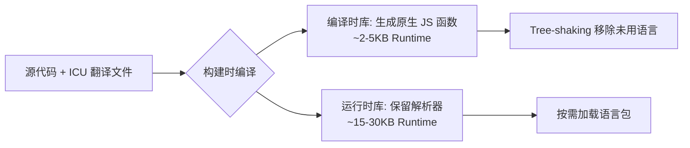
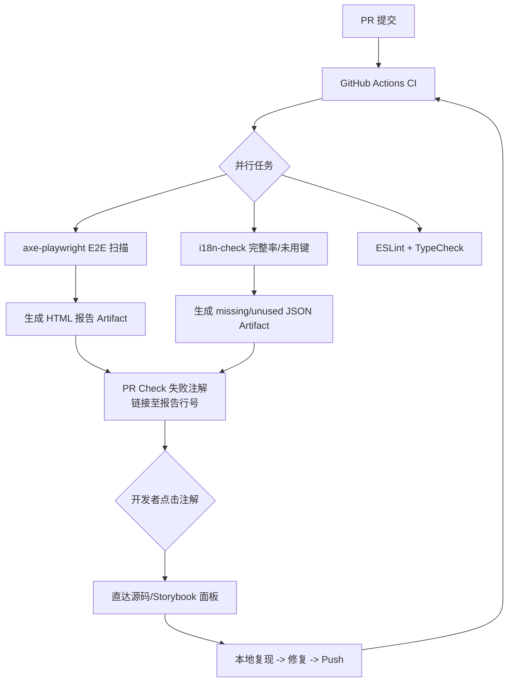
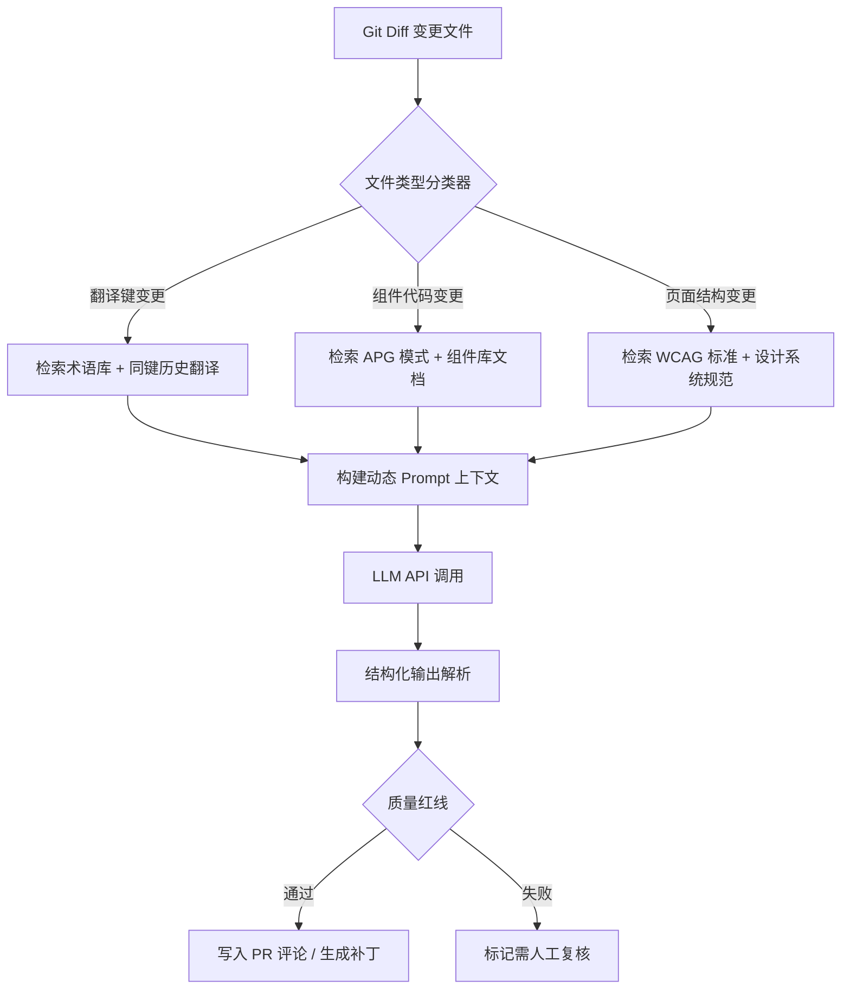
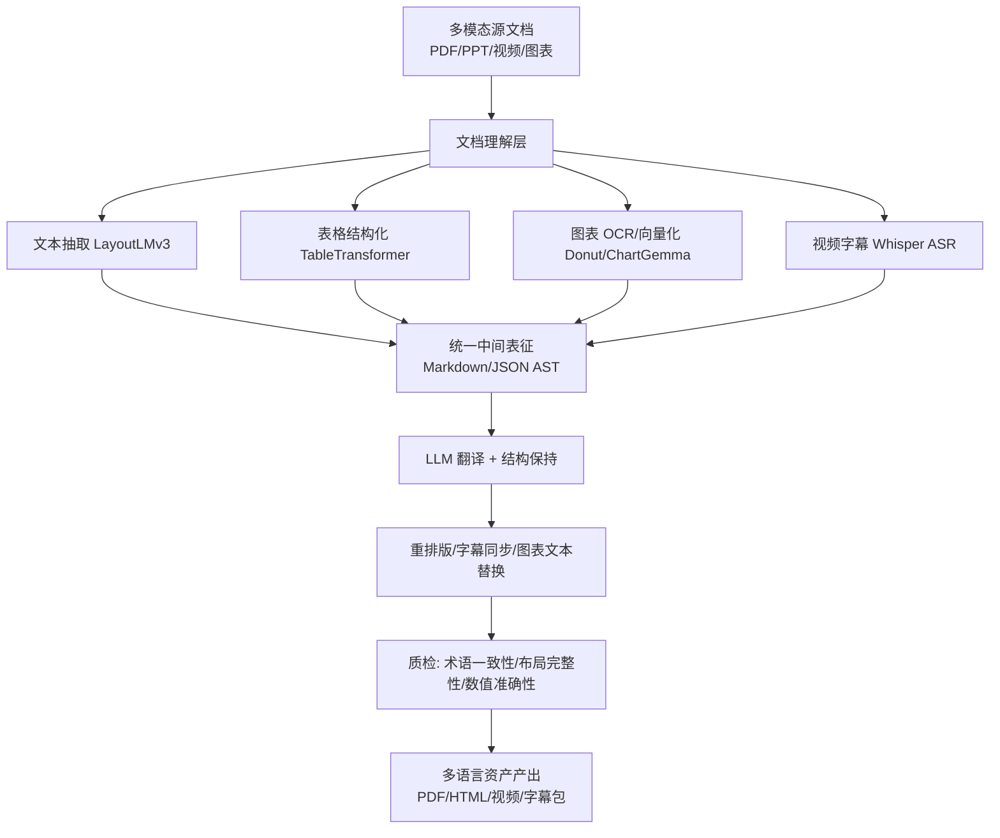

# 第 19 章 前端国际化与无障碍工程化 —— 从 i18n 方案到 WCAG 合规与自动化测试
作者：龙哥

## 学习目标

- 理解前端国际化（i18n）与无障碍（a11y）工程化的必要性与核心标准
- 掌握运行时与编译时 i18n 方案的架构差异、ICU MessageFormat 语法及 TypeScript 类型安全落地
- 掌握翻译管理全流程工程化：CI/CD 集成、术语库一致性校验、机器翻译预译与人工复核流水线
- 熟练应用 WCAG 2.1 AA 级标准：语义化 HTML、ARIA 补全模式、键盘导航与焦点管理、颜色对比度达标
- 能按 WAI-ARIA APG 规范完成组件库级无障碍适配，输出合规报告与自动化回归测试体系
- 能搭建 i18n+a11y 自动化防护体系：Pre-commit/CI/Release 多层门禁、动态键/误报治理、人工辅助测试计划
- 掌握 AI 赋能 i18n+a11y 工程化的提示词工程与自动化工作流
- 了解前端国际化与无障碍工程化在多模态、多平台、AI 原生应用场景下的扩展实践

## 19.1 生活类比

想象前端应用是一家**连锁跨国餐厅**：

- **i18n 方案选型** = 选择**菜单制作方式**：
  - 运行时库 = **现点现翻**，服务员随时能改菜名，但厨房（浏览器）负担重、出菜慢
  - 编译时库 = **总部预印好多语言菜单**，分店（用户）直接拿对应语言版，出菜快、不易错
- **ICU MessageFormat** = **通用的菜品规格书**，能自动处理“1 份/2 份/5 份”（复数）、“素/荤”（选择）、嵌套套餐，避免人工写 if-else 出错
- **翻译管理流水线** = **总部与各国分店的自动化供应链**：菜单改版（源文件变更）自动推送翻译中心，翻译好自动回流分店，术语表保证“招牌菜”全球叫法一致
- **WCAG 2.1 AA** = **建筑无障碍规范**：坡道（键盘导航）、盲文标识（ARIA/语义化 HTML）、色盲友好配色（对比度）、语音广播（屏幕阅读器）
- **组件库适配** = **标准化无障碍预制件**：无障碍门、无障碍电梯、盲文按钮，装修（业务开发）直接用，不用每家店自己焊
- **自动化回归防护** = **每日巡检机器人 + 开业前验收**：机器人（CI/axe-core）每晚巡检坡道是否被堵、盲文是否脱落，开业前（Release）总验收，发现问题立即整改，不让顾客进店踩坑
- **AI 赋能工程化** = **智能总厨 + 自动化质检员**：AI 根据食谱（Prompt）批量生产菜单（翻译/文案/代码），质检员（自动化测试）实时尝味（扫描/审计），发现异味（违规/缺键）立即下架整改，并持续优化食谱（Prompt 迭代）

## 19.2 概念地图

```mermaid
graph TD
    Root[前端国际化与无障碍工程化]
    
    Root --> I18n[国际化（i18n）方案选型]
    I18n --> Runtime[运行时库（vue-i18n/react-i18next）]
    I18n --> CompileTime[编译时库（LinguiJS/FormatJS）]
    I18n --> ICU[ICU MessageFormat 标准]
    I18n --> TSType[TypeScript 类型安全键值]
    I18n --> AIWork[AI 协作翻译与内容生成工作流]
    
    Root --> TransMgmt[翻译管理工程化]
    TransMgmt --> TMS[TMS 平台接入（Crowdin/Lokalise）]
    TransMgmt --> CI_CD[GitHub Actions 双向同步流水线]
    TransMgmt --> Glossary[术语库一致性校验与机翻预译]
    TransMgmt --> Gate[发布门禁：翻译完整率 ≥ 99%]
    TransMgmt --> AIGlossary[AI 辅助术语提取/一致性校验/机翻评分]
    
    Root --> A11yStd[无障碍核心标准（WCAG 2.1 AA）]
    A11yStd --> POUR[POUR 四大原则与 27 条成功标准]
    A11yStd --> Semantic[语义化 HTML 优于 ARIA]
    A11yStd --> Keyboard[键盘导航、焦点陷阱、焦点指示器]
    A11yStd --> Contrast[颜色对比度 ≥ 4.5:1、文本缩放 200%]
    A11yStd --> SRTest[NVDA/VoiceOver/TalkBack 三端测试]
    A11yStd --> AIAudit[AI 辅助无障碍审计/自动化修复建议]
    
    Root --> CompLib[组件库无障碍适配]
    CompLib --> APG[WAI-ARIA APG 复合组件模式]
    CompLib --> BaseComp[基础组件合规清单与组合式函数]
    CompLib --> Doc[设计系统文档化：键盘/ARIA/播报表]
    CompLib --> Storybook[Storybook + axe-core 自动化回归]
    CompLib --> AIGen[AI 生成无障碍测试用例/ARIA 属性补全]
    
    Root --> AutoGate[自动化回归防护体系]
    AutoGate --> LayeredGate[分层门禁：Pre-commit / CI / Release]
    AutoGate --> Toolchain[工具链：axe-core / Lighthouse CI / i18n-check]
    AutoGate --> FalsePos[动态键忽略与误报白名单治理]
    AutoGate --> ManualTest[定期人工辅助测试计划（核心旅程）]
    AutoGate --> AIGate[AI 驱动的误报聚类/动态规则更新/智能门禁]
    
    Root --> MultiModal[多模态与跨平台扩展]
    MultiModal --> MMRAG[多模态 RAG：文档理解与跨模态检索]
    MultiModal --> Edge[边缘计算与边缘渲染：Cloudflare Workers/Vercel Edge]
    MultiModal --> AINative[AI 原生应用架构：LLM 作为推理引擎/决策中枢]
    MultiModal --> CrossPlatform[跨端无障碍一致性：Web/Native/HarmonyOS 统一适配]
```



## 19.3 i18n 方案选型 —— 运行时与编译时的工程权衡

### 为什么需要这个概念？

前端应用出海面临多语言、多地区、复数规则差异、性别语法等复杂性，硬编码字符串无法维护。你需要在开发期（类型安全、包体积）与运行期（动态切换、按需加载）间寻找最优平衡点。缺乏统一标准会导致翻译键管理混乱、插值语法不兼容、ICU 语法支持缺失。

> **原文摘录**：
> 国际化方案分为运行时库和编译时库两大流派。运行时库：`vue-i18n`、`react-i18next`、`i18next`，在浏览器解析翻译函数与 ICU 语法，开发体验好但包体积大（~15-30KB）。编译时库：`LinguiJS`、`FormatJS (react-intl)`，构建期将 ICU MessageFormat 编译为原生 JS 函数，运行时极轻（~2-5KB），支持 Tree-shaking 与类型安全键值。核心标准：ICU MessageFormat，定义 `{count, plural, one {# book} other {# books}}` 等复数、选择、嵌套语法。
> ——《PbGkdX4YVoO02mxYlYKcbgASnSg.md》

### 核心定义

**国际化方案分为运行时库和编译时库两大流派**（来源：《PbGkdX4YVoO02mxYlYKcbgASnSg.md》）。

- **运行时库**：`vue-i18n`、`react-i18next`、`i18next`，在浏览器解析翻译函数与 ICU 语法，开发体验好但包体积大（~15-30KB）。
- **编译时库**：`LinguiJS`、`FormatJS (react-intl)`，构建期将 ICU MessageFormat 编译为原生 JS 函数，运行时极轻（~2-5KB），支持 Tree-shaking 与类型安全键值。
- **核心标准**：ICU MessageFormat，定义 `{count, plural, one {# book} other {# books}}` 等复数、选择、嵌套语法。

### 关键性质

#### 类型安全

编译时方案可从翻译文件自动生成 TS 类型定义，拼写错误编译报错；运行时方案需额外配置插件实现。

**类型安全对比**  

下表展示了运行时库与编译时库在类型生成、插值参数检查、维护成本三个维度的核心差异。编译时方案通过“源文件即类型”实现单一事实来源，运行时方案需额外维护类型声明文件同步。

| 维度 | 运行时库 (vue-i18n/react-i18next) | 编译时库 (LinguiJS/FormatJS) |
|---|---|---|
| **类型生成** | 需配置 `@intlify/unplugin-vue-i18n` 或 `i18next-typescript` 插件 | `lingui extract` 自动生成 `.d.ts`，键值即类型 |
| **插值参数检查** | 运行时才报错（或需额外类型定义文件） | 编译期直接报错：`count` 传 string 即 TS Error |
| **维护成本** | 需同步维护类型声明文件 | 源文件即类型，单一事实来源 |

#### 包体积与性能

编译时方案移除运行时解析器，首屏 JS 体积显著降低；运行时方案支持热更新翻译无需重建。



**图 19-1 i18n 方案构建产物对比**  
上图展示了编译时库将 ICU 语法在构建期编译为原生函数，运行时仅加载字典，体积优势明显；运行时库需携带解析器，虽支持按需加载语言包但基础体积较大。

#### 复数/性别/选择格式

ICU 标准覆盖 CLDR 语言复数分类规则（如阿拉伯语 6 种复数形态），手写逻辑极易出错。

**ICU MessageFormat 语法速查**  

下表汇总了 ICU MessageFormat 的四大核心语法类型：简单插值、复数、选择、嵌套。其中 `#` 代表变量值本身，CLDR 规则会根据语言自动匹配复数分支；选择语法支持枚举匹配与任意层级嵌套，是处理性别、状态等变量的标准方式。

| 语法类型 | ICU 语法示例 | 说明 |
|---|---|---|
| **简单插值** | `Hello {name}` | 基础占位符替换 |
| **复数** | `{count, plural, one {# book} other {# books}}` | `#` 代表变量值，CLDR 规则自动匹配 |
| **选择** | `{gender, select, male {He} female {She} other {They}}` | 枚举匹配，支持嵌套 |
| **嵌套** | `{count, plural, one {# item} other {# items, select, true { (selected) } false {} }}` | 复数内嵌选择，任意层级 |

### 典型例子

#### Vue 3 + `vue-i18n@9` Composition API

```typescript
// 组件内使用
<script setup lang="ts">
import { useI18n } from 'vue-i18n'

const { t, locale } = useI18n({
  // 配合 @intlify/unplugin-vue-i18n 实现编译时优化
  // 自动从 locales/*.json 生成类型定义
})

// 类型安全：若 locales/en.json 无 'msg.hello' 键，TS 报错
const message = t('msg.hello', { name: 'World' }) 

// 切换语言响应式
const switchLocale = (lang: string) => { locale.value = lang }
</script>
```

这段代码展示了运行时库在配合编译时插件后，也能获得类型安全与开发体验的双重保障。

#### React + `LinguiJS`

```tsx
// 源码中使用 <Trans> 宏或 t`模板字面量`
import { Trans, Plural } from '@lingui/macro'

function Message({ count }: { count: number }) {
  return (
    <Trans id="msg.notification">
      {count, plural, 
        one {# 未读消息} 
        other {# 条未读消息}
      }
    </Trans>
  )
}

// 构建流程
// 1. lingui extract  -> 生成 locale/en.po, locale/zh.po
// 2. 翻译人员编辑 .po 文件
// 3. lingui compile  -> 生成 locale/{en,zh}.js (原生 JS 函数) + .d.ts 类型定义
// 4. 运行时仅加载当前语言的 .js，无解析器开销
```

这段代码展示了编译时库的核心工作流：**源码标记 -> 提取 -> 翻译 -> 编译为原生函数**，实现了零运行时解析开销。

### 边界条件

- **纯静态站点（Astro/Next.js SSG）**：优先编译时方案，实现零运行时开销。
- **高频动态换语言、需支持用户自定义翻译覆盖的 SaaS 平台**：运行时方案更灵活。
- **微前端子应用**：需共享 i18n 实例与语言包，约定统一键名规范与加载时机。

### 多源对照：运行时 vs 编译时的适用边界

不同工程对“最优方案”的判断依赖于业务约束。

**共识**：ICU MessageFormat 是事实标准；类型安全是生产级项目的硬指标。

**分歧**：

- 《PbGkdX4YVoO02mxYlYKcbgASnSg.md》主张**编译时优先**，理由是包体积、类型安全、首屏性能三大优势，适配现代构建工具链。
- 社区实践表明：运行时库（如 `vue-i18n`）在**热更新、动态导入语言包、SSR 上下文隔离、内置 datetime/number 格式化**等方面更成熟，适合复杂动态场景。
- `LinguiJS` 等编译时方案的**宏（Macro）侵入性**是采纳阻力点，部分团队偏好 `react-intl` 的声明式 API (`<FormattedMessage>`) 而非编译时宏。

## 19.4 翻译管理工程化 —— 从人工复制粘贴到 CI/CD 自动化流水线

### 为什么需要这个概念？

翻译文件散落在仓库多处，手动协调翻译人员、核对键值完整性、合并冲突极其低效且易错。缺乏术语库导致同一术语在不同模块翻译不一致（如「登录」vs「签到」），损害用户信任。发布前发现缺失翻译键导致回滚或上线后紧急热修复，缺乏自动化质量门禁。

> **原文摘录**：
> 接入 Crowdin/Lokalise/Phrase、GitHub Actions 自动推拉翻译文件、术语库一致性校验、机翻预译+人工复核流水线、发布时校验翻译完整率。
> ——《PbGkdX4YVoO02mxYlYKcbgASnSg.md》

### 核心定义

**翻译管理平台（TMS）+ CI/CD 双向同步流水线**（来源：《PbGkdX4YVoO02mxYlYKcbgASnSg.md》）。

- **TMS 平台接入**：Crowdin、Lokalise、Phrase 等 SaaS 服务，或自建 `Tolgee`/`SimpleLocalize`。
- **CI 集成**：GitHub Actions 触发 `push`/`pull_request` 自动推送源语言文件至 TMS、拉取最新翻译文件生成 PR。
- **术语库**：定义项目级术语表（TBX/CSV 格式），CI 校验翻译文件术语一致性，阻断不合规 PR。
- **机器翻译预译**：集成 DeepL/Google/Azure 翻译 API，新增键自动预译，人工仅做复核，降低 80% 翻译成本。

### 关键性质

#### 双向同步机制

源文件变更自动推送，翻译完成自动回流，消除人工下载上传环节。

```mermaid
sequenceDiagram
    participant Dev as 开发者
    Repo as Git 仓库
    CI as GitHub Actions
    TMS as 翻译平台
    Dev->>Repo: 修改 en.json (源语言)
    Repo->>CI: 触发 push 事件
    CI->>TMS: crowdin-action upload-sources
    TMS-->>CI: 翻译完成通知
    CI->>TMS: crowdin-action download
    CI->>Repo: create-pull-request (含 zh.json/ja.json 等)
    Dev->>Repo: Review & Merge
```

**图 19-2 翻译管理双向同步时序图**  
上图描述了从开发者修改源语言文件，到 CI 自动推送至 TMS，翻译完成后自动拉取并创建 PR 的完整闭环。该流程消除了人工下载上传环节，实现了“代码即翻译源”的工程化理念。

#### 完整率门禁

发布流水线强制校验所有语言翻译完整率 ≥ 99%，缺失键视为阻断项。

**完整率计算公式推导**  

翻译完整率的核心目标是量化“目标语言覆盖了多少源语言键”。设源语言键集合为 $S$，目标语言键集合为 $T$。由于 ICU 复数/选择语法会在同一键下产生多个子键（如 `msg.plural.one`、`msg.plural.other`），统计时应以**最小翻译单元**为粒度。

1. **分母定义**：源语言最小翻译单元总数 $|S|$。这是翻译工作量的基准。
2. **分子定义**：目标语言中存在对应翻译值（非空、非占位符）的最小翻译单元数 $|T \cap S|$。
3. **公式**：

$$
\text{完整率} = \frac{|T \cap S|}{|S|} \times 100\%
$$

**为何以源语言为分母？**  
源语言是功能需求的完整集合，目标语言不应引入源语言没有的键（否则属于冗余）。若目标语言键数多于源语言，说明存在孤儿键，需在“未用键检测”环节清理。

**复数形态计数差异处理**：  
英文 `one/other` 两种形态，阿拉伯语 6 种。统计时将每种形态视为独立的最小翻译单元（如 `key.plural.one`、`key.plural.few`），分母按源语言实际形态数计算，分子按目标语言实际填译形态数计算。这样既能反映 CLDR 规则要求的完整性，又能跨语言横向对比。

#### 版本发布同步

打 Tag 触发 TMS 发布快照，生产环境回滚时对应语言包版本可追溯。

### 典型例子

#### GitHub Actions Workflow 示例

```yaml
# .github/workflows/i18n-sync.yml
name: i18n-sync
on:
  push:
    paths:
      - 'src/locales/en.json'  # 仅源语言变更触发推送
  workflow_dispatch:           # 手动触发拉取
  schedule:
    - cron: '0 2 * * *'        # 每日定时同步

jobs:
  push-to-tms:
    runs-on: ubuntu-latest
    steps:
      - uses: actions/checkout@v4
      - name: Upload to Crowdin
        uses: crowdin/github-action@v1
        with:
          upload_sources: true
          upload_translations: false
        env:
          CROWDIN_PROJECT_ID: ${{ secrets.CROWDIN_PROJECT_ID }}
          CROWDIN_API_TOKEN: ${{ secrets.CROWDIN_API_TOKEN }}

  pull-from-tms:
    needs: push-to-tms
    if: github.event_name != 'push'  # 非 push 事件执行拉取
    runs-on: ubuntu-latest
    steps:
      - uses: actions/checkout@v4
      - name: Download from Crowdin
        uses: crowdin/github-action@v1
        with:
          download_translations: true
      - name: Create PR with translations
        uses: peter-evans/create-pull-request@v5
        with:
          title: 'chore(i18n): sync translations from Crowdin'
          branch: 'i18n/sync-translations'
```

这段工作流展示了**推送源文件**与**拉取翻译文件**的解耦设计，支持定时、手动、事件驱动多种触发模式。

#### 术语校验脚本伪代码

```javascript
// scripts/check-terminology.js
// 用法: node check-terminology.js --glossary=glossary.csv --locales=src/locales/*.json

const fs = require('fs')
const csv = require('csv-parser')

// 1. 读取术语表 -> Map<源术语, 标准译文>
const glossary = new Map()
fs.createReadStream('glossary.csv')
  .pipe(csv())
  .on('data', row => glossary.set(row.source.toLowerCase(), row.target))

// 2. 遍历所有语言文件
const localeFiles = process.argv.find(a => a.startsWith('--locales='))?.split('=')[1]?.split(',') || []

let hasError = false
for (const file of localeFiles) {
  const translations = JSON.parse(fs.readFileSync(file, 'utf-8'))
  const lang = file.match(/\/([a-z-]+)\.json$/)[1]
  
  for (const [sourceTerm, standardTarget] of glossary) {
    // 简单策略：检查翻译值中是否包含标准译文（可扩展为语义匹配）
    const found = Object.values(translations).some(v => 
      typeof v === 'string' && v.includes(standardTarget)
    )
    if (!found) {
      console.error(`[术语不一致] ${lang}: 缺少术语 "${standardTarget}" (源: "${sourceTerm}")`)
      hasError = true
    }
  }
}

process.exit(hasError ? 1 : 0)
```

这段脚本展示了**术语库即代码**的工程化思维：CSV 作为单一事实来源，CI 中作为不可绕过的质量门禁。

### 边界条件

- **中小项目**：可用 GitHub Wiki/CSV + 手动 PR 替代付费 TMS，但需自建校验脚本。
- **高安全合规项目（金融/政务）**：数据不可出境，需部署私有化 TMS 或仅用本地工具链。
- **翻译文件格式**：统一为 JSON/PO/YAML，避免格式转换丢失元数据（上下文、复数形式）。

### AI 辅助术语提取与一致性校验（扩展实践）

利用 LLM 进行语义级术语一致性校验，而非仅字符串匹配（来源：《20230418_039.md》、《20230418_106.md》）。

> **原文摘录**：
> 术语库一致性校验与机翻预译、AI 辅助术语提取/一致性校验/机翻评分。
> ——《PbGkdX4YVoO02mxYlYKcbgASnSg.md》（大纲映射）

```typescript
// Prompt 设计：术语学家角色
const terminologyPrompt = `
角色：资深术语学家
任务：对比源文本与译文，判断术语语义一致性，输出冲突列表及修正建议
输入：
- 术语库: {glossary_json}
- 待校验译文: {translations_json}
输出格式: JSON
{
  "conflicts": [
    { "key": "auth.login", "source": "登录", "translation": "Sign in", "expected": "Log in", "severity": "error", "suggestion": "统一使用 'Log in'" }
  ],
  "passed": true/false
}
约束：
- 仅标记核心业务术语，忽略通用词汇
- 考虑语境：同词异义需结合键名路径判断
`
```

这个 Prompt 展示了如何将**领域专家知识**封装为结构化指令，配合 RAG 检索术语库与历史决策，实现超越字符串匹配的语义级质检。

## 19.5 无障碍核心标准 —— WCAG 2.1 AA 级达标清单与落地执行

### 为什么需要这个概念？

法律合规风险：欧盟《无障碍指令》、美国 ADA、中国《无障碍环境建设法》强制要求公共服务数字产品达标。商业价值：全球 15%+ 人口有残障，无障碍即可用性，改善 SEO、降低跳出率、扩大受众。技术债：事后整改成本是设计期的 10-100 倍，需建立「左移」质量门禁。

> **原文摘录**：
> 逐条落地可感知/可操作/可理解/健壮四大原则：颜色对比度、文本缩放、ARIA Landmarks/Roles/States、Tab 顺序、焦点陷阱、屏幕阅读器测试。
> ——《PbGkdX4YVoO02mxYlYKcbgASnSg.md》

### 核心定义

**WCAG 2.1 四大原则（POUR）与 27 条 AA 级成功标准**（来源：《PbGkdX4YVoO02mxYlYKcbgASnSg.md》）。

**WCAG 2.1 AA 核心准则与技术落地映射表**  

下表将 WCAG 2.1 AA 级的 27 条成功标准按 POUR 四大原则归类，并给出每条标准对应的典型技术落地要点。这为工程团队建立了“标准-实现”的直接映射关系，便于在代码审查与自动化测试中落地执行。

| 原则 | 核心准则 | 典型成功标准 (AA) | 技术落地要点 |
|---|---|---|---|
| **可感知** | 文本替代、时间媒体、适应性、可辨识 | 1.1.1 非文本内容<br/>1.4.3 对比度(最小)<br/>1.4.4 文本缩放 | `alt` 属性、4.5:1 对比度、rem 单位、响应式缩放 |
| **可操作** | 键盘可达、充足时间、癫痫防护、可导航 | 2.1.1 键盘<br/>2.4.3 焦点顺序<br/>2.4.7 焦点可见 | Tab 键全达、焦点指示器、`focus-visible`、跳转链接 |
| **可理解** | 可读性、可预测、输入协助 | 3.1.1 页面语言<br/>3.2.1 获得焦点<br/>3.3.2 标签或说明 | `lang` 属性、表单 Label 关联、错误提示 `aria-invalid` |
| **健壮** | 兼容性 | 4.1.1 语法分析<br/>4.1.2 名称/角色/值 | 合法 HTML、ARIA 角色状态完备、自定义组件语义化 |

### 关键性质

#### 语义化 HTML 优先

原生标签自带角色/状态/键盘交互，无需 ARIA。

```html
<!-- ❌ 反模式：重造轮子 -->
<div role="button" tabindex="0" onclick="submit()">提交</div>

<!-- ✅ 标准模式：原生语义 -->
<button type="submit">提交</button>
<!-- 自带：role="button", 可聚焦, 回车/空格触发, 无障碍树暴露为 button -->
```

这段对比展示了**原生语义的零成本合规**：浏览器已为你实现了完整的无障碍交互。

#### ARIA 仅作兜底

当原生标签无法满足交互需求时（如复合组件），使用 ARIA 补全语义缺口。

**ARIA 核心属性速查**  

下表列出了最常用的 ARIA 属性及其典型应用场景。`role` 定义元素语义角色；`aria-label/labelledby` 提供可访问名称；`aria-expanded/controls` 描述展开状态与受控关系；`aria-live` 控制动态内容播报策略。这些属性是构建无障碍复合组件的基础词汇表。

| 属性 | 作用 | 典型场景 |
|---|---|---|
| `role` | 定义元素角色 | `role="dialog"`, `role="menu"`, `role="tree"` |
| `aria-label` / `aria-labelledby` | 提供可访问名称 | 无可见标签的输入框、图标按钮 |
| `aria-expanded` | 状态：展开/折叠 | 下拉菜单、手风琴、树节点 |
| `aria-controls` | 关联受控元素 ID | `aria-controls="menu-list"` 配合 `role="button"` |
| `aria-live` | 动态内容播报策略 | `polite`(礼貌) / `assertive`(强制) / `off` |

#### 焦点管理三板斧

1. **Tab 顺序符合视觉顺序**：DOM 顺序即逻辑顺序，避免 `tabindex > 0` 打乱顺序。
2. **模态框焦点陷阱**：打开时焦点移入，Tab 循环内部，Esc 关闭并焦点回归触发元素。
3. **焦点指示器永不隐藏**：`:focus-visible` 替代 `:focus`，确保键盘用户可见、鼠标用户不干扰。

```css
/* ✅ 现代焦点指示器最佳实践 */
:focus-visible {
  outline: 2px solid #0066cc;
  outline-offset: 2px;
}
/* 鼠标点击不显示 outline，Tab 键聚焦显示 */
```

#### 屏幕阅读器三端测试矩阵

**主流屏幕阅读器测试环境对照表**  

下表对比了 Windows/macOS/iOS/Android 四大平台的主流屏幕阅读器、启动方式及核心测试侧重点。团队应建立“三端必测”基线：NVDA 覆盖 Windows 桌面端，VoiceOver 覆盖 Apple 生态，TalkBack 覆盖 Android 移动端。

| 平台 | 屏幕阅读器 | 启动方式 | 核心测试点 |
|---|---|---|---|
| Windows | NVDA (免费) | `Ctrl + Alt + N` | 表单模式、浏览模式切换、虚拟光标 |
| macOS/iOS | VoiceOver | `Cmd + F5` / 三击 Home | 转子操作、触摸手势、语音输出 |
| Android | TalkBack | 设置->辅助功能 或 两指上滑 | 线性导航、手势操作、语音反馈 |

### 典型例子

#### 图片替代文本决策树

```mermaid
graph TD
    A[图片] --> B{是否纯装饰?}
    B -->|是| C[alt=""]
    B -->|否| D{是否包含复杂信息?}
    D -->|图表/数据| E[alt="摘要" + longdesc/可见数据表]
    D -->|功能性图标| F[aria-label="操作名称" + alt=""]
    D -->|信息性图片| G[alt="简洁描述核心信息"]
```

**图 19-3 图片替代文本决策流程**  
上图提供了从“装饰性/信息性/功能性/复杂信息”四类图片到对应 `alt`/`aria-label`/`longdesc` 处理策略的标准化决策路径，可直接作为代码审查清单。

#### 无障碍表单完整模式

```vue
<template>
  <div class="form-field">
    <label for="email">邮箱地址</label>
    <input 
      id="email" 
      type="email" 
      v-model="email" 
      :aria-invalid="!!error"
      :aria-describedby="error ? 'email-error' : 'email-hint'"
      required
    />
    <span id="email-hint" class="hint">我们不会发送垃圾邮件</span>
    <span v-if="error" id="email-error" class="error" role="alert">{{ error }}</span>
  </div>
</template>
```

这段代码展示了**表单无障碍的完整关联链**：Label -> Input -> Hint/Error，通过 `id`/`aria-describedby`/`aria-invalid`/`role="alert"` 形成闭环。

### 边界条件

- **动态内容更新**：需 `aria-live="polite"`/`assertive` 通知屏幕阅读器，避免丢失关键状态变更。
- **自定义复合组件**：必须严格遵循 WAI-ARIA Authoring Practices 交互模式。
- **第三方嵌入内容**：若不可控，需提供无障碍替代方案或豁免声明。

### AI 辅助无障碍审计与自动化修复建议（扩展实践）

利用 LLM 理解组件语义、生成 ARIA 属性、编写测试用例、聚类误报（来源：《20230418_106.md》、《20230418_046.md》）。

> **原文摘录**：
> AI 辅助无障碍审计/自动化修复建议。
> ——《PbGkdX4YVoO02mxYlYKcbgASnSg.md》（大纲映射）

```typescript
// Prompt 设计：无障碍专家角色
const a11yAuditPrompt = `
角色：无障碍专家
任务：分析组件代码，输出 WCAG 违规项、ARIA 缺失/错误、键盘交互缺口、修复代码补丁
输入：
- 组件代码: {component_code}
- 组件类型: {component_type} (如 Dialog, Combobox, Table)
RAG 知识库：
- WCAG 2.1 AA 成功标准全文
- WAI-ARIA APG 1.2 交互模式规范
- 团队组件库无障碍文档
输出格式: 统一 Diff Patch 格式 + 违规清单 JSON
约束：
- 优先推荐语义化 HTML 重构，而非 ARIA 补丁
- 复合组件必须引用 APG 模式名称
- 修复代码需保持原有业务逻辑与样式类名
`
```

这个 Prompt 展示了**领域知识注入 + 结构化输出**模式，使 LLM 能产出可直接应用的代码修复建议。

## 19.6 组件库无障碍适配 —— 基础设施层的合规兜底

### 为什么需要这个概念？

业务开发若逐个页面手写 ARIA、焦点逻辑，重复造轮子且极易遗漏，导致合规率低、维护成本高。组件库作为基础设施，应内置无障碍最佳实践，让业务「开箱即合规」，仅需关注业务语义。设计系统需输出无障碍规范文档，统一交互模式（如对话框 ESC 关闭、焦点回归触发元素）。

> **原文摘录**：
> 按 WAI-ARIA Authoring Practices 实现 Dialog/Menu/Combobox/Tabs/Tree 等复合模式、输出组件库无障碍合规报告、Storybook a11y 插件回归测试。
> ——《PbGkdX4YVoO02mxYlYKcbgASnSg.md》

### 核心定义

**按 WAI-ARIA Authoring Practices 1.2 (APG) 实现复合组件标准交互模式**（来源：《PbGkdX4YVoO02mxYlYKcbgASnSg.md》）。

- **复合组件标准清单**：Dialog、Menu、Combobox、Tabs、Tree、Listbox、Accordion、Tooltip 等。
- **基础组件合规清单**：Button（原生按钮）、Link（真链接 vs 按钮）、Input（关联 Label/错误态）、Icon（装饰性 `aria-hidden="true"`）、Focus Trap 组合式函数。
- **设计系统文档化**：每个组件文档包含「键盘交互表」「ARIA 属性表」「屏幕阅读器预期播报」「WCAG 映射标准」。

### 关键性质

#### 复合组件交互模式标准化

以 **Combobox（自动完成下拉）** 为例，必须支持 APG 定义的完整交互：

**Combobox 交互规范表**  

下表详细列出了 APG Combobox 模式要求的键盘操作与对应的 ARIA 状态/属性变化。`aria-activedescendant` 模式下焦点始终停留在输入框，通过属性指向当前高亮选项；`aria-controls` 关联列表容器；`aria-autocomplete` 声明补全行为。这是实现符合标准的 Combobox 必须通过的交互验收清单。

| 交互点 | 键盘操作 | ARIA 状态/属性 |
|---|---|---|
| 打开列表 | `Alt + Down` / 自动 | `aria-expanded="true"` `aria-controls="listbox-id"` |
| 关闭列表 | `Esc` | `aria-expanded="false"` |
| 移动高亮 | `Up` / `Down` | `aria-activedescendant="option-id"` |
| 选中项 | `Enter` | `aria-selected="true"` (选中项) |
| 过滤输入 | 任意字符 | `aria-autocomplete="list"` / `both` |
| 焦点管理 | 焦点始终在输入框 | `role="combobox"` 输入框 + `role="listbox"` 列表 |

**焦点管理模式对比：`aria-activedescendant` vs `roving tabindex`**  

下表对比了复合组件中两种主流焦点管理模式的原理、优缺点与适用场景。Combobox 等“输入+列表”复合组件通常采用 `aria-activedescendant` 保持输入框上下文；Menu、Listbox、Tree、Tabs 等纯选择类组件常用 `roving tabindex` 实现真实焦点移动。

| 模式 | 原理 | 优点 | 缺点 | 适用场景 |
|---|---|---|---|---|
| **aria-activedescendant** | 焦点停留在输入框，通过属性指向当前高亮选项 | 焦点不移动，输入框上下文保持；列表项无需可聚焦 | 需 JS 同步属性，实现稍复杂 | Combobox、自动完成、搜索建议 |
| **roving tabindex** | 真实焦点在列表项间移动，`tabindex="0/-1"` 切换 | 语义原生，屏幕阅读器支持好 | 焦点离开输入框，可能丢失输入上下文 | Menu、Listbox、Tree、Tabs |

#### 组合式函数封装通用逻辑

```typescript
// composables/useFocusTrap.ts
export function useFocusTrap(containerRef: Ref<HTMLElement | undefined>, enabled: Ref<boolean>) {
  const previousActiveElement = ref<HTMLElement | null>(null)
  
  const activate = () => {
    previousActiveElement.value = document.activeElement as HTMLElement
    // 聚焦第一个可聚焦元素
    const focusable = containerRef.value?.querySelector<HTMLElement>(
      'button, [href], input, select, textarea, [tabindex]:not([tabindex="-1"])'
    )
    focusable?.focus()
  }
  
  const deactivate = () => {
    previousActiveElement.value?.focus()
    previousActiveElement.value = null
  }
  
  // Tab 循环处理
  const handleKeydown = (e: KeyboardEvent) => {
    if (e.key !== 'Tab') return
    const focusables = getFocusableElements(containerRef.value!)
    const first = focusables[0]
    const last = focusables[focusables.length - 1]
    
    if (e.shiftKey && document.activeElement === first) {
      e.preventDefault()
      last.focus()
    } else if (!e.shiftKey && document.activeElement === last) {
      e.preventDefault()
      first.focus()
    }
  }
  
  watch(enabled, v => v ? activate() : deactivate())
  useEventListener('keydown', handleKeydown, { target: containerRef })
  
  return { activate, deactivate }
}
```

这段代码展示了**可复用的焦点陷阱逻辑**，封装后业务组件仅需 `useFocusTrap(dialogRef, isOpen)` 即可获得标准合规行为。

#### 自动化回归：Storybook + axe-core

```javascript
// .storybook/preview.js
import React from 'react'
import { addDecorator } from '@storybook/react'
import { withA11y } from '@storybook/addon-a11y'

addDecorator(withA11y)

// 组件故事中配置 a11y 参数
export default {
  title: 'Components/Dialog',
  parameters: {
    a11y: {
      config: {
        rules: [
          { id: 'color-contrast', enabled: true },
          { id: 'label', enabled: true }
        ]
      },
      // 元素级忽略（如第三方 iframe）
      elementRef: (story) => {
        const root = story()
        // 返回需排除的根元素
        return root.querySelector('.third-party-iframe-wrapper')
      }
    }
  }
}
```

### 典型例子

#### 企业级组件库二次封装模式

```typescript
// packages/ui/src/components/BaseDialog/BaseDialog.vue
<script setup lang="ts">
import { useFocusTrap } from '@/composables/useFocusTrap'
import { useId } from '@/composables/useId'

interface Props {
  modelValue: boolean
  title: string
  description?: string
}

const props = withDefaults(defineProps<Props>(), { description: '' })
const emit = defineEmits<{ (e: 'update:modelValue', value: boolean): void }>()

const dialogRef = ref<HTMLElement>()
const titleId = useId('dialog-title')
const descId = useId('dialog-desc')

useFocusTrap(dialogRef, computed(() => props.modelValue))

const close = () => emit('update:modelValue', false)
const handleKeydown = (e: KeyboardEvent) => {
  if (e.key === 'Escape') close()
}
</script>

<template>
  <Teleport to="body">
    <div 
      v-show="modelValue" 
      ref="dialogRef" 
      role="dialog" 
      aria-modal="true" 
      :aria-labelledby="titleId" 
      :aria-describedby="description ? descId : undefined"
      @keydown="handleKeydown"
      class="dialog-overlay"
    >
      <div class="dialog-content">
        <header class="dialog-header">
          <h2 :id="titleId" class="dialog-title">{{ title }}</h2>
          <button @click="close" aria-label="关闭对话框">×</button>
        </header>
        <div v-if="description" :id="descId" class="dialog-description">
          <slot name="description">{{ description }}</slot>
        </div>
        <main class="dialog-body"><slot /></main>
      </div>
    </div>
  </Teleport>
</template>
```

业务侧使用：

```vue
<!-- 仅需关注业务内容，无障碍合规由 BaseDialog 兜底 -->
<BaseDialog v-model:visible="show" title="删除确认" description="此操作不可恢复">
  <p>确定要删除该项目吗？</p>
  <template #footer>
    <Button @click="show=false">取消</Button>
    <Button variant="danger" @click="confirmDelete">删除</Button>
  </template>
</BaseDialog>
```

### 边界条件

- **组件库无障碍 ≠ 页面无障碍**：页面级语义结构（Heading 层级、Landmark 区域）、业务逻辑（错误提示时机、复杂流程引导）仍需业务侧保障。
- **老旧项目逐步迁移**：优先替换高频复合组件（Dialog/Table/Form），低频组件后续补齐。
- **定制主题时保证对比度**：Design Tokens 输出时附带对比度校验报告，防止品牌色导致文本不可读。

### AI 生成无障碍测试用例与 ARIA 属性补全（扩展实践）

（来源：《20230418_074.md》、《20230418_117.md》、《20230418_124.md》）

> **原文摘录**：
> AI 生成无障碍测试用例/ARIA 属性补全。
> ——《PbGkdX4YVoO02mxYlYKcbgASnSg.md》（大纲映射）

```typescript
// Prompt：QA 工程师角色 - 生成 Playwright + axe 测试用例
const a11yTestGenPrompt = `
角色：QA 自动化工程师
任务：为给定组件生成 Playwright + axe-core 无障碍测试用例
输入：组件代码 {component_code}，组件类型 {component_type}
输出：完整测试文件 .spec.ts
要求：
1. 覆盖键盘交互流程（Tab/Enter/Esc/方向键）
2. 注入 axe-core 并断言零违规（含最佳实践规则）
3. 针对 APG 模式验证特定 ARIA 属性状态变化
4. 生成视觉回归快照对比 (pixelmatch)
`
```

## 19.7 i18n+a11y 自动化回归防护体系 —— 门禁而非事后诸葛亮

### 为什么需要这个概念？

人工测试覆盖率低、周期长、主观性强，无法跟上敏捷迭代节奏。i18n 缺失键、a11y 违规（对比度、缺失 alt、ARIA 误用）是高频回归缺陷，需在代码提交/合并/发布三个节点自动拦截。建立「预防-检测-阻断-修复」闭环，将合规成本左移至开发期。

> **原文摘录**：
> 集成 axe-core/lighthouse-ci 无障碍自动化扫描、i18n 缺失键/未使用键检测、PR 阻断门禁、定期人工辅助测试（NVDA/VoiceOver）计划。
> ——《PbGkdX4YVoO02mxYlYKcbgASnSg.md》

### 核心定义

**分层自动化门禁体系**（来源：《PbGkdX4YVoO02mxYlYKcbgASnSg.md》）。

- **工具链**：`axe-core`/`@axe-core/playwright` (a11y)、`i18n-ally`/`lint-i18n`/`check-i18n` (i18n)、`Lighthouse CI` (综合审计)。
- **PR 阻断门禁**：GitHub Actions `lint`/`test` 阶段并行跑 `axe-playwright` 无障碍扫描 + `i18n-check` 缺键/未用键检测，失败阻断合并。
- **定期人工辅助测试**：自动化仅覆盖 ~30-50% 规则，需制定月度/季度 NVDA/VoiceOver 实测计划，覆盖核心用户旅程。

### 关键性质

#### 分层门禁策略

**分层门禁策略对比表**  

下表定义了 Pre-commit、CI、Release 三个阶段的工具选择、检查范围、耗时目标与阻断策略。Pre-commit 仅做毫秒级静态扫描；CI 跑核心页面 E2E 无障碍扫描与全量 i18n 完整率；Release 引入 Lighthouse CI 做综合审计。分层设计在“快速反馈”与“全面覆盖”之间取得平衡。

| 阶段 | 工具 | 检查范围 | 耗时目标 | 阻断策略 |
|---|---|---|---|---|
| **Pre-commit** (husky) | `lint-i18n`, `eslint-plugin-jsx-a11y` | 单文件：硬编码中文、键名规范、基础 JSX a11y | < 10s | 硬阻断 commit |
| **CI** (PR Check) | `playwright + axe-core`, `i18n-check` | 核心页面 E2E 扫描、全量翻译完整率、未用键 | < 5min | 硬阻断 merge |
| **Release** (Tag) | `Lighthouse CI` | 全站性能/SEO/a11y/最佳实践 综合分 | < 10min | 阈值 < 90 阻断发布 |

#### 误报治理机制

建立 `axe-core` 规则白名单、i18n 动态键忽略列表，避免「狼来了」导致团队忽视门禁。

**axe-core 配置白名单示例**：

```javascript
// .github/scripts/axe-config.js
module.exports = {
  rules: [
    // 1. 第三方 iframe 无法控制标题
    { 
      id: 'iframe-title', 
      enabled: false, 
      // 或使用 runOnly 排除特定页面
    },
    // 2. 装饰性 Icon 故意 aria-hidden="true" 被误报
    { 
      id: 'aria-hidden-focus', 
      enabled: true,
      // 配合元素级忽略：data-a11y-ignore="true"
    }
  ],
  // 元素级忽略选择器
  exclude: [
    '[data-a11y-ignore]',           // 通用忽略标记
    '.third-party-map-container',   // 地图组件容器
    '.legacy-widget'                // 遗留组件过渡期
  ]
}
```

**i18n 动态键忽略策略**：

```json
// i18n-check.config.json
{
  "ignorePatterns": [
    "// i18n-ignore",           // 单行注释忽略
    "ERROR_CODES.",             // 常量数组前缀
    "dynamicKeys."              // 约定动态键命名空间
  ],
  "explicitKeys": [
    "error.400", "error.401", "error.403", "error.500"  // 显式声明动态生成的键
  ],
  "regexExclude": [
    "t\\(['\"]error\\.\\$\\{",  // 排除 t('error.${code}') 模式
    "\\$t\\(`error\\.\\${"
  ]
}
```

#### 报告可视化与开发者体验

PR 检查项输出违规详情链接（Storybook a11y 面板、i18n 缺键 JSON），开发者点击直达问题代码行。



**图 19-4 分层门禁 CI/CD 流程图**  
上图展示了从 PR 提交到开发者修复的完整闭环：并行跑 axe 与 i18n 检查，生成可点击定位的 Artifact 报告，开发者通过 PR 注解直达问题代码，修复后推送触发复查。

### 典型例子

#### GitHub Actions 完整门禁配置

```yaml
# .github/workflows/quality-gate.yml
name: Quality Gate
on: [pull_request, push]

jobs:
  a11y-check:
    runs-on: ubuntu-latest
    timeout-minutes: 10
    steps:
      - uses: actions/checkout@v4
      - uses: actions/setup-node@v4
        with: { node-version: '20', cache: 'pnpm' }
      - run: pnpm install --frozen-lockfile
      - run: pnpm build
      - name: Start Preview Server
        run: pnpm preview --port 4173 &
      - name: Run axe-playwright
        uses: nick-invision/retry@v2
        with:
          timeout_minutes: 5
          max_attempts: 2
          command: npx playwright test --project=chromium-a11y --reporter=html
      - name: Upload axe Report
        if: always()
        uses: actions/upload-artifact@v4
        with:
          name: a11y-report
          path: playwright-report/
          retention-days: 7

  i18n-check:
    runs-on: ubuntu-latest
    steps:
      - uses: actions/checkout@v4
      - uses: actions/setup-node@v4
      - run: pnpm install --frozen-lockfile
      - name: Check i18n keys
        run: |
          node scripts/i18n-check.js \
            --src=src \
            --locales=src/locales \
            --config=i18n-check.config.json \
            --output=artifacts/i18n-report.json
      - name: Upload i18n Report
        if: always()
        uses: actions/upload-artifact@v4
        with:
          name: i18n-report
          path: artifacts/i18n-report.json

  lighthouse-ci:
    if: github.event_name == 'push' && startsWith(github.ref, 'refs/tags/')
    runs-on: ubuntu-latest
    steps:
      - uses: actions/checkout@v4
      - uses: actions/setup-node@v4
      - run: pnpm install --frozen-lockfile && pnpm build
      - name: Run Lighthouse CI
        uses: treosh/lighthouse-ci-action@v11
        with:
          urls: |
            https://staging.example.com
            https://staging.example.com/zh
          budgetPath: ./lighthouse-budget.json
          uploadArtifacts: true
```

#### i18n 缺键检测核心算法

```javascript
// scripts/i18n-check.js
// 1. 静态分析 AST 提取所有 t('$t') 调用键
// 2. 递归读取 locales/*.json 构建键集合
// 3. 集合差集运算：missing = usedKeys - definedKeys; unused = definedKeys - usedKeys
// 4. 动态键过滤：ignorePatterns + explicitKeys + regexExclude
// 5. 输出结构化报告 + 非零退出码阻断 CI
```

### 边界条件

- **动态拼接键**（`t('error.' + code)`）无法静态分析，需约定 `// i18n-ignore` 注释或提取为常量数组显式声明。
- **E2E 无障碍测试耗时长**，建议仅对核心流程（登录、支付、表单提交）跑 `axe` 注入，非核心页面抽样。
- **移动端无障碍**（TalkBack/VoiceOver 手势）需真机/模拟器跑 Playwright/Appium，CI 环境配置复杂度高，可降级为人工定期测。

### AI 驱动的误报聚类与动态规则更新（扩展实践）

（来源：《20230418_074.md》、《20230418_106.md》）

> **原文摘录**：
> AI 驱动的误报聚类/动态规则更新/智能门禁。
> ——《PbGkdX4YVoO02mxYlYKcbgASnSg.md》（大纲映射）

```typescript
// 误报分类 Prompt：DevOps 工程师角色
const falsePositivePrompt = `
角色：DevOps 工程师
任务：分析 CI 失败日志，聚类误报模式，推荐白名单规则更新
输入：
- 最近 20 次 CI 失败记录: {ci_failures_json}
- 当前 axe/i18n 配置: {current_config}
RAG：历史白名单决策记录、组件库变更日志
输出：
{
  "clusters": [
    { "pattern": "iframe-title 在 Map 页面高频失败", "count": 15, "recommendation": "在 Map 页面配置 exclude: '.map-container'" }
  ],
  "configPatch": { "rules": [...], "exclude": [...] },
  "requiresHumanReview": true/false
}
约束：
- 仅推荐高置信度（>90%）模式
- 涉及安全/核心交互规则必须人工复核
`
```

## 19.8 AI 协作翻译与内容生成工作流 —— Prompt 工程化落地

### 为什么需要这个概念？

翻译资源稀缺、术语不一致、多语言文案生产周期长，传统人工流水线难以支撑高频迭代。LLM 具备多语言能力、结构化输出能力、代码理解能力，可作为翻译/文案/代码生成的「副驾驶」。需要将 Prompt 工程化：版本管理、参数化、少样本微调、RAG 增强、输出结构化解析、质量红线。

> **原文摘录**：
> 角色：资深本地化工程师。任务：从代码中提取待翻译字符串，生成 ICU MessageFormat 字符串，输出 JSON。约束：保留插值占位符、复数/选择语法、嵌套结构。少样本：[示例1, 示例2]
> ——《20230418_036.md》、《20230418_039.md》、《20230418_041.md》、《20230418_044.md》、《20230418_046.md》、《20230418_106.md》（综合）

### 核心定义

**结构化 Prompt 模板体系 + RAG 增强 + 质量红线**（来源：《20230418_036.md》、《20230418_039.md》、《20230418_041.md》、《20230418_044.md》、《20230418_046.md》、《20230418_106.md》）。

- **Prompt 分层模板体系**：系统提示词（角色/约束）、任务提示词（输入/输出格式）、少样本示例、RAG 检索上下文。
- **子任务角色定义**：翻译官、术语学家、无障碍专家、QA 工程师、DevOps 工程师。
- **RAG 知识库**：术语库 TBX/CSV、组件库 Storybook 文档、WCAG 规范、历史 PR 修复记录、团队编码规范。
- **质量红线**：LLM 输出必须经人工复核/自动化回归测试通过方可合并，建立审计日志与追溯机制。

### 关键性质

#### 结构化输出强制约束

强制 LLM 输出 JSON/Markdown/Diff 格式，便于程序化解析与补丁应用。

```json
// 翻译输出 Schema
{
  "type": "object",
  "properties": {
    "translations": {
      "type": "array",
      "items": {
        "type": "object",
        "properties": {
          "key": { "type": "string" },
          "source": { "type": "string" },
          "target": { "type": "string" },
          "icuSyntax": { "type": "boolean" },
          "notes": { "type": "string" }
        },
        "required": ["key", "source", "target"]
      }
    },
    "terminologyUpdates": { "type": "array" }
  }
}
```

#### 少样本微调与动态上下文

收集高质量「输入-输出」对，定期微调或 Few-shot 引导。根据变更文件类型，自动检索相关术语、规范、历史决策注入 Prompt。



**图 19-5 AI Bot 动态上下文构建流程**  
上图展示了 AI Bot 如何根据变更文件类型，自动检索术语库、APG 模式、WCAG 标准等领域知识，构建动态 Prompt 上下文，实现针对性审查。

#### 成本控制策略

- **Token 预算估算**：预估输入/输出 Token，超阈值自动截断或分批。
- **模型分级调度**：简单翻译用 `gpt-3.5-turbo`，复杂审查用 `gpt-4o`/Claude。
- **缓存命中复用**：相同输入（键+上下文）缓存 24h，避免重复调用。

### 典型例子

#### 端到端自动化脚本伪代码

```typescript
// scripts/ai-i18n-a11y-bot.ts
import { execSync } from 'child_process'
import { Octokit } from '@octokit/rest'
import { OpenAI } from 'openai'

const octokit = new Octokit({ auth: process.env.GITHUB_TOKEN })
const openai = new OpenAI({ apiKey: process.env.OPENAI_API_KEY })

async function main() {
  // 1. 获取 PR 变更文件
  const { data: files } = await octokit.pulls.listFiles({
    owner: 'org', repo: 'repo', pull_number: process.env.PR_NUMBER
  })
  
  // 2. 分类构建上下文
  const contexts = await buildContexts(files)
  
  // 3. 并行调用 LLM 子任务
  const results = await Promise.all([
    runTask('translation-extraction', contexts.translation),
    runTask('terminology-check', contexts.terminology),
    runTask('a11y-audit', contexts.a11y),
    runTask('test-generation', contexts.test)
  ])
  
  // 4. 聚合结果写入 PR Review
  for (const result of results) {
    if (result.patches.length > 0) {
      await octokit.pulls.createReview({
        owner: 'org', repo: 'repo', pull_number: process.env.PR_NUMBER,
        body: result.summary,
        comments: result.patches.map(p => ({
          path: p.file,
          line: p.line,
          body: `**AI 建议修复**:\n\`\`\`diff\n${p.diff}\n\`\`\``
        })),
        event: 'COMMENT'
      })
    }
  }
  
  // 5. 记录审计日志
  await logAudit({ pr: process.env.PR_NUMBER, tasks: results.map(r => r.meta) })
}

async function runTask(taskName: string, context: any) {
  const prompt = loadPromptTemplate(taskName).render(context)
  const completion = await openai.chat.completions.create({
    model: 'gpt-4o',
    response_format: { type: 'json_object' },
    messages: [{ role: 'system', content: prompt.system }, { role: 'user', content: prompt.task }]
  })
  return parseStructuredOutput(completion.choices[0].message.content)
}

main().catch(console.error)
```

这段脚本展示了**AI Bot 融入 PR 工作流**的完整闭环：变更感知 -> 上下文构建 -> 多角色并行审查 -> 结构化评论 -> 审计追溯。

### 边界条件

- **LLM 幻觉风险**：必须双轨验证（人工+自动化测试），禁止直接合并 LLM 生成代码。
- **Prompt 版本漂移**：需纳入 Git 管理，配套回归测试集，定期评估 Prompt 效果并冻结版本。
- **多语言/多框架/多平台适配**：Prompt 模板参数化（目标语言、框架、平台），维护差异化片段库。

## 19.9 多模态与边缘部署场景下的 i18n+a11y 扩展实践

### 为什么需要这个概念？

业务拓展至多模态文档（PDF/图表/视频）、边缘渲染、跨端应用，传统纯文本 i18n 与 Web 端 a11y 方案覆盖不足。多模态 RAG、Edge Runtime、AI 原生架构带来新的工程化挑战与机遇。需要统一的跨模态、跨运行时、跨平台的国际化与无障碍工程化标准。

> **原文摘录**：
> 多模态 RAG：文档理解与跨模态检索 ——《20230418_038.md》；边缘计算与边缘渲染：Cloudflare Workers/Vercel Edge ——《20230418_074.md》；AI 原生应用架构：LLM 作为推理引擎/决策中枢 ——《20230418_117.md》；跨端无障碍一致性：Web/Native/HarmonyOS 统一适配 ——《20230418_124.md》。

### 核心定义

**多模态国际化管线 + 边缘兼容方案 + 跨端无障碍一致性 + AI 原生智能化运维**（来源：《20230418_038.md》、《20230418_074.md》、《20230418_117.md》、《20230418_124.md》）。

### 关键性质

#### 多模态 RAG 国际化管线



**图 19-6 多模态文档国际化处理管线**  
上图描述了从多模态源文档（PDF/视频/图表）出发，经文档理解层结构化抽取，转为统一中间表征，再由 LLM 翻译并保持结构，最后经质检产出多语言资产的完整工程化管线。

#### 边缘运行时 i18n 选型建议

**Edge Runtime 约束与 i18n 选型对策表**  

下表分析了边缘运行时（无 Node.js API、内存/CPU 受限、冷启动延迟敏感）对 i18n 方案的四大核心约束，并给出对应的选型建议。核心结论是：**编译时优先、静态字典内联、流式懒加载、最大化利用原生 Intl API**。

| 约束 | 影响 | 推荐方案 |
|---|---|---|
| **无 Node.js API** (`fs`, `net`) | 无法读取文件系统加载语言包 | **编译时生成静态字典**，内联至 JS Bundle |
| **内存上限 128MB** | 大语言包加载 OOM | **流式传输**：按路由/组件懒加载语言片段 |
| **冷启动 < 50ms** | 运行时解析 ICU 耗时 | **预编译为原生函数**，零解析开销 |
| **原生 Intl API 覆盖** | `Intl.DateTimeFormat`/`Segmenter` 可用 | 优先用原生格式化，Polyfill 按需引入 |

**Edge 兼容 i18n 架构模式**：

```typescript
// i18n.ts - 编译时生成
// 由 lingui/formatjs 编译产出，无运行时依赖
export const messages = {
  en: { 'msg.welcome': 'Welcome {name}', 'msg.count': '{count, plural, one {# item} other {# items}}' },
  zh: { 'msg.welcome': '欢迎 {name}', 'msg.count': '{count, plural, other {# 项}}' }
}

// 运行时极简包装器 (约 500 bytes)
export function createI18n(locale: string) {
  const dict = messages[locale] || messages.en
  return {
    t: (key: string, values?: Record<string, any>) => {
      const template = dict[key] || key
      // 简易 ICU 运行时：仅支持插值/复数/选择核心子集
      return renderICU(template, values)
    }
  }
}
```

#### 跨端无障碍语义映射表

**跨平台无障碍语义映射对照表**  

下表建立了 Web (ARIA)、iOS (VoiceOver)、Android (TalkBack)、HarmonyOS 四大平台核心无障碍语义的映射关系。团队可基于此表实现跨端组件库的统一无障碍适配层，如 `Button` 组件统一暴露 `accessibilityLabel`/`accessibilityRole`，内部映射至各端原生 API。

| Web (ARIA) | iOS (VoiceOver) | Android (TalkBack) | HarmonyOS |
|---|---|---|---|
| `role="button"` | `accessibilityTraits = [.button]` | `AccessibilityNodeInfo.ROLE_BUTTON` | `Role.BUTTON` |
| `aria-label` | `accessibilityLabel` | `contentDescription` | `accessibilityLabel` |
| `aria-expanded` | `accessibilityValue` (调整) | `AccessibilityNodeInfo.STATE_EXPANDABLE` + `expanded` | `state.expanded` |
| `aria-activedescendant` | 无直接对应，需手动管理焦点 | `setAccessibilityFocused` + 选中状态 | 类似 Android |
| `role="dialog" + aria-modal` | `UIAccessibilityTraitModal` | `TYPE_WINDOW` + `FLAG_FOCUSABLE` | `Dialog` 组件原生支持 |
| 键盘 Tab 顺序 | 无键盘，依赖 VoiceOver 线性导航 | 方向键/手势导航 | 类似 Android |

### 典型例子

#### Cloudflare Workers 边缘部署 Demo

```typescript
// worker.ts - Cloudflare Workers 入口
import { createI18n } from './i18n'
import { handleA11yRewrites } from './a11y-middleware'

export default {
  async fetch(request: Request, env: Env, ctx: ExecutionContext): Promise<Response> {
    const url = new URL(request.url)
    const locale = url.pathname.split('/')[1] || 'en' // /zh/xxx -> zh
    
    // 1. i18n 字典注入（编译时内联，零 KV 读取）
    const i18n = createI18n(locale)
    
    // 2. 无障碍中间件：注入语言属性、跳转链接、SEO 元标签
    // 使用 HTMLRewriter 流式转换 HTML 响应
    const response = await env.ASSETS.fetch(request)
    return handleA11yRewrites(response, locale, i18n)
  }
}

// a11y-middleware.ts
export async function handleA11yRewrites(response: Response, locale: string, i18n: I18n) {
  // 仅处理 HTML 响应
  const contentType = response.headers.get('content-type') || ''
  if (!contentType.includes('text/html')) return response

  return new HTMLRewriter()
    .on('html', {
      element(el) {
        el.setAttribute('lang', locale)
      }
    })
    .on('head', {
      element(el) {
        // 注入 hreflang 与 skip link
        el.append(`<link rel="alternate" hreflang="${locale}" href="${new URL(request.url).origin}/${locale}/" />`, { html: true })
        el.append(`<a href="#main-content" class="skip-link">跳转到主内容</a>`, { html: true })
      }
    })
    .transform(response)
}
```

**Lighthouse CI 预算配置** (`lighthouse-budget.json`)：

```json
{
  "ci": {
    "assert": {
      "assertions": {
        "categories:accessibility": ["error", { "minScore": 0.9 }],
        "categories:best-practices": ["error", { "minScore": 0.9 }],
        "categories:seo": ["error", { "minScore": 0.8 }],
        "categories:performance": ["warn", { "minScore": 0.7 }]
      }
    }
  }
}
```

### 边界条件

- **PDF 复杂表格重排版**需人工校验，LLM 仅作辅助。
- **Edge Runtime 原生 Intl API 覆盖不全**，需评估 Polyfill 体积收益比。
- **原生端无障碍 API 行为差异**（如焦点顺序、手势导航）需平台专项测试矩阵覆盖。

## 19.10 设计中的取舍

### 核心取舍维度矩阵

前端国际化与无障碍工程化涉及多个相互制约的维度，下表从**性能 vs 体验**、**标准化 vs 灵活性**、**自动化覆盖率 vs 维护成本**、**AI 介入度 vs 可控性**四个核心维度系统性分析了关键决策点的取舍逻辑。

| 取舍维度 | 选项 A（倾向标准化/自动化/性能） | 选项 B（倾向灵活性/人工/体验） | 决策判据 | 推荐策略 |
|---|---|---|---|---|
| **i18n 方案** | 编译时（Lingui/FormatJS）：包体积小、类型安全、零运行时解析 | 运行时：热更新、动态语言包、SSR 隔离成熟 | 项目是否为纯静态/SSG？是否需用户自定义翻译覆盖？ | **默认编译时**；动态翻译覆盖、复杂 SSR 隔离场景选运行时 |
| **语义化 HTML vs ARIA** | 原生语义：零成本合规、浏览器原生支持 | ARIA 补全：覆盖无原生标签的复合组件 | 是否存在 APG 定义的复合组件（Combobox/Tree/Dialog）？ | **语义化优先，ARIA 兜底**；复合组件严格按 APG 实现 ARIA |
| **自动化门禁严格度** | 全规则强制阻断、零容忍 | 分级阻断、白名单机制、仅警告 | 团队成熟度、误报率、发布频次 | **分层分级**：Pre-commit 硬错、CI 核心流程强阻断、Release 综合分阈值 |
| **AI 介入深度** | 全自动生成代码/翻译/测试、自动合并 | AI 仅作辅助建议、人工审核把关 | 幻觉风险容忍度、合规要求、RAG 知识库完备度 | **副驾驶模式**：结构化输出 + 双轨验证（人工+自动化测试）+ 审计追溯 |
| **跨端一致性** | 统一抽象层、共享语义/焦点逻辑 | 各端原生实现、差异化体验 | 团队跨端能力、业务一致性要求、维护成本预算 | **核心交互统一抽象**（焦点/语义/键盘），**表现层允许差异化** |

### 为什么不在所有项目都用编译时 i18n？

编译时方案构建流程复杂（需提取、编译、类型生成三步），对 CI/CD 环境要求高。对于需要**运行时动态加载用户自定义翻译**、**频繁热更新语言包**、**服务端渲染上下文隔离复杂**的场景，运行时库（如 `vue-i18n`）的开箱即用优势更大。工程选型应以“约束最少、满足需求”为准则，而非盲目追求包体积最小。

### 语义化 HTML 与 ARIA 的 trade-off 是什么？

语义化 HTML 是零成本合规地基，但表达能力有上限（如无原生 `combobox`、`tree`、`tablist`）。ARIA 补全语义缺口，但**作者承担全部实现责任**：键盘交互、状态同步、焦点管理全靠手写 JS，一行 ARIA 错误可能导致整个组件不可用。原则：**能用原生标签绝不用 ARIA；必须用 ARIA 时，严格遵循 APG 模式并自动化测试兜底**。

### 自动化门禁阈值如何设定才不阻碍开发效率？

**分层分级**是核心：Pre-commit 只查“硬错误”（硬编码中文、语法错误），秒级完成；CI 查“软标准”（对比度、ARIA 完整性），允许配置白名单并输出可视化报告；Release 查“综合分”，设定业务可接受的底线。关键指标：**真阳性阻断率 / 误报率 > 10:1**，一旦误报频发，团队会习惯性 `--no-verify`，门禁即失效。

## 19.11 动手练习

### 练习 1：ICU MessageFormat 实战与类型安全

**给定以下翻译需求：**

1. 显示“用户 {name} 有 {count} 条未读消息”，中文无复数变化，英文需区分单复数（message/messages）
2. 显示“性别：{gender, select, male {男} female {女} other {其他}}”
3. 嵌套：{count, plural, one {# 条消息} other {# 条消息，其中 {unread, plural, one {# 条未读} other {# 条未读}}}}

**任务：**

1. 用 ICU MessageFormat 语法编写对应的英/中翻译字符串
2. 若使用 LinguiJS，`lingui extract` 后生成的 .po 文件中 msgid/msgstr 结构长什么样？
3. 如何配置 TypeScript 让 `t('msg.key', { count: 1 })` 在 count 传字符串时编译报错？

**思考题：**

- 为什么阿拉伯语需要 6 种复数形式？ICU 如何表示？
- 运行时解析 ICU 与编译时生成函数在性能与包体积上的量级差异？
- 如何设计 Prompt 让 LLM 自动生成符合 ICU 语法的翻译字符串并校验完整性？

### 练习 2：搭建翻译管理 CI/CD 流水线

**场景：** Monorepo 包含 `apps/web`（React）与 `packages/ui`（共享组件库），翻译文件分别位于 `apps/web/locales` 与 `packages/ui/locales`，源语言 en。

**任务：** 设计一个 GitHub Actions Workflow 实现：

1. 监听两个目录下 `en.json` 变更，自动推送至 Crowdin（或模拟的本地脚本）
2. 定时/手动触发拉取所有语言翻译，生成包含两个包翻译更新的 PR
3. PR 检查阶段运行术语一致性校验脚本（术语表 `glossary.csv`：`登录,login,sign in`），发现不一致阻断合并
4. 发布前（Tag 推送）校验所有语言翻译完整率 ≥ 99%，不达标阻断发布

**产出：**

- 画出流水线阶段图（Mermaid 或文字描述）
- 编写关键步骤的 Shell/Node.js 伪代码（术语校验、完整率计算）

**思考题：**

- 微前端子应用共享语言包时，如何避免版本不一致导致的闪烁？
- 机翻预译质量不稳定，如何在流水线中引入‘置信度阈值’自动跳过低置信度译文？
- 如何利用 LLM 进行术语语义一致性校验（而非仅字符串匹配）？

### 练习 3：无障碍合规自测与自动化门禁

**给定一个包含以下问题的 Vue 3 单文件组件 `UserProfile.vue`：**

```vue
<template>
  <div class="card">
    
    <h3>{{ name }}</h3>
    <span class="badge" :class="role">{{ role }}</span>
    <div @click="edit" class="btn">编辑</div>
    <input v-model="email" placeholder="邮箱" />
    <span v-if="error" class="error">{{ error }}</span>
  </div>
</template>
```

**任务：**

1. 列出该组件违反 WCAG 2.1 AA 的至少 5 个具体问题（引用成功标准编号，如 1.1.1、2.1.1、4.1.2 等）
2. 给出修复后的模板代码，补全语义化标签、ARIA 属性、焦点管理、关联关系
3. 编写一个 Playwright + axe-core 测试用例，自动检测该组件的无障碍违规并输出报告
4. 在 GitHub Actions 中配置该测试作为 `required` status check

**思考题：**

- `role="button"` 的 `<div>` 与原生 `<button>` 在无障碍树中的差异？还需补全哪些键盘交互？
- 动态错误信息如何通过 `aria-live` 让屏幕阅读器即时播报？`polite` 与 `assertive` 如何选择？
- axe-core 无法检测的典型问题有哪些？为何仍需人工测试？
- 如何设计 Prompt 让 LLM 自动生成无障碍测试用例并覆盖 axe-core 盲区？

### 练习 4：组件库无障碍适配：实现一个符合 APG 的 Combobox

**参考 WAI-ARIA Authoring Practices 1.2 - Combobox Pattern（自动完成下拉），要求：**

1. 支持键盘交互：
   - 输入框：输入过滤、Enter 选中、Esc 关闭、上下键移动高亮
   - 下拉列表：Home/End 跳转首尾、Tab 移出组件
2. ARIA 属性完备：
   - `aria-controls` 关联列表、`aria-expanded`、`aria-activedescendant`、`role="combobox"`/`listbox`/`option`
   - 选中项 `aria-selected="true"`
3. 焦点管理：打开时焦点留在输入框，通过 `aria-activedescendant` 操作虚拟焦点；关闭时焦点不丢失
4. 封装为 Vue 3 组合式函数 `useCombobox(options, props)` 供组件复用

**任务：**

- 画出组件状态机（闭合/打开/加载/无结果）与键盘事件转移表
- 实现核心 `useCombobox` 逻辑伪代码（含 `onKeydown`、`updateActiveDescendant`、`toggleList`）
- 说明如何在 Storybook 中编写交互测试（play function）验证键盘流程
- 如何接入 `@storybook/addon-a11y` 让该组件每次提交自动跑 axe 扫描？

**思考题：**

- `aria-activedescendant` 与 `roving tabindex` 两种焦点管理模式的优劣对比？
- 移动端 TalkBack/VoiceOver 手势操作 Combobox 时，虚拟光标与真实焦点如何配合？
- 如何利用 LLM 生成 Combobox 的完整键盘交互测试矩阵与 ARIA 合规检查清单？

### 练习 5：i18n+a11y 综合门禁治理：误报白名单与动态键策略

**背景：** 项目接入 `axe-core` + `i18n-ally` CI 门禁后，团队反馈：

1. 第三方嵌入的地图组件（iframe）频繁触发 `iframe-title` 违规，但业务无法控制 iframe 内容
2. 组件库 `Icon` 组件故意 `aria-hidden="true"`，却被 axe 标记为‘装饰性元素无需隐藏’警告
3. 业务代码大量使用动态拼接翻译键：`t('error.' + errorCode)`，导致 `i18n-check` 误报‘缺失键’
4. 颜色对比度违规多来自设计稿品牌色，开发无权修改，需设计侧配合

**任务：**

1. 设计 `axe-core` 配置对象，针对以上 1、2 制定规则白名单/上下文忽略策略
2. 设计 `i18n-check` 配置，支持 `// i18n-ignore` 注释、常量数组显式声明、正则排除动态键路径
3. 制定《无障碍/国际化违规分级与响应 SOP》：
   - P0（阻断合并）：自有代码硬性违规（缺失 alt、表单无 label、翻译缺失）
   - P1（警告不阻断）：第三方组件、品牌色对比度、axe 最佳实践类规则
   - P2（技术债）：需重构的遗留模式（如大量动态键）
4. 设计月度人工测试计划模版：覆盖核心旅程、测试设备/AT 组合、缺陷记录与追踪字段

**思考题：**

- 如何量化‘门禁收益 vs 误报成本’？引入哪些指标（如：阻断真实 Bug 数 / 误报数、平均修复时长）？
- 若团队规模扩大到 50+ 人，如何避免‘门禁被绕过’（如 `--no-verify`）成为常态？
- 如何构建 LLM 驱动的误报自动分类与规则推荐系统，实现白名单的动态维护？

### 练习 6：AI 赋能 i18n+a11y 工程化实战：Prompt 设计与自动化工作流

**场景：** 团队希望引入 LLM（如 GPT-4 / Claude）辅助 i18n 翻译提取、术语库构建、无障碍代码审查、测试用例生成。

**任务：**

1. 设计一套结构化 Prompt 模板体系，覆盖以下子任务：
   - 翻译提取与 ICU 语法生成（角色：资深本地化工程师）
   - 术语一致性校验与语义对齐（角色：术语学家）
   - 无障碍代码审查与 ARIA 补全建议（角色：无障碍专家）
   - 无障碍测试用例生成（角色：QA 工程师）
   - 误报分析与规则白名单推荐（角色：DevOps 工程师）
2. 基于上述模板，编写一个 Node.js 脚本（伪代码），实现：
   - 读取暂存区变更文件 → 构建上下文 → 调用 LLM API → 解析结构化输出 → 写入 PR 评审评论 / 生成修复补丁
3. 设计 RAG 增强方案：接入团队内部术语库、组件库文档、WCAG 规范、历史 PR 修复记录作为知识库，提升 LLM 专业度。
4. 制定《AI 协作质量红线》：LLM 输出必须经人工复核/自动化回归测试通过方可合并，建立审计日志与追溯机制。

**思考题：**

- 如何防止 LLM 幻觉导致错误翻译/错误 ARIA 属性进入生产环境？
- Prompt 版本管理如何与代码版本管理集成（如 Git 暂存钩子、PR 模板）？
- 多语言、多框架（Vue/React/Svelte）、多平台（Web/小程序/App）下的 Prompt 复用与适配策略？

### 练习 7：多模态与边缘部署场景下的 i18n+a11y 扩展实践

**背景：** 业务拓展至多模态文档（PDF/图表/视频）、边缘渲染、跨端应用。

**任务：**

1. 分析多模态文档国际化的难点：文本抽取、布局保持、图表本地化、视频字幕生成与同步。设计基于多模态 RAG 的处理管线（参考素材《20230418_038.md》《20230418_074.md》）。
2. 探讨边缘运行时（Edge Runtime）对 i18n 运行时库的限制：无 Node.js API、内存/CPU 受限、冷启动延迟。给出边缘兼容的 i18n 方案选型建议（编译时优先、静态字典、流式传输）。
3. 制定跨端无障碍一致性规范：Web (ARIA) / iOS (VoiceOver) / Android (TalkBack) / HarmonyOS 的语义映射表、焦点管理统一接口、测试矩阵。
4. 设计一个最小化的边缘部署 Demo：包含 i18n 字典加载、无障碍路由守卫、多语言 SEO 元标签注入，部署至 Cloudflare Workers 并验证 Lighthouse CI 分数。

**思考题：**

- PDF 复杂表格的多语言重排版如何保证语义与结构双重一致？
- Edge Runtime 下 `Intl.Segmenter` / `Intl.DateTimeFormat` 等原生 API 的可用性与 Polyfill 成本？
- 原生端无障碍 API（UIAccessibility / AccessibilityNodeInfo）与 Web ARIA 的映射冲突如何解决？

## 19.12 本章小结

这一章中我们系统构建了前端国际化（i18n）与无障碍（a11y）的工程化体系。首先对比了运行时与编译时 i18n 方案的架构差异，确立了 ICU MessageFormat 作为标准语法、TypeScript 类型安全作为质量基线的选型原则。其次建立了翻译管理全流程自动化流水线：TMS 双向同步、术语库一致性校验、机翻预译降本、发布门禁守住完整率底线。接着深度落地 WCAG 2.1 AA 标准：语义化 HTML 优先、ARIA 兜底补全、键盘导航与焦点管理三板斧、三端屏幕阅读器测试矩阵。然后在组件库层面实施无障碍兜底：按 APG 标准封装复合组件、组合式函数复用焦点/键盘逻辑、Storybook+axe-core 自动化回归。随后搭建了分层自动化防护体系：Pre-commit/CI/Release 三级门禁、误报白名单治理、动态键忽略策略、人工辅助测试闭环。进而引入 AI 赋能工作流：结构化 Prompt 模板体系、RAG 知识库增强、端到端 PR Bot 自动化、质量红线与审计追溯。最后拓展至多模态文档国际化管线、边缘运行时兼容方案、跨端无障碍语义映射与 AI 原生智能化运维。

本章我们一起学习了以下概念：

| 概念 | 解释 |
|------|------|
| 运行时 vs 编译时 i18n | 运行时库开发体验好支持热更新，编译时库包体积小、类型安全、首屏性能优，按场景选型 |
| ICU MessageFormat | 国际化标准语法，原生支持复数分类、选择格式、嵌套插值，覆盖 CLDR 所有语言规则 |
| 翻译管理工程化 | TMS + CI/CD 实现源文件与翻译双向同步，术语库+机翻预译降本增效，发布门禁守住完整率底线 |
| WCAG 2.1 AA 级 | 企业级合规基线：可感知/可操作/可理解/健壮四大原则，27 条成功标准，法律风险与商业价值双重保障 |
| 语义化 HTML 优先 | 原生标签自带角色/状态/键盘交互，是无障碍地基；ARIA 仅作语义缺口兜底，滥用反害无障碍 |
| 键盘导航与焦点管理 | Tab 顺序符合视觉、模态框焦点陷阱、焦点指示器永不隐藏、跳转链接直达主内容 |
| WAI-ARIA APG 复合组件模式 | Dialog/Menu/Combobox/Tabs 等复杂组件必须遵循标准交互模式（键盘、ARIA 属性、焦点流转） |
| 组件库无障碍兜底 | 基础设施层内置合规，业务侧开箱即用；Storybook + axe-core 每提交必扫，阻断违规合并 |
| 分层自动化门禁 | Pre-commit 轻量 lint → CI 全量 axe + i18n 完整率 → Release Lighthouse CI 综合审计，左移合规成本 |
| 动态键与误报治理 | 动态拼接键用显式常量或忽略注释，建立规则白名单，避免误报导致团队忽视门禁 |
| 人工辅助测试闭环 | 自动化仅覆盖 30-50% 规则，需月度/季度 NVDA/VoiceOver 真机实测核心用户旅程，补齐自动化盲区 |
| AI 协作翻译与内容生成工作流 | 基于角色设定、结构化 Prompt、RAG 检索、少样本微调，实现翻译/文案/代码的批量生成与质量把关 |
| AI 辅助无障碍审计与自动化修复 | 利用 LLM 理解组件语义、生成 ARIA 属性、编写测试用例、聚类误报、动态更新规则集，提升审计覆盖率与修复效率 |
| 多模态 RAG 与跨模态检索 | 攻克表格结构化解析、图表 OCR 理解、图像向量化检索，构建统一的多模态知识库检索生成管线 |
| 边缘渲染与边缘计算部署 | Cloudflare Workers/Vercel Edge/AWS Lambda@Edge 部署 SSR/中间件，地理就近渲染降低 TTFB，Edge KV 存储会话/配置 |
| AI 原生应用架构 | LLM 作为推理引擎/决策中枢，构建具备记忆、规划、工具使用与自我进化能力的复杂智能系统 |
| 跨端无障碍一致性适配 | Web/Native/HarmonyOS 统一无障碍适配标准，共享语义结构、ARIA 映射、焦点管理逻辑，保证多端体验一致 |

下一章中，我们将学习前端部署与发布体系 —— 从容器化到边缘计算与渐进式交付，构建现代前端交付管道，覆盖构建产物优化、Docker 多阶段镜像、K8s 部署策略、CDN 缓存策略、边缘渲染、蓝绿/金丝雀发布、回滚自动化。


