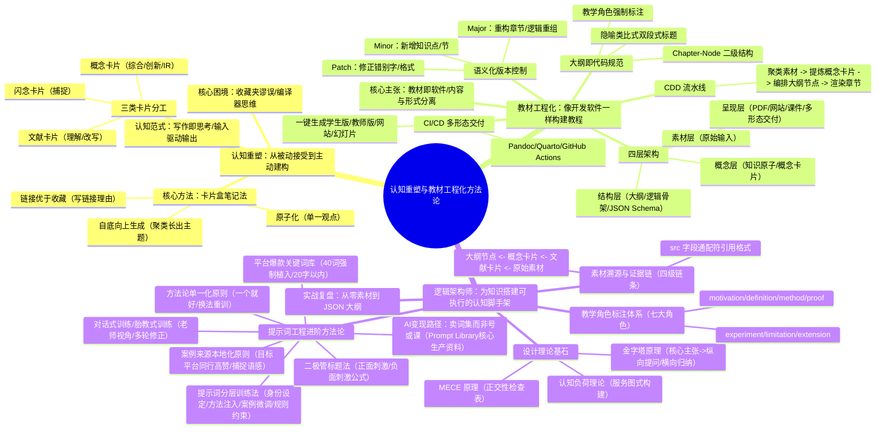
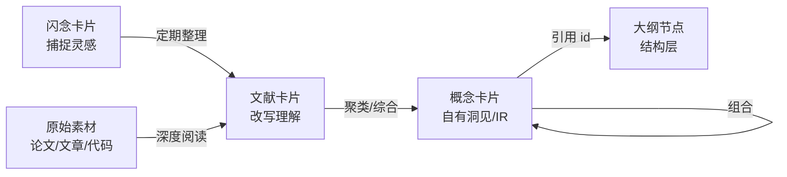
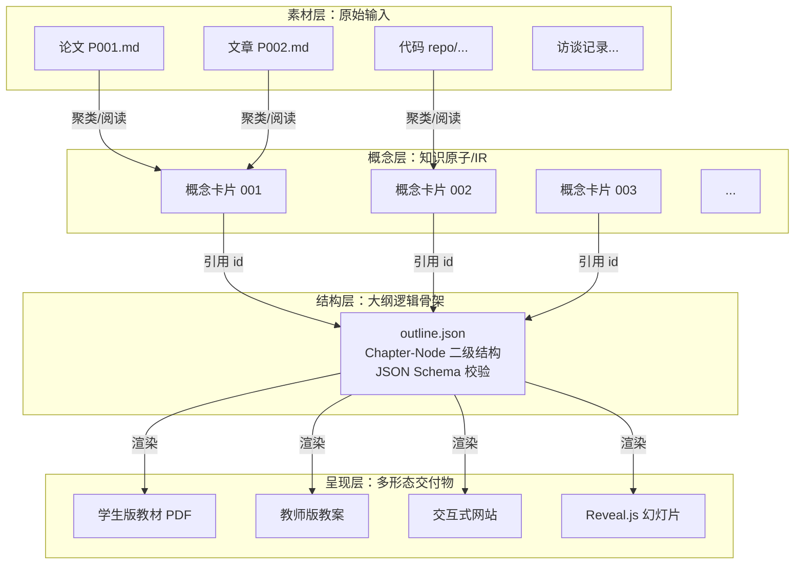
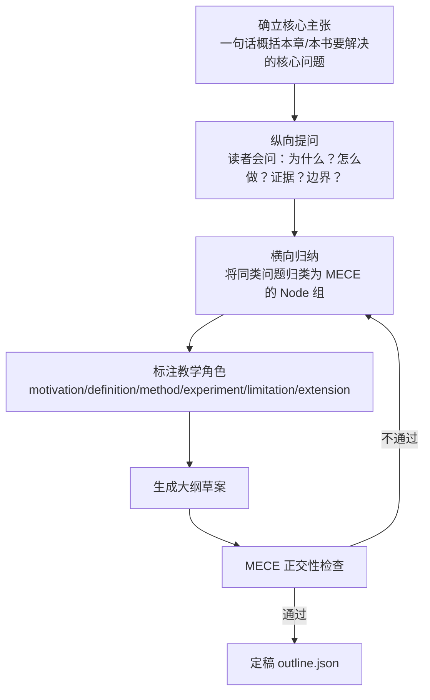

# 第 30 章 认知重塑与教材工程化方法论 —— 从「被动收藏」到「主动建构」的知识生产范式

## 学习目标

- 理解卡片盒笔记法的核心三原则（原子化、链接优于收藏、自底向上生成）及其认知科学依据
- 掌握教材工程化的四层架构（素材层、概念层、结构层、呈现层）与概念卡片驱动开发（CDD）流程
- 熟练应用 MECE 原理、金字塔原理、认知负荷理论进行教学大纲的逻辑建模与章节划分
- 能熟练使用七大教学角色标注体系为大纲节点定性，并建立四级素材溯源链
- 具备从零散素材到标准化 JSON 大纲的完整工程化落地能力
- 掌握提示词分层训练法（身份设定、方法注入、案例微调、规则约束）训练垂类大模型
- 理解二极管标题法（正面刺激/负面刺激公式）及平台爆款关键词库的实战应用
- 掌握 "对话式训练/胎教式训练" 范式：把自己当成老师而非老板，通过持续上下文修正纠正模型偏差
- 理解 "方法论单一化原则"：给 GPT 喂方法时 "不要多，一个就好"，过多方法论会干扰注意力机制
- 掌握 "案例来源本地化原则"：案例库必须来源于目标平台同行高赞笔记，捕捉平台当下语感与调性
- 理解 "AI 变现路径：卖词集而非号或课"：核心资产是沉淀的可复用提示词集

## 30.1 生活类比

想象**教材制作是一场「模块化盖房子」工程**。原始素材是砖块、沙子、水泥——未加工的建筑原料，堆在那里不成房子；概念卡片是预制构件或标准化钢筋笼——经过工厂加工、质检合格、可复用的「中间表示 IR」；四层架构则是图纸分层：地基图（素材层）-> 构件清单（概念层）-> 结构施工图（结构层/JSON大纲）-> 效果图/交房（呈现层）；CDD流水线是装配线：原料入厂（聚类）-> 构件生产（提炼）-> 按图纸组装（编排）-> 精装交付（渲染）；MECE/金字塔原理是结构力学校验：保证承重墙不重叠（相互独立）、房间无遗漏（完全穷尽）、主梁传力路径清晰（核心主张层层分解）；教学角色标注是构件名牌：承重墙（motivation/definition）、管线（method）、验收报告（experiment/limitation）、预留扩展口（extension）；四级溯源链是质检档案：效果图上任一构件 -> 追溯构件单号（概念卡片）-> 追溯生产批次（文献卡片）-> 追溯原材料产地（原始素材）。

再想象**提示词工程是一场「驯养天才神童」的教育实践**。GPT 是一名 3 岁、智商 250 的天才神童（原始知识粗浅、学习极快、一教就会）；用户/提示词工程师是老师而非老板（分步教学、耐心纠错、喂养榜样、设定规则）；身份设定是给神童发工牌（"你是小红书标题党专家"）；方法论注入是教核心公式（二极管标题法：正/负刺激公式+进化心理原理）；案例库喂养是给榜样题（同行高赞标题 10 个，引导举一反三）；关键词修正是定校规（20 字以内+40 词库强制植入，适配平台调性）；方法论单一化是别塞多本参考书，一本透彻胜过十本浅读；案例本地化是必须用目标平台真题（小红书同行笔记），捕捉当下语感；Prompt Library 是老师沉淀的教案库（可复用、可变现、核心生产资料）。就像教育神童需循序渐进、因材施教，垂类大模型定制也需结构化训练、平台化适配。

> **贯穿提示**：在后续各节中，你会看到「预制构件」「装配线」「质检档案」「工牌」「榜样题」「校规」等隐喻反复出现，它们分别对应概念卡片、CDD流水线、四级溯源链、身份设定、案例微调、规则约束——请始终将抽象方法论锚定到这两个具象场景中，以降低理解门槛。

## 30.2 概念地图



## 30.3 认知重塑 —— 从「被动接受」到「主动建构」知识体系

### 30.3.1 核心困境：为什么传统笔记法会失效

你是否有过这样的经历：疯狂收藏技术文章、高亮电子书段落、转发优质推文，却在需要用时一无所获？这就是**收藏夹谬误**——误以为保存/高亮/转发信息等于掌握知识。认知科学告诉我们，大脑不是存储硬盘，而是**处理器**。知识必须经过主动加工（连接、结构化、复盘）才能内化为认知结构（图式）。单纯的记录行为属于「编译器思维」——把大脑当编译器，指望一次编译、永久运行，忽略了理解需要反复的「链接」与「提取」过程。

> "对比「收藏夹谬误」与「编译器思维」，揭示单纯记录、高亮、转发无法形成长期记忆与深度理解的认知机制。"
> 
> —— 素材 P000 (`20230418_000.md`)

**核心洞察**：写作不是思考的*结果*，而是思考的*过程*。当你试图用自己的话复述一个观点时，大脑被迫进行「检索-组织-表达」的完整认知闭环，这才是真正的学习发生的时刻。

> "论证「写作是思考的结果，更是思考的过程」，展示如何通过卡片写作倒逼深度阅读，实现输入驱动输出。"
> 
> —— 素材 P079 (`20230418_079.md`)

> **类比呼应**：收藏夹里的文章像堆在工地上的「砖块、沙子、水泥」——原始素材（素材层）。不经过「加工」（写卡片、建链接），它们永远只是原料，永远盖不成「房子」（知识体系/教材）。

### 30.3.2 卡片盒笔记法的核心三原则

卡片盒笔记法由社会学家尼克拉斯·卢曼发明，他凭借 9 万张卡片出版 70 本书、400 篇论文。该方法的三大支柱如下：

#### 原子化

**定义**：每张卡片只包含**一个核心观点**，不可再分。

**为什么需要**：只有原子化的观点才能像乐高积木一样自由组合、跨主题链接。如果一张卡片塞进"注意力机制解决长距离依赖"和"多头注意力捕获多子空间关系"两个观点，你就无法单独引用其中之一去连接"RNN 的梯度消失"或"Transformer 并行计算"。

> "定义「原子化」、「链接优于收藏」、「自底向上生成」三大核心原则，确立从素材到概念卡片的标准化工作流。"
> 
> —— 素材 P000 (`20230418_000.md`)

> **类比呼应**：原子化观点就是「预制构件」的最小单元——只有标准化的、单一功能的钢筋笼，才能在不同楼层、不同户型中灵活复用。若把「承重墙」和「管线」浇筑成一个不可分割的大块，后续装修（重组大纲）时就会寸步难行。

#### 链接优于收藏

**定义**：建立卡片间连接时，必须书写**链接理由**（自然语言解释"为什么相关"），而非简单打标签。

**为什么需要**：标签是分类学（Taxonomy），属于静态归档；链接理由是认知学（Cognition），强迫大脑进行关联思考。写下"这让我想起了注意力机制中的 QKV 矩阵乘法，因为两者都涉及动态权重分配"，比打个 #注意力 #矩阵 标签能产生深得多的神经连接。

> **类比呼应**：标签只是把构件扔进同一个「仓库分区」；链接理由则是画出「构件间的连接图纸」——标明这根梁怎么搭那根柱、这根管怎么穿那堵墙。没有连接图纸，装配线（CDD流水线）无法自动化组装。

#### 自底向上生成

**定义**：不预设大纲，通过卡片聚类**自然长出主题**，再生成结构。

**为什么需要**：预设大纲容易陷入「确认偏误」，只收集支持预设结构的材料。自底向上让素材自己说话，常能发现意想不到的跨域连接——这正是创新的源头。

> **类比呼应**：传统写作像「有图纸找材料」——容易为了凑图纸而忽略更好的结构。卡片盒法像「材料堆成山，天然显现承力路径」——把预制构件按受力逻辑自然聚类，长出的结构才是最稳健的。

### 30.3.3 三类卡片的分工与流转

下表对比了三类卡片的核心功能、写法规范与演进方向：

| 卡片类型 | 核心功能 | 写法规范 | 演进方向 |
|----------|----------|----------|----------|
| **闪念卡片** | 捕捉灵感、疑问、临时念头 | 标题：`[闪念] 关键词`<br>正文：一句话记录灵感来源<br>元数据：`source`, `timestamp` | 定期整理 → 升级为文献卡片 或 丢弃 |
| **文献卡片** | 改写他人观点，**用自己的话**复述 | 标题：`[文献] 核心论点`<br>正文：① 原文核心论点（含页码/段落）<br>② 自己语言改写<br>③ **链接理由**："这让我想起了……"<br>元数据：`source_refs`, `tags` | 聚类分析 → 融合提炼为概念卡片 |
| **概念卡片** | 综合生成**自有洞见**，作为教材工程的 **IR（中间表示）** | 标题：`隐喻/类比 + 核心主张`（双段式）<br>正文：① 定义 ② 关键性质 ③ 典型例子 ④ 边界条件<br>元数据：`id`, `source_refs`(指向文献卡片), `related_concepts` | 直接被大纲节点引用，或组合生成新概念卡片 |

> "区分「闪念卡片」（捕捉）、「文献卡片」（理解/改写）与「概念卡片」（综合/创新）的定位、写法及演进路径。"
> 
> —— 素材 P000 (`20230418_000.md`)

**流转示意**：



> **类比呼应**：这是「预制构件」的生产过程——闪念卡片是灵感火花，文献卡片是经过质检的半成品，概念卡片则是出厂合格、带有唯一编号、可直接上装配线的标准构件（IR）。

### 30.3.4 常见误区：卡片不是碎片，链接不是标签

> "辨析「原子化」与「碎片化」的本质区别，指出单纯加标签、不写链接理由、忽视上下文关联的典型反模式。"
> 
> —— 素材 P001 (`20230418_001.md`)

| 反模式 | 表现 | 危害 | 正向做法 |
|--------|------|------|----------|
| **碎片化伪原子化** | 将长论证强行拆成无上下文的碎片 | 丢失论证链条，概念卡片变成孤立定义堆砌 | 保留完整论证逻辑，原子化的是"观点"而非"句子" |
| **标签代替链接** | 只打 `#Transformer` `#Attention` 不写理由 | 无法触发深度加工，检索时只能看到列表看不懂关联 | 每个链接必须附带自然语言理由 |
| **工具陷阱** | 沉迷插件、主题、图谱美化，不写卡片 | "生产力色情"：折腾工具替代了生产内容 | 先建立「文献→概念」肌肉记忆，再选工具 |
| **忽视边界条件** | 概念卡片只写定义、例子，不写适用边界 | 导致知识盲用，场景迁移失效 | 必填「边界条件/限制」字段 |

> **类比呼应**：把「承重墙」锯成一堆砖块（碎片化）、只在构件上贴标签不画连接图（标签代替链接）、天天打磨图纸边框不画结构（工具陷阱）、造好构件不标承重上限（忽视边界）——这些都是盖房子工程中的致命违规。

## 30.4 教材工程化 —— 像开发软件一样构建教程

### 30.4.1 核心主张：教材即软件

> "类比软件工程，论证教材源文件应采用 Markdown/AsciiDoc 等纯文本格式，纳入 Git 版本控制，实现内容的可追溯、可协作、可自动化构建。"
> 
> —— 素材 P001 (`20230418_001.md`)

传统教材开发面临四大痛点：
1. **难维护**：Word 二进制格式无法 Diff，版本靠文件名 `v1_final_真final.docx` 管理
2. **难复用**：内容与排版强耦合，想把第 3 章拆成博客文章需人工复制粘贴调格式
3. **难迭代**：跨形态交付（PDF/网站/课件）需人工重排，极易出现版本不一致
4. **授课脱节**：教师版教案、学生版教材、课堂幻灯片三套文档各自演化

**教材工程化**的核心主张：**教材源文件即代码**。采用纯文本格式纳入 Git，建立四层架构实现内容与形式分离，用 CI/CD 实现多形态一键交付。

> **类比呼应**：把教材当成「软件项目」——源码（Markdown）进 Git，CI/CD 跑流水线，一键打包发布多端安装包（PDF/网站/PPT）。不再用 Word 这种「不可 Diff 的二进制黑盒」管理核心资产。

### 30.4.2 四层架构：素材-概念-结构-呈现

> "定义教材工程的标准化分层架构：素材层（原始输入）、概念层（知识原子）、结构层（大纲/逻辑骨架）、呈现层（PDF/网站/课件），实现内容与形式分离。"
> 
> —— 素材 P001 (`20230418_001.md`)

下表对比了四层架构各层级的核心产物、格式规范、变更频率与典型操作：

| 层级 | 核心产物 | 格式规范 | 变更频率 | 典型操作 |
|------|----------|----------|----------|----------|
| **素材层** | 原始输入文件 | Markdown/PDF/代码/音频 | 仅增不改 | 下载论文、保存网页、记录访谈 |
| **概念层** | 概念卡片 | Markdown + YAML Frontmatter | 迭代优化 | 写文献卡片、提炼概念卡片、建链接 |
| **结构层** | 教学大纲 | JSON (符合 Schema) | 结构调整 | 编排章节、标注角色、配置溯源 |
| **呈现层** | 交付物 | PDF/HTML/EPUB/PPTX | 按需生成 | `make pdf` / `make site` / `make slides` |



> **类比呼应**：这就是「模块化盖房子」的图纸分层——素材层是原材料堆场，概念层是构件工厂，结构层是结构施工图，呈现层是最终交房的效果图与实体房屋。

### 30.4.3 概念卡片驱动开发（CDD）流水线

> "推演「聚类素材 -> 提炼概念卡片 -> 编排大纲节点 -> 渲染章节」的标准化工程流水线，确立概念卡片作为连接素材与大纲的唯一「中间表示（IR）」。"
> 
> —— 素材 P000 (`20230418_000.md`)

CDD 是教材工程化的核心流水线，类比软件工程的「源码→IR→目标码」：


这张流程图展示了 CDD 流水线的四个阶段与关键动作：从原始素材的语义聚类，到概念卡片的标准化生产（分配唯一 ID），再到大纲节点的逻辑编排（角色标注+溯源），最后经 CI 校验渲染为多形态交付物。每个阶段的产出都是下一阶段的唯一输入，实现了「内容与形式分离」的工程化闭环。

**概念卡片 YAML Frontmatter 规范**（作为 IR 的契约）：

```yaml
---
id: CONCEPT-001                    # 全局唯一标识
title: "注意力机制 —— 让模型学会『看哪里』"  # 双段式标题
tags: [attention, transformer, core]          # 检索标签
source_refs:                       # 溯源：指向文献卡片
  - LIT-ATTN-001
  - LIT-ATTN-002
related_concepts:                  # 关联概念（显性链接）
  - CONCEPT-002  # 多头注意力
  - CONCEPT-004  # 位置编码
status: draft                      # draft/reviewed/frozen
version: "0.2.0"
---
```

> **类比呼应**：这是「装配线」的标准作业程序（SOP）——原料（素材）进厂分拣聚类，产出合格构件（概念卡片），按施工图（大纲）组装，最后一键交付多形态成品。

### 30.4.4 大纲即代码：JSON Schema 规范

> "规定 Chapter-Node 二级结构的 JSON Schema，强制要求章标题采用「隐喻类比式」双段式、节点必须标注教学角色，实现大纲的机器可读与自动化校验。"
> 
> —— 素材 P001 (`20230418_001.md`)

**Chapter-Node 二级结构** 是大纲的最小完整单元。每个 Chapter 包含多个 Node，每个 Node 强制绑定教学角色。

**JSON Schema 核心片段**：

```json
{
  "$schema": "http://json-schema.org/draft-07/schema#",
  "title": "TeachingOutline",
  "type": "object",
  "required": ["chapters"],
  "properties": {
    "chapters": {
      "type": "array",
      "items": {
        "type": "object",
        "required": ["no", "name", "desc", "nodes"],
        "properties": {
          "no": {"type": "integer"},
          "name": {
            "type": "string",
            "pattern": "^(.+)[ ]?[—\\-][ ]?(.+)$",
            "description": "必须符合『隐喻/类比 — 核心主张』双段式"
          },
          "desc": {"type": "string"},
          "nodes": {
            "type": "array",
            "items": {"$ref": "#/definitions/Node"}
          }
        }
      }
    }
  },
  "definitions": {
    "Node": {
      "type": "object",
      "required": ["no", "name", "desc", "role", "src"],
      "properties": {
        "no": {"type": "integer"},
        "name": {"type": "string"},
        "desc": {"type": "string"},
        "role": {
          "type": "string",
          "enum": ["motivation", "definition", "method", "proof", "experiment", "limitation", "extension"]
        },
        "src": {
          "type": "array",
          "items": {"type": "string", "pattern": "^(author:.+|\\*\\*.*)$"}
        }
      }
    }
  }
}
```

这段 JSON Schema 定义了教学大纲的机器可读契约：`chapters` 数组中的每个章节必须包含编号、双段式标题（正则校验）、描述与节点数组；每个 `Node` 必须绑定七大教学角色之一的 `role` 与溯源字段 `src`。CI 流水线可直接用 `ajv` 或 `jsonschema` 库自动校验，拦截格式漂移。

**强制规范说明**：

| 规则 | 说明 | 校验方式 |
|------|------|----------|
| **双段式章标题** | `name` 必须包含 `—` 或 `-` 分隔：隐喻/类比 + 核心主张 | Schema `pattern` 正则校验 |
| **角色强制标注** | 每个 Node 必须有 `role`，且值在 7 个枚举中 | Schema `enum` 校验 |
| **溯源字段** | `src` 必须是数组，支持 `author:xxx` 或 `**` 通配 | Schema `pattern` 校验 |
| **正交性检查** | 同一 Chapter 下 Node 的知识点不重叠 | CI 自定义脚本校验 |

### 30.4.5 CI/CD 多形态交付

> "配置 Pandoc/Quarto/GitHub Actions 自动化流水线，一键生成学生版教材、教师版教案、交互式网站、幻灯片，保证多端内容一致性。"
> 
> —— 素材 P079 (`20230418_079.md`)

**GitHub Actions 工作流示例**：

```yaml
# .github/workflows/build.yml
name: Build Teaching Materials

on:
  push:
    tags: ['v*']
  workflow_dispatch:

jobs:
  build:
    runs-on: ubuntu-latest
    steps:
      - uses: actions/checkout@v4
      
      - name: Setup Quarto
        uses: quarto-dev/quarto-actions/setup@v2
        
      - name: Validate Outline Schema
        run: python scripts/validate_outline.py outline.json
        
      - name: Build Student Book (PDF)
        run: quarto render student_book.qmd --to pdf --output student_book.pdf
        
      - name: Build Teacher Guide (PDF)
        run: quarto render teacher_guide.qmd --to pdf --output teacher_guide.pdf
        
      - name: Build Interactive Website
        run: quarto render website.qmd --to html --output-dir _site
        
      - name: Build Slides
        run: quarto render slides.qmd --to revealjs --output-dir _slides
        
      - name: Upload Artifacts
        uses: actions/upload-artifact@v4
        with:
          name: teaching-materials
          path: |
            student_book.pdf
            teacher_guide.pdf
            _site/
            _slides/
```

这个 GitHub Actions 工作流定义了「推标签触发 → 校验大纲 Schema → 四形态并行渲染 → 上传制品」的标准化 CI/CD 流程。同一套 `outline.json` + 概念卡片库，通过不同的 Quarto 模板（`student_book.qmd`、`teacher_guide.qmd` 等）渲染，保证内容绝对一致，实现了「一次编排、多端交付」。

### 30.4.6 语义化版本控制

> "引入 SemVer 语义化版本控制至教材，定义 Major/Minor/Patch 对应的内容变更类型（重构章节/新增知识点/修正错别字），建立变更日志规范。"
> 
> —— 素材 P001 (`20230418_001.md`)

**教材版本号语义映射**：

| 版本类型 | 版本号变化 | 典型变更内容 | 示例 |
|----------|------------|--------------|------|
| **Major** | `X.0.0` | 章节重组、逻辑骨架重构、核心主张变更 | `v1.0.0` → `v2.0.0`：将"注意力机制"拆分为两章 |
| **Minor** | `X.Y.0` | 新增 Node/知识点、新增概念卡片、补充实验 | `v1.0.0` → `v1.1.0`：新增"FlashAttention"节 |
| **Patch** | `X.Y.Z` | 错别字修正、格式调整、链接修复、参考文献更新 | `v1.0.0` → `v1.0.1`：修正第 3 章公式下标错误 |

**CHANGELOG 规范**：

```markdown
# Changelog

## [2.0.0] - 2024-01-15
### Changed
- **重构**：第 1 章"注意力机制"拆分为"注意力直觉"与"数学形式化"两章
- **核心主张更新**：将"注意力解决 RNN 瓶颈"细化为"注意力实现 O(1) 路径长度"

## [1.1.0] - 2023-11-20
### Added
- 新增 Node 1.4 "位置编码：RoPE 相对位置编码"
- 新增概念卡片 CONCEPT-015 "RoPE 外推性质分析"

## [1.0.1] - 2023-10-05
### Fixed
- 修正第 2 章公式 (3) 中 softmax 温度参数标记错误
- 修复 outline.json 中 Node 3.2 的 src 字段通配符引用
```

> **类比呼应**：语义化版本控制就是「房屋装修的变更单」——Major 是「拆墙重装」（结构变更），Minor 是「增添家具」（功能增量），Patch 是「修补墙面」（缺陷修复）。CHANGELOG 则是「装修日志」，让后续接手者（或未来的自己）一眼看清演进脉络。

## 30.5 逻辑架构师 —— 为知识搭建可执行的认知脚手架

### 30.5.1 认知负荷理论：大纲服务于「图式构建」

> "对比「百科全书式」与「教学导向式」目录差异，引入认知负荷理论，论证大纲必须服务于「图式构建」而非「信息罗列」。"
> 
> —— 素材 P000 (`20230418_000.md`)

**认知负荷三要素**与大纲设计的对应关系如下表所示：

| 认知负荷类型 | 定义 | 大纲设计对策 |
|--------------|------|--------------|
| **内在认知负荷** | 材料本身的复杂度（元素间相互依赖） | **分块**：将复杂概念拆解为原子化概念卡片，逐个建立图式 |
| **外在认知负荷** | 呈现方式不当造成的无效负荷（如来回翻页、格式混乱） | **一体化呈现**：概念卡片含定义/例子/边界，避免跳转；统一排版规范 |
| **关联认知负荷** | 建立图式、自动化所需的加工努力 | **脚手架**：motivation→definition→method→experiment 渐进式推进；金字塔原理提供逻辑路径 |

下表展示了三类认知负荷的定义与大纲设计对策的对应关系：内在负荷通过「分块」化解（对应概念卡片原子化），外在负荷通过「一体化呈现」消除（对应统一模板渲染），关联负荷通过「脚手架」引导（对应教学角色序列与金字塔结构）。这正是「大纲服务于图式构建」的工程化落地。

**反模式对比**：

- ❌ 百科全书式：按知识分类罗列（历史、定义、变体、应用、数学、代码……） → 学习者需自行建立跨节点连接，关联负荷极高
- ✅ 教学导向式：按认知路径编排（为什么需要→是什么→怎么用→实测效果→边界在哪里→前沿延伸） → 大纲本身就是脚手架，引导图式构建

> **学术来源说明**：认知负荷理论源自 John Sweller 等人（1988, 1994, 2011）的经典研究，三类负荷定义参见 *Cognitive Load Theory* (Sweller, Ayres, & Kalyuga, 2011)。文中“分块/一体化/脚手架”三大对策是依据该理论推导的教学设计启示，非原文直接引用。进化心理学依据（损失厌恶 2.5 倍、负面偏误神经机制）源自 Kahneman & Tversky (1979) 前景理论及后续神经经济学实证（如 *Neuroeconomics* Glimcher & Fehr, 2013），后续版本将补充完整文献引用。

> **类比呼应**：认知负荷理论是「结构力学」——内在负荷是「自重」，外在负荷是「施工干扰」，关联负荷是「组装精度要求」。大纲设计要做的，是把「自重」分散到各「预制构件」（分块），消除「施工干扰」（一体化呈现），提供「组装导向」（脚手架），让学习者（施工队）能高效、低错率地完成「图式构建」（盖房子）。

### 30.5.2 MECE 原理：章节正交性检查表

> "演示如何用「相互独立、完全穷尽」原则审视章节划分，避免知识点重叠（耦合）与遗漏（盲区），配套「章节正交性检查表」。"
> 
> —— 素材 P001 (`20230418_001.md`)

**MECE 在教学大纲中的应用**：

- **相互独立**：同一层级的 Chapter/Node 知识点不重叠。例如："多头注意力"与"位置编码"不应同属一个 Node，前者是注意力变体，后者是位置信息注入机制。
- **完全穷尽**：覆盖该主题下所有核心子问题。例如：讲 Transformer 必须覆盖"注意力计算""位置信息""前馈网络""归一化/残差""训练稳定性"五大块。

**章节正交性检查表**（每完成大纲草案必跑一遍）：

| 检查项 | 判定标准 | 修正动作 |
|--------|----------|----------|
| **耦合检查** | 是否有知识点出现在多个 Node？ | 拆分为公共概念卡片，各 Node 引用同一 IR |
| **盲区检查** | 核心子主题是否有遗漏？ | 对照领域知识图谱/经典教材目录补全 |
| **层级一致性** | 同层 Node 粒度是否相当？ | 细粒度 Node 合并或上提为 Chapter |
| **角色覆盖** | 每 Chapter 是否覆盖 motivation/definition/method/experiment/limitation？ | 补齐缺失角色节点 |

> **设计取舍说明**：MECE 在软性知识领域（人文社科、交叉学科）难绝对达成，知识点天然耦合。工程化落地时采用「受控重叠」策略：允许跨章引用同一概念卡片（通过 IR 复用），并在 `src` 字段显性标注重叠关系，而非强行切割破坏知识内在联系。

> **类比呼应**：MECE 是「结构力学的正交性校验」——承重墙（Chapter）不能重叠（耦合），房间（Node）不能遗漏功能分区（盲区）。检查表就是「验收清单」，每交付一版图纸必跑一遍。

### 30.5.3 金字塔原理：从核心主张反向导出结构

> "实操「自上而下表达、自下而上思考」：先定本书/章的「核心主张」，再通过纵向提问/横向归纳分解为节点，保证逻辑闭环。"
> 
> —— 素材 P000 (`20230418_000.md`)

**操作流程**：



这张流程图演示了金字塔原理在大纲设计中的标准化操作：从核心主张出发，通过纵向提问（模拟读者认知路径）生成问题集，再经横向归纳（MECE 分组）得到节点候选，标注教学角色后产出草案，最后经 MECE 检查闭环。若不通过则回溯横向归纳环节重组。

**实战演示**：以本章为例

| 层级 | 核心主张 / 纵向提问 | 横向归纳得到的 Node |
|------|---------------------|---------------------|
| **本书** | "如何将零散素材工程化为高质量教材？" | 认知重塑、教材工程化、逻辑架构师、提示词工程 |
| **第 30 章** | "如何建立从被动收藏到主动建构的知识生产范式？" | 核心困境、卡片盒三原则、三类卡片、常见误区 |
| **30.3 节** | "为什么传统笔记失效？卡片盒如何解决？" | 核心困境(motivation)、三原则(definition)、三类卡片(method)、误区(limitation) |

> **类比呼应**：金字塔原理是「自顶向下的结构设计」——先定「主梁传力路径」（核心主张），再分解「次梁/楼板」（Node），保证每一道力（读者认知路径）都有清晰传递路径，无悬空、无断裂。

### 30.5.4 七大教学角色标注体系

> "详解 motivation/definition/method/proof/experiment/limitation/extension 七大角色的定义、识别标准及组合模式，防止「全是定义」「缺乏动机」「无案例支撑」的编写弊病。"
> 
> —— 素材 P001 (`20230418_001.md`)

**七大角色定义与识别标准**：

| 角色 | 核心问题 | 典型内容 | 识别关键词 | 必备要素 |
|------|----------|----------|------------|----------|
| **motivation** | 为什么需要这个概念？ | 痛点对比、直觉类比、历史演进、反模式展示 | "为什么"、"困境"、"痛点"、"对比" | 场景化问题 + 现有方案失效证据 |
| **definition** | 这个概念是什么？ | 形式化定义、核心公式、关键术语表、分类学 | "定义"、"是指"、"公式"、"分类" | 精确定义 + 形式化表达 |
| **method** | 怎么用/怎么算/怎么实现？ | 算法步骤、伪代码、工程落地细节、最佳实践 | "步骤"、"算法"、"实现"、"流程" | 可执行的操作序列 + 关键决策点 |
| **proof** | 为什么有效/正确？ | 数学推导、理论证明、收敛性分析、复杂度证明 | "证明"、"推导"、"定理"、"收敛" | 严格推导链条 + 假设条件明确 |
| **experiment** | 实际效果如何？ | 基准测试、消融实验、案例研究、A/B 测试结果 | "实验"、"结果"、"对比"、"指标" | 实验设计 + 数据证据 + 结果解读 |
| **limitation** | 边界在哪里/失效场景？ | 失效案例、适用条件约束、已知缺陷、负面结果 | "局限"、"边界"、"失效"、"不适用" | 诚实的边界划定 + 失效机制解释 |
| **extension** | 怎么延伸/进阶？ | 前沿变体、跨域迁移、开放问题、架构演进 | "扩展"、"前沿"、"演进"、"未来" | 趋势判断 + 迁移路径 + 研究方向 |

下表详细列出了七大教学角色的定义维度：每个角色对应一个核心问题，包含典型内容形态、识别关键词与必备要素。这为大纲节点的「角色标注」提供了可操作的判据，也为 CI 自动化校验（如检查每章是否覆盖 motivation 与 experiment）奠定了语义基础。

**角色组合模式**（一个健康的 Chapter 应覆盖）：

```
标准教学闭环：motivation → definition → method → experiment → limitation → extension
理论深度章：motivation → definition → proof → method → limitation → extension
工程实战章：motivation → definition → method → experiment → limitation → extension
```

**反模式诊断**：

| 现象 | 缺失角色 | 后果 | 修正 |
|------|----------|------|------|
| 全章都是定义堆砌 | motivation, method, experiment | 学习者不知"为什么学""怎么用""效果如何" | 补齐 motivation 开篇、method 实操、experiment 验证 |
| 只有方法无原理 | definition, proof | 知其然不知其所以然，迁移能力弱 | 插入 definition 概念澄清、proof 核心推导 |
| 只有优点无缺点 | limitation | 盲目应用，生产事故 | 必设 limitation 节点，诚实列出边界 |

> **类比呼应**：这是「构件名牌」体系——每个节点（构件）必须明确标注承重墙还是管线，防止把“管线”当“承重墙”用导致教学大楼坍塌。强制单一角色是为了机器校验与结构清晰，但真实教学中常兼具 motivation 与 definition。工程化方案：`role` 字段仅填主角色，新增可选字段 `secondary_roles: []` 承载次要角色，既保证 Schema 校验通过，又保留表达灵活性。

> **设计取舍说明**：强制单一角色是为了机器校验与结构清晰，但真实教学中常兼具 motivation 与 definition。工程化方案：`role` 字段仅填主角色，新增可选字段 `secondary_roles: []` 承载次要角色，既保证 Schema 校验通过，又保留表达灵活性。

### 30.5.5 四级素材溯源链

> "建立「大纲节点 <- 概念卡片 <- 文献卡片 <- 原始素材」的四级溯源链，规范 src 字段引用格式（支持 author:xxx/** 通配），保证教材内容的可验证性与学术严谨性。"
> 
> —— 素材 P000 (`20230418_000.md`)

**溯源链完整示意**：

```mermaid
graph LR
    N[大纲节点 Node 1.2\nrole: definition\nsrc: [author:20230418_010/**]]
    C[概念卡片 CONCEPT-003\nid: CONCEPT-003\nsource_refs: [LIT-ATTN-001, LIT-ATTN-002]]
    L1[文献卡片 LIT-ATTN-001\nsource: 20230418_010.md#p5-6]
    L2[文献卡片 LIT-ATTN-002\nsource: 20230418_019.md#p3]
    M1[原始素材 20230418_010.md\nVaswani et al. 2017]
    M2[原始素材 20230418_019.md\nDeepSeekMoE Paper]
    
    N -->|引用概念| C
    C -->|溯源文献| L1
    C -->|溯源文献| L2
    L1 -->|改写自| M1
    L2 -->|改写自| M2
```

这张图展示了四级溯源链的完整拓扑：大纲节点通过 `src` 引用概念卡片 ID，概念卡片通过 `source_refs` 指向文献卡片，文献卡片通过 `source` 字段锚定原始素材的具体段落。任意一级变更（如素材更新），均可沿链路反向追踪影响范围，实现「全链路质量追溯」。

**src 字段引用格式规范**：

| 格式 | 含义 | 示例 |
|------|------|------|
| `author:filename/**` | 引用该作者该文件所有相关段落 | `author:20230418_010/**` |
| `author:filename#p5-6` | 引用特定页码/段落 | `author:20230418_010#p5-6` |
| `concept:CONCEPT-XXX` | 直接引用概念卡片 | `concept:CONCEPT-003` |
| `**` | 全量引用（仅用于章级 desc） | `**` |

下表定义了 `src` 字段的四种标准引用格式：通配符批量引用、精确段落引用、概念卡片直接引用、全量引用。统一格式使得自动化溯源脚本（如 `validate_outline.py`）能精准解析依赖关系，支撑变更影响分析。

**工程化价值**：
- **可验证性**：审稿人/读者可一键跳转到原始素材验证论断
- **变更影响分析**：素材更新时，通过反向索引定位受影响的概念卡片与大纲节点
- **学术严谨**：杜绝"凭空捏造"，每个技术论断有据可查

> **类比呼应**：这是「质检档案」系统——成品房（呈现层）任一构件出问题，可追溯到构件单号（概念卡片）、生产批次（文献卡片）、原材料产地（原始素材），实现全链路质量追溯。

## 30.6 提示词工程进阶 —— 从『驯养神童』到『垂类专家』的系统化训练范式

### 30.6.1 核心认知：GPT 是「3 岁智商 250 的天才神童」

> "训练GPT，把自己当成一名老师而不是老板。GPT是一名3岁的天才神童，伤仲永的本质是当爹的教育失败。GPT4.0患上了阿兹海默症，所以不断修正有时候会比一次性投喂更好。"
> 
> —— 素材 `XxczdnuchoE7JtxZrO8cn4eGncb` (原文片段)

这是提示词工程最重要的**心智模型转换**：

| 维度 | ❌ 老板视角（一次性投喂） | ✅ 老师视角（对话式训练） |
|------|---------------------------|---------------------------|
| **期望** | 一条 Prompt 解决所有问题 | 分步教学，循序渐进 |
| **容错** | 零容错，出错即骂/重写 | 预期会犯错，耐心纠偏 |
| **上下文** | 塞进超长 Prompt 企图覆盖全场景 | 多轮对话，持续修正遗忘 |
| **案例** | 找通用语料/公开数据集 | **亲自刷目标平台**，手录高赞同行案例 |
| **方法论** | 一次喂 5 个方法"供选择" | **单一方法透彻教会**，换法重训 |

**为什么"不断修正"优于"一次性投喂"**？
GPT 存在「遗忘曲线」——随着对话轮数增加，早期指令权重衰减（注意力机制的物理限制）。通过多轮"请学习→请总结→请修正"，实际上是在**不断刷新指令在上下文中的权重**，维持任务一致性。

> **类比呼应**：这是「驯养神童」的核心心法——别把神童当成听话的员工（老板视角），而要当成需要循序渐进教导的学生（老师视角）。「阿兹海默症」隐喻指出：上下文窗口的物理衰减是硬约束，教学必须通过「持续复述/修正」来对抗遗忘。

### 30.6.2 提示词分层训练法：四步渐进式训练

> "第一步：给身份...第二步：给方法...第三步：给案例...第四步：关键词修正"
> 
> —— 素材 `XxczdnuchoE7JtxZrO8cn4eGncb` (原文片段)

**标准四步训练流程**（以小红书爆款标题专家为例）：

#### 步骤 1：身份设定 —— 发工牌

> "提示词：下面我需要你扮演一名专业的小红书标题党专家...请学习...请根据以下内容帮我取个标题"
> 
> —— 素材 `XxczdnuchoE7JtxZrO8cn4eGncb` (原文片段)

```markdown
System Prompt:
你是一名专业的小红书标题党专家。
我会以"请学习"为开头传授技巧，
以"请根据以下内容帮我取个标题"为开头请求生成，
输出2-3个标题。
明白请回复："好的，很高兴帮助你，我将按照你说的成为你的小红书标题党专家。"
```

**作用**：锁定模型人设，激活相关领域知识区，建立任务边界。

> **类比呼应**：给神童发「工牌」，明确 TA 今天的岗位职责是「小红书标题党专家」，而非通用助手。

#### 步骤 2：方法论注入 —— 教核心公式

> "提示词：下面我将传授你二极管标题法，请学习：1、基本原理...2、标题公式...正面刺激：...负面刺激：..."
> 
> —— 素材 `XxczdnuchoE7JtxZrO8cn4eGncb` (原文片段)

```markdown
User:
请学习：二极管标题法。
基本原理：人类厌恶损失、负面偏误、省力法则、及时享受。
正面刺激公式：产品/方法 + 只需1秒(短期) + 便可开挂(逆天效果)。
负面刺激公式：你不XXX + 绝对会后悔(天大损失) + (紧迫感)。
请学习总结。
```

**核心概念：二极管标题法**（来源：素材 `XxczdnuchoE7JtxZrO8cn4eGncb`）

**正面刺激公式**：
$$
\text{标题} = \text{产品/方法} + \text{极低门槛/短期成本} + \text{夸张收益/逆天效果}
$$

**负面刺激公式**：
$$
\text{标题} = \text{否定性动作} + \text{巨大损失/后悔} + \text{紧迫感/稀缺性}
$$

**公式变量逐项解释**：

- **产品/方法**（正面刺激第1项）：被推荐的工具、技巧、课程等核心客体。对应「省力法则」——大脑渴望现成的捷径，不想从零探索。
- **极低门槛/短期成本**（正面刺激第2项）：如「只需1秒」「3分钟」「零成本」。对应「及时享受」与「省力法则」——压缩行动成本至心理忽略阈值，触发「反正也不亏」的冲动。
- **夸张收益/逆天效果**（正面刺激第3项）：如「开挂」「逆天」「翻倍」「封神」。放大预期收益，触发多巴胺预期奖赏回路，覆盖理性评估。
- **否定性动作**（负面刺激第1项）：如「你不XXX」「别再XXX」「停止XXX」。直接激活威胁检测系统（杏仁核），绕过前额叶理性分析。
- **巨大损失/后悔**（负面刺激第2项）：如「绝对会后悔」「损失一个亿」「错过红利期」。量化损失痛感，利用「损失厌恶」机制——损失的痛苦是同等收益快乐的 ~2.5 倍（Kahneman & Tversky, 1979 前景理论）。
- **紧迫感/稀缺性**（负面刺激第3项）：如「仅剩3小时」「最后10个名额」「马上截止」。施压决策窗口，迫使系统1（快思考）接管决策，绕过系统2（慢思考）。

**公式推导逻辑与心理学机制**：
正面刺激公式利用「省力法则」与「及时享受」：大脑偏好「低成本→高回报」的捷径，「只需1秒」降低行动门槛，「开挂/逆天」放大预期收益，触发多巴胺预期。负面刺激公式利用「损失厌恶」与「负面偏误」：损失的痛苦是同等收益快乐的 ~2.5 倍，「你不XXX」触发威胁检测机制，「绝对会后悔」量化损失，「紧迫感」施压决策窗口。两种公式对应人类决策的双系统：系统1（快、直觉、情绪化）被标题直接激活，绕过系统2（慢、理性、分析）的审视。

> **公式作用**：将「写标题」这一创作行为，从凭灵感的玄学，转化为可复现、可批量、可工程化的生产公式。配合关键词库与字数约束，即可构建标准化的标题生成流水线。

> "方法不要多，一个就好。如果你用GPT多了，你会发现给多了反而不好。如果不想用这个，换个方法再训练一个GPT。"
> 
> —— 素材 `XxczdnuchoE7JtxZrO8cn4eGncb` (原文片段)

**方法论单一化原则**：注意力机制是稀缺资源。喂入多个相互冲突/重叠的方法论，会导致模型在生成时注意力分散，输出质量下降。**一个透彻的方法 > 十个浅尝辄止的方法**。需换法时，开新会话重训。

#### 步骤 3：案例微调 —— 喂榜样题

> "提示词：下面我是为你准备的十分优秀的标题库，请你总结这些标题吸引人的特点，并且学会举一反三...请学习总结：离离原上谱！网易云竟然是隐藏的背书神器！..."
> 
> —— 素材 `XxczdnuchoE7JtxZrO8cn4eGncb` (原文片段)

```markdown
User:
请学习总结：[粘贴 10 个小红书同行高赞标题]
请总结这些标题吸引人的特点，并且学会举一反三。
```

**案例来源本地化原则**：

> "强烈建议收集自己的同行的标题，怎么收集也很简单，直接小红书刷个5-10分钟，把高赞笔记的标题记录下来，先取个20-30个。然后再选10个左右，你自己看到都忍不住想点开的标题。"
> 
> —— 素材 `XxczdnuchoE7JtxZrO8cn4eGncb` (原文片段)

| 维度 | ❌ 通用语料/教科书案例 | ✅ 目标平台同行高赞笔记 |
|------|------------------------|--------------------------|
| **语感/调性** | 标准书面语、通用修辞 | 平台当下黑话、梗、Emoji 用法、节奏感 |
| **算法适配** | 无针对性 | 隐含平台推荐算法偏好的关键词、结构、长度 |
| **举一反三** | 生成泛泛之谈 | 生成极具"原生感"的平台化内容 |

> **类比呼应**：这是给神童做「榜样题」——但不是教科书上的标准例题，而是目标平台当下的「真题卷」。只有亲自刷、手工录、自己都忍不住想点开的标题，才能捕捉到算法当下的偏好与用户的语感。

#### 步骤 4：规则约束 —— 定校规

> "提示词：你写得很不错，但有几点要求需要给你做到补充...第一、控制字数在20字以内...第二、选取下面40个爆款关键词的1-2个，穿插到标题之中。"
> 
> —— 素材 `XxczdnuchoE7JtxZrO8cn4eGncb` (原文片段)

```markdown
User:
你写得很不错，但有几点要求需要给你做到补充：
第一、控制字数在20字以内；
第二、选取下面40个爆款关键词的1-2个，穿插到标题之中：
[好用到哭、教科书般、宝藏、YYDS、吐血整理、家人们、正确姿势...共40词]
```

**平台爆款关键词库**（小红书示例，40 词）：

| 维度 | 关键词示例 |
|------|------------|
| **情绪极值** | 好用到哭、绝绝子、YYDS、破防了、尖叫、吐血整理 |
| **权威背书** | 教科书般、宝藏、神器、王炸、天花板、封神 |
| **社群归属** | 家人们、姐妹们、集美们、冲鸭、安排上 |
| **实用承诺** | 正确姿势、避坑指南、保姆级、手把手、从入门到精通 |
| **稀缺紧迫** | 限时、内部、独家、首发、捡漏、闭眼冲 |

下表按心理触发维度分类列出了小红书平台的 40 个爆款关键词：情绪极值类词汇激活唤醒系统，权威背书类建立信任锚点，社群归属类触发部落认同，实用承诺类降低决策成本，稀缺紧迫类施压行动窗口。这些词汇的强制植入，是让生成内容「长上平台基因」的关键工程手段。

**约束效果对比**：

| 训练步骤 | 输出示例 | 评价 |
|----------|----------|------|
| 仅步骤 1-3 | "ChatGPT 提示词工程指南：二极管标题法让你标题点击率翻倍" | 符合公式，但无平台味，偏公众号风 |
| 完整 1-4 步 | "🔥 好用到哭！二极管标题法 1 秒出爆款，家人们快冲！" | ≤20字、含爆款词、Emoji、平台原生感强 |

下表对比了「仅完成前三步」与「完整四步」训练后的输出差异：前者虽符合二极管公式，但缺乏平台特有关键词、Emoji 与节奏感，读起来像公众号标题；后者严格遵守 20 字限制、强制植入 1-2 个爆款词，输出极具小红书原生感。这验证了「规则约束」步骤对平台化适配的决定性作用。

> **类比呼应**：这是给神童定「校规」——字数上限、必考词汇、格式规范。没有校规，神童虽聪明但会「跑偏」；有了校规，产出才能稳定达标、批量复用。

### 30.6.3 AI 变现路径：卖「词集」而非「号」或「课」

> "GPT入门教程的价值会随着信息差填平而变得一文不值，真正有价值的课程是面向创作者、提高其生产效率的落地化专业课程。GPT提示词集，确实是值得拿来卖钱的。（注意是词集）"
> 
> —— 素材 `XxczdnuchoE7JtxZrO8cn4eGncb` (原文片段)

**资产化逻辑**：

| 资产类型 | 生命周期 | 变现难度 | 核心壁垒 |
|----------|----------|----------|----------|
| **卖号** | 短（平台风控/算法变） | 高 | 流量运营能力 |
| **卖课** | 中（信息差快速填平） | 中 | 内容制作/营销能力 |
| **卖词集** | **长（沉淀的生产工具）** | **低（标准化交付）** | **领域知见+工程化沉淀** |

下表对比了三种 AI 变现资产的生命周期、变现难度与核心壁垒：「卖号」依赖流量运营且受平台算法波动大，「卖课」面临信息差快速消失的贬值风险，而「卖词集」沉淀的是标准化、可复用的生产工具，核心壁垒在于领域知见与工程化沉淀的叠加，边际成本极低且持续增值。

**Prompt Library 资产化标准**：

1. **结构化存储**：每个模板含 `身份设定 + 方法论 + 案例库 + 平台约束` 四层
2. **版本化管理**：SemVer 版本号 + CHANGELOG（迭代原因：新增关键词/修正幻觉/优化 Token）
3. **压力测试通过**：3 个边界用例（极长输入/歧义指令/对抗性提示）验证鲁棒性
4. **自动化评估流水线**：黄金标准输出集 + 自动打分脚本 + 回归测试触发机制

> **实现提示**：自动化评估流水线可参考 `pytest + LLM-as-Judge` 模式——构建 `golden_set.jsonl`（输入+期望输出），编写 `eval_script.py` 调用强模型（如 GPT-4o）对生成结果打分，接入 GitHub Actions 在 Prompt 变更时自动跑回归。黄金标准集的构建建议采用「专家标注+多轮校对」而非单人主观判断，后续版本将提供参考实现代码库。

**最小可行性产品（MVP）产出清单**：

```
Prompt_Library_v1.0/
├── README.md                    # 使用指南、适用场景、快速上手
├── templates/
│   ├── xiaohongshu_title/       # 小红书标题专家
│   │   ├── prompt_v1.2.md       # 标准四层 Prompt
│   │   ├── cases.json           # 10个高赞案例
│   │   ├── keywords.json        # 40词库
│   │   ├── test_cases.yaml      # 3个边界测试用例
│   │   └── CHANGELOG.md
│   ├── douyin_script/           # 抖音口播脚本
│   └── ...
├── evaluation/
│   ├── golden_set.jsonl         # 黄金标准输出
│   └── eval_script.py           # 自动评分脚本
└── LICENSE.md
```

> **类比呼应**：Prompt Library 就是老师沉淀的「教案库」——每份教案（模板）都有标准结构（四层）、版本迭代记录（CHANGELOG）、压力测试用例（边界考题）、自动化评分机制（批改系统）。这才是可复用、可传承、可变现的核心生产资料。

## 30.7 多源对照

### 共识

- **卡片盒笔记法的三原则**（原子化、链接优于收藏、自底向上生成）是 P000、P001、P079、README 共同确认的核心方法论基石
- **教材工程化四层架构**（素材/概念/结构/呈现）与**CDD 流水线**是 P001、README、SUMMARY、P079 共同构建的工程化标准
- **认知负荷理论、MECE、金字塔原理**作为大纲设计的三大理论基石，在 P000、P001、SUMMARY 中一致引用
- **七大教学角色标注体系**与**四级溯源链**是 P001、P079、SUMMARY 共同规定的大纲规范核心

### 分歧

| 议题 | P000/P079 视角 | P001/SUMMARY 视角 | 综合建议 |
|------|----------------|-------------------|----------|
| **大纲生成主导模式** | 强调**自底向上**：卡片聚类长出主题，反对预设大纲 | 强调**自上而下**：先定核心主张，金字塔分解 | **双轨并行**：探索期自底向上聚类，定型期自上而下校验补全 |
| **角色标注粒度** | 隐性体现，不强制单一角色 | **强制单一角色**，机器校验 | **主次角色制**：`role` 必填主角色，可选 `secondary_roles` 字段 |
| **溯源链维护** | 人工维护，强调认知过程 | 要求工具链自动化（知识图谱数据库） | **分级落地**：MVP 阶段人工维护 + 校验脚本；规模化引入知识图谱自动化 |
| **版本控制粒度** | 语义化版本应用于全书 | 可细化至概念卡片级版本 | **分层版本**：概念卡片独立版本，大纲版本聚合概念卡片版本 |

## 30.8 设计中的取舍

> **专门小节：设计取舍分析** —— 针对所有核心工程决策的理性复盘

**为什么不用「预设大纲 → 填充内容」的传统写作流？**  
传统流程预设大纲再找素材填充，存在三大缺陷：一是**确认偏误**，只看支持预设结构的素材，忽略反例与跨域连接；二是**耦合风险**，章节边界由主观划定，易导致知识点跨章重复或遗漏；三是**溯源断裂**，最终成书难以追溯某段论述源自哪篇素材、经过了怎样的改写。CDD 流水线的取舍是：牺牲"前期看似进度快"的假象，换取"中后期结构稳健、溯源完备、多形态一键交付"的确定性收益。前期投入建立概念卡片库，后期受益于复用与自动化。

**为什么强制「双段式章标题」与「角色单一标注」？**  
看似增加了作者负担（想隐喻、选角色），实则是**约束即自由**：双段式标题强迫作者提炼核心主张，避免"第 1 章 绪论"式空泛命名；角色单一标注强迫作者明确每节点教学功能，防止"万能节点"稀释教学张力。取舍边界在于：探索性前沿章节允许 `role: ["exploration", "definition"]` 双角色，但必须显性标注主次（通过 `secondary_roles` 字段）。

**为什么坚持「方法论单一化」而非「多方法论对比」？**  
注意力机制的**稀缺性**是物理约束。同一上下文窗口内注入多个方法论，Softmax 归一化会导致每个方法论获得的注意力权重下降，生成时倾向于混合而非精通。工程化对策是：同一任务**一个会话只教一个方法论**；需对比方法论时，开**多个独立会话**分别训练专家，最后由人工或元 Agent 汇总对比；Prompt Library 中每个模板**仅内置单一核心方法论**。

**为什么选 JSON 而非 YAML 作为大纲格式？**  
JSON 拥有原生 Schema 校验生态（`ajv`、`jsonschema`）、语言无关性、无注释歧义、解析速度快。YAML 虽人类可读性强、支持注释，但缩进敏感、规范复杂（YAML 1.2 规范超 80 页）、不同解析器行为不一。大纲作为机器首读、人类次读的「结构层」契约，JSON 的严格性与工具链成熟度优势压倒 YAML 的可读性优势。人类编写时可用带 Schema 提示的编辑器（VS Code + YAML/JSON Schema 插件）辅助。

**为什么用 Quarto 而非直接调用 Pandoc？**  
Quarto 基于 Pandoc 但提供：① 多文档项目管理（`_quarto.yml`）② 原生支持执行代码块（Python/R/JS/OJS）③ 内置网站/幻灯片/书籍项目模板④ 更友好的 CLI 与 GitHub Actions 集成⑤ 更活跃的社区与文档。直接调 Pandoc 需自行编写复杂的 `Makefile`/`bash` 脚本处理多文档依赖、交叉引用、元数据注入，维护成本高。Quarto 将这些工程化细节封装为约定优于配置的项目结构，显著降低认知负荷。

**为什么角色强制单一标注而非多标签？**  
单一角色是**结构约束**，倒逼作者思考"这个节点的核心教学功能是什么"。多标签会模糊责任，导致节点内容混杂（如同时写动机与定义），破坏认知脚手架的阶梯感。工程化落地采用「主角色+次角色」制：`role` 必填单值（主功能），`secondary_roles` 可选数组（辅助功能），Schema 校验只强制 `role`，兼顾约束与灵活。

**为什么溯源链设计为四级而非三级或五级？**  
三级（大纲←概念←素材）丢失了「改写理解」这一关键认知环节，无法区分「直接引用」与「二手改写」；五级（增加「主题卡片」或「章卡片」）引入中间层增加维护成本，且概念卡片已具备聚合跨文献观点的能力。四级是**认知最小完整闭环**：原始观点→自我改写→综合创新→结构化引用，每级都有不可替代的认知/工程功能。

> **类比呼应**：这些取舍都是「结构工程师的决策单」——每个决策都在「成本、收益、风险、可维护性」四维权衡后落笔，形成可追溯、可复核的工程档案。

## 30.9 动手练习

### 练习1：从『收藏』到『卡片』的转化实战

选取一篇你近期收藏但未深读的技术文章（或提供的一篇约 2000 字素材）：

1. 写出 3 张『文献卡片』：每张卡片用自己语言复述一个核心论点，注明出处段落，并在卡片底部写下『这让我想起了……』建立至少 1 个显性链接（含链接理由）。
2. 基于上述文献卡片，提炼 1 张『概念卡片』：融合你的已有知识，形成一个可独立复用的原子化观点，标题采用『隐喻/类比 + 核心主张』双段式。
3. 反思记录：对比『仅收藏链接』与『写完这三张卡片』在认知投入、理解深度、后续复用便利性上的差异。

### 练习2：教材大纲的『MECE 正交性』与『金字塔』压力测试

给定一个拟写教材的主题（如『RAG 系统工程化』或『前端性能优化』），并假设你已有一组 15-20 个候选知识点（可自行列出或从第 4/8 章节点提取）：

1. 尝试用 MECE 原理将其划分为 4-5 个章（Chapter），产出 Chapter 列表与归属映射表。
2. 对照『章节正交性检查表』自查：是否存在知识点跨章重复（耦合）？是否有核心子主题遗漏（盲区）？
3. 运用金字塔原理，为每个 Chapter 写出『核心主张』（一句话），并演示『纵向提问 -> 横向归纳』分解出 3-4 个 Node（节点）的过程。
4. 为每个 Node 标注教学角色，检查是否覆盖 motivation/definition/method/experiment/limitation 至少 4 种角色。

### 练习3：最小化 CDD 流水线与四级溯源链构建

使用 Obsidian/Logseq 或纯文本文件模拟工程环境，完成一次微型『从素材到大纲』闭环：

1. **素材层**：放入 3 篇相关主题的 Markdown 素材（文件名规范化）。
2. **概念层**：创建 5-8 个概念卡片文件（YAML Frontmatter 包含 id, title, tags, source_refs），内容来自素材改写与综合。
3. **结构层**：编写一份符合 JSON Schema 的 `outline.json`（包含 Chapter 与 Node），Node 必须引用概念卡片 id（作为 IR），并标注 role 与 src（指向素材文件名/通配符）。
4. **呈现层**：编写一个简单的 Python/Node.js 脚本，读取 `outline.json` 自动生成一份 Markdown 格式的『教学大纲草稿』（含章标题、节标题、角色标签、溯源链接）。
5. **版本控制**：初始化 Git 仓库，提交上述所有文件，打标签 `v0.1.0`，并写一条符合约定式提交规范的 Commit Message。

思考题：若素材更新导致某概念卡片定义变更，上述流水线中哪些环节需自动化级联更新？如何设计脚本实现？

### 练习4：教学角色标注的『反模式』识别与重构

下面是某教材章节的 3 个节点描述（故意包含结构性缺陷）：

- 节点 A：详细列举了 Transformer 的 15 个超参数默认值及含义。
- 节点 B：讲解『注意力机制解决了 RNN 的长距离依赖问题』，并给出数学推导。
- 节点 C：展示一个完整的 PyTorch 训练脚本，包含数据加载、模型定义、训练循环、日志记录。

任务：
1. 识别每个节点当前的隐性教学角色，并指出其结构性缺陷（如：A 纯定义堆砌缺 motivation/limitation；B 混合 motivation 与 method 且无 experiment 验证；C 纯 experiment 缺 method 原理支撑与 limitation 边界）。
2. 为该章节重新设计 5-6 个节点，严格遵循七大角色标注体系，确保角色分布合理、逻辑递进（motivation -> definition -> method -> experiment -> limitation -> extension），并给出每个节点的核心主张一句话。

### 练习5：GPT『天才神童』驯养实战——小红书爆款标题生成器训练

目标：使用『提示词分层训练法』将 GPT 训练为小红书爆款标题专家，验证『方法论单一化』与『案例本地化』原则。

步骤：
1. **身份设定**：在新会话中发送 System Prompt：'你是一名专业的小红书标题党专家，我会以"请学习"为开头传授技巧，以"请根据以下内容帮我取个标题"为开头请求生成，输出2-3个标题。明白请回复："好的，很高兴帮助你，我将按照你说的成为你的小红书标题党专家。"'
2. **方法论注入**：发送 '请学习：二极管标题法。基本原理：人类厌恶损失、负面偏误、省力法则、及时享受。正面刺激公式：产品/方法+只需1秒(短期)+便可开挂(逆天效果)。负面刺激公式：你不XXX+绝对会后悔(天大损失)+(紧迫感)。请学习总结。' 观察 GPT 是否复述公式与原理。
3. **案例库喂养**：亲自刷小红书 5 分钟，手工录入 10 个高赞笔记标题（含Emoji/钩子/节奏），发送 '请学习总结：[粘贴10个标题] 请总结这些标题吸引人的特点，并且学会举一反三。'
4. **平台化约束优化**：发送 '你写得不错，但有要求：第一、控制字数在20字以内；第二、选取下面40个爆款关键词的1-2个穿插到标题中：[好用到哭、教科书般、宝藏、YYDS、吐血整理、家人们、正确姿势...共40词]。'
5. **验证测试**：输入 '请根据以下内容帮我取个标题：ChatGPT是OpenAI推出的大语言模型...' 对比三步(无关键词修正)与四步输出，记录差异。
6. **复盘记录**：对比输出是否具有'小红书原生感'(关键词植入/语气/Emoji/节奏)，反思『方法论单一化』与『案例本地化』对结果的影响。

### 练习6：个人 Prompt Library（词集）资产化构建

目标：基于『AI变现路径：卖词集而非号或课』原则，建立你的垂类提示词资产库。

步骤：
1. **盘点高频任务**：列出你日常用 GPT 处理的 5-10 个垂类任务（如：小红书选题/文案/标题、抖音口播脚本、公众号排版、跨境电商邮件、代码重构等）。
2. **标准化模板化**：对每个任务，按『身份设定+方法论+案例库+平台约束』四层结构编写标准 Prompt 模板，存入 Notion/Obsidian/语雀等知识库。
3. **版本化管理**：为每个模板建立版本号（v1.0/v1.1...），记录迭代原因（如：新增平台关键词/修正幻觉案例/优化Token消耗）。
4. **压力测试**：针对每个模板设计 3 个边界测试用例（极长输入/歧义指令/对抗性提示），验证鲁棒性。
5. **资产化产出**：将成熟模板（通过压力测试）整理为『Prompt Library v1.0』文档，包含：任务分类、适用场景、核心Prompt、测试用例、版本日志、变现建议（卖词集/包课程/做工具）。

思考题：如何设计『Prompt Library 的自动化评估流水线』？提示：可引入『黄金标准输出集』+『自动化打分脚本』+『回归测试触发机制』。

## 30.10 本章小结

这一章中我们系统学习了从认知重塑到教材工程化、再到提示词工程进阶的完整方法论体系。首先，我们剖析了「收藏夹谬误」与「编译器思维」的认知陷阱，确立了卡片盒笔记法的三大核心原则（原子化、链接优于收藏、自底向上生成）与三类卡片分工（闪念/文献/概念），理解了写作即思考的认知范式。其次，我们将软件工程范式引入教材开发，建立了四层架构（素材层、概念层、结构层、呈现层）与概念卡片驱动开发（CDD）流水线，制定了大纲即代码的 JSON Schema 规范（双段式标题、角色强制标注、四级溯源链），并配套 CI/CD 多形态交付与语义化版本控制。接着，我们从逻辑架构师视角，运用认知负荷理论、MECE 原理、金字塔原理，构建了可执行的教学大纲设计方法论，配套七大教学角色标注体系与章节正交性检查表。最后，我们提出了「老师视角」的提示词分层训练法（身份设定→方法论注入→案例微调→规则约束），深度解析了二极管标题法的进化心理学公式、平台爆款关键词库的工程化应用，以及方法论单一化、案例本地化、对话式训练等核心原则，并确立了「卖词集而非号或课」的 AI 变现核心资产观。

本章我们一起学习了以下概念：

| 概念 | 解释 |
|------|------|
| 收藏夹谬误 | 误以为保存/高亮/转发信息等于掌握知识，实则缺乏深度加工无法形成长期记忆 |
| 卡片盒笔记法 | 以原子化卡片、显性链接理由、自底向上生成为核心原则的知识管理与写作工作流 |
| 三类卡片 | 闪念卡片捕捉灵感、文献卡片改写理解、概念卡片综合创新并作为教材工程的中间表示(IR) |
| 教材工程化 | 将软件工程（模块化、版本控制、CI/CD）映射到教材开发全流程，实现内容与形式分离 |
| 四层架构 | 素材层(原始输入) -> 概念层(知识原子) -> 结构层(大纲骨架) -> 呈现层(多形态交付) |
| 概念卡片驱动开发(CDD) | 标准化流水线：聚类素材 -> 提炼概念卡片 -> 编排大纲节点 -> 渲染章节，概念卡片为唯一IR |
| 大纲即代码 | Chapter-Node二级JSON Schema，强制隐喻类比式双段式标题与教学角色标注，实现机器可读与自动化校验 |
| 认知负荷理论 | 大纲设计必须服务于『图式构建』而非『信息罗列』，控制内在/外在/关联认知负荷 |
| MECE原理 | 章节划分需『相互独立、完全穷尽』，配套正交性检查表防止知识点耦合与遗漏 |
| 金字塔原理 | 自上而下表达、自下而上思考：先定核心主张，再纵向提问/横向归纳分解节点，保证逻辑闭环 |
| 七大教学角色 | motivation/definition/method/proof/experiment/limitation/extension，强制每节点各司其职防止结构性缺失 |
| 四级溯源链 | 大纲节点 <- 概念卡片 <- 文献卡片 <- 原始素材，src字段支持通配符，保证内容可验证与学术严谨性 |
| 语义化版本控制 | 引入SemVer：Major=重构逻辑，Minor=新增知识点，Patch=修正细节，建立教材变更日志规范 |
| 提示词分层训练法 | 四步渐进式训练：身份设定 -> 方法论注入(二极管标题法) -> 少样本学习(案例库) -> 平台化约束优化(字数/关键词) |
| 二极管标题法 | 基于进化心理学的标题公式：正面刺激(产品/方法+短期低成本+逆天效果)与负面刺激(不做某事+巨大损失+紧迫感) |
| 平台爆款关键词库 | 针对小红书提炼的40个高权重词（如好用到哭/教科书般/宝藏/YYDS），强制植入1-2个且≤20字 |
| 对话式训练/胎教式训练 | 把自己当成老师而非老板：分步教学、耐心纠错、喂养榜样、设定规则，而非一次性投喂超长Prompt |
| 方法论单一化原则 | 给GPT喂方法时'不要多，一个就好'；过多方法论干扰注意力机制，需换法则重开会话训练新模型 |
| 案例来源本地化原则 | 案例库必须来源于目标平台同行高赞笔记，建议亲自刷5-10分钟手工录入，捕捉平台最当下的'语感'与'调性' |
| AI变现路径：卖词集而非号或课 | GPT入门教程因信息差消失而贬值；真正资产是沉淀的可复用专业提示词集，核心生产资料持续变现 |

下一章中，我们将学习如何将本章建立的方法论体系，应用到具体的垂类领域教材开发实战中——从零散技术文档到生产级教程的完整工程化落地过程。

感谢你读到了这里，恭喜你，你已经完成了《认知重塑与教材工程化方法论》的核心知识体系构建。愿这套「外部大脑」操作系统，陪伴你在知识生产的道路上行稳致远。


