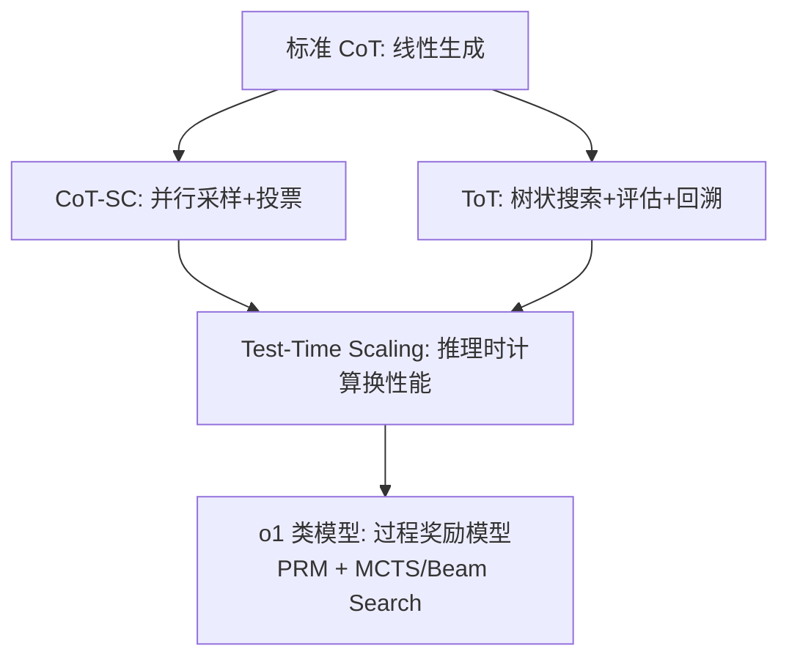
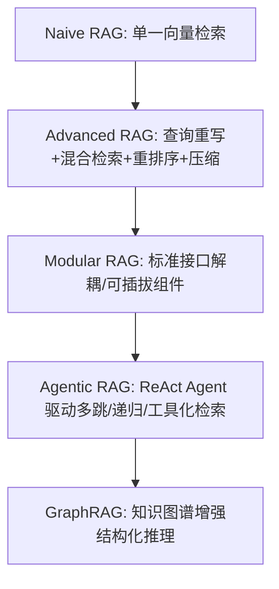
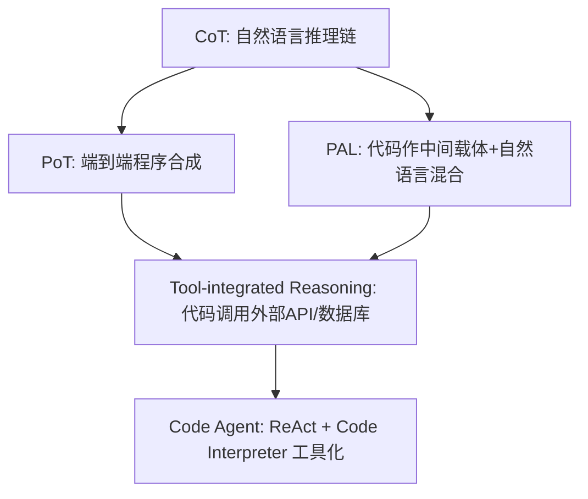
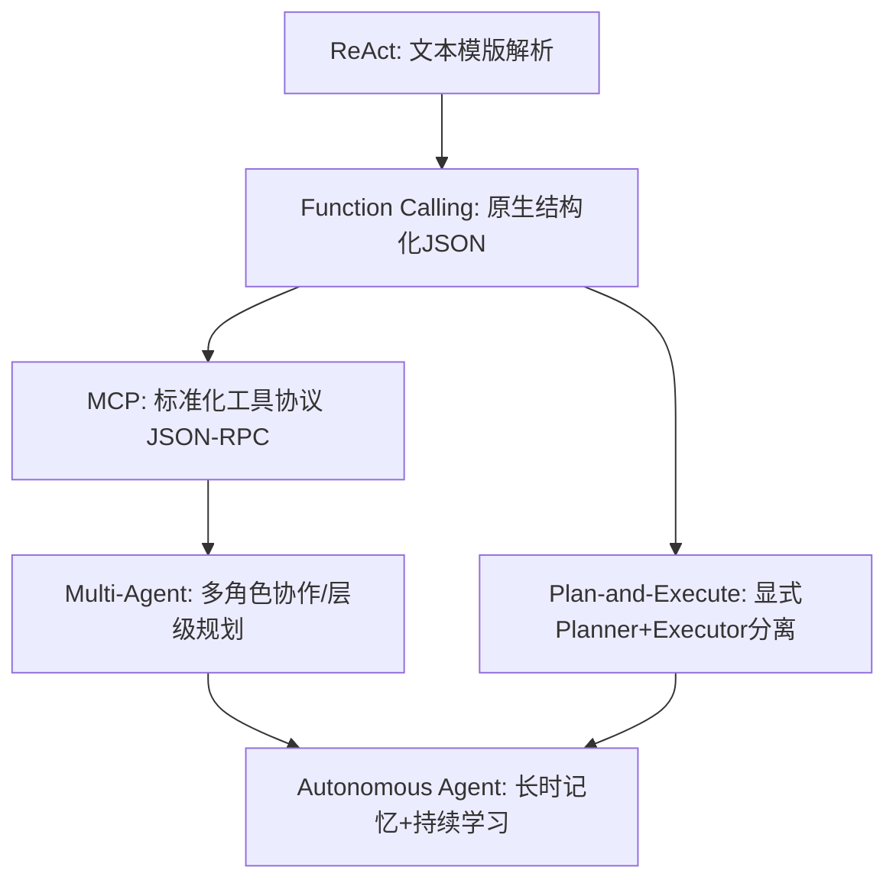

# 第 2 章 进阶推理技术 —— 让模型学会“慢思考”
作者：龙哥

## 学习目标

- 理解思维链（CoT）在复杂推理中面临的“单一路径不可逆”局限，掌握自我一致性（CoT-SC）与思维树（ToT）的核心机制差异与适用边界
- 掌握检索增强生成（RAG）的标准流程（索引-检索-生成），能识别朴素RAG的召回瓶颈与上下文噪声问题，并设计混合检索、重排序、查询重写等进阶优化策略
- 理解程序辅助推理（PAL）将自然语言推理转为代码执行的“推理-计算分离”范式，掌握其在数学计算、符号推理、表格问答中的优势与沙箱安全工程要求
- 掌握 ReAct（推理+行动）闭环架构与 Function Calling 标准化协议，能设计具备规划、工具调用、环境反馈纠偏能力的 Agent 系统，并处理循环失控与上下文膨胀等工程风险

## 2.1 生活类比

想象解决一道复杂的奥数题：标准 CoT 如同一个学生只能在草稿纸上线性推导，一旦第 2 步算错，后面全错，且无法回头。CoT-SC（自我一致性）则像是让 5 个不同学生独立做同一题，最后投票选票数最多的答案，靠“大概率事件”修正个别粗心。ToT（思维树）则更像一个会回溯的聪明学生：尝试“设 x 法”卡住了 → 回退 → 尝试“设 y 法” → 评估哪条路更通 → 继续深入，甚至同时在草稿纸上并行探索两条路。

再想象 RAG 是“开卷考试”系统：Indexing 相当于考前把图书馆所有书拆页、建索引、贴标签存进智能书架；Retrieval 是考生提问“什么是量子纠缠”，系统秒速抽出最相关的 5 页纸递给考生；Generation 是考生只看这 5 页纸（上下文）作答，并在答卷上标注引用页码（溯源）；进阶优化则是考生问题太模糊 → 帮他改写成精准检索词；召回太多 → 重排序只留最硬核的 2 页；纸太长 → 帮他提炼精华摘要塞进答题卡。

再想象 PAL（程序辅助推理）是“数学家 + 计算器”组合：数学家（LLM）负责看懂题意、设计解题逻辑、写出解题程序（Python 代码）；计算器（Interpreter）负责跑代码、算大数、解方程、处理矩阵，绝不算错一位小数；最终答案 = 计算器的确定性输出，而非数学家的模糊心算。

最后想象 ReAct Agent 是“带工具箱的实习生”：Thought 是实习生琢磨“老板要竞品分析报告，我得先查官网、再查财报、最后算市占率”；Action 是实习生伸手拿工具：调用 `浏览器搜索(竞品官网)`、`Python跑数(市占率公式)`；Observation 是工具返回结果（网页内容/计算结果），实习生看一眼，决定下一步；循环直到实习生说 Finish，把报告交上来；Function Calling 则是给实习生发标准化工具说明书（JSON Schema），别让他猜参数叫啥、传啥类型。

## 2.2 概念地图

进阶推理技术
├── 思维链进化：CoT → CoT-SC → ToT
│   ├── CoT-SC（自我一致性）        —— P001: 温度采样+多数投票，解决单路径随机性错误，适合离散答案空间
│   ├── ToT（思维树）               —— P001: 状态分解+价值评估+树搜索（BFS/DFS），支持回溯与规划，适合组合探索任务
│   └── Test-Time Scaling 视角      —— P001: 推理时计算换性能，不改模型参数
├── 检索增强生成（RAG）
│   ├── 标准流程                    —— P002: Indexing(分块/嵌入/入库) → Retrieval(向量搜索/Top-K) → Generation(拼装Prompt)
│   ├── 进阶优化                    —— P002: 查询重写(HyDE/分解) → 混合检索(BM25+稠密) → 重排序(Cross-Encoder/LLM) → 上下文压缩
│   ├── 模块化架构                  —— P002: DocumentLoader/TextSplitter/EmbeddingModel/VectorStore/Retriever/Reranker/Generator/Evaluator 标准接口
│   └── 核心痛点                    —— P002: 召回瓶颈/上下文窗口限制/隐性知识难检索/噪声干扰
├── 程序辅助推理（PAL）
│   ├── 核心范式                    —— P003: Question → LLM生成代码 → Interpreter执行 → Result → LLM生成答案
│   ├── 关键优势                    —— P003: 计算精度100%保障/逻辑结构显性化(循环/分支/数据结构)/可验证可调试
│   ├── 适用边界                    —— P003: 需强代码能力模型/沙箱安全隔离/非算法任务无优势
│   └── 对比 PoT                    —— P003: PoT强调程序直接出答案，PAL强调代码作中间推理载体可混合自然语言
└── ReAct 与工具调用
    ├── ReAct 循环                  —— P004: Thought(推理) → Action(工具调用) → Observation(环境反馈) → 循环直到 Finish
    ├── Function Calling 标准化      —— P004: 结构化JSON输出/JSON Schema约束/并行多工具调用/OpenAI/Anthropic/MCP协议统一
    ├── 核心能力                    —— P004: 交互式信息获取/外部反馈纠偏/副作用执行
    └── 工程风险与对策              —— P004: 最大步数防死循环/上下文摘要压缩/工具Schema文档化治理

## 2.3 思维链的变体与进化 —— 从线性推理到树状搜索

### 为什么需要这个概念？

标准 CoT（Chain-of-Thought）虽能引导模型逐步推理，但单一路径极易因早期错误导致全盘皆错（“一步错，步步错”）。正如我们在 2.1 节生活类比中所述，这如同一个学生只能在草稿纸上线性推导，一旦第 2 步算错，后面全错，且无法回头。复杂任务（如数学证明、代码生成、战略规划）往往存在多条可行推理路径，单链条无法探索替代方案。我们需要一种机制在“广度”上生成多样化路径、在“深度”上评估路径质量，实现推理的自我纠错与最优路径选择。

> "Chain-of-Thought prompting enables large language models to solve complex reasoning problems by generating intermediate reasoning steps. However, the greedy decoding strategy often leads to a single, potentially erroneous reasoning path."
> 
> ——《Chain-of-Thought Prompting Elicits Reasoning in Large Language Models》（Wei et al., NeurIPS 2022） (P001 / 20230418_025.md)

### 核心定义

**CoT-SC (Self-Consistency)** 方法（来源：《Self-Consistency Improves Chain-of-Thought Reasoning in Language Models》（Wang et al., ICLR 2023） (P001 / 20230418_025.md)）

通过温度采样生成多条独立推理链，对最终答案进行多数投票，以“少数服从多数”修正单路径随机性错误。这正如 2.1 节类比中“让 5 个不同学生独立做同一题，最后投票选票数最多的答案”。

$$
\text{Answer}_{\text{SC}} = \arg\max_{a} \sum_{i=1}^{N} \mathbb{1}[\text{Answer}_i = a]
$$

这个公式展示了 CoT-SC 的核心逻辑：在温度 $T>0$ 下采样 $N$ 条推理路径，统计每个最终答案 $a$ 出现的频次，选择频次最高者作为最终输出。它将推理问题转化为一个“众包投票”问题，利用模型内部概率分布的多样性来抵消单次采样的随机性误差。

**数学推导：从贪婪解码到边际分布众数**

标准 CoT 采用贪婪解码 $\hat{y} = \arg\max_y P(y|x)$，仅产出单一确定性推理路径，一旦路径偏离便无法恢复。CoT-SC 引入温度采样 $y_i \sim P(y|x; T>0)$，近似从真实后验分布 $P(y|x)$ 中抽样。我们关注的最终答案 $a$ 由推理路径 $y$ 确定性映射而来 $a = g(y)$。答案的边际分布为 $P(a|x) = \sum_y P(a|y,x)P(y|x) = \sum_y \mathbb{1}[g(y)=a] P(y|x)$。蒙特卡洛采样近似该边际分布：$\hat{P}(a|x) \approx \frac{1}{N}\sum_{i=1}^N \mathbb{1}[g(y_i)=a]$。多数投票 $\arg\max_a \sum_i \mathbb{1}[g(y_i)=a]$ 正是该经验分布的众数估计。因此，投票机制在数学上等价于**近似边际答案分布的众数**，而非单一条件模式的最大似然估计，这正是其抗随机性误差的理论根基。

**为什么可以边际化隐变量？** 推理路径 $y$ 是我们无法直接观测到的隐变量（或不关心其具体形式），我们只关心最终答案 $a$。根据概率论全概率公式，边际分布 $P(a|x)$ 通过对所有可能路径 $y$ 求和获得。在推理阶段我们无法枚举所有路径，故采用蒙特卡洛采样近似。

**ToT (Tree of Thoughts)** 框架（来源：《Tree of Thoughts: Deliberate Problem Solving with Large Language Models》（Yao et al., NeurIPS 2023） (P001 / 20230418_026.md)）

将推理建模为树状搜索过程，每个节点为一个“思维状态”，通过 BFS/DFS 等搜索算法结合状态评估器（Value 函数）进行前瞻与回溯。这正如 2.1 节类比中“会回溯的聪明学生：尝试‘设 x 法’卡住了 → 回退 → 尝试‘设 y 法’ → 评估哪条路更通”。

ToT 框架由四大要素构成：

1.  **Thought Decomposition（思维分解）**：将问题分解为多个中间思维步骤，定义树的分支因子 $b$。
2.  **State Evaluation（状态评估）**：为每个节点（部分推理路径）打分，估计其通向正确答案的概率 $V(s)$。可用启发式函数、LLM 自评分或外部仿真器。值得注意的是，过程奖励模型 PRM (Lightman et al., 2023; Uesato et al., 2022) 正成为高性能 ToT 系统的标准评估器，其通过在步骤级别提供监督信号，比单纯的结果奖励模型 (ORM) 更能指导搜索方向。
3.  **Search Algorithm（搜索算法）**：采用广度优先搜索（BFS）或深度优先搜索（DFS）结合剪枝策略（如 Beam Search 保留 Top-$k$ 节点）遍历树。
4.  **Budget（计算预算）**：限制最大节点访问数或总 Token 消耗，控制推理成本。

以下是 ToT 搜索循环的核心伪代码逻辑，展示了其显式回溯机制：

```python
def tot_search(problem, budget, branch_factor, evaluator):
    root = State(problem, path=[])
    frontier = [root]
    best_state = None
    
    while budget > 0 and frontier:
        # 扩展：从 frontier 取状态，生成 b 个子思维
        current = frontier.pop(0)  # BFS; 用 pop() 则为 DFS
        children = generate_thoughts(current, branch_factor)
        
        # 评估：为每个子节点打分
        for child in children:
            child.value = evaluator.score(child)
            budget -= 1
        
        # 剪枝 + 回溯：保留 Top-k 进入下一轮 frontier
        # 这实现了“评估哪条路更通 → 继续深入，或回退到父节点尝试其他分支”
        frontier = sorted(children, key=lambda s: s.value, reverse=True)[:beam_width]
        
        # 更新最佳终止态
        for child in children:
            if child.is_terminal() and (best_state is None or child.value > best_state.value):
                best_state = child
    
    return best_state.path if best_state else root.path
```

这个伪代码展示了 ToT 如何将“推理”显式地建模为一个“搜索+评估+回溯”过程，打破了线性生成的不可逆性，引入了规划与试错能力。`frontier` 的维护与排序即实现了回溯：当某分支评分低时，它自然被挤出 frontier，搜索回退到树的上层节点继续展开其他分支。

### 关键性质对照

以下表格对比了 CoT-SC 与 ToT 在核心机制、回溯能力、计算开销、适用任务及模型要求上的关键差异：

| 特性 | CoT-SC (自我一致性) | ToT (思维树) |
|------|---------------------|--------------|
| **核心机制** | 并行采样 + 多数投票 | 树状搜索 + 状态评估 + 回溯 |
| **是否支持回溯** | 否（独立路径） | 是（显式回退到父节点） |
| **计算开销** | 线性增长 $O(N)$ | 指数级潜力，需剪枝控制 $O(b^d)$ |
| **适用任务类型** | 答案空间离散、有明确正确答案（数学、选择题） | 需规划、探索、组合决策（24点、填字、代码生成） |
| **对模型要求** | 基础推理能力 + 多样性采样 | 强推理能力 + 良好的状态评估能力 |

### 典型例子

**GSM8K 数学题**：标准 CoT 准确率 ~70%，CoT-SC (40 paths) 提升至 ~83%，ToT 进一步逼近上限。这表明在标准数学推理上，增加采样路径即可显著受益，而 ToT 的搜索优势在更复杂的组合问题中更明显（P001 / 20230418_025.md）。

**创意写作/跨词游戏**：ToT 允许模型尝试不同开头、回溯修改情节，显著优于线性生成。例如在“24 点游戏”中，ToT (BFS, b=5) 的通过率 78% vs CoT 42% vs CoT-SC (k=10) 56%（P001 / 20230418_025.md）。这验证了 ToT 在需要战略性试错的任务上的优势，正如类比中“同时在草稿纸上并行探索两条路”。

### 边界条件与局限

- **CoT-SC 失效模式**：依赖“正确答案在采样分布中占多数”。若模型存在**系统性幻觉**（如固定认为某错误知识为真），所有采样路径汇聚同一错误答案，投票机制完全失效。这正如类比中“5 个学生都背错了同一个公式，投票也救不回来”。
- **ToT 设计难点**：需要设计有效的**状态评估函数** $V(s)$。若评估器偏差大（如启发式函数短视、LLM 自评分不准），会误导搜索方向，剪枝掉正确路径。PRM 的引入缓解但未根治此问题。
- **成本控制**：搜索空间指数级爆炸，必须配合**剪枝阈值**、**Beam Width** $k$、最大深度 $d$ 等工程参数严格控制推理预算。

### 方法演进图



## 2.4 检索增强生成（RAG） —— 给模型装上“外挂大脑”

### 为什么需要这个概念？

大模型参数内知识有“截止日期”，无法获取最新资讯、私有领域数据。参数化知识存储稠密但不可靠：易产生幻觉、难以溯源、难以修改（需重训/微调）。我们需要一种“开卷考试”机制：将外部知识库作为非参数化记忆，检索相关片段注入上下文，让模型基于证据生成。这正如 2.1 节类比：RAG 是“开卷考试”系统，考生只看抽出的相关页纸（上下文）作答，并在答卷上标注引用页码（溯源）。

> "Retrieval-Augmented Generation (RAG) combines the parametric knowledge of LLMs with non-parametric external knowledge bases, enabling knowledge-intensive tasks without retraining."
> 
> ——《Retrieval-Augmented Generation for Knowledge-Intensive NLP Tasks》（Lewis et al., NeurIPS 2020） (P002 / 20230418_027.md)

### 核心定义

**RAG 标准流程**（来源：《Retrieval-Augmented Generation for Knowledge-Intensive NLP Tasks》（Lewis et al., NeurIPS 2020） (P002 / 20230418_027.md)）

RAG = Retriever（检索器）+ Generator（生成器）。标准流程包含三阶段：

1.  **Indexing（索引构建）**：Document Loading → Text Splitting（分块） → Embedding（嵌入向量化） → Vector Store 入库。
2.  **Retrieval（检索）**：Query Embedding → 向量相似度搜索 → Top-K 召回 Context Chunks。
3.  **Generation（生成）**：拼装 Prompt（Query + Retrieved Context + Instruction） → LLM 生成答案。

以下是朴素 RAG 的核心伪代码流程：

```
# Indexing Phase
documents = load_documents(source)
chunks = text_splitter.split(documents)          # 固定长度/语义分块
embeddings = embedding_model.encode(chunks)      # 文本 -> 向量
vector_store.add(chunks, embeddings)             # 入库建索引

# Retrieval & Generation Phase
query_embedding = embedding_model.encode(query)
retrieved_chunks = vector_store.search(query_embedding, top_k=5)
prompt = f"Context: {retrieved_chunks}\nQuestion: {query}\nAnswer:"
answer = llm.generate(prompt)
```

这段伪代码展示了 Naive RAG 的“一次性检索、直接生成”范式。它简单直观，但正如下文所述，面临严重的召回瓶颈与噪声问题。

### 2.4.1 查询重写 —— 解决“用户问得烂，检索找不准”

查询重写旨在将用户模糊、复杂或口语化的查询转换为检索器友好的精准查询，正如 2.1 节类比中“考生问题太模糊 → 帮他改写成精准检索词”。**HyDE (Hypothetical Document Embeddings)** 让 LLM 先生成一个假设性答案文档，再用该文档的 Embedding 去检索，弥补 Query 与 Document 分布不匹配（P002 / 20230418_028.md）。**Query Decomposition** 将复杂多跳问题拆解为多个子查询并行/串行检索，再聚合结果，解决单一查询难以覆盖多跳依赖的问题。

### 2.4.2 混合检索 —— 解决“语义匹配 ≠ 关键词精准命中”

混合检索融合稀疏检索（BM25/关键词精准）与稠密检索（向量/语义匹配），兼顾精确命中与语义召回。

**加权求和融合**：
$$
\text{Score}_{\text{hybrid}}(d, q) = \alpha \cdot \text{Score}_{\text{dense}}(d, q) + (1-\alpha) \cdot \text{Score}_{\text{sparse}}(d, q)
$$
其中 $\alpha \in [0,1]$ 为可调超参数。稠密向量分数与稀疏 BM25 分数分布尺度迥异（前者通常在 $[-1,1]$ 或 $[0,1]$，后者为非负无界值），**直接线性加权前必须归一化**（Min-Max 归一化至 $[0,1]$ 或 Z-score 标准化）。归一化后的 $\alpha$ 本质是融合后分布的先验权重。动态调整 $\alpha$（如实体密集型查询降低 $\alpha$、语义泛化查询升高 $\alpha$）等价于查询自适应的后验加权，体现了“查询路由”思想。

**为什么需要归一化再加权？** 两种分数的数值分布在完全不同的尺度上，直接相加会导致数值大的一方（通常是 BM25）完全主导结果，丧失另一方的信息量。归一化将它们映射到同一概率尺度 $[0,1]$，使得 $\alpha$ 真正代表“语义匹配 vs 关键词匹配”的权重偏好。

**RRF (Reciprocal Rank Fusion)**：
$$
\text{RRF}(d) = \sum_{i} \frac{1}{k + \text{rank}_i(d)}
$$
其中 $k$ 为平滑常数（典型值 60），$\text{rank}_i(d)$ 为文档 $d$ 在第 $i$ 个检索器返回列表中的排名（从 1 开始）。从概率排序原理出发，RRF 利用倒数排名近似不同检索器的得分累积分布函数 (CDF) 逆变换，实现了**无需显式归一化即可融合异构分数**的效果。

**为什么 RRF 无需归一化即可融合异构分数？** RRF 仅依赖排名而非原始分数。排名是无量纲的序数统计量，天然消除了不同检索器分数分布（尺度、形状、范围）的差异。参数 $k$ 的平滑作用机制是：防止排名靠前的文档得分过大（分母过小）主导融合结果，同时赋予未召回文档隐性惩罚（视作 rank 无穷大，贡献趋近 0）。BM25 基于词项频率 TF-IDF 变体，天然对**精确词项（实体名、ID、数值、代码符号）**具有精准匹配能力，而稠密向量检索将文本压缩为定长向量，易丢失低频实体的表面形式信息，二者互补（P002 / 20230418_028.md）。

### 2.4.3 重排序 —— 解决“向量相似 ≠ 答案相关”

重排序用 Cross-Encoder（交叉编码器）或 LLM 对粗排 Top-K（如 50 个）精细打分，再取 Top-3/5 进上下文。Cross-Encoder 通过全注意力交互 Query 与 Doc，精度远高于 Bi-Encoder 的向量内积，但计算慢，故只能用于二阶段。这正如 2.1 节类比中“召回太多 → 重排序只留最硬核的 2 页”（P002 / 20230418_028.md）。

### 2.4.4 上下文压缩/过滤 —— 解决“上下文窗口宝贵，噪声占比高”

上下文压缩通过 **LLM-based Compression** 让小模型/廉价模型提炼 Chunk 中与 Query 相关的关键句，或利用 **Metadata Filtering / Reranking** 利用元数据（时间、来源、标签）硬过滤或软加权，降低噪声干扰。这正如 2.1 节类比中“纸太长 → 帮他提炼精华摘要塞进答题卡”（P002 / 20230418_028.md）。

### 模块化架构标准接口

为了支撑上述策略的灵活组装，业界沉淀出标准化组件接口（来源：《Modular RAG》，P002 / 20230418_028.md）。主流框架如 LlamaIndex、LangChain、RAGAS 均遵循类似的模块化设计原则，将 RAG 流水线拆解为可替换、可独立测试、可独立升级的标准化模块，是构建生产级系统的基础。

以下是核心组件接口定义（伪代码）：

```python
# 标准化接口设计
class DocumentLoader:      def load(source: str) -> List[Document]
class TextSplitter:        def split(doc: Document) -> List[Chunk]
class EmbeddingModel:      def encode(texts: List[str]) -> np.ndarray
class VectorStore:         def add(chunks, embeddings); def search(query_emb, top_k) -> List[Chunk]
class Retriever:           def retrieve(query: str) -> List[Chunk]       # 封装重写+混合检索+重排
class Reranker:            def rerank(query: str, chunks: List[Chunk]) -> List[Chunk]
class Generator:           def generate(query: str, context: List[Chunk]) -> Answer
class Evaluator:           def evaluate(query: str, answer: str, context: List[Chunk]) -> Metrics
```

这个设计展示了将 RAG 流水线拆解为可替换、可独立测试、可独立升级的标准化模块，是构建生产级系统的基础。每个接口的单一职责保证了组件的可插拔性：例如更换 `EmbeddingModel` 从 BGE 到 E5 只需实现 `encode` 接口，无需修改 `Retriever` 或 `Generator` 逻辑。

### 核心痛点总结

以下表格总结了 RAG 系统的四大核心痛点、现象、根因及典型对策：

| 痛点 | 现象 | 根因 | 典型对策 |
|------|------|------|----------|
| **召回瓶颈** | 关键证据未召回 → 生成幻觉 | Embedding 语义模糊/分块破坏上下文/查询表达差 | 查询重写、混合检索、小块大窗/父子文档 |
| **上下文窗口限制** | 长文档挤占窗口、指令遵循下降 | Top-K 过多、Chunk 过长 | 重排序减 K、上下文压缩、长上下文模型 |
| **隐性知识难检索** | 精确 ID/数值/多跳逻辑失败 | 向量检索本质是语义近似，非精确匹配/逻辑推理 | 混合检索(BM25)、Text2SQL/Code Agent、GraphRAG |
| **噪声干扰** | 无关 Chunk 误导生成 | 向量相似度阈值难设、语义相关≠答案相关 | 重排序、压缩、引用溯源机制 |

### 方法演进图



### 多源对照

#### 共识
- RAG 是解决知识截止、幻觉、私有数据落地的主流工程范式，成本远低于持续预训练/微调。
- 模块化解耦（Indexing/Retrieval/Generation 分离）是构建可维护系统的必要条件。
- “评测驱动迭代”比“盲目调参”有效：需建立召回率、忠实度、答案相关性等指标体系。

#### 分歧
- **检索器选型**：P002 强调稠密向量为主辅以 BM25；部分工程实践（如 P009）主张在特定领域（代码、法律）BM25 甚至关键词匹配优于向量检索。
- **重排序必要性**：P002 视 Cross-Encoder 重排为标配；P008 指出其延迟高（+200ms），主张轻量化蒸馏模型或启发式规则替代。
- **长上下文 vs RAG**：P007 认为 1M 上下文窗口可能使简单 RAG 过时；P002 反驳成本与噪声控制仍需检索，长窗口不等于有效注意力。

## 2.5 程序辅助推理（PAL） —— 用代码执行保障逻辑与计算精度

### 为什么需要这个概念？

LLM 天生擅长模式匹配（“系统1”直觉），但不擅长精确算术、符号推理、复杂逻辑验证（“系统2”计算）。CoT 让模型用自然语言推理数学题，极易在中间步骤算错数、漏步骤、逻辑跳跃。我们将推理过程转化为可执行代码（Python），交由确定性的解释器执行，实现“推理与计算分离”。这正如 2.1 节类比中“数学家 + 计算器”组合：数学家（LLM）负责看懂题意、设计解题逻辑、写出解题程序；计算器（Interpreter）负责跑代码、算大数、解方程、处理矩阵，绝不算错一位小数。

> "Program-aided Language Models (PAL) offload the computation to a programmatic runtime, using the LLM only as a program synthesizer. This decouples reasoning from computation."
> 
> ——《PAL: Program-aided Language Models》（Gao et al., NeurIPS 2022） (P003 / 20230418_029.md)

### 核心定义

**PAL (Program-aided Language Models) 核心范式**（来源：《PAL: Program-aided Language Models》（Gao et al., NeurIPS 2022） (P003 / 20230418_029.md)）

Prompt 引导 LLM 生成**程序代码**而非自然语言推理链，代码执行结果作为最终答案或中间变量再喂回模型。

典型模版流程：
`Question -> [LLM] -> Python Code -> [Interpreter] -> Result -> [LLM] -> Final Answer`

PAL 的核心数学形式化表达为**程序合成视角下的期望风险最小化**：

给定问题 $q$，模型从程序空间 $\mathcal{P}$ 中采样程序 $p \sim P_\theta(p|q)$，解释器执行得到结果 $r = \text{Interpreter}(p)$，最终答案 $a = g(r)$。训练目标是最大化正确答案的边际概率。由于监督信号仅有最终答案 $a^*$，程序 $p$ 为隐变量。引入变分下界或直接边际化，目标函数为：

$$
\max_\theta \mathbb{E}_{(q,a^*) \sim \mathcal{D}} \left[ \log \sum_{p \in \mathcal{P}} P_\theta(p|q) \cdot \mathbb{1}[g(\text{Interpreter}(p)) = a^*] \right]
$$

推导说明：我们对所有可能生成正确答案的程序 $p$ 的概率求和（边际化隐变量 $p$），最大化该边际似然。这等价于 EM 算法的 E 步推断后验 $P(p|q,a^*)$ 与 M 步更新 $\theta$，但在推理阶段我们无法枚举 $\mathcal{P}$，故采用采样近似。

推理阶段，采用**程序级自洽**策略：采样 $N$ 个程序 $\{p_i\}_{i=1}^N$，执行得结果 $\{r_i\}$，取多数投票结果：

$$
a_{\text{PAL}} = \arg\max_a \sum_{i=1}^N \mathbb{1}[g(r_i) = a]
$$

为何程序级自洽优于 Token 空间自洽（CoT-SC）？自然语言推理链中，语义等价但措辞不同的路径被视为不同答案；而代码执行具有**确定性语义**：语法不同但执行轨迹/输出相同的程序归为同一等价类。程序级自洽实现了**执行语义等价类聚合**，显著降低了表面形式多样性带来的方差，提升了投票信噪比（P003 / 20230418_029.md）。

**为什么“执行语义等价类聚合”能降低方差？** 在 Token 空间，`2+3=5` 与 `3+2=5` 是不同序列，投票时被视为不同答案（除非后续归一化）；而在程序空间，`print(2+3)` 与 `print(3+2)` 执行输出均为 `5`，直接归为同一等价类。这种聚合将模型在表达形式上的随机波动（对最终答案无影响）过滤掉，仅保留执行结果的确定性差异，从而提升了自洽投票的信噪比。

以下是 PAL 标准交互循环伪代码：

```
def pal_solve(question, max_retries=3):
    prompt = build_pal_prompt(question)  # 包含 few-shot 代码示例
    for attempt in range(max_retries):
        code = llm.generate(prompt)        # LLM 生成 Python 代码
        try:
            result = sandbox.execute(code) # 沙箱执行，捕获 stdout/return
            # 可选：将结果反馈给 LLM 生成自然语言最终答案
            final_prompt = f"{prompt}\nCode Output: {result}\nFinal Answer:"
            return llm.generate(final_prompt)
        except ExecutionError as e:
            # 错误反馈回注 Prompt，引导模型修复
            prompt += f"\n# Execution Error: {e}\n# Please fix the code:\n"
    raise RuntimeError("PAL failed after max retries")
```

这段伪代码展示了 PAL 的“生成-执行-反馈”闭环。关键在于**沙箱执行环境**提供了确定性的计算保障（正如类比中“计算器绝不算错一位小数”），而**错误反馈机制**赋予了系统自动修复代码的鲁棒性。

### 关键性质与优势

以下表格对比了 CoT 与 PAL 在计算精度、逻辑表达、可验证性、适用场景及模型要求上的核心差异：

| 维度 | CoT (自然语言推理) | PAL (代码辅助推理) |
|------|-------------------|-------------------|
| **计算精度** | 易出错（大数、小数、阶乘） | **100% 保障**（Python 解释器） |
| **逻辑表达** | 隐性、易跳跃、难调试 | **显性化**（循环/分支/函数/数据结构） |
| **可验证性** | 低（需人工阅读推理链） | **高**（代码可静态分析/单测/人工审阅） |
| **适用场景** | 通用推理、常识、创意 | 数学计算、符号推理、表格/SQL/算法题 |
| **模型要求** | 基础推理能力 | **强代码生成能力**（需代码预训练/微调） |

### 典型例子

- **GSM8K 数学应用题**：PAL (Codex) 准确率 78.8% vs CoT (Codex) 61.2%，尤其在多步计算题优势巨大（P003 / 20230418_029.md）。
- **符号推理/表格问答**：生成 Pandas 操作代码处理 CSV，生成 SQL 查询数据库，生成算法代码解决组合优化。
- **大数阶乘任务**：CoT 几乎全错，PAL 全对（Python 原生大整数支持）（P003 / 20230418_030.md）。

### 对比 PoT (Program of Thoughts)

**共识**：均主张“LLM 写代码、解释器跑代码”，实现推理计算分离。

**分歧**：
- **PoT** 强调生成的程序**可直接运行得出最终答案**，倾向于端到端的完整程序合成。
- **PAL** 更强调代码作为**中间推理载体**，允许代码与自然语言混合交互（如代码算出中间变量 -> 自然语言分析 -> 再写代码），灵活性更高（P003 / 20230418_030.md）。

### 边界条件与工程风险

1.  **模型代码能力门槛**：小模型（<7B）难以写出语法正确、逻辑无误、API 调用准确的代码，导致执行失败率高。
2.  **沙箱安全风险（必须硬化）**：执行模型生成的任意代码面临极大风险，正如类比中“计算器”必须是受控设备，需多层防护：
    - **系统调用过滤**：`seccomp` 禁止 `execve`、`fork`、`open`(写)、`socket` 等危险 syscall。
    - **资源限额**：`cgroups` 限制 CPU 时间、内存、PID 数、磁盘 IO。
    - **文件系统隔离**：只读根目录、临时目录挂载 `noexec`、`nodev`、`nosuid`。
    - **网络隔离**：独立网络命名空间，无外网访问。
    - **进程隔离**：每次执行独立容器/进程，用完即销毁。
3.  **非算法任务无优势**：开放域问答、创意写作、常识推理等无法自然转为代码的场景，PAL 不适用，反而增加延迟。

### 方法演进图



## 2.6 ReAct 与工具调用 —— 推理与行动的闭环

### 为什么需要这个概念？

纯推理（CoT）只能在“脑内”思考，无法获取实时信息（天气、股价、API 数据）、无法执行副作用操作（发邮件、下单、写数据库）。纯工具调用（Function Calling）缺乏规划能力，面对复杂多步任务不知如何拆解、串联、异常重试。我们需要 **Reasoning + Acting 交织循环**：思考→行动→观察→再思考，形成闭环，实现自主任务完成。这正如 2.1 节类比中“带工具箱的实习生”：Thought 是实习生琢磨“老板要竞品分析报告，我得先查官网、再查财报、最后算市占率”；Action 是实习生伸手拿工具；Observation 是工具返回结果，实习生看一眼，决定下一步。

> "ReAct synergizes reasoning and acting in language models, allowing them to interact with external environments to solve tasks that require both knowledge and action."
> 
> ——《ReAct: Synergizing Reasoning and Acting in Language Models》（Yao et al., ICLR 2023） (P004 / 20230418_031.md)

### 核心定义

**ReAct 循环架构**（来源：《ReAct: Synergizing Reasoning and Acting in Language Models》（Yao et al., ICLR 2023） (P004 / 20230418_031.md)）

Prompt 结构包含 `Thought`（推理）、`Action`（工具调用名+参数）、`Observation`（工具返回），循环直到 `Finish`。

标准 ReAct 循环伪代码：

```
history = ""
while True:
    # 1. Thought: 模型推理下一步
    thought = llm.generate(prompt_template + history + "Thought:")
    
    # 2. Action 解析 (早期基于文本解析，现多用 Function Calling)
    action = parse_action(thought) 
    if action.name == "Finish":
        return action.args["answer"]
    
    # 3. 执行工具
    observation = tool_registry.execute(action.name, action.args)
    
    # 4. 更新历史
    history += f"Thought: {thought}\nAction: {action}\nObservation: {observation}\n"
```

这段伪代码展示了 ReAct 的核心交互循环：模型在每一步生成 Thought 进行推理规划，解析出 Action 调用外部工具，获得 Observation 环境反馈后拼接进历史上下文，供下一轮推理使用。早期版本依赖文本解析 `parse_action`，极其脆弱；现代版本全部迁移至原生 **Function Calling**。

**Function Calling / Tool Use 标准化协议**（来源：《Function Calling / MCP》 (P004 / 20230418_032.md)）

模型原生输出结构化 JSON `{name, arguments}` 而非文本模版，由客户端解析执行并返回结果，强制 JSON Schema 约束参数类型，支持并行多工具调用。这正如 2.1 节类比中“给实习生发标准化工具说明书（JSON Schema），别让他猜参数叫啥、传啥类型”。

标准调用契约：
```json
// 模型输出
{
  "tool_calls": [
    {
      "id": "call_abc123",
      "type": "function",
      "function": {
        "name": "search_flight",
        "arguments": "{\"origin\": \"PEK\", \"dest\": \"SHA\", \"date\": \"2024-10-01\"}"
      }
    }
  ]
}

// 工具返回 (客户端构造)
{
  "role": "tool",
  "tool_call_id": "call_abc123",
  "content": "{\"flights\": [{\"flight_no\": \"CA123\", \"price\": 1200}]}"
}
```

这个契约展示了结构化工具调用如何绕过文本解析的不稳定性，建立起模型与外部工具的类型安全接口。

### 关键性质与工程化演进

以下表格梳理了从 ReAct 文本解析到 Function Calling 再到 MCP 协议的工程化演进脉络：

| 阶段 | 核心特征 | 局限 | 典型代表 |
|------|----------|------|----------|
| **ReAct (文本解析)** | Thought/Action/Observation 文本模版 | 解析脆弱、格式易错、不支持并行 | Yao et al. 2022 (P004) |
| **Function Calling (原生)** | 结构化 JSON 输出、Schema 约束、并行调用 | 单轮决策、缺乏长程规划 | OpenAI / Anthropic (P004) |
| **MCP (Model Context Protocol)** | 标准化 `tools/list`/`tools/call`/`resources/read` JSON-RPC | 生态建设中 | Anthropic / 开源社区 (P007) |

### 典型例子

- **旅行规划 Agent**：查航班→查酒店→查天气→算预算→订票，全程自主决策工具调用顺序与参数（P004 / 20230418_031.md）。
- **数据分析 Agent**：读 CSV→写 Python 清洗→跑统计→画图→写报告，代码执行环境作为核心工具（实质是 ReAct + Code Interpreter 工具化）（P009）。

### 工程风险与治理对策

以下表格列举了 ReAct Agent 落地中的主要工程风险、现象、根因及硬化方案：

| 风险 | 现象 | 根因 | 硬化方案 |
|------|------|------|----------|
| **循环失控** | 反复调用同一工具、参数微调、超 50 步不 Finish | 模型短视、缺乏全局规划、工具返回未改变信息增益 | 1. 最大步数硬截断 (Max Steps=10-15)<br>2. **循环检测器**：滑动窗口去重 `(Action, KeyParams Hash)`<br>3. 引入 Planner 先规划后执行 |
| **上下文膨胀** | 多轮 Observation 累积挤占窗口，指令遵循下降 | 历史无压缩、无关细节保留 | 1. 滑动窗口保留最近 N 轮<br>2. 定期摘要压缩历史<br>3. 仅保留关键 Observation（嵌入相似度去重） |
| **工具描述质量低** | 模型选错工具、参数填错、幻觉出不存在参数 | Schema `description` 模糊、缺乏示例、类型定义不严 | **像写 API 文档一样治理 Schema**：必填项、枚举值、示例、副作用说明、幂等性标注 |
| **幻觉工具调用** | 调用不存在的工具、参数类型完全错误 | 模型未对齐工具集、上下文干扰 | 1. 白名单校验<br>2. 严格 JSON Schema 校验（客户端拦截）<br>3. 少样本演示工具调用格式 |

正如 2.1 节类比中“实习生反复跑腿查同一航班日期 ±1 天”，循环检测器正是为了识别并打断这种低信息增益的重复行为。

### 方法演进图



### 多源对照

#### 共识
- Reasoning + Acting 闭环是通往自主 Agent 的必要架构。
- 结构化 Function Calling 优于文本解析，是工程化基线。
- 工具生态标准化（MCP）是规模化复用的关键。

#### 分歧
- **规划位置**：P004 (ReAct) 主张**交织式**规划（边想边做）；P009 (Plan-and-Execute) 主张**显式分离**（先 Planner 生成 DAG 计划，再 Executor 逐步执行），后者更适合长程、高确定性流程。
- **记忆管理**：P004 依赖上下文窗口；P007 引入长时记忆模块（向量/图谱），主张记忆应独立于推理循环持久化。
- **评估器角色**：ToT 引入显式 Value 函数评估中间状态；ReAct 隐式依赖模型下一步 Thought 的合理性，缺乏显式前瞻评估。

## 2.7 设计中的取舍

为什么不用单纯的 CoT 解决所有推理问题？CoT 将推理压缩为单一线性 Token 序列，一旦前序 Token 偏离最优路径（概率性采样或模型内在偏差），后续生成被锁定在错误流形上，无法回溯。这在组合爆炸搜索空间（如 24 点、棋类、代码调试）中尤为致命。ToT 引入显式搜索树与状态评估，以指数级计算换取回溯能力，但工程复杂度高、延迟不可控。工程上常采用“CoT-SC 兜底 + 关键节点 ToT 深搜”的混合策略。

RAG 中为什么不直接把所有文档塞进长上下文窗口？即使模型支持 1M/10M 上下文，（1）成本线性增长，RAG 检索成本近乎常数；（2）注意力机制存在“Lost in the Middle”现象，中间段落信息利用率极低；（3）无关文档作为噪声干扰生成，RAG 的检索+重排序本质是“信噪比提升器”。

PAL 为什么不直接用 CoT 或 PoT 解决数学推理？模型参数化知识存储的是“统计规律”而非“确定性算法”。让模型心算 12345 * 6789 等同于让人类心算，极易出错；生成 `12345 * 6789` 交给 Python 解释器，成本微乎其微且精度 100%。**代码是精确逻辑的可执行规范，自然语言是模糊意图的表达**。PAL 利用代码的“确定性执行语义”修正语言的“概率生成语义”。对比 PoT，PAL 允许代码与自然语言混合交互（代码算中间量 → 自然语言分析 → 再写代码），更适合需要人类可读的中间推理解释、或推理逻辑难以一次性封装为单一程序的场景；而 PoT 追求端到端程序合成，更适合逻辑自包含、无需人工介入的自动化流水线。

ReAct 为什么不直接用 Function Calling 单轮调用？Function Calling 解决了“如何调用工具”的接口问题，但未解决“调用哪个工具、参数从哪来、结果如何用、失败怎么办”的决策问题。ReAct 循环提供了**决策中枢**：Thought 规划调用策略，Observation 处理异常反馈，支持多步依赖链（工具 A 的输出是工具 B 的输入）。单轮 Function Calling 仅适用于“意图明确、单步可达”的简单任务。

## 2.8 动手练习

1. **CoT-SC 与 ToT 机制对比与参数权衡**
   - 某数学推理任务，基础模型单次 CoT 准确率 65%。
   - 1. 若使用 CoT-SC，温度 T=0.7，采样 20 条路径投票，预期准确率会如何变化？若模型存在“系统性幻觉”（如固定认为 2+2=5），投票机制为何会失效？
   - 2. 若改用 ToT，设定广度 b=3，深度 d=4，状态评估器为启发式函数。请估算最坏情况下的节点访问量，并说明剪枝阈值如何影响“探索-利用”平衡。
   - 3. 对比两者在 Token 消耗、延迟、工程复杂度上的权衡，给出“选择 CoT-SC 而非 ToT”的 3 个典型场景判据。

2. **RAG 召回瓶颈诊断与混合检索设计**
   - 某企业内部文档问答系统：文档 10 万段，Embedding 模型 BGE-large，Top-K=5，用户反馈“专有名词查不准、多跳问题答不对”。
   - 1. 设计一个“召回诊断实验”：如何量化“关键证据未召回”的比例？需构造什么样的测试集？
   - 2. 请给出“BM25 + 稠密向量”混合检索的融合公式（如 RRF 或 加权求和），并解释为何 BM25 能补齐向量检索在专有名词/ID/数值上的短板。
   - 3. 引入 Cross-Encoder 重排序后，端到端延迟增加 200ms。如何通过“两阶段异步”或“轻量化蒸馏”将延迟压缩至 50ms 以内？请画出优化前后的流程时序图。

3. **PAL 沙箱安全与代码生成鲁棒性测试**
   - 你需部署一个支持 PAL 的数学解题服务，模型生成 Python 代码由沙箱执行。
   - 1. 列举 5 类模型生成代码可能引发的安全风险（如 `os.system`、`__import__('subprocess')`、无限循环、内存炸弹、文件系统访问），并给出沙箱层面的对应硬化方案（如 seccomp 规则、cgroups 限额、只读根目录、网络命名空间隔离）。
   - 2. 设计一组“对抗性提示”，诱导模型生成：(a) 看似正确实则含后门的代码 (b) 语法正确但逻辑死循环的代码 (c) 利用 Python 动态特性绕过静态检查的代码。
   - 3. 当沙箱执行超时或报错时，如何设计“错误反馈回注 Prompt”机制，让模型自动修复代码并重试？限制重试次数为 3，请写出伪代码逻辑。

4. **ReAct Agent 循环失控复现与治理**
   - 某 ReAct Agent 在执行“预订机票”任务时，陷入循环：反复调用 `search_flight` 参数仅微调日期 ±1 天，累计 50 步未 Finish。
   - 1. 分析导致该循环的 3 个可能根因（涉及 Prompt 设计、工具返回、模型推理缺陷）。
   - 2. 设计一个“循环检测器”：基于 (Action Name, 关键参数 Hash) 滑动窗口去重，窗口大小 5，连续 3 次重复即强制中断并注入 `Thought: 检测到重复动作，需换策略或求助`。请给出核心判定逻辑代码。
   - 3. 对比“最大步数硬截断” vs “循环检测软中断” vs “引入 Planner 先规划后执行”三种治理方案的优劣，并在“高确定性流程” vs “高探索性任务”两类场景下给出选型建议。

## 2.9 本章小结

这一章中我们学习了进阶推理技术的四大核心支柱。首先，我们剖析了思维链的进化路线：从线性的 CoT 到通过多数投票修正随机性错误的 CoT-SC，再到引入显式搜索、评估与回溯能力的 ToT，理解了 Test-Time Scaling 范式下“推理时计算换性能”的核心逻辑与工程权衡。其次，我们系统构建了 RAG 系统的工程认知：从朴素的索引-检索-生成三阶段出发，深入诊断召回瓶颈与噪声干扰，掌握了查询重写、混合检索、重排序、上下文压缩等进阶优化手段，并确立了模块化标准接口以支撑系统迭代。接着，我们探讨了程序辅助推理 PAL 的“推理-计算分离”范式，明确了其在精确计算与逻辑结构显性化上的决定性优势，同时厘清了沙箱安全、模型代码能力门槛等工程边界。最后，我们解构了 ReAct 与 Function Calling 的闭环架构，掌握了从文本解析到结构化 JSON、再到标准化 MCP 协议的工具调用演进脉络，重点攻克了循环失控、上下文膨胀、Schema 治理等生产级落地风险。

本章我们一起学习了以下概念：

| 概念 | 解释 |
|------|------|
| CoT-SC (自我一致性) | 通过温度采样生成多条推理路径，对最终答案多数投票修正单路径随机性错误，适合离散答案空间 |
| ToT (思维树) | 将推理建模为树状搜索：思维分解、状态评估、搜索算法（BFS/DFS）、计算预算，支持回溯与规划 |
| Test-Time Scaling | 在推理阶段投入额外计算（采样/搜索）换取性能提升，不修改模型参数 |
| RAG (检索增强生成) | 索引-检索-生成三阶段，将外部知识作为非参数化记忆注入上下文，实现知识零成本更新与可溯源 |
| 混合检索 | 融合稀疏检索（BM25/关键词精准）与稠密检索（向量/语义匹配），兼顾精确命中与语义召回 |
| 重排序 | 用 Cross-Encoder 或 LLM 对粗排 Top-K 精细打分，解决向量检索“语义相似≠答案相关”的噪声问题 |
| 查询重写 | 将用户模糊/复杂查询转为多个精准子查询或假设性文档（HyDE），提升召回上界 |
| PAL (程序辅助推理) | LLM 生成可执行代码，解释器执行保证计算精度，实现“推理逻辑”与“数值计算”分离 |
| 沙箱隔离 | 执行模型生成代码的安全容器：无网络、资源限额、禁用危险库、进程隔离 |
| ReAct | Reasoning+Acting 交织循环：Thought(推理)→Action(工具调用)→Observation(观察)→循环，实现自主决策闭环 |
| Function Calling | 模型原生输出结构化 JSON `{name, arguments}`，由客户端解析执行，绕过文本解析不稳定，支持并行调用 |
| MCP (Model Context Protocol) | 标准化工具接口协议：`tools/list`/`tools/call`/`resources/read`，实现工具跨框架/语言/进程复用 |
| Agent 工程风险 | 循环失控(设最大步数/去重)、上下文膨胀(摘要/滑动窗口)、工具描述质量(Schema文档化治理) |

下一章中，我们将学习自动化提示优化 —— 从人工调参到算法搜索，探索如何让模型自己优化提示词，构建提示工程的数据飞轮。


