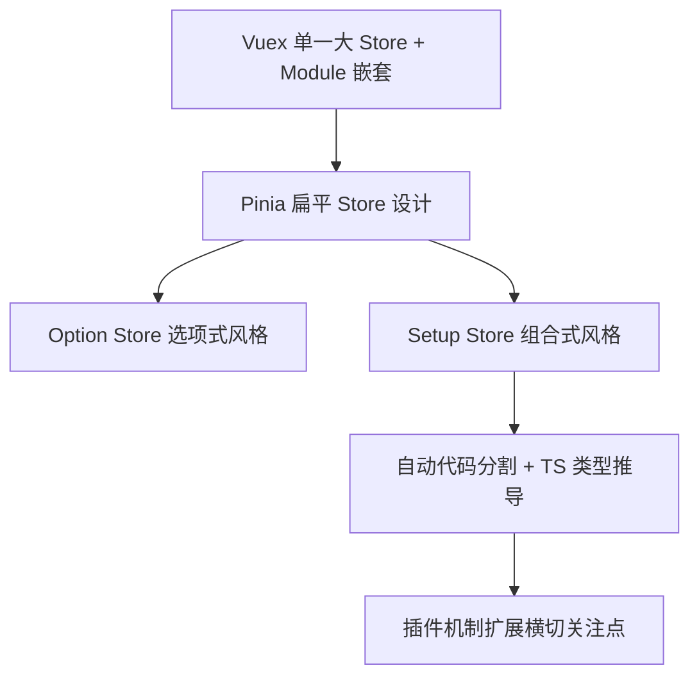
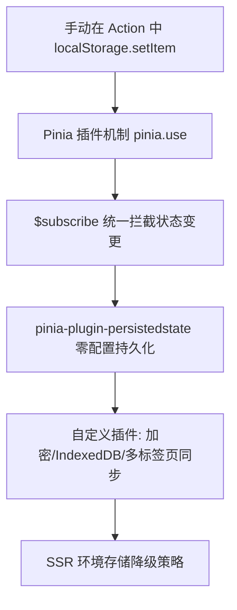
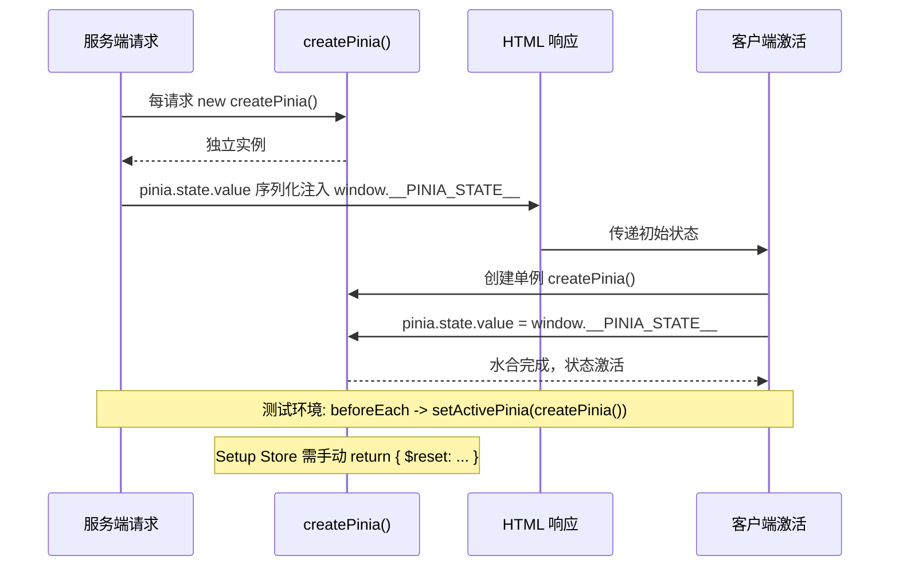
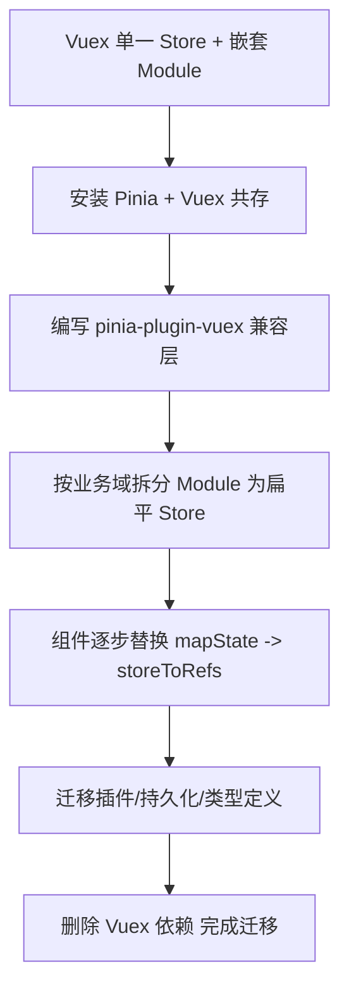
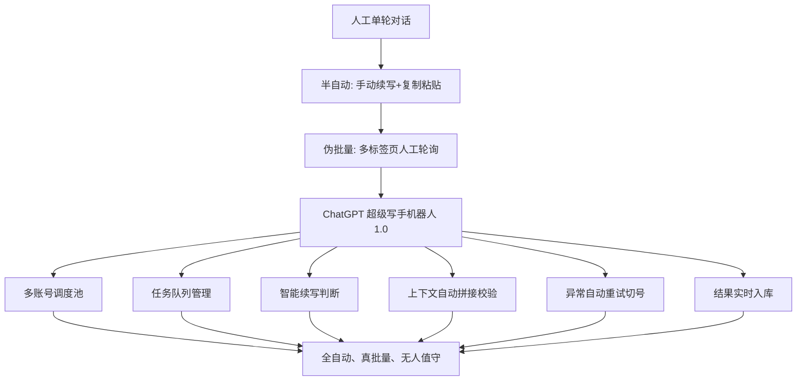
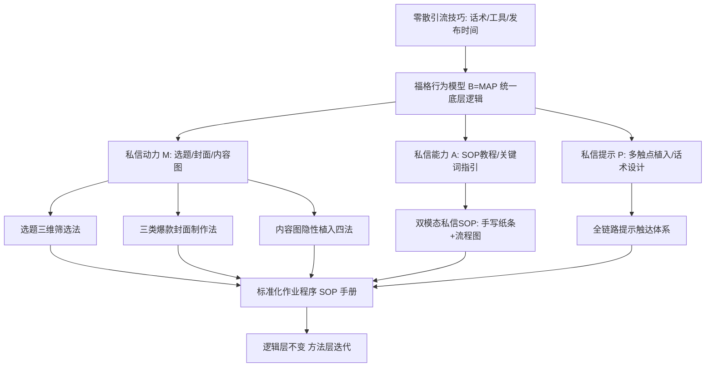
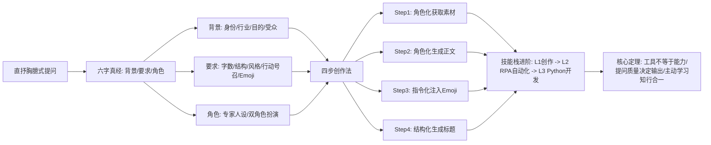
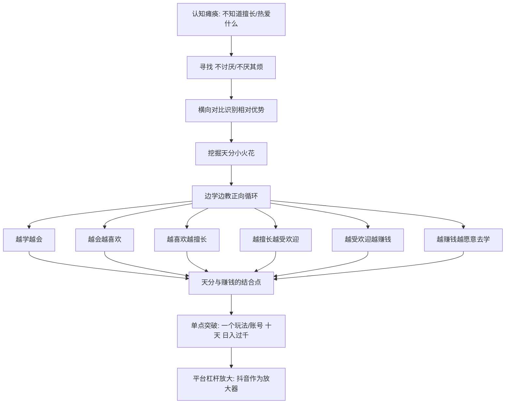

# 第 37 章 Pinia 状态管理实战与 AI 赋能变现方法论综合实战
作者：龙哥

## 学习目标

- 理解 Pinia 核心架构设计理念：扁平化 Store、自动代码分割、类型安全优先
- 掌握 Option Store 与 Setup Store 两种定义风格的区别、适用场景及迁移策略
- 精通 TypeScript 环境下的类型推导最佳实践：storeToRefs 保持响应式与类型、跨 Store 组合类型安全
- 掌握插件机制原理与开发：持久化、多标签页同步、状态加密等横切关注点的优雅注入
- 理解 SSR 环境下的请求级实例隔离机制与水合流程，掌握 Vitest 单元测试的 Store 重置与 Mock 策略
- 能够制定 Vuex 到 Pinia 的增量迁移方案：共存兼容层、Module 拆分策略、类型定义迁移、常见坑位规避
- 掌握『ChatGPT 超级写手机器人 1.0』的全自动、真批量内容生产架构与核心痛点解决方案
- 理解基于福格行为模型（B=MAP）的小红书全行业通用引流底层逻辑与实操体系
- 掌握『以教为学』变现模式与『六字真经』（背景、要求、角色）提示词工程核心方法论
- 理解『普通人』抖音变现核心方法论：放弃寻找『热爱/擅长』，转而寻找『不讨厌/不厌其烦』的微小切入点
- 掌握抖音图文引流、情感粉引流、快团团帮卖、视频号带货等平台原生打法的实操 SOP
- 理解『边学边教』正向循环机制与『单点突破』执行策略在新人变现中的应用
- 理解信息差、圈层差、认知差在商业变现中的核心杠杆作用
- 掌握 AI 赋能工作流（ChatGPT+RPA、Prompt Engineering、SOP 化）的降本增效实战方法

## 37.1 生活类比

想象我们正在**建造一座名为“数字资产变现”的摩天大楼**。这座大楼的每一层、每一个系统，都对应本章将要掌握的核心能力模块。

**地基与骨架——Pinia 核心架构**  
大楼的地基是 **`createPinia()` 总控调度塔**（来源：《20230418_037.md`），每个租户（请求/用户会话）拥有独立的调度塔，互不干扰。每一层楼是一个 **`defineStore` 专用货仓**（用户仓、购物车仓、商品仓），扁平管理、无嵌套套娃。货架上的 **实物库存** 是 State；**智能分拣标签** 是 Getters（派生数据、自动缓存）；**作业工单/机械臂** 是 Actions（异步业务流程、可跨仓调用）。**给库存贴上 RFID 智能标签**（`storeToRefs`），解构搬运时不丢失“响应式”追踪能力。**给仓储中心装插件**（`pinia.use(plugin)`），安装“自动盘点入账”持久化、“跨园区同步”多标签页、“操作回放”时光机，业务货仓零侵入。**SSR 隔离** = 每位客户专属临时仓库，下单即建、离场即销、数据随人走、绝不串单。**Vuex 迁移** = 从“单一超大仓+分区”升级为“多个专用智能仓+总控塔”，分批搬迁、新旧并行、平滑切换。

**动力系统——ChatGPT 超级写手机器人 1.0**  
大楼的动力核心是一个**不知疲倦的全自动流水线工厂**（来源：《20230418_037.md`）。「多账号调度池」=「多条并行生产线」，单线故障自动切换、无人值守；「任务队列」=「原料传送带」，提示词有序进入、不拥堵不遗漏；「智能续写判断」=「光学质检传感器」，检测输出是否截断、自动触发“继续生成”指令；「上下文自动拼接」=「精密焊接机械臂」，将分段输出无缝拼合、保持语义连贯；「结果实时入库」=「成品自动入库系统」，生成即存储、可追溯、防丢失。

**导航系统——福格行为模型（B=MAP）**  
大楼的智能导航系统是**引流的“通用遥控器”**（来源：《Efm3dQsmpoUyHxxDPaAcoqXvnVe.md`）。**私信动力（M）** = 用户想按下按钮的“意愿”，由选题精准度、痛点刺激、收益展示决定；**私信能力（A）** = 用户“能按下按钮”的“容易度”，由 SOP 教程、关键词搜索指引降低门槛；**私信提示（P）** = “按钮闪烁/震动”的“外部触发”，在图片、评论、私信、群聊多触点植入引导线索。只要**动力足、能力强、提示及时**，用户就会产生“私信”行为，平台规则变化仅影响具体“按钮样式”，不影响“遥控器原理”。

**操作手册——六字真经**  
大楼的标准作业手册是**驾驭 ChatGPT 这台“超级实习生”的“标准作业单”**（来源：《AnkEdEtEtoXIbexWlQ3cL6zenFf.md`）。**背景** = 实习生入职档案：告诉 TA 你是谁、做什么行业、问这个问题的目的、面向谁；**要求** = 任务清单与验收标准：字数、结构、风格、行动号召、Emoji 位置……；**角色** = 岗位说明书：赋予 TA 专业身份（如“小红书旅游博主”）、对话对象人设（如“预算 1000 元的背包客”）。只要按这“三张单子”填好，实习生就能交出符合预期的“成品”。

**选址策略——不讨厌/不厌其烦**  
大楼的选址策略是**普通人在抖音淘金时的“金属探测器”**（来源：《QhJudGRcgoQlxGxYU67cndJenjh.md`）。大多数人在沙漠里挖金子（追求热爱/擅长），累得半死不一定有收获；你只需拿着探测器走一圈：**别人“讨厌死、给钱不干”的事，你“不厌其烦”**；这个微小的“耐受度差异”，就是埋在浅层沙砾下的“金矿”（天分火种）；持续“边学边教”（挥动镐头），星星之火终将燎原，成为“天分与赚钱的结合点”。

**增长飞轮——边学边教正向循环**  
大楼的电梯系统是**用“教”这把杠杆撬动“学”的大门**（来源：《QhJudGRcgoQlxGxYU67cndJenjh.md`）：不懂没关系，先报名学，学 3 天就开课；教着教着就懂了，教着教着就有种子用户了；教着教着就有现金流了，教着教着就成专家了。

**执行战术——单点突破**  
大楼的施工策略是**在迷雾中点燃一盏灯**（来源：《LE3Ad03QAoTJWWxZ8jBcFBKXnEy.md`）：不要试图点亮整片森林，先把手里这盏灯点亮；一个玩法、一个账号、十天以上、日入过千；这一盏灯亮了，才有资格去点亮更多灯。

**价值电梯——信息差搬运**  
大楼的垂直交通是**圈层间的“电梯”**（来源：《QhJudGRcgoQlxGxYU67cndJenjh.md`）：A 圈层的常识 = B 圈层的高价值；你不用发明电梯，只需搬运乘客（方案）上下楼；越早搬运、搬运越准，赚得越多、越稳。

## 37.2 概念地图

Pinia 状态管理实战
├── 核心架构
│   ├── 根实例与扁平 Store          —— 20230418_037.md
│   ├── State/Getters/Actions 三元组 —— 20230418_037.md
│   ├── Option Store vs Setup Store   —— 20230418_037.md
│   └── 自动代码分割机制              —— 20230418_037.md
├── 类型安全实践
│   ├── defineStore 返回类型自动推导  —— 20230418_037.md
│   ├── storeToRefs 响应式解构保型    —— 20230418_037.md
│   ├── 跨 Store 组合类型安全         —— 20230418_037.md
│   └── 测试环境类型上下文隔离        —— 20230418_037.md
├── 插件机制与持久化
│   ├── pinia.use() 扩展点设计        —— 20230418_037.md
│   ├── $subscribe 状态变更拦截       —— 20230418_037.md
│   ├── pinia-plugin-persistedstate   —— 20230418_037.md
│   ├── 自定义插件：加密/同步/脱敏     —— 20230418_037.md
│   └── SSR 环境存储降级策略          —— 20230418_037.md
├── SSR 与测试策略
│   ├── 请求级 createPinia() 隔离      —— 20230418_037.md
│   ├── 状态序列化与客户端水合        —— 20230418_037.md
│   ├── setActivePinia 测试上下文重置  —— 20230418_037.md
│   ├── Setup Store 手动实现 $reset    —— 20230418_037.md
│   └── HMR 热更新原生支持            —— 20230418_037.md
└── Vuex 迁移路径
    ├── 共存方案：双实例安装 + 兼容插件   —— 20230418_037.md
    ├── Module 拆分为扁平 Store         —— 20230418_037.md
    ├── mapState/mapActions 兼容层替换  —— 20230418_037.md
    ├── 类型定义逐文件迁移                —— 20230418_037.md
    └── 动态注册/插件/严格模式迁移对策   —— 20230418_037.md
ChatGPT 自动化写作工具
├── 核心痛点
│   ├── 输出中断与上下文断层          —— 20230418_037.md
│   ├── 人工复制粘贴交互成本高        —— 20230418_037.md
│   ├── 多轮对话管理困难              —— 20230418_037.md
│   └── 缺乏自动持久化存储            —— 20230418_037.md
├── 解决方案架构
│   ├── 多账号调度池                  —— 20230418_037.md
│   ├── 任务队列管理                  —— 20230418_037.md
│   ├── 智能续写判断                  —— 20230418_037.md
│   ├── 上下文自动拼接校验            —— 20230418_037.md
│   └── 异常自动重试切号              —— 20230418_037.md
└── 核心价值
    ├── 全自动、真批量                —— 20230418_037.md
    ├── 开箱即用源码交付              —— 20230418_037.md
    └── 无需学习提示词工程            —— 20230418_037.md
小红书引流行为设计
├── 核心公式
│   └── 用户私信行为=私信动力×私信能力×私信提示  —— Efm3dQsmpoUyHxxDPaAcoqXvnVe.md
├── 三大模块
│   ├── 强化私信动机（选题/封面/内容图）     —— Efm3dQsmpoUyHxxDPaAcoqXvnVe.md
│   ├── 降低私信难度（SOP制作/关键词指引）   —— Efm3dQsmpoUyHxxDPaAcoqXvnVe.md
│   └── 提示私信行为（多触点植入/话术设计）  —— Efm3dQsmpoUyHxxDPaAcoqXvnVe.md
├── 标准化产出
│   ├── 三类爆款封面制作法              —— Efm3dQsmpoUyHxxDPaAcoqXvnVe.md
│   ├── 内容图隐性植入四法              —— Efm3dQsmpoUyHxxDPaAcoqXvnVe.md
│   ├── 双模态私信SOP制作法             —— Efm3dQsmpoUyHxxDPaAcoqXvnVe.md
│   └── 全链路提示触达体系              —— Efm3dQsmpoUyHxxDPaAcoqXvnVe.md
└── 核心定理
    ├── 引流本质即行为设计定理          —— Efm3dQsmpoUyHxxDPaAcoqXvnVe.md
    ├── 精准流量优于泛流量定理          —— Efm3dQsmpoUyHxxDPaAcoqXvnVe.md
    └── 合规性即生存性定理              —— Efm3dQsmpoUyHxxDPaAcoqXvnVe.md
ChatGPT 高效对话方法论
├── 核心框架
│   └── 六字真经：背景、要求、角色      —— AnkEdEtEtoXIbexWlQ3cL6zenFf.md
├── 实战流程
│   ├── 四步创作法（获取内容→生成文案→添加Emoji→生成标题）  —— AnkEdEtEtoXIbexWlQ3cL6zenFf.md
│   ├── 角色化提示词构建法             —— AnkEdEtEtoXIbexWlQ3cL6zenFf.md
│   └── 小红书笔记四步生成法           —— AnkEdEtEtoXIbexWlQ3cL6zenFf.md
├── 技能栈进阶
│   ├── L1 内容创作                     —— AnkEdEtEtoXIbexWlQ3cL6zenFf.md
│   ├── L2 ChatGPT+RPA 批量自动化       —— AnkEdEtEtoXIbexWlQ3cL6zenFf.md
│   └── L3 ChatGPT+Python 零代码开发    —— AnkEdEtEtoXIbexWlQ3cL6zenFf.md
└── 核心定理
    ├── 工具不等于能力定律            —— AnkEdEtEtoXIbexWlQ3cL6zenFf.md
    ├── 提问质量决定输出质量公理      —— AnkEdEtEtoXIbexWlQ3cL6zenFf.md
    └── 主动学习与知行合一原则        —— AnkEdEtEtoXIbexWlQ3cL6zenFf.md
普通人抖音变现方法论
├── 核心概念
│   ├── 普通人定义                     —— QhJudGRcgoQlxGxYU67cndJenjh.md
│   ├── 不讨厌/不厌其烦                —— QhJudGRcgoQlxGxYU67cndJenjh.md
│   ├── 天分小火花                     —— QhJudGRcgoQlxGxYU67cndJenjh.md
│   └── 天分与赚钱的结合点             —— QhJudGRcgoQlxGxYU67cndJenjh.md
├── 增长模型
│   └── 边学边教正向循环               —— QhJudGRcgoQlxGxYU67cndJenjh.md
├── 定位方法
│   ├── 差异化定位法                   —— QhJudGRcgoQlxGxYU67cndJenjh.md
│   └── 搜索技能变现法                 —— QhJudGRcgoQlxGxYU67cndJenjh.md
└── 核心定理
    ├── 普通人起盘核心主张：不讨厌即天分  —— QhJudGRcgoQlxGxYU67cndJenjh.md
    ├── 正向循环必然性主张            —— QhJudGRcgoQlxGxYU67cndJenjh.md
    └── 平台杠杆主张：抖音作为放大器  —— QhJudGRcgoQlxGxYU67cndJenjh.md
抖音/视频号/快团团 实战打法库
├── 抖音图文引流
│   ├── 选品六脉神剑                   —— Yjt0dfSN8ob6Xgxl9z6ct7Kfnqf.md
│   ├── 像素级模仿对标                  —— Yjt0dfSN8ob6Xgxl9z6ct7Kfnqf.md
│   ├── 录播切片直播冷启动              —— Yjt0dfSN8ob6Xgxl9z6ct7Kfnqf.md
│   └── 爆款视频重复发布复用逻辑        —— Yjt0dfSN8ob6Xgxl9z6ct7Kfnqf.md
├── 情感粉引流
│   ├── 制作类型 ROI 排序（书单号最高）  —— QRqzdIpMfoxvgfxDXO7cMOLunzg.md
│   ├── 平台-制作类型适配矩阵          —— QRqzdIpMfoxvgfxDXO7cMOLunzg.md
│   └── 精准作品三要素（去哪找/搜什么词/如何识别/有何价值）  —— QRqzdIpMfoxvgfxDXO7cMOLunzg.md
├── 快团团帮卖
│   ├── 人货场匹配选品法                —— SYkqdYJ4FoEXOlxQpitcWY8Rnqg.md
│   ├── 草莓单品爆款运营（高客单+高复购）  —— SYkqdYJ4FoEXOlxQpitcWY8Rnqg.md
│   └── 积分激励闭环（交易返积分/邀请返积分/抽奖兑换）  —— 20230418_058.md
└── 视频号带货
    ├── 核心用户画像：三四线中老年     —— 20230418_134.md
    ├── 伪原创两大模式（二改/保留音频换画面）  —— 20230418_134.md
    ├── 爆款结构：悬念开头+虐逆循环+悬念截断  —— 20230418_134.md
    └── 公域流量尾量期直播承接变现      —— 20230418_134.md
AI 赋能工作流与提示词工程
├── 核心范式
│   ├── 六字真经（背景/要求/角色）      —— AnkEdEtEtoXIbexWlQ3cL6zenFf.md
│   ├── 提示词分层训练法（身份/方法/案例/关键词）  —— XxczdnuchoE7JtxZrO8cn4eGncb.md
│   ├── 二极管标题法（正/负刺激公式）    —— XxczdnuchoE7JtxZrO8cn4eGncb.md
│   └── 平台爆款关键词库（40词强制植入）  —— XxczdnuchoE7JtxZrO8cn4eGncb.md
├── 协作模式
│   ├── ChatGPT+RPA 批量自动化（超级写手机器人）  —— 20230418_037.md
│   ├── 角色扮演双人对练（销售/客户）      —— AnkEdEtEtoXIbexWlQ3cL6zenFf.md
│   └── Emoji 语义级精准匹配            —— AnkEdEtEtoXIbexWlQ3cL6zenFf.md
└── 核心定理
    ├── 方法论单一化原则（一个就好）      —— XxczdnuchoE7JtxZrO8cn4eGncb.md
    ├── 案例来源本地化原则（同行高赞笔记）  —— XxczdnuchoE7JtxZrO8cn4eGncb.md
    └── AI 变现路径：卖『词集』而非『号/课』  —— XxczdnuchoE7JtxZrO8cn4eGncb.md
认知重塑与成长模型
├── 卡片盒笔记法（原子化/链接优于收藏/自底向上）  —— 20230418_000.md, 20230418_001.md
├── 费曼学习法变现（输出倒逼输入）      —— 20230418_016.md
├── 边学边教正向循环（学→教→信任→变现）  —— QhJudGRcgoQlxGxYU67cndJenjh.md
├── 单点突破原则（一个项目一种玩法）    —— LE3Ad03QAoTJWWxZ8jBcFBKXnEy.md
├── 认知变现论（赚不到认知外的钱）     —— QhJudGRcgoQlxGxYU67cndJenjh.md
└── 心态重塑工具：成功日记/微习惯/低预期  —— 20230418_027.md, 20230418_085.md

## 37.3 Pinia 核心架构 —— 从模块化 Store 到自动代码分割

### 37.3.1 为什么需要这个概念？

Vuex 存在模块命名空间冲突、TypeScript 类型推导困难、热更新支持弱、服务端渲染 (SSR) 易污染状态等痛点。大型应用需要状态管理天然支持代码分割，避免打包体积过大影响首屏加载。开发体验需从“手动注册模块”升级为“按需引入即自动注册”。

> "Pinia 的核心架构优势在于：1) 类型推导完美支持 TS，无需手写类型；2) 模块自动代码分割，无需手动配置；3) 支持 Composition API 风格编写 Store，逻辑复用更灵活；4) 更轻量（~1kb），无 Module 嵌套概念。"
> 
> ——《20230418_037.md》

### 37.3.2 核心定义

**Pinia 核心架构**（来源：《20230418_037.md`）

Pinia 由一个根 Store 实例 (`createPinia()`) 和多个独立的 Store 组成。每个 Store 包含 `state`（响应式数据源）、`getters`（派生计算缓存）、`actions`（业务逻辑/异步操作）三元组。Store 定义即注册：调用 `defineStore` 返回的函数即完成注册，无需手动 `store.registerModule`。模块自动代码分割：Vite/Rollup 通过动态 `import()` 识别 Store 文件，自动生成独立 Chunk，按需加载。

**定义 Store 的两种方式**（来源：《20230418_037.md`）

- Option Store: `defineStore('id', { state: () => ({...}), getters: {}, actions: {} })`
- Setup Store: `defineStore('id', () => { const count = ref(0); return { count } })`

**自动代码分割原理**（来源：《20230418_037.md`）

Vite/Rollup 遇到 `import { useUserStore } from '@/stores/user'` 会自动将该 Store 打包为单独 chunk，实现按需加载。

这个机制展示了 Pinia 如何利用现代构建工具的原生 ESM 特性，将状态管理模块化到极致——每个 Store 都是一个独立的分割点，只有在组件真正 `import` 并调用 `useStore()` 时，对应的 JS 文件才会被网络请求下载并执行。

**类型签名与推导演示**（核心公式块）

```typescript
// createPinia 根实例类型签名
function createPinia(): Pinia

interface Pinia {
  install(app: App): void
  _s: Map<string, StateTree>  // 存储所有 Store 的响应式 state
  state: Ref<Record<string, StateTree>>  // 根状态，用于 SSR 序列化/水合
  use(plugin: PiniaPlugin): Pinia
}

// defineStore 核心签名（简化）
function defineStore<
  Id extends string,
  State extends StateTree = StateTree,
  Getters extends GettersTree<State> = GettersTree<State>,
  Actions extends ActionsTree = ActionsTree
>(
  id: Id,
  setup: () => { 
    state: State
    getters: Getters
    actions: Actions
  } | State  // Option Store 传入对象，Setup Store 传入工厂函数
): () => Store<Id, State, Getters, Actions>

// 返回类型 StoreDefinition 自动推导
type StoreDefinition = {
  (): Store  // useStore()
  $id: Id
  $onAction: ...
  $patch: ...
  $reset: ...
  $subscribe: ...
}
```

**为什么可以这样变？**  
Pinia 放弃了 Vuex 的“单一状态树 + Module 嵌套”设计，转而采用**扁平化 Store + 组合式 API**。`defineStore` 即定义即注册，利用 ES Module 天然的作用域隔离实现模块化；Vite/Rollup 识别动态 `import()` 自动生成 Chunk，无需手动配置 `webpackChunkName`。TypeScript 通过 `defineStore` 的泛型参数（`Id`、`State`、`Getters`、`Actions`）在定义时刻完成全链路类型推导，无需像 Vuex 那样编写繁琐的类型装饰器。Setup Store 直接在 `setup()` 函数内使用 `ref`/`computed`/`watch`，返回对象自动解包为普通属性，彻底消除了 Option Store 中 `this` 指向与类型推导的痛点。

### 37.3.3 关键性质

- **扁平化架构**：无嵌套模块概念，Store 间通过 `useStore()` 直接组合，天然解耦。
- **类型安全首选**：`defineStore` 返回类型自动推导 State/Getters/Actions，`storeToRefs` 保持响应式解构类型。
- **插件系统基于 `pinia.use()` 扩展横切关注点**（持久化、DevTools、同步标签页）。
- **SSR 友好**：每次请求创建新 `createPinia()` 实例，天然隔离用户状态，无污染风险。

### 37.3.4 典型例子

电商项目中：`useUserStore`（用户信息/权限）、`useCartStore`（购物车）、`useProductStore`（商品缓存）三个独立 Store，分别按需加载。组合式 API 风格 (Setup Store) 编写：在 `setup()` 中自由使用 `ref`/`computed`/`watch`，逻辑复用能力强。

### 37.3.5 边界条件

- 选项式 API 风格 (Option Store) 与组合式 API 风格不可混用，团队需统一规范。
- `state` 必须返回对象，不能直接返回 `ref`/`reactive`（Setup Store 除外）。
- 直接修改 `$state` 会丢失响应式连接，需使用 `$patch` 或逐属性赋值。
- 浏览器开发工具时间旅行仅支持 Option Store 完美回放，Setup Store 受限于闭包作用域。

### 37.3.6 方法演进图



## 37.4 类型安全实践 —— 让 Store 类型随代码流动

### 37.4.1 为什么需要这个概念？

Vuex 中 `this.$store.state.a.b` 类型丢失、`mapState` 字符串魔法无类型提示、重构极易出错。组合式 API 中解构 `store` 会丢失响应式，`storeToRefs` 需保持类型完整。团队协作需要“以类型为文档、以编译为测试”的开发信心。

### 37.4.2 核心定义

**类型安全最佳实践**（来源：《20230418_037.md`）

`defineStore` 返回类型自动推导为 `StoreDefinition`，包含 `State`、`Getters`、`Actions` 类型别名。`storeToRefs(store)` 将 Store 转为普通对象，每个属性均为 `Ref` 且保持原类型，解决解构丢失响应式问题。组件中通过 `const store = useUserStore()` 获得完整类型提示，`store.name`、`store.getFullName()`、`store.login()` 均有智能感知。

> "类型安全最佳实践：\n1. 优先使用 Setup Store，利用 TS 推导能力。\n2. 组件中必须使用 `storeToRefs(store)` 解构，保持响应式与类型。\n3. 避免直接 `const { state } = store` 导致响应式丢失。\n4. 测试文件顶部 `setActivePinia(createPinia())` 确保实例隔离。"
> 
> ——《20230418_037.md》

**类型定义与推导机制**（核心公式块）

```typescript
// storeToRefs 类型签名：将 Store 转为 { [K in keyof Store]: Ref<Store[K]> }
function storeToRefs<
  Store extends { [key: string]: any }
>(store: Store): {
  [K in keyof Store]: Store[K] extends Ref<infer T> ? Ref<T> 
    : Store[K] extends ComputedRef<infer T> ? ComputedRef<T>
    : Ref<Store[K]>
}

// defineStore 返回类型 StoreDefinition 的泛型结构
interface StoreDefinition<
  Id extends string,
  State extends StateTree,
  Getters extends GettersTree<State>,
  Actions extends ActionsTree
> {
  (): Store<Id, State, Getters, Actions>
  $id: Id
  // ... 扩展方法
}

// Setup Store 中 ref/computed 自动解包推导
// 写法：
const count = ref(0)
const double = computed(() => count.value * 2)
return { count, double }
// 推导结果：{ count: number, double: number } 但在 store 实例上实际为 Ref<number> 与 ComputedRef<number>
// 组件中使用 storeToRefs 后：{ count: Ref<number>, double: ComputedRef<number> }
```

**作用解释**  
`storeToRefs` 的核心作用是**在保持响应式连接的前提下完成解构**。Setup Store 返回的对象属性在内部是 `Ref`/`ComputedRef`，直接解构 `const { count } = store` 会丢失响应式（得到原始值 `number`）。`storeToRefs` 利用 TypeScript 映射类型将每个属性包裹为 `Ref<原类型>`，使得组件中 `count.value++` 既能触发视图更新，又能获得完整的类型提示。跨 Store 组合时，`useCartStore` 内调用 `useUserStore()`，TypeScript 会自动合并两个 Store 的类型依赖图，实现“类型随代码流动”。

### 37.4.3 关键性质

- **类型自动收窄**：在 Setup Store 中，`ref` 推导为 `Ref<T>`，`computed` 推导为 `ComputedRef<T>`，返回对象自动解包。
- **跨 Store 组合类型安全**：`useCartStore()` 内调用 `useUserStore()`，类型系统自动合并依赖图。
- **测试时 `setActivePinia(createPinia())` 重置上下文**，Store 实例类型不变。

### 37.4.4 典型例子

定义 `interface User { id: number; name: string }`，`state: () => ({ user: null as User | null })`，`getters: { userName: (state) => state.user?.name ?? 'Guest' }`，全程类型推导无需注解。组件内 `const { userName } = storeToRefs(useUserStore())`，`userName.value` 类型为 `string`，修改触发响应式更新。

### 37.4.5 边界条件

- Setup Store 返回函数/类等非纯数据对象时，类型推导可能偏离预期，需显式 `return { ... }` 约束。
- `store.$subscribe` 回调参数类型为 `MutationPayload`，需注意泛型参数传递。
- 循环引用 Store（A 依赖 B，B 依赖 A）会导致类型实例化深度溢出，需重构依赖方向。

### 37.4.6 方法演进图


## 37.5 插件机制与持久化 —— 横切关注点的优雅注入

### 37.5.1 为什么需要这个概念？

状态持久化（localStorage/IndexedDB）、多标签页同步、DevTools 时间旅行属于横切关注点，不应侵入业务 Store 代码。手动在每个 Action 中 `localStorage.setItem` 导致代码分散、难维护、易遗漏。需要统一的扩展点在状态变更前后拦截、转换、持久化。

### 37.5.2 核心定义

**Pinia 插件机制**（来源：《20230418_037.md`）

`pinia.use(plugin)` 注册插件，插件函数签名 `({ store, app, pinia, options }) => { /* 返回可选属性扩展 store */ }`。插件可访问 `store.$subscribe((mutation, state) => {})` 监听所有状态变更（类似 Vuex `subscribe`）。`pinia-plugin-persistedstate` 官方推荐持久化插件，配置 `persist: true` 或 `{ key, storage, paths, serializer }` 即可零代码持久化。

> "插件机制核心代码：\n```ts\nimport function piniaPluginPersistedstate(context) {\n  const { store, options } = context\n  if (options.persist) {\n    // 读取存储恢复 state\n    // 订阅 $subscribe 持久化变更\n  }\n}\n```\n\n`pinia.use()` 类型签名：`(plugin: PiniaPlugin) => Pinia`，支持链式调用。插件可返回对象合并到 store 实例上，如 `return { $reset: () => ... }`。"
> 
> ——《20230418_037.md`

**插件类型签名与 $subscribe 机制**（核心公式块）

```typescript
// PiniaPlugin 类型签名
type PiniaPlugin = (context: PiniaPluginContext) => Partial<StateTree> | void

interface PiniaPluginContext {
  pinia: Pinia
  app: App
  store: Store
  options: DefineStoreOptionsBase<any, any>  // defineStore 的原始选项，含 persist 配置
}

// $subscribe 回调参数 MutationPayload 泛型定义
interface MutationPayload<
  State extends StateTree = StateTree
> {
  storeId: string
  type: 'patch object' | 'patch function'
  payload: Partial<State> | ((state: State) => void)
  _fromSync?: boolean  // 插件内部标记，防止循环广播
}

// $subscribe 方法签名
function $subscribe(
  callback: (mutation: MutationPayload, state: State) => void,
  options?: { detached?: boolean }  // detached: 组件卸载时是否自动取消订阅
): () => void  // 返回取消订阅函数
```

**作用解释**  
`PiniaPlugin` 接收上下文对象，可读取 `store.$id`、`options.persist` 等元信息，决定是否为该 Store 注入持久化逻辑。`$subscribe` 是插件实现持久化/同步/审计的核心钩子：它在**每次状态变更后**同步触发，`mutation.type` 区分对象式 `$patch({...})` 与函数式 `$patch(s => ...)`，`payload` 携带变更内容。插件通过监听 `$subscribe` 实现“状态变更即持久化”，业务代码零侵入。`_fromSync` 字段用于多标签页同步插件防止回环广播（收到广播 -> `$patch` -> 触发 `$subscribe` -> 再次广播）。

### 37.5.3 关键性质

- 插件执行顺序即注册顺序，后注册插件可覆盖前者返回的扩展属性。
- 插件内可通过 `pinia.use()` 链式调用，或访问 `pinia._s` (Map<id, Store>) 遍历所有 Store。
- 自定义插件可实现：状态加密存储、敏感字段脱敏、异步存储适配器（如 IndexedDB/WebSQL）、跨标签页 `BroadcastChannel` 同步。

### 37.5.4 典型例子

`pinia-plugin-persistedstate` 配置：`defineStore('user', { state: () => ({ token: '' }), persist: { storage: sessionStorage, paths: ['token'] } })` 仅持久化 token 到 sessionStorage。自定义插件实现多标签页同步：监听 `storage` 事件或 `BroadcastChannel`，收到消息调用 `store.$patch(payload)` 更新状态。

### 37.5.5 边界条件

- 持久化存储容量受限（localStorage 5MB），大对象需压缩或分片，或改用 IndexedDB。
- 服务端渲染 (SSR) 环境无 `window`/`localStorage`，插件需判断 `import.meta.env.SSR` 跳过或使用 `cookie` 存储。
- 状态结构变更（字段重命名/删除）会导致旧版本持久化数据反序列化报错，需实现版本迁移逻辑 `serializer: { deserialize: (v) => migrate(v) }`。

### 37.5.6 方法演进图



## 37.6 SSR 与测试策略 —— 实例隔离与 Store 重置

### 37.6.1 为什么需要这个概念？

SSR 中全局单例 Pinia 会导致请求间状态污染（用户 A 登录态泄露给用户 B）。单元测试中 Store 状态残留导致测试用例相互干扰，破坏隔离性。Vuex 需手动 `store.hotUpdate` 热更新、手动重置 state，Pinia 需标准化方案。

### 37.6.2 核心定义

**SSR 关键点**（来源：《20230418_037.md`）

SSR 必须在每个请求创建新 `createPinia()` 实例，通过 `app.use(pinia)` 注入，确保请求级隔离。客户端激活时 `pinia.state.value = window.__PINIA_STATE__` 完成水合，避免双倍序列化。测试环境：`vitest` 配置 `globalSetup` 创建 Pinia，每个测试用例前 `setActivePinia(createPinia())` 重置上下文。Store 重置：`store.$reset()` 仅重置 Option Store 的 state 到初始值，Setup Store 需手动实现 `$reset` 或重新实例化。

> "SSR 关键点：\n1. 服务端每请求 `createPinia()`\n2. `pinia.state.value` 序列化为 HTML 注入\n3. 客户端 `pinia.state.value = window.__PINIA_STATE__` 水合\n4. 避免在 Store 顶层直接访问 `window`/`document`\n\n测试最佳实践：\n- 使用 `setActivePinia(createPinia())` 而非 `createPinia()` 单例\n- `storeToRefs` 解构后的 Ref 可直接 `.value` 断言\n- 利用 `vi.mock` 模拟外部 API 依赖，测试 Action 逻辑"
> 
> ——《20230418_037.md`

**SSR 序列化/水合类型流转与 setActivePinia 机制**（核心公式块）

```typescript
// Pinia 根状态类型
interface Pinia {
  state: Ref<Record<string, StateTree>>  // 响应式根状态，键为 store.$id
  // ...
}

// 服务端序列化流程
// 1. pinia.state.value = { user: { token: 'abc', profile: {...} }, cart: { items: [...] } }
// 2. JSON.stringify(pinia.state.value) -> 注入 HTML: window.__PINIA_STATE__ = {...}

// 客户端水合流程
// 1. const pinia = createPinia()  // 创建新实例，内部 _s 为空 Map，state 为空 Ref
// 2. app.use(pinia)  // 注册插件、初始化 Store 实例（懒加载或预创建）
// 3. pinia.state.value = window.__PINIA_STATE__  // 关键：触发 Proxy setter，递归更新每个 Store 内部响应式对象

// Setup Store 内部 ref 为何能自动更新？
// Pinia 在创建 Store 实例时，将 setup() 返回的响应式对象（通过 reactive 包装）存入 pinia._s
// pinia.state.value 是一个 Proxy，代理 pinia._s 中每个 store 的 state
// 赋值 pinia.state.value = {...} 会触发 Proxy 的 set 陷阱，依次对每个 store 执行 store.$patch(partialState)
// Setup Store 内部的 ref/computed 引用的是同一个响应式对象，故自动更新

// setActivePinia 上下文绑定机制
let activePinia: Pinia | undefined
function setActivePinia(pinia: Pinia | undefined) {
  activePinia = pinia
}
function getActivePinia(): Pinia {
  if (!activePinia) throw new Error('No active Pinia instance')
  return activePinia
}
// useStore() 内部实现：
function useStore() {
  const pinia = getActivePinia()  // 获取当前上下文绑定的 Pinia 实例
  // ... 从 pinia._s 获取或创建 Store 实例
}
// 测试时 beforeEach 调用 setActivePinia(createPinia()) 即可实现用例级隔离
```

**作用解释**  
SSR 的核心难点是**请求级隔离**与**状态水合**。Pinia 通过 `createPinia()` 创建极轻量的实例（仅含 Map 与 Ref），服务端每请求一个实例，天然解决污染问题。水合时 `pinia.state.value = window.__PINIA_STATE__` 利用 Proxy 的 `set` 拦截，将扁平化的根状态按 `store.$id` 分发到各 Store 的内部响应式对象中，Setup Store 的 `ref`/`computed` 引用同一对象故自动同步。测试隔离利用 `setActivePinia` 维护一个**模块级变量** `activePinia`，`useStore()` 运行时读取该变量，`beforeEach` 重置即可实现用例级实例隔离，无需全局单例。

### 37.6.3 关键性质

- **请求隔离**：`createPinia()` 成本极低（仅创建 Map 和 Symbol），可放心每请求实例化。
- **类型安全测试**：`const store = useStore()` 在测试中类型完全一致，`vi.spyOn(store, 'action')` 可 Mock Actions。
- **热更新 (HMR) 原生支持**：`import.meta.hot.accept()` 无需手动处理，Pinia 内部自动迁移 state。

### 37.6.4 典型例子

Nuxt 3 / Vue SSR 入口：`export default defineNuxtPlugin(() => { const pinia = createPinia(); app.use(pinia) })`。Vitest 测试文件：

```ts
import { setActivePinia, createPinia } from 'pinia'
import { useUserStore } from '@/stores/user'
import { beforeEach, it, expect } from 'vitest'

beforeEach(() => setActivePinia(createPinia()))
it('login sets token', () => {
  const store = useUserStore()
  store.login('token123')
  expect(store.token).toBe('token123')
})
```

### 37.6.5 边界条件

- Setup Store 无自动 `$reset`，需手动添加：`return { ..., $reset: () => { count.value = 0 } }`。
- 测试中 Mock `store.$patch` 需注意类型兼容，建议 `vi.spyOn(store, '$patch')`。
- SSR 传递初始状态序列化时，避免循环引用（如 Router 实例），需自定义 `JSON.stringify` replacer。

### 37.6.6 方法演进图



## 37.7 Vuex 迁移到 Pinia —— 增量重构的平滑路径

### 37.7.1 为什么需要这个概念？

存量 Vuex 项目无法一次性重写，需共存迁移策略。`mapState`/`mapGetters`/`mapActions` 等辅助函数大量存在，需兼容方案。Module 嵌套结构需拆解为扁平 Store，迁移顺序影响风险。

### 37.7.2 核心定义

**Vuex 到 Pinia 迁移核心差异表**（来源：《20230418_037.md`）

以下是迁移过程中需要重点关注的核心差异对照：

| 特性 | Vuex | Pinia |
|---|---|---|
| 定义风格 | 单一大 Store + Module | 多个扁平 Store |
| 类型支持 | 需手写类型装饰器 | TS 原生推导 |
| 代码分割 | 需手动配置 | 自动 (动态 import) |
| SSR | 需手动克隆 state | 每请求创建实例原生隔离 |
| 组合式 API | 需 `useStore()` 封装 | 原生 Setup Store |
| 体积 | ~3.5kb | ~1kb |

**兼容层示例**（来源：《20230418_037.md`）

```ts
// pinia-plugin-vuex.js
export function vuexPlugin({ store }) {
  store.$vuex = vuexStore // 挂载旧 Vuex 实例
}
```

这个兼容层展示了如何通过 Pinia 插件机制，将旧的 Vuex 实例挂载到每个 Pinia Store 实例上，使得旧组件中的 `this.$store` 仍能正常工作，从而实现“新旧共存、逐步替换”的平滑迁移。

**兼容层类型代理与 mapState 映射对照**（核心公式块）

```typescript
// piniaPluginVuex 完整类型实现
function piniaPluginVuex({ store }: PiniaPluginContext) {
  // 代理 Vuex 根 state 到 Pinia store.$vuex
  store.$vuex = vuexStore
  
  // 为旧组件提供 this.$store 兼容访问
  // 组件内 this.$store.state.account.user 
  // -> 代理到 pinia.state.value.account?.user
}

// mapState -> storeToRefs 类型映射对照表
// Vuex 写法                              // Pinia 写法
// ---------------------------------------------------------------
// mapState('account', ['user', 'permissions'])
// -> { user: state.account.user, permissions: state.account.permissions }
const { user, permissions } = storeToRefs(useAccountStore())
// 类型：{ user: Ref<User | null>, permissions: Ref<string[]> }

// mapGetters('account', ['isAdmin'])
// -> { isAdmin: state.account.isAdmin }
const { isAdmin } = storeToRefs(useAccountStore())
// 类型：ComputedRef<boolean>

// mapActions('account', ['login', 'fetchPermissions'])
// -> { login: store.login, fetchPermissions: store.fetchPermissions }
const { login, fetchPermissions } = useAccountStore()
// 类型：{ login: () => Promise<void>, fetchPermissions: () => Promise<void> }

// 关键差异：Pinia 无命名空间字符串，类型由 TS 直接推导，重构安全
```

**作用解释**  
`piniaPluginVuex` 通过插件机制将 Vuex 根实例挂载到每个 Pinia Store 上，旧组件的 `this.$store.state.account.user` 实际上通过 Proxy 代理读取 `pinia.state.value.account.user`，实现零成本兼容。`mapState` 到 `storeToRefs` 的映射不仅是语法替换，更是**类型系统的升级**：字符串键名 `'account'` 消失，变为 `useAccountStore()` 的直接引用，重构时重命名 Store ID 会触发 TS 编译报错，彻底消除运行时 KeyError。

### 37.7.3 关键性质

- **增量迁移**：新功能直接写 Pinia，旧功能按模块逐个迁移，运行期共存无冲突。
- **类型迁移**：Vuex `Store<RootState>` -> Pinia `useXStore()` 返回类型，逐文件替换 import。
- **迁移后体积减少**：Pinia 无模块嵌套开销，Tree-shaking 更彻底，生产包体积通常减少 20%+。

### 37.7.4 典型例子

迁移步骤：
1. 安装 Pinia，`app.use(createPinia())`
2. 编写 `pinia-plugin-vuex` 兼容层，使 `this.$store` 可用
3. 将 `store/modules/user.js` 重写为 `stores/user.ts` (Setup Store)
4. 组件中 `import { useUserStore } from '@/stores/user'` 替换 `mapState('user', ['name'])`
5. 删除 Vuex 相关代码与依赖

迁移后组件代码对比：
Vuex: `computed: { ...mapState('user', ['name']), ...mapGetters('user', ['fullName']) }, methods: { ...mapActions('user', ['login']) }`
Pinia: `const store = useUserStore(); const { name, fullName } = storeToRefs(store); store.login()`

### 37.7.5 边界条件

- Vuex 插件（如 `vuex-persistedstate`）需重写为 Pinia 插件，无法直接复用。
- 动态注册模块 `store.registerModule` 场景需改为动态 `import` Store + `pinia._s.set(id, store)`。
- 严格模式 `strict: true` 迁移后由 TypeScript 编译时检查替代运行时检查。
- 大型项目建议设立“迁移冻结期”，核心模块优先迁移，边缘模块后置。

### 37.7.6 方法演进图



## 37.8 ChatGPT 超级写手机器人 1.0 —— 全自动、真批量的长文本生产利器

### 37.8.1 为什么需要这个概念？

ChatGPT Web 端长文本创作存在六大痛点：输出长度限制导致中断、续写上下文衔接失败、人工复制粘贴交互成本高、多轮对话管理困难、缺乏自动持久化存储、API/账号频率限制与人工故障处理成本高。现有方案多为“半自动”或“伪批量”，未解决上下文智能衔接、多账号故障自动切换、全流程无人值守问题。

### 37.8.2 核心定义

**ChatGPT 超级写手机器人 1.0**（来源：《20230418_037.md`）

针对 ChatGPT Web 端长文本创作痛点开发的全自动化批量生产工具，集成了自动续写、上下文衔接、多账号调度、自动保存等功能，实现无人值守的内容生产闭环。

**全自动、真批量**（来源：《20230418_037.md`）

区别于市面上半自动或伪批量方案的核心技术指标，指代工具实现从任务分发、多账号轮询、断点续写重试、上下文自动拼接到结果落库的全链路零人工干预自动化能力。

### 37.8.3 关键性质

- 基于浏览器自动化或 Web 端模拟技术，构建多账号调度池。
- 通过任务队列管理提示词，实现自动发送、监听流式输出、智能判断截断触发续写指令、上下文自动拼接校验、异常自动重试切号、结果实时入库。
- 开箱即用：提供完整源码与部署文档，无需学习提示词工程（PRP）即可‘拿来急用’。

### 37.8.4 典型例子

**痛点-方案映射表**（来源：《20230418_037.md`）

1. 写了一段没写完就停了 → 自动续写
2. 停了之后发继续写，上下文衔接不上 → 自动衔接上下文
3. 提问和回答都需要手动复制粘贴 → 自动交互
4. 提问次数多了，整理提问回答很麻烦 → 自动保存/整理
5. 提问回答无法自动保存 → 自动保存/整理
6. chatgpt 提问回答次数有限，多账号多浏览器解决需人工守着 → 多账号自动调度/无人值守故障处理

> "解决以上问题：写了一段没写完就停了 -> 自动续写；上下文衔接不上 -> 自动衔接上下文；手动复制粘贴 -> 自动交互；整理麻烦/无法自动保存 -> 自动保存/整理；次数限制/人工守着 -> 多账号自动调度/无人值守故障处理。"
> 
> ——《20230418_037.md`

> "不用学，拿来急用，有源码"
> 
> ——《20230418_037.md`

### 37.8.5 方法演进图



## 37.9 福格行为模型驱动的小红书引流体系 —— 从‘行为设计’到‘标准化作业程序’

### 37.9.1 为什么需要这个概念？

传统引流教学依赖零散技巧（话术、工具、发布时间），缺乏统一的底层逻辑，平台规则变更导致技巧失效。引流本质是用户行为设计，福格行为模型（B=MAP）提供了跨平台、跨业务的通用分析框架。

### 37.9.2 核心定义

**引流行为公式**（来源：《Efm3dQsmpoUyHxxDPaAcoqXvnVe.md`）

用户私信行为 = 私信动力 × 私信能力 × 私信提示（B=MAP）

**私信动力**：用户产生‘想建立联系’意愿的心理驱动力，由选题精准度、痛点刺激、收益展示构成。

**私信能力**：用户完成私信操作的难易度，核心在于 SOP 教程（手写纸条/流程图）规避平台检测、降低认知门槛。

**私信提示**：在笔记图片、评论区、私信、群聊等多触点植入引导线索，触发用户即时行动的外部诱因。

> "用户私信行为=私信动力 * 私信能力 * 私信提示"
> 
> ——《Efm3dQsmpoUyHxxDPaAcoqXvnVe.md`

### 37.9.3 关键性质

- **逻辑层不变、方法层迭代**：平台规则变化仅影响方法层（能力/提示的具体载体），不影响逻辑层（B=MAP 公式）有效性。
- **精准流量优于泛流量**：引流选题目标是吸引‘对产品感兴趣’的精准用户，百赞精准笔记引流效果优于万赞泛流量笔记。
- **合规性即生存性**：所有引流动作必须在平台风控红线内，手写、打码、关键词搜索、小号协作是核心生存策略。

### 37.9.4 典型例子

**选题三维筛选法**：从‘用户想要的（产品匹配度）’、‘用户有需求的（需求精准度）’、‘戳用户痛点（潜在需求唤醒）’三维度筛选，确保流量精准可转化。

**三类爆款封面制作法**：对比型（前后反差）、纯文字型（关键词/噱头）、大合集型（全景式价值展示），附工具与制作要点。

**内容图隐性植入四法**：打印资料实物、不完整资料预告、收益截图、交付/反馈截图，自然传递‘有产品、可获取、有价值、可信赖’四大信号。

**双模态私信 SOP**：手写纸条（低重复率、强伪装性）与流程图（高清晰度、强逻辑）两种制作范式，必含‘去哪找、搜什么词、如何识别、有何价值’五要素。

> "方法会根据平台更新而变化，但逻辑不变"
> 
> ——《Efm3dQsmpoUyHxxDPaAcoqXvnVe.md`

> "用手写的方式，能更好避开平台的检测，而且可以随时拍新图，图片重复率会低一些"
> 
> ——《Efm3dQsmpoUyHxxDPaAcoqXvnVe.md`

> "不是所有的选题和内容都适合引流，有些笔记很爆... 但就是没有人联系你"
> 
> ——《Efm3dQsmpoUyHxxDPaAcoqXvnVe.md`

### 37.9.5 方法演进图



## 37.10 ChatGPT 高效对话六字真经 —— 从‘玄学咒语’到‘结构化提示词工程’

### 37.10.1 为什么需要这个概念？

99% 人觉得 ChatGPT 不好用是因为‘不会问问题’，即缺乏结构化提示词能力。通用大模型输出质量与提示词结构化程度强相关，无背景/角色/约束的‘直抒胸臆式’提问仅得‘正确的废话’。需要一套可复用、可迁移、可教学的标准化提示词构建范式。

### 37.10.2 核心定义

**六字真经**（来源：《AnkEdEtEtoXIbexWlQ3cL6zenFf.md`）

ChatGPT 提示词工程核心框架，包含三个维度——**背景**、**要求**、**角色**：

- **背景**：你需要介绍你是谁？你是做什么行业的？你问这个问题，你的目的是什么？你面向的是什么人群
- **要求**：你希望它输出的结果具体有哪一些要求？比如说不少于 1000 字、要以悬念式的提问开头、要包含 6 个要点...
- **角色**：你需要赋予 ChatGPT 一个专业的角色... 你还可以给你自己赋予一个角色... 让他不断地来和你对话、问问题，最终想方设法把产品卖给你

### 37.10.3 关键性质

- **结构化提示词显著提升垂直领域内容生成质量**：通过明确赋予专业角色并显式列出硬性约束，可引导大模型输出可直接投产的高质量内容。
- **双角色扮演（销售与客户对练）可生成高转化话术**，模拟真实博弈场景。
- **方法论单一化原则**（来源：《XxczdnuchoE7JtxZrO8cn4eGncb.md`）：给 GPT 喂方法时‘不要多，一个就好’；过多方法论会干扰模型注意力机制，导致生成质量下降。

### 37.10.4 典型例子

**小红书笔记四步生成法**（来源：《AnkEdEtEtoXIbexWlQ3cL6zenFf.md`）

Step1 角色化获取基础素材（含约束条件） → Step2 角色化生成正文（赋予博主人设） → Step3 指令化注入 Emoji（段首+内容内嵌，语义匹配） → Step4 结构化生成爆款标题（含问题、方案、结果、字数限制）

**游戏攻略脚本对比**：未用六字真经得‘正确废话’，应用后得‘资源管理、部队选择搭配、小技巧’等可落地细节。

**Emoji 语义级精准匹配**：龙船溪漂流→🚤，植物园→🌸，红色纪念馆→🚩，证明跨模态语义联想能力。

> "在会话优化前，它给的内容其实是一些正确的废话，没有落脚点。会话优化之后，它会给出一些比较细节的点... 这个内容要丰富很多。"
> 
> ——《AnkEdEtEtoXIbexWlQ3cL6zenFf.md`

> "你需要赋予 ChatGPT 一个专业的角色... 让他不断地来和你对话、问问题，最终想方设法把产品卖给你。"
> 
> ——《AnkEdEtEtoXIbexWlQ3cL6zenFf.md`

> "第三步，添加 emoji 表情：我给它指令，在每段开头的位置插入合适的 emoji 表情，文章的内容里也要插入表情..."
> 
> ——《AnkEdEtEtoXIbexWlQ3cL6zenFf.md`

### 37.10.5 方法演进图



## 37.11 普通人抖音变现核心方法论 —— 从‘寻找热爱’到‘发现不讨厌’

### 37.11.1 为什么需要这个概念？

普通人普遍陷入‘不知道自己擅长什么、热爱什么’的认知瘫痪，导致不敢起步或频繁切换赛道。‘热爱/擅长’是高门槛、难验证的主观判断；‘不讨厌/不厌其烦’是低门槛、可观测、可量化的相对优势信号。

### 37.11.2 核心定义

**普通人**（来源：《QhJudGRcgoQlxGxYU67cndJenjh.md`）

不知道自己擅长什么，自己会的身边人也会；别人不会的，自己也不会。没什么特别喜欢干的事，平平无奇，这应该是多数人的现状。

**不讨厌/不厌其烦**（来源：《QhJudGRcgoQlxGxYU67cndJenjh.md`）

个体相较于他人，在某件事上表现出的耐受度更高、抗挫折、愿意投入时间且不觉得痛苦的特质。这是普通人发现天分火种的关键信号，比‘热爱’更易寻找、更可持续。

**天分小火花**（来源：《QhJudGRcgoQlxGxYU67cndJenjh.md`）

隐喻‘不讨厌’背后蕴含的、可被呵护放大的微小天赋种子。通过持续‘边学边教’可燎原成核心竞争力。

**边学边教正向循环**（来源：《QhJudGRcgoQlxGxYU67cndJenjh.md`）

越学越会 → 越会越喜欢 → 越喜欢越擅长 → 越擅长越受欢迎 → 越受欢迎越赚钱 → 越赚钱越愿意去学。

### 37.11.3 关键性质

- **差异化定位法**：通过横向对比（与身边人/同行比）识别‘不讨厌’的相对优势。他人‘讨厌死/给钱不干’的事，己方‘不厌其烦’，即为可切入的差异化赛道。
- **搜索技能变现法**：将‘不讨厌搜索/掘地三英尺找答案’的特质，转化为挖掘赚钱机会、解决疑难问题的核心技能，进而变现。
- **平台杠杆主张**：抖音等内容平台是普通人将微小‘不讨厌’放大为‘天分与赚钱结合点’的最佳杠杆，通过‘边学边教’的公开输出，强制成长、获取反馈、积累资产。

### 37.11.4 典型例子

**大学生搜索技能变现**：无优势大学生凭‘不讨厌搜索、掘地三尺’练就强搜索力，搜索到赚钱机会并实操赚钱，进入正向循环。

**八大职业场景切入点**：程序员不厌沟通、大学生不厌学英语、宝妈不厌读绘本、老板不厌思考薪酬、打工人不厌找副业、运营不厌和用户沟通、实体店主不厌选址、餐饮不厌加微信。

**圈友互动验证**：认知共鸣强（‘我就是那个大学生’、‘不讨厌整理资料’），但也暴露‘无不讨厌怎么办’、‘如何变现’的实操缺口。

> "热爱的找不到，不讨厌的还找不到吗？注意，这个点，对于普通人来说，不讨厌去干的事情，可能就是你的天分小火花。"
> 
> ——《QhJudGRcgoQlxGxYU67cndJenjh.md`

> "越学越会，越会越喜欢，越喜欢越擅长，越擅长越在抖音受欢迎，越受欢迎越赚钱，越赚钱越愿意去学。这就进入到一个正向循环...剩下的交给时间。"
> 
> ——《QhJudGRcgoQlxGxYU67cndJenjh.md`

> "不如找来相关的书和课，每天学一点并在抖音拍视频和直播分享出去。"
> 
> ——《QhJudGRcgoQlxGxYU67cndJenjh.md`

### 37.11.5 方法演进图



## 37.12 多源对照

本章整合了前端工程化（Pinia）、AI 自动化工具（ChatGPT 写手机器人）、行为设计学（福格模型引流）、提示词工程（六字真经）、个人成长与变现（普通人抖音方法论）五大领域的知识体系。以下是核心概念的多源对照分析：

### 37.12.1 状态管理 vs 智能体记忆架构的异同

**共识**：
- 都需要**单一数据源**（Single Source of Truth）保证一致性
- 都支持**模块化/分层设计**，便于维护与扩展
- 都面临**持久化与水合**的工程挑战（Pinia SSR 水合 vs Agent 记忆巩固）

**分歧**：
- **Pinia** 强调**编译时类型安全**与**构建时自动代码分割**，是确定性的状态容器
- **Agent 记忆系统** 强调**运行时动态巩固/遗忘**、**向量检索**、**冲突消解**，是概率性的认知架构
- Pinia 的 `$subscribe` 是同步广播；Agent 记忆更新常涉及异步 Embedding 与索引重建

### 37.12.2 提示词工程：六字真经 vs 分层训练法 vs PRP

以下表格对比了三种主流提示词工程范式的核心差异（来源：《AnkEdEtEtoXIbexWlQ3cL6zenFf.md》、XxczdnuchoE7JtxZrO8cn4eGncb.md、《20230418_037.md`）：

| 维度 | 六字真经 (AnkEdEtEtoXIbexWlQ3cL6zenFf.md) | 分层训练法 (XxczdnuchoE7JtxZrO8cn4eGncb.md) | PRP/自动化提示词 (20230418_037.md) |
|---|---|---|---|
| **核心抓手** | 背景/要求/角色 三要素结构化 | 身份→方法→案例→关键词 四步递进 | 任务队列+多账号调度+智能续写工程化流程 |
| **适用阶段** | 单轮/少轮高质量对话 | 训练专用 GPT/长期复用 Prompt | 批量化、无人值守长文本生产 |
| **人工介入度** | 高（每次需手工填三要素） | 中（前期投入训练，后期复用） | 低（配置任务即可全自动跑通） |
| **核心主张** | "提问质量决定输出质量" | "案例来源本地化/方法论单一化" | "全自动真批量/开箱即用/无需学PRP" |

**共识**：结构化约束优于非结构化自由发挥；案例演示优于抽象指令；领域上下文注入是高质量输出的前提。

### 37.12.3 变现方法论：技术变现 vs 内容变现 vs 知识变现

**共识**：
- **认知变现论**：赚不到认知外的钱（来源：《QhJudGRcgoQlxGxYU67cndJenjh.md`）
- **杠杆思维**：用平台算法/工具放大个体微小优势
- **最小可行性闭环**：先跑通一个完整的“获客-转化-交付”闭环，再规模化

**分歧**：
- **Pinia/前端技术变现**：卖**工程化能力**（脚手架、组件库、架构治理），壁垒在技术深度与工程规范
- **AI 写手机器人**：卖**工具/源码/自动化流程**，壁垒在工程化集成度与抗风控能力
- **小红书引流/抖音变现**：卖**流量获取方法论/SOP/咨询服务**，壁垒在渠道经验与合规操作
- **以教为学**：卖**陪伴/打卡/社群/进阶课**，壁垒在信任资产与真实见证

## 37.13 设计中的取舍

### 为什么 Pinia 放弃了 Vuex 的 Module 嵌套，转而采用扁平 Store？

Vuex 的 Module 嵌套虽然符合直觉（如 `account/profile`），但带来三大工程代价：① 命名空间冲突与类型推导地狱（`state.account.profile.avatar`）；② 代码分割需手动配置 `webpackChunkName`，维护成本高；③ 热更新需手动 `hotUpdate` 迁移 state。Pinia 的扁平设计将“组合”下放到**使用层**（在 `useAccountStore` 内 `const profile = useProfileStore()`），由 TypeScript 自然合类型，Vite 自动分割 Chunk，HMR 原生支持。权衡结论：**设计时的微小不适（需手动组合），换来运行时与构建时的巨大确定性收益**。

### 为什么 Setup Store 没有自动 `$reset()`，而 Option Store 有？

Option Store 的 `state` 是工厂函数 `() => ({...})`，Pinia 内部保存初始工厂，重置时再次调用即可。Setup Store 的状态定义在闭包中（`const count = ref(0)`），无法通过序列化方式获取“初始值快照”，且可能包含非可序列化副作用（如 `watch`、事件监听）。权衡结论：**显式优于隐式**，强制开发者思考“重置意味着什么”（是归零？还是恢复特定快照？），避免业务逻辑隐性 Bug。

### 为什么 Pinia 选择 Proxy-based reactivity 而非 Vuex 的手动订阅模式？

Vuex 通过 `store._mutations` 手动管理订阅者，需显式 `commit` 触发，Action 中修改 state 不走 mutation 会绕过订阅（严格模式下报错）。Pinia 基于 Vue 3 `reactive`/`ref` 的 Proxy 响应式系统，**任何修改（无论在 Action、Getter、组件、插件中）自动触发依赖追踪与触发**，无需显式 commit，`$patch` 仅是批量修改的语法糖。权衡结论：**利用语言运行时原生响应式，消除手动订阅的认知负担与漏报风险**。

### 为什么福格模型 B=MAP 能成为跨平台引流的“通用遥控器”，而具体话术 SOP 却必须频繁更新？

B=MAP 处于**逻辑层**（人性底层动机-能力-触发机制），平台规则变更（如私信改为评论区@、图片不可留联系方式）仅影响**方法层**（能力的载体变为手写纸条、提示的载体变为评论区置顶）。权衡结论：**稳定的底层理论指导多变的上层战术**，是应对平台规则高频变更的唯一生存策略。

### 为什么“六字真经”强调“方法论单一化（一个就好）”？（来源：《XxczdnuchoE7JtxZrO8cn4eGncb.md`）

大模型注意力机制在长上下文中存在“中间遗忘”现象。塞入多套方法论会稀释核心指令的注意力权重，导致模型“既要又要”最终两头落空。权衡结论：**约束即自由**，给模型最清晰的单一执行标准，反而能激发其在该框架内的最大创造力。

### 为什么“六字真经”不包含“示例”维度，而“分层训练法”将其作为第三步核心？（来源：《XxczdnuchoE7JtxZrO8cn4eGncb.md`）

六字真经面向**即时对话场景**，上下文窗口宝贵，示例消耗 Token 且难以在单轮对话中复用；分层训练法面向**长期复用的专用 GPT 训练**，示例用于微调模型隐性模式（语气/节奏/钩子），一次投入长期受益。权衡结论：**场景决定结构**，即时工程精简为主，训练工程案例为主。

### 为什么普通人变现建议“放弃寻找热爱，转而寻找不讨厌”？

“热爱”是**存量心理**（需要先有强烈情感），普通人大多处于“平平无奇”的增量期；“不讨厌”是**增量行为特质**（可观测、可量化、可刻意练习）。权衡结论：**用可观测的行为信号替代不可观测的心理状态**，降低起盘决策的认知负荷与试错成本。

## 37.14 动手练习

### 37.14.1 手写一个迷你 Pinia 核心

实现 `createPinia()` 返回 `{ install(app), _s: Map, state: Ref<Record<string, any>> }`。实现 `defineStore(id, setupFn)`：1. 接受 Setup Store 工厂函数，返回 `useStore` 函数；2. `useStore()` 调用时：若 `_s` 有实例则复用，否则调用 `setupFn` 获取返回对象，用 `reactive` 包装 state，挂载 `_s`；3. 支持 `store.$subscribe(cb)` 记录回调，`store.$patch(obj|fn)` 触发变更并广播。在 Vue 应用中注册 `app.use(pinia)` 验证：组件中 `const store = useCounterStore()` 获取状态与方法；修改 `store.count++` 触发视图更新；刷新页面后手动挂载 `pinia.state.value = savedState` 验证水合。思考题：为什么 `defineStore` 返回的 `useStore` 要接受可选的 `pinia` 参数？Setup Store 中的 `ref`/`computed` 如何自动解包为普通属性返回？如何实现 `storeToRefs(store)` 保持响应式与类型？

### 37.14.2 类型安全实战：从定义到组件使用的全链路推导

定义一个 `useOrderStore`（Setup Store 风格），包含：state: `orders: Order[]`，`filter: 'all' | 'pending' | 'completed'`；getter: `filteredOrders` 根据 filter 筛选，`totalAmount` 计算总金额；action: `addOrder(order)`, `toggleStatus(id)`, `setFilter(f)`；使用 `storeToRefs` 解构 `filteredOrders` 与 `filter` 在组件中使用。类型挑战：1. 让 `Order` 接口在别处定义，Store 内部引用时自动推导泛型；2. `addOrder` 参数类型自动推导为 `Omit<Order, 'id' | 'createdAt'>`；3. 组件中 `const { filteredOrders, totalAmount } = storeToRefs(store)` 类型分别为 `ComputedRef<Order[]>` 与 `ComputedRef<number>`；4. 在另一个 `useUserStore` 的 action 中调用 `useOrderStore().addOrder(...)`，验证跨 Store 类型合并无报错。回答问题：如果 Setup Store 返回 `return { orders, filteredOrders, addOrder }` 直接返回 `ref`/`computed`，组件解构后类型会是什么？为何推荐 `storeToRefs`？如何为 `defineStore` 显式指定泛型参数以约束返回类型？（提示：`defineStore<'order', State, Getters, Actions>()`）

### 37.14.3 开发一个『多标签页状态同步』Pinia 插件

需求：在多个标签页打开同一应用时，任一标签页修改 `useUserStore` 的 `token` 或 `profile`，其他标签页自动同步更新，且不触发循环广播。实现步骤：1. 编写 `piniaPluginBroadcastSync(context)` 插件函数；2. 利用 `BroadcastChannel API` 创建频道 `pinia-sync-${store.$id}`；3. 监听 `store.$subscribe((mutation) => { ... })`，仅当 `mutation.type === 'patch object'` 或 `'patch function'` 时，发送 `{ type: 'sync', payload: mutation.payload }` 到 Channel；4. 监听 `channel.onmessage`，收到消息时调用 `store.$patch(payload)`，**关键：需标记来源防止回环广播**（如设置 `mutation._fromSync = true` 并在发送时跳过）；5. 在 `pinia.use(piniaPluginBroadcastSync)` 注册，或仅对特定 Store 生效（通过 `options.sync?: true` 判断）。进阶挑战：支持 `paths: string[]` 配置仅同步部分字段（如仅同步 `token`，不同步 `profile`）；处理标签页关闭/离线场景：新标签页打开时如何获取最新状态？（提示：Channel 无历史，需结合 localStorage 快照或主动请求广播）。回答问题：为什么不能直接在 `$subscribe` 回调里无条件 `channel.postMessage`？`BroadcastChannel` 与 `localStorage storage event` 在同步机制上有何本质区别？哪个更适合高频状态同步？

### 37.14.4 SSR 场景下的 Pinia 实例隔离与水合排查

模拟 Nuxt 3 / Vue SSR 环境：1. 服务端入口 `server-entry.ts`：为每个请求创建 `const pinia = createPinia()`，`app.use(pinia)`，渲染 HTML 前序列化 `pinia.state.value` 注入 `window.__PINIA_STATE__`；2. 客户端入口 `client-entry.ts`：创建 `pinia = createPinia()`，`app.use(pinia)`，**关键步骤**：`pinia.state.value = window.__PINIA_STATE__`；3. 定义 `useAuthStore` 包含 `token`、`userInfo`，在服务端 `asyncData` 中模拟登录设置 token。排查任务：现象 A：客户端控制台报错 `Cannot read property 'token' of undefined`，定位原因（提示：Setup Store 顶层访问 `useRoute()` 或 `window`）；现象 B：刷新页面后 `token` 丢失，但 `userInfo` 保留，定位序列化/水合差异（提示：`$subscribe` 序列化时机与 `pinia.state.value` 赋值顺序）；现象 C：多用户并发请求，用户 A 看到用户 B 的 `userInfo`，定位实例隔离失败（提示：是否复用了全局单例 `pinia`？）。回答问题：为什么 SSR 必须每请求 `new createPinia()`，而客户端可以单例？`pinia.state.value = { ... }` 赋值时，Setup Store 内部的 `ref` 变量为何能自动更新？（提示：`pinia.state.value` 是 Proxy/Ref，Store 实例内部引用同一响应式对象）

### 37.14.5 Vuex 迁移 Pinia 实战：从 Module 嵌套到扁平 Store 重构

给定一个 Vuex 存量结构（见细纲）。迁移任务：1. 拆分为 3 个 Pinia Store：`useAccountStore`、`useProfileStore`、`useCartStore`；2. `useAccountStore` 内通过 `const profileStore = useProfileStore()` 组合原嵌套模块，`getters.isAdmin` 改为 `computed`；3. 编写兼容层插件 `piniaPluginVuex`，使旧组件 `this.$store.state.account.user` 仍可工作（提示：代理 `pinia.state.value.account`）；4. 组件侧重构：将 `mapState('account', ['user'])` 替换为 `const { user } = storeToRefs(useAccountStore())`；5. 迁移 `vuex-persistedstate` 配置至 `pinia-plugin-persistedstate`，注意 `paths` 映射变化。回答问题：原 Vuex `account/profile` 嵌套改为扁平组合后，`useAccountStore` 里调用 `useProfileStore()` 会形成循环依赖吗？如何避免？迁移后 `store.registerModule('dynamic', module)` 动态注册模块的场景如何用 Pinia 实现？（提示：动态 `import` + `pinia._s.set()`）为什么迁移后生产包体积通常减少 20%+？（提示：Tree-shaking、无模块嵌套开销、Setup Store 无字符串键名）

### 37.14.6 实战：基于『ChatGPT 超级写手机器人 1.0』架构设计一个通用的 AI 长文本生产编排器

设计一个 TypeScript 类 `AIWriterOrchestrator`，核心能力包括：1. 账号池管理：支持添加/移除账号、健康度检查、自动隔离异常账号；2. 任务队列：接收 `{ prompt: string, options: { maxTokens, temperature } }`，自动分片、调度、重试；3. 智能续写：检测流式输出是否因 `length` 截断，自动发送 `继续` 指令并拼接上下文；4. 上下文拼接：维护对话历史，确保多轮对话的语义连贯性，支持 `system`/`user`/`assistant` 角色分离；5. 结果持久化：自动保存至本地数据库（如 IndexedDB），支持断点续传与增量导出；6. 监控面板：暴露 `onProgress`/`onComplete`/`onError` 事件，供上层 UI 实时展示生成进度、Token 消耗、成功率。验收标准：单次任务支持 ≥5000 字输出，上下文连贯性无逻辑断层；账号异常（限流/封号）时自动切换，任务无感知迁移；网络抖动触发指数退避重试，最大重试 3 次；内存占用 ≤ 200MB，无内存泄漏。

### 37.14.7 实战：为某垂直领域（如母婴/编程/健身）设计一套小红书引流 SOP 手册

基于 B=MAP 模型，产出包含以下章节的标准化操作手册（Markdown 格式）：1. **选题策略矩阵**：基于『用户想要的/用户有需求的/戳用户痛点』三维筛选 50 个高转化选题，标注预估私信动力等级；2. **封面制作规范**：对比型/纯文字型/大合集型三类模板的参数化配置（字体/排版/配色/关键词位置），附 Figma/PS 源文件链接；3. **内容图隐性植入清单**：打印资料实物图、不完整资料预告图、收益截图、交付反馈图的拍摄/制作标准与合规要点；4. **私信 SOP 双模态模板**：手写纸条版（含去哪找/搜什么词/如何识别/有何价值）与流程图版（含节点/分支/异常处理）的标准化文案；5. **全链路触达部署表**：图片植入/评论区置顶/私信主动引导/群聊运营四大触点的发布频次、话术变体、账号分工；6. **合规红线自检表**：敏感词规避、链接隐写、账号隔离、频次控制等平台风控红线的量化指标与自检流程。交付物：一份可直接交给运营执行的《小红书XX领域引流 SOP v1.0》手册。

### 37.14.8 实战：应用『六字真经』重构一篇低质量的 ChatGPT 生成小红书旅游笔记

给定一篇由简单提示词生成的平庸旅游笔记（内容泛泛、无人设、结构松散、缺乏 Emoji、标题平淡），要求：1. 补全 **背景**：我是某城市深度游玩家，目的是帮背包客避坑省钱，受众是预算 1000 元的大学生；2. 补全 **要求**：字数 800-1000、三段式结构（开头钩子/干货分层/结尾互动）、植入 3 个平台爆款关键词、每段开头加 Emoji、标题 ≤20 字含 1 个关键词；3. 补全 **角色**：ChatGPT 扮演『邵阳隆回当地导游』，我扮演『预算 1000 元的背包客』，双角色对练生成话术；4. 执行四步生成法：获取基础素材 → 生成正文（赋予博主人设） → 注入 Emoji（语义匹配） → 生成爆款标题（问题/方案/结果/字数限制）；5. 对比生成前后版本的差异，从『阅读完读率』、『收藏转发比』、『私信咨询转化率』三个维度评估提升效果。交付物：重构前后对比文档 + 最终版 Prompt 模板。

### 37.14.9 实战：挖掘并验证你的『不讨厌/不厌其烦』微小切入点

执行以下自我考古流程，输出一份《我的抖音天分挖掘报告》：1. **横向对比清单**：列出 10 个身边人/同行『讨厌死、给钱不干』但你『不厌其烦』的具体事项（如：整理资料、反复打磨文案、钻研工具参数、陪孩子读绘本、深夜排查 Bug、整理税务发票……）；2. **耐受度量化**：对每项事项打分（1-10 分），评估『单次持续时长』与『重复频次』，筛选 TOP 3 核心项；3. **技能变现路径设计**：针对 TOP 3 项，分别设计『边学边教』的抖音内容方向（如：整理资料 → 『Notion 模板测评/效率工具测评』账号；陪读绘本 → 『亲子绘本精读/避坑指南』账号）；4. **MVP 验证计划**：每个方向制定『前 5 期内容选题』+『单期制作 SOP』+『3 个关键指标（完播率/互动率/私信转化）』+『止损线（连续 10 期数据不达标即切换）』；5. **正向循环预演**：书面推演『越学越会 → 越会越喜欢 → 越喜欢越擅长 → 越擅长越受欢迎 → 越受欢迎越赚钱 → 越赚钱越愿意去学』在该路径上的具体表现节点。交付物：包含上述 5 个模块的结构化报告（PDF/Notion/语雀）。

### 37.14.10 实战：抖音图文引流『六脉神剑』选品与像素级模仿 SOP 执行

基于 Yjt0dfSN8ob6Xgxl9z6ct7Kfnqf.md 素材，完成以下执行任务：1. 应用『六脉神剑』选品标准筛选 20 个候选商品：客单价适中、退货率低、佣金≥30%、无需实景真人、单点跟随、像素级可模仿；2. 在考古加/蝉妈妈中寻找 3 个对标账号（粉丝<20万、不露脸、近30天销售额稳定），建立像素级模仿模板（选品/文案/剪辑/发布频次）；3. 使用 CR TubeGet/闪豆批量下载对标视频，剪映去重（镜像/变速/贴纸/滤镜），多账号矩阵上传测试；4. 监控 7 天数据：播放量、点赞、转化，筛选出 1 个爆款视频，执行『录播切片直播』冷启动（向供应商要样品、对标话术、简陋搭建、卡首播流量券）；5. 爆款视频重复发布 3 次验证『不损耗粉丝价值』假设，记录每次播放/转化数据。交付物：选品清单、对标账号分析表、7天数据看板、直播复盘记录。

### 37.14.11 实战：情感粉引流『书单号』低成本冷启动与 ROI 验证

基于 QRqzdIpMfoxvgfxDXO7cMOLunzg.md 与 20230418_138.md 素材：1. 选定 1 个细分需求（如：婚姻修复/脱单追求），制作 10 条书单号视频（背景图+文案排版，7秒/条）；2. 适配平台：主攻小红书（混剪/图文）、快手/视频号（实拍/书单），避开抖音 IP 号红海；3. 执行『精准作品』内容策略：内容垂直到具体事项（如『老公冷暴力怎么沟通』），封面植入『去哪找/搜什么词/如何识别/有何价值』四要素；4. 部署双模态私信 SOP：手写纸条版（规避检测）+ 流程图版（高清晰度），引流至咨询师微信；5. 记录 14 天漏斗数据：发布量/播放/私信/加微/成交/ROI，验证『书单号 ROI 最高』结论。交付物：10条视频成品、双平台发布记录、14天漏斗数据表、SOP 迭代版本。

### 37.14.12 实战：快团团帮卖『草莓单品』爆款复盘与私域积分闭环设计

基于 SYkqdYJ4FoEXOlxQpitcWY8Rnqg.md 与 20230418_058.md 素材：1. 应用『人货场』逻辑：目标人群（中产家庭主妇/大城女白领）→ 选品草莓（应季/高颜值/高客单/性价比/社交货币）；2. 设计『饥饿营销+氛围组』：每日 10 点秒杀、限量 200 份、托儿带节奏、晒单截图制造从众；3. 构建积分激励闭环：交易满 1000 送 1 积分、邀请好友送积分、积分可兑现金/抽奖/实物，目标：0 退款、60%+ 续费；4. 双渠道拉新：老带新（2元红包奖励）、小红书高颜值笔记引流至 13 个购买群；5. 高转化文案七要素：产地溯源/价格锚定/视觉冲击/售后兜底/社会认同/氛围制造/稀缺逼单。交付物：草莓单品运营日志、积分体系配置表、小红书笔记素材、私域群运营 SOP。

### 37.14.13 实战：视频号带货『尾量期直播承接』与选品避坑演练

基于 20230418_134.md 素材：1. 选定 1 个情感泛娱乐赛道（如：民间故事/家庭情感），制作 5 条伪原创视频（方式一：二改原视频+自拍音频；方式二：保留音频替换画面）；2. 监控视频爆款后，在流量增速放缓期（日涨粉~3000）预约直播，开播承接尾量流量，记录场观/转化；3. 选品避坑实测：尝试挂载养生茶/中医书籍/食谱书籍，记录违规扣分/限流现象，总结『视频号选品红线』清单；4. 验证『账号包装精细度对冷启动无显著影响』：对比精心包装 vs 10分钟随意包装的流量表现；5. 爆款结构拆解：悬念开头（黄金3秒）+ 虐+小逆袭循环 + 悬念截断结尾，提炼可复用模板。交付物：5条视频剪辑工程文件、直播复盘记录、选品红线清单、爆款结构模板。

### 37.14.14 实战：『以教为学』边学边教变现闭环设计

基于 QhJudGRcgoQlxGxYU67cndJenjh.md 与 20230418_016.md 素材：1. 选定 1 个『不讨厌』技能（如：Notion 整理/英语搜索/绘本阅读），购买 1 门相关课程；2. 听课第 3 天同步启动自己的『陪练营/训练营』（定价 99 元打卡返现），边学边教；3. 朋友圈/社群日更『学习进度+避坑指南+学员见证』，建立『真实见证』信任资产；4. 低价前端收割种子用户 → 逐期迭代涨价 → 沉淀『工具箱思维』多产品矩阵（平台合作型/技能服务型/自主运营型）；5. 私域运营『真诚+互惠』SOP：拒绝目的性链接，主动提供无偿价值（回答问题/分享资源/情绪支持），实现流量互通复用。交付物：陪练营招募文案、13期迭代涨价表、私域 SOP 文档、收入结构拆解图。

### 37.14.15 实战：提示词分层训练法训练『小红书标题专家』GPT

基于 XxczdnuchoE7JtxZrO8cn4eGncb.md 素材：1. **第一步·给身份**：设定 GPT 为『专业小红书标题党专家』，交互协议：『请学习』触发学习、『请根据以下内容』触发生成；2. **第二步·给方法**：注入『二极管标题法』——正面刺激（产品/方法+短期低成本+逆天效果）、负面刺激（不做某事+巨大损失+紧迫感）及进化心理学原理；3. **第三步·给案例**：手工收集同行 10 个高赞标题（刷 5 分钟高赞笔记手录），喂给 GPT 总结隐性模式（语气/节奏/Emoji/钩子设计）；4. **第四步·关键词修正**：强制限制字数<20字，从 40 词库中强制植入 1-2 个爆款关键词（如：宝藏/吐血整理/YYDS/好用到哭）；5. 验证：输入『百度百科 ChatGPT 词条』生成 5 个标题，对比三步版（无关键词修正）与四步版的『平台感』差异。交付物：训练全记录 Prompt、三步版 vs 四步版输出对比、40词库表、标题生成器可复用 Prompt 模板。

### 37.14.16 实战：ChatGPT+RPA『超级写手机器人』核心模块原型开发

基于 20230418_037.md 与 AnkEdEtEtoXIbexWlQ3cL6zenFf.md 素材，设计 TypeScript 核心类：1. `AccountPool`：多账号轮询、登录态维持、验证码拦截、健康度评分、自动隔离异常账号；2. `TaskQueue`：提示词分片、优先级调度、指数退避重试（最大3次）、断点续传状态持久化；3. `StreamMonitor`：流式输出监听、截断检测（`length` finish_reason）、自动发送『继续』指令、上下文拼接校验；4. `ContextManager`：多轮对话历史维护、`system/user/assistant` 角色分离、Token 预算控制、语义连贯性检查；5. `ResultPersister`：IndexedDB 存储、增量导出、断点续传元数据；6. `MonitorPanel`：EventEmitter 暴露进度/完成/错误事件、Token 消耗/成功率仪表盘。交付物：核心类 UML 图、关键算法伪代码、IndexedDB Schema 设计、异常处理流程图。

## 37.15 本章小结

这一章中我们学习/了解/讨论了 Pinia 状态管理的核心架构与工程化实践、ChatGPT 自动化长文本生产工具架构、基于福格行为模型的小红书引流体系、六字真经提示词工程方法论、普通人抖音变现核心方法论以及多平台实战打法库。首先我们剖析了 Pinia 扁平化 Store 设计、自动代码分割、TypeScript 类型推导最佳实践、插件机制与持久化、SSR 隔离与测试策略、Vuex 增量迁移路径等前端工程化核心技术；其次我们深入解构了 ChatGPT 超级写手机器人 1.0 解决长文本生产六大痛点的全自动化架构；接着我们建立了 B=MAP 引流行为公式，推导出选题/封面/内容图/私信 SOP 的标准化作业体系；然后我们确立了背景/要求/角色六字真经与四步生成法，将提示词工程从玄学转化为结构化编程；之后我们提出了普通人寻找“不讨厌/不厌其烦”微小切入点、边学边教正向循环、单点突破等认知重塑与变现模型；最后我们汇总了抖音图文引流、情感粉书单号、快团团帮卖、视频号带货四大平台原生打法的实操 SOP，并贯穿 AI 赋能工作流（ChatGPT+RPA、分层训练法、二极管标题法）贯穿始终。

本章我们一起学习了以下概念：

| 概念 | 解释 |
|------|------|
| Pinia 核心架构 | 扁平化 Store 设计，自动代码分割，Option/Setup 双风格，无模块嵌套，~1kb 轻量级 |
| defineStore | 定义即注册，返回类型自动推导 State/Getters/Actions，Setup Store 支持 Composition API 灵活复用 |
| storeToRefs | 解决组合式 API 解构丢失响应式问题，将 Store 转为 Ref 对象并保持完整类型推导 |
| pinia.use() | 插件扩展点，接收 {store, app, pinia, options}，可返回属性扩展 Store，支持横切关注点注入 |
| $subscribe | 监听 Store 所有状态变更，参数为 MutationPayload，插件实现持久化/同步/审计的核心钩子 |
| pinia-plugin-persistedstate | 官方推荐持久化插件，配置式声明持久化策略（storage/paths/serializer），支持 SSR 降级 |
| SSR 隔离 | 每请求创建 createPinia() 实例，服务端序列化 pinia.state.value 注入 HTML，客户端水合激活 |
| setActivePinia(createPinia()) | 测试用例级上下文重置，确保 Store 实例隔离，配合 vi.spyOn 实现 Action/Getter Mock |
| Setup Store $reset | Option Store 自带重置，Setup Store 需手动 return { $reset: () => { ... } } 实现状态归零 |
| Vuex 迁移共存 | app.use(pinia).use(vuex) 双运行，pinia-plugin-vuex 兼容 this.$store，Module 按业务域拆分为扁平 Store |
| Module 拆分策略 | 原 modules/a/b -> useAStore/useBStore，通过组合（useAStore 内调用 useBStore）替代嵌套，利于 Tree-shaking |
| ChatGPT 超级写手机器人 1.0 | 解决长文本输出中断、上下文断层、人工交互、多账号管理、自动保存六大痛点，实现全自动真批量内容生产 |
| 全自动、真批量 | 零人工干预的端到端自动化：任务分发、多账号轮询、断点续写、上下文拼接、异常切号、结果入库 |
| 引流行为公式 B=MAP | 用户私信行为 = 私信动力 × 私信能力 × 私信提示，平台规则变化仅影响方法层不影响逻辑层 |
| 私信动力 | 用户产生‘想建立联系’意愿的心理驱动力，由选题精准度、痛点刺激、收益展示构成 |
| 私信能力 | 用户完成私信操作的难易度，核心在于 SOP 教程（手写纸条/流程图）规避平台检测、降低认知门槛 |
| 私信提示 | 在笔记图片、评论区、私信、群聊等多触点植入引导线索，触发用户即时行动的外部诱因 |
| 六字真经 | ChatGPT 提示词工程核心框架：背景（身份/行业/目的/受众）、要求（字数/结构/风格/行动号召）、角色（专家人设/双角色扮演） |
| AIGC 时代双核竞争力 | 行业经验（方法论沉淀）与执行力（训练/落地强度），工具仅是放大器而非替代品 |
| 不讨厌/不厌其烦 | 普通人发现天分火种的关键信号：他人‘讨厌死、给钱不干’的事，己方‘不厌其烦’，即为可切入的差异化赛道 |
| 天分小火花 | 隐喻‘不讨厌’背后蕴含的、可被呵护放大的微小天赋种子，通过持续‘边学边教’可燎原成核心竞争力 |
| 边学边教正向循环 | 越学越会 → 越会越喜欢 → 越喜欢越擅长 → 越擅长越受欢迎 → 越受欢迎越赚钱 → 越赚钱越愿意去学 |
| 抖音图文引流 SOP | 选品六脉神剑 → 对标账号像素级模仿 → 多号矩阵测试 → 爆款视频重复发布 → 录播切片直播冷启动 |
| 情感粉引流 ROI 排序 | 书单号>口罩号>实拍号>混剪号>IP号，低制作门槛对应高投产比，新手首选书单号 |
| 快团团人货场匹配 | 以‘人’（目标画像）为起点反推‘货’（选品），在‘场’（群/朋友圈）完成交易闭环，核心选品：时令水果/生活方式/预制菜 |
| 视频号带货核心逻辑 | 三四线中老年用户画像 → 情感泛娱乐内容偏好 → 伪原创剪辑 → 尾量期直播承接 → 选品避开养生/中医书红线 |

下一章中，我们将学习第 38 章的内容（根据大纲顺序推演）。


