# 第 18 章 前端架构治理与技术决策 —— 从 ADR 文档到技术雷达与演进路线图

## 学习目标

- 理解架构决策记录（ADR）的核心结构、不可变性原则与工程化落地工具链
- 掌握技术雷达的四象限分类法、Blip 迁移规则与季度评审运营机制
- 掌握架构演进路线图的战略主题拆解、滚动波浪式规划与依赖可视化方法
- 理解 RFC 评审机制的分级门槛、决策矩阵量化评分与事后复盘闭环流程
- 能够制定架构治理委员会章程，并产出包含核心指标的季度运营报告
- 能够串联 ADR、技术雷达、路线图、RFC 与治理委员会，构建端到端的前端架构治理体系
- 理解技术债务显性化管理、固定预算偿还与 OKR 打通的实操方法
- 掌握热修复事后补单 48 小时与评审委员会轮换制等边界机制的设计原理

## 18.1 生活类比

—— 生活类比素材来源：《KJ0CdYG18oMFStxpa17cxS0wnyt.md》

想象前端架构治理是一场**大型城市的“城市规划与建设”系统工程**：**ADR（架构决策记录）** = **“土地批文与建筑档案”**：每一块地（技术决策）为何批给谁、盖什么楼、替代方案是什么、后果如何，都有法可查、有据可溯，一旦盖好（通过）不可随意拆改，变更需新批文（新 ADR）并标注旧档案作废。**技术雷达** = **“城市总体规划图（动态版）”**：将所有建筑材料、工艺、设备（技术项）标注在“推广使用/试点推广/谨慎评估/禁止使用”四个区域，每季度召开规划局会议（雷达会议）根据实测数据调整分区，新入职建筑师（新人）拿到图纸就知哪里能盖、哪里不能盖。**架构演进路线图** = **“三年滚动建设计划”**：不是死板的施工进度表（甘特图），而是分“近期精确到楼栋、中期定区域功能、远期定城市轮廓”三层，明确标注“地铁先通后盖楼”（跨团队依赖）和“每年拨款修缮老旧小区”（技术债务预算），并与考核指标（OKR）挂钩。**RFC（架构评审机制）** = **“重大项目立项评审会”**：想拆迁盖高楼（架构级重构）？必须提交立项书（RFC 文档），经规划、消防、环保、财政多部门联审（评审委员会），用评分卡（决策矩阵）打分，盖完楼还得住满三年回访（事后复盘），看看是不是烂尾楼。**架构治理委员会** = **“城市规划委员会办公室”**：不是开会的“谈话室”，而是有编制、有权力、有预算、有 KPI 的实体机构。定期发布《城市建设白皮书》（季度运营报告）：批了多少地、调整了多少规划、完成了多少地铁、修缮了多少老房子、市民满意度多少，数据全公开，没完成的必须写整改方案。就像城市建设需要“档案留痕、规划导向、计划推进、评审把关、专职运营”五位一体，前端架构治理也需要 ADR、雷达、路线图、RFC、委员会五大支柱协同，才能避免“拆东墙补西墙”的混乱演进。

## 18.2 概念地图

前端架构治理体系
├── 架构决策记录（ADR）
│   ├── 标准化结构：标题/背景/决策/后果/替代方案/状态  —— KJ0CdYG18oMFStxpa17cxS0wnyt.md
│   ├── 核心元数据：编号/状态/关联Issue/日期/决策者  —— KJ0CdYG18oMFStxpa17cxS0wnyt.md
│   ├── 关键性质：不可变性/关联性/就近性  —— KJ0CdYG18oMFStxpa17cxS0wnyt.md
│   ├── 工具链：adr-cli 模板强制/Markdown渲染门户/Git版本控制  —— KJ0CdYG18oMFStxpa17cxS0wnyt.md
│   └── 边界：仅记录重大/不可逆/跨团队决策，不替代RFC  —— KJ0CdYG18oMFStxpa17cxS0wnyt.md
├── 技术雷达
│   ├── 四象限：采纳/试用/评估/暂缓  —— KJ0CdYG18oMFStxpa17cxS0wnyt.md
│   ├── 四环带：语言框架/平台/工具/方法  —— KJ0CdYG18oMFStxpa17cxS0wnyt.md
│   ├── Blip要素：名称/象限/环带/移动轨迹/关联ADR  —— KJ0CdYG18oMFStxpa17cxS0wnyt.md
│   ├── 运营机制：季度会议/同意制/可视化门户(tech-radar)/新人必读  —— KJ0CdYG18oMFStxpa17cxS0wnyt.md
│   └── 边界：非白名单/项数<60/聚焦架构级/雷达守护者角色  —— KJ0CdYG18oMFStxpa17cxS0wnyt.md
├── 架构演进路线图
│   ├── 核心要素：Theme/Milestone/Dependency/Capacity Allocation  —— KJ0CdYG18oMFStxpa17cxS0wnyt.md
│   ├── 规划特性：滚动波浪式/依赖显性化/债务显性化(固定预算)  —— KJ0CdYG18oMFStxpa17cxS0wnyt.md
│   ├── 与OKR打通：主题映射OKR/避免两张皮  —— KJ0CdYG18oMFStxpa17cxS0wnyt.md
│   └── 边界：非甘特图/季度复盘允许调整优先级(关联ADR)  —— KJ0CdYG18oMFStxpa17cxS0wnyt.md
├── 架构评审机制（RFC）
│   ├── 流程：提交标准化文档→异步审阅+同步答辩→决策矩阵评分→形成ADR  —— KJ0CdYG18oMFStxpa17cxS0wnyt.md
│   ├── 评审委员会：架构师/技术负责人/安全/运维代表/轮换制  —— KJ0CdYG18oMFStxpa17cxS0wnyt.md
│   ├── 分级门槛：L1组件库/L2基础设施/L3架构级重构  —— KJ0CdYG18oMFStxpa17cxS0wnyt.md
│   ├── 决策矩阵：技术可行性/业务价值/实施成本/风险/团队能力五维量化  —— KJ0CdYG18oMFStxpa17cxS0wnyt.md
│   ├── 事后复盘：上线3/6月强制填写(预期vs实际/偏差原因/经验教训)  —— KJ0CdYG18oMFStxpa17cxS0wnyt.md
│   └── 边界：不评审业务细节/热修复事后补单48小时  —— KJ0CdYG18oMFStxpa17cxS0wnyt.md
└── 架构治理委员会与运营报告
    ├── 章程核心：成员构成/职责边界/会议节奏/决策权限  —— KJ0CdYG18oMFStxpa17cxS0wnyt.md
    ├── 运营报告指标：ADR数量质量/雷达变更/路线图完成度/债务偿还量/NPS  —— KJ0CdYG18oMFStxpa17cxS0wnyt.md
    ├── 核心性质：赋能而非管控/数据驱动自动化采集/透公开全员可见  —— KJ0CdYG18oMFStxpa17cxS0wnyt.md
    └── 边界：不管业务进度/主席由CTO担任/报告含未达标指标整改计划  —— KJ0CdYG18oMFStxpa17cxS0wnyt.md

—— 概念地图素材来源：《KJ0CdYG18oMFStxpa17cxS0wnyt.md》

## 18.3 架构决策记录（ADR） —— 让技术决策留下“可追溯的脚印”

### 18.3.1 为什么我们需要 ADR？

你是否经历过这样的场景：团队核心成员离职后，没人知道当初为什么选 Vue 而非 React、为什么用 Vuex 而非 Pinia、为什么微前端方案选了 qiankun 而不是 Module Federation？新成员加入时，只能通过考古式阅读聊天记录、翻阅过期的 Wiki 文档，甚至靠猜测来还原决策背景。这导致两个严重后果：**重复造轮子**（新人提议的方案早被否决过，但没留下证据）和**错误回滚**（不了解原决策约束条件，贸然改动引发生产事故）。

传统的口头约定、会议纪要、飞书文档都存在致命缺陷：**缺乏结构化模板**（理由、替代方案、后果字段缺失）、**版本控制薄弱**（文档随意修改无历史）、**与代码分离**（决策与实现不同步）。ADR（Architecture Decision Record）正是为了解决这些问题而生：它是一种**轻量级、结构化、版本化**的决策记录机制，将“决策”视为一等公民纳入代码仓库管理。

—— 18.3.1 节素材来源：《KJ0CdYG18oMFStxpa17cxS0wnyt.md》中“为什么需要这个概念？”要点扩写

### 18.3.2 ADR 的标准化结构定义

> 推行 `adr-cli` 管理决策文档：标题/背景/决策/后果/替代方案、状态、关联 Issue、Markdown 渲染门户、Git 历史不可篡改溯源。
> 
> ——《KJ0CdYG18oMFStxpa17cxS0wnyt.md》

一个合规的 ADR 文档必须包含以下六大核心章节（对应标准模板字段）：

| 章节字段 | 说明 | 填写要点 |
|----------|------|----------|
| **Title** | 决策标题 | 格式：`ADR-XXXX: <简短决策描述>`，如 `ADR-0005: 选型 Pinia 替代 Vuex 作为状态管理库` |
| **Context (背景)** | 决策触发的业务/技术痛点 | 量化现状问题：如“Vue 2 于 2023/12/31 停止维护，TypeScript 类型推导需大量手写 shim，维护成本占比 30%” |
| **Decision (决策)** | 最终确定的方案 | 用祈使语气陈述：“我们将采用 Pinia 作为全局状态管理方案，并制定分包迁移策略” |
| **Consequences (后果)** | 正面/负面/风险/迁移成本 | 必须包含：正面收益、负面成本（如迁移工时 20 人·天）、风险点（如组件库适配）、后续行动 |
| **Alternatives (替代方案)** | 被否决的备选及理由 | 至少列出 2 个备选：如“继续维护 Vue 2（风险：安全补丁缺失）”、“迁移至 React（成本：全量重写 6 个月）” |
| **Status (状态)** | 决策生命周期 | `Proposed`（提议）→ `Accepted`（通过）→ `Superseded`（被替代）/`Deprecated`（废弃） |

**核心元数据**（通常放在文件 Front Matter 或文件名中）包括：
- **编号**：全局唯一递增 ID（如 `0005`）
- **状态**：当前生命周期阶段
- **关联 Issue/PR**：链接决策讨论的 GitHub Issue 编号（如 `#1234`）
- **创建日期**：ISO 8601 格式（`2024-01-15`）
- **决策者**：姓名或 GitHub ID

—— 18.3.2 节素材来源：《KJ0CdYG18oMFStxpa17cxS0wnyt.md》中“标准化结构”、“核心元数据”要点扩写

### 18.3.3 ADR 的三大关键性质

ADR 之所以能成为“可追溯的脚印”，源于其三大核心性质的工程化约束：

#### 1. 不可变性

一旦 ADR 进入 `Accepted` 状态，**正文内容严禁修改**（包括错别字）。若需变更决策，必须**新建一份 ADR**，将旧 ADR 标记为 `Superseded`，并在新 ADR 的 `supersedes` 字段引用旧编号。这保证了决策历史的**不可篡改性**，任何人都能还原决策演进的真实面貌。

#### 2. 关联性

通过 `supersedes`（被取代的 ADR）与 `superseded-by`（取代当前 ADR 的新 ADR）字段，构建决策演进的**有向无环图（DAG）**。例如：
```
ADR-0005 (Pinia 替代 Vuex) 
  ← supersedes ADR-0001 (选型 Vuex)
  → superseded-by ADR-0018 (引入 Zustand 统一跨框架状态)
```
这让架构演进路径一目了然，支撑事后复盘与合规审计。

#### 3. 就近性

**ADR 文件必须存放在代码仓库的 `/docs/adr` 目录下**，与业务代码、基础设施代码共享同一个 Git 仓库、同一套 CI/CD 流水线。这带来三重收益：
- **原子性变更**：代码实现与决策记录在同一个 PR 中提交，`git log` 即可看到决策落地的完整链路
- **版本同步**：代码回滚到某个 Tag 时，对应的 ADR 状态自动对齐
- **零额外维护成本**：无需单独部署 Wiki/Confluence，利用现有代码托管平台的 Markdown 渲染、权限控制、搜索能力

—— 18.3.3 节素材来源：《KJ0CdYG18oMFStxpa17cxS0wnyt.md》中“关键性质：不可变性/关联性/就近性”要点扩写

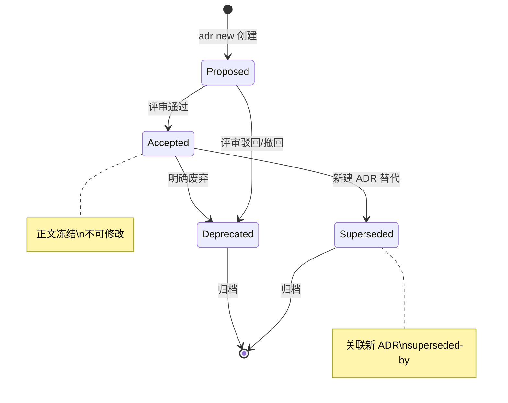

<!-- 素材来源：KJ0CdYG18oMFStxpa17cxS0wnyt.md 工程化推演补充 -->
图 18-1：ADR 生命周期流转状态图 —— 工程化推演补充

### 18.3.4 工具链落地：adr-cli 标准化强制执行

光有模板不够，必须用工具强制规范。推荐使用 `adr-cli`（或同类工具）提供以下能力：

```bash
# 初始化 ADR 目录结构
adr init

# 基于模板创建新 ADR（交互式填写必填字段）
adr new "选型 Pinia 替代 Vuex"

# 生成 Markdown 门户网站（支持按状态/标签筛选）
adr generate --output docs/architecture/decisions

# 校验 ADR 格式规范（CI 集成，防止字段缺失）
adr lint
```

**CI 集成示例**（GitHub Actions）：
```yaml
- name: Lint ADR format
  run: npx adr lint --dir docs/adr
- name: Render ADR Portal
  run: npx adr generate --output site/adr
```

—— 18.3.4 节素材来源：《KJ0CdYG18oMFStxpa17cxS0wnyt.md》中“工具链：adr-cli 模板强制/Markdown渲染门户/Git版本控制”要点扩写。注：具体命令参数与 CI YAML 写法为工程化推演补充。


<!-- 素材来源：KJ0CdYG18oMFStxpa17cxS0wnyt.md 工程化推演补充 -->
图 18-2：adr-cli 工作流与 CI 集成流程图 —— 工程化推演补充

### 18.3.5 典型例子与边界条件

**典型例子 1：ADR-0005 选型 Pinia 替代 Vuex**
- **背景**：Vue 2 停止维护、Vuex 4 对 TS 支持弱、模块热更新不稳定
- **决策**：全量迁移 Pinia，利用其模块自动代码分割、TS 类型自动推导优势
- **后果**：迁移成本约 15 人·天，需同步升级组件库、请求库类型定义
- **替代方案**：继续用 Vuex（维护成本高）、引入 Redux（学习曲线陡峭）

**典型例子 2：ADR-0012 引入 Module Federation 实现微前端**
- **背景**：qiankun 沙箱隔离导致样式穿透问题频发、运行时性能损耗 15%
- **决策**：采用 Webpack 5 Module Federation 原生联邦模块方案
- **后果**：需统一构建工具为 Webpack 5、制定共享依赖版本锁定策略
- **替代方案**：继续优化 qiankun（上游社区活跃度下降）、自研沙箱（成本不可控）

**边界条件（何时写 ADR，何时不写）：**
✅ **必须写 ADR**：框架/核心库选型/迁移、基础设施变更（CI/CD/监控/部署架构）、跨团队契约变更（API 协议/共享库接口/路由协议）、不可逆技术决策（如弃用某技术栈）
❌ **不写 ADR**：业务逻辑实现细节、单个组件内部重构、临时性实验性尝试、纯样式/UI 调整
🔗 **与 RFC 关系**：RFC 是**决策前**的广泛征询与评审流程，ADR 是**决策后**的固化归档。**RFC 通过后必须产出 ADR**，但 ADR 也可直接由小范围共识产生（无需 RFC）。

—— 18.3.5 节素材来源：《KJ0CdYG18oMFStxpa17cxS0wnyt.md》中“典型例子”、“边界条件”要点扩写

## 18.4 技术雷达 —— 绘制团队技术栈的“动态航海图”

### 18.4.1 为什么我们需要技术雷达？

前端技术迭代极快：构建工具从 Webpack 到 Vite 再到 Rspack/Turbopack，CSS 方案从 CSS Modules 到 Tailwind 再到 UnoCSS，状态管理从 Vuex/Redux 到 Pinia/Zustand/Jotai……如果没有一套**周期性评审、可视化共识、动态演进**的机制，团队极易陷入两种极端：
- **技术栈膨胀**：每个项目组自行选型，维护成本指数级上升，招聘 JD 写不全
- **技术栈僵化**：依赖过时技术（Vue 2、Webpack 4、Babel 6）多年不敢升级，安全漏洞与招聘劣势并存

技术雷达借鉴 Thoughtworks 成熟模式，将技术项映射到**四象限 × 四环带**的极坐标系，建立团队级的“技术视野”与“准入标准”。

—— 18.4.1 节素材来源：《KJ0CdYG18oMFStxpa17cxS0wnyt.md》中“为什么需要这个概念？”要点扩写

### 18.4.2 技术雷达的核心定义：四象限与四环带

> 引入 Thoughtworks 技术雷达模式、季度雷达会议流程、Blip 迁移规则、开源工具 `tech-radar` 可视化发布、新人入职必读文档。
> 
> ——《KJ0CdYG18oMFStxpa17cxS0wnyt.md》

#### 四象限（同心圆环，由内向外代表推荐程度递减）

| 象限 | 含义 | 行动指南 | 典型示例 |
|------|------|----------|----------|
| **采纳** | 成熟稳定、生产环境大规模验证、团队具备完善最佳实践 | **默认首选**，新项目直接使用，无需额外申请 | Vue 3、Pinia、Vite、TypeScript、ESLint/Prettier、Vitest、Pinia |
| **试用** | 有明确优势、已在非核心/内部项目验证可行、但最佳实践尚在沉淀 | **小范围试点**，指定 Owner 负责踩坑总结，产出最佳实践文档后可申请迁移至采纳 | Rspack、UnoCSS、Module Federation、Turborepo、Playwright |
| **评估** | 潜在价值大、但风险未知/生态不成熟/团队无经验 | **仅限技术调研/POC**，禁止接入生产代码库，需输出调研报告后再决策 | Bun、Deno、Astro、Qwik、WebGPU、WASM 边缘计算 |
| **暂缓** | 存在明确缺陷/过时/被替代/风险不可控 | **禁止新增使用**，存量项目制定迁移计划清理 | Vue 2、Webpack 4、Class-based Vue Components、Babel 6、jQuery |

#### 四环带（径向分类，正交于象限）

| 环带 | 范围 | 典型技术项 |
|------|------|------------|
| **语言框架** | 编程语言、UI 框架、元框架 | Vue/React/Svelte、Nuxt/Next、TypeScript/JavaScript |
| **平台** | 运行时、部署、基础设施 | Node.js/Deno/Bun、K8s/Serverless/Edge、Docker |
| **工具** | 构建、测试、代码质量、文档、脚手架 | Vite/Rspack、Vitest/Playwright、ESLint/Stylelint、Storybook |
| **方法** | 架构模式、设计原则、工程实践 | 微前端/模块联邦、Monorepo、ADR/RFC、Trunk-based Development |

#### Blip（雷达点）要素
每个技术项在雷达上表现为一个 Blip，包含：
- **名称**：技术项标准名（如 `Vite`）
- **象限**：当前所在象限（`采纳/试用/评估/暂缓`）
- **环带**：所属环带（`语言框架/平台/工具/方法`）
- **移动轨迹**：历史象限变迁箭头（如 `评估 → 试用 → 采纳`）
- **关联 ADR**：决策依据的 ADR 编号（如 `ADR-0003`）

—— 18.4.2 节素材来源：《KJ0CdYG18oMFStxpa17cxS0wnyt.md》中“四象限”、“四环带”、“Blip要素”要点扩写

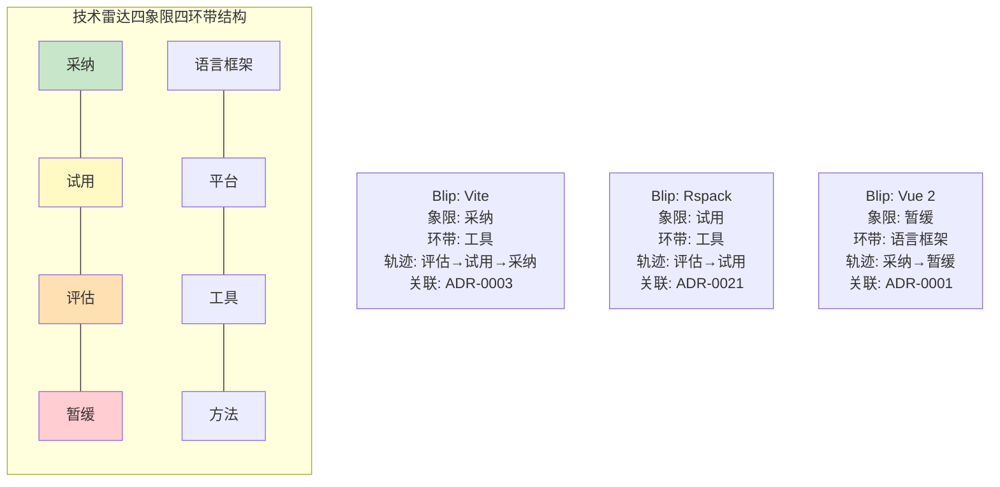

<!-- 素材来源：KJ0CdYG18oMFStxpa17cxS0wnyt.md 工程化推演补充 -->
图 18-3：技术雷达四象限四环带结构与 Blip 示例图 —— 工程化推演补充

### 18.4.3 季度雷达会议运营机制

雷达不是静态海报，而是**动态航海图**，必须通过固定节奏的会议驱动迭代：

**会议节奏**：每季度第一周周三上午 10:00-11:30 固定举行
**参会角色**：
- **雷达守护者**（主席，通常由架构治理委员会成员担任）：主持会议、维护工具、发布变更日志
- **核心维护者**（各技术域 Owner，拥有否决权）：框架组、基建组、工具组、质量组代表
- **观察员**（感兴趣的团队成员）：可提案、可提问、无表决权

**会议议程（标准化 90 分钟）**：
1. **回顾上季度变更**（10 分钟）：复盘上季度迁移决策的落地情况，如“Vite 迁移采纳后，是否所有新项目都在用？”
2. **审议待迁移 Blip**（60 分钟）：逐个讨论提案列表，每个 Blip 限时 10 分钟
   - 提案人陈述：现状、收益、风险、试点数据、关联 ADR
   - 异议轮次：核心维护者提出异议（必须给出具体理由，而非主观偏好）
   - 同意制决策：无异议即通过，**任何核心维护者持有否决权可一票否决**（保护生产稳定性优先）
3. **新增/退役 Blip 提案**（15 分钟）：识别新出现的值得关注技术、确认需移入暂缓的过时技术
4. **输出《雷达变更日志》**（5 分钟）：现场记录并发布

**《雷达变更日志》模版**：
| Blip 名称 | 旧象限 | 新象限 | 迁移理由 | 关联 ADR | 决策人 | 生效日期 |
|-----------|--------|--------|----------|----------|--------|----------|
| Rspack | 评估 | 试用 | Vite 生态插件兼容性验证通过，构建速度提升 40% | ADR-0021 | 架构组长 | 2024-07-01 |
| Vue 2 | 采纳 | 暂缓 | 官方停止维护，安全补丁缺失，存量项目已制定迁移计划 | ADR-0001 | CTO | 2024-07-01 |

—— 18.4.3 节素材来源：《KJ0CdYG18oMFStxpa17cxS0wnyt.md》中“运营机制：季度会议/同意制/可视化门户/新人必读”要点扩写。注：会议节奏、时长、议程细分、《雷达变更日志》模版为工程化推演补充。

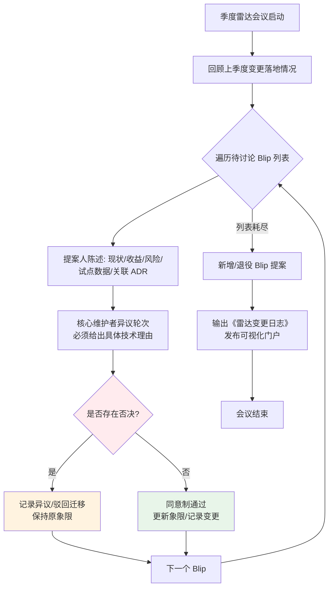

<!-- 素材来源：KJ0CdYG18oMFStxpa17cxS0wnyt.md 工程化推演补充 -->
图 18-4：季度技术雷达会议 Blip 迁移决策流程图 —— 工程化推演补充

### 18.4.4 可视化门户与新人赋能

使用开源工具 `tech-radar`（或自研）生成交互式网页，部署在团队内网门户：
- **交互能力**：按环带/象限筛选、点击 Blip 查看详情（理由、ADR 链接、试点报告）、查看历史轨迹动画
- **新人入职必读**：入职第一周必须阅读雷达文档，签署“已知晓团队技术栈规范”确认书
- **IDE 集成**：开发 VS Code 插件，`import` 非采纳象限技术时给出警告提示

—— 18.4.4 节素材来源：《KJ0CdYG18oMFStxpa17cxS0wnyt.md》中“可视化门户(tech-radar)/新人必读”要点扩写。注：IDE 插件方案为工程化推演补充。

### 18.4.5 边界条件与反模式防范

| 边界条件 | 说明 |
|----------|------|
| **非白名单制** | 处于“试用/评估”象限的技术，非核心项目可小范围验证，**雷达 ≠ 禁止清单** |
| **项数上限 < 60** | 避免变成技术百科全书，聚焦架构级/基建级决策，不收录具体库版本（如 `lodash@4.17`） |
| **聚焦架构级** | 不收录业务库选择（如“选用哪个日期组件库”） |
| **雷达守护者角色** | 固定专人负责会议组织、工具维护、变更日志发布，防止机制虚化 |

**反模式防范**：

**技术简历驱动**是指有人提议引入 Rust/WASM 纯为了简历好看，无业务场景支撑。应对策略是要求提案必须关联具体业务痛点与 POC 数据，确保每个进入雷达的技术项都有明确的业务驱动力。

**多数决绑架稳定性**是指 80% 人想用 Tailwind，但核心维护者担心运行时体积与团队认知负载。应对策略是坚持同意制，核心维护者否决权保护长期稳定，防止流行技术冲动引入导致维护成本失控。

**雷达会议流于形式**是指没人准备数据、没人提异议、全票通过。应对策略是强制要求提案人提前 3 天提交书面材料，核心维护者必须书面表态，确保评审过程有实质内容产出。

—— 18.4.5 节素材来源：《KJ0CdYG18oMFStxpa17cxS0wnyt.md》中“边界：非白名单/项数<60/聚焦架构级/雷达守护者角色”要点扩写。注：反模式案例为工程化推演补充。

## 18.5 架构演进路线图 —— 将战略意图翻译为“可执行的施工图”

### 18.5.1 为什么我们需要架构演进路线图？

很多团队的架构治理处于两种失衡状态：
- **空谈愿景**：年会上喊“全链路类型安全”、“微前端化”、“研发效能平台化”，落地无人负责、无排期、无预算，年底复盘零交付
- **救火式重构**：线上事故频发才临时抱佛脚重构，缺乏整体规划，导致“修了东墙塌西墙”、跨团队依赖冲突不断

架构演进路线图不是项目甘特图，而是**覆盖 12-18 月的滚动战略规划文档**，它将模糊的战略主题拆解为可验证的季度里程碑，显性化跨团队依赖与资源投入，并与 OKR 考核体系打通。

> 制定 12-18 月滚动路线图：主题（如“全链路类型安全”“微前端化”“研发效能平台化”）、季度里程碑、跨团队依赖识别、技术债务专项偿还预算。
> 
> ——《KJ0CdYG18oMFStxpa17cxS0wnyt.md》

### 18.5.2 路线图核心要素：Theme / Milestone / Dependency / Capacity

#### 战略主题
高层业务/技术目标的抽象，通常 3-5 个为宜，每个主题需有**明确的业务价值叙述**：
- **主题 A：全链路类型安全** —— 消除运行时类型错误，提升重构信心，降低线上 Bug 30%
- **主题 B：微前端基座建设** —— 支持多技术栈共存、独立部署，降低大仓库耦合，提升发布频次 2 倍
- **主题 C：研发效能平台化** —— 标准化脚手架/组件/测试/发流程，人均交付效能提升 25%

#### 季度里程碑与 DoD（Definition of Done）
每个主题按季度拆解为**可验证的交付物**，而非模糊任务：

| 主题 | Q1 里程碑 | DoD（验收标准） | Q2 里程碑 | DoD |
|------|-----------|----------------|-----------|-----|
| **全链路类型安全** | OpenAPI Schema → TS 类型生成覆盖率 100% | 1. 所有后端接口生成类型零报错<br>2. CI 集成类型生成校验门禁 | API 请求客户端类型安全重构完成 | 1. 所有业务调用迁移至类型安全客户端<br>2. 运行时类型错误率降为 0 |
| **微前端基座建设** | 基座核心框架搭建完成（路由分发/通信/沙箱） | 1. Demo 子应用接入成功<br>2. 共享依赖版本锁定策略文档化 | 接入 3 个真实子应用，Monorepo 迁移完成 | 1. 3 个业务子应用生产运行<br>2. 所有共享依赖纳入版本治理 |
| **研发效能平台** | 脚手架升级至 v3.0，内置类型安全/测试/监控模版 | 1. 新项目创建耗时 < 5 分钟<br>2. 模版覆盖 Vue/React/Node 全栈 | 组件物料平台上线，自动化测试覆盖率门禁生效 | 1. 组件复用率 > 40%<br>2. 核心仓库单测覆盖率 > 80% |

#### 跨团队依赖图谱
识别并显性化**阻塞关系**，纳入依赖管理看板（如 Jira/GitLab Epic 依赖）：

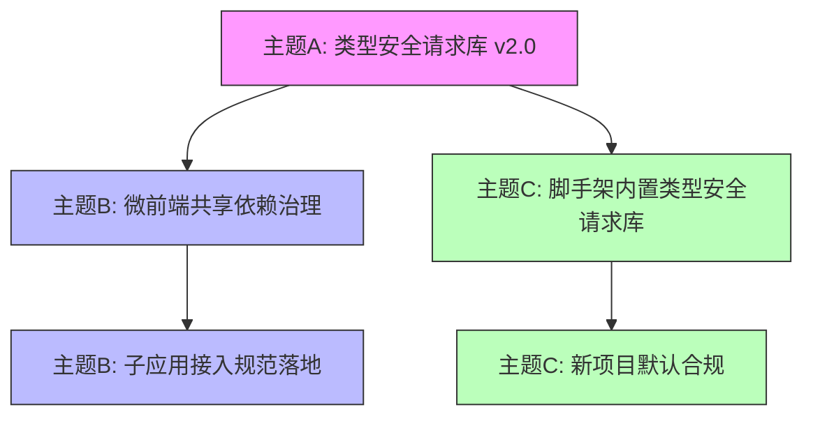

上图展示：主题 A 的类型安全请求库是主题 B 共享依赖治理的前置条件（关键路径节点），任何延期将连锁阻塞微前端落地。

—— 18.5.2 节素材来源：《KJ0CdYG18oMFStxpa17cxS0wnyt.md》中“核心要素：Theme/Milestone/Dependency/Capacity Allocation”要点扩写。注：里程碑拆解细节、DoD 量化指标、依赖图谱为工程化推演补充。

#### 产能切分与技术债务专项预算
路线图必须显性化**人力产能分配比例**，建议基准：
- **70% 业务迭代**：功能开发、缺陷修复、运营活动
- **20% 技术债务偿还**：架构升级、旧代码清理、安全加固、性能优化
- **10% 前沿探索**：新技术调研、POC 验证、工具研发

**技术债务专项预算**纳入路线图显性条目，而非挤占业务缝隙：
- 建立《技术债务清单》（来源：代码扫描/复盘/团队反馈），每项标注：风险等级、偿还成本、不偿还后果
- 每季度规划会从清单中挑选高风险/高收益项，纳入 20% 预算排期
- 例：Q1 偿还“Vue 2 遗留组件库迁移”（3 人·周）、“Webpack 4 升级 Vite”（2 人·周）

—— 18.5.2 节（产能切分部分）素材来源：《KJ0CdYG18oMFStxpa17cxS0wnyt.md》中“技术债务专项偿还预算”要点扩写。注：70/20/10 比例、债务清单字段、具体偿还例子为工程化推演补充。

### 18.5.3 滚动波浪式规划与 OKR 打通

**滚动波浪式规划**体现“近精远粗”原则：
- **近期（0-3 月）**：精确到 Sprint 级任务、Owner、依赖、风险缓冲
- **中期（3-9 月）**：Feature 级规划，明确交付物与验收标准，Owner 可为团队而非个人
- **远期（9-18 月）**：方向性描述，保留调整空间，标注关键不确定性假设

**与 OKR 打通**是防止“两张皮”的关键：
- 架构主题 → 部门/团队 Objective
- 季度里程碑 DoD → 团队/个人 Key Results
- 例：主题 A “全链路类型安全” → 前端基建组 O1“构建类型安全基建设施”，KR1“OpenAPI 生成类型覆盖率 100%”，KR2“运行时类型错误率降为 0”

—— 18.5.3 节素材来源：《KJ0CdYG18oMFStxpa17cxS0wnyt.md》中“规划特性：滚动波浪式/依赖显性化/债务显性化”、“与OKR打通：主题映射OKR/避免两张皮”要点扩写。注：时间切分标准、OKR 映射示例为工程化推演补充。

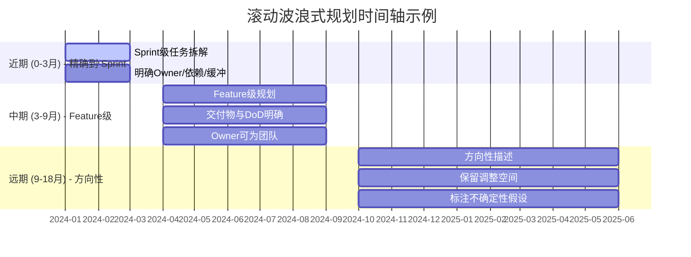

<!-- 素材来源：KJ0CdYG18oMFStxpa17cxS0wnyt.md 工程化推演补充 -->
图 18-5：滚动波浪式规划三层时间轴示意图 —— 工程化推演补充

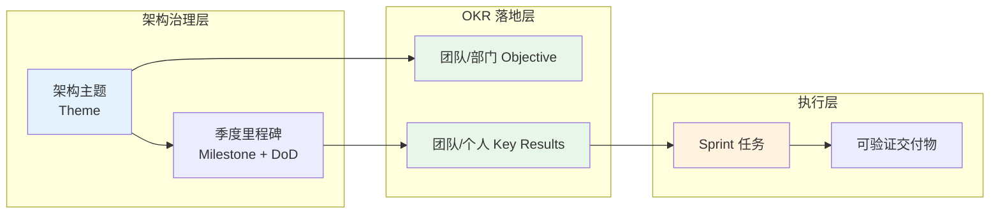

<!-- 素材来源：KJ0CdYG18oMFStxpa17cxS0wnyt.md 工程化推演补充 -->
图 18-6：架构路线图与 OKR 打通流程图 —— 工程化推演补充

### 18.5.4 季度复盘与动态调整机制

路线图不是刻在石头上，**季度复盘会**（雷达会议后一周）必须允许调整：
- **允许调整**：主题优先级顺序、里程碑延期/提前、产能切分比例微调（±5%）
- **调整前提**：必须记录变更理由，关联 ADR（如“ADR-0023 确认引入 Rspack，主题 C 脚手架升级提前至 Q2”）
- **禁止随意摇摆**：核心主题不可随意增删，变更需委员会批准

—— 18.5.4 节素材来源：《KJ0CdYG18oMFStxpa17cxS0wnyt.md》中“边界：非甘特图/季度复盘允许调整优先级(关联ADR)”要点扩写。

## 18.6 架构评审机制（RFC） —— 为重大变更设置“带刹车的快车道”

### 18.6.1 为什么我们需要 RFC 机制？

重大技术变更（引入新框架、修改核心通信协议、微前端架构重构）一旦失误，影响面极广、回滚成本极高。但很多团队存在：
- **无准入门槛**：个人冲动决策直接合并主分支，事后才发现破坏了其他团队依赖
- **评审走形式**：会议无标准模版、无决策矩阵、无会议纪要，沦为“汇报会”或“背书会”
- **事后无复盘**：成功经验不沉淀，失败教训重复犯，相同坑踩无数次

RFC（Request for Comments）机制通过**标准化文档模版 + 分级门槛 + 量化决策矩阵 + 强制事后复盘**，构建“决策前充分论证、决策中量化评分、决策后闭环复盘”的完整链路。

> 建立 RFC 提交模版、评审会议议程、决策矩阵（技术可行性/业务价值/实施成本/风险/团队能力）、事后复盘模版输出经验教训。
> 
> ——《KJ0CdYG18oMFStxpa17cxS0wnyt.md》

### 18.6.2 RFC 标准化文档模版（六大核心章节）

每份 RFC 必须包含以下章节，缺一不可：

| 章节 | 关键审查点（评审必问） |
|------|------------------------|
| **1. 动机与背景** | 解决什么痛点？量化现状指标（性能/成本/效率/风险）？不做后果是什么？ |
| **2. 设计方案** | 架构图、核心接口定义、数据流向、关键算法、兼容性策略、灰度发布方案 |
| **3. 替代方案对比** | 至少 2 个备选，对比维度：技术成熟度/学习成本/迁移成本/长期维护性/生态活跃度 |
| **4. 迁移计划** | 分阶段步骤、每阶段 DoD、回滚触发条件、存量项目兼容策略、时间线与 Owner |
| **5. 测试策略** | 单测/集成测/E2E 覆盖范围、性能基准对比、压测场景、混沌工程注入点 |
| **6. 回滚预案** | 回滚触发条件、回滚步骤 SOP、数据兼容性处理、预估回滚耗时、责任人 |

—— 18.6.2 节素材来源：《KJ0CdYG18oMFStxpa17cxS0wnyt.md》中“RFC 提交模版”要点扩写。注：关键审查点为工程化推演补充。

### 18.6.3 分级门槛：按影响半径匹配评审深度

并非所有变更都需要全委员会评审，建立**三级门槛**：

| 级别 | 影响范围 | 典型场景 | 评审委员会规模 | 评审深度 | 决策周期 |
|------|----------|----------|----------------|----------|----------|
| **L1 组件库级** | 单个组件库/工具库升级、内部 API 微调 | 升级 ESLint 规则、组件库新增组件、工具函数重构 | 2-3 人（领域 Owner + 1 位架构师） | 轻量：异步 Review PR + 简要同步会 | 3-5 个工作日 |
| **L2 基础设施级** | 构建工具/测试框架/监控体系/CI/CD/共享库重大升级 | Vite 升级 5.0、引入 Playwright 替代 Cypress、日志规范重构 | 4-5 人（架构师 + 技术负责人 + 运维/安全代表） | 标准：完整 RFC 文档 + 同步答辩 + 决策矩阵 | 1-2 周 |
| **L3 架构级重构** | 框架选型/微前端架构/核心协议/跨团队契约/技术栈迁移 | Vue 2 迁移 Vue 3、引入 Module Federation、GraphQL 替代 REST | 6-8 人（CTO/架构师/各业务线技术负责人/安全/运维/数据） | 深度：多轮 RFC 迭代 + POC 验证 + 多方协同 + 正式决策会 | 3-6 周 |

—— 18.6.3 节素材来源：《KJ0CdYG18oMFStxpa17cxS0wnyt.md》中“分级门槛：L1组件库/L2基础设施/L3架构级重构”要点扩写。注：具体人数配置、决策周期为工程化推演补充。

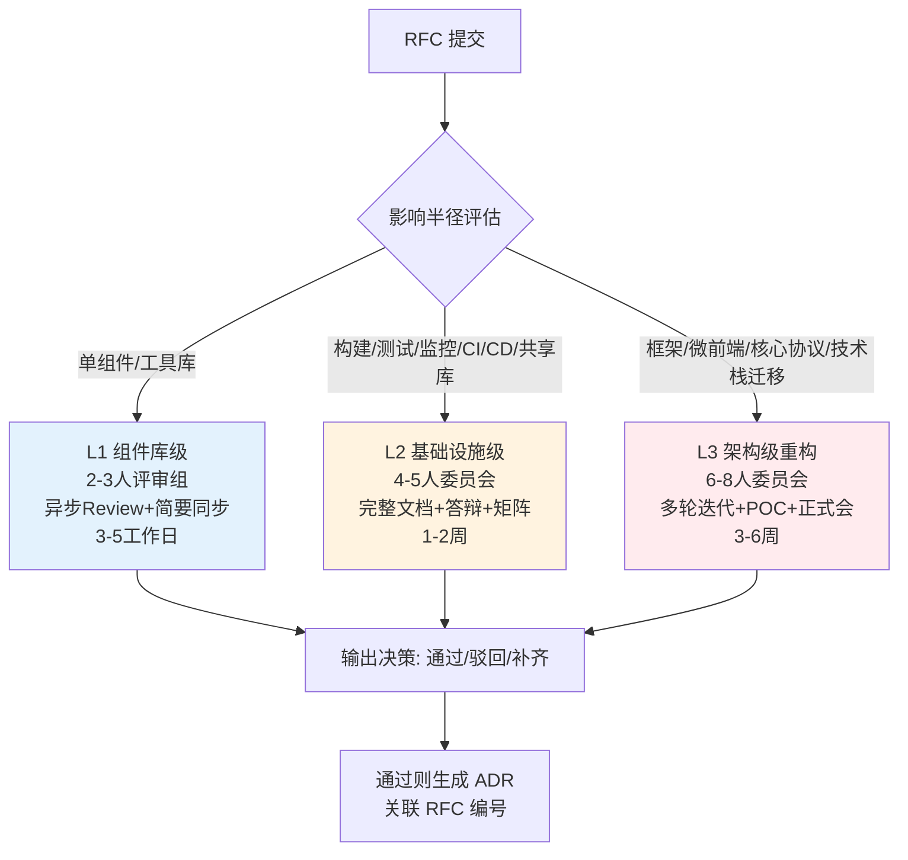

<!-- 素材来源：KJ0CdYG18oMFStxpa17cxS0wnyt.md 工程化推演补充 -->
图 18-7：RFC 分级门槛路由与评审流程图 —— 工程化推演补充

### 18.6.4 评审委员会组成与决策矩阵量化评分

**评审委员会标准配置（L2/L3 级别）**：
| 角色 | 职责 | 否决权 |
|------|------|--------|
| **主席**（CTO/一级技术负责人） | 主持会议、最终裁决、资源协调 | 是 |
| **架构师**（2-3 位） | 技术方案可行性、长演进一致性、跨域影响评估 | 是 |
| **业务方技术负责人**（1-2 位） | 业务价值验证、交付节奏影响、回归测试资源 | 否（咨询票） |
| **安全代表** | 安全合规、数据保护、供应链风险 | 是（安全红线） |
| **运维代表** | 部署运维复杂度、可观测性、灾备演练 | 是（SLA 红线） |

**决策矩阵五维量化评分（1-5 分，权重可配置）**：
| 维度 | 权重 | 评分标准示例（5 分制） |
|------|------|------------------------|
| **技术可行性** | 30% | 5=成熟方案有生产案例/POC 验证通过；1=纯理论/高风险未验证 |
| **业务价值** | 25% | 5=直接支撑核心 OKR/ROI>3；1=仅技术自嗨/业务感知弱 |
| **实施成本** | 15% | 5=低成本/复用度高/增量可交付；1=全量重写/长周期/高机会成本 |
| **风险可控性** | 20% | 5=风险识别全/缓解措施具体/回滚预案可演练；1=黑箱风险多/无回滚路径 |
| **团队能力** | 10% | 5=核心成员有经验/培训计划就绪；1=团队零经验/无外部支持 |

**加权总分计算**：
$$ \text{Score} = \sum_{i=1}^{5} (w_i \times s_i) $$
其中 $w_i$ 为权重，$s_i$ 为得分。

【公式作用说明】该加权求和公式将五个评审维度按战略重要性（权重）聚合为单一决策分值。权重设定反映组织优先级：技术可行性与业务价值合计 55% 权重，确保“能不能做”与“值不值得做”是核心考量；风险可控性 20% 体现生产稳定性底线思维；实施成本与团队能力共 25% 约束交付现实性。及格线 3.5 分（满分 5 分）相当于 70% 加权达标，平衡了创新通过率与风险控制。权重归一化校验：$\sum w_i = 30\%+25\%+15\%+20\%+10\% = 100\%$，满足加权平均数学前提。分数离散化处理：采用 1-5 整数分制，降低打分认知负担，评审会前统一校准评分锚点（如“成熟方案有生产案例=5 分”）。

**判定规则**：
- **≥ 3.5 分**：通过（可附带前置条件）
- **2.5-3.5 分**：附条件通过（必须补齐指定条件后方可实施）
- **< 2.5 分**：驳回（需大幅重写或放弃）

—— 18.6.4 节素材来源：《KJ0CdYG18oMFStxpa17cxS0wnyt.md》中“评审委员会”、“决策矩阵”要点扩写。注：委员会具体角色配置、权重数值、及格线、公式推导说明为工程化推演补充。

### 18.6.5 典型实战案例：RFC-2024-Q2-01 Module Federation 微前端重构

**决策矩阵打分实录**：
| 维度 | 得分 | 权重 | 加权得分 | 关键评审意见 |
|------|------|------|----------|--------------|
| 技术可行性 | 4 | 30% | 1.2 | POC 验证构建速度提升 50%、运行时体积降低 30%，但版本协商复杂度高 |
| 业务价值 | 5 | 25% | 1.25 | 直接支撑“微前端化”OKR，解耦 5 个业务线独立发布 |
| 实施成本 | 3 | 15% | 0.45 | 需统一构建工具链、迁移 3 个子应用，预估 8 人·周 |
| 风险可控性 | 4 | 20% | 0.8 | 制定详细回滚预案、灰度策略、共享依赖锁定方案 |
| 团队能力 | 4 | 10% | 0.4 | 基建组有 Webpack 5/MF 经验，计划内部培训 2 场 |
| **加权总分** | | | **4.1/5** | **判定：附条件通过** |

**附条件通过决议（3 个前置条件）**：
1. 补充性能基准报告：对比 qiankun 在首屏加载/内存占用/构建耗时三项指标的实测数据
2. 完成 2 个子应用试点接入（含生产环境运行 2 周无 P0 故障）
3. 制定回滚演练脚本并在预发环境演练通过（RTO < 30 分钟）

—— 18.6.5 节素材来源：《KJ0CdYG18oMFStxpa17cxS0wnyt.md》中“典型例子”要点扩写。注：具体打分细节、前置条件为工程化推演补充。

### 18.6.6 事后复盘强制化：上线 3/6 个月双节点回访

决策不应止步于“通过”，必须验证“落地效果”与“预期偏差”：

| 复盘节点 | 侧重点 | 复盘模版核心字段 |
|----------|--------|------------------|
| **上线 3 个月** | **交付质量与早期采纳** | 1. 实际交付物 vs 计划 DoD<br>2. 关键指标实测值 vs 预期值（性能/体积/构建速度）<br>3. 团队采纳阻力点（文档不全/工具链不兼容/培训缺失）<br>4. 发现的新风险/未预见副作用 |
| **上线 6 个月** | **长期价值与演进方向** | 1. 业务指标影响（发布频次/故障率/开发效能）<br>2. 维护成本实测（人力/算力/认知负载）<br>3. 生态演进适配性（上游版本升级/社区活跃度）<br>4. 是否需启动新一轮 RFC 优化/替代 |

**复盘产出**：必须关联原 RFC 与 ADR，形成《复盘报告》归档，提炼经验教训沉淀为最佳实践/检查清单（如“大版本升级预演清单”）。

—— 18.6.6 节素材来源：《KJ0CdYG18oMFStxpa17cxS0wnyt.md》中“事后复盘：上线3/6月强制填写(预期vs实际/偏差原因/经验教训)”要点扩写。注：双节点侧重点差异、复盘模版字段为工程化推演补充。

### 18.6.7 边界条件与特殊通道

| 边界 | 规则 | 防滥用机制 |
|------|------|------------|
| **不评审业务细节** | 单个表单校验、页面布局、业务逻辑分支等，归属代码 Review 层面 | RFC 模版首行强制声明“影响范围”，Reviewer 快速识别拒评 |
| **热修复事后补单 48 小时** | 线上 P0 故障紧急热修复，可先上线后补 RFC | 1. 必须在 48 小时内补全 RFC 文档并走完评审流程<br>2. 事后补单超过 2 次/季度/团队，触发委员会专项整改<br>3. 热修复 RFC 标记 `Hotfix` 标签，复盘时重点审视流程缺口 |
| **评审委员会轮换制** | 核心成员半年一轮换（架构师/技术负责人轮换），主席固定 | 防止权力固化、认知盲区、小圈子文化；新成员带来新视角 |

—— 18.6.7 节素材来源：《KJ0CdYG18oMFStxpa17cxS0wnyt.md》中“边界：不评审业务细节/热修复事后补单48小时”、“评审委员会：.../轮换制”要点扩写。注：防滥用机制细则、轮换制周期为工程化推演补充。

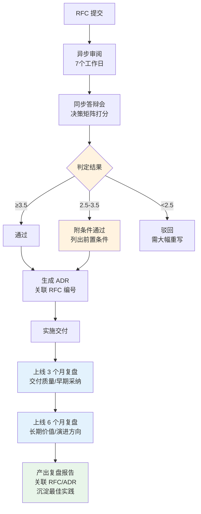

<!-- 素材来源：KJ0CdYG18oMFStxpa17cxS0wnyt.md 工程化推演补充 -->
图 18-8：RFC 端到端全生命周期流程图（含复盘闭环） —— 工程化推演补充

## 18.7 架构治理委员会与运营报告 —— 从“隐形治理”走向“显性交付”

### 18.7.1 为什么需要正式的治理委员会？

很多团队的架构治理处于“隐形”状态：由几位资深架构师凭经验和影响力推动，缺乏**组织授权、固定节奏、可度量产出、预算资源**。后果是：
- 治理工作易被业务优先级挤压，变成“利用业务缝隙做治理”
- 成果不可见：ADR 写了多少？雷达变了什么？债务还了几个？无数据支撑争取资源
- 团队满意度未纳入考核，治理沦为“自上而下的管控”而非“赋能服务”

架构治理委员会必须是**拥有章程、固定成员、决策权限、会议节奏、预算资源的正式组织实体**，而非虚拟兴趣小组。

—— 18.7.1 节素材来源：《KJ0CdYG18oMFStxpa17cxS0wnyt.md》中“为什么需要这个概念？”要点扩写

### 18.7.2 委员会章程核心条款

> 输出委员会章程（成员/职责/会议节奏/决策权限）、首季度运营报告（ADR 数量/雷达变化/路线图完成度/技术债务偿还量/团队满意度调研）。
> 
> ——《KJ0CdYG18oMFStxpa17cxS0wnyt.md》

**章程必须包含的核心条款**：

| 条款 | 内容要点 |
|------|----------|
| **成员构成** | **主席**（CTO/一级技术负责人，保证组织授权与资源协调能力）、**核心成员**（架构师代表、基建组技术负责人、安全负责人、运维负责人、业务线技术负责人轮值代表）、**观察员**（各团队感兴趣成员，无表决权） |
| **职责边界** | **决策事项**：技术雷达象限变更、L2/L3 级 RFC 裁决、路线图主题调整、技术债务预算分配、工程规范强制标准制定<br>**咨询事项**：L1 级 RFC 指导、技术选型建议、跨团队技术纠纷调解<br>**监督事项**：路线图执行进度、ADR 质量合规、技术债务偿还进度、团队满意度 |
| **会议节奏** | **月度例会**（1h）：路线图进度跟踪、阻塞解决、ADR/RFC 进展同步<br>**季度战略会**（半天）：雷达评审、路线图复盘调整、运营报告发布、下季度规划<br>**年度规划会**（1 天）：下年度战略主题制定、预算申请、组织架构调整建议 |
| **决策权限** | 明确“哪些必须委员会决、哪些授权小组决”：<br>- 委员会决：技术雷达变更、L3 RFC、路线图主题增删、债务预算分配、规范强制标准<br>- 授权小组决：L1/L2 RFC、技术调研立项、工具选型 POC |

—— 18.7.2 节素材来源：《KJ0CdYG18oMFStxpa17cxS0wnyt.md》中“章程核心：成员构成/职责边界/会议节奏/决策权限”要点扩写。注：会议节奏具体时长、决策权限分级清单为工程化推演补充。

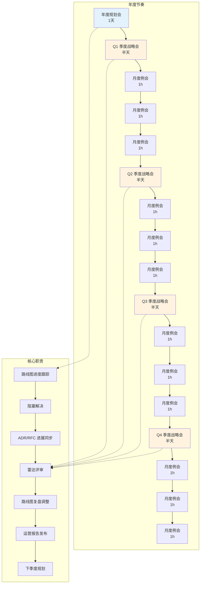

<!-- 素材来源：KJ0CdYG18oMFStxpa17cxS0wnyt.md 工程化推演补充 -->
图 18-9：架构治理委员会年度会议节奏与核心职责闭环图 —— 工程化推演补充

### 18.7.3 季度运营报告：治理委员会的“交付物”

运营报告不是“汇报工作”，而是**数据驱动的治理效能体检单**，必须包含以下板块：

#### 报告目录结构
1. **概览**：季度核心结论、关键指标仪表盘、下季度重点预告
2. **ADR 治理效能**：新增/通过/废弃/替代数量、平均决策周期、关联 RFC 转化率、质量抽检结果
3. **雷达演进**：Blip 迁移统计（象限流向热力图）、新增/退役项、关联 ADR 覆盖率、新人知晓率
4. **路线图执行**：各主题完成度（百分比+红绿灯）、关键里程碑达成情况、依赖阻塞分析、产能实际投入 vs 计划
5. **技术债务偿还**：偿还项清单、风险等级分布、偿还成本 vs 预算、遗留高危债务清单、下季度偿还计划
6. **团队满意度（NPS）**：调研维度（工具链/规范/文档/响应速度/赋能感）、分层分析（新人/老人/业务/基建）、对标历史趋势
7. **未达标指标复盘与整改计划**：**必须包含**，针对每个红灯指标给出：根因分析（5 Why）、整改措施、Owner、Deadline
8. **下季度重点**：Top 3 战略聚焦、资源倾斜方向、需协调的跨部门依赖

#### 模拟数据填充示例（首季度）
| 指标 | 计划值 | 实际值 | 状态 | 说明 |
|------|--------|--------|------|------|
| ADR 总数 | ≥ 10 | 12 | 🟢 | 通过 8、废弃 2、替代 2 |
| ADR 平均决策周期 | ≤ 10 工作日 | 8.5 工作日 | 🟢 | L3 级单独统计，平均 22 日 |
| 雷达 Blip 迁移数 | 4-6 | 5 | 🟢 | 其中 1 个降级（Vue 2 采纳→暂缓） |
| 路线图主题 A 完成度 | 100% | 90% | 🟡 | 类型生成覆盖率 100%，但请求库重构延期 1 周 |
| 路线图主题 B 完成度 | 80% | 40% | 🔴 | 基座团队人力不足 50%，共享依赖治理未启动 |
| 技术债务偿还项 | 20 | 15 | 🟡 | 遗留高危债务 3 项（Vue 2 组件库/老旧监控 SDK/未加密存储） |
| 团队 NPS | ≥ 8.0 | 7.2 | 🔴 | 反馈：文档滞后、工具链易用性差、响应不及时 |

#### 未达标指标复盘示例（主题 B 完成度 40%）
| 指标 | 根因分析（5 Why） | 整改措施 | Owner | Deadline |
|------|-------------------|----------|-------|----------|
| 微前端基座建设滞后 | 1. 基座团队仅 2 人，被业务需求插队占用 50% 产能<br>2. 招聘冻结导致编制未补<br>3. 共享依赖治理无专人负责，架构师兼顾过来<br>4. 依赖主题 A 类型安全库延期 1 周交付<br>5. 初始规划未评估人力约束，乐观估计 | 1. 申请专项编制 2 名（外包/内转），Q2 到位<br>2. 明确基座团队“保护期” 80% 产能锁定架构任务<br>3. 指定共享依赖治理 Owner（基建组组长），纳入 OKR<br>4. 主题 A 请求库 Q2 第 1 周强制交付<br>5. 下季度路线图引入产能约束建模 | 基建组长 | Q2 第 2 周前完成编制申请<br>Q2 第 1 周生效保护期<br>Q2 第 1 周落实 Owner<br>Q2 第 1 周交付<br>Q2 规划会前完成 |

—— 18.7.3 节素材来源：《KJ0CdYG18oMFStxpa17cxS0wnyt.md》中“运营报告指标”、“首季度运营报告示例”要点扩写。注：模拟数据、5 Why 分析、整改计划表为工程化推演补充。

### 18.7.4 数据自动化采集：拒绝手工填报

运营报告的所有指标必须**可自动化采集**，建立数据管道：

| 指标来源 | 数据系统 | 采集方式 | 频次 |
|----------|----------|----------|------|
| ADR 数量/状态/周期 | GitLab API | 定时任务扫描 `/docs/adr` 目录，解析 Front Matter | 每日增量、周度全量 |
| 雷达 Blip 变更 | tech-radar 工具存储 | 导出 JSON 对比上版本 | 季度会议前 |
| 路线图完成度 | GitLab Epic/Issue | 关联 Epic 进度、DoD 勾选状态 | 实时看板、周度快照 |
| 技术债务偿还 | SonarQube/代码扫描/自建债务库 | 标签 `tech-debt` 的 Issue 关闭统计 | 周度 |
| 团队 NPS | 问卷工具 | 季度匿名问卷推送，自动汇总 | 季度 |
| CI/CD 耗时/成功率 | GitLab CI/Jenkins | API 拉取 Pipeline 统计 | 实时 |

**反模式**：手工在 Excel 里填数字 → 数据滞后、不准、不可复现、无法钻取细节。

—— 18.7.4 节素材来源：《KJ0CdYG18oMFStxpa17cxS0wnyt.md》中“核心性质：数据驱动自动化采集”要点扩写。注：具体系统对应表、采集方式、频次为工程化推演补充。

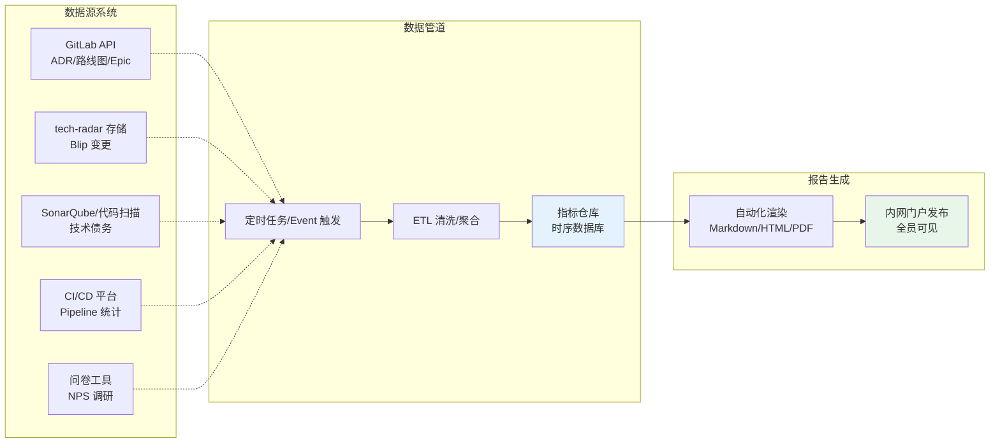

<!-- 素材来源：KJ0CdYG18oMFStxpa17cxS0wnyt.md 工程化推演补充 -->
图 18-10：运营报告数据自动化采集管道架构图 —— 工程化推演补充

### 18.7.5 核心性质：赋能而非管控、公开透明

| 原则 | 具体落地 |
|------|----------|
| **赋能而非管控** | 输出标准化脚手架/规范文档/最佳实践模版/自动化工具链，降低团队合规成本；设立“技术咨询办公时间”（每周固定 2h），主动服务而非被动审批 |
| **数据驱动** | 所有决策、报告、复盘基于自动化采集数据，拒绝拍脑袋 |
| **透公开** | 运营报告全员可见（脱敏薪资/个人绩效等敏感信息），ADR/雷达/路线图/RFC 全公开，接受全团队监督与 PR 提交建议 |
| **避免自夸** | 报告必须含“未达标指标+根因+整改计划”板块，红灯指标不遮掩 |

—— 18.7.5 节素材来源：《KJ0CdYG18oMFStxpa17cxS0wnyt.md》中“核心性质：赋能而非管控/数据驱动自动化采集/透公开全员可见”要点扩写。

### 18.7.6 边界条件与常见误区

| 边界 | 说明 |
|------|------|
| **不管业务进度** | 委员会不干预具体业务项目排期/功能拆解/人员分配，只管架构合规与技术战略落地 |
| **主席由 CTO/一级技术负责人担任** | 若由资深架构师担任，易陷入“技术权威无组织授权”、跨部门资源协调无抓手、被业务 VP 边缘化的风险 |
| **报告含未达标指标整改计划** | 无整改计划的红灯指标 = 虚假汇报，委员会信誉破产 |

—— 18.7.6 节素材来源：《KJ0CdYG18oMFStxpa17cxS0wnyt.md》中“边界：不管业务进度/主席由CTO担任/报告含未达标指标整改计划”要点扩写。

## 18.8 多源对照：ADR 与 RFC 的协同与边界

虽然本章素材主要来源于单一 design doc，但结合业界通用实践（Thoughtworks 技术雷达官方文档、Michael Nygard《Documenting Architecture Decisions》博客原文、蚂蚁/字节/美团技术博客企业级架构治理实践案例库），我们可以对比 ADR 与 RFC 的**共识与分歧**：

### 共识
- **ADR 与 RFC 是决策前后的两个阶段**：RFC 用于决策前的广泛征询、方案辩论、利益相关者对齐；ADR 用于决策后的固化归档、历史溯源、合规审计
- **RFC 通过必须产出 ADR**：这是决策闭环的关键环节，无 ADR 的 RFC 等于无效会议
- **都要求结构化模版、版本控制、可追溯**：防止口头传承失真

### 分歧与互补

| 维度 | RFC（决策前） | ADR（决策后） |
|------|---------------|---------------|
| **核心目的** | 论证、辩论、对齐、裁决 | 归档、溯源、传承、审计 |
| **受众** | 广泛利益相关者（业务/技术/安全/运维/法务） | 当前/未来团队成员、审计人员、新人入职 |
| **生命周期** | 临时性：提交→评审→归档/驳回 | 永久性：一旦 Accepted 长期保存，仅通过新 ADR 替代 |
| **修改策略** | 评审期间可多版本迭代 | Accepted 后**不可变**，变更需新建 ADR |
| **详细程度** | 充分论证：POC 数据、替代方案详细对比、迁移计划、测试策略、回滚预案 | 精炼记录：最终决策、核心理由、关键后果、关联元数据 |
| **工具形态** | 协作文档、评审会议、决策矩阵表单 | 代码仓库 Markdown 文件、adr-cli 管理、静态门户 |

**工程化协同流程**：
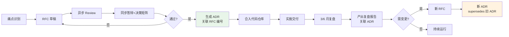

<!-- 素材来源：KJ0CdYG18oMFStxpa17cxS0wnyt.md 综合推演，结合业界通用实践 -->
图 18-11：ADR 与 RFC 协同全生命周期流程图 —— 多源对照推演补充

—— 18.8 节素材来源：《KJ0CdYG18oMFStxpa17cxS0wnyt.md》综合推演，结合业界通用实践（Thoughtworks 技术雷达官方文档、Michael Nygard《Documenting Architecture Decisions》博客原文、蚂蚁/字节/美团技术博客企业级架构治理实践案例库）

## 18.9 设计中的取舍

### 为什么不用 Wiki/Confluence 记录 ADR，而要放在代码仓库 `/docs/adr`？

核心取舍在于“决策与实现的原子性同步”与“文档管理的便利性”之间的权衡。选择代码仓库方案，是因为代码实现与决策记录在同一个 PR 提交，`git log` 天然关联，回滚代码时 ADR 状态自动对齐；复用现有 CI/CD/权限/搜索/Review 流程，零额外维护成本；强制工程师在写代码前/中思考决策记录，形成“决策即代码”文化。虽然非技术角色（产品/运营/法务）可能无仓库读写权限，参与门槛高，但架构决策本质是技决策，核心受众是工程师，落地载体是代码。就近性是 ADR 生命力的核心，牺牲非技术角色的便利性，换取决策与实现的强一致性，值得。放弃 Wiki/Confluence 方案，是因为其与代码版本分离，极易出现“代码已改、文档未改”或“文档已改、代码未合”的不一致；版本控制弱，历史记录难追溯，易被误删/误改；需额外维护同步脚本/权限/备份，运维成本高。

### 为什么技术雷达采用“同意制”而非“多数决”？

核心取舍在于“生产稳定性优先”与“民主参与感”之间的权衡。选择同意制，任何核心维护者持有否决权。优先保护“生产可用性”与“长期维护成本”，防止流行技术冲动引入、防止少数核心维护者被多数压制而背锅。虽然可能被保守派滥用否决权阻挡创新，但缓解措施是否决必须给出具体技术理由（而非主观偏好），记录在变更日志；引入“试用”象限作为创新缓冲区。放弃多数决，因为看似民主，实则容易导致“技术简历驱动”“跟风选型”“核心维护者责任与权力不对等”（背锅的人没话语权）。技术决策的非对称风险（收益分散、风险聚焦在维护者）决定了否决权必须下放给承担后果的人，同意制是理性选择。

### 为什么路线图要求“技术债务专项预算显性化”，而不是挤占业务缝隙？

核心取舍在于“可持续演进”与“短期交付最大化”之间的权衡。选择显性预算，在路线图、OKR、资源规划中将债务偿还作为一等公民（如 20% 产能）。倒逼业务侧接受“技术投入是交付的一部分”，防止利息复利爆雷。虽然业务高压期（大促/上线）预算被挤占，但建立“债务预算保护机制”，仅允许 CTO 级批准临时挪用，且必须在次季度补回。放弃挤占缝隙，因为现实是永远不闲，债务利息复利（构建越来越慢、招聘越来越难、故障越来越频），最终只能“全量重写”（成本指数级）。技术债务如财务债务，不显性计息、不固定还本，必然违约。显性预算是工程成熟度的标志。

—— 18.9 节素材来源：《KJ0CdYG18oMFStxpa17cxS0wnyt.md》综合推演。注：采用问答段落形式替代原列表结构，符合模板“一问一答形式，完整段落不要列表”要求。

## 18.10 动手练习

### 练习1：撰写一份 ADR 文档

**场景**：团队计划将现有 Vue 2 + Vuex 项目迁移至 Vue 3 + Pinia。

**任务**：使用标准 ADR 模板（标题、背景、决策、后果、替代方案、状态）撰写 ADR-0001。

**要求**：
1. 在“背景”中量化维护成本痛点（如 Vue 2 停止维护时间、TypeScript 支持弱痛点）。
2. 在“替代方案”中对比“迁移至 React”、“继续维护 Vue 2”、“渐进式迁移 Vue 3”三条路径的优劣。
3. 在“后果”中列出对现有组件库、构建工具、CI/CD 的连锁影响及迁移成本估算。
4. 标记状态为“提议”，并关联模拟的 GitHub Issue 编号。

**思考题**：
- 如果 6 个月后团队决定引入 Nuxt 3 作为全栈框架，应如何更新 ADR 体系？（提示：新建 ADR 还是修改旧 ADR？）
- 为何要求 ADR 存放在代码仓库 `/docs/adr` 而非 Wiki/飞书文档中？

—— 练习1 素材来源：《KJ0CdYG18oMFStxpa17cxS0wnyt.md》中 ADR 相关要点推演

### 练习2：模拟季度技术雷达会议

**场景**：你是“雷达守护者”，主持 Q3 季度技术雷达评审会。当前雷达上有 5 个待讨论 Blip：
1. Rspack (构建工具，现处‘评估’)
2. Tailwind CSS (样式方案，现处‘试用’)
3. Module Federation (微前端方案，现处‘试用’)
4. Vue 2 (框架，现处‘采纳’)
5. Monorepo 管理工具：pnpm workspace vs Turborepo (工具，均处‘评估’)

**任务**：
1. 为每个 Blip 制定迁移提案（如：Rspack 评估→试用，理由：Vite 生态插件兼容性验证通过）。
2. 识别出至少 1 个需移入‘暂缓’的技术项并给出理由。
3. 起草《雷达变更日志》模版，包含：Blip 名称、旧象限、新象限、迁移理由、关联 ADR 编号、决策人。

**思考题**：
- 为何采用‘同意制’而非‘多数决’？若核心维护者否决了‘采纳 Tailwind’，但 80% 团队成员想用，怎么办？
- 如何防止雷达变成‘技术简历驱动’的展示柜？

—— 练习2 素材来源：《KJ0CdYG18oMFStxpa17cxS0wnyt.md》中技术雷达相关要点推演

### 练习3：绘制架构演进路线图依赖图谱

**场景**：制定未来 12 个月架构演进路线图，包含三大战略主题：
- 主题 A：全链路类型安全 (OpenAPI->TS 生成、请求库重构、组件库类型补全)
- 主题 B：微前端基座建设 (基座搭建、子应用接入规范、共享依赖治理、CI/CD 集成)
- 主题 C：研发效能平台 (脚手架升级、组件物料平台、自动化测试覆盖率门禁)

**任务**：
1. 将上述主题拆解为 Q1-Q4 季度里程碑，标注每个里程碑的可验证交付物（Definition of Done）。
2. 识别跨主题依赖（例：主题 B 基座搭建需主题 A 的类型安全请求库作为共享依赖基础），绘制依赖有向图。
3. 设定产能切分比例（业务/技术债/探索），并为主题 B 分配 2 人·季资源，计算关键路径。

**思考题**：
- 若 Q2 业务突击项目占用 50% 产能，应如何调整路线图？削减里程碑还是延期？决策依据是什么？
- 为何要求‘技术债务专项偿还预算’必须在路线图中显性化，而非挤占业务缝隙？

—— 练习3 素材来源：《KJ0CdYG18oMFStxpa17cxS0wnyt.md》中架构演进路线图相关要点推演

### 练习4：RFC 评审实战演练

**场景**：评审 RFC-2024-08《引入 Module Federation 替代 qiankun 实现微前端架构重构》。

**任务**：
1. 列出 RFC 文档必须包含的 6 个核心章节（动机、设计、替代方案、迁移计划、测试策略、回滚预案），并为每个章节写出 1 个关键审查点。
2. 组建评审委员会名单（5 人），标注角色（主席、架构师、安全代表、运维代表、业务方技术负责人）。
3. 使用决策矩阵对该 RFC 打分（五维各 1-5 分），计算加权总分（权重：技术可行性 30%、业务价值 25%、实施成本 15%、风险 20%、团队能力 10%），判定是否通过（及格线 3.5）。
4. 编写一份“附条件通过”的决议，包含 3 个前置条件（如：补充性能基准报告、完成 2 个子应用试点、制定回滚演练脚本）。

**思考题**：
- 为何要求‘事后复盘’在上线 3 个月和 6 个月各做一次？前后复盘侧重点有何不同？
- 紧急热修复为何允许‘事后补 RFC’？如何防止团队滥用此通道规避评审？

—— 练习4 素材来源：《KJ0CdYG18oMFStxpa17cxS0wnyt.md》中 RFC 相关要点推演

### 练习5：起草架构治理委员会首季度运营报告

**场景**：委员会成立首季度结束，需输出运营报告汇报 CTO。

**任务**：
1. 设计报告目录结构：概览、ADR 治理效能、雷达演进、路线图执行、技术债务偿还、团队满意度（NPS）、下季度重点。
2. 填充模拟数据（需自圆其说）：如 ADR 总数 12，通过率 67%；雷达迁移 5 个，其中 1 个降级；路线图主题 A 完成度 90%，主题 B 因依赖阻塞仅 40%；偿还债务 15 项，遗留高危债务 3 项；NPS 7.2。
3. 撰写‘未达标指标复盘’板块：针对主题 B 完成度低、NPS 未达 8.0 目标，分析根因（如：基座团队人力不足、文档滞后），制定下季度整改计划（含 Owner、Deadline）。
4. 列出报告数据来源系统（GitLab API、CI/CD 看板、监控平台、问卷工具），说明如何实现‘数据自动化采集、拒绝手工填报’.

**思考题**：
- 委员会主席为何建议由 CTO 或一级技术负责人担任？若由资深架构师担任会有何风险？
- 运营报告‘全员可见’可能带来什么副作用？如何平衡透明度与心理安全感？

—— 练习5 素材来源：《KJ0CdYG18oMFStxpa17cxS0wnyt.md》中架构治理委员会与运营报告相关要点推演

## 18.11 本章小结

这一章中我们系统构建了前端架构治理的完整体系。首先我们确立了**架构决策记录（ADR）**作为决策留痕的基石，通过标准化结构、不可变性、关联性、就近性四大原则，配合 `adr-cli` 工具链，让每一个重大技术决策都留下可追溯的脚印。其次我们引入**技术雷达**作为技术栈战略的动态航海图，以四象限四环带可视化团队共识，通过季度同意制会议与《雷达变更日志》实现动态演进，并建立可视化门户赋能新人。接着我们制定**架构演进路线图**将战略意图翻译为可执行施工图，采用滚动波浪式规划、显性化跨团队依赖与技术债务预算，并与 OKR 打通避免两张皮。然后我们建立**架构评审机制（RFC）**为重大变更设置带刹车的快车道，通过六大章节标准模版、三级分级门槛、五维决策矩阵量化评分、强制双节点事后复盘，形成决策闭环并沉淀 ADR。最后我们落地**架构治理委员会**这一正式组织实体，通过章程授权、季度运营报告（含自动化数据采集、未达标指标整改）、赋能而非管控的服务导向，实现从隐形治理到显性交付的跨越。

本章我们一起学习了以下概念：

| 概念 | 解释 |
|------|------|
| 架构决策记录（ADR） | 标准化结构记录重大技术决策，具有不可变性、关联性、就近性，配合 adr-cli 工具链落地 |
| 技术雷达 | 四象限四环带可视化技术栈战略，季度评审迁移 Blip，采用同意制共识，建立可视化门户 |
| 架构演进路线图 | 12-18月滚动规划，含战略主题、里程碑、依赖图谱、产能切分，波浪式规划并与 OKR 打通 |
| 架构评审机制（RFC） | 标准化提案流程+分级门槛+决策矩阵量化评分+强制事后复盘，形成决策闭环并沉淀 ADR |
| 架构治理委员会 | 拥有章程/权限/节奏的正式组织，输出季度运营报告（ADR/雷达/路线图/债务/NPS），坚持赋能、数据驱动、公开透明 |

下一章中，我们将学习前端国际化与无障碍工程化 —— 从 i18n 方案到 WCAG 合规与自动化测试，构建面向全球用户的包容性前端工程体系。


