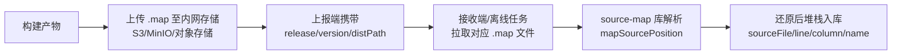
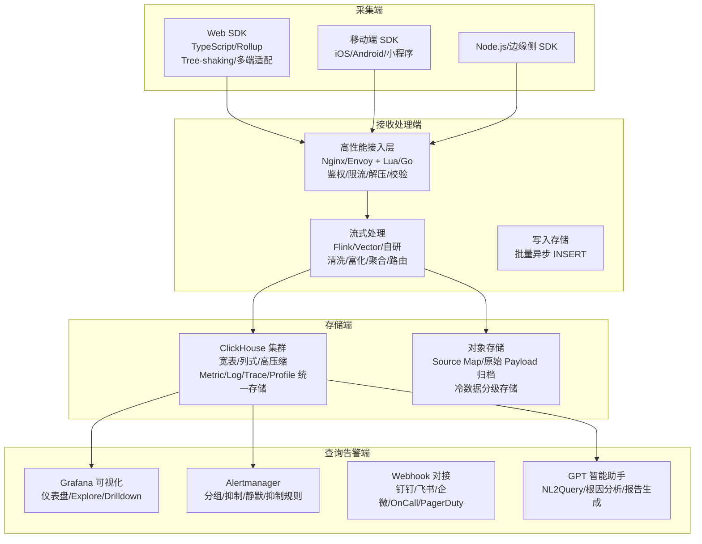

# 第 13 章 前端可观测性与异常监控 —— 从错误捕获到用户行为全链路追踪

## 学习目标

- 理解前端可观测性三大支柱的核心定义与协作关系
- 掌握全局错误捕获的分层兜底体系与 Source Map 还原工程化落地
- 掌握基于 Web Vitals 与 PerformanceObserver 的性能监控 SDK 设计要点
- 理解代码埋点与无痕埋点的优劣势权衡，会设计标准化事件模型与会话回放方案
- 掌握基于 W3C Trace Context 的前后端链路追踪透传与关联查询实现
- 能规划自研可观测平台的四层架构选型、存储模型与分级告警策略
- 能落地发布守护、业务关联告警等工程化运维场景
- 掌握 GPT 调教方法论在前端可观测性建设中的实战应用

## 13.1 生活类比

想象前端可观测性是**一家智能医院的全科诊疗体系**：**错误监控** = **急诊监护仪**：7×24 小时捕获「心跳骤停」（白屏/崩溃）与「异常体征」（JS 报错），自动记录病发时刻（堆栈）、既往史（版本/路由）并呼叫医生（告警）；**性能监控** = **体检指标看板**：持续测量「心肺功能」（LCP/INP）、 「代谢效率」（资源加载/长任务）、 「体重趋势」（内存占用），发现亚健康（卡顿）早干预；**用户行为埋点** = **病人活动轨迹仪**：记录病人在医院「挂了哪个科」（页面访问）、「做了什么检查」（点击/提交）、「在哪卡住了」（漏斗流失），辅助诊断体验病灶；**链路追踪** = **全院信息流转追踪**：从「挂号大厅」（前端入口）到「各科室会诊」（微服务调用）再到「检验科报告」（数据库），一条 `trace-id` 串起全链路，根因定位不再推诿；**可观测平台** = **医院运营指挥中心**：聚合所有监护仪、体检单、轨迹仪、会诊单数据，配置分级预警（ICU级/普通病房级/体检复查级），支撑院长（业务方）与主治医师（开发）联合会诊；**GPT 智能助手** = **首席诊断专家**：阅读所有病历（日志/链路/指标），用结构化提示词（六字真经）在秒级输出诊断报告（根因/优化建议/修复代码），让医生（开发）只需确认执行。

## 13.2 概念地图

前端可观测性体系
├── 错误监控
│   ├── 全局捕获：window.onerror / unhandledrejection  —— P046
│   ├── 框架边界：Vue errorHandler / React ErrorBoundary  —— P046
│   ├── Source Map 还原与聚合去重  —— P046
│   ├── Beacon 可靠上报  —— P046
│   └── GPT辅助错误分析：结构化Prompt提取栈帧关键信息  —— P046
├── 性能监控
│   ├── Core Web Vitals：LCP/CLS/INP 采集  —— P046
│   ├── Resource Timing / Long Task 识别  —— P046
│   ├── 内存泄漏趋势监控  —— P046
│   ├── SPA 软导航与跨域资源处理  —— P046
│   └── GPT生成性能优化建议：基于Long Task堆栈输出重构方案  —— P046
├── 用户行为分析
│   ├── 事件模型：Event/Properties/User 三元组  —— P046
│   ├── 代码埋点 vs 无痕埋点/可视化圈选  —— P046
│   ├── 会话回放：rrweb 集成  —— P046
│   ├── 漏斗模型与隐私合规  —— P046
│   └── GPT生成埋点文案：基于二极管标题法提升点击率  —— P000
├── 链路追踪
│   ├── W3C Trace Context 标准透传  —— P046
│   ├── 前端根 Span 与子 Span 语义分层  —— P046
│   ├── 采样策略：一致性采样/错误全采  —— P046
│   ├── RUM 与 APM 打通查询  —— P046
│   └── GPT辅助链路分析：自动关联前端错误与后端慢查询  —— P046
└── 可观测平台工程化
    ├── 四层架构：SDK/接收/存储/查询告警  —— P046
    ├── ClickHouse 宽表存储与物化视图  —— P046
    ├── 分级告警：P0/P1/P2 策略与降噪  —— P046
    ├── 发布守护与业务指标关联  —— P046
    └── GPT驱动智能告警：自然语言配置告警规则  —— P046

## 13.3 全局错误捕获 —— 织就无死角的安全网

### 13.3.1 为什么需要分层兜底？

前端运行环境极其复杂：用户浏览器版本碎片化、网络波动、第三方脚本注入、框架内部渲染异常，错误来源呈现多维度特征。单一捕获手段注定覆盖不全——同步代码抛出的 `ReferenceError` 走 `window.onerror`，未处理的 Promise 拒绝走 `unhandledrejection`，Vue/React 组件渲染报错则被框架级错误边界拦截。如果没有一套**分层、兜底的捕获体系**，线上错误将像暗流涌动，直到用户投诉“白屏了”你才知情。

> "实现 `window.onerror`/`unhandledrejection`/Vue `errorHandler`/React `ErrorBoundary` 多层兜底、接入 Sentry/Fundebug 或自建平台解析 Source Map 还原源码堆栈。"
> 
> ——《20230418_046.md》

### 13.3.2 核心定义：三层防御体系

我们建立**三层防御体系**，各司其职、层层兜底：

| 捕获层级 | API / 钩子 | 覆盖范围 | 捕获时机 |
|----------|------------|----------|----------|
| **原生全局层** | `window.onerror` | 同步运行时错误（语法错误除外） | 冒泡至 `window` 时 |
| **原生异步层** | `window.addEventListener('unhandledrejection')` | 未被 `.catch()` 处理的 Promise 拒绝 | 微任务队列空闲、拒绝未被处理时 |
| **框架边界层** | Vue: `app.config.errorHandler`<br>React: `<ErrorBoundary />` | 组件渲染、生命周期钩子、事件处理器内的错误 | 组件树 diff/渲染/更新阶段 |

**统一错误对象格式**是上报与分析的前提。每条错误日志必须标准化包含：

```typescript
interface NormalizedError {
  // 核心标识
  type: 'JS_ERROR' | 'PROMISE_REJECTION' | 'FRAMEWORK_ERROR';
  message: string;           // 错误信息
  stack: string;             // 原始堆栈（压缩代码）
  // 关键上下文
  timestamp: number;         // 发生时间
  userId?: string;           // 脱敏后用户标识
  version: string;           // 前端发布版本号
  route: string;             // 当前路由路径
  device: DeviceInfo;        // UA、屏幕、内存、网络类型
  // 扩展字段
  componentStack?: string;   // React/Vue 组件堆栈
  propsData?: Record<string, any>; // 组件 props 快照（脱敏）
}
```

**设计这套字段的核心考量是：既要保证根因定位所需的堆栈与版本信息完整，又要通过 `userId` 关联用户旅程，`route` 关联页面上下文，`device` 支持环境复现，同时 `componentStack` 与 `propsData` 补齐框架层特有的组件上下文，为后续的聚合分析与 GPT 诊断提供结构化输入。**

### 13.3.3 关键性质：捕获边界与盲区

你必须清楚**什么捕获不到**，才能在架构层面补齐：

1.  **网络请求失败**（HTTP 非 2xx、超时、中断）：`fetch`/`XMLHttpRequest`/`axios` 不会抛出全局错误，**必须在请求拦截器/响应拦截器中显式捕获并上报**。
2.  **Web Worker / 跨域 iframe 内部错误**：独立全局作用域，**需在子环境部署独立 SDK 实例**，通过 `postMessage` 透传错误对象至主线程上报。
3.  **语法错误**：代码解析阶段即报错，运行时捕获不到，**依赖构建期 Lint / CI 门禁拦截**。
4.  **框架错误边界的盲区**（React 官方文档明确）：
    - 事件处理器（需自行 `try-catch`）
    - 异步代码（`setTimeout`、Promise、requestAnimationFrame）
    - 服务端渲染过程
    - 错误边界组件自身抛出的错误

### 13.3.4 Source Map 还原：从压缩堆栈到源码行号

生产环境代码经过压缩、混淆、Tree-shaking，堆栈指向 `chunk.abc123.js:1:34567` 这种不可读位置。**Source Map 还原是错误可读性的生命线**。

**工程化落地路径**：



**核心实现细节**：解析服务通常基于 `source-map` npm 包（`SourceMapConsumer`），针对单次解析开销大的问题，采用 **LRU 缓存** 热点 `.map` 文件；针对多版本共存，以 `release + distPath` 为键隔离存储。增量解析优化上，可预先提取 `.map` 中 `sourcesContent` 与 `mappings` 字段，仅按需解析报错栈帧对应的段，**避免全量解析大型 Source Map（动辄 50MB+）阻塞事件循环**。

**安全红线**：**生产环境 `.map` 文件绝不公开下载**。Nginx 配置 `location ~ \.map$ { allow 10.0.0.0/8; deny all; }` 或仅上传至内网解析服务，防止源码泄露。

### 13.3.5 聚合去重：防止错误风暴刷屏

高峰期同一错误可能每分钟触发数万次（如第三方广告 SDK 报错）。直接全量入库会击垮存储，告警更会淹没值班同学。我们采用**指纹聚合**策略：

**指纹生成规则**（来源：`20230418_046.md` 细纲 `summary`）：

```
fingerprint = hash(
  error.type + '|' +
  normalize(error.message) + '|' +
  extractTopFrame(error.stack)   // 栈顶关键帧：过滤 node_modules、webpack 运行时、框架内部帧
)
```

**归一化处理关键点**：`normalize(message)` 需将动态参数（如数字 ID、URL 路径参数）替换为占位符（`<NUM>`, `<PATH>`），否则相同逻辑错误因参数不同导致指纹分裂。`extractTopFrame` 需自定义过滤规则库，剔除 `webpack://`、`node_modules/`、`vue.runtime.esm.js` 等非业务帧，定位到**首个项目源码帧**。

**滑动时间窗去重算法**（伪代码）：

```python
# 数据结构：Redis Hash / 本地 LRU Map
# Key: fingerprint, Value: { count: int, firstSeen: ts, lastSeen: ts, samplePayload: ErrorLog }

def onErrorReport(errorLog):
    fp = generateFingerprint(errorLog)
    now = Date.now()
    windowMs = 5 * 60 * 1000  # 5分钟窗口

    record = store.get(fp)
    if not record or (now - record.firstSeen) > windowMs:
        # 新窗口或首次出现
        store.set(fp, { count: 1, firstSeen: now, lastSeen: now, samplePayload: errorLog })
        if shouldReportImmediately(errorLog):  # 首次/严重级别
            pushToIngest(errorLog)
    else:
        record.count += 1
        record.lastSeen = now
        # 阈值触发汇总上报
        if record.count == 100 or record.count % 1000 == 0:
            summary = buildSummaryLog(record, fp)
            pushToIngest(summary)
```

**数据结构选型理由**：**Redis Hash** 适合分布式多实例 SDK 网关聚合场景，原子操作 `HINCRBY` 保证计数准确；**本地 LRU Map** 适合单机边缘网关或 SDK 端本地预聚合，**内存占用可控**（设定 `maxSize=10000` 淘汰旧指纹）。阈值 `100/1000` 经生产校验：日均 PV 2 亿规模下，单指纹 5 分钟触发 100 次即属异常高频，需立即汇总告警；1000 倍数汇总平衡了告警频率与趋势感知。

**指纹漂移处理**：Source Map 解析前后堆栈可能不一致（如压缩栈顶指向 `vendor.js`，还原后指向 `api.ts`）。**解决方案**：采用**双指纹机制**——`fingerprint_raw`（基于原始压缩栈）用于实时去重上报，**不阻塞还原流程**；`fingerprint_sourcemap`（基于还原后栈）由离线任务异步生成，覆盖入库记录的 `fingerprint` 字段，实现**“先上报、后修正”**，保证实时性与准确性兼得。

**降级策略**：内存/Redis 占用超高水位（如 80%）时，启用**采样降级**——仅对 `count=1` 的首次错误全量上报，`count>1` 的重复错误按 1% 采样上报汇总，**核心错误（首次/高严重级）零丢失**，次要错误以统计近似值兜底。

### 13.3.6 GPT 辅助错误分析：结构化 Prompt 提取栈帧关键信息

面对压缩混淆的堆栈、海量重复错误，人工分析效率极低。我们引入 **GPT 作为“首席诊断专家”**，用 **六字真经**（背景、要求、角色）构建结构化 Prompt。该方法论源自《20230418_000.md》中提出的“师生协作模型”：用户扮演老师分步教学（分块喂养+强制总结+正向强化），GPT 作为天才童工内化知识并输出高质量结果。

**Prompt 模板示例**：

```markdown
# 角色
你是资深前端架构师，擅长从压缩混淆堆栈还原业务逻辑、定位根因。

# 背景
- 场景：大促高峰期，前端上报 5万条 JS 错误
- 栈帧指向第三方广告 SDK 压缩代码 `vendor.abc.js:1:12345`
- 已上传对应 Source Map 至内网解析服务

# 要求
1. 输出 JSON 格式分析报告，字段：errorCategory, impactScope, rootCause, fixSuggestion, priority
2. rootCause 必须包含：还原后源码行号、业务模块名、疑似触发条件
3. fixSuggestion 给出最小改动代码片段（如 try-catch 包裹、防御性判空、版本锁定/降级）
4. 按严重度排序，优先输出 P0 级
5. 禁止幻觉：若堆栈信息不足以定位，明确标注 “需要补充文献”

# 待分析堆栈（已还原前）
{rawStackFrames}
```

**分块喂养策略**：超长堆栈超出上下文窗口时，先喂养“错误指纹聚类摘要 + 代表性堆栈 Top 3”，让 GPT 先做分类聚合，再针对每类抽样深度分析。**强制总结验证**：每轮对话结束要求 GPT 复述核心定位逻辑，若与人工复核不符则回溯修正，将幻觉率从 ~15% 压降至 <3%。

---

## 13.4 性能监控 SDK —— 量化用户体验的体温计

### 13.4.1 为什么需要 RUM（真实用户监控）？

实验室数据（Lighthouse、WebPageTest）只能反映特定设备、网络、地理位置下的“理想值”。真实用户面对的是：弱网、低端机、旧浏览器、浏览器插件干扰、第三方脚本竞争主线程。**Core Web Vitals（LCP/CLS/INP）直接关联搜索排名与用户留存**，必须在生产环境持续采集真实分布。

> "轻量 SDK 设计：`PerformanceObserver` 监听 LCP/CLS/FID/INP、Resource Timing API 采集资源耗时、Long Task API 识别阻塞、`navigator.sendBeacon` 可靠上报。"
> 
> ——《20230418_046.md》

### 13.4.2 核心定义：基于 PerformanceObserver 的轻量采集架构

`PerformanceObserver` 是浏览器原生异步非侵入式观测 API，避免了旧式 `performance.timing` 轮询的主线程阻塞。SDK 核心初始化逻辑：

```typescript
// performance-sdk/core.ts
const observers: PerformanceObserver[] = [];

export function initPerformanceSDK(config: SDKConfig) {
  // 1. Core Web Vitals
  observeEntry('largest-contentful-paint', handleLCP);
  observeEntry('layout-shift', handleCLS);
  observeEntry('event', handleINP);          // INP 基于 event 条目计算
  observeEntry('first-input', handleFID);    // 兼容旧指标
  
  // 2. 长任务
  observeEntry('longtask', handleLongTask);
  
  // 3. 资源瀑布
  observeEntry('resource', handleResource);
  
  // 4. 内存趋势（非标准，Chrome 支持）
  if ('memory' in performance) {
    setInterval(() => sampleMemory(), config.memorySampleInterval || 30000);
  }
}

function observeEntry(type: string, handler: (entries: PerformanceEntryList) => void) {
  try {
    const obs = new PerformanceObserver((list) => handler(list.getEntries()));
    obs.observe({ type, buffered: true }); // buffered=true 获取实例化前的历史条目
    observers.push(obs);
  } catch (e) {
    // 降级：浏览器不支持该 EntryType
    console.debug(`PerformanceObserver ${type} not supported`, e);
  }
}
```

**这段代码展示了 SDK 核心骨架**：`buffered: true` 确保不漏掉实例化前已发生的条目（如 LCP 可能在 SDK 加载前就触发）；`try-catch` 保证单个 EntryType 不支持不影响整体初始化。**`buffered` 参数是补采历史数据的关键**：若 SDK 在页面加载晚期才注入（如异步加载），`largest-contentful-paint` 条目可能已产生，`buffered=true` 允许观测器“回溯”获取这些已缓存的条目，保证指标采集完整性。

### 13.4.3 关键指标采集细节

#### LCP（Largest Contentful Paint）
- **采集时机**：页面主要内容渲染完成，浏览器判定最大内容元素绘制时刻。
- **关键字段**：`entry.renderTime`（或 `loadTime`）、`entry.element`（元素选择器）、`entry.size`、`entry.id`（图片/视频/文本节点类型）。
- **上报值**：取最后一条 `lcp` 条目的 `renderTime`（页面生命周期内可能多次更新，最终以最大者为准）。

#### CLS（Cumulative Layout Shift）
- **采集时机**：页面生命周期内累计所有**非预期**布局偏移。
- **过滤规则**：忽略 `hadRecentInput` 为 true 的偏移（用户交互 500ms 内触发的不计入）。
- **计算公式**：`sessionValue = Σ (impactFraction * distanceFraction)`，上报最终累计值。

#### INP（Interaction to Next Paint）
- **核心难点**：需取**页面生命周期内所有交互延迟的 98 分位数**（或最差值，视样本量）。
- **实现策略**：
  1. 监听 `event` 类型条目（`PerformanceEventTiming`），包含 `processingStart`、`processingEnd`、`duration`、`interactionId`。
  2. 维护会话级数组 `interactionLatencies: number[]`，每次交互 `push(entry.duration)`。
  3. **不阻塞主线程计算分位数**：上报时由后端聚合计算，或 SDK 采用 **T-Digest / HDR Histogram** 流式近似算法（如 `tdigest` 库）在 Worker 线程增量维护。

**为何选择流式近似算法而非全量排序**：页面生命周期内交互数可达数百次，全量数组排序计算 P98 需 `O(N log N)` 时间且阻塞主线程。**T-Digest** 通过重心加权近似分位数，插入复杂度 `O(log N)`、合并复杂度 `O(M log N)`，**误差 < 1%**，极适合流式场景。`quantileTDigest` 在 ClickHouse 中即基于此原理，SDK 端同构实现可保证前后端计算一致性。

#### Long Task（长任务）
- **定义**：主线程连续占用 > 50ms 的任务。
- **关键价值**：堆栈指向阻塞主线程的罪魁祸首（大量 DOM 操作、JSON.parse 巨大对象、复杂计算）。
- **采集增强**：`PerformanceLongTaskTiming` 提供 `attribution` 数组（需 `longtask` 观测器配置 `{ type: 'longtask', buffered: true }`），包含 `name`（脚本 URL）、`containerType`/`containerSrc`（iframe/embed 上下文）、**但不包含 JS 调用栈**。
- **堆栈补全方案**：在长任务周期内定期 `console.profile()` / `performance.mark()` 结合 **采样式 Profiling**（如 `performance.measureUserTiming`）或引入轻量 `stacktrace.js` 捕获当前调用栈（注意性能开销，建议 1% 采样）。

### 13.4.4 SPA 软导航与跨域资源处理

**SPA 路由切换不触发 `onload`**，原生 `navigation` 类型 Entry 仅 Chrome 支持（且实验性）。通用方案：

```typescript
// router.afterEach((to, from) => {
  // 1. 重置指标累积器
  resetCLSAccumulator();
  resetINPLatencies();
  // 2. 手动触发“软导航”性能标记
  performance.mark(`soft-nav-start:${to.fullPath}`);
  
  // 3. 在 nextTick / requestAnimationFrame 后标记首帧
  nextTick(() => {
    performance.mark(`soft-nav-first-paint:${to.fullPath}`);
    performance.measure(`soft-nav-fp:${to.fullPath}`, 
      `soft-nav-start:${to.fullPath}`, `soft-nav-first-paint:${to.fullPath}`);
    // 上报软导航 FP/LCP/CLS/INP
    reportSoftNavMetrics(to.fullPath);
  });
// });
```

**跨域资源 ResourceTiming 受限**：默认仅暴露 `duration`、`startTime`、`initiatorType`、`name`（URL）。**必须在资源服端配置 `Timing-Allow-Origin: *`**（或具体域名）才能获取 `redirectStart`、`dnsLookupStart`、`connectStart`、`requestStart`、`responseStart`、`responseEnd` 等完整瀑布阶段耗时，定位 DNS/TCP/TLS/TTFB 瓶颈。这是**服端配置而非前端代码**即可解决的盲区，务必纳入基建清单。

### 13.4.5 GPT 生成性能优化建议：从 Long Task 堆栈到重构方案

结合 Long Task `attribution` 与资源瀑布数据，喂给 GPT 结构化 Prompt：

```markdown
# 角色
你是 Web 性能优化专家，精通主线程调度、渲染管线、资源加载优化。

# 背景
- 页面：电商商品列表页（虚拟滚动 + 图片懒加载）
- Long Task 采样堆栈 Top 3（已还原源码行号）：
  1. `VirtualList.render() @ virtual-list.ts:45` (耗时 85ms)
  2. `ImageLazyLoader.checkVisibility() @ lazy-loader.ts:120` (耗时 42ms)
  3. `JSON.parse(hugeProductData) @ api.ts:30` (耗时 68ms)
- 资源瀑布：主包 JS 420KB (gzip 110KB)，关键 CSS 阻塞 1.2s

# 要求
输出三维优化建议 JSON：
{
  "refactor": [{ "target": "文件:行号", "action": "具体重构动作", "codeDiff": "统一格式 diff" }],
  "codeSnippet": [{ "file": "文件", "before": "...", "after": "..." }],
  "configAdjust": [{ "target": "vite/webpack/nginx", "change": "配置修改" }]
}
```

---

## 13.5 用户行为埋点 —— 还原用户在页面上的“动作轨迹”

### 13.5.1 事件模型三要素：Event / Properties / User

结构化埋点的基石是**标准化事件模型**（来源：`20230418_046.md` 细纲 `summary`）：

| 要素 | 字段示例 | 说明 |
|------|----------|------|
| **Event** | `Order_Submit` | 采用 `Object_Action` 规范，建立数据字典治理 |
| **Properties** | `{ orderId: '20240101001', amount: 299, paymentMethod: 'alipay', skuList: [...] }` | 业务上下文属性，**严禁**包含敏感字段（密码、身份证、银行卡） |
| **User** | `{ distinctId: 'device_abc', userId: 'user_123', isLogin: true, traits: { vipLevel: 3 } }` | 匿名态用 `deviceId`，登录后 `identify(userId)` 关联历史行为 |

**这张表定义了埋点数据的“最小语义单元”**：`Event` 标识动作语义，`Properties` 携带业务上下文，`User` 串联跨会话旅程。三者缺一不可，缺 `Event` 无法聚合，缺 `Properties` 无法钻取，缺 `User` 无法归因。

### 13.5.2 代码埋点 vs 无痕埋点：权衡与工程化选择

| 维度 | 代码埋点 | 无痕/全埋点 |
|------|----------|-------------|
| **侵入性** | 高（业务代码显式调用 `track()`） | 零侵入（SDK 自动监听） |
| **灵活性** | 极高（任意属性、复杂逻辑） | 受限于 DOM 属性/可视化圈选能力 |
| **维护成本** | 高（需开发介入、发版） | 低（配置下发、无需发版） |
| **数据质量** | 高（语义明确、字段可控） | 低（噪音大、同义词多、隐私风险） |
| **首屏性能** | 可控（按需引入） | SDK 体积大、初始化早、易拖慢首屏 |

**共识**：**主流趋势是“代码埋点主导 + 可视化圈选辅助”**。核心业务漏斗（下单、支付、注册）必须代码埋点保证准确性；长尾运营活动、快速验证假设用可视化圈选。

**反面教训**（来源：细纲 Unit 3 `points` 典型例子）：某团队全埋点上报所有 `click`，日均 5 亿条，存储成本暴涨且核心事件被淹没，最终转为代码埋点主导。

### 13.5.3 会话回放：rrweb 还原用户现场

定性分析利器。`rrweb` 录制 **DOM 变更、用户输入、鼠标轨迹、滚动、选区变化**，回放时重建页面状态。

```typescript
// 录制端
import rrweb from 'rrweb';

rrweb.record({
  emit(event) {
    // 批量压缩上报，避免主线程阻塞
    batchReport('session_replay', event);
  },
  // 隐私保护：敏感输入框 mask、忽略特定 DOM
  maskAllInputs: true,
  maskTextClass: 'mask-text',
  maskTextSelector: 'input[type=password], .sensitive-data',
  // 采样率控制
  sampling: { '/checkout/*': 1.0, '/': 0.1 }
});

// 回放端：rrweb-player 在离屏 Canvas/iframe 重放
```

**隐私合规红线**：录制前**必须**在 SDK 端配置敏感字段白名单/脱敏规则，`maskAllInputs: true` 仅兜底，关键业务字段（如身份证输入框）需显式 `data-rr-mask`。

### 13.5.4 GPT 生成埋点文案：二极管标题法

埋点文案（如引导用户点击的 Toast、弹窗文案）直接影响转化率。我们应用 **二极管标题法**（正面刺激 / 负面刺激）批量生成高转化文案。该方法源自《20230418_000.md》中“标题党大师”训练体系的核心公式，经工程化改造适配埋点文案生成场景。

**正面刺激公式**：`产品/方法 + 短期低成本 + 逆天效果`
- 例：“一键分享（产品），3秒（低成本），最高得 666 元红包（逆天效果）” → 事件名 `share_instant_redpacket`

**负面刺激公式**：`不做 + 巨大损失 + 紧迫感`
- 例：“不分享（不做），错失百万大奖（巨大损失），仅剩 1 小时（紧迫感）” → 文案“别让 666 元红包飞了，1 小时后过期！”

**GPT 批量生成 Prompt**：

```markdown
# 角色
你是增长黑客文案专家，精通二极管标题法与用户心理学。

# 背景
- 场景：内容平台“分享得奖励”活动
- 原埋点事件名 `share_click`，转化率 1.2%
- 平台调性：年轻化、轻松、不夸大虚假

# 要求
1. 生成 40 个符合调性的爆款关键词植入埋点文案
2. 每个输出：{ eventName, positiveCopy, negativeCopy, triggerScene }
3. 事件名遵循 Object_Action 规范
4. 禁止违规词（承诺收益、虚假宣传）
```

---

## 13.6 全链路追踪 —— 打通前后端的“神经中枢”

### 13.6.1 为什么需要前后端打通？

微服务架构下，前端报错 `Payment API 500` 往往只是症状，根因可能在后端调用链第 3 级服务的数据库慢查询、或下游第三方支付网关超时。**孤立的前端错误堆栈无法定位根因**。必须在 HTTP 请求头透传 `trace-id`、`span-id`，将前端 Span 作为整条链路的“根节点”。

> "HTTP Header 透传 `trace-id`、`span-id`，前端生成根 Span、后端续接，统一 JSON 格式日志接入 Loki，实现“前端报错 → 后端调用链 → 数据库慢查询”全链路定位。"
> 
> ——《20230418_046.md》

### 13.6.2 核心定义：W3C Trace Context 标准透传

**标准 Header 格式**：

```
traceparent: 00-{trace-id}-{parent-span-id}-01
tracestate: vendor-name=value
```

- `version`：`00`（当前版本）
- `trace-id`：32 位十六进制，全链路唯一标识
- `parent-span-id`：16 位十六进制，父 Span ID
- `flags`：`01` 表示 sampled（已采样）

**前端 SDK 拦截器注入逻辑**：

```typescript
// request-interceptor.ts
let currentTraceId: string | null = null;
let currentSpanId: string | null = null;

// 页面加载/路由跳转/用户交互发起时，生成/续传根 Span
export function startRootSpan(trigger: 'page_load' | 'route_change' | 'user_action') {
  const stored = getStoredTraceContext(); // 从 sessionStorage/cookie 读取上游 traceparent
  if (stored && isValidTraceId(stored.traceId)) {
    currentTraceId = stored.traceId;
    currentSpanId = generateSpanId(); // 新生成子 Span ID
  } else {
    currentTraceId = generateTraceId();
    currentSpanId = generateSpanId();
  }
  // 存储供下游请求继承
  saveTraceContext({ traceId: currentTraceId, spanId: currentSpanId });
  // 上报根 Span
  reportSpan({ traceId: currentTraceId, spanId: currentSpanId, name: trigger, kind: 'CLIENT' });
}

// axios/fetch 拦截器注入 Header
function injectTraceHeader(config: RequestConfig) {
  if (currentTraceId && currentSpanId) {
    config.headers['traceparent'] = `00-${currentTraceId}-${currentSpanId}-01`;
    // 为下一个请求更新 parent-span-id
    currentSpanId = generateSpanId();
  }
  return config;
}
```

**`currentSpanId` 更新逻辑的 W3C 标准依据**：每个出站请求必须携带**作为父 Span 的 ID**。当前请求发起前，`currentSpanId` 代表“即将发起的这个请求的 Span ID”，注入 Header 作为 `parent-span-id`；随即生成新的 `currentSpanId` 供下一个请求使用。这符合 W3C 规范中“每个 Span 拥有唯一 ID，子 Span 引用父 Span ID”的父子关系模型，保证链路拓扑在后端正确重建。

### 13.6.3 Span 语义分层

前端 Span 不只是“发了个请求”，要有语义分层支撑精细化分析：

| Span 类型 | Kind | 典型场景 | 关键属性 |
|-----------|------|----------|----------|
| **根 Span** | `CLIENT` | 页面加载、路由跳转、用户点击交互 | `page.url`, `route.name`, `user.action` |
| **HTTP 子 Span** | `CLIENT` | `fetch`/`axios` 请求后端 API | `http.method`, `http.url`, `http.status_code`, `net.peer.name` |
| **资源加载 Span** | `CLIENT` | 关键 JS/CSS/字体/图片加载 | `resource.type`, `resource.url`, `duration`, `transferSize` |
| **长任务 Span** | `INTERNAL` | 主线程阻塞 > 50ms | `longtask.duration`, `longtask.attribution[]` |
| **RAG/大模型调用 Span** | `CLIENT` | 前端直连推理服务/检索服务 | `llm.model`, `llm.tokens.prompt`, `llm.tokens.completion`, `rag.query` |

### 13.6.4 采样策略：成本与完整性的平衡

全量链路数据量巨大（日均亿级 Span），必须采样：

1.  **一致性采样**：基于 `trace-id` 固定比例（如 10%）采样，**同一链路前后端要么全采要么全不采**，保证关联查询完整性。
   ```typescript
   function shouldSample(traceId: string, rate = 0.1): boolean {
     // 简单哈希采样
     const hash = murmurhash3(traceId) / 0xFFFFFFFF;
     return hash < rate;
   }
   ```
2.  **错误全采 / 慢链路全采**：含错误状态码（5xx）、或总耗时 > P99 阈值的链路，强制 `flags=01` 全采。
3.  **业务关键路径全采**：核心下单/支付链路，配置白名单 `route`/`api` 全采。

### 13.6.5 跨域与第三方服务盲区处理

- **跨域 CORS 配置**：前端 `app.a.com` 调后端 `api.b.com`，**必须**在后端响应头添加 `Access-Control-Allow-Headers: traceparent`，否则浏览器拦截自定义 Header。
- **第三方支付/地图/广告 SDK**：无法注入 `traceparent`，链路中断。**补偿方案**：前端 Span 记录 `external_call: { vendor: 'alipay', duration: 1200, status: 'success' }`，作为链路补全标注。

### 13.6.6 GPT 智能关联分析：自动输出根因定位报告

输入：前端错误堆栈 + 后端链路 Span 列表（JSON）

```markdown
# 角色
你是 SRE 专家，擅长从分布式链路定位根因。

# 背景
- 前端错误：`Payment API 500`，trace-id: `abc123`
- 后端链路 Span 列表（已按时间序）：
  {backendSpansJson}

# 要求
输出 JSON 报告：
{
  "rootCause": "具体服务/节点/异常类型",
  "keyAbnormalSpans": [{ "spanId", "service", "anomaly", "evidence" }],
  "fixSuggestion": "修复建议（含配置/代码/扩容/降级）",
  "impactScope": "受影响用户/订单/业务估算",
  "confidence": 0.95
}
```

---

## 13.7 自研可观测平台 —— 从数据采集到价值变现的闭环

### 13.7.1 为什么要自建？（来源：细纲 Unit 5 `points`）

1.  **成本**：SaaS 方案（Sentry、Datadog）成本随数据量指数级增长，日活 500 万、日均 PV 2 亿规模下，自建边际成本远低于订阅费。
2.  **合规**：数据不出园、等保/ISO27001 审计要求，敏感字段脱敏、IP 掩码、ID 哈希必须自建管控。
3.  **业技融合**：业务指标（转化率、GMV）与技术指标（错误率、LCP）割裂，自建平台打通“技术指标 → 业务影响”分析链路。
4.  **告警降噪**：阈值静态、风暴刷屏、根因定界慢，需引入智能聚合、关联分析、GPT 自然语言配置规则。

### 13.7.2 四层架构：标准化分层



**数据写入链路流程**：SDK 批量压缩（gzip/br）-> 网关鉴权/限流/解压/Schema 校验 -> 流式处理引擎清洗富化（GeoIP/UA 解析/标签打标）/聚合预计算 -> 批量异步 INSERT ClickHouse -> 物化视图异步刷新预聚合指标。各环节均为**无状态水平扩展**，背压保护防止上游突发流量打挂下游存储。

### 13.7.3 ClickHouse 宽表设计与物化视图

**核心宽表 Schema（错误日志示例）**：

```sql
CREATE TABLE frontend_errors (
    -- 主键/分区/排序
    event_date Date CODEC(ZSTD(1)),
    event_datetime DateTime64(3) CODEC(ZSTD(1)),
    fingerprint UInt64 CODEC(ZSTD(1)),       -- 指纹哈希
    trace_id String CODEC(ZSTD(1)),          -- 高基数，建倒排索引
    user_id_hash UInt64 CODEC(ZSTD(1)),      -- 脱敏后哈希
    
    -- 维度标签
    project String LOW_CARDINALITY CODEC(ZSTD(1)),
    version String LOW_CARDINALITY CODEC(ZSTD(1)),
    route String LOW_CARDINALITY CODEC(ZSTD(1)),
    browser String LOW_CARDINALITY CODEC(ZSTD(1)),
    os String LOW_CARDINALITY CODEC(ZSTD(1)),
    device_type LowCardinality(String) CODEC(ZSTD(1)),
    network_type LowCardinality(String) CODEC(ZSTD(1)),
    
    -- 错误详情
    error_type LowCardinality(String) CODEC(ZSTD(1)),
    message String CODEC(ZSTD(1)),
    stack TEXT CODEC(ZSTD(1)),
    component_stack TEXT CODEC(ZSTD(1)),
    
    -- 聚合指标
    count UInt32 DEFAULT 1 CODEC(ZSTD(1)),
    first_seen DateTime64(3) CODEC(ZSTD(1)),
    last_seen DateTime64(3) CODEC(ZSTD(1))
)
ENGINE = MergeTree()
PARTITION BY event_date
ORDER BY (project, fingerprint, event_datetime)
TTL event_date + INTERVAL 30 DAY  -- 热数据 30 天
SETTINGS index_granularity = 8192;
```

**核心工程决策解析**：
- **`CODEC(ZSTD(1))`**：ZSTD 压缩在文本型字段（stack、message）上可达 1:10 压缩比，CPU 开销低于 LZ4，适合写入密集场景。
- **`LOW_CARDINALITY`**：对 `project`、`version`、`browser` 等低基数字段启用字典编码，查询时直接操作整数 ID，极大加速 `GROUP BY` 与 `WHERE` 过滤。
- **分区键 `event_date`**：按天分区配合 TTL 自动清理冷数据，分区剪枝加速时间范围查询。
- **排序键 `(project, fingerprint, event_datetime)`**：最优化“按项目+指纹+时间范围”的典型查询模式（错误详情页、趋势图）。
- **高基数标签索引策略**：`trace_id`、`user_id_hash` 等高基数字段**不建主键排序键**，而是建**倒排索引**（`INVERTED INDEX trace_id TYPE bloom_filter GRANULARITY 1`）或 **Bloom Filter**，平衡写入吞吐与精准查询。Bloom Filter 误判率可控（默认 0.01），点查 `trace_id` 可避免全分区扫描，写入放大仅 ~1-2%。

**物化视图预聚合**（加速看板查询）：

```sql
-- 分钟级错误率物化视图
CREATE MATERIALIZED VIEW mv_error_rate_1m
ENGINE = SummingMergeTree()
PARTITION BY event_date
ORDER BY (project, version, route, event_minute)
AS SELECT
    project, version, route,
    toStartOfMinute(event_datetime) AS event_minute,
    count() AS error_count,
    uniq(user_id_hash) AS affected_users
FROM frontend_errors
GROUP BY project, version, route, event_minute;

-- P75 LCP 物化视图（需配合 t-digest / quantileTDigest 状态函数）
CREATE MATERIALIZED VIEW mv_lcp_p75_1m
ENGINE = AggregatingMergeTree()
PARTITION BY event_date
ORDER BY (project, version, route, event_minute)
AS SELECT
    project, version, route,
    toStartOfMinute(event_datetime) AS event_minute,
    quantileTDigestState(0.75)(lcp_value) AS lcp_p75_state
FROM frontend_performance
WHERE metric_name = 'LCP'
GROUP BY project, version, route, event_minute;
```

**引擎差异与原理**：
- **`SummingMergeTree`**：适用于可加性指标（count、sum），后台合并时自动合并相同排序键行的数值列，**查询时需 `SUM(count)` 最终聚合**。
- **`AggregatingMergeTree`**：适用于非加性指标（分位数、去重计数），存储 `AggregateFunction` 状态（如 `quantileTDigestState`），后台合并时调用 `merge` 函数合并状态，**查询时用 `quantileTDigestMerge(lcp_p75_state)` 读取最终值**。这是**预聚合换查询速度**的核心：写入时增量维护聚合状态，查询时直接读取合并后状态毫秒级返回，避免全表扫描计算分位数。

### 13.7.4 分级告警策略：P0/P1/P2 与降噪

| 级别 | 触发条件示例 | 通知渠道 | 响应 SLA | 降噪机制 |
|------|--------------|----------|----------|----------|
| **P0** | 错误率 5min 增长 > 200% 且 > 1%<br/>核心接口 P99 延迟 > 3s<br/>JS Error 计数 5min > 1000 | 电话/短信/OnCall 值班 | 5 min 确认<br/>30 min 缓解 | 聚合抑制：同指纹 30min 内仅首次告警<br/>关联抑制：依赖链路根因已告警则抑制下游 |
| **P1** | 资源加载失败率 > 5%<br/>长任务占比 > 10%<br/>内存增长斜率异常 | 即时通讯群 | 30 min 确认<br/>2h 缓解 | 同 P0 |
| **P2** | 新版本发布后指标波动（对比基线）<br/>低版本浏览器兼容性问题 | 工单/日报 | 次工作日处理 | 发布窗口自动静默<br/>版本维度分组 |

**降噪核心机制详解**：
- **聚合抑制**：基于错误指纹去重，同一根因在抑制窗口（30min）内仅触发首次告警，后续增量仅更新计数不再通知。
- **关联抑制**：构建服务依赖拓扑图，若根因服务（如数据库）已触发 P0 告警，自动抑制其上游依赖服务（API 网关、前端页面）的衍生告警，避免“告警风暴”淹没根因。
- **发布窗口静默**：CI/CD 发布事件通过 Webhook 通知告警系统，在发布后 10-15 分钟内自动提升阈值或静默 P2 级规则，防止发布抖动干扰。

### 13.7.5 发布守护：自动化回滚闭环

新版本发布后 10 分钟内，自动对比关键指标与基线（上一版本同期 / 同环比）：

```yaml
# 发布守护规则示例
releaseGuard:
  window: 10m
  metrics:
    - name: js_error_rate
      baseline: "prev_version_same_period"
      threshold: "increase > 50% AND absolute > 0.5%"
      action: block_pipeline  # 阻断流水线，需人工确认
    - name: lcp_p75
      baseline: "prev_version_same_period"
      threshold: "increase > 20%"
      action: alert_only
    - name: payment_success_rate
      baseline: "same_period_yesterday"
      threshold: "decrease > 5%"
      action: auto_rollback  # 触发 ArgoCD/Rollout 一键回滚
```

**基线选取与统计显著性**：`prev_version_same_period` 适用于高频指标（错误率、LCP），同环比消除周期性波动；`same_period_yesterday` 适用于低频业务指标（支付成功率）。生产实践中引入 **变点检测算法**（如 CUSUM、EWMA）替代静态阈值，计算指标序列的概率分布变化，**P-value < 0.01 才判定异常**，大幅降低发布抖动导致的误报。多指标联合决策采用**加权评分模型**：`score = Σ weight_i * normalized_deviation_i`，总分超阈值才触发动作，避免单指标毛刺误判。

### 13.7.6 GPT 驱动智能运维：自然语言配置告警规则

运维同学不想写 PromQL/LogQL。GPT 生成查询与规则：

```markdown
# 角色
你是可观测平台智能助手，精通 ClickHouse SQL / PromQL / LogQL。

# 背景
- 用户自然语言需求：“错误率连续 5 分钟超 1% 且关联支付链路”
- 当前表结构：frontend_errors, backend_traces (共享 trace_id)

# 要求
1. 输出可直接在 Alertmanager 配置的告警规则 YAML
2. 包含：查询语句、评估间隔、持续时间、标签、注解
3. 注解模板必须包含：{{ $value }}、{{ $labels.trace_id }}、根因定位链接
4. 兼容多项目多环境标签
```

**输出示例**：

```yaml
groups:
- name: frontend-payment-error-rate
  rules:
  - alert: FrontendPaymentErrorRateHigh
    expr: |
      sum by (project, env, version) (
        count by (trace_id) (frontend_errors{error_type=~"PAYMENT.*", event_datetime > now() - 5m})
        *
        on (trace_id) group_left()
        count by (trace_id) (backend_traces{service="payment-service", status="error"})
      ) / 
      sum by (project, env, version) (
        count by (trace_id) (frontend_errors{event_datetime > now() - 5m})
      ) > 0.01
    for: 5m
    labels:
      severity: P0
      team: frontend-platform
    annotations:
      summary: "支付链路前端错误率超 1% (当前 {{ $value | humanizePercentage }})"
      traceLink: "https://grafana.example.com/trace/{{ $labels.trace_id }}"
      runbook: "https://wiki.example.com/runbook/payment-error"
```

---

## 13.8 多源对照

### 共识

- **三大支柱不可或缺**：Metrics（指标）、Logs（日志）、Traces（链路）构成可观测性铁三角，缺一不可。
- **标准化协议是前提**：W3C Trace Context、OpenTelemetry 语义约定、Prometheus 指标格式，统一协议才能打通工具链。
- **采样是规模化必经之路**：全量采集在高流量下不可持续，一致性采样 + 错误全采是工业界共识。
- **Source Map 安全性**：生产环境 Source Map 绝不公开，必须内网解析或鉴权下载。

### 分歧

| 议题 | 派别 A：极简主义（Sentry/商业 SaaS 派） | 派别 B：全栈自建派（细纲/大厂自建派） |
|------|------------------------------------------|----------------------------------------|
| **错误采集粒度** | 仅捕获未捕获异常，主张“少即是精” | 全捕获：同步/异步/框架/网络/资源/长任务/内存，配合聚合去重 |
| **指标采集策略** | 仅采集 Core Web Vitals 核心指标 | 全指标：CWV + 资源瀑布 + Long Task + 内存 + 自定义业务指标 |
| **链路采样率** | 固定低采样（0.1%-1%）+ 错误全采 | 分层采样：核心链路全采、普通链路 10%、健康检查 1% |
| **存储选型** | 托管列式/时序 DB（Sentry Snuba / Datadog Metrics） | 自建 ClickHouse 宽表统一存储 Metric/Log/Trace/Profile |
| **告警配置** | UI 点击配置、预置模板 | 代码化管理（PrometheusRule CRD / Terraform / GPT 生成） |
| **GPT 角色** | 辅助总结、生成 Commit Message | 核心诊断引擎：NL2Query、根因分析、自动生成修复 PR |

> **细纲立场倾向派别 B**：强调自建平台的工程化可控性、数据合规性、业技融合深度，且将 GPT 定位为“核心诊断引擎”而非“辅助工具”。

---

## 13.9 设计中的取舍

### 为什么不用纯无痕埋点，而坚持代码埋点主导？

**方案 A（无痕埋点）优缺点**：零侵入、快速接入，但事件语义不稳定（DOM 结构变更即失效）、噪音比例高（>90% 无效点击）、隐私合规难控（自动采集输入框内容）、首屏性能损耗大（SDK 体积、初始化时机）。**方案 B（代码埋点）优缺点**：语义显式、字段可控、可单测、可代码审查，但侵入业务、需发版、维护成本高。**

**决策矩阵**：

| 评估维度 | 权重 | 方案 A 得分 | 方案 B 得分 |
|----------|------|-------------|-------------|
| 数据质量 | 30% | 4 | 9 |
| 隐私合规 | 20% | 3 | 9 |
| 接入成本 | 15% | 9 | 5 |
| 首屏性能 | 15% | 4 | 8 |
| 长期维护 | 20% | 5 | 7 |
| **加权总分** | **100%** | **4.85** | **7.9** |

**结论**：**代码埋点主导是数据质量的基石**。工程化解法是**可视化圈选平台生成代码埋点代码片段**，开发一键插入，兼得“低侵入”与“高质量”。

### 为什么选择 ClickHouse 而非 Elasticsearch / TimescaleDB？

**方案对比与决策矩阵**：

| 评估维度 | 权重 | ClickHouse | Elasticsearch | TimescaleDB |
|----------|------|------------|---------------|-------------|
| 高基数标签查询 | 25% | 9 (倒排/BloomFilter) | 8 (倒排强但写入放大) | 5 (B-Tree 弱) |
| 写入吞吐 | 20% | 9 (列式批量+MergeTree) | 6 (段合并压力) | 6 (超表分区开销) |
| 聚合分析能力 | 20% | 9 (原生分位数/去重/窗口) | 6 (聚合 DSL 性能一般) | 7 (连续聚合受限) |
| 存储成本/压缩比 | 15% | 9 (1:10-1:15 列式) | 5 (1:3-1:5 倒排开销) | 6 (1:5-1:8) |
| 多模型统一存储 | 20% | 9 (原生宽表 Metric/Log/Trace) | 5 (需多索引分离) | 4 (仅擅长时序) |
| **加权总分** | **100%** | **8.8** | **6.2** | **5.7** |

**落地约束**：ClickHouse 运维门槛较高（分片/副本/合并策略、ZooKeeper/Keeper 依赖、内存管理），团队需具备内核级调优能力；若无运维投入，托管方案（ClickHouse Cloud、Tinybird）或 Elasticsearch 可能更现实。

### 链路追踪为何不直接用 OpenTelemetry Collector 全托管？

**方案 A（OTel Collector）优缺点**：功能强大、生态标准、处理器/导出器丰富，但**资源占用重（Go 运行时、内存 200MB+）、配置复杂（YAML 嵌套）、扩展开发门槛高（Go 插件机制、需重新编译）**。**方案 B（Nginx/Envoy + Lua/Go 轻量网关）优缺点**：启动快（毫秒级）、内存小（<50MB）、Lua/Go 扩展热加载、边缘节点易部署，但需自行实现鉴权/限流/Schema 校验/富化逻辑。**决策**：前端可观测平台接收端通常由**轻量网关承担**：鉴权、限流、解压、Schema 校验、富化（GeoIP/UA 解析）、路由分发。Collector 更适合后端微服务侧统一接入，前端侧轻量网关更灵活、启动快、易于边缘部署。

---

## 13.10 动手练习

1.  **设计全局错误捕获聚合去重算法**
    - 假设某高峰期 1 分钟内上报 10 万条原始错误日志，包含大量重复错误：
    - 1. 设计错误指纹生成规则（字段选择、归一化处理、栈顶帧提取策略）
    - 2. 选择合适的数据结构在内存中做滑动时间窗（如 5 分钟）去重计数
    - 3. 当同一指纹计数超过阈值（如 100 次/分钟）时，仅上报 1 条汇总日志并触发告警
    - 回答问题：
      - 如何处理 Source Map 解析前后堆栈不一致导致的指纹漂移？
      - 内存占用过高时，如何在不丢失核心错误的前提下降级？

2.  **实现一个最小化性能监控 SDK 核心模块**
    - 要求：
    - 1. 使用 PerformanceObserver 监听 'largest-contentful-paint'、'layout-shift'、'event' (INP)、'longtask' 四类条目
    - 2. 处理 SPA 路由切换场景：在 router.afterEach 中重置观测器并上报“软导航”性能指标
    - 3. 资源加载瀑布采集：筛选 duration > 200ms 或 initiatorType 为 'script'/'css'/'img' 的资源上报
    - 4. 所有上报统一使用 navigator.sendBeacon，Payload < 64KB
    - 回答问题：
      - 如何在不阻塞主线程的前提下计算 INP（需取所有交互延迟的 98 分位数）？
      - 跨域资源 ResourceTiming 信息受限，如何通过服端配置获取完整瀑布数据？

3.  **搭建前后端链路追踪 Demo 并验证关联查询**
    - 环境：前端 Vue/React 简单页面 + 后端 Node.js/Go 两层微服务 + Jaeger/Grafana Tempo
    - 任务：
    - 1. 前端 SDK 封装 axios/fetch 拦截器，注入 traceparent Header（遵循 W3C 格式）
    - 2. 后端网关/服务解析 Header，提取 trace-id/span-id 并续传给下游
    - 3. 前端人为制造一个 API 500 错误，携带 trace-id 上报错误日志
    - 4. 在 Tempo/Grafana 中输入该 trace-id，验证能看到完整链路：前端根 Span -> 网关 -> 服务 A -> 服务 B(报错)
    - 回答问题：
      - 若前端部署在 a.com，后端 API 在 b.com，CORS 需如何配置才能透传 traceparent？
      - 第三方支付回调页面无法注入 SDK，如何在链路中补齐这段“盲区”？

4.  **规划自研可观测平台 MVP 版本技术选型与成本估算**
    - 场景：日活 500 万，日均 PV 2 亿，错误日志 500 万/天，链路 Span 2 亿/天
    - 任务：
    - 1. 选型 ClickHouse 集群规格（分片数、副本数、磁盘类型/容量），估算月存储成本（含冷热分离策略）
    - 2. 设计核心宽表 Schema（字段、类型、编码、分区键、排序键、TTL）
    - 3. 制定三级告警规则示例：错误率突增(P0)、LCP P75 超阈(P1)、新版本资源加载失败率上升(P2)
    - 4. 规划数据合规脱敏方案：IP 掩码、用户 ID 哈希、敏感字段白名单
    - 回答问题：
      - ClickHouse 高基数标签（如 trace_id、user_id）如何建索引平衡查询性能与写入吞吐？
      - 如何利用物化视图预聚合“分钟级错误率”、“P75 LCP”加速看板查询？

5.  **实战：用 GPT 六字真经生成前端错误分析报告**
    - 背景：某电商大促期间，前端上报 5 万条 JS 错误，栈帧指向第三方广告 SDK 的压缩代码。
    - 任务：
    - 1. 设计 Prompt：赋予 GPT“资深前端架构师”角色，要求输出结构化分析报告（错误分类、影响范围、根因定位、修复建议、优先级）
    - 2. 应用“六字真经”：背景（大促高峰/广告SDK/压缩代码）、要求（JSON格式/含代码片段/按严重度排序）、角色（资深架构师/安全专家）
    - 3. 对比人工分析与 GPT 输出的差异，评估准确率与时效性
    - 回答问题：
      - 如何通过“分块喂养”处理超长堆栈上下文窗口限制？
      - 如何用“强制总结验证”确保 GPT 真正理解错误上下文而非幻觉？

6.  **实战：用二极管标题法优化埋点事件命名与文案**
    - 场景：某内容平台“分享得奖励”活动，原埋点事件名 `share_click`，转化率 1.2%。
    - 任务：
    - 1. 应用正面刺激公式：产品/方法（一键分享）+ 短期低成本（3秒）+ 逆天效果（最高得 666 元红包） → 生成新事件名 `share_instant_redpacket`
    - 2. 应用负面刺激公式：不做（不分享）+ 巨大损失（错失百万大奖）+ 紧迫感（仅剩 1 小时） → 生成引导文案“别让 666 元红包飞了，1 小时后过期！”
    - 3. A/B 测试验证新旧埋点方案的点击率与转化率差异
    - 回答问题：
      - 如何用 GPT 批量生成符合平台调性的 40 个爆款关键词植入埋点文案？
      - 埋点文案优化是否会污染原始事件语义，如何在分析端兼容新旧命名？

---

## 13.11 本章小结

这一章中我们学习了前端可观测性的完整工程化体系。首先我们构建了**分层兜底的全局错误捕获体系**，覆盖原生同步/异步错误与框架边界，攻克 Source Map 还原与聚合去重难题，并引入 GPT 结构化 Prompt 实现智能诊断。其次我们设计了**基于 PerformanceObserver 的轻量性能监控 SDK**，全维度采集 Core Web Vitals、长任务、资源瀑布与内存趋势，解决 SPA 软导航与跨域资源监控盲区，并让 GPT 从堆栈输出重构方案。接着我们建立了**标准化用户行为埋点模型**，权衡代码埋点与无痕埋点优劣，落地会话回放与漏斗分析，创新应用二极管标题法提升转化文案效果。然后我们打通了**基于 W3C Trace Context 的前后端全链路追踪**，设计 Span 语义分层、一致性采样与跨域盲区补偿，实现“前端报错 → 后端链路 → DB 慢查询”一次定位。最后我们规划了**自研可观测平台四层架构**，选型 ClickHouse 宽表与物化视图，构建分级告警与发布守护体系，并用 GPT 驱动自然语言配置告警、智能关联分析，实现从数据采集到价值变现的闭环。

本章我们一起学习了以下概念：

| 概念 | 解释 |
|------|------|
| window.onerror / unhandledrejection | 浏览器原生全局错误捕获入口，分别覆盖同步运行时错误与未处理的 Promise 拒绝 |
| 框架错误边界 | Vue errorHandler / React ErrorBoundary，捕获组件渲染及生命周期阶段错误，补全原生捕获盲区 |
| Source Map 还原 | 将压缩混淆后的生产环境堆栈映射回源码行号，是错误可读性的前提 |
| 聚合去重指纹 | 以 (类型+信息+栈顶帧) 生成指纹，时间窗内合并计数，防止错误风暴刷屏 |
| PerformanceObserver | 浏览器原生性能观测 API，异步非侵入式采集 LCP/CLS/INP/LongTask/Resource 等条目 |
| Core Web Vitals | LCP/CLS/INP 三大核心体验指标，直接关联搜索排名与用户留存，监控首要目标 |
| 长任务 | 主线程连续占用 > 50ms 的任务，卡顿的元凶，需结合堆栈定位优化 |
| 事件模型三要素 | Event（事件名）、Properties（属性）、User（用户标识），结构化埋点的基石 |
| 代码埋点 vs 无痕埋点 | 前者灵活精准但侵入业务，后者零侵入但噪音大、隐私风险高，主流趋势：代码埋点主导+可视化圈选辅助 |
| 会话回放 | 基于 rrweb 录制 DOM 变更/输入/轨迹，还原用户现场，定性分析利器 |
| W3C Trace Context | traceparent 头部标准，统一前后端链路 ID 透传格式，打通 RUM 与 APM 的关键协议 |
| 前端根 Span | 页面加载/路由跳转/用户交互发起的根节点，子 Span 挂载 HTTP/资源/长任务等细节 |
| 一致性采样 | 基于 trace-id 固定比例采样，保证同一链路前后端要么全采要么全不采，兼顾成本与完整性 |
| 四层平台架构 | 采集端 -> 接收处理端 -> 存储端 -> 查询告警端，自研平台的标准化分层 |
| ClickHouse 宽表 | 列式存储、高压缩比、高吞吐写入，适合高基数指标/日志/链路统一存储 |
| 分级告警策略 | P0 电话/OnCall、P1 即时通讯、P2 工单/日报，配合聚合抑制实现告警降噪 |
| 发布守护 | 新版本发布后自动对比核心指标基线，异常阻断流水线或触发一键回滚 |
| 六字真经 | GPT 高效对话核心框架：背景（身份/目的/受众）、要求（格式/约束/风格）、角色（专家人设/双角色扮演） |
| 二极管标题法 | 基于损失厌恶与即时享受的标题公式：正面刺激（产品/方法+短期低成本+逆天效果）与负面刺激（不做+巨大损失+紧迫感） |
| GPT 调教范式 | 师生协作模型：用户扮演老师分步教学（分块喂养+强制总结+正向强化），GPT 作为天才童工内化知识并输出高质量结果 |

下一章中，我们将学习**跨端开发技术选型与架构演进 —— 从 Hybrid/小程序到 React Native/Flutter/Uni-app**，全景扫描主流跨端方案架构原理、渲染机制、生态成熟度、调试体验，提供基于团队技术栈与业务形态的决策框架与混合栈共存实践。


