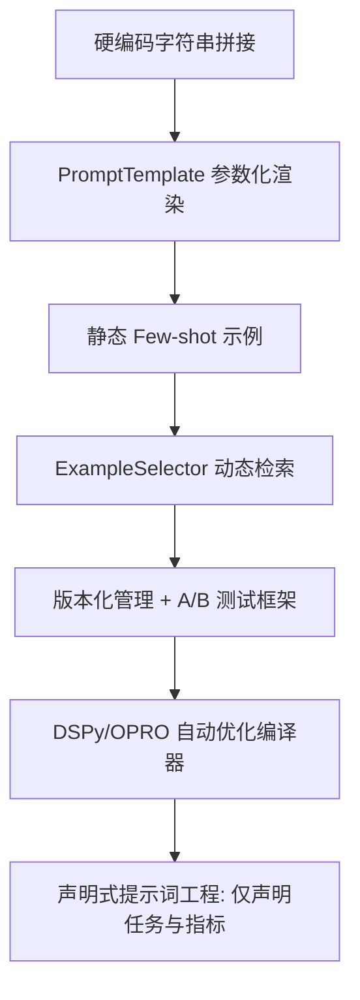
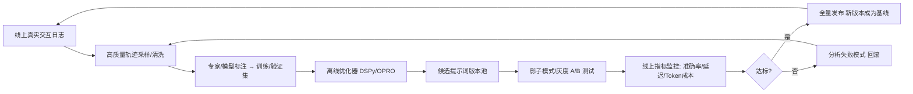
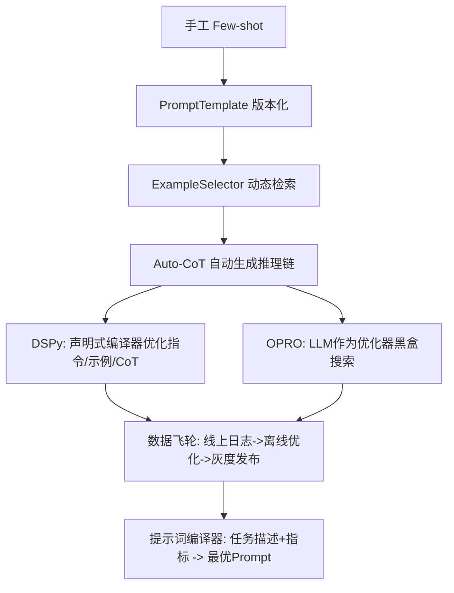

# 第 48 章 提示工程体系化与知识生产分发闭环

## 学习目标

- 理解 PromptTemplate 与 ExampleSelector 实现提示词工程化（版本化、参数化、动态少样本）的核心价值
- 掌握结构化输出解析器（OutputParser/PydanticOutputParser）构建“自然语言输入→类型安全对象输出”编程契约的方法
- 了解 DSPy 与 OPRO 将提示词优化建模为离散优化/编译流程的原理、适用边界与工程落地成本
- 能根据任务复杂度、模型能力与数据规模，选择合适的提示词管理与自动优化策略
- 掌握“龙哥赚钱周报”知识生产与分发方法论：基于语雀文档协作产出 -> 定期整理为周报 -> 通过私域社群（专属群）分发 -> 利用版权警示维护稀缺性 -> 通过邀请制实现裂变增长
- 理解“龙哥风向标”作为周报内容核心来源体系/专栏名称，暗示包含趋势研判与项目筛选信息
- 理解“专属群/私域社群”作为承载周报分发与用户互动的载体，通过邀请裂变增长、设有准入门槛
- 掌握知识生产与分发体系的工程化闭环：从碎片情报到结构化知识资产的沉淀、分发与变现路径
- 识别“龙哥赚钱周报”与“龙哥风向标”在生财有术社群知识管理体系中的定位与协作关系
- 理解私域社群运营中“版权警示+邀请裂变”构建稀缺性护城河的商业逻辑

## 48.1 生活类比

想象提示工程体系化是建筑工程的标准化演进。PromptTemplate 如同标准化图纸模版，将「盖房子」的通用流程固定为带参数槽位的图纸（户型、朝向、面积为变量），替代每次口头指挥工人砌墙。ExampleSelector 如同智能案例库，业主说「我想要地中海风格」，系统自动从过往万个项目中检索最相似的 3 套「地中海风格」施工案例图纸附在新图纸后，而非死板贴上公司前 3 个项目。PydanticOutputParser 如同验收标准书，约定交付物必须是「JSON 格式的竣工验收单」（字段、类型、枚举全定死），验收员（下游代码）拿着标准书一核对，不合格直接打回重做（自愈重试），彻底杜绝「口头承诺交付」的扯皮。DSPy/OPRO 如同 AI 首席架构师，不再靠人工反复修改图纸，而是告诉架构师「目标：通过验收率>99%、成本降 20%」，架构师自动遍历历史图纸与验收记录，进化出最优图纸模版，并持续随新项目数据迭代。

再想象知识生产与分发体系是专业研报机构的运作模式。龙哥风向标相当于核心分析师团队，每日产出高密度、强实操的趋势研判与项目筛选情报，作为机构核心知识资产库。语雀文档协作则是内部知识管理系统，分析师团队协同产出结构化报告，版本可控、可追溯。龙哥赚钱周报是周度策略报告，将分散情报整理为定期交付产品，形成「短标题吸引、长内容交付」的知识传递路径。专属群/私域社群则是付费订阅终端与裂变渠道的合体，通过邀请制实现低成本获客与高粘性留存，版权警示维护内容稀缺价值。

## 48.2 概念地图

提示工程体系化
├── 提示词即代码
│   ├── PromptTemplate（参数化模版/版本控制/序列化）     —— 概念1
│   └── ExampleSelector（动态少样本/向量检索/长度控制） —— 概念1
├── 结构化输出与类型安全
│   ├── OutputParser 接口（格式指令/解析/自愈重试）     —— 概念2
│   └── PydanticOutputParser（Schema 共享/强类型映射）  —— 概念2
└── 提示自动优化
    ├── DSPy（声明式模块/编译器优化/指令与示例搜索） —— 概念3
    └── OPRO（LLM 作为优化器/优化轨迹上下文/黑盒离散优化） —— 概念3
知识生产与分发体系
├── 龙哥赚钱周报（定期发布的付费/私密社群内容产品）
├── 龙哥风向标（周报内容核心来源体系/专栏名称，含趋势研判与项目筛选信息）
└── 专属群/私域社群（周报分发载体，邀请裂变增长，设有准入门槛）
├── 内容生产流水线（语雀协作/定期整理/周报渲染/自动化分发）
└── 稀缺性护城河（版权警示/邀请制裂变/付费门槛）

## 48.3 PromptTemplate 与 ExampleSelector —— 让提示词像代码一样可复用、可版本化

### 48.3.1 为什么需要这个概念？

在早期的 LLM 应用开发中，提示词往往以字符串字面量的形式硬编码在业务逻辑中，或者散落在各个功能模块的配置文件里。这种“面条式”开发模式带来了三大核心痛点：

1.  **维护灾难**：当业务需求变更需要调整提示词措辞时，开发者必须在代码库中全文搜索、逐个修改，极易遗漏或引入语法错误，且无法像代码一样进行代码审查和版本回滚。
2.  **静态 Few-shot 的局限**：传统做法是在提示词中固定写死 3-5 个示例。但对于语义覆盖面宽的任务（如文本转 SQL、多意图客服分类），固定示例无法覆盖长尾分布，导致模型在面到未见模式时“幻觉”频发；同时，固定示例会无差别消耗宝贵的上下文窗口 Token。
3.  **缺乏实验基建**：没有版本化管理，就无法进行 A/B 测试。我们无法量化回答“新版提示词到底比旧版好在哪、好多少”，提示词迭代只能靠主观感觉，无法形成数据飞轮。

PromptTemplate 与 ExampleSelector 的引入，正是为了将提示词从“玄学咒语”重构为“可工程化、可版本化、可测试”的软件资产。根据《20230418_105.md》所述，“引入 PromptTemplate 与 ExampleSelector 机制，实现提示词与业务逻辑解耦、动态少样本检索、A/B 测试版本控制，落地‘提示词即配置/代码’的工程规范。”而《20230418_106.md》进一步指出要“定义标准化 RAG Pipeline 接口：DocumentLoader/Transformer -> VectorStore/Retriever -> Generator，支持混合检索、父子文档、假设性文档嵌入等高级策略的即插即用组装”，这为 ExampleSelector 提供了检索层的标准化支撑。

### 48.3.2 核心定义与形式化建模

#### PromptTemplate：参数化的提示词骨架

从软件工程视角看，PromptTemplate 本质上是一个**纯函数** $f: \mathcal{V} \to \mathcal{S}$，将变量映射表 $\mathcal{V}$ 渲染为最终提示词字符串 $\mathcal{S}$。

$$
\text{PromptTemplate}(template, input\_variables) \to rendered\_prompt
$$

其中：
- $template$：包含占位符的静态骨架字符串，如 `"将以下文本翻译成 {target_language}：\n{source_text}"`。
- $input\_variables$：运行时注入的键值对字典，如 `{"target_language": "英语", "source_text": "你好"}`。

这个定义展示了**关注点分离**的核心价值：提示词的结构逻辑（骨架）与数据内容（变量）彻底解耦。骨架可以由提示词工程师在可视化编辑器中维护、版本化存储（JSON/YAML），变量则由业务代码在运行时组装注入。

#### ExampleSelector：动态少样本的检索策略

ExampleSelector 将 Few-shot 示例的选择问题建模为一个**检索任务**。给定输入查询 $q$ 和示例库 $\mathcal{D} = \{(x_i, y_i)\}_{i=1}^N$，选择器返回 Top-$k$ 最相关的示例子集 $\mathcal{D}_q \subset \mathcal{D}$。

$$
\text{Select}(q, \mathcal{D}, k) = \text{TopK}(\text{Score}(q, x_i), k)
$$

其中 $\text{Score}(\cdot)$ 可以是：
- **语义相似度**：$\text{cosine}(\text{Embed}(q), \text{Embed}(x_i))$（最常用，需向量数据库支持）；
- **长度惩罚**：优先选择 Token 数较短的示例，留更多预算给推理（`LengthBasedExampleSelector`）；
- **多样性约束**：MMR (Maximal Marginal Relevance) 算法，避免选出语义高度重复的示例。

这个公式展示了**动态上下文构建**的核心思想：示例不再是静态资产，而是随查询动态计算的“上下文燃料”，实现了“按需加载、精准打击”。

### 48.3.3 关键方法与工程化实现模式

#### 组合模式：PromptTemplate + ExampleSelector 协同工作

在实际工程中，两者通过**管道模式**组合：先由 ExampleSelector 根据输入检索示例，将示例格式化为字符串块，再作为变量注入 PromptTemplate 的特定槽位（如 `few_shot_examples`）。

> **组合渲染流程**

```
1. 输入：用户查询 q，业务参数 params
2. 检索：examples = ExampleSelector.select(q, k=3)
3. 格式化：example_block = format_examples(examples)  # 如 "示例1: ...\n示例2: ..."
4. 合并变量：all_vars = {**params, "few_shot_examples": example_block}
5. 渲染：final_prompt = PromptTemplate.render(all_vars)
6. 调用：response = LLM.invoke(final_prompt)
```

这段伪代码展示了**运行时提示词组装线**的标准化步骤。步骤 2-4 实现了“数据依赖提示词结构”的动态绑定，使得同一个 PromptTemplate 能服务于无限多样的输入分布。

#### 版本化与序列化存储

为了支持 A/B 测试和灰度发布，PromptTemplate 必须支持序列化为纯数据结构（JSON），而非 Python 代码对象。

> **PromptTemplate JSON Schema 示例**

```json
{
  "version": "v2.1.0",
  "metadata": {
    "author": "prompt_engineer_01",
    "description": "SQL生成任务模版，新增表结构上下文注入",
    "created_at": "2024-01-15T10:00:00Z"
  },
  "template": "根据数据库Schema：\n{schema}\n\n参考示例：\n{few_shot_examples}\n\n请将问题转为SQL：\n{question}",
  "input_variables": ["schema", "few_shot_examples", "question"],
  "example_selector_config": {
    "type": "SemanticSimilarityExampleSelector",
    "vector_store": "pgvector://prod/db",
    "embedding_model": "text-embedding-3-small",
    "k": 3
  }
}
```

这个配置展示了**声明式提示词工程**的雏形：模版内容、变量契约、检索策略配置全部显性化，便于存入配置中心、纳入 Git 管理、通过 CI/CD 管线部署。

### 48.3.4 典型场景与边界条件分析

下表总结了不同任务场景下推荐的 ExampleSelector 策略及核心考量：

| 场景 | 推荐 Selector 策略 | 核心考量 |
|------|-------------------|----------|
| **文本转 SQL / 代码生成** | `SemanticSimilarityExampleSelector` (向量检索) | 语义匹配度直接决定生成质量；需维护高质量标注示例库 |
| **长文本摘要 / 多轮对话** | `LengthBasedExampleSelector` | 上下文窗口极其紧张，必须压缩示例 Token 占比 |
| **多标签分类 / 意图识别** | `MaxMarginalRelevanceExampleSelector` | 类别间界限模糊，需示例覆盖尽可能广的决策边界 |
| **低延迟实时场景** | `FixedExampleSelector` (预选固定集) | 避免向量检索的 10-50ms P99 延迟抖动；牺牲精度换稳定性 |

**边界条件与工程坑点**：
1.  **检索延迟 vs 效果权衡**：向量检索引入的尾部延迟在高并发下会放大。工程对策：预热热点查询的示例缓存、异步预取、或降级为固定示例池。
2.  **Embedding 领域适应性**：通用 Embedding 模型在垂直领域（如医疗、法律术语）语义相似度表现不佳。对策：领域微调 Embedding、或改用 BM25 稀疏检索兜底。
3.  **模版变量缺失保护**：渲染阶段必须强制校验 `input_variables` 完整性，缺失时抛出明确异常或注入默认值（如 `few_shot_examples` 默认为空字符串），防止提示词结构崩塌。
4.  **示例池污染**：脏数据（错误标注、格式不规范）进入示例库会“毒化”少样本效果。必须建立示例库的**数据治理流程**：定期人工巡检、自动化格式校验、基于模型反馈的坏样本剔除。

### 48.3.5 方法演进图：从硬编码到声明式提示词工程



## 48.4 结构化输出解析器 —— 从“文本生成”到“类型安全对象”的编程契约

### 48.4.1 为什么需要这个概念？

LLM 本质是概率性的文本生成器，其原生输出是非结构化的字符串流。直接在下游代码中用正则、字符串切分、甚至 `eval()` 解析模型输出，是构建脆弱系统的温床：

- **格式漂移**：同一模型在不温度、不同系统提示词下，输出格式可能随机切换（Markdown 代码块 vs 纯 JSON、单引号 vs 双引号、尾随逗号）。
- **字段缺失/类型错误**：模型可能漏掉非必填字段、将整数输出为字符串、枚举值拼写错误。
- **错误处理分散**：每个调用点都要写 `try...except...retry` 逻辑，业务代码与解析容错逻辑耦合，违背单一职责原则。

OutputParser 与 PydanticOutputParser 的引入，建立了**“自然语言输入 → 类型安全对象输出”**的确定性编程契约，将不确定性封装在解析器内部，对外暴露强类型接口。根据《20230418_105.md》与《20230418_110.md》，核心在于“解决 LLM 非结构化输出导致的下游解析脆弱问题，详解 JsonOutputParser、PydanticOutputParser 及修复重试机制，实现‘自然语言输入 -> 类型安全对象输出’的编程契约”，以及“构建工程化工具层：OpenAI Function Calling 协议规范、Model Context Protocol (MCP) 统一接口、工具注册发现与权限控制”。

### 48.4.2 核心定义：OutputParser 接口契约

标准 OutputParser 必须实现三个核心方法，形成**指令注入 → 解析 → 自愈重试**的闭环：

```python
class BaseOutputParser(ABC):
    @abstractmethod
    def get_format_instructions(self) -> str:
        """返回注入提示词的格式要求说明，如 '请输出合法 JSON，包含字段...'"""
        pass

    @abstractmethod
    def parse(self, text: str) -> Any:
        """解析模型原始输出文本，成功返回结构化对象，失败抛出 OutputParserException"""
        pass

    def parse_with_prompt(self, prompt: str, llm_output: str, llm: BaseLLM) -> Any:
        """自愈重试入口：解析失败时，自动构造修复提示词再次调用 LLM"""
        try:
            return self.parse(llm_output)
        except OutputParserException as e:
            # 构造修复 Prompt：包含原始指令、模型错误输出、报错信息、格式要求
            fix_prompt = self._build_fix_prompt(prompt, llm_output, e)
            new_output = llm.invoke(fix_prompt)
            return self.parse(new_output)  # 递归重试，通常设置 max_retries=3
```

这个接口设计展示了**防御性编程**思想：`parse` 负责“快速失败”，`parse_with_prompt` 负责“自动修复”，将非确定性的格式对齐过程封装为确定性的函数调用。

### 48.4.3 PydanticOutputParser：Schema 即契约，代码即文档

PydanticOutputParser 利用 Pydantic 模型作为**单一事实来源**：

1.  **Schema 共享**：同一个 Pydantic Model 类同时用于（a）生成 `get_format_instructions()` 中的 JSON Schema 文档注入提示词，（b）`parse()` 时的运行时校验与反序列化，（c）下游业务代码的类型注解与 IDE 提示。
2.  **强类型映射**：支持嵌套对象、`List[T]`、`Literal[...]`、`Optional[T]`、`Union` 等复杂类型组合，自动处理 Python 类型系统到 JSON Schema 的双向映射。

> **PydanticOutputParser 核心逻辑**

```python
class PydanticOutputParser(BaseOutputParser):
    def __init__(self, pydantic_object: Type[BaseModel]):
        self.pydantic_object = pydantic_object

    def get_format_instructions(self) -> str:
        # 核心：将 Pydantic Model 转为 JSON Schema 文本注入提示词
        schema = self.pydantic_object.model_json_schema()
        # 精简 Schema，移除 $defs 等内部细节，仅保留核心结构
        return f"请输出符合以下 JSON Schema 的对象，不要包含任何额外说明或 Markdown 代码块：\n{json.dumps(schema, ensure_ascii=False, indent=2)}"

    def parse(self, text: str) -> BaseModel:
        # 核心：提取 JSON 片段 -> Pydantic 校验 -> 返回强类型实例
        json_str = self._extract_json(text)  # 处理代码块包裹、前缀说明等噪声
        data = json.loads(json_str)
        return self.pydantic_object.model_validate(data)  # 抛出 ValidationError 触发自愈
```

这个实现展示了**类型驱动开发**在提示词工程中的落地：Pydantic Model 成为连接“人类意图（提示词指令）”、“模型行为（文本生成）”、“机器执行（类型安全对象）”的三方契约核心。

### 48.4.4 典型应用模式与工程陷阱

#### 模式一：函数调用参数生成

这是结构化输出最高频、最高价值的场景。定义参数模型，模型直接输出合规 JSON，下游直接 `**kwargs` 传入函数。

```python
class SearchParams(BaseModel):
    query: str = Field(description="搜索关键词，必须为中文")
    top_k: int = Field(default=10, ge=1, le=50, description="返回条数")
    filters: Optional[Dict[str, str]] = Field(default=None, description="元数据过滤条件")

parser = PydanticOutputParser(pydantic_object=SearchParams)
prompt = PromptTemplate(
    template="用户问题：{question}\n{format_instructions}",
    input_variables=["question"],
    partial_variables={"format_instructions": parser.get_format_instructions()}
)
# 业务代码极其简洁：
params: SearchParams = parser.parse_with_prompt(prompt.format(question=q), llm_output, llm)
results = search_engine.search(**params.model_dump())
```

#### 模式二：复杂嵌套结构抽取

如代码审查、简历解析、合同条款抽取，定义嵌套 Model 树。

```python
class ReviewComment(BaseModel):
    file: str
    line: int
    severity: Literal["low", "medium", "high"]
    fix: str

class CodeReview(BaseModel):
    comments: List[ReviewComment]
    summary: str = Field(description="整体评价不超过 100 字")
```

#### 工程陷阱与对策

下表列出了结构化输出工程化中常见的陷阱及对策：

| 陷阱 | 现象 | 工程对策 |
|------|------|----------|
| **Format Instructions 过长** | 复杂嵌套 Schema 生成的指令可达 500-1000 Tokens，挤占上下文窗口，干扰任务指令 | 1. 精简 Schema（移除 description、examples）<br>2. 使用 `Function Calling` 原生接口（模型内置 Schema 理解，无需提示词注入）<br>3. 采用 `outlines` / `guidance` 等 Grammar-based 约束解码，零 Token 开销 |
| **小模型遵循率低** | 7B 以下模型对复杂 JSON Schema 遵循率 < 60%，频繁触发自愈重试，延迟飙升 | 1. 简化 Schema 结构（扁平化、避免深度嵌套）<br>2. Few-shot 注入标准输出示例<br>3. 微调模型学习输出格式（建议沿用 BF16 混合精度训练基准，保持 FP32 主参数机制）<br>4. 引入 `outlines` 约束解码（硬约束，100% 合规） |
| **流式输出解析困难** | JSON 必须完整接收才能解析，无法增量产出对象字段，首包延迟 = 全量生成时间 | 1. 改用 JSON Lines / 分隔符流格式<br>2. 采用 `Partial JSON` 解析库边生成边解析<br>3. 关键字段前置（如先输出 `summary` 再输出 `comments` 列表） |
| **自愈重试死循环** | 模型反复犯同一错误，触发 max_retries 仍失败，抛出异常阻塞主流程 | 1. 设置 `max_retries=2-3` 硬上限<br>2. 重试时降低 Temperature（如 0.7 → 0.1）<br>3. 记录失败案例用于离线优化提示词/微调数据 |

### 48.4.5 多源对比：OutputParser vs Function Calling vs Grammar-based 解码

当前实现结构化输出有三大主流技术路线，各有适用边界：

**共识**：都旨在解决“LLM 非结构化输出 → 结构化对象”的确定性映射问题，核心都是约束模型输出空间。

**分歧**：

| 维度 | OutputParser (提示词约束) | Function Calling (原生工具调用) | Grammar-based 解码 |
|------|---------------------------|----------------------------------|---------------------|
| **原理** | 在提示词注入 Schema 文本，靠模型自觉遵循 | 模型原生训练支持工具调用，输出特殊 Token 触发 | 解码时用 CFG/正则约束 Token 概率分布，强制合规 |
| **Token 开销** | 高（需注入 Schema 文本） | 低（模型内化 Schema） | 极低（仅约束解码，不占提示词） |
| **模型要求** | 任意指令遵循模型 | 需支持 Function Calling 的模型 | 需支持 logits 干预的开源模型 |
| **合规率** | 85%-98%（随模型/Schema 复杂度波动） | 95%+（原生优化） | **100%**（硬约束） |
| **灵活性** | 最高（任意 Pydantic 类型） | 受限于平台支持的类型子集 | 高（需定义文法，稍繁琐） |
| **流式支持** | 差（需缓冲全量） | 好（原生流式工具调用） | 好（增量解析） |

**选型建议**：
- **闭源强模型 + 标准化工具调用场景** → 优先 Function Calling。
- **开源模型 / 复杂自定义类型 / 需 100% 合规** → Grammar-based 解码。
- **快速原型 / 模型无 Function Calling / 简单 Schema** → OutputParser（开发效率最高）。

## 48.5 提示词自动优化 —— 从“人工调参”到“编译流程”的范式跃迁

### 48.5.1 为什么需要这个概念？

提示词工程长期处于“炼丹”阶段：资深工程师凭直觉写 Prompt，靠人工试错调优，过程不可复现、经验不可沉淀、扩展性极差。随着应用数量爆发，三大矛盾凸显：

1.  **专家瓶颈**：优质提示词高度依赖稀缺的“提示词工程师”经验，人力不足以支撑百业务线并行迭代。
2.  **维护地狱**：基座模型升级、任务分布漂移、新数据加入，都可能导致现有提示词失效，人工维护成本随应用数线性增长。
3.  **目标模糊**：“提示词好不好”缺乏量化指标，无法客观比较版本优劣，更无法自动化搜索最优解。

DSPy 与 OPRO 代表了两条通往**“提示词编译器”**的技术路线：前者以**声明式编程+梯度近似搜索**为核心，后者以**LLM 自身作为黑盒优化器**为核心。根据《20230418_136.md》，核心是“介绍将提示优化视为离散优化/梯度下降问题的前沿方法论，覆盖少样本自动构筑、指令自进化、提示词编译器概念，展示如何建立数据飞轮实现提示词持续自动化迭代。”《20230418_140.md》则补充了“工程化落地模式：从原型到生产的最小可行性架构 (MVA)...提炼生产级应用必备的非功能性需求：流式输出、异步编排、可观测性、版本管理与回滚”。

### 48.5.2 DSPy：声明式模块与编译器优化

DSPy 的核心洞见：**提示词不是手写的字符串，而是可优化的程序参数**。它引入三大抽象：

1.  **Module（模块）**：声明式任务单元，如 `Predict('question -> answer')`、`ChainOfThought('question -> reasoning, answer')`、`ReAct('question -> action, observation... -> answer')`。模块封装了签名、内部提示词模版、解析器。
2.  **Metric（指标）**：可微分或可计算的目标函数，如 `exact_match`、`f1`、`rouge`、或自定义业务指标（如 `sql_execution_accuracy`）。
3.  **Teleprompter（编译器/优化器）**：给定模块、训练集、指标，自动搜索最优提示词参数（指令文本、Few-shot 示例、CoT 模版结构）。

> **DSPy 优化流程形式化**

$$
\theta^* = \arg\max_{\theta \in \Theta} \mathbb{E}_{(x,y) \sim \mathcal{D}_{train}} [\text{Metric}(M_\theta(x), y)]
$$

其中：
- $\theta$：提示词参数空间（指令字符串、示例集合、CoT 模版结构）；
- $M_\theta$：由 $\theta$ 实例化的 Module；
- $\mathcal{D}_{train}$：训练集（输入-标签对）；
- $\text{Metric}$：评价函数。

**BootstrapFewShot 优化器**（最基础、最实用的编译器）工作流程：

```
1. 初始化：用种子提示词在训练集上跑推理，收集「高分轨迹」(输入、中间推理、正确输出)
2. 构建示例池：从高分轨迹中提取 (输入, 推理, 输出) 三元组作为候选 Few-shot 示例
3. 组合搜索：遍历不同示例组合、不同指令变体，评估验证集得分
4. 选出最优：锁定最佳提示词参数 θ*，编译为优化后的 Module
```

这个流程展示了**“编译器”隐喻的精确性**：开发者只需声明“输入输出签名”+“评价指标”+“少量种子数据”，编译器自动完成提示词工程的脏活累活。

### 48.5.3 OPRO：LLM 作为优化器的黑盒离散优化

OPRO 绕过“提示词参数空间显式建模”的难题，直接利用 LLM 强大的**语义理解与泛化能力**作为优化器。其核心是**优化轨迹上下文**：

> **OPRO 优化循环**

```
输入：任务描述、初始提示词池、训练集、评价指标
循环 T 轮：
  1. 评估：对池中每个提示词在训练集上跑推理，计算得分
  2. 构造元提示词：
     "以下是历史尝试的提示词及其得分：
     [Prompt 1]: Score 0.72
     [Prompt 2]: Score 0.65
     ...
     请分析失败模式，生成一个更高分的新提示词："
  3. 调用优化器 LLM：生成 N 个新候选提示词
  4. 入池：将新提示词加入池子，保留 Top-M
输出：最高分提示词
```

这个机制展示了**元认知优化**的独特优势：优化器 LLM 能从历史轨迹中“读懂”什么样的指令有效（如“分步推理优于直接作答”、“引用上下文优于凭记忆”），并泛化出人类难以手工枚举的新指令模式。它不需要定义参数空间 $\Theta$，直接在自然语言空间做离散搜索。

### 48.5.4 数据飞轮：从离线优化到在线持续进化

完整的提示词自动优化不止于离线编译，必须建立**线上-线下闭环**：



这个架构展示了**“数据飞轮”**的工程化落地：数据不再是静态资产，而是持续流动的燃料。关键工程节点：
- **采样策略**：不全量上传日志（成本高、隐私险），而是基于不确定性采样、错误案例采样、业务高价值采样。
- **标注降本**：引入“模型标注 + 专家复核”混合模式，或利用用户隐式反馈（复制、点赞、再次提问）作为弱监督信号。
- **灰度发布**：新版提示词先在 1% 流量运行，监控核心指标无回归再扩量，配合自动回滚机制。

### 48.5.5 适用边界与成本收益分析

下表对比了 DSPy 与 OPRO 在多个维度上的适用边界：

| 维度 | DSPy (声明式编译) | OPRO (LLM 优化器) |
|------|-------------------|-------------------|
| **优化目标** | 结构化任务（分类、抽取、代码生成、RAG） | 开放域推理、数学、创意写作、指令遵循 |
| **搜索空间** | 显式参数化（指令模版、示例集、CoT 结构） | 自然语言空间（隐式、无限大） |
| **计算成本** | 中等（需多次在训练集推理，可并行） | 高（每轮需调用优化器 LLM + 评估候选池） |
| **可解释性** | 高（最优参数显性化，可人工审计） | 低（优化器生成提示词常含隐性启发式） |
| **冷启动需求** | 需 50-100 标注样本 | 需 10-20 样本即可启动（优化器利用预训练知识） |
| **跨模型迁移** | 好（优化出的指令/示例可迁移） | 差（优化器针对特定评估模型过拟合） |
| **分布式训练开销** | 可复用 ZeRO-3 通信量模型估算显存/通信开销（参考第 47 章 140GB 模型单步 280GB 通信量基准） | 需额外部署优化器 LLM，显存占用需纳入 3D 并行拓扑规划 |

**决策指南**：
- **核心高频任务 + 有标注数据 + 需跨模型部署** → **DSPy**（如 RAG 查询重写、SQL 生成、实体抽取）。
- **探索性任务 / 无标注数据 / 追求极致推理性能** → **OPRO**（如数学竞赛提示词、创意写作风格调优）。
- **资源受限 / 快速验证** → 先手工 Few-shot + `ExampleSelector`，积累数据后再上自动优化。

### 48.5.6 多源对照：提示词优化范式演进



## 48.6 龙哥赚钱周报知识生产与分发体系 —— 从“碎片情报”到“周度策略报告”的工程化闭环

### 48.6.1 为什么需要这个体系？

在信息过载时代，优质商业情报呈现**“高稀缺、高噪音、强时效”**三重特征：
- **碎片化**：有价值的信息分散在数百个社群、公众号、付费文档、私聊记录中，个体获取成本极高（需付费加群、筛选噪音、整理笔记）。
- **非结构化**：原始情报多为非结构化长文/语音/截图，缺乏标准化元数据（来源、时间、标签、可执行动作），难以检索复用。
- **交付断层**：即使获取了情报，普通人缺乏“从认知到变现”的执行桥梁，陷入“懂了很多道理，却过不好这一生”的知行分离。

龙哥赚钱周报体系的核心价值，在于构建一条**“原始素材 → 结构化知识资产 → 定期交付产品 → 付费分发裂变”**的端到端工程化流水线，将个人的“信息差”能力组织化、规模化、资产化。根据《20230418_079.md》与《SUMMARY.md》的综合资料，该体系包含“龙哥风向标”“龙哥赚钱周报”“专属群/私域社群”三大核心组件，形成了完整的知识生产分发闭环。

### 48.6.2 核心组件定义与协作关系

#### 龙哥风向标：核心知识资产库（上游源头）

**定位**：社群知识生产的“分析师团队”输出端。每日产出高密度、强实操的趋势研判、项目拆解、工具评测、避坑指南。

**形态**：语雀知识库中的专栏/文档集合。每条目标准化字段：`标题`、`来源链接`、`标签(宏观/项目/工具/心法)`、`核心观点(≤200字)`、`可执行动作`、`置信度评分`。

**工程价值**：作为**结构化素材层**，为下游周报编排提供高信噪比、可检索、可追溯的原子化素材包。根据《20230418_079.md》，“龙哥风向标：周报内容的核心来源体系/专栏名称，暗示包含趋势研判与项目筛选信息，由亦仁等发起人每日精选整理。”

#### 龙哥赚钱周报：标准化交付产品（中游成品）

**定位**：“周度策略报告”成品。将一周内散落的风向标条目，按固定栏目编排、加工润色、形成连贯叙事的交付物。根据《20230418_079.md》，“龙哥赚钱周报：定期发布的付费/私密社群内容产品，以周报形式汇总赚钱风向标信息，每周更新。”

**固定栏目结构**（类比报纸版面设计，降低读者认知负荷）：
1.  **宏观风向**：本周核心趋势研判（政策、平台算法、行业风口）。
2.  **项目拆解**：1-2 个具体赚钱案例的全流程复盘（选品、流量、转化、交付、复利）。
3.  **工具推荐**：实测好用的 AI/RPA/数据工具配置教程。
4.  **避坑指南**：本周踩雷案例与规避清单。
5.  **社群动态**：成员成果展示、高频问答、线下聚会预告。

**交付格式**：Markdown（语雀/飞书文档）+ PDF（归档）+ 语音版（通勤收听），多模态适配消费场景。

#### 专属群/私域社群：分发载体与裂变引擎（下游终端）

**定位**：承载周报分发与用户互动的载体。根据《20230418_079.md》，“专属群/私域社群：承载周报分发与用户互动的载体，通过邀请裂变增长，设有准入门槛。”

**分发触达**：微信群/知识星球/邮件列表并行，保证核心用户“必达”（微信群@全员、星球推送、邮件兜底）。

**准入门槛**：付费年费制 / 邀请码制 / 完成新人任务制，过滤低意向用户，维护社群信噪比。

**裂变机制**：“邀请 3 位好友解锁完整版” / “转发朋友圈领取往期精选 PDF” / “专属邀请海报自动生成”，将用户转化为分销节点。

**版权护城河**：“请勿外流，防止失效”页脚水印 + 动态用户 ID 水印 + 违规封号追责机制，维护内容稀缺性。原文中明确提示：“请勿外流，防止失效。如果感觉专属群有价值，可以邀请朋友进群。”

### 48.6.3 内容生产流水线：标准化 SOP

> **端到端生产流水线**

```
阶段 1：素材采集与结构化 (Daily, 分析师)
  - 来源：社群精华、付费文章、实战复盘、工具测评
  - 动作：录入语雀「风向标」专栏 → 填写标准字段 → 打标签 → MinHash LSH 去重（参数 b=20, r=5，Jaccard 阈值 0.85 过滤重复素材）
  - 产出：结构化文档条目 (JSON/语雀块)

阶段 2：选题与编排 (Weekly 周三, 编辑)
  - 动作：按标签聚类本周素材 → 选定栏目填充素材 → 撰写衔接语/总结语 → 形成周报初稿
  - 产出：周报 Markdown 初稿

阶段 3：渲染与多格式导出 (Weekly 周四, 自动化脚本)
  - 动作：调用语雀 API 拉取初稿 → Pandoc/WeChatFormat 渲染 → 生成 PDF/Markdown/语音/长图 → 注入动态用户 ID 水印
  - 产出：多格式交付物包

阶段 4：分发与裂变触发 (Weekly 周五, 运营/自动化)
  - 动作：推送至专属群/星球/邮件 → 生成本期专属邀请海报/链接 → 发布裂变任务
  - 产出：用户触达记录、裂变转化漏斗数据

阶段 5：反馈与迭代 (Continuous)
  - 动作：收集阅读完读率、提问高频点、裂变转化率 → 反哺选题策略、素材标签体系
  - 产出：下周选题方向、素材库清洗规则
```

这个流水线展示了**知识工业化生产**的核心特征：标准化接口（语雀 API）、固定节拍（周更）、角色分工（分析师/编辑/运营/自动化）、可度量指标（完读率/裂变率/续费率）。

### 48.6.4 稀缺性护城河的商业逻辑建模

私域付费社群的核心护城河非技术壁垒，而是**稀缺性设计**与**社交裂变**的组合拳：

$$
\text{社群生命周期价值 LTV} = \underbrace{\text{内容稀缺性} \times \text{付费意愿}}_{\text{首单转化}} \times \underbrace{(1 + \text{裂变系数} \times \text{留存率})^T}_{\text{裂变复利}} - \text{运营边际成本}
$$

其中**内容稀缺性**可量化为“高质量数据改变 Scaling Laws 指数系数”的能力（参考第 47 章 Phi-1 结论：高质量数据实现‘小模型大智慧’），即单位 Token 承载的可执行商业信息密度。

下表拆解了四层护城河的机制、指标与攻防：

| 护城河层级 | 机制 | 关键指标 | 攻击面与防御 |
|------------|------|----------|--------------|
| **内容层** | 高密度实操信息差、不可替代的项目拆解 | 完读率 > 60%、收藏转发率 > 15%、单位 Token 信息密度提升指数系数 | 防御：持续招募一线实战派分析师、建立独家渠道源、引入 MinHash LSH 去重保证素材库纯净度 |
| **分发层** | 动态水印+封号追责、邀请制准入 | 外流投诉率 < 0.1%、邀请转化率 > 20% | 防御：技术水印溯源、法律条款前置、社群自治文化 |
| **社交层** | 成员认知对齐、互助执行、线下连接 | 人均邀请数 > 0.5、日活/月活 > 30% | 防御：设立群规仲裁机制、定期线下闭门会强化关系链 |
| **工具层** | 语雀/飞书知识库沉淀、自动化分发脚本、索引站检索 | 素材结构化率 100%、分发准时率 100% | 防御：多平台备份、开源备选方案、数据导出演练 |

### 48.6.5 典型案例复盘：《龙哥赚钱周报 20230411》

> **原文摘录**（来源：《20230418_079.md》）

> "原文：`www.yuque.com/for_lazy/thfiu8/fgpmseubv4ogbd4h`"
> "每周更新，龙哥风向标另外文档分享。"
> "请勿外流，防止失效。如果感觉专属群有价值，可以邀请朋友进群。"
> "《龙哥赚钱周报》汇总了社群内成员在认知升级、新人入门、实操技能、心态建设、具体项目拆解等维度的实战复盘与方法论沉淀。"
> "核心在于展示普通人如何利用信息差、工具差（如 ChatGPT、RPA）、平台红利（视频号、小红书、抖音弹幕游戏等）从 0 到 1 实现变现，强调「听话照做」「复制模仿」「最小闭环」「资源整合」等执行策略，形成了一套从认知对齐到项目落地的社群赚钱知识体系。"

**结构化拆解**：

下表从多个维度复盘该期周报的实战表现与工程化启示：

| 维度 | 实战表现 | 工程化启示 |
|------|----------|------------|
| **素材来源** | 社群成员实战复盘、发起人精选（亦仁等） | **UGC + PGC 混合**：降低单一生产者瓶颈，建立激励机制征集优质素材 |
| **知识密度** | 覆盖认知/入门/技能/心态/项目五维，万字长文 | **模块化栏目设计**：读者可按需跳读，长文不等于高认知负荷 |
| **执行导向** | 强调“听话照做、复制模仿、最小闭环” | **动作清单化**：每期必附“本周可执行清单”，将认知转化为行为 |
| **分发载体** | 语雀文档 + 微信群 + 索引站检索 | **多渠道分发 + 公开索引引流**：私域深度服务 + 公域检索获客 |
| **版权保护** | “请勿外流，防止失效” + 邀请裂变 | **软性版权 + 社交契约**：技术手段辅助，核心靠社群文化内化 |

### 48.6.6 边界条件与风险预警

1.  **关键人依赖风险**：核心分析师（亦仁等）产出占比过高，一旦离场内容质量断崖式下跌。
    - *对策*：建立“分析师梯队培养机制”、将核心方法论显性化为 SOP（如“项目拆解 7 步法”）、引入模型辅助初稿生成降低人均产出门槛。
2.  **平台依赖风险**：语雀/飞书/微信生态政策变更（API 限流、群封禁、文档导出限制）可能瘫痪流水线。
    - *对策*：数据多地备份（自建数据库同步）、分发渠道多元化（邮件/Telegram/自建 App 兜底）、核心资产去平台化存储。
3.  **宏观周期敏感性**：赚钱类社群续费率与大环境高度相关，经济下行期付费意愿锐减。
    - *对策*：产品线分层（低价入门版+高价陪跑版）、拓展“教培/工具/服务”非订阅收入、建立社群存量资产变现路径（如出售社群数据资产、授权品牌）。
4.  **内容同质化竞争**：大量同质“赚钱周报”涌现，用户注意力被稀释。
    - *对策*：深化垂直领域护城河（如专注“AI+跨境电商”“短剧推广”细分赛道）、引入“结果承诺制”（未回本退差价）、建立成员成功案例库作为最强背书。

## 48.7 设计中的取舍

**问：为什么不用“手工维护提示词文件”而是引入 PromptTemplate + ExampleSelector？**

答：手工维护提示词文件（如 `prompts/sql_v1.txt`）虽简单，但缺乏**运行时动态性**与**版本化治理能力**。PromptTemplate 强制将变量显性化，ExampleSelector 引入检索逻辑，二者结合将提示词从“静态配置”升级为“动态计算图”，支持 A/B 测试、灰度发布、数据飞轮——这是生产级系统与原型系统的分水岭。代价是引入了模版渲染引擎、向量检索依赖、版本管理基建的工程复杂度。

**问：为什么不用“正则解析/字符串切分”而是引入 PydanticOutputParser？**

答：正则解析在面对 LLM 输出的随机性（Markdown 包裹、字段顺序变化、类型不匹配、缺失字段）时极其脆弱，维护成本随 Schema 复杂度指数级上升。PydanticOutputParser 以“Schema 即契约”为核心，实现了**声明式解析**、**自动校验**、**自愈重试**，将解析逻辑从业务代码中剥离，获得了 IDE 级类型提示与编译期检查。代价是 Format Instructions 消耗 Token、小模型遵循率低需配合约束解码、流式场景下需缓冲全量。

**问：为什么不用“人工持续调优”而是引入 DSPy/OPRO 自动优化？**

答：人工调优受限于认知带宽（无法并行探索大量变体）、经验偏见（陷入局部最优）、不可复现（无法量化“为什么这个版本更好”）。DSPy 将优化建模为“编译器搜索问题”，OPRO 利用 LLM 元认知能力“读懂优化轨迹”，二者均实现了**目标驱动、数据驱动、可复现**的自动化迭代。代价是离线优化算力成本高（需大量 API 调用）、依赖高质量评测集、优化器本身可能引入新偏见、跨模型迁移性需验证。分布式优化时需纳入 ZeRO 通信量模型（第 47 章基准：70B BF16 模型单步 280GB 通信量）进行成本预估。

**问：知识生产体系中，为什么选择“语雀+微信群”而非“自建 CMS+自建 App”？**

答：语雀提供开箱即用的协作编辑、版本控制、API、权限管理，微信群提供国民级触达率、社交关系链裂变、支付闭环。自建系统虽掌握完全控制权，但开发维护成本极高（编辑器、推送、支付、风控、合规），且难以复刻微信的社交裂变效率。选择“借船出海”是早期验证商业模式、聚焦内容生产的理性取舍。代价是数据主权部分让渡、受制于平台规则变更、长期看需逐步自建核心数据中台。

## 48.8 动手练习

### 练习 1：手写一个简易 PromptTemplate 与 ExampleSelector

1. 实现 `PromptTemplate` 类：
   - 接收模版字符串（如 `"翻译成 {lang}：{text}"`）与输入变量字典
   - 提供 `format()` 方法渲染最终提示词，缺失变量时抛出明确异常或使用默认值
   - 支持 `save_json()` / `load_json()` 实现版本化持久化
2. 实现 `SimilarityExampleSelector` 类：
   - 初始化时接收示例列表 `[{'input': '...', 'output': '...'}, ...]` 与 Embedding 函数
   - `select_examples(query, k=3)`：计算 query 与所有示例 input 的向量相似度，返回 Top-k 示例
   - 结合 `PromptTemplate`：渲染时自动将选中的示例格式化注入 `few_shot_examples` 变量
3. 思考题：
   - 当示例库达到 10 万条时，暴力计算相似度延迟过高，如何工程化优化？（提示：引入向量数据库 IVF/PQ 索引、ANN 检索、预热缓存热点查询）
   - 如何设计 A/B 测试对比「固定示例」vs「动态检索示例」的效果差异？

### 练习 2：结构化输出解析与自愈重试实战

场景：让模型输出结构化的「代码审查意见」，包含文件路径、行号、严重度、建议修复代码。

1. 定义 Pydantic 模型 `ReviewComment(file: str, line: int, severity: Literal['low','medium','high'], fix: str)` 与 `CodeReview(comments: List[ReviewComment], summary: str)`。
2. 使用 `PydanticOutputParser` 生成格式指令，拼接进 PromptTemplate。
3. 模拟模型返回「缺少右大括号」「字段类型不匹配」「Markdown 代码块包裹 JSON」等 3 种典型脏输出。
4. 实现 `parse_with_prompt()` 逻辑：捕获解析异常 → 构造修复提示词（含原始输出、报错信息、Schema）→ 再次调用模型 → 循环重试最多 3 次。
5. 思考题：
   - 流式输出场景下，为何难以增量解析 JSON？有何替代方案（如 JSON Lines、分隔符流、Grammar-based 解码）？
   - 小模型（如 3B）遵循复杂 Schema 失败率高，除微调外（建议采用 BF16 混合精度训练，维持 FP32 主参数更新），如何通过提示词工程提升成功率？

### 练习 3：DSPy 风格提示词优化最小闭环

任务：优化「从用户问题生成 SQL」的提示词。

1. 准备数据：收集 50 组 `(question, sql)` 训练集，再准备 20 组测试集（含执行正确性校验脚本）。
2. 定义 DSPy 模块：`class Text2SQL(dspy.Module):` 包含 `Predict('question -> sql')` 与可选的 `ChainOfThought`。
3. 定义指标函数：`def exact_match(pred, gold): return pred.sql.strip() == gold.sql.strip()`。
4. 运行优化器：`tp = dspy.teleprompt.BootstrapFewShot(metric=exact_match); optimized = tp.compile(Text2SQL(), trainset=trainset)`。
5. 对比优化前后在测试集上的 Exact Match 与 Token 消耗。
6. 思考题：
   - BootstrapFewShot 与 MIPROv2 优化器的核心差异是什么？何时选用哪个？
   - 优化得到的提示词迁移到 GPT-4o-mini 与 Llama-3-8B-Instruct 上效果为何可能大相径庭？如何评估跨模型鲁棒性？
   - 优化成本（API 调用次数、Token 费用）与收益如何量化？设定何种停止条件最合理？（参考：若采用分布式优化，需按 ZeRO-3 通信量模型估算单步 280GB 通信开销，NVLink 600GB/s 约 0.5s，跨节点 IB 50GB/s 约 5.6s）

### 练习 4：OPRO 风格提示词进化模拟

不调用真实 LLM，手工模拟 OPRO 核心循环理解其动态。

1. 初始提示词池：`["Let's think step by step.", "Solve this problem.", "Answer directly."]`。
2. 模拟评分函数（人工打分或启发式规则）：为每个提示词在 5 道数学题上打分（0-1）。
3. 构造元提示词：`"以下是历史提示词及其得分：\n[Prompt 1: 0.6]\n[Prompt 2: 0.4]...\n请生成一个更高分的新提示词："`。
4. 人工扮演「优化器 LLM」，根据历史轨迹写出 2 个新候选提示词。
5. 评分新提示词，加入池子，迭代 3 轮。
6. 记录每轮最佳提示词与分数变化曲线。
7. 思考题：
   - OPRO 为何能跳出局部最优？（提示：优化器 LLM 拥有语义理解与泛化能力，非单纯梯度下降）
   - 元提示词中「历史轨迹」的窗口大小、呈现格式对优化效率影响有多大？
   - 如何防止优化器生成的提示词过拟合训练集（如死记硬背答案）？

### 练习 5：复刻「龙哥赚钱周报」知识生产流水线

场景：你想为自己的领域建立一份周度高质量付费报告。

1. 搭建语雀知识库：创建团队空间，建立「风向标」专栏，设定每日/每周录入规范（标题、来源、标签、核心观点、可执行动作）。
2. 设计周报模版：固定栏目结构（宏观风向、项目拆解、工具推荐、避坑指南、社群动态），约定输出字数与排版标准。
3. 编写自动化脚本：利用语雀 API 定时拉取本周「风向标」条目，按模版渲染 Markdown/PDF，自动推送至微信群/知识星球/邮件列表。
4. 设计裂变机制：生成专属邀请海报/链接，设置「邀请 3 位好友解锁完整版」或「转发朋友圈领取往期精选」规则。
5. 版权保护：在报告页脚植入动态水印（用户 ID+时间），约定「仅限专属群内传阅，外流即封号/追责」。
6. 思考题：
   - 如何平衡「免费公开精华版吸引流量」与「付费专属版留存核心用户」的内容切分比例？
   - 当分析师团队（风向标产出者）出现人员波动时，如何保证周报输出的稳定性与质量连贯性？（参考：建立 MinHash LSH 去重机制保证素材库纯净度，将核心方法论显性化为 SOP 实现平滑交接）

### 练习 6：端到端知识生产与分发闭环设计

场景：设计一套从原始信息源到付费周报交付的自动化系统架构。

1. 定义数据模型：原始素材、风向标条目、周报章节、分发渠道、用户权限等核心实体的 Schema。
2. 设计 Pipeline：采集器 -> 清洗/结构化 -> MinHash LSH 去重 -> 选题/编排 -> 渲染/多格式导出 -> 分发/推送 -> 反馈/迭代的全链路。
3. 识别关键工程挑战：多源异构数据融合、长文本模版渲染稳定性、分发渠道 API 限流与重试、版权水印注入性能。
4. 制定运营 SLA：周报准时率、内容准确率、分发送达率、用户投诉响应时效的量化指标。
5. 思考题：
   - 如何设计「人工编辑介入点」在自动化流水线中实现质量把控而不阻塞流程？
   - 当核心分析师（风向标产出者）离职时，如何通过知识资产沉淀实现平滑交接？

## 48.9 本章小结

这一章中我们学习了提示工程体系化的三大支柱与知识生产分发的工程化闭环。首先，我们拆解了 PromptTemplate 与 ExampleSelector 如何将提示词从硬编码字符串重构为可版本化、可动态组装的软件资产，实现了提示词逻辑与业务代码的解耦、少样本示例的语义化动态检索、以及 A/B 测试的基建就绪。其次，我们深入剖析了 OutputParser 与 PydanticOutputParser 如何建立“自然语言输入→类型安全对象输出”的编程契约，通过格式指令注入、强类型校验、自愈重试机制，彻底解决了 LLM 非结构化输出导致的下游解析脆弱问题。接着，我们对比了 DSPy 与 OPRO 两大自动优化范式：前者以声明式编译器搜索显式参数空间，后者以 LLM 元认知能力搜索自然语言空间，并详细设计了数据飞轮架构实现线上线下闭环持续迭代，同时引入分布式训练通信量模型（ZeRO-3 基准）进行工程成本估算。最后，我们以“龙哥赚钱周报”为实战案例，完整复盘了从“龙哥风向标”碎片情报采集、语雀结构化沉淀（含 MinHash LSH 去重）、周报模版化编排、多格式自动化渲染、私域社群分发裂变、版权水印护城河构建的全链路工程化方法论，展示了如何将个人信息差能力组织化为可规模化、可资产化、可持续运营的知识生产系统，并将内容稀缺性映射为“改变 Scaling Laws 指数系数”的高质量数据价值。

本章我们一起学习了以下概念：

| 概念 | 解释 |
|------|------|
| PromptTemplate | 提示词参数化模版，实现静态骨架与动态变量解耦，支持版本控制、序列化存储与非技术人员维护 |
| ExampleSelector | 动态少样本检索器，基于语义相似度/长度/多样性从案例库选取最相关示例，替代静态硬编码 Few-shot |
| OutputParser | 定义格式指令注入、输出解析、带提示词修复重试的标准接口，屏蔽 LLM 非结构化输出的不确定性 |
| PydanticOutputParser | 结合 Pydantic Schema 实现输出到强类型对象的自动映射校验，提示词与解析器共享同一 Schema 契约 |
| DSPy | 声明式自优化框架，将提示词优化建模为『模块声明→编译器搜索』流程，自动优化指令、示例、CoT 步骤 |
| OPRO | 利用 LLM 自身作为优化器，基于历史『Prompt+Score』轨迹生成新候选提示词，实现黑盒离散优化 |
| 数据飞轮 | 线上交互数据→标注/合成→离线优化→线上 A/B→新数据，驱动提示词持续自动化迭代的闭环机制 |
| 龙哥赚钱周报 | 定期发布的付费/私密社群内容产品，以周报形式汇总赚钱风向标信息，每周更新 |
| 龙哥风向标 | 周报内容的核心来源体系或专栏名称，包含趋势研判与项目筛选信息，另有文档分享 |
| 专属群/私域社群 | 承载周报分发与用户互动的载体，通过邀请裂变增长，设有准入门槛，请勿外流防止失效 |
| 内容生产流水线 | 语雀协作产出 -> 定期整理周报 -> 私域分发 -> 版权警示维护稀缺性 -> 邀请制裂变增长的标准化知识生产方法论 |
| 稀缺性护城河 | 通过版权控制、邀请裂变、付费门槛构建社群内容的稀缺价值，确保成员专属权益与长期留存 |

下一章中，我们将学习 RAG 系统工程化全生命周期：从模块化管线设计、多路召回重排序、查询重写路由，到 RAGAS 评测体系与 Agentic RAG 架构演进，构建高可用、低幻觉、可迭代的企业级知识智能系统。


