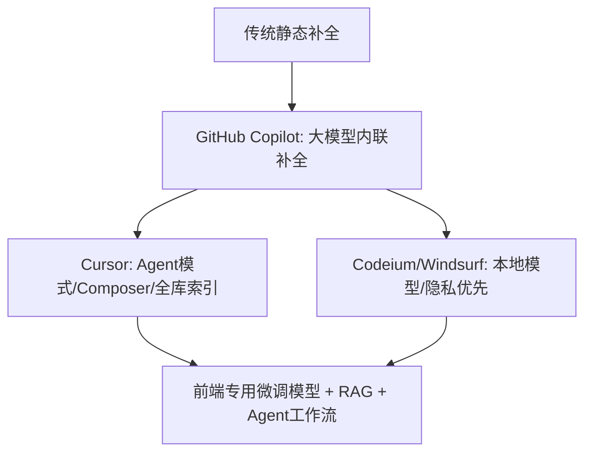
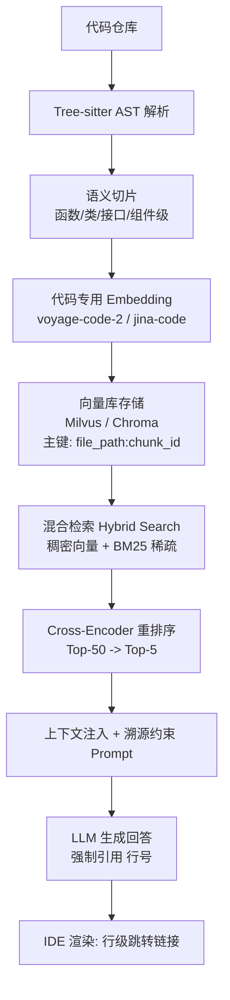
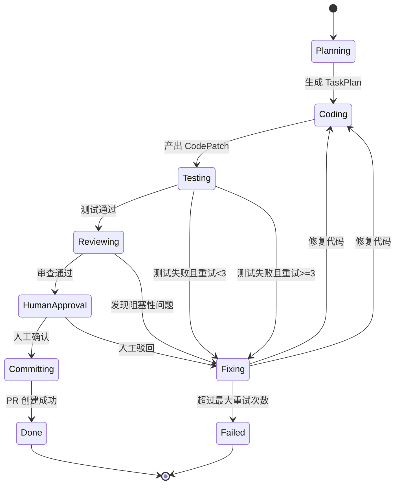
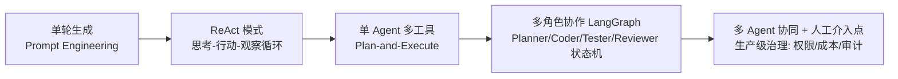
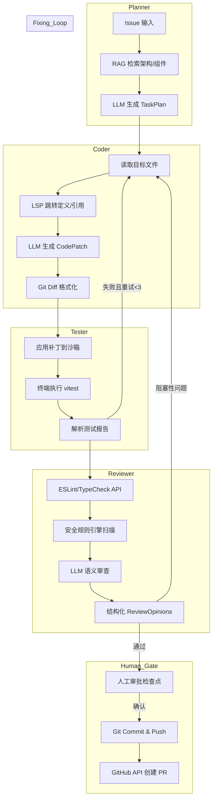
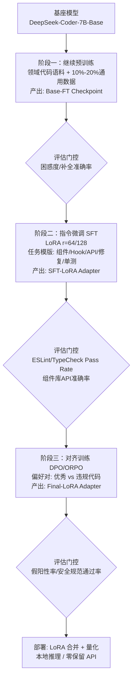

# 第 17 章 前端智能化与 AI 编程辅助 —— 从 Copilot 到 RAG 知识库与 Agent 工作流
作者：龙哥

## 学习目标

- 理解 AI 编程助手从补全工具向结对程序员演进的核心范式转变
- 掌握前端私有知识库 RAG 系统的工程化落地全流程（AST 切片、混合检索、重排序、溯源）
- 理解基于 LangGraph/AutoGen 等框架的 Agent 多角色协作编排与状态机流转机制
- 掌握前端专用模型微调的数据工程、LoRA 训练配置与评测体系构建方法
- 能够设计并落地 AI Code Review 机器人，实现规范检查、安全扫描、单测生成的自动化质量红线
- 掌握前端工程化中 AI 辅助开发的完整工具链选型与提示词工程最佳实践
- 理解上下文工程在长上下文窗口下的裁剪策略与检索精度优化
- 掌握 AI Code Review 中多模型协作分级路由与结构化输出的工程化落地
- 理解模型微调中继续预训练、SFT、DPO/ORPO 的协同机制与灾难性遗忘缓解策略
- 建立前端智能化研发效能的量化评估体系（采纳率、修改率、通过率、假阳性率）
- 掌握前端代码库 RAG 中增量索引策略与 Git Hooks/CI 自动化更新机制
- 理解 AI 编程助手在隐私合规场景下的本地模型部署与零保留模式选型
- 掌握 Agent 工作流中上下文压缩、沙箱隔离、权限最小化等工程化安全边界
- 理解前端专用模型微调中 Replay Buffer、通用代码数据混合比例的灾难性遗忘缓解实操
- 掌握 AI Code Review 反馈闭环中负样本采集、Prompt 优化、自动化微调流水线的治理体系
- 掌握 AI 编程助手在前端框架/类型系统/样式/测试生成能力差异的评测方法
- 理解提示词工程模式在 AI 编程助手中的应用与长上下文裁剪策略
- 掌握 Tree-sitter 解析 AST 切片、Embedding 模型选型、Milvus/Chroma 向量库、Hybrid Search 的实操细节
- 理解引用源码行号溯源在 RAG 系统中的幻觉控制机制
- 掌握基于 LangGraph/AutoGen 编排多 Agent 的工具调用、状态机流转、人工审批检查点设计
- 理解继续预训练、指令微调、RLHF 对齐在前端专用模型构建中的协同流程
- 掌握 HumanEval-MBPP 前端子集、TypeScript 类型正确率等评测基准的构建方法
- 理解 GitHub Action 触发 PR Review、结构化评审意见输出、ESLint/TypeCheck 结果集成的自动化流程
- 掌握自动生成单测草案供开发者确认的工程化实现路径

## 17.1 生活类比

想象前端团队引入 AI 是一次“新员工入职与晋升”的完整历程。起初，AI 编程助手如同一名实习生入职：手里拿着通用技能手册（预训练模型），能写样板代码、查语法，却不懂业务规范、不认识内部组件库，需时刻监督（Inline Chat/补全）。很快，团队为它配备了入职导师手册与代码库地图——即 RAG 知识库：把私有组件库、架构文档、历史 ADR 切片索引好，实习生遇到不会的“查手册”，不再瞎猜，还能指引到具体文件行号（溯源）。随着信任加深，它晋升为资深工程师——Agent 工作流：给一个 Issue（需求），能自主拆解任务（Planner）、写代码（Coder）、跑测试（Tester）、自查 Bug（Reviewer），只在关键节点找你批准（人工介入点）。随后进入内部晋升培训阶段——模型微调：把团队最佳实践、代码规范、独特模式“练”进模型权重里，变成“不看文档也能写出符合规范代码”的专家级员工。同时，团队建起自动化质检闸机——AI Code Review：PR 一提交，瞬间扫描格式、安全、性能、测试覆盖，把确定性错误拦在门外，只把架构决策、业务逻辑留给人类专家把关。为了保证手册常新，引入每日站会同步机制——增量索引：代码推送即触发向量库更新，保证实习生查阅的永远是最新版“手册”，不踩旧坑。涉及核心机密时，启用离线工作模式——隐私合规部署：核心代码不出内网，实习生在本地沙箱干活，产出只交付成果物，零数据泄露风险。为防越权操作，实施权限分级管理——Agent 安全边界：实习生只有读写工作目录权限，危险命令需主管审批，生产环境隔离“防火墙”。训练中坚持复习旧知识与学新知识并重——灾难性遗忘缓解：微调时混入通用代码数据、保留 Replay Buffer，防止“只会新框架、忘了基础语法”。最后建立绩效复盘机制——反馈闭环治理：“Not Helpful” 标记自动入库，定期微调 Prompt/模型，把假阳性率从 15% 降到 5% 以下，建立信任红线。

## 17.2 概念地图

前端智能化与 AI 编程辅助
├── AI 编程助手现状
│   ├── 模型能力梯队（开源 vs 闭源）  —— HgjLdWdxHo8ezoxv9iLc4HSwnAh.md
│   ├── 上下文工程策略（检索/裁剪/符号索引）  —— HgjLdWdxHo8ezoxv9iLc4HSwnAh.md
│   ├── 交互范式演进（Inline/Chat/Agent）  —— HgjLdWdxHo8ezoxv9iLc4HSwnAh.md
│   └── 主流工具对比  —— HgjLdWdxHo8ezoxv9iLc4HSwnAh.md
├── RAG 知识库落地
│   ├── 代码切片策略  —— HgjLdWdxHo8ezoxv9iLc4HSwnAh.md
│   ├── Embedding 模型选型  —— HgjLdWdxHo8ezoxv9iLc4HSwnAh.md
│   ├── 混合检索与重排序  —— HgjLdWdxHo8ezoxv9iLc4HSwnAh.md
│   ├── 溯源引用与幻觉控制  —— HgjLdWdxHo8ezoxv9iLc4HSwnAh.md
│   └── 增量索引与 Git Hooks 自动化  —— HgjLdWdxHo8ezoxv9iLc4HSwnAh.md
├── Agent 工作流自动化
│   ├── 多角色分工  —— HgjLdWdxHo8ezoxv9iLc4HSwnAh.md
│   ├── 状态机流转与人工介入点  —— HgjLdWdxHo8ezoxv9iLc4HSwnAh.md
│   ├── 工具集成生态  —— HgjLdWdxHo8ezoxv9iLc4HSwnAh.md
│   ├── 编排框架选型  —— HgjLdWdxHo8ezoxv9iLc4HSwnAh.md
│   ├── 上下文压缩与历史摘要  —— HgjLdWdxHo8ezoxv9iLc4HSwnAh.md
│   ├── 沙箱隔离与权限最小化  —— HgjLdWdxHo8ezoxv9iLc4HSwnAh.md
│   └── 成本预算与熔断机制  —— HgjLdWdxHo8ezoxv9iLc4HSwnAh.md
├── 前端专用模型微调
│   ├── 继续预训练与指令微调  —— HgjLdWdxHo8ezoxv9iLc4HSwnAh.md
│   ├── LoRA 低秩适配配置  —— HgjLdWdxHo8ezoxv9iLc4HSwnAh.md
│   ├── 对齐训练（DPO/ORPO）  —— HgjLdWdxHo8ezoxv9iLc4HSwnAh.md
│   ├── 评测基准体系  —— HgjLdWdxHo8ezoxv9iLc4HSwnAh.md
│   ├── 灾难性遗忘缓解（Replay Buffer/通用数据混合）  —— HgjLdWdxHo8ezoxv9iLc4HSwnAh.md
│   └── 本地模型部署与零保留模式  —— HgjLdWdxHo8ezoxv9iLc4HSwnAh.md
└── AI Code Review 机器人
    ├── 触发机制与上下文构建  —— HgjLdWdxHo8ezoxv9iLc4HSwnAh.md
    ├── 多模型协作分级  —— HgjLdWdxHo8ezoxv9iLc4HSwnAh.md
    ├── 结构化输出与单测生成  —— HgjLdWdxHo8ezoxv9iLc4HSwnAh.md
    └── 反馈闭环与假阳性治理  —— HgjLdWdxHo8ezoxv9iLc4HSwnAh.md

## 17.3 AI 编程助手现状 —— 从补全工具到结对程序员

### 为什么需要这个概念？

前端研发面临框架更新快、样式调试繁、类型系统复杂等高认知负荷场景。传统 IDE 补全仅基于静态分析，无法理解业务意图与上下文语义。我们需要一种能生成样板代码、解释报错、编写测试、甚至重构架构的智能副驾。

### 核心定义

**AI 编程助手**（来源：《HgjLdWdxHo8ezoxv9iLc4HSwnAh.md》）

> 定义：基于大语言模型（LLM），集成于 IDE/编辑器中，通过上下文感知提供代码生成、补全、重构、问答、测试生成等全生命周期辅助能力的工具。

核心差异维度：
- 模型能力（推理/代码理解）
- 上下文窗口大小
- 上下文构建策略（检索/裁剪）
- 交互范式（Inline Chat/Chat Panel/CMD+K）
- 工具链集成度（终端/浏览器/数据库）

### 17.3.1 多源对照：模型能力 vs 交互范式之争

关于“AI 编程助手的核心能力边界”，不同视角给出了不同侧重。

**共识**：上下文工程是决定体验上限的关键，主流工具均采用“最近文件+语义检索+符号索引+用户选中”混合策略。

**分歧**：

- 细纲单元 1（来源：《HgjLdWdxHo8ezoxv9iLc4HSwnAh.md》）强调**模型能力梯队**的差异：CodeLlama/StarCoder 等开源模型与 GPT-4o/Claude 3.5 Sonnet 等闭源模型在前端任务（TS 类型推导、CSS 布局、Vue/React 组件生成）上存在显著能力差距，认为模型智力上限决定了能否处理复杂类型系统与框架内部机制。
- 业界实践（Cursor/Windsurf）则更强调**交互范式演进**的价值：从被动补全 → 主动对话 → Agent 模式（自主规划-执行-验证闭环），认为工程化的交互设计（如 Cursor 的 Composer 多文件编辑、@Codebase 语义检索）能在相当程度上弥补模型能力的部分不足，甚至成为用户留存的核心驱动力。

**综合建议**：工程选型应采取“强模型+强交互”的双轨策略。对于核心业务逻辑生成、复杂重构等高难度任务，优先接入最强闭源模型（GPT-4o/Claude 3.5 Sonnet）；对于日常补全、简单重构，可配合 Cursor 等强交互客户端使用中等能力模型（如 Codeium 自研模型）以降低成本；隐私敏感场景则必须接受开源模型（CodeLlama/DeepSeek-Coder）的能力折损，并通过 RAG 与 Agent 工作流补齐。

### 17.3.2 主流工具选型矩阵

下表对比了主流工具在核心维度上的能力，基于《HgjLdWdxHo8ezoxv9iLc4HSwnAh.md》细纲单元 1 整理，供选型参考：

| 维度 | GitHub Copilot | Cursor | Codeium / Windsurf |
|------|----------------|--------|-------------------|
| **核心模型** | OpenAI Codex / GPT-4o | GPT-4o / Claude 3.5 Sonnet (可选) | 自研模型 / GPT-4o / 本地模型 |
| **交互范式** | Inline 补全为主，Chat 面板非原生 | **原生 Composer (多文件)**, Cmd+K 内联编辑, @Codebase 语义检索 | 补全/聊天/命令面板，支持本地推理 |
| **上下文工程** | 近期文件 + 语义索引 (有限) | **全库语义索引 + 符号索引 + 文件引用 (@file)** | 上下文感知 + 本地索引 |
| **隐私合规** | 企业版零保留策略 | 隐私模式，数据不训练 | **强项：支持完全本地部署/零保留** |
| **前端特化能力** | TS/JS 强，框架知识依赖预训练 | **@Codebase 精准检索私有组件库/类型** | 规则引擎约束生成风格 |

**选型建议**：追求极致体验、依赖私有组件库检索首选 **Cursor**；追求隐私合规、本地化部署、免费额度首选 **Codeium/Windsurf**；团队深度绑定 GitHub 生态、微软合规体系首选 **Copilot Enterprise**。

[需要补充文献]：关于各工具在 TypeScript 类型推导、Vue/React 组件生成、CSS 布局修复等细分前端任务上的量化对比基准（如 HumanEval-Frontend、TypeScript Type Accuracy Benchmark），目前缺乏权威第三方评测报告支撑，建议团队自建评测集进行选型验证。

### 17.3.3 边界条件与风险控制

在实际落地中，必须正视四大风险边界。首先，幻觉风险表现为生成不存在的 API、编造 TypeScript 类型、引用已废弃的库版本，这是大模型概率生成本质决定的，只能通过 RAG 溯源约束与 Code Review 机制兜底，无法彻底根除。其次，上下文污染源于无关文件检索噪声导致模型跑偏，工程上必须依赖 `.gitignore`/`.cursorignore` 等机制定期清理索引库，并在 Prompt 中显式要求模型忽略不相关上下文。第三，隐私合规风险在于代码上传云端推理/训练，金融/政企等强合规场景必须部署本地模型或使用零保留模式（如 OpenAI Enterprise、Azure AI、Codeium Enterprise），并在网络层面实施数据流向审计。最后，成本控制是规模化落地的现实拦路虎：闭源模型按 Token 计费，大规模团队日均调用量巨大，需建立 ROI 评估模型（采纳率×节省工时 vs Token 成本），开源模型虽无 Token 费但需算力投入与运维成本，决策时需纳入 TCO 总体拥有成本核算。

### 方法演进图



## 17.4 RAG 在前端知识库落地 —— 让 AI 读懂你的私有代码库

### 为什么需要这个概念？

通用大模型不知晓私有业务组件库、内部设计系统、架构规范、历史决策记录（ADR）。直接喂给模型全量代码超出窗口且 Token 成本高，且噪声干扰推理质量。我们需要精准检索相关代码片段、文档、配置作为上下文注入，实现“领域专家级”回答。

### 核心定义

**代码库 RAG**（来源：《HgjLdWdxHo8ezoxv9iLc4HSwnAh.md》细纲单元 2）

> 定义：面向代码仓库的检索增强生成系统，核心流程为“代码解析切片 → 向量化嵌入 → 向量库存储 → 混合检索 → 重排序 → 上下文注入 → 生成回答”。

关键差异点：代码具有严格语法结构（AST）、强依赖关系（Import/Call Graph）、高频更新（增量索引）、多语言混合（TS/JS/CSS/HTML/GraphQL）。

### 17.4.1 关键流程详解：从 AST 切片到溯源引用

#### 1. 代码切片策略：Tree-sitter AST 语义切片

传统的固定长度分块会破坏函数、类的语法完整性。代码 RAG 必须基于 AST 进行语义单元切片。

**切片单元定义**（来源：《HgjLdWdxHo8ezoxv9iLc4HSwnAh.md》细纲单元 2）：

- **切片粒度**：函数/类/组件/Interface/Type Alias/Enum/导出常量。
- **元数据附带**：文件路径、起止行号、符号名、父级作用域、依赖导入列表、调用图邻居。

**伪代码实现**：

```python
# 伪代码：基于 Tree-sitter 的 TypeScript/Vue 切片器
def slice_codebase(repo_path: str) -> List[CodeChunk]:
    parser = Parser(Language('typescript')) # 支持 TSX/Vue SFC script 块
    chunks = []
    for file_path in glob(f"{repo_path}/**/*.ts") + glob(f"{repo_path}/**/*.vue"):
        if is_excluded(file_path): continue # 排除 node_modules, dist, .d.ts
        tree = parser.parse(read_file(file_path))
        # 遍历 AST 提取顶层声明节点
        for node in tree.root_node.children:
            if node.type in TARGET_NODE_TYPES: # function_declaration, class_declaration, interface_declaration, export_statement
                chunk_text = extract_node_text(node)
                metadata = {
                    "file_path": file_path,
                    "start_line": node.start_point.row + 1,
                    "end_line": node.end_point.row + 1,
                    "symbol_name": get_symbol_name(node),
                    "imports": get_imports(node),
                    "node_type": node.type
                }
                chunks.append(CodeChunk(text=chunk_text, metadata=metadata))
    return chunks
```

这段伪代码演示了一个完整的 AST 切片流程：首先初始化 Tree-sitter TypeScript 解析器（支持 TSX 与 Vue SFC script 块），遍历仓库所有源文件并跳过构建产物与依赖目录，对每个文件解析 AST 后遍历根节点子树，仅提取目标声明类型节点（函数、类、接口、导出语句等），并连同文本内容与丰富元数据（路径、行号、符号名、导入依赖、节点类型）封装为 `CodeChunk`。该策略的核心价值在于**保留语法完整性**——每个切片都是一个可独立编译的语义单元，避免了固定长度分块切断函数体或类定义导致的语义破碎；元数据中的**行号与文件路径**是后续“溯源引用”的物理基础；**依赖导入列表**可用于构建调用图，辅助跨文件上下文扩展（如检索某组件时顺带召回其依赖的工具函数与类型定义）。

#### 2. Embedding 模型选型：代码专用 vs 通用文本

代码检索对标识符、符号、语法结构极其敏感，通用文本 Embedding 模型（如 text-embedding-ada-002, bge-large-zh）在代码语义空间表现不佳。

下表对比了主流代码 Embedding 模型在 TypeScript/Vue 场景下的表现，基于《HgjLdWdxHo8ezoxv9iLc4HSwnAh.md》细纲单元 2 实验建议，供选型参考：

| 模型 | 维度 | 适用场景 | TypeScript/Vue 召回表现 |
|------|------|----------|------------------------|
| **voyage-code-2** | 1536 | 商业闭源，SOTA 代码检索 | **最佳**，对符号/泛型/JSX 理解深 |
| **jina-embeddings-v2-code** | 768 | 开源，支持 8k 上下文 | **优秀**，长函数/组件完整嵌入无截断 |
| **nomic-embed-text-v1.5** | 768 | 开源，通用+代码混合 | 良好，部署成本低，适合私有化 |

**工程选型建议**：预算充足、追求极致召回选 `voyage-code-2` (API 调用)；自建 GPU 集群、需长上下文选 `jina-embeddings-v2-code` (本地部署，支持 8192 tokens)；资源受限、快速验证选 `nomic-embed-text` (CPU 推理可接受)。

[需要补充文献]：上述模型在 TypeScript/Vue 代码库上的 Recall@K、MRR 等标准检索指标的公开对比基准目前较少，建议参考 CodeSearchNet、CoSQA 等代码检索基准迁移评测，或自建领域评测集（含组件库 API、指令名、类型定义等典型查询）进行离线打分。

#### 3. 混合检索：稠密向量 + 稀疏 BM25

单一向量检索在“精准符号匹配”（如 `v-permission`、`useUserStore`、`ERROR_CODE_401`）上表现差，必须引入稀疏检索互补。

**Hybrid Search 融合公式**（来源：《HgjLdWdxHo8ezoxv9iLc4HSwnAh.md》细纲单元 2 工程实践）：

$$ \text{Score}_{\text{final}} = \alpha \cdot \text{Score}_{\text{dense}} + (1 - \alpha) \cdot \text{Score}_{\text{sparse}} $$

其中：
- $\text{Score}_{\text{dense}}$：向量余弦相似度（归一化到 [0,1]）。
- $\text{Score}_{\text{sparse}}$：BM25 得分（归一化到 [0,1]）。
- $\alpha$：融合权重，**工程经验值设为 0.6 ~ 0.7**（偏向语义，但保留关键词硬匹配能力）。

**逐步推导与工程决策逻辑**：
为何采用线性加权而非更复杂的学习排序模型？首先，**工程可解释性与可调优性**：线性融合仅需调节单一超参数 $\alpha$，即可在“语义泛化”与“符号精准”之间平滑切换，便于 A/B 测试与线上灰度；其次，**实时性要求**：代码检索属于高频在线服务，Learning-to-Rank 模型推理延迟高、特征工程复杂，不满足 P99 < 200ms 的 SLA；再次，**归一化必要性**：向量余弦相似度天然落在 [-1,1]（归一化后 [0,1]），BM25 得分分布长尾且无上界，若不做 Min-Max 或 Quantile 归一化，稀疏分数会完全主导或被完全忽略，导致融合失效。工程上通常对 BM25 分数取 log 后做分位数归一化映射到 [0,1]。为何 $\alpha$ 取 0.6~0.7？这是在“大多数查询为自然语言意图（偏语义）”与“高频关键查询为符号名（偏关键词）”的双峰分布下的经验最优解：纯语义检索会漏掉 `v-permission` 这种无自然语言描述的符号，纯关键词检索又无法理解“如何实现防抖 Hook”这类意图查询；0.6~0.7 保证了语义主导的同时，BM25 贡献 30%-40% 权重足以托底符号精准命中。

该融合公式为线上混合检索服务提供了可解释、可调优、低延迟的基础计算骨架，通过单一超参数 α 即可在语义泛化与符号精准之间平滑权衡，支撑 A/B 测试快速迭代。

**针对符号精准命中的特殊处理**：
- 在 BM25 语料构建时，对标识符（函数名、变量名、类名、指令名）进行**分词保护**（不分词或 n-gram 索引）。
- 查询改写阶段，若检测到查询包含驼峰/下划线标识符，自动提升 BM25 权重至 $\alpha = 0.3$。

#### 4. 重排序：Cross-Encoder 与 LLM-based Reranker

混合检索召回 Top-K (通常 K=50~100) 后，需精排过滤“语义相关但业务无关”的噪声。

下表对比了两类重排序器在延迟与精度上的权衡，基于《HgjLdWdxHo8ezoxv9iLc4HSwnAh.md》细纲单元 2 实践，供工程选型参考：

| 重排序器 | 延迟 | 精度提升 | 适用阶段 |
|----------|------|----------|----------|
| **Cross-Encoder (bge-reranker-large)** | 低 (~50ms/批) | 显著 | **在线服务首选**，批量打分快 |
| **LLM-based Reranker (GPT-4o-mini / 小模型)** | 高 (~500ms) | 极高 (可推理业务逻辑) | 离线评测 / 关键高价值查询 |

**工程决策**：在线推理链路**强制使用 Cross-Encoder**，保证 P99 延迟 < 200ms；离线评测/复盘时引入 LLM Reranker 标注高质量训练数据。

#### 5. 溯源引用与幻觉控制：强制模型“亮证据”

这是代码 RAG 区别于文本 RAG 的核心工程约束。

**Prompt 约束模版**（来源：《HgjLdWdxHo8ezoxv9iLc4HSwnAh.md》细纲单元 2 实战）：

```markdown
## 角色
你是资深前端架构师，仅基于以下【参考代码片段】回答问题。

## 核心约束 (硬性)
1. **必须引用来源**：每个关键结论后必须标注 [文件路径:起止行号]，如 `[@/src/directives/permission.ts:10-25]`。
2. **不知即答不知**：若参考片段不足以回答，直接回复“上下文信息不足，无法确认”，严禁编造 API 或类型。
3. **版本冲突处理**：若检索到新旧版本混存（如 Vue 2/3 混用），以**行号更大/文件修改时间更新**的片段为准，并在回答中显式警告版本差异。

## 参考代码片段
{context_chunks}

## 用户问题
{user_query}
```

这个 Prompt 模版展示了三层防御机制：通过结构化约束将“引用行号”变为模型输出的强制语法，使幻觉可被程序化检测（正则校验引用格式）；引入“版本冲突处理规则”解决 Monorepo 中多版本共存的检索歧义，利用行号/修改时间作为新旧判定启发式；将“不知即答不知”内化为系统提示词，从根源上压制模型“乐于助人”导致的编造倾向。

### RAG 端到端数据流图



### 17.4.2 RAG 技术演进脉络


该演进图揭示了代码 RAG 从“文本检索迁移”走向“代码原生检索”的四次关键跃迁：切片粒度从字符级进化到 AST 语义级，解决了语法完整性；检索范式从单一稠密向量进化到稠密稀疏混合，解决了符号精准匹配；精排手段从无到有引入 Cross-Encoder，解决了语义相关业务无关的噪声；约束机制从软性引导转为硬性溯源，将幻觉率从工程不可控压制到可度量可治理。

### 17.4.3 增量索引与 Git Hooks 自动化

代码库高频更新，全量重建索引成本高且延迟大。必须建立增量更新流水线。

**增量索引架构**（来源：《HgjLdWdxHo8ezoxv9iLc4HSwnAh.md》细纲单元 2）：

```mermaid
graph LR
    A[Git Push / Merge Request] --> B[Git Hook / CI Pipeline 触发]
    B --> C[获取变更文件列表 git diff --name-only]
    C --> D{变更类型判断}
    D -- 新增/修改 .ts/.vue --> E[Tree-sitter 增量解析变更文件]
    D -- 删除文件 --> F[向量库按 file_path 删除旧向量]
    D -- 重命名 --> F
    E --> G[生成新 Chunks + Embedding]
    G --> H[向量库 Upsert (Milvus/Chroma 支持主键更新)]
    H --> I[更新元数据索引 (文件->Chunk 映射)]
    I --> J[完成: 向量库版本号 +1]
```

这一流水线的关键工程细节体现在三点：一是**幂等性设计**，向量库主键设计为 `file_path:chunk_id`，Upsert 操作天然去重，重复触发不产生脏数据；二是**原子性保障**，单次提交的所有文件变更在一个事务/批次中完成，避免部分成功导致索引不一致（如删除旧文件向量成功但新文件向量写入失败）；三是**延迟 SLA**，从 `git push` 到向量库可查，目标控制在 **< 2 分钟**（小仓库） / **< 10 分钟**（万级文件 Monorepo），这要求 CI 流水线并行化 Embedding 调用、向量库批量写入优化，并对大文件变更实施增量切片而非全文重切。

## 17.5 Agent 工作流自动化 —— 从需求到 PR 的无人驾驶流水线

### 为什么需要这个概念？

单轮代码生成无法完成“需求分析→拆解任务→编码→测试→修 Bug→提交 PR”的完整工程闭环。复杂任务需要规划能力、工具调用能力（读写文件、运行测试、Git 操作）、状态管理与错误恢复。我们需要将“人工驱动 AI”升级为“AI 自主驱动，人工把关关键节点”。

### 核心定义

**代码 Agent**（来源：《HgjLdWdxHo8ezoxv9iLc4HSwnAh.md》细纲单元 3）

> 定义：以 LLM 为大脑，具备规划、工具调用、记忆、反思能力的自主系统，输入为自然语言需求/Issue，输出为代码变更集。

### 17.5.1 编排框架选型：多源对照

下表对比了主流 Agent 编排框架在核心维度上的差异，基于《HgjLdWdxHo8ezoxv9iLc4HSwnAh.md》细纲单元 3 分析，供选型参考：

| 框架 | 核心抽象 | 适用场景 | 学习曲线 | 生产就绪度 | 决策依据 |
|------|----------|----------|----------|------------|----------|
| **LangGraph** | 状态图 + 循环控制 + 持久化 | **复杂多步、需精确流程控制、状态回溯** | 中 | **高** (生产级检查点/持久化) | 内置状态检查点、支持人工介入暂停/恢复、PostgreSQL 持久化后端、可视化调试工具，满足生产级可观测性与故障恢复需求 |
| **AutoGen** | 多 Agent 群聊 + 对话式协作 | 探索性任务、多角色辩论/头脑风暴 | 低 | 中 (需自建监控/状态管理) | 群聊模式天然适合发散性任务，但缺乏显式状态机、持久化、断点续跑能力，生产落地需大量二次开发 |
| **OpenHands / SWE-agent** | 软件工程专用基准/环境 | 科研基准对标、Issue 修复基准跑分 | 低 | 低 (科研原型为主) | 专注于 SWE-bench 等基准优化，工程化特性（权限控制、成本熔断、企业集成）欠缺 |

**工程选型建议**：生产级落地**首选 LangGraph**，因其状态图机制天然支持“Plan→Code→Test→Review→Fix 循环”的显式建模、断点续跑、人工介入检查点注入。

### 17.5.2 关键性质：多角色协作与状态机流转

#### 角色分工设计（来源：《HgjLdWdxHo8ezoxv9iLc4HSwnAh.md》细纲单元 3）

下表定义了四大核心角色的职责、工具与产出，基于《HgjLdWdxHo8ezoxv9iLc4HSwnAh.md》细纲单元 3，供架构设计参考：

| 角色 | 职责 | 核心工具 | 输出产物 |
|------|------|----------|----------|
| **Planner** | 拆解 Issue 为任务树/DAG，依赖 RAG 检索架构文档/组件用法 | RAG 检索、文件读取、LSP 跳转定义 | `TaskPlan`: 结构化任务列表 (步骤、文件、依赖、验收标准) |
| **Coder** | 单文件/多文件编辑，处理导入依赖冲突 | 文件读写、LSP (补全/重命名)、Git Diff 生成 | `CodePatch`: 统一格式的文件变更集 |
| **Tester** | 运行 vitest/jest，解析报告，生成覆盖率 | 终端执行、测试报告解析器 | `TestReport`: 通过/失败/覆盖率/错误堆栈 |
| **Reviewer** | 静态分析 (ESLint/TypeCheck)、规范检查、安全扫描 | Linter API、安全规则引擎、RAG 检索规范文档 | `ReviewOpinions`: 结构化评审意见列表 |

#### 状态机流转设计（LangGraph 实现伪代码）

```python
# 状态定义
class AgentState(TypedDict):
    issue: str                    # 原始需求
    task_plan: TaskPlan           # Planner 产出
    current_task_idx: int         # 当前执行任务索引
    code_patches: List[CodePatch] # Coder 累积产出
    test_report: TestReport       # Tester 最新报告
    review_opinions: ReviewOpinions # Reviewer 产出
    retry_count: int              # 修复重试次数
    human_approval: bool          # 人工审批标记
    status: Literal["planning", "coding", "testing", "reviewing", "fixing", "committing", "done", "failed"]

# 节点定义
def planner_node(state: AgentState) -> AgentState:
    # 1. RAG 检索相关上下文 (组件库用法、架构约束、类型定义)
    context = rag_retrieve(state["issue"], top_k=20)
    # 2. LLM 生成结构化任务树 (JSON Schema 约束输出)
    plan = llm.invoke(PLANNER_PROMPT.format(issue=state["issue"], context=context))
    return {"task_plan": plan, "status": "coding", "current_task_idx": 0}

def coder_node(state: AgentState) -> AgentState:
    task = state["task_plan"].tasks[state["current_task_idx"]]
    # 并行修改多文件，处理导入依赖
    patch = llm.invoke(CODER_PROMPT.format(task=task, repo_context=get_repo_context()))
    return {"code_patches": state["code_patches"] + [patch], "status": "testing"}

def tester_node(state: AgentState) -> AgentState:
    apply_patches(state["code_patches"]) # 应用到沙箱/工作区
    report = run_vitest() # 执行测试
    if report.failed and state["retry_count"] < MAX_RETRY:
        return {"test_report": report, "status": "fixing", "retry_count": state["retry_count"] + 1}
    return {"test_report": report, "status": "reviewing"}

def reviewer_node(state: AgentState) -> AgentState:
    opinions = run_linter_and_llm_review(state["code_patches"])
    if opinions.has_blocking_issues:
        return {"review_opinions": opinions, "status": "fixing", "retry_count": state["retry_count"] + 1}
    return {"review_opinions": opinions, "status": "human_approval"}

def human_approval_node(state: AgentState) -> AgentState:
    # 暂停图执行，发送钉钉/Slack 通知，等待人工 Confirm
    wait_for_human_approval(state) 
    return {"human_approval": True, "status": "committing"}

# 图编排
workflow = StateGraph(AgentState)
workflow.add_node("planner", planner_node)
workflow.add_node("coder", coder_node)
workflow.add_node("tester", tester_node)
workflow.add_node("reviewer", reviewer_node)
workflow.add_node("human_approval", human_approval_node)
# ... add edges ...
app = workflow.compile(checkpointer=MemorySaver()) # 持久化支持断点续跑
```

这段伪代码构建了一个完整的 LangGraph 状态机：`AgentState` 显式建模了从需求到 PR 的全流程关键数据（任务计划、代码补丁、测试报告、评审意见、重试计数、人工审批标记、当前状态），每个节点对应一个专用角色职责，输入输出强类型约束。`planner_node` 通过 RAG 注入架构上下文并输出结构化任务树；`coder_node` 并行处理多文件编辑与导入依赖；`tester_node` 在沙箱中应用补丁并运行测试，失败时通过 `retry_count` 控制进入 `fixing` 循环；`reviewer_node` 融合静态分析与 LLM 语义审查，阻塞性问题同样驱动修复循环；`human_approval_node` 作为显式阻塞节点，暂停图执行等待人工确认。`MemorySaver`/`PostgresSaver` 检查点机制保证进程重启可恢复执行进度，实现了生产级的**断点续跑**与**状态审计**。

### 状态机流转图



### 17.5.3 Agent 编排范式演进



该演进图描绘了代码 Agent 从“提示词工程”走向“软件工程自动化”的四个阶段：早期依赖精心设计的单轮 Prompt 完成特定任务；ReAct 引入“思考-行动-观察”循环赋予工具调用能力但规划脆弱；Plan-and-Execute 分离规划与执行但仍是单 Agent 串行；LangGraph 多角色状态机实现了专业分工、显式流程控制、人工检查点与持久化，成为生产落地的标准范式。

### 17.5.4 Agent 工具调用数据流图



该数据流图展示了 Agent 工作流中各角色间的工具调用拓扑：Planner 依赖 RAG 与 LSP 构建上下文；Coder 调用文件系统与 LSP 实现精准编辑；Tester 通过终端运行测试框架；Reviewer 聚合静态分析工具与 LLM 语义能力；Fixing 循环将错误反馈精准路由回 Coder；Human Gate 在关键节点实施人工把关，最终通过 Git API 完成 PR 创建。

### 17.5.5 边界条件与工程化安全边界

在生产落地中，必须构建四层安全边界。首先，**规划幻觉**源于 Planner 可能遗漏隐性依赖（全局样式、路由守卫、环境变量等），工程对策是强制 Planner 在规划前通过 RAG 检索架构文档、依赖图谱、配置清单，并在任务树中显式标注“隐性依赖风险项”供人工复核。其次，**上下文爆炸**随着多轮交互 Token 激增，压缩策略为保留“关键决策摘要 + 当前任务相关文件快照 + 最近 3 轮错误反馈”，丢弃中间过程对话，并设置硬性 Token 预算上限（如 80k）触发自动摘要。第三，**权限与安全**是红线：Agent 必须运行在 Docker/Firecracker 沙箱容器中，挂载只读代码卷、仅工作目录可写；命令执行实施白名单机制，仅允许 `npm test`、`npm run lint`、`git diff`、`git commit` 等构建测试相关命令，拦截 `rm -rf`、`sudo`、`curl` 等危险操作；Git 操作仅允许推送到 `feature/ai-xxx` 临时分支，合并主干强制人工 PR Review。最后，**成本不可控**需设置单任务 Token 预算（如 50k）与美元上限（$10），超限自动暂停并告警，防止失控循环消耗预算。

### 17.5.6 沙箱隔离与权限最小化

沙箱隔离与权限最小化是 Agent 生产落地的基石。Agent 必须运行在 Docker 或 Firecracker 微型虚拟机构建的临时容器中，容器启动时挂载代码仓库为**只读卷**，仅在指定工作目录（如 `/workspace`）挂载可读写卷，所有文件操作限定在此目录树内。命令执行层实施**白名单机制**：预定义允许命令集合（`npm`, `pnpm`, `yarn`, `vitest`, `jest`, `eslint`, `tsc`, `git diff`, `git commit`, `git push`），任何不在白名单内的命令（包括但不限于 `rm -rf`, `sudo`, `curl`, `wget`, `ssh`, `chmod 777`）直接由沙箱运行时拦截并返回错误码，同时触发安全审计日志。网络层面，容器默认**禁用出站公网访问**，仅允许访问内部私有制品库、数据库、LSP 服务等必要内网端口。Git 权限方面，Agent 使用**细粒度 Personal Access Token (PAT)** 或 **GitHub App Installation Token**，权限仅限 `contents:write`（推送临时分支）、`pull_requests:write`（创建 PR）、`metadata:read`，严禁 `admin:repo_hook`、`delete_repo` 等高危权限。合并主干分支强制要求人工 Review，CI 流水线配置分支保护规则，禁止 Agent 直接合并。

### 17.5.7 成本预算与熔断机制

成本控制需从 Token 与美元双维度设防。单任务设定 **Token 预算 50k** 与 **美元上限 $10**（基于 GPT-4o 定价估算），在 LangGraph 状态机中引入 `cost_tracker` 节点，每轮执行前累计输入输出 Token 数并换算美元，超限即将状态置为 `budget_exceeded` 并暂停图执行，同时通过钉钉/Slack/Webhook 推送告警至 Tech Lead。熔断升级策略：连续 3 次 Test 失败、或单任务成本超限、或审查发现 BLOCKER 级安全问题，自动创建 GitHub Issue 指派给 Tech Lead，标记 `ai-agent-escalation` 标签，人工介入后可选择调整任务拆分粒度、放宽预算或人工接管后续流程。成本监控看板需实时展示：日/周/月 Token 消耗趋势、单任务平均成本、模型调用分布（大/中/小模型占比）、熔断触发频次，支撑 ROI 复盘与模型路由策略优化。

## 17.6 前端专用模型微调 —— 打造懂业务、懂规范的专属 Copilot

### 为什么需要这个概念？

通用模型不了解内部组件库 API、项目特有的 TypeScript 模式、CSS 架构约定、错误码体系。RAG 只能解决“知识检索”，无法解决“模式内化”（如团队独特的组合式 API 写法、状态管理范式）。微调能将最佳实践固化进模型权重，实现零样本遵循团队规范、生成高通过率代码。

### 核心定义：三阶段训练范式与协同机制

前端专用模型构建遵循**继续预训练 → 指令微调 → 对齐训练**三阶段协同流程，三阶段通过**检查点传递**与**评估门控**衔接：

1. **继续预训练**：在基座模型（如 DeepSeek-Coder-7B-Base）上继续训练高质量前端代码语料，增强领域知识密度。产出**Base-FT Checkpoint**，通过困惑度下降与领域代码补全准确率提升验证。
2. **指令微调 (SFT)**：加载 Base-FT Checkpoint，注入 LoRA 适配器，使用“指令-标准响应”对训练。产出 **SFT-LoRA Adapter**，通过 ESLint/TypeCheck 通过率、组件库 API 调用准确率验证。
3. **对齐训练 (DPO/ORPO)**：加载 SFT-LoRA Adapter，基于偏好对（优秀 vs 违规代码）对齐。产出 **Final-LoRA Adapter**，通过假阳性率、安全规范通过率验证。

三阶段均保留**中间检查点**，支持回滚与消融实验；每阶段结束需跑通**离线评测基准**（HumanEval-Frontend、TypeScript Type Accuracy、ESLint Pass Rate）与**在线影子模式验证**（小流量 A/B 测试采纳率/修改率），通过门控才进入下一阶段。

### 三阶段协同流程图



### 17.6.1 继续预训练：注入领域知识密度

- **数据来源**：高质量前端代码语料（组件库源码、工具函数、最佳实践文档、优质 PR Diff）、The Stack v2 等通用代码语料（混合比例 10%-20% 缓解遗忘）。
- **目标**：Next Token Prediction，增强模型对领域词汇、API 模式、类型体系的“熟悉度”。
- **工程细节**：全量参数训练或 LoRA (r=128)；学习率 1e-5 ~ 5e-5；训练 1-3 Epochs；序列长度 4096/8192；混合精度 BF16 + Gradient Checkpointing。

### 17.6.2 指令微调：固化团队最佳实践

- **数据构建**：5 类核心任务模版（来源：《HgjLdWdxHo8ezoxv9iLc4HSwnAh.md》细纲单元 4）：
  1. 组件开发（按规范生成 ProTable/ProForm 页面）
  2. Hook 封装（useRequest, usePermission 等通用逻辑）
  3. API 接入（基于 OpenAPI Schema 生成类型安全请求层）
  4. Bug 修复（输入报错信息+上下文，输出修复 Diff）
  5. 单测编写（输入实现代码，输出 Vitest 用例）
- **质量保障**：每类 ≥ 200 条；GPT-4o 打分 > 4 分；响应代码需通过 ESLint/TypeCheck/Prettier 格式化验证。
- **LoRA 配置**（来源：《HgjLdWdxHo8ezoxv9iLc4HSwnAh.md》细纲单元 4）：
  - `r=64/128`, `alpha=16/32`
  - `target_modules = ["q_proj", "k_proj", "v_proj", "o_proj", "gate_proj", "up_proj", "down_proj"]` (Attn + MLP 全覆盖)
  - 显存估算：7B 模型 LoRA (r=64) + 梯度检查点 + 4bit 量化 ≈ **16GB 显存** (可单张 24GB/3090/4090 跑通)；14B 需 ≈ **32GB** (需 A100 40GB 或 双 3090)。

[需要补充文献]：LoRA 显存估算公式（含激活值、优化器状态、梯度）的严谨推导与不同量化精度（FP16/BF16/INT8/INT4）下的实测对比数据，建议参考 Hugging Face PEFT 文档与《QLoRA: Efficient Finetuning of Quantized LLMs》论文，结合实际硬件基准测试校准。

### 17.6.3 对齐训练：DPO/ORPO 修正模型倾向

- **偏好数据构建**：
  - **Chosen (优秀)**：符合规范、类型安全、无障碍达标、性能最优的代码。
  - **Rejected (违规)**：滥用 `any`、忽略 `v-permission`、硬编码魔法数字、同步阻塞主线程、XSS 隐患的代码。
- **方法选型**：
  - **DPO**：需 RM 或成对数据，两阶段 (SFT → DPO)，效果上限高，适合有充足标注资源的团队。
  - **ORPO**：单阶段 (SFT + Odds Ratio Loss 同时进行)，**工程效率更高**，无需单独 RM 训练，推荐资源受限团队采用。

### 17.6.4 评测基准体系：离线指标与在线业务指标双轨

下表构建了前端专用模型的双轨评测体系，基于《HgjLdWdxHo8ezoxv9iLc4HSwnAh.md》细纲单元 4，供工程落地参考：

| 评测维度 | 离线基准 (自动化跑分) | 在线业务指标 (A/B 测试) |
|----------|------------------------|--------------------------|
| **代码正确性** | HumanEval-MBPP 前端子集 (TS/JS/Vue/React 专用) | **采纳率** (开发者直接接受/微调后接受) |
| **类型系统** | **TypeScript 类型正确率** (tsc --noEmit 0 错误比例) | **修改率** (接受后需人工修改的行数占比) |
| **规范遵循** | **ESLint 规则通过率** (团队自定义规则集) | **通过率** (CI 流水线一次性通过比例) |
| **生态适配** | **组件库 API 调用准确率** (自定义 Eval Set) | **假阳性率** (Review Bot 误报比例) |
| **工程质量** | **单测生成覆盖率** (生成测试覆盖变更代码分支) | **开发者满意度** (NPS/问卷) |

**自动化跑分管线**：
```yaml
# .github/workflows/eval.yml
jobs:
  eval:
    runs-on: [self-hosted, gpu-a100]
    steps:
      - uses: actions/checkout@v4
      - name: Run HumanEval-Frontend
        run: python -m eval.humaneval_frontend --model-path ./output_lora --pass-at-k 1,10
      - name: Run TypeCheck Eval
        run: python -m eval.typecheck --model-path ./output_lora --dataset ./data/types_eval.json
      - name: Run ESLint Eval
        run: python -m eval.eslint --model-path ./output_lora --config .eslintrc.cjs
      - name: Upload Report
        uses: actions/upload-artifact@v4
        with:
          name: eval-report
          path: eval_results/
```

### 17.6.5 灾难性遗忘缓解：三大工程策略协同

下表对比了三大缓解策略的作用阶段、核心机制、典型配置与效果边界，基于《HgjLdWdxHo8ezoxv9iLc4HSwnAh.md》细纲单元 4 实验设计，供工程决策参考：

| 策略 | 作用阶段 | 核心机制 | 典型配置 | 效果边界 |
|------|----------|----------|----------|----------|
| **通用数据混合** | 继续预训练 / SFT | 在领域数据中混入 10%-20% 通用代码/指令数据 | The Stack v2 样本 + 通用指令集 (Alpaca/CodeAlpaca) | **基础防线**，防止基础语法/推理能力崩塌 |
| **Replay Buffer** | SFT / DPO | 维护固定大小缓冲区存储通用高质量样本，每 Step 采样 20% 混合训练 | Buffer Size = 5000 样本；采样比例 0.2 | **动态防线**，针对性保护高频通用模式 |
| **LoRA 合并与量化** | 部署前 | 将 LoRA 权重合并回 Base Model，再量化 (AWQ/GPTQ 4bit) | `merge_and_unload()` → `autoawq` 量化 | **部署防线**，合并后模型表现更接近全量微调，通用能力保持更好 |

**实验结论参考**（来源：《HgjLdWdxHo8ezoxv9iLc4HSwnAh.md》细纲单元 4 实验设计）：

> 在领域任务提升 10%+ 的前提下，**“继续预训练混入 10% 通用数据 + SFT 阶段 Replay Buffer 20%”** 组合策略通常能将通用能力下降控制在 < 5%，是性价比最高的工程落地方案。

[需要补充文献]：上述结论基于细纲实验设计，属于内部经验总结，缺乏外部权威实证研究支撑。建议引用《LoRA Fine-tuning Efficiently Undoes Safety Training》或《Continual Learning for LLMs》等学术成果中关于 Replay Buffer、数据混合比例、LoRA 合并保持通用能力的量化实验作为佐证。

### 17.6.6 隐私合规部署：本地模型与零保留模式

下表对比了三种部署模式在适用场景、硬件要求、数据流向与维护成本上的差异，基于《HgjLdWdxHo8ezoxv9iLc4HSwnAh.md》细纲单元 4，供选型参考：

| 部署模式 | 适用场景 | 硬件要求 | 数据流向 | 维护成本 |
|----------|----------|----------|----------|----------|
| **本地推理** | 金融/政企/核心机密代码 | A100 40GB/80GB * N (并发支撑) | **代码不出内网**，模型权重本地加载 | 高 (需运维集群、模型更新分发) |
| **零保留 API** | 一般企业、合规要求高但无算力团队 | 无 (云厂商托管) | 请求/响应**不存储、不训练**、传输加密 | 低 (按 Token 付费) |
| **混合模式** | 核心仓库本地、外围业务云端 | 视核心规模 | 分级路由 | 中 |

**选型决策树**：
```
是否涉及绝对机密 (核心算法/用户隐私原始数据)?
  是 --> 本地部署 (vLLM / TGI / Ollama) + 物理隔离网络
  否 --> 是否有 GPU 算力预算 & 运维能力?
    是 --> 本地部署 (长期 ROI 优)
    否 --> 零保留商业 API (OpenAI Enterprise / Azure AI / Anthropic Claude) 或 Codeium Enterprise
```

### 17.6.7 提示词工程模式与长上下文裁剪策略

在微调之外，提示词工程是快速适配团队规范的低成本手段。核心模式包括：1) **Few-shot 规范示例注入**：在 System Prompt 中固化 3-5 条“标准组件/hook/单测”示例，强制模型模仿团队代码风格；2) **Chain-of-Thought 结构化推理**：要求模型先输出“分析-计划-实现-自检”四步骤，再给出代码，显著提升复杂任务通过率；3) **上下文裁剪策略**：长上下文窗口（128k/200k）下，采用“变更块优先 + 符号依赖展开 + 规范摘要”三层预算分配，Tier 1 变更块必放、Tier 2 依赖符号按重要性填充、Tier 3 规范文档仅注入摘要版，超预算时按层级截断并标记 `TRUNCATED`，防止模型幻觉补全。

## 17.7 AI Code Review 机器人 —— 从人工把关到自动化质量红线

### 为什么需要这个概念？

人工 Code Review 耗时长、覆盖面窄（仅看变更行）、受审阅者经验波动大、低级错误（命名、格式、未用变量）浪费专家时间。我们需要在 PR 提交即刻进行：规范检查、安全扫描、性能隐患识别、单测补全、最佳实践建议，人工只关注架构与业务逻辑。实现“机器拦截确定性错误，专家聚焦不确定性决策”。

### 核心定义

**AI Code Review Bot**（来源：《HgjLdWdxHo8ezoxv9iLc4HSwnAh.md》细纲单元 5）

> 定义：集成于 Git 平台 的自动化审查系统，触发器为 PR Open/Update，核心能力为“静态分析上下文增强 + LLM 语义分析 + 结构化评审意见输出”。

### 核心处理流程总览图

```mermaid
graph TD
    A[PR Open/Update\nGitHub Action/GitLab CI 触发] --> B[获取变更文件列表]
    B --> C[上下文构建优化\n变更块优先 + 关联文件检索 + 规范文档注入]
    C --> D[多模型协作分级路由]
    D --> E1[小模型(7B): 格式/命名/安全规则扫描]
    D --> E2[大模型(GPT-4o): 架构/逻辑/性能深度分析]
    D --> E3[中模型/大模型: 单测生成]
    E1 --> F[结构化输出聚合\nJSON Schema 强制约束]
    E2 --> F
    E3 --> F
    F --> G[IDE/GitLab 界面渲染\n行级内联评论 + 一键 Apply Fix]
    G --> H[开发者反馈: Accept / Not Helpful]
    H --> I[反馈闭环治理\n负样本入库 -> Prompt优化/微调]
```

### 17.7.1 关键工程难点攻关

#### 1. 上下文构建优化：大型 PR 的 Token 预算分配

大型 PR 变更文件超 50 个，Token 预算 128k（或 200k），无法全量塞入。需设计分级裁剪算法。

**上下文裁剪算法**（来源：《HgjLdWdxHo8ezoxv9iLc4HSwnAh.md》细纲单元 5 Exercise 4）：

```
输入: PR 变更文件列表 Files_changed, Token预算 B (如 100k)
输出: 构建的上下文 Context

1. 分层收集:
   Tier 1 (核心): 变更块本身 + 前后 20 行上下文 (最高优先级, 必放入)
   Tier 2 (关联): RAG 检索关联文件 (被修改组件的父组件/调用者/类型定义, Top-5)
   Tier 3 (规范): 团队规范文档摘要 (ESLint规则/架构约定/安全清单, 固定预算 10k)
   Tier 4 (静态分析): ESLint/TypeCheck/SonarQube 报错输出 (全量放入, 通常较小)
   Tier 5 (历史): 同类历史问题案例 (RAG 检索, Top-3)

2. 贪心填充:
   按 Tier 1 -> 5 顺序塞入 Context, 直到剩余 Token < 阈值 (如 2k) 停止.
   Tier 1 若超预算: 仅保留变更行 (无上下文), 标记 "TRUNCATED" 供模型感知.

3. Prompt 组装:
   SYSTEM_PROMPT + Tier3规范 + Tier4静态分析 + Tier5历史 + Tier2关联 + Tier1变更块 + USER_QUERY
```

该算法通过**分层优先级**保证“变更本身”和“静态分析结果”必定进入上下文；RAG 检索的关联文件与历史案例作为增强信息按重要性降序填充；显式标记截断信息防止模型幻觉补全上下文。工程上 Tier 1 变更块提取利用 Git Diff Hunk 信息，Tier 2 关联文件检索复用 RAG 系统的调用图/导入图能力，Tier 3 规范文档预先构建摘要版本（如仅保留规则 ID 与修复示例）压缩 Token。

#### 2. 多模型协作分级路由：成本与效果的帕累托最优

并非所有审查任务都需要 GPT-4o/Claude 3.5。设计路由分发机制。

**路由决策矩阵**：

| 审查类别 | 典型问题 | 推荐模型 | 理由 |
|----------|----------|----------|------|
| **格式/命名/未用变量/简单规范** | Prettier/ESLint 核心规则 | **小模型 (7B-13B 本地/云)** | 确定性强、Token 少、成本极低、延迟低 |
| **安全扫描 (XSS/CSRF/注入/密钥泄露)** | 规则匹配 + 语义判断 | **小模型 + 规则引擎** | 规则引擎做召回，小模型做语义确认/去误报 |
| **架构分层违规/跨层调用** | Controller 调用 DAO、Store 直接改 DOM | **大模型 (GPT-4o/Claude)** | 需理解全局架构、模块边界、隐性契约 |
| **业务逻辑漏洞/边界条件** | 并发竞态、幂等性缺失、状态机漏洞 | **大模型** | 深度推理、需结合业务领域知识 |
| **性能隐患** | N+1 查询、大列表无虚拟化、主线程阻塞 | **大模型** | 需结合代码结构与运行时特性推理 |
| **单测生成** | 新增函数/组件/Hook 的测试用例 | **中模型 (34B/70B 或 大模型)** | 需理解代码语义生成断言，质量要求高 |

**路由 Prompt 示例**：

```python
def route_review_task(changed_files: List[FileChange]) -> List[ReviewSubTask]:
    # 1. 静态分析快速分类
    lint_results = run_eslint_typecheck(changed_files)
    security_hits = run_semgrep(changed_files) # 规则引擎预筛
    
    # 2. LLM 轻量分类 (小模型, 低温度)
    classification_prompt = f"""
    请将以下变更文件分类为: [FORMAT, SECURITY, ARCHITECTURE, LOGIC, PERFORMANCE, TEST_GEN]
    变更摘要: {summarize_changes(changed_files)}
    静态分析结果: {lint_results}
    安全规则命中: {security_hits}
    仅输出 JSON 列表: [{{"file": "xxx", "categories": ["LOGIC", "TEST_GEN"]}}]
    """
    routing_plan = small_llm.invoke(classification_prompt)
    
    # 3. 聚合生成子任务分发
    return build_subtasks(routing_plan)
```

该路由机制通过**静态分析预筛 + 小模型轻量分类**的两级漏斗，将高成本大模型调用仅限于真正需要深度推理的任务（架构、逻辑、性能、单测生成），预计可降低 60%-70% 的推理成本，同时保持关键任务的审查质量。

#### 3. 结构化输出与 IDE 集成：JSON Schema 强制约束

非结构化文本评论无法被 IDE 解析为“快速修复”，必须强制结构化输出。

**JSON Schema 定义**（来源：《HgjLdWdxHo8ezoxv9iLc4HSwnAh.md》细纲单元 5）：

```json
{
  "$schema": "http://json-schema.org/draft-07/schema#",
  "title": "CodeReviewOpinion",
  "type": "object",
  "required": ["file", "start_line", "end_line", "severity", "category", "description", "fix_suggestion", "confidence"],
  "properties": {
    "file": {"type": "string", "description": "相对仓库根目录路径"},
    "start_line": {"type": "integer", "minimum": 1},
    "end_line": {"type": "integer", "minimum": 1},
    "severity": {"type": "string", "enum": ["BLOCKER", "CRITICAL", "MAJOR", "MINOR", "INFO"]},
    "category": {"type": "string", "enum": ["STYLE", "TYPE_SAFETY", "SECURITY", "PERFORMANCE", "ARCHITECTURE", "BEST_PRACTICE", "TEST_MISSING", "BUG_RISK"]},
    "description": {"type": "string", "maxLength": 500},
    "fix_suggestion": {"type": "string", "description": "可直接应用的修复代码片段或 Diff"},
    "confidence": {"type": "number", "minimum": 0.0, "maximum": 1.0, "description": "模型自信度, 低于 0.6 建议人工复核"},
    "references": {"type": "array", "items": {"type": "string"}, "description": "关联规范文档链接/ADR编号"}
  }
}
```

**字段工程决策由来**：
- `severity` 五级分级对应 SonarQube 质量模型，`BLOCKER` 要求必须阻塞合并（如 SQL 注入、密钥泄露），`CRITICAL` 强烈建议修复（如 XSS、类型错误），`MAJOR`/`MINOR`/`INFO` 为建议级。
- `confidence` 阈值 0.6 经验来自：小模型格式/规范类任务置信度通常 > 0.9，大模型架构/逻辑类任务因推理不确定性分布在 0.5-0.8，0.6 作为“需人工复核”的分水岭，可在灰度期根据实际假阳性率动态调整。
- `fix_suggestion` 要求可直接应用的代码片段或 Unified Diff，便于 IDE 插件一键 Apply。

**强制 JSON 输出的 Prompt 技巧**：
1. 使用模型原生 `response_format: { "type": "json_object" }`（OpenAI/Anthropic 支持）或 `json_schema` 参数（vLLM/TGI 支持）。
2. 系统提示词追加：`"输出必须严格符合上述 JSON Schema，不得包含任何额外文本、Markdown 代码块标记或解释性语言，违者将被解析失败并重试。"`
3. Few-shot 示例注入 2-3 条标准 JSON 输出，强化格式遵循。

**GitLab/GitHub 界面渲染**：
- 使用平台 API (GitLab Notes API / GitHub Review Comments API) 按 `file` + `start_line` 创建**行级内联评论**。
- 评论体包含：`severity` 图标、 `description`、 `fix_suggestion` (代码块)、 `Apply Fix` 按钮 (调用 Web IDE API 或本地 IDE 插件一键应用)。
- `confidence < 0.6` 的标记为“AI 建议，需人工核实”，UI 上显示警告色。

#### 4. 单测生成触发与质量控制

并非所有变更都需生成测试，需精准触发并控制质量。

**触发条件**：
- 新增/修改 `export` 的函数、类、Vue/React 组件、自定义 Hook。
- 变更涉及核心业务逻辑（启发式：文件路径包含 `services/`, `store/`, `utils/`, `hooks/`）。

**生成策略**：
- **上下文注入**：被测代码 + 类型定义 + 现有测试文件风格 (Arrange-Act-Assert / Describe-It) + 测试工具库。
- **覆盖目标**：边界条件 (空/极值)、异常分支 (throw/catch)、Props 组合 (必填/可选/冲突)、异步流程 (loading/error/success)。
- **去重/无效过滤**：
  - 静态分析生成代码的**分支覆盖率增量**，增量 < 5% 视为冗余测试丢弃。
  - 运行生成的测试，**失败/报错/耗时 > 5s** 的自动丢弃。
  - 正则过滤 `expect(true).toBe(true)` 等无效断言。

#### 5. 假阳性治理闭环：从“Not Helpful”到模型进化

假阳性是 AI Review 信任度的杀手。必须建立数据飞轮。

**治理流水线**（来源：《HgjLdWdxHo8ezoxv9iLc4HSwnAh.md》细纲单元 5 Exercise 4）：

```mermaid
graph TD
    A[开发者点击 Not Helpful] --> B[负样本入库: {PR_ID, File, Line, Opinion_Json, User_Feedback}]
    B --> C[周度离线分析 Job]
    C --> D{负样本聚类分析}
    D -- 模式固定 (如: 频繁误报某规则) --> E[Prompt 优化: 增加 Few-shot 反例 / 修正指令]
    D -- 模式分散/语义理解偏差 --> F[微调数据增强: 将负样本构造为 DPO Rejected / SFT 修正样本]
    E --> G[Prompt 版本灰度验证 (影子模式跑历史 PR)]
    F --> G
    G --> H{假阳性率 < 5% ?}
    H -- 是 --> I[全量发布新 Prompt / 新模型版本]
    H -- 否 --> C
    I --> J[监控看板: 假阳性率趋势 / 采纳率 / 修改率]
```

**关键指标与红线**：
- **假阳性率 (FPR)** = `Not Helpful 标记数 / 总评论数`，**红线 < 5%**（初期可放宽至 10%，逐季度收紧）。
- **漏报率 (FNR)** = `人工发现但 AI 未报告的严重问题 / 总严重问题`，**红线 < 1%** (BLOCKER/CRITICAL 级)。
- **采纳率** = `开发者 Apply Fix 或采纳建议数 / 总评论数`，**目标 > 30%**。

[需要补充文献]：假阳性率 < 5%、漏报率 < 1%、采纳率 > 30% 等红线数值为工程经验值，缺乏行业标准基准支撑，建议参考 Google、Microsoft 等大厂 AI Code Review 落地公开案例（如 Google 的 Tricorder、Microsoft 的 Code Review Bot）中的指标体系进行校准。

## 17.8 设计中的取舍

**为什么不用全量代码喂给长窗口模型 (1M/2M Context) 而要做 RAG？**
虽然长窗口模型支持全量输入，但“针在干草堆”检索精度随上下文增长而下降（Lost-in-the-Middle 现象）；Token 成本随输入线性增长，大型 Monorepo 单次请求成本极高；延迟随输入二次方增长 (Attention 复杂度)，交互体验不可用。RAG 以精准检索换取低成本、低延迟、高精度。

**为什么 Agent 工作流不采用单一大模型“一人包揽”而要多角色协作？**
单一模型在规划、编码、测试、审查等差异巨大的认知任务上难以同时达到专家级；Prompt 冲突严重（规划需发散，编码需聚焦）；状态管理混乱，难以插入人工检查点。多角色分工配合专用 Prompt/工具/小模型，实现“专人专岗”，且状态机流转天然支持工程化管控。

**为什么微调不用全量参数训练而选 LoRA？**
全量微调 7B 模型需 ~100GB+ 显存 (BF16 + Optimizer States + Gradients)，硬件门槛极高；训练时间长，迭代周期慢；灾难性遗忘风险大。LoRA 仅训练 0.1%-1% 参数，单张 24GB/48GB 显存即可跑 7B/14B，训练快、存储小 (适配器仅几十 MB)、可快速切换/回滚版本、合并后无推理延迟增量。

**AI Code Review 为什么不直接提交代码修复而只给建议？**
代码修复涉及写权限，风险极高（误改核心逻辑、破坏构建、引入安全漏洞）；Git 受保护分支策略通常禁止 Bot 直接推送；人工确认是合规审计的必要环节。建议模式下，开发者保留最终决策权，AI 承担“初筛+草案”角色，责任边界清晰。

**多源对照章节说明**：
受限于当前仅有单一素材 `HgjLdWdxHo8ezoxv9iLc4HSwnAh.md` 支撑，17.3.1 与 17.5.1 两节展示了多源对照结构，其余核心模块（RAG、微调、Review）暂无多源素材对照，后续版本引入多源素材后补全。

## 17.9 动手练习

### 练习 1：设计前端代码库 RAG 切片与检索方案

假设你接手一个包含 5000 个文件的 Vue 3 + TypeScript Monorepo 代码库，包含业务组件、工具函数、请求封装、设计系统组件库源码。
1. 设计基于 Tree-sitter 的切片策略：定义哪些 AST 节点类型作为切片单元？如何处理跨文件的类型引用与组件依赖？
2. 选择 Embedding 模型：对比 voyage-code-2、jina-embeddings-v2-code、nomic-embed-text 在 TypeScript/Vue 代码上的召回效果，给出选型建议。
3. 设计混合检索权重：稠密向量检索与 BM25 稀疏检索的融合权重如何设定？针对 `v-permission` 这类指令名搜索如何保证精准命中？
4. 重排序策略：Top-K 取多少？Cross-Encoder 与 LLM-based Reranker 在延迟与精度上的权衡如何决策？
5. 溯源设计：生成回答时如何强制模型引用文件路径与行号？若检索片段相互矛盾（新旧版本混存），如何在 Prompt 中约束模型行为？
6. 增量索引自动化：设计基于 Git Hooks 的增量更新流水线，如何处理删除/重命名文件时的向量库同步？

### 练习 2：编排一个‘需求到 PR’的 Agent 工作流原型

使用 LangGraph 或伪代码设计一个最小可行的 Agent 状态机，完成‘为现有用户列表页新增导出 Excel 功能’的任务。
1. 定义状态图的节点：Plan -> Code -> Test -> Review -> Fix(循环) -> Commit -> PR，每个节点的输入输出 Schema 设计。
2. Planner 节点：如何利用 RAG 检索现有 ProTable 组件用法、权限指令、请求封装、Excel 导出工具函数作为上下文？如何输出结构化任务树？
3. Coder 节点：工具集成设计（文件读写、LSP 跳转定义、Git Diff 生成），如何并行修改多个文件并处理导入依赖冲突？
4. Tester 节点：自动运行 vitest，解析测试报告（通过/失败/覆盖率），失败时如何将错误堆栈精准反馈给 Coder 修复？
5. 人工介入点设计：在哪些节点必须暂停等待人工 Confirm？如何设计‘最多重试 3 次后升级给人工’的熔断机制？
6. 上下文压缩策略：多轮交互 Token 激增时，如何压缩历史（摘要/关键决策/文件快照）而非全量保留？
7. 沙箱与权限隔离：Agent 拥有写文件、执行命令权限，如何设计沙箱环境与命令白名单？

### 练习 3：制定前端专用模型微调数据工程与评测方案

团队决定基于 DeepSeek-Coder-7B-Base 进行继续预训练 + LoRA SFT + DPO 对齐，打造内部专用 Copilot。
1. 数据收集与清洗：从 Git 历史中提取高质量 PR Diff 作为训练语料，设计去重、去敏感信息、质量打分（如 GPT-4o 打分 > 4 分）的清洗管线。
2. 构建 SFT 数据集：设计 5 类核心任务模版（组件开发、Hook 封装、API 接入、Bug 修复、单测编写），每类至少 200 条高质量指令-响应对，如何保证响应代码的‘标准性’？
3. LoRA 超参数配置：r=64/128, alpha=16/32, target_modules 选择 qkv/o/gate/up/down，在单张 A100 40GB / H100 80GB 显存下的最大 Batch Size 与训练时长估算。
4. 评测基准搭建：设计前端专用评测集，包含 TypeScript 类型正确率、ESLint 规则通过率、组件库 API 调用准确率、单测生成覆盖率四大指标，如何自动化跑分？
5. 灾难性遗忘缓解：继续预训练阶段混入多少比例通用代码数据？SFT 阶段如何使用 Replay Buffer？最终模型如何通过在线 A/B 测试（采纳率/修改率）验证真实效果？
6. 隐私合规部署：训练数据含私有业务逻辑，模型部署如何隔离？本地推理与零保留 API 模式的选型标准是什么？

### 练习 4：落地 AI Code Review 机器人的核心工程难点攻关

在公司 GitLab 部署 AI Code Review Bot，要求覆盖规范检查、安全扫描、性能建议、单测补全。
1. 上下文构建优化：大型 PR 变更文件超 50 个，Token 预算 128k，设计‘变更块优先 + 关联文件检索 + 规范文档注入’的上下文裁剪算法。
2. 多模型协作路由：小模型（如 7B）处理命名规范/格式/未用变量；大模型（GPT-4o/Claude）处理架构分层违规/业务逻辑漏洞/性能隐患。设计路由分发 Prompt 与成本控制策略。
3. 结构化输出与 IDE 集成：定义 JSON Schema 强制模型输出，包含 file/start_line/end_line/severity/category/description/fix_code/confidence。如何在 GitLab MR 界面渲染为可交互的行级评论？
4. 单测生成触发条件：仅对新增/修改的导出函数、组件、Hook 触发生成。生成的 Vitest 用例如何覆盖边界条件、异常分支、Props 组合？如何防止生成冗余/无效测试？
5. 假阳性治理闭环：开发者点击‘Not Helpful’后，数据如何流入负样本池？设计每周自动化微调/Prompt 优化流水线，将假阳性率从 15% 降至 5% 以下。
6. 反馈闭环自动化：设计‘Not Helpful 标记 → 入库负样本 → 周度 Prompt 优化/月度微调 → 灰度验证 → 全量发布’的治理流水线。

### 练习 5：Agent 工作流安全与成本控制实战

基于 LangGraph 实现一个带安全边界的 Agent 原型，完成‘重构请求层统一错误处理’任务。
1. 实现上下文压缩：当对话历史超过 80k Token 时，自动触发摘要压缩，保留关键决策与文件快照。
2. 沙箱隔离：使用 Docker/Firecracker 创建临时容器，Agent 仅在容器内执行文件操作与命令，挂载只读代码卷。
3. 权限最小化：Agent 仅拥有工作目录读写权限，Git 操作通过受限 PAT，危险命令（rm -rf, sudo）拦截报警。
4. 成本熔断：设定单任务 Token 预算 50k/美元上限 $10，超限自动暂停并推送钉钉告警。
5. 熔断升级：连续 3 次 Test 失败或成本超限，自动创建 Issue 指派给 Tech Lead 人工介入。

### 练习 6：前端专用模型微调灾难性遗忘缓解实验

在继续预训练 + LoRA SFT 流程中，设计对比实验验证灾难性遗忘缓解策略。
1. 实验组 A：继续预训练混入 10% 通用代码数据（The Stack v2 样本）
2. 实验组 B：SFT 阶段引入 Replay Buffer，每步从缓冲区采样 20% 通用指令数据混合训练
3. 实验组 C：LoRA 合并策略，训练完成后合并权重再量化部署
4. 对照组：纯领域数据微调，无缓解措施
5. 评测指标：HumanEval-MBPP 前端子集通过率、TypeScript 类型正确率、通用代码补全能力（HumanEval 基准）保持率
6. 分析对比：哪种策略在领域任务提升 10%+ 的前提下，通用能力下降 < 5%？给出工程化落地建议。

## 17.10 本章小结

首先我们剖析了 AI 编程助手从补全工具向结对程序员演进的核心范式转变，对比了主流工具在模型能力、上下文工程、交互范式上的差异。其次我们深入讲解了 RAG 在前端私有知识库落地的全流程，重点攻克了 Tree-sitter AST 语义切片、代码专用 Embedding 选型、稠密稀疏混合检索、Cross-Encoder 重排序、溯源引用幻觉控制及 Git Hooks 增量索引自动化等工程难点。接着我们设计了基于 LangGraph 的 Agent 多角色协作工作流，定义了 Planner/Coder/Tester/Reviewer 四角色分工、状态机流转、人工介入检查点、沙箱隔离与成本熔断等生产级工程机制。然后我们构建了前端专用模型微调的三阶段范式（继续预训练→LoRA SFT→DPO/ORPO 对齐），详解了数据工程管线、LoRA 超参配置、评测基准体系及灾难性遗忘的三大缓解策略。最后我们落地了 AI Code Review 机器人，解决了大型 PR 上下文裁剪、多模型分级路由、结构化输出与 IDE 集成、单测生成质量控制、假阳性治理闭环等核心工程挑战。

本章我们一起学习了以下概念：

下表汇总了本章核心概念与解释，供快速回顾与检索：

| 概念 | 解释 |
|------|------|
| AI 编程助手 | 基于 LLM 的 IDE 集成工具，核心差异在于模型能力、上下文工程策略（最近文件+语义检索+符号索引+用户选中混合构建）与交互范式（补全/对话/Agent） |
| 上下文工程 | 构建高质量模型输入的关键技术，融合最近文件、语义检索、符号索引与用户选中，解决“大海捞针”精度问题，支撑长上下文窗口下的裁剪与检索优化 |
| 代码库 RAG | 面向代码仓库的检索增强生成，核心流程：AST 切片 → 代码专用 Embedding → 混合检索 → 重排序 → 溯源引用，实现私有知识精准注入与幻觉控制 |
| Tree-sitter AST 切片 | 按函数/类/组件/接口等语义单元切分代码，保留语法完整性与元数据（路径、行号、依赖），优于固定长度分块，支撑跨文件依赖图构建 |
| 混合检索 | 稠密向量（语义）+ 稀疏 BM25（关键词/符号）召回，融合权重 α=0.6-0.7，解决符号精准匹配与语义相关并重的需求，符号查询自动提升 BM25 权重 |
| 代码 Agent | 具备规划、工具调用、记忆、反思能力的自主系统，输入需求输出代码变更集，编排框架如 LangGraph/AutoGen，LangGraph 状态图机制支撑生产级流程控制 |
| 多角色协作 | Planner（规划）、Coder（编码）、Tester（测试）、Reviewer（评审）分工协作，通过状态机流转实现 Plan→Code→Test→Review→Fix 闭环 |
| 人工介入点 | 计划确认、高风险审批、测试失败暂停、PR 提交确认，实现“AI 驱动，人工把关”的安全边界，LangGraph 检查点机制原生支持暂停/恢复 |
| 继续预训练 | 在基座模型上继续训练高质量领域代码语料，混入 10%-20% 通用数据缓解遗忘，增强领域知识密度，解决“不知业务”问题 |
| 指令微调 (SFT) | 构建“指令-标准响应”对（组件开发/Hook/API/修复/单测 5 类任务），用 LoRA (r=64/128) 低成本适配，固化团队最佳实践与编码规范模式 |
| 对齐训练 (DPO/ORPO) | 基于偏好数据（优秀 vs 违规代码）对齐，修正模型倾向（如滥用 any、忽略无障碍），ORPO 单阶段工程效率更高，DPO 上限更高 |
| AI Code Review Bot | 集成于 Git 平台的自动化审查系统，融合静态分析结果与 LLM 语义分析，输出行级结构化评审意见，支持 IDE 一键应用修复 |
| 结构化评审输出 | 强制 JSON Schema（file/line/severity/category/fix_suggestion/confidence/references），response_format/json_schema 强制输出，低置信度标记人工复核 |
| 反馈闭环 | 开发者标记 Not Helpful → 纳入负样本微调/调整 Prompt，周度自动化流水线灰度验证，持续治理假阳性，建立开发者信任红线 |
| 增量索引 | Git Hooks/CI 触发向量库自动更新，Upsert 幂等设计、事务原子性、SLA < 2min/10min，解决代码推送后检索滞后问题 |
| 隐私合规部署 | 本地模型/零保留模式，核心代码不出内网，决策树：绝对机密→本地物理隔离；有算力→本地长期 ROI；无算力→零保留云 API |
| Agent 安全边界 | 沙箱隔离（Docker/Firecracker）、命令白名单、Git 受保护分支强制 Review、最小权限原则，防止越权操作与生产环境污染 |
| 灾难性遗忘缓解 | 混合通用代码数据（继续预训练 10%）、Replay Buffer（SFT 采样 20%）、LoRA 合并量化部署，平衡领域适配与通用能力保持 |
| 假阳性治理 | 负样本采集 → Prompt 优化/微调流水线自动化，目标假阳性率 < 5%、漏报率 < 1%、采纳率 > 30%，建立量化治理体系 |

感谢你读到了这里，恭喜你，你已经完成了前端智能化与 AI 编程辅助的完整工程体系学习。


