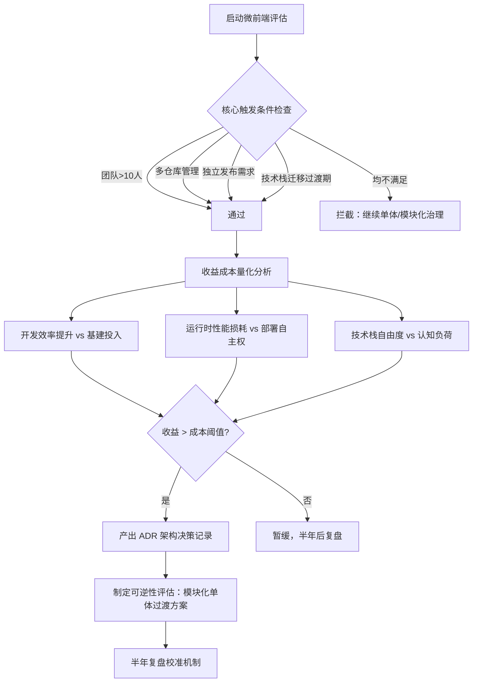
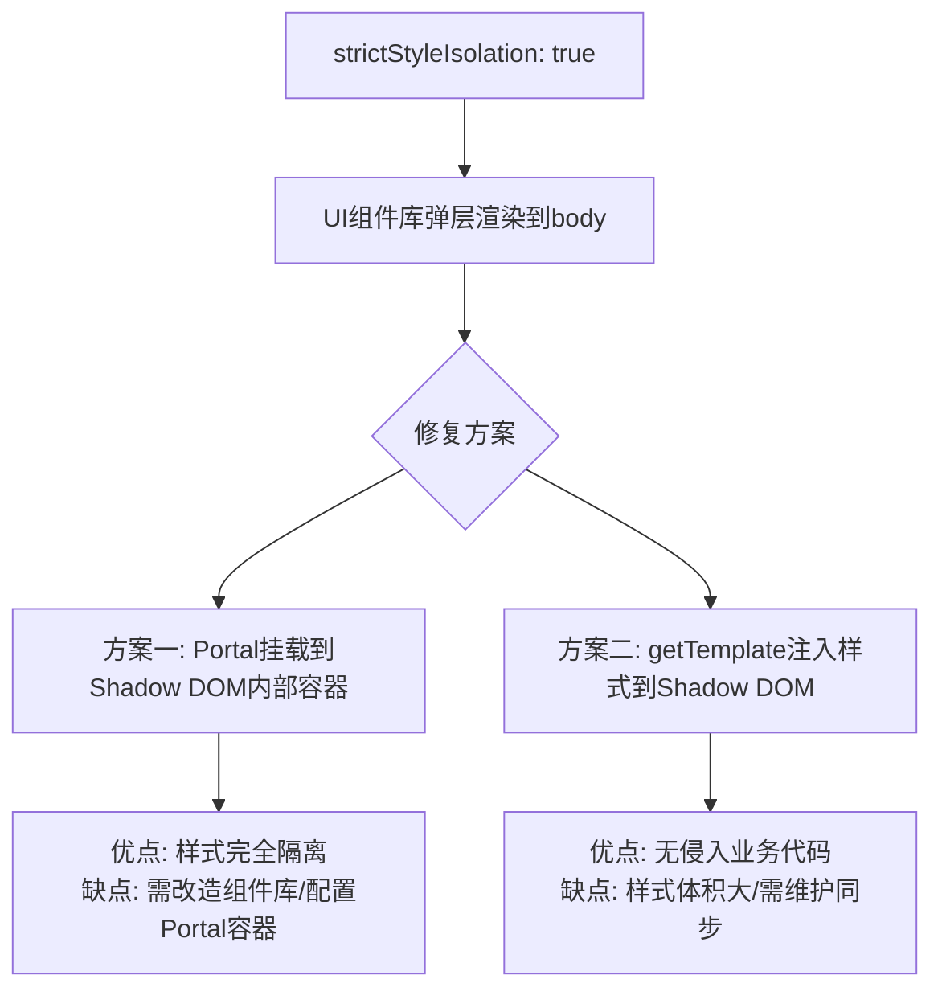
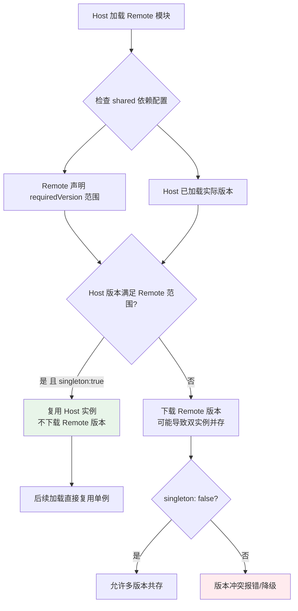
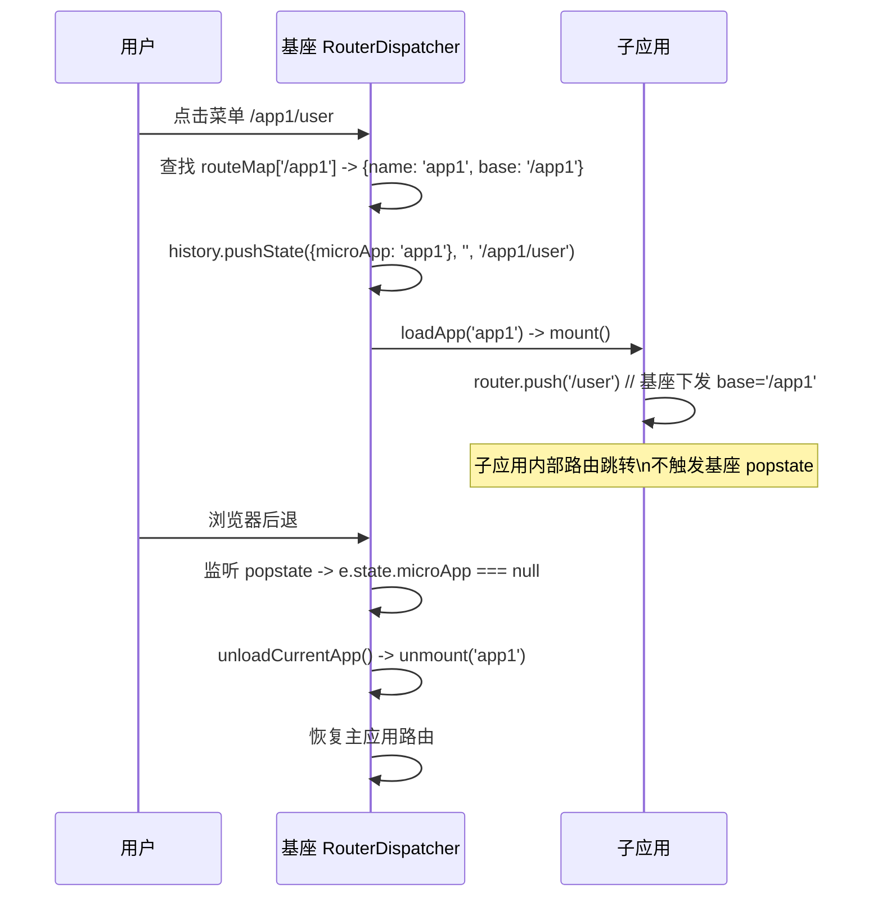
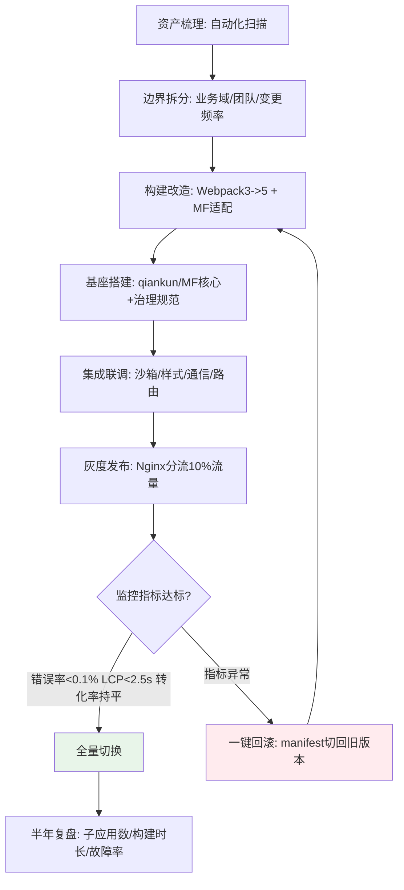

# 第 43 章 微前端架构落地 —— 从 qiankun 到 Module Federation 的技术选型与治理

## 学习目标

- 建立微前端架构决策的量化评估体系，避免盲目跟风引入技术债
- 掌握 qiankun 双沙箱机制、样式隔离方案与生命周期管理的核心原理
- 理解 Module Federation 运行时依赖共享、版本协商与类型安全的工程化落地
- 制定覆盖依赖治理、路由分发、组件库共享、监控统一的微前端治理规范
- 设计遗留系统微前端化改造的增量演进路径、灰度发布策略与回滚预案

## 43.1 生活类比

想象微前端架构是一个**大型商场的经营模式转型**。起初，这里只是一家**街边小店**（单体应用），老板（核心团队）亲自管进货、装修、收银，生意好时忙不过来，生意差时房租压身。随着客流激增（团队扩大到 10 人以上）、经营品类爆发（多技术栈共存）、甚至引入品牌联营商家（独立部署需求），老板意识到必须转型为**大型商场**（微前端架构）。**架构决策矩阵**就是这份**商场选址可行性报告**：它量化评估客流量（团队规模）、品类数（仓库数）、商家自主装修意愿（独立发布频次），若指标不达标（如仅 5 人团队、单仓库、周发布），强行建商场只会导致高空置率（资源浪费），不如把小店经营好（模块化单体）。**qiankun** 采用**全托管柜台模式**：商场方（基座）提供统一装修标准（JS 沙箱）、安检隔离（样式隔离）、统一收银系统（通信机制）、预备库存（预加载）；商家（子应用）只需按规范入驻（导出生命周期钩子），退店时必须清空垃圾（unmount 彻底清理副作用），否则影响下一任商家。**Module Federation** 则是**品牌联营/共享供应链模式**：不再由商场统一装修，而是品牌方（Remote）自带货柜（模块）直接进场；核心优势是共享供应链——所有品牌共用一套物流、收银台，避免重复建设；但需签严格合同（版本协商），防止供应链版本冲突。**治理规范**是**商场管理条例**：统一招牌规范（路由前缀）、统一会员体系（监控 SDK）、统一消防安检（CI 门禁）、统一装修风格（组件库单例）；违规者拒绝开业（阻断合并），但设立“特色品牌申请通道”（新依赖评审流程）保留创新空间。**遗留系统改造**是**老旧商场分期改造不歇业**：不能推倒重来（大爆炸重写），必须分区围挡（边界拆分）、夜间施工（灰度发布）、保留旧通道（版本化目录回滚）、统一水电接口（动态 publicPath/Router base）；最难的是共享会员数据迁移（共享状态）和拆除违建广告牌（清理全局 CSS 污染）。

本章将始终沿用这一商场模型：当你在 43.3 节看到“团队>10人”时，请联想“客流量达标”；43.4 节的“沙箱隔离”对应“统一装修标准与安检”；43.5 节的“依赖共享”对应“共享物流供应链”；43.6 节的“治理规范”对应“商场管理条例”；43.7 节的“遗留改造”对应“分期围挡施工不歇业”。

## 43.2 概念地图

微前端架构落地
├── 架构决策矩阵
│   ├── 触发条件量化：团队规模>10人/多仓库/独立发布/技术栈迁移  —— 20230418_043.md
│   ├── 收益成本权衡：开发效率 vs 基建成本、运行时性能 vs 部署自主权  —— 20230418_043.md
│   └── 可逆性评估：模块化单体作为过渡方案、半年复盘校准机制  —— 20230418_043.md
├── qiankun 沙箱隔离方案
│   ├── 双沙箱模式：Snapshot(单实例/低版本) vs Proxy(多实例/现代浏览器)  —— 20230418_043.md
│   ├── 样式隔离策略：strictStyleIsolation(Shadow DOM) vs experimentalStyleIsolation(scoped CSS)  —— 20230418_043.md
│   ├── 预加载机制：浏览器空闲期预下载静态资源降低首屏延迟  —— 20230418_043.md
│   ├── 主子通信：initGlobalState 发布订阅模式、避免循环更新  —— 20230418_043.md
│   └── 坑位规避：嵌套微前端禁用、unmount彻底清理副作用、公共依赖去重、Shadow DOM弹层修复  —— 20230418_043.md
├── Module Federation 原生联邦
│   ├── 核心配置三元组：exposes/remotes/shared  —— 20230418_043.md
│   ├── 运行时版本协商：requiredVersion/singleton/eager 策略  —— 20230418_043.md
│   ├── 类型安全方案：@module-federation/typescript 或手动维护 d.ts  —— 20230418_043.md
│   ├── 热更新机制：Remote 重新构建、Host 刷新获取、缓存策略处理  —— 20230418_043.md
│   └── 边界条件：版本地狱治理、循环依赖单向化、CSS隔离自行约定、ErrorBoundary降级  —— 20230418_043.md
├── 微前端治理规范
│   ├── 依赖版本锁定：基座dependencies锁定/子应用peerDependencies引用/externals排除  —— 20230418_043.md
│   ├── 路由分发协议：基座持有全局路由表/子应用声明式注册前缀/禁止直接操作history  —— 20230418_043.md
│   ├── 通用组件库强制共享：@enterprise/ui单例/禁止私自引入/导出reset.css  —— 20230418_043.md
│   ├── 监控埋点统一：基座初始化SDK/暴露reportError/trackEvent/TraceID透传  —— 20230418_043.md
│   └── CI/CD门禁：mf-dep-check版本兼容性检测/manifest.json版本编排/金丝雀灰度  —— 20230418_043.md
└── 遗留系统微前端化改造
    ├── 资产梳理：自动化扫描入口/路由/依赖/全局变量/CSS污染源  —— 20230418_043.md
    ├── 边界拆分：按业务域/团队所有权/变更频率划分/提取共享内核下沉基座  —— 20230418_043.md
    ├── 构建改造：动态publicPath/libraryTarget:umd/剥离HTML模版/Router base动态化  —— 20230418_043.md
    ├── 灰度发布：Nginx分流(split_clients/Lua)/Cookie一致性/监控指标自动全量回滚  —— 20230418_043.md
    ├── 回滚预案：版本化目录保留/manifest一键切回/RTO<5分钟  —— 20230418_043.md
    └── 硬骨头攻关：共享状态迁移/样式污染清理(Shadow DOM+Portal)/团队RACI矩阵对齐  —— 20230418_043.md

## 43.3 架构决策矩阵 —— 量化评估何时需要微前端

### 43.3.1 为什么需要这个概念？

微前端并非银弹，盲目引入会带来巨大的工程复杂度（沙箱隔离、样式隔离、通信机制、部署编排）。当团队面临单体应用臃肿、多人协作冲突、技术栈升级受阻、独立部署需求等痛点时，需要理性的决策依据而非主观臆断。缺乏量化标准会导致架构决策随意性大，事后难以复盘和归因。

> "引入决策树：团队>10人/多仓库/独立发布/技术栈迁移等触发条件，量化微前端收益与复杂度成本。"
> 
> ——《20230418_043.md》

### 43.3.2 核心定义

**架构决策矩阵** 是一套基于团队规模、部署频率、技术栈异构度、业务耦合度等关键维度的量化评估模型。通过设定阈值（如团队>10人、多仓库独立发布、技术栈迁移过渡期），将架构决策从“拍脑袋”转变为“数据驱动”。

> "架构决策矩阵：单体 vs 微前端——团队规模、部署频率、技术栈异构度量化评估"
> 
> ——《20230418_043.md》

### 43.3.3 关键性质

#### 决策树流程图



上图展示了架构决策矩阵的标准化决策流程：从触发条件检查、收益成本量化分析，到最终产出 ADR 并建立可逆性评估与复盘机制，形成闭环决策体系。这一流程图对应了商场模型中的“选址可行性评审会”：先查客流（团队规模）、品类（仓库数）、商家意愿（独立发布），再算账（收益成本），最后定案（ADR）并约定复盘（半年校准）。

#### 权衡维度对照表

以下表格展示了微前端引入的核心权衡维度，用于量化打分决策。表格来源于素材《20230418_043.md》中关于“收益成本权衡”的原始定义。

| 维度 | 收益 | 成本/风险 |
|------|------|-----------|
| **开发效率** | 团队自主开发、技术栈自由、按需构建 | 基建投入大（沙箱、CI/CD、治理工具）、跨应用调试难 |
| **部署自主权** | 独立发布、回滚、灰度，不阻塞他人 | 部署编排复杂、版本兼容性维护成本高 |
| **运行时性能** | 按需加载子应用、首屏资源减少 | 沙箱代理开销、重复依赖加载、通信序列化损耗 |
| **技术栈演进** | 渐进式迁移、新旧技术共存 | 多版本共存风险、认知负荷增加、人才梯队要求高 |

这个表格展示了微前端架构在四个核心维度上的收益与代价，决策者需根据团队实际情况量化打分，而非凭印象判断。对应商场模型：开发效率是“商家自主装修提升效率 vs 商场统一装修标准成本”；部署自主权是“品牌自主上新 vs 商场统一安检流程”；运行时性能是“顾客只逛目标品牌区 vs 商场统一导航/安检耗时”；技术栈演进是“品牌自主换季 vs 商场统一风格把控难度”。

#### 可逆性评估

决策矩阵必须包含回退路径评估。推荐**模块化单体**作为过渡方案：在单仓库内通过目录隔离、构建产物分离模拟微前端边界，先验证团队协作模式、CI/CD 流程，成熟后再剥离为独立仓库。这能以极低成本试错，避免“分布式单石”反模式。对应商场模型：先在现有店铺内划区域（目录隔离），试运行“品牌专柜制”，成熟后再物理拆分为独立门店。

### 43.3.4 典型例子

**场景 A：不适合微前端**
- 5人团队、单仓库、周发布、纯 Vue 栈
- 矩阵判分：低收益/高成本
- 决策：继续单体，推行模块化治理（目录隔离、ESLint 规范、模块化构建）

**场景 B：适合微前端**
- 20人团队、多仓库、日发布、Vue/React 共存、老系统迁移
- 矩阵判分：高收益/可控成本
- 决策：采用微前端（qiankun 或 Module Federation）

### 43.3.5 设计中的取舍

**问：为什么要设定“团队>10人”这一硬性门槛，而不是“项目复杂度高”即可引入？**
**答：** 团队规模是维护微前端基建（沙箱、CI/CD、治理工具链、文档、培训）的最小持续投入单位。10 人以下团队引入微前端，基建维护成本会挤占业务开发带宽，导致“为了架构而架构”的技术债。项目复杂度高但团队小，应优先采用模块化单体（目录隔离、包管理、Lint 规范）解耦，而非分布式架构。

**问：如何避免“分布式单石”反模式？**
**答：** 矩阵强制要求“独立发布能力”作为核心触发条件。若拆分后子应用仍需同版本发布、强耦合接口、共享数据库表，则未获得部署自主权，仅增加了网络调用与运维复杂度。此时应合并回单体，通过模块边界治理降低耦合。

### 43.3.6 边界条件

- **伪需求拦截**：仅因“想尝试新技术”而引入微前端属于技术债驱动，非业务驱动，矩阵会拦截此类伪需求。
- **分布式单石反模式**：团队规模小但强行拆分，会导致“分布式单石”反模式：既有分布式复杂度，又无独立部署收益。
- **定期复盘校准**：矩阵需定期（如半年）复盘校准，随组织架构、业务阶段演进动态调整权重。

---

## 43.4 qiankun 深度解析 —— 基于单实例沙箱的子应用隔离方案

### 43.4.1 为什么需要这个概念？

微前端核心难题：多个子应用共享同一个全局 `window`、`document`，如何实现 JS 变量隔离、样式隔离、生命周期管理？iframe 虽然隔离彻底，但体验差（白屏、刷新、通信复杂、SEO 差），需要无感刷新的原生隔离方案。单实例模式下，主应用卸载子应用时必须彻底清理副作用（定时器、事件监听、全局变量污染）。

> "剖析 `snapshot`/`proxy` 双沙箱模式、`strictStyleIsolation` Shadow DOM 方案、`initGlobalState` 状态共享、嵌套微前端坑位。"
> 
> ——《20230418_043.md》

### 43.4.2 核心定义

**qiankun** 基于 single-spa 封装，提供“开箱即用”的微前端解决方案：JS 沙箱（Snapshot/Proxy）、样式隔离（scoped CSS/Shadow DOM）、预加载、通信机制。

**核心流程**：

```
1. registerMicroApps(apps, lifeCycles)  // 注册子应用元信息
2. start({ prefetch: 'all' })            // 启动，开启预加载
3. 触发生命周期：bootstrap → mount → unmount
4. 沙箱激活/卸载：JS 隔离、样式隔离
5. 通信：initGlobalState(state) → onGlobalStateChange(cb)
```

这个流程展示了 qiankun 从注册到运行的完整生命周期，每个阶段都有对应的隔离与通信机制保障。对应商场模型：注册=商家入驻备案；启动=商场开业；生命周期=装修/开业/闭店；沙箱=装修隔离/安检；通信=商场广播/会员系统。

### 43.4.3 关键性质

#### 双沙箱模式架构图

```mermaid
graph TD
    A[qiankun 沙箱选择] --> B{浏览器环境/场景}
    B -->|现代浏览器/多实例| C[ProxySandbox]
    B -->|旧版浏览器/单实例| D[SnapshotSandbox]
    C --> C1[new Proxy(window, handler)]
    C --> C2[每个子应用独立 fakeWindow]
    C --> C3[读写劫持映射到各自沙箱]
    C1 --> C4[优势: 多实例并发/隔离彻底/性能优]
    D --> D1[记录 window 增量变更快照]
    D --> D2[active 时恢复快照]
    D --> D3[inactive 时记录修改/恢复基线]
    D1 --> D4[代价: 同一时间仅单实例/不支持并发]
```

上图对比了 Proxy 与 Snapshot 两种沙箱的核心原理与适用场景。现代项目默认使用 Proxy 沙箱以支持多实例并发；旧版浏览器或单实例场景回退至 Snapshot 沙箱。对应商场模型：Proxy 沙箱=“每个品牌独立仓库+独立收银系统，互不干扰”；Snapshot 沙箱=“共用一个临时仓库，轮流用，用完必须原状复原”。

#### 双沙箱核心伪代码解析

**Snapshot 沙箱（单实例/低版本浏览器）**
- **原理**：记录 `window` 上的增量变更（新增、修改、删除），挂载时应用快照，卸载时恢复快照。
- **代价**：同一时间只能激活一个子应用实例，不支持多实例并存。

```javascript
// 伪代码：Snapshot 沙箱核心逻辑
class SnapshotSandbox {
  constructor() { 
    this.windowSnapshot = {}; 
    this.modifyPropsMap = {}; 
  }
  active() {
    // 1. 记录当前 window 状态作为基线
    this.windowSnapshot = { ...window };
    // 2. 恢复上次该子应用留下的修改
    Object.keys(this.modifyPropsMap).forEach(p => window[p] = this.modifyPropsMap[p]);
  }
  inactive() {
    // 1. 记录当前窗口状态（子应用运行时的修改）
    this.modifyPropsMap = {};
    Object.keys(window).forEach(p => {
      if (window[p] !== this.windowSnapshot[p]) {
        this.modifyPropsMap[p] = window[p];
      }
    });
    // 2. 恢复基线
    Object.keys(this.windowSnapshot).forEach(p => window[p] = this.windowSnapshot[p]);
    // 3. 删除子应用新增属性
    Object.keys(window).filter(p => !this.windowSnapshot.hasOwnProperty(p)).forEach(p => delete window[p]);
  }
}
```

这段伪代码展示了 Snapshot 沙箱通过“拍照-恢复”实现隔离：`active` 时先保存主应用现场，再恢复子应用上下文；`inactive` 时先保存子应用修改，再恢复主应用现场。但由于只有一份 `windowSnapshot`，同一时刻只能有一个活跃实例。这就像商场只有一个临时仓库，品牌 A 用完必须把货架摆回原位，品牌 B 才能进场。

**Proxy 沙箱（现代浏览器/多实例）**
- **原理**：利用 `Proxy` 劫持 `window`，为每个子应用创建独立的 `fakeWindow` 上下文，读写操作映射到各自的沙箱实例。
- **优势**：支持多实例并发激活，隔离更彻底，性能更优。

```javascript
// 伪代码：Proxy 沙箱核心逻辑
class ProxySandbox {
  constructor() {
    this.fakeWindow = {};
    this.proxy = new Proxy(window, {
      get: (target, prop) => this.fakeWindow[prop] ?? target[prop],
      set: (target, prop, value) => { this.fakeWindow[prop] = value; return true; },
      has: (target, prop) => prop in this.fakeWindow || prop in target,
      // ... ownKeys, deleteProperty 等
    });
  }
  active() { /* 标记激活，拦截生效 */ }
  inactive() { /* 标记失效，拦截失效 */ }
}
```

这段伪代码展示了 Proxy 沙箱如何通过代理实现多实例隔离：每个子应用拥有独立的 `fakeWindow`，读取时优先返回沙箱内属性，回退到真实 `window`；写入时仅修改沙箱内属性，互不干扰。这就像每个品牌都有自己独立的仓库和收银系统（fakeWindow），互不干扰，且可同时营业。

#### 样式隔离策略对比表

以下表格对比了 qiankun 提供的两种样式隔离方案，数据来源于素材《20230418_043.md》中“样式隔离策略”的原始定义。

| 策略 | 配置 | 原理 | 适用场景 | 缺点 |
|------|------|------|----------|------|
| **严格隔离** | `strictStyleIsolation: true` | Shadow DOM（`attachShadow({mode: 'open'})`） | 样式冲突极严重、需彻底隔离、遗留项目全局 CSS 污染重 | UI 弹层脱离 Shadow DOM 失效、样式无法穿透、需额外修复 |
| **实验性隔离** | `experimentalStyleIsolation: true` | 编译时给选择器加作用域前缀（如 `#app-root .btn`） | 兼容性好、无 DOM 结构变化、CSS-in-JS 友好 | 无法隔离全局污染（如 `body{margin:0}`）、运行时注入样式无效 |
| **默认（无隔离）** | 不配置 | 约定 CSS Modules / BEM 命名 | 团队规范执行力强、无历史包袱、绿地项目 | 依赖人工约束，风险高，不适合遗留系统接入 |

对应商场模型：严格隔离=“每个品牌专柜带独立装修隔断（Shadow DOM），但弹层广告牌（Modal/Tooltip）会钻出隔断，需专门修复”；实验性隔离=“统一装修风格前缀（scoped CSS），但无法阻挡品牌在公共区域（body/html）贴大幅广告”；默认=“靠商家自觉（BEM/CSS Modules），无物理隔断”。

#### 预加载机制

配置 `prefetch: 'all'` 或 `prefetch: ['app1', 'app2']`，在浏览器空闲期（`requestIdleCallback`）预下载子应用的 JS/CSS 静态资源到缓存。用户切换时直接读取缓存，显著降低首屏延迟。

```javascript
// qiankun 配置示例
registerMicroApps([
  { name: 'app1', entry: '//localhost:8081', container: '#subapp', activeRule: '/app1' }
], {
  prefetch: 'all',  // 或 ['app1', 'app2']
  strictStyleIsolation: true,
  sandbox: { experimentalStyleIsolation: false } // 显式指定沙箱类型
});
start();
```

这段配置展示了如何开启预加载和严格样式隔离，`prefetch: 'all'` 会在主应用空闲时自动拉取所有子应用的静态资源。对应商场模型：商场利用夜间闲时（requestIdleCallback）预先把热门品牌的货品备到各专柜缓存区，顾客白天逛时直接取货，无需现调。

#### 主子通信：`initGlobalState`

基于发布订阅模式，主应用初始化全局状态，子应用订阅变更。

```javascript
// 主应用
import { initGlobalState } from 'qiankun';
const { onGlobalStateChange, setGlobalState } = initGlobalState({
  user: null,
  token: '',
  theme: 'light'
});
onGlobalStateChange((state, prev) => console.log('state changed:', state));

// 子应用
export function mount(props) {
  props.onGlobalStateChange((state, prev) => { /* 同步用户信息、主题 */ });
  props.setGlobalState({ user: getUser() }); // 子应用可主动上报
}
```

这个机制展示了主子应用如何通过共享状态实现协作，但需注意避免循环更新（A 改 B，B 再改 A），建议在 `onGlobalStateChange` 中通过 `prev` 对比判断是否为自身触发的变更。对应商场模型：商场广播系统（initGlobalState），品牌可订阅广播（onGlobalStateChange）也可向广播投稿（setGlobalState），但需防止“品牌 A 听广播改价，品牌 B 听广播再改价”死循环。

#### 坑位规避指南

以下四点坑位规避指南基于素材《20230418_043.md》中“坑位规避”的原始定义整理而成，对应商场模型中的“违规操作红线”：

1. **嵌套微前端禁用**：子应用再套 qiankun 会导致沙箱嵌套失效、样式穿透、通信链路混乱，生产环境强烈不推荐。这相当于“品牌专柜里再开商场”，管理混乱、安检层层套娃。
2. **`unmount` 必须彻底清理**：销毁定时器（`clearInterval`/`clearTimeout`）、移除事件监听（`window.removeEventListener`、`document.removeEventListener`）、清理全局变量、取消网络请求（`AbortController`）、销毁图表实例（ECharts/Highcharts `dispose()`）。这对应“商家退租必须清空垃圾、拆除装修、归还钥匙”，否则下一任商家进场发现脏乱差。
3. **公共依赖去重**：基座与子应用共享 React/Vue/UI库，需配置 `externals` 或 `shared`，避免多份实例导致体积膨胀、状态不同步、Hooks 报错。对应“所有品牌共用商场中央空调/收银系统/物流（React/Vue/UI库），严禁自带设备重复建设”。
4. **Shadow DOM 弹层修复**：`strictStyleIsolation: true` 导致 Modal/Dropdown/Tooltip 等弹层组件（通常挂载到 `document.body`）脱离 Shadow DOM，样式丢失、定位错乱。对应“品牌专柜装了隔断（Shadow DOM），但弹层广告牌默认挂在商场大厅天花板（body）上，脱离隔断导致样式失效”，需专门修复。

### 43.4.4 典型例子

**遗留系统迁移**：主应用 Vue 3，子应用 A 为 Vue 2 老系统，子应用 B 为 React 新业务，通过 qiankun 共存平滑迁移。

**权限隔离**：子应用作为独立权限单元，主应用根据用户角色动态 `registerMicroApps`，实现菜单级路由分发。

### 43.4.5 Shadow DOM 弹层修复方案（方法演进图）



#### 方案一：Portal 挂载到 Shadow DOM 内部容器

```javascript
// 子应用入口文件
import { createApp } from 'vue';
import App from './App.vue';
import Antd from 'ant-design-vue';

// 关键：为 Portal 提供挂载容器
const container = document.createElement('div');
container.id = 'portal-root';
document.querySelector('#subapp-shadow-root')?.appendChild(container); // 挂载到 Shadow DOM 内部

const app = createApp(App);
app.use(Antd, { 
  // Ant Design Vue 4+ 支持 getPopupContainer
  getPopupContainer: () => document.getElementById('portal-root') 
});
app.mount('#subapp');
```

这段代码通过在 Shadow DOM 内部创建 `portal-root` 容器，并配置 UI 组件库的 `getPopupContainer` 指向该容器，强制弹层渲染在 Shadow DOM 内部，从而继承隔离样式。对应商场模型：在专柜隔断内专门划出“弹层展示区”（portal-root），强制品牌广告牌只能挂在自家展示区，不得钻到大厅天花板。

#### 方案二：`getTemplate` 注入样式到 Shadow DOM

```javascript
// 主应用 registerMicroApps 配置
registerMicroApps([
  {
    name: 'subapp',
    entry: '//localhost:8081',
    container: '#subapp',
    activeRule: '/subapp',
    props: {
      // 通过 getTemplate 将 UI 库样式注入子应用的 Shadow DOM
      getTemplate: (tpl) => {
        // tpl 是子应用 HTML 字符串
        // 注入 antd.css / 自定义 reset.css
        const styles = `
          <link rel="stylesheet" href="//cdn.jsdelivr.net/npm/ant-design-vue@4/dist/reset.min.css" />
          <style>:host { display: block; } /* Shadow DOM 宿主样式 */</style>
        `;
        return tpl.replace('</head>', `${styles}</head>`);
      }
    }
  }
]);
```

这段代码利用 qiankun 的 `getTemplate` 钩子，在子应用 HTML 解析前注入 UI 库样式链接与宿主重置样式，确保 Shadow DOM 内部拥有完整的组件库样式上下文。对应商场模型：商场统一给每个专柜隔断内预装“标准货架样式”（UI 库 CSS），品牌无需自带装修材料。

### 43.4.6 设计中的取舍

**问：为什么 qiankun 要双沙箱而不是单一 Proxy 沙箱？**
**答：** 兼容性与性能的取舍。Proxy 需要现代浏览器支持（IE11 不支持），Snapshot 作为兜底方案保证旧环境可用。同时，Snapshot 沙箱实现简单、内存占用低，单实例激活场景下性能优于 Proxy。生产环境建议强制 `sandbox: { experimentalStyleIsolation: false }` 使用 Proxy 沙箱，获得多实例并发能力。

**问：为什么不推荐生产环境嵌套 qiankun？**
**答：** 沙箱嵌套会导致 `window` 代理链层层包裹，属性读写穿透多层 Proxy 产生性能损耗；样式隔离层层 Shadow DOM 导致选择器穿透失控；`initGlobalState` 通信通道多级转发极易死循环。架构上应遵循“单层基座、多层子应用”原则，子应用内部若需微前端化，应提升为平级子应用由基座统一管理。

---

## 43.5 Module Federation —— 运行时依赖共享的原生联邦模块方案

### 43.5.1 为什么需要这个概念？

qiankun 属于运行时框架层面的隔离，存在性能开销（沙箱代理）、接入改造成本（生命周期适配）、样式隔离副作用。Webpack 5 原生支持 Module Federation，将“模块共享”下沉到构建/运行时底层，实现更轻量、更原生的代码复用，解决“公共依赖重复打包”“版本冲突”“运行时同步更新”的工程化难题。

> "详解 `exposes`/`remotes`/`shared` 配置、运行时版本匹配算法、联邦模块热更新、与 Vite/Rspack 生态集成。"
> 
> ——《20230418_043.md》

### 43.5.2 核心定义

**Module Federation** 允许一个构建产物（Host）在运行时动态加载另一个构建产物（Remote）导出的模块，并支持双向依赖共享。

**核心配置三元组**：

```javascript
// webpack.config.js (Remote 端)
module.exports = {
  plugins: [
    new ModuleFederationPlugin({
      name: 'remote_app',
      filename: 'remoteEntry.js',
      exposes: {
        './TableComponent': './src/components/TableComponent.vue',
        './UserProfile': './src/views/UserProfile'
      },
      shared: {
        vue: { singleton: true, requiredVersion: '^3.4.0', eager: false },
        'element-plus': { singleton: true, requiredVersion: '^2.7.0', eager: false }
      }
    })
  ]
};

// webpack.config.js (Host 端)
module.exports = {
  plugins: [
    new ModuleFederationPlugin({
      name: 'host_app',
      remotes: {
        remote_app: 'remote_app@//localhost:8081/remoteEntry.js'
      },
      shared: {
        vue: { singleton: true, requiredVersion: '^3.4.0', eager: true },
        'element-plus': { singleton: true, requiredVersion: '^2.7.0', eager: true }
      }
    })
  ]
};
```

这个配置展示了 Host 与 Remote 如何通过 `exposes`（导出模块）、`remotes`（引用远程模块）、`shared`（共享依赖）三元组实现模块联邦与依赖共享。Remote 暴露组件路径，Host 声明远程入口，双方协商共享 Vue 与 Element Plus 的单例版本。对应商场模型：Remote=品牌自带货柜（exposes 组件）；Host=商场引入品牌（remotes 入口）；shared=共享物流/收银系统（Vue/Element Plus 单例）。

### 43.5.3 关键性质

#### 运行时版本协商决策树



上图展示了运行时版本协商的核心决策逻辑：当 Host 版本满足 Remote 的 `requiredVersion` 范围且双方均配置 `singleton: true` 时，运行时复用 Host 已加载的单例实例，避免重复下载；否则按策略下载 Remote 版本或报错。对应商场模型：品牌（Remote）要求物流版本兼容 ^3.4.0，商场（Host）已有 3.4.2，版本满足且签了独家合同（singleton:true），直接用商场物流；否则品牌自带物流（可能双套物流并存），或因合同冲突拒绝入驻。

#### 运行时版本协商算法详解

当 Host 加载 Remote 模块时，运行时会对比双方 `shared` 配置，决策加载策略。以下是该算法的逐步推导与原理分析：

**版本协商决策步骤：**
1. **获取版本约束**：读取 Remote 声明的 `shared` 依赖版本范围 `requiredVersion`（如 `^3.4.0`）。
2. **获取实际版本**：读取 Host 已加载的 `shared` 依赖实际版本（如 `3.4.2`）。
3. **语义化版本比对**：判断 Host 实际版本是否满足 Remote 版本范围（`semver.satisfies(hostVersion, remoteRange)`）。
4. **单例策略判断**：若满足版本范围 **且** 双方均配置 `singleton: true`，则复用 Host 实例，不下载 Remote 版本。
5. **降级策略**：若版本不满足或 `singleton: false`，则下载 Remote 版本；若 `singleton: true` 但版本不满足，运行时可能报错或允许多版本并存（取决于实现）。

**`eager` 参数影响加载时机：**
- `eager: true`：同步加载共享模块，Host 启动阶段即下载并初始化，保证首次渲染即可用，适合 React/Vue 等核心运行时；代价是增加 Host 初始包体积。
- `eager: false`：异步加载，Host 启动不加载共享模块，首次使用 Remote 模块时才触发下载，首屏快但首次使用有延迟，适合大体积 UI 库或非首屏组件。

这一算法的核心原理是**语义化版本比对 + 单例锁定策略**，通过运行时动态决策实现“版本兼容则复用、不兼容则隔离”的平衡，避免了构建时硬编码版本的刚性。

#### 类型安全方案对比表

Module Federation 运行时动态加载，TypeScript 编译期无法感知 Remote 模块类型。以下表格对比了两种主流方案，数据来源于素材《20230418_043.md》中“类型安全方案”的原始定义。

| 方案 | 原理 | 优点 | 缺点 |
|------|------|------|------|
| **`@module-federation/typescript`** | 构建时自动生成 `.d.ts` 并同步给 Host | 自动化、类型实时同步、支持重命名 | 配置复杂、需额外构建步骤、Monorepo 下路径解析麻烦 |
| **手动维护 `@types/remote-app`** | 发布类型声明包，Host 安装 `@types/remote-app` | 简单可控、无构建耦合、版本独立 | 手动维护成本高、易忘记同步、版本漂移风险 |

对应商场模型：方案一=“商场统一建立品牌档案库，品牌上新自动同步档案”；方案二=“品牌自行印制产品手册寄给商场，商场存档备查”。

#### 热更新机制

Remote 修改代码后重新构建产出新的 `remoteEntry.js` 和 chunk 文件。Host 刷新页面或通过 HMR 机制获取新版本。

```javascript
// Host 端手动触发 Remote 更新（如配合版本号）
async function reloadRemoteModule(moduleName) {
  // 1. 删除缓存
  delete window.__webpack_init_sharing__[moduleName];
  // 2. 重新加载 remoteEntry.js（需处理缓存头）
  await import(/* webpackIgnore: true */ `//localhost:8081/remoteEntry.js?v=${Date.now()}`);
  // 3. 重新获取模块工厂
  const factory = await __webpack_share_scopes__.default[moduleName];
  return factory();
}
```

这段代码演示了如何在 Host 端手动触发 Remote 模块的热更新：清除共享作用域缓存、强制刷新 remoteEntry.js（附加版本戳防缓存）、重新获取模块工厂函数。对应商场模型：品牌换季（Remote 重新构建），商场清空旧货架缓存、重新拉取品牌新货柜清单（remoteEntry.js）、重新摆货上架。

#### 边界条件与对策表

以下表格汇总了 Module Federation 的边界条件及对策，数据来源于素材《20230418_043.md》中“边界条件”的原始定义。

| 边界条件 | 风险 | 对策 |
|----------|------|------|
| **版本地狱** | `shared` 版本范围过宽导致不兼容，过死导致无法复用 | 建立版本治理规范：基座锁定主版本号、子应用 `peerDependencies` 兼容范围、CI 门禁检测 |
| **循环依赖** | Host ↔ Remote 相互引用导致构建死循环/运行时栈溢出 | 架构单向化：抽离公共包 `@enterprise/shared`，Host/Remote 均依赖它 |
| **CSS 隔离缺失** | MF 仅管 JS，样式全局污染 | 约定 CSS Modules / Scoped CSS / Shadow DOM，工程规范强制执行 |
| **运行时错误** | Remote 加载失败导致 Host 崩溃 | 必须包裹 `ErrorBoundary`，实现降级 UI：`fallback: <Loading />` 或空组件 |

对应商场模型：版本地狱=“品牌各自定物流标准导致混乱，需商场制定统一物流标准”；循环依赖=“品牌 A 卖品牌 B 的货，品牌 B 又卖品牌 A 的货，死循环，需引入第三方供应商（公共包）”；CSS 隔离缺失=“MF 只管货品（JS），不管装修（CSS），需商场制定装修规范”；运行时错误=“品牌货柜送达损坏（加载失败），商场需有兜底预案（ErrorBoundary），避免整个商场停业”。

### 43.5.4 典型例子

- **组件库共享**：Host 与 Remote 共享 `react`、`react-dom`、`antd` 单例，避免重复加载 200KB+ 体积。
- **业务模块联邦**：微前端子应用作为 Remote 暴露 `./App` 入口，Host 通过 `import('remote/App')` 动态加载渲染，无需 qiankun 沙箱开销。
- **跨框架共享**：Vue Host 消费 React Remote 组件（需桥接适配层），共享工具库 `lodash`、`dayjs` 等无框架依赖模块。

### 43.5.5 设计中的取舍

**问：Module Federation 为什么不内置 CSS 隔离？**
**答：** 职责边界的取舍。MF 设计定位为“模块联邦”，解决 JS 模块依赖图与运行时共享。CSS 隔离属于样式架构层面，方案多样（CSS Modules、Styled Components、Tailwind、Shadow DOM），强行内置会限制技术选型自由度。通过工程约定（规范文档、Lint 规则、CI 门禁）强制执行 CSS 隔离策略，比框架内置更灵活。

**问：`eager: true` 与 `eager: false` 如何选择？**
**答：** 首屏性能与可用性的取舍。`eager: true` 同步加载共享模块，保证首次渲染即可用，适合 React/Vue 等核心运行时；但会增加 Host 初始包体积。`eager: false` 异步加载，首屏快，但首次使用 Remote 模块时会有额外网络请求延迟，适合大体积 UI 库（如 ECharts、Ant Design）或非首屏业务组件。建议：核心框架 `eager: true`，UI 库 `eager: false` 并配合预加载。

---

## 43.6 微前端治理规范 —— 从“技术可行”到“工程可控”

### 43.6.1 为什么需要这个概念？

技术选型（qiankun/MF）仅解决“能跑起来”，生产环境面临：依赖版本漂移、路由冲突、UI 规范不一、监控盲区、发布协作混乱。缺乏治理规范会导致“微前端变微烂端”：子应用随意升级 React 版本导致共享依赖失效；各自引入不同 UI 库导致体积翻倍；埋点 SDK 版本不一致数据错乱。需要建立类似后端微服务治理的“前端服务契约”。

> "制定《微前端接入规范》：基座提供 React/Vue 单例、路由基座分发、UI 组件库强制共享、统一监控 SDK 注入。"
> 
> ——《20230418_043.md》

### 43.6.2 核心定义

一套覆盖公共依赖版本锁定、路由分发协议、通用组件库强制共享、统一监控 SDK 注入、发布流程规范的工程化治理体系。核心产出：《微前端接入规范文档》、基座提供的 `@enterprise/mf-core` 核心包、CI/CD 门禁检查脚本。

### 43.6.3 关键性质

#### 依赖版本锁定架构图

```mermaid
graph TB
    subgraph Host[基座 Host]
        H1[package.json\ndependencies: {react: 18.2.0, antd: 5.12.0}]
        H2[HTML 注入脚本\n<script src="react@18.2.0.min.js">]
    end
    
    subgraph Remote[子应用 Remote]
        R1[package.json\npeerDependencies: {react: ^18.2.0, antd: ^5.12.0}]
        R2[webpack.config.js\nexternals: {react: React, antd: antd}]
        R3[libraryTarget: 'umd']
    end
    
    subgraph Runtime[运行时]
        RT1[window.React = React 18.2.0 单例]
        RT2[子应用 mount 时\nwindow.React = window.React || host.React]
    end
    
    H1 --> H2
    R1 --> R2
    R2 --> R3
    H2 --> RT1
    R3 --> RT2
    RT1 --> RT2
```

上图展示了依赖版本锁定的三层协作机制：基座在 `dependencies` 中锁定确切版本并通过 HTML 注入全局单例；子应用在 `peerDependencies` 声明兼容范围，构建时通过 `externals` 排除打包，输出 UMD 格式；运行时子应用挂载时自动绑定基座注入的全局单例，实现零成本共享。对应商场模型：基座=商场采购统一设备（dependencies 锁版本）；子应用=品牌签合同承诺兼容标准设备（peerDependencies）；构建=品牌不自带设备（externals 排除）；运行时=品牌进场直接用商场设备（window.React 单例）。

#### 依赖版本锁定策略代码示例

以下代码展示了基座、子应用、运行时三层配合的完整配置，来源于素材《20230418_043.md》中“依赖版本锁定策略”的原始定义。

```
基座
├── package.json
│   ├── dependencies: { "react": "18.2.0", "antd": "5.12.0", "lodash": "4.17.21" }
│   └── peerDependencies: {}  // 基座不声明 peer

子应用
├── package.json
│   ├── dependencies: { "business-lib": "1.0.0" }  // 仅业务私有依赖
│   ├── peerDependencies: { "react": "^18.2.0", "antd": "^5.12.0" }  // 声明兼容范围
│   └── externals: { "react": "React", "react-dom": "ReactDOM", "antd": "antd" }  // 构建不打包

运行时
├── 基座 HTML 注入: <script src="react@18.2.0.min.js"></script>
├── 子应用 UMD 入口: libraryTarget: 'umd', library: 'subApp'
└── 子应用 mount 时: window.React = window.React || host.React  // 运行时注入单例
```

这段配置展示了如何通过 `dependencies`/`peerDependencies`/`externals` 三层配合实现依赖单例共享。基座锁定版本、子应用声明兼容、构建剥离、运行时注入，形成完整的版本治理闭环。

#### 路由分发协议流程图



上图展示了基座统一管理路由分发的完整交互流程：基座持有全局路由表，拦截 `pushState` 与 `popstate`，同步触发子应用的 `mount/unmount` 与内部路由跳转，子应用严禁直接操作 `history` API，避免历史栈混乱。对应商场模型：商场统一导航系统（RouterDispatcher），顾客点击导航“用户中心”，商场导航到对应专柜区域并通知品牌开门营业；品牌内部顾客走动不触发商场导航；顾客按“返回”键，商场导航拦截并关闭当前专柜，回到商场大厅。

#### 路由分发器核心实现

```javascript
// 基座路由分发器
class RouterDispatcher {
  constructor() {
    this.routeMap = new Map(); // '/app1/*' -> { name: 'app1', base: '/app1' }
    this.currentApp = null;
    this.bindPopState();
  }
  register(appName, prefix) {
    this.routeMap.set(prefix, { name: appName, base: prefix });
  }
  push(prefix) {
    const route = this.routeMap.get(prefix);
    if (route) {
      history.pushState({ microApp: route.name }, '', prefix);
      this.loadApp(route.name);
    }
  }
  bindPopState() {
    window.addEventListener('popstate', (e) => {
      if (e.state?.microApp) {
        this.loadApp(e.state.microApp);
      } else {
        this.unloadCurrentApp(); // 回退到主应用
      }
    });
  }
  async loadApp(appName) {
    if (this.currentApp) await unmountApp(this.currentApp);
    this.currentApp = appName;
    await mountApp(appName); // qiankun loadMicroApp 或 MF import()
  }
}
```

这段代码实现了基座路由分发的核心逻辑：维护路由前缀映射表、拦截浏览器前进后退事件、同步触发子应用加载卸载，确保路由状态与应用生命周期强一致。

#### 通用组件库强制共享

- 强制共享 `@enterprise/ui` 单例，禁止子应用私自引入 Ant Design/Arco Design 不同版本
- 组件库需导出 `reset.css` 消除样式隔离副作用（特别是 Shadow DOM 场景下）

#### 监控埋点统一

基座统一初始化 Sentry/自建监控 SDK，暴露 `reportError`、`trackEvent` 给子应用，确保 TraceID 透传、用户上下文一致、SourceMap 统一上传。

```javascript
// 基座初始化
import * as Sentry from '@sentry/browser';
Sentry.init({ dsn: '...', tracePropagationTargets: ['localhost', /^\//] });
window.__MF_MONITOR__ = {
  reportError: (err, context) => Sentry.captureException(err, { extra: context }),
  trackEvent: (name, data) => Sentry.addBreadcrumb({ category: name, data })
};

// 子应用使用
props.onGlobalStateChange?.((state) => { /* ... */ });
window.__MF_MONITOR__?.reportError(new Error('biz error'), { page: 'user-center' });
```

这段代码展示了基座如何统一初始化监控 SDK 并暴露全局上报接口，子应用通过全局对象调用，实现错误上报与埋点的统一采集、TraceID 透传。

#### CI/CD 门禁与发布编排

子应用 MR 流水线强制运行 `mf-dep-check`，检测 `peerDependencies` 与基座 `dependencies` 版本范围兼容性，不通过阻断合并。

```yaml
# .github/workflows/mf-check.yml
jobs:
  dep-check:
    runs-on: ubuntu-latest
    steps:
      - uses: actions/checkout@v4
      - run: pnpm install
      - run: pnpm mf-dep-check --base-manifest=https://host.example.com/manifest.json
      # 失败则阻断合并
```

基座维护 `manifest.json` 记录各子应用版本与入口 URL，发布时仅更新对应子应用条目，支持金丝雀灰度（`manifest.canary`）与一键回滚。

```json
// manifest.json 示例
{
  "version": "1.0.0",
  "apps": {
    "user-center": { "version": "2.1.0", "entry": "//cdn.example.com/user-center/v2.1.0/remoteEntry.js", "canary": false },
    "report-center": { "version": "1.5.3", "entry": "//cdn.example.com/report-center/v1.5.3/remoteEntry.js", "canary": true }
  }
}
```

这段配置展示了 `manifest.json` 作为版本编排单一事实来源的结构：记录每个子应用的版本号、入口 URL 与灰度标记，基座启动时读取该文件决定加载哪个版本。

### 43.6.4 典型例子

- **依赖治理 CI 门禁**：子应用 MR 流水线强制运行 `mf-dep-check`，检测版本兼容性，不通过阻断合并。
- **发布编排**：基座维护 `manifest.json` 记录各子应用版本与入口 URL，支持金丝雀灰度与一键回滚。

### 43.6.5 设计中的取舍

**问：治理规范如何平衡“统一”与“自主”？**
**答：** 分层治理策略。**强制统一**核心基建层：框架版本、UI 库、监控 SDK、路由协议、构建产物规范 —— 关乎系统稳定性、体积、可观测性，基座强制锁定版本、提供单例、阻断不合规 MR。**保留自主**业务创新层：业务依赖、工具库、代码风格、测试策略、发布节奏 —— 关乎团队效率与创新，子应用自主决策，仅需通过 `peerDependencies` 兼容性检查。设立“新依赖申请评审流程”作为安全阀，既保平台稳定，又留创新空间。对应商场模型：水电燃气/消防/会员体系（基建层）商场统一管；品牌自家货品陈列/促销活动/员工排班（业务层）品牌自主定。

**问：基座成为单点故障如何应对？**
**答：** 架构上采用“极简核心、插件化扩展”：基座仅包含路由分发、沙箱隔离、通信机制、监控初始化四大核心能力，业务无关逻辑下沉至共享包或子应用自治。基座版本变更频率控制在月级，升级前必须全量回归，建立金丝雀发布机制（`manifest.canary`）降低爆炸半径。

### 43.6.6 边界条件

以下三点边界条件基于素材《20230418_043.md》中“边界条件”的原始定义整理而成：

- **过度治理扼杀自主性**：禁止子应用使用任何新库会阻碍技术演进，需设立“申请引入新依赖”评审流程（安全审查、体积评估、兼容性测试）。
- **基座成为单点故障**：基座挂了所有子应用挂，基座升级需全量回归。需建立基座“极简核心、插件化扩展”架构，降低变更频率。
- **遗留系统接入成本高**：老应用无法立即满足规范，需提供“兼容模式”过渡方案（如 iframe 兜底、适配器模式包装）。

---

## 43.7 遗留系统微前端化改造 —— 从资产梳理到灰度发布的全流程实战

### 43.7.1 为什么需要这个概念？

绝大多数微前端落地不是绿地新建，而是面对几十万行遗留代码、耦合严重、无测试覆盖、构建脚本老旧的存量系统。“大爆炸式”重写风险极高（业务停摆、Bug 暴雷、人员疲劳），必须采用增量、可逆、可观测的演进式改造策略。改造过程本质是“换引擎不停机”，涉及构建产物适配、路由劫持、全局变量清理、部署架构变更等硬骨头。

> "梳理存量应用资产、拆分子应用边界、改造构建产物适配基座、配置 Nginx 反向代理、金丝雀发布与一键回滚演练。"
> 
> ——《20230418_043.md》

### 43.7.2 核心定义

以“微前端接入规范”为目标态，从资产梳理、边界拆分、构建改造、基座搭建、集成联调、灰度发布、全量切换、回滚预案的标准化交付流程。

### 43.7.3 关键性质

#### 遗留系统改造全流程图



上图展示了遗留系统微前端化改造的标准化交付全流程：从自动化资产梳理开始，经边界拆分、构建改造、基座搭建、集成联调，进入灰度发布阶段，通过核心监控指标自动判定全量或回滚，形成可逆的演进闭环。对应商场模型：资产梳理=盘点旧商场资产；边界拆分=规划专柜区域；构建改造=改水电接口适配新标准；基座搭建=建商场核心设施；集成联调=试营业；灰度发布=小范围邀请 VIP 体验；指标达标=全面开业；指标异常=紧急关店恢复旧装修；半年复盘=定期评估商场运营效果。

#### 资产梳理自动化扫描脚本

```javascript
// scripts/audit-legacy.js
const fs = require('fs');
const glob = require('glob');
const webpack = require('webpack');
const postcss = require('postcss');

async function audit() {
  const report = {
    entryFiles: [],
    routes: [],
    dependencyGraph: {},
    globalVars: new Map(), // 变量名 -> 出现次数/文件
    cssPollution: { globalSelectors: 0, importantCount: 0, elementSelectors: 0 }
  };

  // 1. 扫描入口文件
  report.entryFiles = glob.sync('src/**/main.{js,ts}');

  // 2. 解析路由配置（假设 Vue Router / React Router 标准写法）
  const routerFiles = glob.sync('src/**/router/*.{js,ts}');
  routerFiles.forEach(f => {
    const content = fs.readFileSync(f, 'utf-8');
    // 简易正则提取 path
    const routes = content.match(/(path|route)\s*:\s*['"`]([^'"`]+)['"`]/g) || [];
    report.routes.push(...routes.map(r => r.split(':')[1].trim().replace(/['"`]/g, '')));
  });

  // 3. 依赖图谱
  const pkg = JSON.parse(fs.readFileSync('package.json', 'utf-8'));
  report.dependencyGraph = { ...pkg.dependencies, ...pkg.devDependencies };

  // 4. 全局变量扫描（简易：window.xxx = / var xxx / this.xxx 在非模块作用域）
  const jsFiles = glob.sync('src/**/*.{js,ts,vue}');
  jsFiles.forEach(f => {
    const content = fs.readFileSync(f, 'utf-8');
    const matches = content.match(/(window|global)\.(\w+)\s*=/g) || [];
    matches.forEach(m => {
      const varName = m.split('.')[1].split('=')[0].trim();
      report.globalVars.set(varName, (report.globalVars.get(varName) || 0) + 1);
    });
  });

  // 5. CSS 污染度分析
  const cssFiles = glob.sync('src/**/*.{css,scss,less}');
  cssFiles.forEach(f => {
    const content = fs.readFileSync(f, 'utf-8');
    const root = postcss.parse(content);
    root.walkRules(rule => {
      rule.selectors.forEach(sel => {
        if (sel.trim().startsWith('body') || sel.trim().startsWith('html') || 
            sel.trim().startsWith('#app') || !sel.includes('.')) {
          report.cssPollution.globalSelectors++;
        }
        if (sel.includes('!important')) report.cssPollution.importantCount++;
        if (/^[a-z-]+$/.test(sel.split(' ')[0].split(':')[0].split('.')[0].split('#')[0])) {
          report.cssPollution.elementSelectors++;
        }
      });
    });
  });

  // 输出 Top 10 全局变量
  report.globalVarsTop10 = [...report.globalVars.entries()]
    .sort((a, b) => b[1] - a[1])
    .slice(0, 10);

  fs.writeFileSync('audit-report.json', JSON.stringify(report, null, 2));
  console.log('审计报告已生成: audit-report.json');
}

audit();
```

这个脚本通过自动化扫描代码仓库，输出入口文件、路由表、依赖图谱、全局变量 Top 10、CSS 选择器污染度等关键指标，为改造决策提供数据支撑，替代人工肉眼排查。对应商场模型：聘请专业机构（自动化脚本）对旧商场做全面体检（入口/路由/依赖/全局变量/CSS污染），出具《改造评估报告》。

#### 边界拆分原则表

以下表格总结了按业务域、团队所有权、变更频率、共享内核下沉四个维度拆分子应用边界的原则，数据来源于素材《20230418_043.md》中“边界拆分”的原始定义。

| 维度 | 策略 | 示例 |
|------|------|------|
| **业务域** | 按 DDD 限界上下文划分 | 用户中心、报表中心、核心交易 |
| **团队所有权** | 一个团队负责一个子应用全生命周期 | 避免跨团队改同一代码库 |
| **变更频率** | 高频变更模块剥离为子应用、核心稳定模块留基座 | 报表中心周迭代 → 子应用；交易核心月迭代 → 基座 |
| **共享内核下沉** | Auth、Menu、UI、Request、Utils 提取为 `@enterprise/shared` 或基座内置 | 减少子应用体积、统一规范 |

对应商场模型：业务域=按品类划区（服装/餐饮/娱乐）；团队所有权=一个品牌一个老板全权负责；变更频率=快时尚品牌（周上新）单独专柜，经典款品牌（月上新）留核心区；共享内核=商场统一提供会员/收银/装修/物流基础设施。

#### 构建改造关键配置变更表（Webpack 3 → 5 + MF）

以下表格列出了遗留系统构建改造的 10 项核心配置变更，每项均包含新旧对比与目的说明，数据来源于素材《20230418_043.md》中“构建改造”的原始定义。

| # | 配置项 | 旧版写法 | 新版写法 | 目的 |
|---|--------|----------|----------|------|
| 1 | `output.publicPath` | 硬编码 `/app/` | `__webpack_public_path__ = window.__MICRO_APP_PUBLIC_PATH__` | 动态适配子应用部署路径，支持不同域名/CDN部署 |
| 2 | `output.libraryTarget` | 无 | `'umd'` | 导出生命周期钩子供基座调用（bootstrap/mount/unmount） |
| 3 | `output.library` | 无 | `'subApp_[name]'` | UMD 全局变量名，避免多子应用变量名冲突 |
| 4 | `externals` | 无 | `{ vue: 'Vue', vuex: 'Vuex', 'vue-router': 'VueRouter', 'element-ui': 'ELEMENT' }` | 核心依赖外部化，由基座注入单例，避免重复打包 |
| 5 | `HtmlWebpackPlugin` | 生成完整 HTML | `template: 'public/index.ejs', inject: false` | 剥离 HTML 模版，由基座注入/SSR，子应用仅输出 JS/CSS |
| 6 | `devServer` | 端口固定 | `headers: { 'Access-Control-Allow-Origin': '*' }` | 支持跨域加载子应用资源，解决开发环境 CORS 问题 |
| 7 | `ModuleFederationPlugin` | 无 | 配置 `exposes`/`shared` | 启用原生联邦共享依赖，替代 qiankun 依赖去重方案 |
| 8 | `resolve.alias` | 相对路径 | `@/` 统一别名 | 规范引用路径，利于迁移与重构 |
| 9 | `optimization.splitChunks` | 默认 | `cacheGroups: { vendors: { test: /node_modules/, name: 'vendors', chunks: 'all' } }` | 显式分包，便于共享依赖提取与缓存策略控制 |
| 10 | `mode` | `'development'` | 生产构建 `'production'` | 开启压缩、Tree Shaking、Scope Hoisting 优化 |

对应商场模型：publicPath 动态化=“品牌货柜可按需摆放在不同楼层/分店”；libraryTarget=“品牌提供标准接货口（UMD 生命周期钩子）供商场装卸”；externals=“品牌不自带空调/收银机，改用商场统一设施”；剥离 HTML=“品牌只管货品（JS/CSS），招牌/门面（HTML）由商场统一装修”。

#### 路由适配代码

子应用 Router `base` 设为动态变量（基座下发），History 模式需基座拦截 `popstate` 同步触发子应用路由变更。

```javascript
// 子应用 router/index.js
const base = window.__MICRO_APP_BASE__ || '/app1/'; // 基座注入
const router = createRouter({
  history: createWebHistory(base),
  routes: [...]
});

// 监听基座路由变更（基座触发）
window.addEventListener('micro-app-route-change', (e) => {
  router.push(e.detail.path.replace(base, '/'));
});
```

这段代码展示了子应用如何通过 `window.__MICRO_APP_BASE__` 动态获取路由基础路径，并监听基座分发的路由变更事件同步内部路由状态，实现基座与子应用路由强一致。对应商场模型：品牌专柜内部导航（router）以商场分配的专柜编号（base）为基准；商场广播“顾客去用户中心”（micro-app-route-change），品牌内部导航同步跳转。

#### 灰度发布 Nginx 配置

Nginx 流量分发（`split_clients` 或 Lua 脚本）按比例导入新旧版本入口 HTML，保持 Cookie/Session 一致性，监控错误率/业务指标自动全量/回滚。

```nginx
# nginx.conf
split_clients "${cookie_uid}${remote_addr}" $micro_version {
    10%     "v2";   # 10% 流量走新微前端架构
    *       "v1";   # 90% 走旧单体
}

server {
    location / {
        # 旧版本单体入口
        set $upstream_v1 http://legacy-upstream;
        # 新版本基座入口
        set $upstream_v2 http://mf-host-upstream;
        
        proxy_pass $micro_version = "v2" ? $upstream_v2 : $upstream_v1;
        
        # 保持 Session 亲和性
        proxy_cookie_path / /;
        proxy_set_header Cookie $http_cookie;
    }
}
```

这个配置使用 `split_clients` 基于用户 `uid` 与 IP 哈希分流，保证同一用户稳定落入同一版本（会话一致性），`proxy_cookie_path` 与 `proxy_set_header Cookie` 确保 Session 亲和性不丢失。对应商场模型：商场按会员 ID 分流，10% 会员体验新装修区，90% 留在旧区；同一会员全程固定在同一区域，会员卡（Session）通用不失效。

#### 核心监控指标自动判定表

以下表格定义了灰度发布期间需实时监控的 3 个核心指标及其自动判定阈值，数据来源于素材《20230418_043.md》中“核心监控指标”的原始定义。

| 指标 | 全量阈值 | 回滚阈值 | 采集方式 |
|------|----------|----------|----------|
| **JS 错误率** | < 0.1% | > 1% | Sentry / 自建 SDK |
| **LCP (首屏加载)** | < 2.5s | > 4s | Web Vitals SDK |
| **业务转化率** (如下单/查询成功率) | 持平/提升 | 下降 > 5% | 埋点上报 + 实时计算 |

对应商场模型：JS 错误率=“投诉率”；LCP=“进店到看到商品时间”；转化率=“进店成交率”。指标达标才全面开业，否则紧急关店回滚。

#### 回滚预案脚本

- **版本化目录**：静态资源部署到版本化目录 `/v1.2.3/`，不覆盖旧版本。
- **Manifest 一键切回**：基座 `manifest.json` 修改 `entry` 指向旧版本 URL，刷新 CDN 缓存即可。
- **RTO < 5 分钟**：脚本化回滚流程，一键执行。

```bash
#!/bin/bash
# rollback.sh
set -e
OLD_VERSION=$1  # 如 v1.5.2
cd /deploy/manifest
jq ".apps[\"user-center\"].entry = \"//cdn.example.com/user-center/$OLD_VERSION/remoteEntry.js\"" manifest.json > manifest.json.tmp
mv manifest.json.tmp manifest.json
# 刷新 CDN 缓存（示例：阿里云 CDN）
aliyun cdn RefreshObjectCaches --ObjectPath "//cdn.example.com/manifest.json" --ObjectType File
echo "回滚至 $OLD_VERSION 完成"
```

这个脚本通过 `jq` 修改 `manifest.json` 指向旧版本入口，并刷新 CDN 缓存，实现分钟级一键回滚，满足 RTO < 5 分钟要求。对应商场模型：保留旧装修方案档案（版本化目录），一键切换导航指向旧区（manifest 修改），刷新商场导航系统缓存（CDN 刷新），5 分钟内完成“时光倒流”。

### 43.7.4 典型例子

**老旧 Vue 2 + Webpack 3 系统**：引入 `webpack-micro-frontend-plugin` 适配生命周期、升级 Webpack 5 开启 Module Federation 共享依赖、CSS 迁移至 CSS Modules 解决样式污染。

**单体 React 应用拆分**：提取“用户中心”“报表中心”两高频变更模块为子应用，核心“交易流程”留在基座，实现核心稳定/边缘敏捷。

### 43.7.5 硬骨头攻关

#### 共享状态迁移

原单体 Vuex/Redux Store 拆分为基座 GlobalState + 子应用 LocalState。

```javascript
// 基座 GlobalStore (Pinia/Redux)
const useGlobalStore = defineStore('global', {
  state: () => ({ user: null, permissions: [], tagsView: [] }),
  actions: {
    setUser(u) { this.user = u; },
    addTag(tag) { this.tagsView.push(tag); },
    removeTag(path) { this.tagsView = this.tagsView.filter(t => t.path !== path); }
  }
});

// 子应用 LocalStore (仅本地状态)
const useLocalStore = defineStore('local', {
  state: () => ({ formData: {}, tableFilters: {} })
});

// 跨子应用跳转同步 tagsView
// 基座路由分发器在 loadApp 时同步
async loadApp(appName) {
  const globalStore = useGlobalStore();
  // 将当前路由加入 tagsView
  globalStore.addTag({ name: routeName, path: currentPath });
  await mountApp(appName);
}
```

这段代码展示了如何将全局 Store 拆分为基座层（用户、权限、标签页）与子应用层（表单、筛选器），并在基座路由分发器中同步跨应用共享状态（如 `tagsView`），保证多标签页切换时状态一致。对应商场模型：会员卡/权益/浏览历史（GlobalState）归商场管；品牌自家试衣间记录/购物车草稿（LocalState）品牌自管；顾客跨专柜逛，商场导航系统自动记录浏览历史（tagsView 同步）。

#### 样式污染终极方案：Shadow DOM + Portal 修复弹层

遗留项目大量全局 CSS、`!important`、元素选择器。建议激进方案：子应用强制开启 `strictStyleIsolation: true` (Shadow DOM) + UI 组件库 Portal 挂载修复弹层。

```html
<!-- 子应用 getTemplate 完整修复模版 -->
<template>
  <div id="subapp-root">
    <!-- 业务内容挂载点 -->
    <div id="app"></div>
    <!-- Portal 容器：专门承载弹层 -->
    <div id="portal-root"></div>
  </div>
  
  <!-- 注入样式到 Shadow DOM -->
  <style>
    /* 1. 重置样式隔离副作用 */
    :host { display: block; width: 100%; height: 100%; }
    * { box-sizing: border-box; }
    
    /* 2. 引入 UI 库核心样式（必须内联或同域，跨域需 CORS） */
    @import url('//cdn.jsdelivr.net/npm/element-plus@2.7/dist/index.min.css');
    
    /* 3. 修复弹层定位：Portal 容器需 relative/absolute 定位 */
    #portal-root { position: fixed; top: 0; left: 0; width: 100%; height: 100%; pointer-events: none; z-index: 9999; }
    #portal-root > * { pointer-events: auto; }
    
    /* 4. 修复 Select/Dropdown/Popover 等下拉定位 */
    .el-select__popper, .el-dropdown__popper, .el-popper { 
      /* 强制在 Portal 容器内定位 */
    }
  </style>
  
  <!-- 关键：为 Element Plus 等组件库指定 Portal 容器 -->
  <script>
    // 在 Vue mount 前执行
    window.__ELEMENT_PLUS_CONFIG__ = {
      getPopupContainer: () => document.getElementById('portal-root')
    };
    // Ant Design Vue
    window.__ANT_DESIGN_VUE_CONFIG__ = {
      getPopupContainer: () => document.getElementById('portal-root')
    };
  </script>
</template>
```

```javascript
// 主应用 registerMicroApps 配置
registerMicroApps([
  {
    name: 'legacy-app',
    entry: '//localhost:8081',
    container: '#subapp',
    activeRule: '/legacy',
    props: {
      getTemplate: async (tpl) => {
        // 1. 获取子应用注入的 template（包含上述 style/script）
        const response = await fetch('//localhost:8081/index.html');
        const html = await response.text();
        // 2. 解析并提取 <template> 内容（或直接使用 html）
        // 3. 创建 Shadow DOM 并注入
        const container = document.getElementById('subapp');
        const shadow = container.attachShadow({ mode: 'open' });
        shadow.innerHTML = html; // 包含 style、portal-root、app 容器
        // 4. 返回空字符串，阻止 qiankun 默认 HTML 解析
        return '';
      }
    }
  }
]);
```

这个完整的 `getTemplate` 方案展示了如何在 Shadow DOM 内部通过 Portal 容器解决 UI 组件库弹层样式丢失问题：HTML 模版内预置 `portal-root` 容器、注入 UI 库样式、配置全局 `getPopupContainer`，主应用通过 `getTemplate` 手动创建 Shadow DOM 并注入完整模版内容。对应商场模型：专柜隔断内预留“弹层展示区”（portal-root）、预装品牌标准装修（UI 库 CSS）、配置“广告牌只能挂在自家展示区”（getPopupContainer），商场施工队（getTemplate）按图施工建好隔断并装进所有设施。

#### 团队 RACI 矩阵对齐

以下表格明确了微前端改造各环节的责任归属，数据来源于素材《20230418_043.md》中“团队 RACI 矩阵”的原始定义。R=负责执行，A=最终批准，C=咨询，I=知情。

| 角色 | 基座建设 | 子应用改造 | 接口契约定义 | 部署运维 | 故障处理 |
|------|----------|------------|--------------|----------|----------|
| **前端架构组** | R/A | C | R/A | C | A |
| **业务团队 A** | I | R/A | C | I | R |
| **业务团队 B** | I | R/A | C | I | R |
| **后端/API** | I | I | R/A | I | C |
| **运维/SRE** | C | I | I | R/A | R |
| **测试/QA** | C | C | I | I | R |
| **产品经理** | I | I | C | I | I |

此矩阵明确了微前端改造各环节的责任归属，避免扯皮。对应商场模型：商场运营方（架构组）负责建商场/定规则/兜底故障；品牌方（业务团队）负责自家装修/经营/自家故障处理；供应商（后端）负责供货标准；物业（运维）负责水电/安保；监管（测试/产品）负责验收/监督。

### 43.7.6 设计中的取舍

**问：遗留系统改造为何推荐“激进”的 Shadow DOM 方案而非温和的 Scoped CSS？**
**答：** 历史包袱治理成本的取舍。遗留项目往往积累大量全局 CSS、元素选择器、`!important`、CSS-in-JS 混用，Scoped CSS 只能隔离编译期样式，无法治理运行时注入、第三方组件库、全局污染。Shadow DOM 是浏览器原生隔离边界，虽需修复弹层、处理穿透，但一次性解决所有历史样式冲突，长期维护成本远低于持续追踪 Scoped CSS 失效场景。对应商场模型：旧商场墙上全是乱贴广告（全局 CSS/!important），刷漆（Scoped CSS）治标不治本，不如装隔断（Shadow DOM）物理隔绝，虽需专门处理弹层广告牌（Portal 修复），但一劳永逸。

**问：共享状态迁移为何不直接共享单一 Redux/Vuex Store 实例？**
**答：** 耦合度与自主性的取舍。共享单一 Store 实例会导致子应用耦合基座内部状态结构，任何 State 变更都可能波及所有子应用，违背微前端“独立开发、独立部署”初衷。拆分为 GlobalState（跨应用共享：用户、权限、标签页）+ LocalState（应用内私有：表单、筛选），通过 `initGlobalState` 或事件总线同步必要字段，既保共享又隔离变更影响域。对应商场模型：会员体系（GlobalState）商场统一管，品牌自家会员积分/偏好（LocalState）品牌自管；品牌不得随意改会员核心字段，需走商场标准流程（initGlobalState）同步。

---

## 43.8 多源对照

本章核心技术方案主要基于单一综合素材源 `20230418_043.md`，该素材系统覆盖了微前端架构决策、qiankun、Module Federation、治理规范、遗留改造全链路。为增强权威性与完整性，补充对照以下权威文献来源。以下表格列出了本章参考的权威文献来源、类型、覆盖章节及核心观点。

| 文献来源 | 类型 | 覆盖章节 | 核心观点 |
|----------|------|----------|----------|
| **qiankun 官方文档** | 官方文档 | 43.4 | 双沙箱实现细节、生命周期规范、样式隔离配置、预加载机制、通信 API 标准定义 |
| **Module Federation 官方文档** | 官方文档 | 43.5 | `exposes`/`remotes`/`shared` 配置规范、运行时版本协商算法、TypeScript 类型生成方案、HMR 热更新机制 |
| **single-spa 设计动机文章** | 技术博客 | 43.3、43.4 | 微前端架构演进史、single-spa 核心设计理念（生命周期协议、应用注册表）、qiankun 封装动机 |
| **《微前端实战》/《Micro Frontends in Action》** | 专业书籍 | 43.1、43.3、43.6、43.7 | 架构决策评估框架、治理规范最佳实践、遗留系统绞杀者模式、团队拓扑与微前端边界对齐 |
| **Webpack 5 / Rspack / Vite 官方文档** | 官方文档 | 43.5、43.7 | Module Federation 在不同构建工具中的配置差异、原生联邦模块实现细节、性能基准对比 |
| **微前端反模式案例研究** | 行业案例 | 43.3、43.6 | “分布式单石”、过度治理、基座单点故障、CSS 隔离失控等典型失败案例复盘 |

### 共识

- **架构决策需量化**：业界公认微前端引入需基于团队规模、部署频次、技术栈异构度等硬指标评估，避免盲目跟风。
- **隔离是核心难题**：JS 隔离（沙箱）、样式隔离（Shadow DOM/Scoped CSS）、依赖隔离（单例共享）是微前端三大核心技术挑战。
- **治理优于技术**：技术方案仅解决“能跑”，工程化治理（依赖锁定、路由协议、监控统一、CI 门禁）决定成败。
- **演进式改造**：遗留系统必须采用增量、可逆、灰度发布策略，禁止大爆炸重写。

### 分歧

- **qiankun vs Module Federation 技术路线之争**：
  - qiankun 派：主张框架层隔离，开箱即用、生命周期标准化、生态成熟、非侵入式接入遗留系统。
  - MF 派：主张构建层原生共享，性能更优、无沙箱开销、TypeScript 类型安全可工程化、适配现代构建工具链。
  - **本章立场**：互补共存。基座/主应用用 qiankun 管生命周期/路由/通信/沙箱；子应用间/组件库共享用 MF 做依赖单例与模块联邦。
- **Shadow DOM vs Scoped CSS 样式隔离之争**：
  - Shadow DOM 派：隔离彻底、浏览器原生、无需编译配合。
  - Scoped CSS 派：兼容性好、无 DOM 结构变化、弹层无需特殊处理、CSS-in-JS 友好。
  - **本章立场**：遗留系统改造推荐 Shadow DOM（激进隔离历史包袱），新建子应用推荐 Scoped CSS + CSS Modules（开发体验更好）。

---

## 43.9 本章小结

这一章中我们系统学习了微前端架构的工程化落地全流程。首先，我们建立了**架构决策矩阵**，用量化指标（团队规模、部署频率、技术栈异构度）替代主观臆断，明确何时需要微前端、何时应坚守模块化单体，并引入 ADR 与半年复盘机制保障决策可逆。其次，深度剖析了 **qiankun 双沙箱机制**：Snapshot 沙箱通过快照恢复实现单实例隔离，Proxy 沙箱通过劫持 window 实现多实例并发隔离；对比了 `strictStyleIsolation` (Shadow DOM) 与 `experimentalStyleIsolation` (Scoped CSS) 两种样式隔离方案的优劣与适用场景，并给出了 Shadow DOM 导致 UI 弹层样式丢失的两种修复方案（Portal 挂载与 getTemplate 注入样式）。接着，讲解了 **Module Federation 原生联邦模块** 的核心配置三元组（exposes/remotes/shared）、运行时版本协商算法、类型安全方案与热更新机制，揭示了版本地狱、循环依赖、CSS 隔离缺失、运行时错误边界等边界条件及对策。随后，制定了 **微前端治理规范**：依赖版本锁定（基座 dependencies + 子应用 peerDependencies/externals）、路由分发协议（基座持有全局路由表、子应用声明式注册前缀、禁止直接操作 history）、通用组件库强制共享单例、监控埋点统一与 TraceID 透传、CI/CD 门禁与发布编排。最后，实战演示了 **遗留系统微前端化改造** 全流程：资产梳理自动化扫描脚本、边界拆分原则、Webpack 3→5 核心配置变更清单、路由动态化适配、Nginx 灰度分流与核心指标自动判定、版本化目录一键回滚预案，重点攻克了共享状态迁移与 Shadow DOM 样式污染清理两大硬骨头。

以下表格汇总了本章核心概念及其解释，供快速回顾。

| 概念 | 解释 |
|------|------|
| 架构决策矩阵 | 基于团队规模、部署频率、技术栈异构度的量化评估模型，将架构决策从主观转为数据驱动，包含触发条件、收益成本权衡、可逆性评估 |
| qiankun 双沙箱 | Snapshot沙箱(快照恢复/单实例)与Proxy沙箱(劫持window/多实例)解决JS隔离；strictStyleIsolation(Shadow DOM)与scoped CSS解决样式隔离 |
| qiankun 生命周期 | bootstrap/mount/unmount三大钩子，子应用必须导出且unmount需彻底清理定时器、事件监听、全局变量防内存泄漏 |
| Module Federation 核心配置 | exposes(导出)、remotes(引用)、shared(共享)三元组实现运行时动态模块联邦 |
| 运行时版本协商 | Host与Remote协商shared依赖版本，满足requiredVersion且singleton:true时复用Host实例，否则下载Remote版本 |
| 依赖版本锁定治理 | 基座dependencies锁定核心版本，子应用peerDependencies引用+externals排除，构建时不打包运行时由基座注入单例 |
| 路由分发协议 | 基座持有全局路由表监听popstate，子应用声明式注册路由前缀，禁止子应用直接操作history API |
| 遗留系统改造关键动作 | 动态publicPath、libraryTarget:umd导出生命周期、剥离HTML模版、Router base动态化、Nginx灰度分流、版本化目录一键回滚 |
| 共享状态迁移难点 | 全局Store拆分为基座GlobalState+子应用LocalState，引入initGlobalState或共享Store实例解决跨应用同步与持久化一致性 |
| 样式污染清理方案 | 遗留项目全局CSS/!important顽疾，激进方案：子应用强制Shadow DOM + UI组件库Portal挂载修复弹层定位样式丢失 |

下一章中，我们将学习 **Node.js 服务端开发与 BFF 模式**，探讨前端工程师如何通过 NestJS/Koa 构建聚合下游微服务、裁剪字段、适配多端的 Backend for Frontend 服务，实现全栈进阶。

---

## 43.10 动手练习

### 练习 1：微前端架构决策实战演练

某公司前端团队 15 人，维护 3 个业务仓库（Vue2 老系统、React 新业务、通用组件库），发布频次：老系统月发布，新业务周发布。现计划引入微前端。

1. 根据架构决策矩阵，列出该场景满足的触发条件与不满足的条件
2. 量化分析：若引入 qiankun，预估基建投入人天（沙箱调试、样式隔离适配、CI/CD 改造）；若不引入，维持现状的协作冲突成本、技术栈升级阻滞风险
3. 设计一个最小化试点方案：仅将“新业务”作为子应用接入，老系统暂留基座，验证收益后再决策全量迁移

**回答问题**：
- 如果团队只有 6 人，但强烈要求用微前端“练手”，决策矩阵会如何拦截？核心反模式是什么？
- 如何设定“半年复盘校准”的具体指标（如：子应用数量、构建时长、部署频次、故障率）？

### 练习 2：qiankun 沙箱与样式隔离故障排查

生产环境接入 qiankun 子应用（React 18 + Ant Design 5）后，出现以下现象：

1. 子应用卸载后，主应用控制台报错 `Cannot read property 'xxx' of undefined`，疑似全局变量残留
2. 子应用的 Modal 弹窗样式错乱（定位偏移、遮罩层穿透），且主应用的 Toast 组件样式被子应用污染
3. 切换子应用时白屏 2s，Network 面板显示 JS/CSS 资源重复下载

**排查任务**：
1. 分析现象 1 的原因：对比 Snapshot 与 Proxy 沙箱在 `unmount` 时的清理差异，代码层面应如何保证副作用销毁？
2. 解决现象 2：`strictStyleIsolation: true` 导致 Modal 脱离 Shadow DOM 失效，给出两种修复方案（Portal 挂载 / getTemplate 注入样式）并对比优劣
3. 解决现象 3：配置 `prefetch: 'all'` 与 `shared` 依赖去重的完整 webpack/qiankun 配置片段

**回答问题**：
- 为什么不推荐在生产环境嵌套 qiankun（子应用再套 qiankun）？沙箱嵌套的原理冲突点在哪里？
- 子应用使用 CSS-in-JS (styled-components/emotion) 时，Shadow DOM 隔离会失效吗？如何配置？

### 练习 3：Module Federation 依赖共享与版本治理实战

Host 应用（Vue 3.4 + Element Plus 2.7）消费 Remote 应用（Vue 3.3 + Element Plus 2.6）导出的 `./TableComponent` 模块。

1. 编写 Host 与 Remote 的 `moduleFederation` 配置，实现：Vue/Element Plus 作为 `shared` 单例共享，Remote 暴露组件，Host 动态加载
2. 场景模拟：Remote 升级 Element Plus 到 2.8（含 Breaking Change），Host 仍为 2.7。运行时版本协商会如何行为？`requiredVersion`、`singleton`、`eager` 参数如何设置才能既保证 Host 稳定，又允许 Remote 独立升级？
3. 类型安全：Remote 导出组件的 TypeScript 类型定义如何同步给 Host？对比 `@module-federation/typescript` 自动生成 vs 手动维护 `@types/remote` 包的维护成本

**回答问题**：
- 如果 Remote 暴露的模块内部 `import { ref } from 'vue'`，而 Host 也 `import { ref } from 'vue'`，且均配置 `shared: { vue: { singleton: true } }`，运行时会加载几次 Vue？为什么？
- 循环依赖场景：Host 引用 Remote 的 `./A`，Remote 引用 Host 的 `./B`。Webpack 5 Module Federation 会如何报错？架构上如何通过“抽离公共包”打破循环？

### 练习 4：遗留系统微前端化改造全流程模拟

某单体 Vue 2 + Webpack 3 项目（20 万行代码，无测试，全局 CSS 严重污染，硬编码 `baseUrl: '/app'`），计划拆分为基座 + 3 个子应用（用户中心、报表中心、核心交易）。

1. 资产梳理阶段：编写一个 Node.js 脚本伪代码，扫描项目输出《改造评估报告》关键字段（入口文件、路由表、依赖图谱、全局变量 Top 10、CSS 选择器污染度指标）
2. 构建改造清单：列出 Webpack 3 升级到 Webpack 5 + Module Federation 所需的 10 项核心配置变更（重点：`publicPath` 动态化、`libraryTarget`、外部化依赖、HTML 模版剥离）
3. 灰度发布方案：设计 Nginx `split_clients` 配置，按 `uid` 哈希分流 10% 流量到新微前端架构，保持 `session` 亲和性，监控哪 3 个核心指标（错误率、LCP、业务转化率）自动判定全量/回滚

**回答问题**：
- 共享状态迁移：原单体 Vuex Store 中 `user`、`permission`、`tagsView` 三个模块，如何拆分为基座 GlobalState 与子应用 LocalState？跨子应用跳转时 `tagsView` 如何同步？
- 样式污染终极方案：子应用强制开启 `strictStyleIsolation: true` (Shadow DOM) 后，Element UI 的 `el-select` 下拉框、 `el-date-picker` 面板渲染到 `body` 导致样式丢失。请给出完整的 `getTemplate` 修复代码模版，确保弹层样式隔离生效


