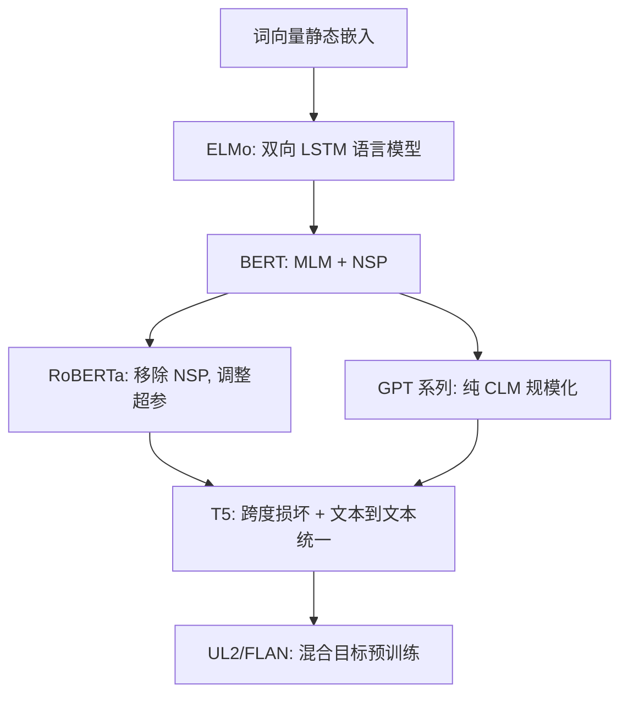
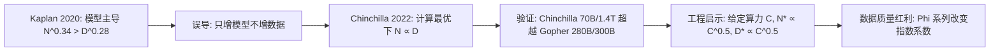
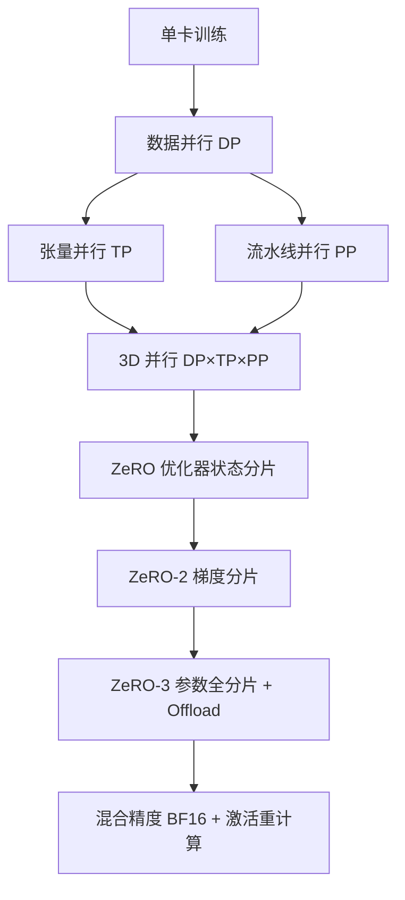
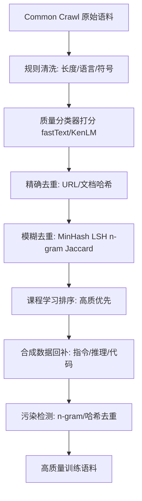
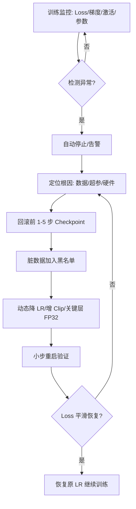

# 第 47 章 预训练范式 —— 从“刷题”到“通识教育”
作者：龙哥

## 学习目标

- 理解自监督学习在大模型预训练中的核心地位与任务设计原理（MLM/CLM/NSP/跨度损坏）
- 掌握 Scaling Laws（Kaplan 与 Chinchilla 定律）推导模型规模、数据量与算力的最优分配策略
- 熟悉大规模分布式预训练工程体系：3D 并行（DP/TP/PP）、ZeRO 优化、混合精度（BF16）与激活重计算
- 掌握从 Common Crawl 到高质量训练语料的数据工程全流程：清洗、去重、课程学习、合成数据与污染检测
- 建立预训练稳定性诊断与应急恢复 SOP：Loss Spike 成因分类、监控体系、回滚策略与数据黑名单机制
- 了解跨度损坏/文本到文本统一框架在预训练目标设计中的应用
- 理解数据质量对 Scaling Laws 指数系数的影响及 Phi 系列小模型大智慧的启示

## 47.1 生活类比

想象预训练大模型是一场**“为超级考生设计通识教育课程”**的系统工程：

- **自监督目标 (MLM/CLM/跨度损坏)** = **“填空题”、“接龙题”与“完形填空”**：不请老师批改，用课本自身内容自动生成习题，让学生在海量刷题中悟出语言规律。
- **Scaling Laws** = **“教育投资回报率模型”** ：给定总预算（算力），到底该招多聪明的学生（参数量 N），买多少题库（Token 数 D），才能考出最高分？Chinchilla 告诉我们：别光招天才不给题做，也别光买题给笨蛋做，聪明度与题量要同步增长。数据质量提升相当于“换更好的教材”，能让同等投入产出更高分（Phi 系列）。
- **3D 并行 + ZeRO** = **“分布式备考组织架构”** ：
  - **DP (数据并行)** = 多个班级同步上同一门课，最后汇总错题本（梯度 All-Reduce）。
  - **TP (张量并行)** = 一道超大数学题拆给小组每人算一步，算完拼答案（矩阵切分 All-Reduce），组内必须坐得近（NVLink）。
  - **PP (流水线并行)** = 课程分模块，班级 A 讲语法，讲完传给班级 B 讲语义（层切分），中间课桌空着等交接是“气泡”。
  - **ZeRO** = 不让每个学生都背全套参考书（优化器/梯度/参数分片），只背自己负责的章节，考试时现借现还（Offload）。
- **数据工程** = **“题库清洗与精炼”** ：Common Crawl 是堆混杂垃圾的废品站；清洗是拣废纸、洗油污、撕重复页；MinHash 去重是查重防背答案；课程学习是先刷名校真题（Wiki/代码）再刷海量模拟题；合成数据是请状元生成高质量预测题。
- **稳定性诊断** = **“考试监控与应急预案”** ：Loss Spike 如同模考突然崩盘；监控梯度范数如监控心率血压；回滚 Checkpoint 是回到上次正常模考状态；数据黑名单是把那套有毒试卷销毁；动态降 LR 是暂时降低训练强度缓一缓。

## 47.2 概念地图

预训练范式
├── 自监督学习目标设计
│   ├── 掩码语言建模 (MLM)          —— P001
│   ├── 因果语言建模 (CLM)          —— P001
│   ├── 下一句预测 (NSP)            —— P001
│   ├── 跨度损坏 / 文本到文本统一    —— P001
├── Scaling Laws 理论指导
│   ├── Kaplan 定律 (模型主导)      —— P002
│   ├── Chinchilla 定律 (模型-数据同步缩放) —— P002
│   ├── 计算最优分配原则 (N* ∝ C^0.5, D* ∝ C^0.5) —— P002
│   └── 数据质量对指数系数的影响 (Phi 系列验证) —— P002
├── 分布式训练工程体系
│   ├── 数据并行 (DP)               —— P003
│   ├── 张量并行 (TP)               —— P003
│   ├── 流水线并行 (PP)             —— P003
│   ├── 3D 并行组合策略             —— P003
│   ├── ZeRO 优化 (阶段 1/2/3)      —— P003
│   ├── 混合精度训练 (BF16/FP16)    —— P003
│   └── 激活重计算                  —— P003
├── 数据工程炼丹炉
│   ├── 多级清洗管线 (规则+分类器)  —— P004
│   ├── 精确/模糊去重 (MinHash LSH) —— P004
│   ├── 课程学习调度                —— P004
│   ├── 合成数据回补                —— P004
│   └── 数据污染检测 (n-gram/哈希)  —— P004
└── 稳定性诊断与急救手册
├── Loss Spike 成因三大类 (数据/超参/硬件) —— P005
├── 监控体系 (梯度/参数/激活分布)       —— P005
├── 应急 SOP (回滚/剔除/动态降级/重启)  —— P005
└── 检查点策略与确定性训练保障         —— P005

## 47.3 自监督学习 —— 从海量无标签数据中挖掘监督信号

### 47.3.1 为什么需要自监督学习？

大规模人工标注数据成本高昂、速度慢，无法满足大模型对海量数据的需求。自然语言本身蕴含丰富的结构信息（如上下文依赖、句间关系），可构建免费监督信号。通过精心设计的预训练任务，让模型在“解谜”过程中自动习得语言通用表示能力。这是从“标注驱动”到“数据驱动”范式转变的基石。

> "对比掩码语言建模（MLM）与因果语言建模（CLM）的双向/单向上下文差异，分析 NSP 任务对句子关系建模的得失。"
> 
> ——《20230418_023.md》 (P001, origin)

> "自监督学习：无标签数据的监督信号设计"
> 
> ——《20230418_024.md》 (P001, improve)

### 47.3.2 核心定义：四大预训练任务范式

**自监督学习**定义（来源：《20230418_023.md》 P001, origin）

从输入数据自身自动生成标签的机器学习范式，无需人工标注。

**掩码语言建模**定义（来源：《20230418_023.md》 P001, origin）

随机遮盖输入 Token（通常 15%），利用双向上下文预测被遮盖内容。

$$
\mathcal{L}_{\text{MLM}} = -\sum_{i \in M} \log P(x_i | x_{\backslash M}; \theta)
$$

这一公式展示了 MLM 的核心机制：仅对被遮盖位置 $M$ 计算损失，利用完整的双向上下文 $x_{\backslash M}$ 进行预测。这使得模型能捕捉深度的双向语义依赖，特别适合自然语言理解（NLU）任务。

**因果语言建模**定义（来源：《20230418_023.md》 P001, origin）

仅利用历史上下文（单向）预测下一个 Token，符合生成式任务范式。

$$
\mathcal{L}_{\text{CLM}} = -\sum_{i=1}^{L} \log P(x_i | x_{<i}; \theta)
$$

这一公式展示了 CLM 的自回归本质：每一步只能看到过去 $x_{<i}$，预测未来 $x_i$。这种单向约束天然契合文本生成任务，也是 GPT 系列模型的基石。

**下一句预测**定义（来源：《20230418_023.md》 P001, origin）

判断两句文本是否为原文连续段落，建模句间关系。

$$
\mathcal{L}_{\text{NSP}} = -\log P(\text{IsNext} | [CLS]; \theta)
$$

这一公式展示了 NSP 任务的形式：将两句话拼接，通过 `[CLS]` 标记的表示进行二分类。然而，后续研究（如 RoBERTa）发现移除 NSP 后下游任务效果不降反增，说明该任务引入的噪声可能大于信号。

**跨度损坏 / 文本到文本统一**定义（来源：《20230418_023.md》 P001, origin）

随机遮盖连续片段并预测，融合 MLM 与 CLM 优势。

T5 模型将所有 NLP 任务统一为“文本到文本”格式，预训练时随机采样跨度（Span）进行遮盖，并让模型生成被遮盖的连续文本片段。这兼顾了双向编码的理解能力与自回归的生成能力。

### 47.3.3 方法演进图：从 MLM 到统一文本到文本框架的演进

### 47.3.4 多源对照：不同预训练目标的适用边界

#### 共识

所有主流预训练目标均基于自监督原则，利用海量无标签文本学习语言表示。MLM 擅长理解，CLM 擅长生成，跨度损坏试图统一两者。

#### 分歧

- **BERT 阵营 (P001, origin)**：坚持 MLM + NSP，认为句级任务需要显式的句间关系建模。
- **GPT 阵营 (P001, origin)**：纯 CLM，认为规模扩展足以涌现理解能力，无需显式双向编码。
- **T5 阵营 (P001, origin)**：主张跨度损坏统一文本到文本框架，简化多任务适配流程。
- **RoBERTa (P001, improve)**：实证证明移除 NSP 并调整超参（更大批次、更多数据、去掉 NSP）即可超越 BERT，质疑 NSP 的必要性。

### 47.3.5 典型案例与边界条件

**典型例子**：

- **BERT**：MLM + NSP，开启预训练+微调范式统治 NLU 榜单。
- **GPT 系列**：纯 CLM（Next Token Prediction），通过规模扩展涌现少样本学习与生成能力。
- **T5**：统一文本到文本框架，用跨度损坏融合 MLM 与 CLM 优势。

**边界条件**：

- 仅靠 MLM/CLM 无法直接解决复杂推理、数学计算等需显式逻辑的任务，需后续微调或提示工程激活。
- 数据质量对自监督效果影响巨大：垃圾进，垃圾出（Garbage In, Garbage Out）。
- 预训练目标与下游任务存在“目标错位”，需通过指令微调/对齐缓解。

## 47.4 Scaling Laws —— 模型、数据、算力的“铁三角”最优配比法则

### 47.4.1 为什么需要 Scaling Laws？

训练大模型耗资巨大（百万级美元），盲目堆叠参数或数据极易导致资源浪费。早期 Kaplan 定律误导了“模型越大越好”，Chinchilla 修正后节省了海量算力。我们需要科学法则指导：在固定算力预算下，模型有多大？数据练多少？如何分配最划算？

> "详解 Kaplan 与 Chinchilla 定律，推导最优分配策略：在固定算力下，模型参数量与训练 Token 数应同步缩放。"
> 
> ——《20230418_033.md》 (P002, origin)

> "Scaling Laws：规模、数据、计算的三角权衡"
> 
> ——《CQXRd5Lc5ozWjFxwgpgcqmk5nAe.md》 (P002, improve)

### 47.4.2 核心定义：从 Kaplan 到 Chinchilla 的演进

**Scaling Laws**定义（来源：《20230418_033.md》 P002, origin）

描述模型测试损失 $L$ 与模型参数量 $N$、训练 Token 数 $D$、算力预算 $C$ 之间幂律关系的经验公式。

**Kaplan 定律**定义（来源：《20230418_033.md》 P002, origin）

$$
L(N, D) \approx \frac{A}{N^{\alpha}} + \frac{B}{D^{\beta}} + E
$$

Kaplan 等人 (2020) 认为 $\alpha \approx 0.34, \beta \approx 0.28$，即模型规模 $N$ 的指数更大，是主导因素，数据 $D$ 相对次要。这导致早期研究倾向于“定数据、无限增大模型”。

**Chinchilla 定律 / 计算最优分配**定义（来源：《CQXRd5Lc5ozWjFxwgpgcqmk5nAe.md》 P002, improve）

Hoffmann 等人 (2022) 重新拟合发现，在**计算最优**条件下，模型参数量与训练 Token 数应同比例缩放：

$$
N_{\text{opt}} \propto C^{0.5}, \quad D_{\text{opt}} \propto C^{0.5}
$$

即 $N$ 和 $D$ 应大致成正比。给定算力预算 $C$ (FLOPs)，最优配置满足 $C \approx 6 N D$（Transformer 标准估算）。

这一推导展示了为什么 Chinchilla (70B, 1.4T tokens) 能用 1/4 算力超越 Gopher (280B, 300B tokens)：Gopher 违反了最优分配原则，模型太大、数据太少。

**数据质量对 Scaling Laws 的影响**定义（来源：《CQXRd5Lc5ozWjFxwgpgcqmk5nAe.md》 P002, improve）

高质量数据（教科书级）可改变幂律指数系数。Phi-1 仅用 1.3B 参数、教科书质量代码数据，即超越同量级甚至更大的模型。这验证了**数据质量 > 数据量**。

### 47.4.3 方法演进图：Scaling Laws 认知的迭代过程

### 47.4.4 关键性质与工程启示

- **算力最优分配原则**：给定算力预算 $C$，最优模型大小 $N^* \propto C^{0.5}$，最优训练 Token $D^* \propto C^{0.5}$。
- **“Chinchilla 最优”基准**：训练一个 70B 模型需 ~1.4T Tokens；若数据不足，宁可练小模型多看数据，也别练大模型欠数据。
- **过度训练**：在固定模型上继续投喂数据超出最优 $D$，收益递减但推理成本固定，有时工程上可接受（如 LLaMA 1T+ tokens）。
- **数据质量红利**：高质量数据可改变指数系数，实现“小模型大智慧”（Phi 系列）。

### 47.4.5 典型案例与边界条件

**典型例子**：

- **Chinchilla** (70B, 1.4T tokens) 用 1/4 算力超越 Gopher (280B, 300B tokens)，验证了定律。
- **LLaMA 系列**：LLaMA-1 遵循 Chinchilla 最优；LLaMA-2/3 选择“过度训练”换取推理阶段性价比。
- **Phi 系列**：教科书质量合成数据 + 精选网页，小模型大智慧。

**边界条件**：

- 定律基于特定架构、数据分布、优化器得出，更换架构（如 MoE、RWKV）或高质量数据比例变化时，指数系数会漂移。
- 仅关注验证集 Loss（困惑度）不等于下游任务性能最优，存在“Loss 下降但能力不增”现象。
- 硬件利用率、并行效率、通信开销等工程因素未纳入公式，实际落地需工程修正。

## 47.5 大规模预训练工程 —— 3D 并行与混合精度的“分布式拼图”

### 47.5.1 为什么需要分布式训练工程？

千亿参数模型显存需求远超单张 GPU（如 175B FP16 需 350GB+ 显存，单卡 80GB 根本放不下）。单卡训练速度太慢（年级单位），必须将计算拆分到成百上千张卡上并行。通信开销、负载均衡、数值稳定性是规模化训练成败的工程关键。

> "拆解 3D 并行（数据/流水线/张量）、ZeRO 优化、BF16 混合精度、梯度累积等工程落地细节。"
> 
> ——《20230418_047.md》 (P003, origin)

> "大规模预训练工程：并行策略与混合精度"
> 
> ——《20230418_048.md》 (P003, improve)

### 47.5.2 核心定义：三大并行维度与组合策略

**数据并行**定义（来源：《20230418_047.md》 P003, origin）

各卡持有完整模型副本，切分数据批次，梯度 All-Reduce 同步。基线方案，但显存不随卡数降低。

**张量并行**定义（来源：《20230418_047.md》 P003, origin）

将单层矩阵乘法（如 Attention QKV 投影、FFN 线性层）按维度切分到多卡，显存线性降低，但需高频 All-Reduce，依赖高带宽互联 (NVLink/IB)。

以 Attention 投影为例，将权重矩阵 $W \in \mathbb{R}^{d \times d}$ 沿输出维度切分为 $W = [W_1, W_2, ..., W_k]$，每卡计算 $Y_i = X W_i$，最后 All-Gather 拼接 $Y$。反向传播时需 All-Reduce 梯度。

**流水线并行**定义（来源：《20230418_047.md》 P003, origin）

将模型按层切分为多个 Stage，不同卡负责不同层，微批次流水流动。显存降低，但存在“气泡”空闲期，需调度优化 (1F1B, ZB1P)。

**3D 并行**定义（来源：《20230418_047.md》 P003, origin）

$DP \times TP \times PP$ 组合，如 Megatron-LM 架构，实现万卡规模训练。典型拓扑：TP=8 (节点内 NVLink 域)，PP=层数/阶段数，DP=剩余卡数。

**ZeRO 优化**定义（来源：《20230418_047.md》 P003, origin）

按状态分片（优化器状态、梯度、参数）而非复制，ZeRO-3 可将显存降至单副本 $1/N$，配合 CPU Offload/NVMe Offload 突破显存墙。

- ZeRO-1：分片优化器状态
- ZeRO-2：+ 分片梯度
- ZeRO-3：+ 分片参数（全参数分片）

**混合精度训练**定义（来源：《20230418_047.md》 P003, origin）

前向/反向用低精度 (BF16/FP16) 加速，参数主副本、梯度累积、Loss Scaling 用 FP32 保稳定。BF16 无需 Loss Scaling，动态范围更大，成 A100/H100 标配。

$$
\begin{aligned}
\text{Forward: } & x_{16} = x_{32}.to(\text{bf16}) \\
& y_{16} = f(x_{16}; W_{16}) \\
\text{Backward: } & \nabla y_{32} = \nabla y_{16}.to(\text{fp32}) \\
\text{Update: } & W_{32} \leftarrow W_{32} - \eta \cdot \nabla W_{32} \quad (\text{FP32 master weights})
\end{aligned}
$$

这段伪代码展示了混合精度的核心流程：计算链路低精度化，参数更新链路高精度化，兼顾速度与稳定性。

**激活重计算**定义（来源：《20230418_047.md》 P003, origin）

前向不存中间激活，反向重算，用 20-30% 算力换取大幅显存节省。

### 47.5.3 方法演进图：从单卡到万卡的并行演进

### 47.5.4 关键性质与工程权衡

- **TP 域内通信最频繁**，必须部署在 NVLink 互联的节点内（如 8 卡一组），PP/DP 跨节点。
- **通信计算重叠**是榨干算力关键：异步 All-Reduce、双缓冲、内核融合。
- **训练稳定性挑战**：Loss Spike（梯度爆炸/数据脏样）、BF16 下溢、显存碎片 OOM。
- **PP 气泡比例**随微批次数增加而下降，但微批次太小降低 GPU 利用率，需权衡。
- **ZeRO-3 通信量巨大**，对网络带宽极其敏感，InfiniBand 必选。

### 47.5.5 典型案例与边界条件

**典型例子**：

- **Megatron-LM / Megatron-DeepSpeed**：3D 并行 + ZeRO 训练万亿参数模型标配。
- **GPT-3 175B**：TP=8 (节点内), PP=12 (层数), DP=多节点。
- **LLaMA 训练**：FSDP (PyTorch 原生 ZeRO-3 类实现) + Activation Checkpointing + BF16。

**边界条件**：

- PP 气泡比例随微批次数增加而下降，但微批次太小降低 GPU 利用率，需权衡。
- ZeRO-3 通信量巨大，对网络带宽极其敏感，InfiniBand 必选。
- 激活重计算用算力换显存，约 20-30% 训练时间开销。

## 47.6 数据工程 —— 从 Common Crawl 到高质量训练语料的“炼丹炉”

### 47.6.1 为什么需要数据工程？

模型上限由数据决定：Scaling Laws 假设数据分布固定，提升数据质量等效于“免费”扩大模型/算力。原始网页数据（Common Crawl）噪声极大：广告、导航栏、重复内容、有毒/非法/低质文本占比高。数据污染会导致基准测试作弊（测试集泄露进训练集），评估失真。

> "介绍 Common Crawl 清洗管线、MinHash 去重、质量过滤器训练、课程学习调度及合成数据回补的实战经验。"
> 
> ——《20230418_049.md》 (P004, origin)

> "数据工程：清洗、去重、课程学习与合成数据"
> 
> ——《20230418_050.md》 (P004, improve)

### 47.6.2 核心定义：数据处理全流水线

**清洗管线**定义（来源：《20230418_049.md》 P004, origin）

语言识别/过滤 $\rightarrow$ 脱敏/PII 清洗 $\rightarrow$ 启发式规则过滤（长度、符号比、停用词） $\rightarrow$ 质量分类器打分 (fastText/BERT-based) $\rightarrow$ 阈值筛选。

这是一个漏斗式流程：每一层过滤掉低质量数据，保留高价值信息。核心原则：**数据质量 > 数据量**。

**去重**定义（来源：《20230418_049.md》 P004, origin）

精确去重 (URL/文档哈希) + 模糊去重 (MinHash LSH, n-gram Jaccard 相似度) $\rightarrow$ 文档级/段落级去重，防止模型“背诵”高频语料。

**MinHash LSH 算法**原理（来源：《20230418_049.md》 P004, origin）

1. 将文档切分为 n-gram (如 13-gram) 集合
2. 计算 MinHash 签名 (如 128 个哈希函数的最小值)
3. LSH 分桶：将签名分成 b 组，每组 r 个，同一组全匹配则为候选对
4. 精确计算候选对 Jaccard 相似度，阈值 (如 > 0.8) 判重

$$
J(A, B) = \frac{|A \cap B|}{|A \cup B|} \approx \frac{1}{k} \sum_{i=1}^{k} \mathbb{1}[h_i(A) = h_i(B)]
$$

这一公式展示了 MinHash 如何用签名碰撞概率无偏估计 Jaccard 相似度，实现亚线性时间去重。

**课程学习**定义（来源：《20230418_049.md》 P004, origin）

按数据质量/难度排序，前期喂高质量/易学数据（如 Wikipedia、书籍、代码），后期喂海量网页，加速收敛提升上限。

**合成数据**定义（来源：《20230418_049.md》 P004, origin）

用强模型生成高质量指令/推理/代码/多语言数据，回补稀缺领域，实现“模型教模型”。

**数据污染检测**定义（来源：《20230418_049.md》 P004, origin）

n-gram 重叠检测、子字符串匹配、训练集/测试集哈希去重，发布前必须做。

### 47.6.3 方法演进图：数据清洗与质量提升的演进路径

### 47.6.4 典型数据混合配方

**典型例子**：

- **LLaMA 训练数据混合**：67% CCNet, 15% C4, 4.5% GitHub, 4.5% Wikipedia, 4.5% Books, 2% ArXiv, 2% StackExchange。
- **RedPajama / Falcon RefinedWeb**：完整复现开源清洗管线。
- **Phi 系列**：教科书质量合成数据 + 精选网页，小模型大智慧。

### 47.6.5 边界条件与风险

- 清洗规则存在“过拟合”风险：过度过滤导致分布偏移、多样性丧失、长尾知识缺失。
- 版权/合规风险：书籍、代码、学术论文版权模糊，需法律审查与去版权化处理。
- 合成数据若质量把控不严，会引入模型幻觉、风格单一、分布坍缩，需人工/强模型复核。

## 47.7 预训练稳定性诊断 —— 驯服 Loss Spike 与梯度异常的“急救手册”

### 47.7.1 为什么需要稳定性诊断？

万亿 Token 训练周期长（数周至数月），中断一次损失巨大（算力费、时间窗口、人力）。Loss Spike（损失突增 10-100x）高频发生，不处理会导致模型永久发散（NaN、权重崩坏）。需要标准化的监控、诊断、恢复 SOP，将“玄学调参”变为“工程化运维”。

> "分析训练中 Loss 突增成因（数据脏样、学习率过大、数值溢出），给出回滚检查点、动态缩放梯度的应急方案。"
> 
> ——《20230418_051.md》 (P005, origin)

> "预训练稳定性诊断：Loss Spike 与梯度异常处理"
> 
> ——《20230418_051.md》 (P005, origin)

### 47.7.2 核心定义：Loss Spike 三大成因与 SOP

**Loss Spike 成因三大类**定义（来源：《20230418_051.md》 P005, origin）

1. **数据脏样**：极长序列、异常字符、编码错误、高熵噪声触发梯度爆炸。
2. **优化器/超参问题**：学习率过大、LR Warmup 不足、Weight Decay 设置不当、BF16 下溢。
3. **硬件/软件故障**：GPU ECC 错误、NCCL 通信异常、显存溢出静默截断、内核非确定性。

**诊断工具链**定义（来源：《20230418_051.md》 P005, origin）

逐层梯度范数监控、参数范数监控、激活值分布直方图、异常步骤自动保存 Checkpoint 供事后复盘。

建议监控指标：
- 梯度范数 $\|\nabla\|_2$（正常 ~1.0，爆炸 > 100）
- 参数范数 $\|W\|_2$ 逐层分布
- 激活值最大值/最小值/均值/方差（BF16 下溢检测）
- Loss 移动平均与瞬时值偏差

**应急恢复 SOP**定义（来源：《20230418_051.md》 P005, origin）

1. **立即停止/回滚**：检测到 Spike 立即终止，回滚到 Spike 前 1-5 个 Checkpoint。
2. **数据剔除**：定位触发 Spike 的 Batch 数据（需记录 Data Seed/Index），加入黑名单剔除。
3. **动态缩放/降级**：临时降低 LR (如 $\times 0.1$)、增大 Gradient Clipping 阈值、开启 BF16$\to$FP32 关键层保护。
4. **重启验证**：小步重启，观察 Loss 曲线平滑恢复后再拉回原 LR。

### 47.7.3 方法演进图：稳定性诊断与应急响应流程

### 47.7.4 关键性质与预防策略

- **预防优于治疗**：充分 Warmup (1-5% steps)、Gradient Clipping (1.0)、稳定的 LR 调度器 (Cosine/Constant with Warmup)、BF16 训练。
- **检查点策略**：频繁保存（每 500-1000 步）、异步保存不阻塞训练、多副本异地容灾。
- **确定性训练**：固定随机种子、CUDA_DETERMINISTIC、避免非确定性算子，保证回滚后复现一致。

### 47.7.5 典型案例与边界条件

**典型例子**：

- **GPT-3 训练日志**：多次因数据脏样/硬件故障回滚，总算力浪费 ~10%。
- **LLaMA 训练**：采用“Loss Spike 自动检测 + 自动回滚 + 数据黑名单”全自动化管线。
- **Megatron-DeepSpeed**：内置 Gradient Clipping、Loss Scaling、异常检测回调。

**边界条件**：

- 部分 Spike 属于“良性波动”（如学习率重启后、数据分布切换后），盲目回滚反而浪费算力，需人工/规则二次确认。
- 极大规模（万卡）下，单卡故障率高，需结合集群调度器（Slurm/K8s）实现节点级自动隔离与重调度。
- 训练后期模型进入“平台期”，对扰动极度敏感，容错阈值需动态收紧。

## 47.8 设计中的取舍

- **为什么不用纯 MLM 而改用 CLM 做生成式模型？**
  MLM 利用双向上下文，预测任务相对简单，模型倾向于学习“补全”而非“生成”。CLM 的单向自回归约束强制模型学习前向生成分布，天然适配解码推理。工程上，CLM 还支持 KV Cache 推理加速，MLM 则不支持。

- **为什么 Chinchilla 定律建议 N 与 D 同步缩放，但 LLaMA 选择过度训练小模型？**
  Chinchilla 定律优化目标是“训练时最优 Loss”，但工程部署关注“推理时性价比”。小模型推理快、显存小、部署灵活，多训练些数据（过度训练）虽然训练算力没最优用，但换来推理阶段的巨大收益，总拥有成本 (TCO) 更低。

- **TP 为什么必须在节点内 (NVLink)？**
  TP 涉及每层多次 All-Reduce，通信量大、延迟敏感。NVLink 带宽 600-900 GB/s，而跨节点 IB 仅 25-50 GB/s（200-400 Gbps），延迟高 10 倍。跨节点 TP 会让通信时间远超计算时间，MFU 暴跌。

- **ZeRO-3 与 TP/PP 如何选择？**
  ZeRO-3 通信量最大但编程最简单（近似 DP 编程模型）；TP 通信频繁但显存降得最快；PP 通信少但有气泡。通常：节点内 8 卡做 TP，节点间做 PP+DP，ZeRO-1/2 叠加在 DP 维度上；显存极度受限时上 ZeRO-3 + Offload。

## 47.9 动手练习

### 练习 1：Scaling Laws 实战：算力预算下的最优配置推导

假设你拥有 1e24 FLOPs 的算力预算 (C)，遵循 Chinchilla 定律最优分配原则 (N* ∝ C^0.5, D* ∝ C^0.5)，且已知训练一个 70B 模型需 1.4T Tokens 对应算力约 3.5e23 FLOPs (参考公式 C ≈ 6ND)。

1. 计算在 1e24 FLOPs 预算下，最优模型参数量 N* (Billion) 与训练 Token 数 D* (Trillion) 的理论值。
2. 若受限于显存只能训练 30B 模型，根据定律推导应训练多少 Tokens 才达到该模型规模下的计算最优？此时实际消耗算力是多少？
3. 对比 LLaMA-1 (7B/13B/33B/65B 均训练 1T tokens) 与 Chinchilla 最优策略的差异，分析 LLaMA 选择“过度训练”小模型的工程动机（提示：推理成本、部署灵活性）。

回答问题：
- 为什么 Kaplan 定律会误导研究者“只增大模型不增数据”？其假设条件与 Chinchilla 有何关键不同？
- 如果数据质量显著提升 (如 Phi 系列教科书级数据)，Scaling Laws 的指数系数会如何变化？对最优分配策略有何启示？

### 练习 2：3D 并行拓扑设计与通信量估算

任务：在 128 张 A100 (80GB, NVLink 600GB/s, IB 200Gbps) 上训练一个 40 层、隐藏维度 8192、注意力头数 64、FFN 隐藏层 22016 的类 GPT 模型 (约 7B 参数)，目标是最大化 MFU (Model FLOPs Utilization)。

1. 设计 3D 并行拓扑 (DP × TP × PP = 128)，给出具体分割方案并说明理由（提示：TP 域大小受限于 NVLink 域，PP 需平衡气泡比例与显存，DP 承担剩余）。
2. 估算该拓扑下每个微批次的通信量：
   - TP 域内 All-Reduce (Attention QKV 投影 + Output + FFN 两次线性层) 通信数据量 (GB)？
   - PP 域间激活传递 (隐藏状态) 通信数据量 (GB)？
   - DP 域间梯度 All-Reduce 通信数据量 (GB)？
3. 分析该拓扑的主要瓶颈在哪里（计算/显存/通信），并提出一项具体优化建议（如调整微批次、开启异步通信重叠、调整 TP/PP 比例、使用 ZeRO-1 替代 DP 等）。

回答问题：
- 为什么 TP 必须部署在单节点 (8 卡) 内？跨节点 TP 性能会发生什么？
- PP 的“气泡比例”如何计算？增加微批次数量对气泡比例、显存占用、通信频率分别有何影响？

### 练习 3：数据清洗管线设计与质量评估实验

你获得 10TB 原始 Common Crawl 数据 (WARC 格式)，目标产出 1T 高质量 Token 训练 7B 模型。请设计清洗管线并制定评估指标：

1. 列出管线中 5 个关键清洗阶段，每阶段核心操作、工具/算法 (如 fastText 语言识别、MinHash LSH 去重、KenLM 质量打分) 及预期数据保留率。
2. 设计“质量分类器”训练策略：正样本从哪里来 (Wikipedia/书籍/代码)？负样本如何构造？特征选用 n-gram 还是嵌入向量？阈值如何校准 (Precision/Recall 权衡)？
3. 制定去重策略：文档级精确去重 vs 段落级模糊去重 (MinHash, n=13, Jaccard > 0.8)，分析两者对数据量、语义多样性、计算开销的影响差异。
4. 定义 3 项离线评估指标 (如困惑度下游任务零样本、重复 n-gram 比例、领域分布 KL 散度) 和 1 项在线评估指标 (训练 Loss 曲线收敛速度/终值)，用于对比不同清洗策略的优劣。

回答问题：
- 过度清洗导致“分布偏移”和“长尾知识缺失”如何量化检测？
- 合成数据回补时，如何设计“质量把关关卡”防止模型自产幻觉污染训练集？

### 练习 4：Loss Spike 复盘与应急演练

场景：万卡集群训练第 15 万步 (共 30 万步)，全局 Loss 从 1.8 突增至 45.0，梯度范数爆炸至 1e3 (正常 ~1.0)，触发自动停机。

1. 按 SOP 排查：依次检查 (a) 当前 Batch 数据样本 (通过 Data Seed 定位) 是否含超长序列/异常字符/高熵噪声；(b) 学习率调度器是否异常跳变 (Warmup 结束/重启点)；(c) GPU 日志 (ECC 错误/温度/时钟降频) 与 NCCL 通信错误计数；(d) BF16 下溢统计 (激活值/梯度是否大量接近 0)。
2. 假设定位为某条包含大量重复特殊 Unicode 字符的脏数据导致，执行恢复操作：回滚至 Step 149,500 (最近正常 Checkpoint) -> 将脏样本 Index 加入数据黑名单 -> 重启训练并临时将 LR 降为 1e-5 (原 3e-4) 运行 500 步 -> 恢复原 LR。
3. 复盘报告撰写要点：根因分类、影响范围 (损失算力小时数)、检测延迟 (从 Spike 发生到停机耗时)、黑名单生效验证、预防措施更新 (如增加数据端侧长度/字符分布校验、梯度爆炸早期预警阈值)。

回答问题：
- 为什么回滚步数建议“前 1-5 个 Checkpoint”而非“仅回滚 1 步”？Checkpoint 间隔过大 (如 5000 步) 对恢复成本与风险有何影响？
- ZeRO-3 场景下，参数/优化器状态分片在多张卡上，回滚 Checkpoint 的一致性如何保证？需注意什么？
- 部分 Spike 属于“良性波动”(如 LR 重启后瞬时上升)，如何设计自动化规则区分“良性”与“恶性” Spike，避免误杀？

## 47.10 本章小结

这一章中我们学习了预训练范式的完整体系。首先，我们剖析了自监督学习的四大核心任务（MLM、CLM、NSP、跨度损坏），理解了它们如何从无标签数据中挖掘监督信号，以及双向编码与单向生成的归纳偏置差异。其次，我们深入推导了 Scaling Laws 从 Kaplan 到 Chinchilla 的演进，掌握了在固定算力下模型规模与数据量同步缩放的最优分配原则，并认识到数据质量可以改变幂律指数系数的关键洞见。接着，我们拆解了大规模分布式训练的工程拼图：3D 并行（DP/TP/PP）的拓扑设计、ZeRO 优化器状态分片、混合精度 BF16 与激活重计算的显存-算力权衡。然后，我们构建了从 Common Crawl 到高质量语料的数据工程炼丹炉：多级清洗、MinHash LSH 去重、课程学习调度、合成数据回补与污染检测。最后，我们建立了预训练稳定性诊断的急救手册：Loss Spike 三大成因分类、监控体系建设、自动化回滚 SOP 与数据黑名单机制。

以下表格汇总了本章的核心概念与关键解释，供快速回顾与查阅：

| 概念 | 解释 |
|------|------|
| MLM (掩码语言建模) | 随机遮盖 Token 利用双向上下文预测，适合 NLU 任务，BERT 核心范式 |
| CLM (因果语言建模) | 单向自回归预测下一 Token，天然适配生成任务，GPT 系列核心范式 |
| NSP (下一句预测) | 判断两句是否连续，后被证明对下游任务提升有限，RoBERTa 等移除 |
| 跨度损坏 / 文本到文本统一 | T5 范式：随机遮盖连续片段并生成，融合 MLM 与 CLM 优势 |
| Scaling Laws | 描述 Loss 与参数量 N、数据量 D、算力 C 的幂律关系，指导资源最优分配 |
| Chinchilla 定律 / 计算最优 | 最优训练下 N 与 D 应同比例缩放 (N* ∝ C^0.5, D* ∝ C^0.5)，避免模型大数据少或模型小数据多 |
| 数据质量对 Scaling Laws 的影响 | 高质量数据（教科书级）可改变指数系数，Phi-1 仅用 1.3B 参数超越大模型，验证数据质量 > 数据量 |
| 数据并行 (DP) | 各卡存完整模型副本，切分数据，梯度同步，显存不随卡数降低 |
| 张量并行 (TP) | 单层矩阵切分多卡计算，显存线性降低，高频通信需 NVLink，节点内部署 |
| 流水线并行 (PP) | 模型按层切分 Stage，微批次流水执行，存在气泡开销，需 1F1B 等调度优化 |
| ZeRO (Zero Redundancy Optimizer) | 按状态分片 (优化器/梯度/参数) 而非复制，ZeRO-3 显存降至 1/N，配合 Offload 突破显存墙 |
| 混合精度 (BF16/FP16) | 计算用低精度加速，主参数/梯度累积用 FP32 保稳定，BF16 无需 Loss Scaling 成标配 |
| 激活重计算 | 前向不存中间激活，反向重算，用 20-30% 算力换取大幅显存节省 |
| 数据清洗管线 | 语言识别→脱敏→规则过滤→质量分类器打分→阈值筛选，核心原则：数据质量 > 数据量 |
| 去重 (MinHash LSH) | 精确哈希 + 模糊 n-gram Jaccard 相似度去重，防止模型背诵高频语料 |
| 课程学习 | 按质量/难度排序喂数据：前期高质易学 (Wiki/代码/书籍)，后期海量网页，加速收敛提上限 |
| 合成数据 | 强模型生成指令/推理/代码数据回补稀缺领域，实现模型教模型，需严控质量防分布坍缩 |
| 数据污染检测 | n-gram 重叠/子串匹配/哈希去重检测测试集泄露，发布前必做 |
| Loss Spike | 训练中损失突增 10-100x，三大成因：数据脏样、超参/优化问题、硬软件故障 |
| 稳定性诊断 SOP | 监控梯度/参数/激活分布 → 检测异常自动停止 → 回滚前 1-5 步 Checkpoint → 剔除脏数据黑名单 → 临时降 LR/增 Clip → 小步重启验证 |
| 检查点策略 | 高频异步保存 (500-1000 步)、多副本异地容灾、确定性训练保证回滚可复现 |

下一章中，我们将学习微调与对齐技术，探讨如何把通才预训练模型打磨成专才，涵盖监督微调（SFT）、奖励建模（RM）、强化学习对齐（RLHF/DPO/ORPO）等核心技术栈，解决“会说人话”到“懂人意、守规矩”的关键跨越。

