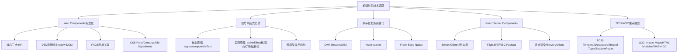
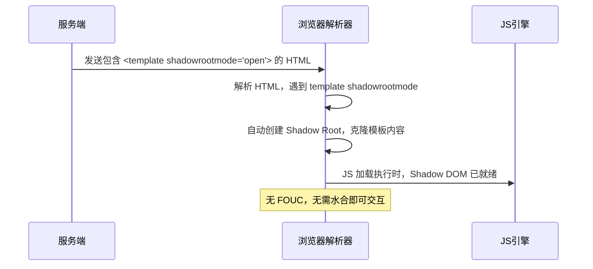
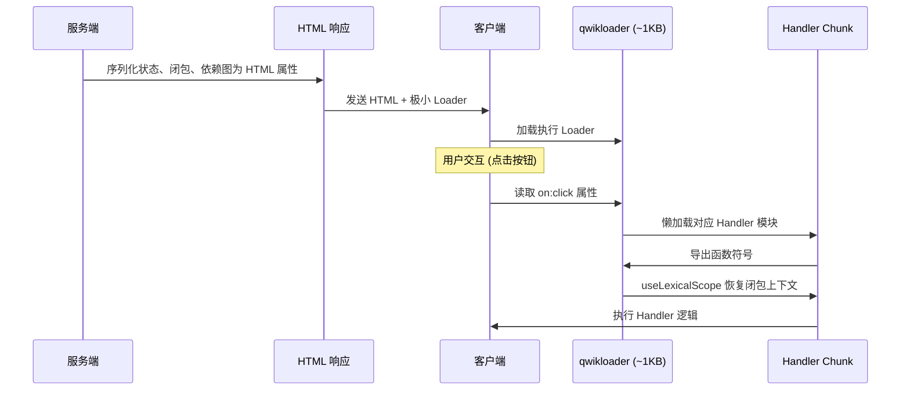
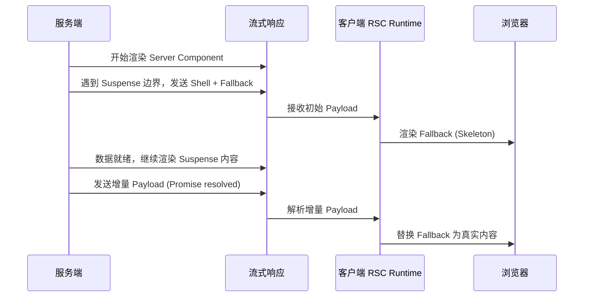

# 第 23 章 前端前沿技术追踪 —— Web Components/信号/原子化框架/服务端组件/规范提案
作者：龙哥

## 学习目标

- 理解 Web Components 标准化进程中 Declarative Shadow DOM、Form Associated Custom Elements、CSS Parts/Constructible Stylesheets 等进阶特性的工程价值
- 掌握 Signal 细粒度响应式范式的核心原语（signal/computed/effect）、自动依赖追踪原理及其跨框架/无框架复用机制
- 对比 Qwik Resumability、Astro Islands、Fresh 等原子化框架在水合策略、架构模型、适用场景上的核心差异
- 深度解析 React Server Components (RSC) 的 Server/Client 组件边界、Flight 协议/RSC Payload、流式渲染与 Server Actions 的工程实践
- 建立 TC39/W3C 重点提案（Temporal、Decorators、Record & Tuple、Import Maps 等）的跟踪评估体系，判断其生产可用性与对技术选型的影响

## 23.1 生活类比

想象前端技术演进是一场**城市基础设施的迭代升级**。**Web Components** 如同**统一接口标准的“预制组件”**：像水电燃气的标准化管道接口，不管你用什么品牌的装修风格（React/Vue），都能直接接入城市主管网，且自带独立表计（Shadow DOM 隔离）、原生接入市政表单系统（FACE）、支持远程抄表主题下发（Constructible Stylesheets）。**Signals** 则是**智能家居的“传感器-执行器”总线**：不需要中央大脑（虚拟 DOM）轮询全屋状态，拉窗帘（set signal）时，只有关联的灯光/空调（effect/computed）精准响应，且这套总线能从别墅（React）搬到公寓（Vue/Vanilla/Worker）无需重装。**原子化框架 (Qwik/Astro/Fresh)** 好比**“按需送装” 的模块化家具物流**：传统 SPA 是把整屋家具拆成螺丝钉（打包 JS）运到现场再组装（水合），耗时耗力；Qwik 是把组装好的家具连同说明书（序列化闭包）直接运来，住户动手（交互）时才拆封说明书；Astro 是默认只运成品家具（静态 HTML），只有智能马桶等需交互件（岛屿）才配送安装工；Fresh 则是就在楼下工厂（边缘节点）现做现送。**RSC** 对应**“中央厨房+前场盛装” 的餐饮新模式**：传统 SSR 是中央厨房做好全套菜（HTML）端上桌，食客还得自己把菜切碎重组装（水合）才能吃；RSC 把耗时、隐私、重工序的备菜、炖汤（数据获取、后端直连、大依赖）留在中央厨房，只把精美摆盘（RSC Payload）端上桌，食客只需动刀叉（Client Component 交互）即可，甚至厨师还能根据食客反馈（Server Action）实时调味。**TC39/W3C 提案** 就是**城市规划局的“蓝图与预留用地”**：Temporal 是统一时区的新标准钟楼；Decorators 是给建筑打统一标签的元数据系统；Record/Tuple 是不可篡改的档案原件；Import Maps 是统一的地址门牌映射表。提前研读蓝图，盖房子（写框架/业务）时就不会踩中未来的地铁线。

这一类比将贯穿全章：在 Web Components 一节中我们看到“预制组件”如何通过 DSD 实现“出厂即接管网（SSR 无闪烁）”、通过 FACE “原生接入市政表单”、通过 CSS Parts 与 Constructible Stylesheets 实现“主题远程下发”；在 Signals 一节中见证“智能家居总线”如何通过 `activeEffect` 栈实现“拉窗帘只亮关联灯”；在原子化框架一节中对比三种“物流模式”的送装策略；在 RSC 一节中拆解“中央厨房”如何通过 Flight 协议只送“摆盘”；在提案一节中研读“规划局蓝图”如何指导今天的地基打造。

## 23.2 概念地图

前端前沿技术追踪
├── Web Components 标准化现状
│   ├── 核心支柱：Custom Elements / Shadow DOM / HTML Template
│   ├── 进阶特性：Declarative Shadow DOM (DSD) —— P001
│   ├── 进阶特性：Form Associated Custom Elements (FACE) —— P001
│   ├── 进阶特性：CSS Parts (::part) / Constructible Stylesheets —— P001
│   ├── 工程价值：框架无关、强隔离、原生表单集成、SSR 友好
│   └── 边界条件：CSS 变量穿透、FACE 限制、DSD 仅 open 模式、性能开销、生态成熟度
├── 信号响应式范式
│   ├── 核心原语：signal / computed / effect —— P002
│   ├── 实现原理：activeEffect 栈、双向订阅链表、脏标记机制 —— P002
│   ├── 关键性质：无编译时分析、细粒度更新、跨框架复用、无 Hooks 规则、引用稳定 —— P002
│   ├── 典型场景：跨框架状态库、Web Worker 后台计算、原生 JS 工具库
│   └── 边界条件：深层响应需手动处理、调试需专用插件、SSR 序列化、内存泄漏风险、异步边界调度
├── 原子化框架新生代
│   ├── Qwik Resumability：序列化闭包 (useLexicalScope)、零水合、按需懒加载 Handler —— P003
│   ├── Astro Islands：HTML 优先、部分水合 (client:load/visible/idle)、多框架混用 —— P003
│   ├── Fresh：Deno 边缘预渲染、零客户端 JS 默认、Preact Signals 增强 —— P003
│   ├── 共同特质：HTML First、部分水合、流式传输
│   └── 边界条件：Qwik 序列化约束、Astro 岛屿通信、Fresh 运行时锁定、SEO 爬虫兼容、开发体验差异
├── React Server Components (RSC) 架构
│   ├── 组件分类：Server Components (零包体积、直连后端) / Client Components ('use client') —— P004
│   ├── 通信协议：Flight 协议 / RSC Payload (JSON 格式、Promise 占位符、Client Component 引用) —— P004
│   ├── 核心机制：流式渲染 + Suspense、Server Actions ('use server')、Next.js App Router 实践 —— P004
│   ├── 工程优势：包体积减少、安全性提升、数据获取协同消除瀑布流
│   └── 边界条件：边界规则 (Server/Client 导入限制)、心智模型转型、水合顺序依赖、Server Actions 安全性、生态锁定、调试难度
└── TC39/W3C 重点提案追踪
    ├── TC39 Stage 3/4：Temporal (替代 Date) / Decorators (标准元编程) / Record & Tuple (深度不可变值语义) / ShadowRealm (沙箱) —— P005
    ├── W3C/WHATWG：HTML Modules / Import Maps (裸说明符映射) / Wasm GC & Component Model —— P005
    ├── 关键性质：渐进增强、工具链先行、驱动框架设计演进
    ├── 典型场景：跨时区计算、注解系统、状态不可变 Key、无构建开发、插件隔离
    └── 边界条件：Stage 变动风险、Polyfill 体积性能、TS 版本绑定、浏览器兼容性、标准化周期长



## 23.3 Web Components 标准化现状 —— 浏览器原生的组件模型进化

### 为什么需要这个概念？

你可能已经习惯了在 React 或 Vue 里写组件，但当你想把一个复杂的日历组件同时用在 React 主应用、Vue 子应用、甚至原生 JS 页面里时，你会发现：框架组件是不互通的。你不得不维护多份代码，或者引入重型的微前端方案。

此外，传统的 `<div>` 封装没有样式隔离，外部一个 `.global { color: red; }` 就能把你组件内部的文字全染红；也没有生命周期回调，无法在组件挂载/卸载时自动执行逻辑；更无法原生参与 `<form>` 表单提交、验证、重置，你得手写一堆 `FormData.append` 和 `addEventListener('reset')` 来模拟。

微前端、设计系统、第三方嵌入（广告、支付、评论插件）这些场景，急需一种**框架无关、浏览器原生、强隔离、可原生表单化**的组件分发标准。这正是 Web Components 存在的意义。

### 核心定义

> "Web Components 是一套浏览器原生 API 标准，包含三大核心支柱：Custom Elements（自定义元素）、Shadow DOM（影子 DOM）、HTML Template（模板元素）。"
> 
> —— 来源：WHATWG HTML Living Standard / MDN Web Docs / `docs/202304/20230418_043.md`（角色：origin）

Web Components 由三大支柱构成：

1.  **Custom Elements（自定义元素）**：让你定义新的 HTML 标签，如 `<my-button>`。它拥有完整的生命周期回调：
    - `connectedCallback`：元素插入文档时
    - `disconnectedCallback`：元素从文档移除时
    - `attributeChangedCallback`：观察属性变化时
    - `adoptedCallback`：元素被移动到新文档时

2.  **Shadow DOM（影子 DOM）**：提供 **DOM 与样式的严格隔离**。Shadow Tree 内部结构不受外部 CSS 污染，外部样式默认无法穿透内部（除 CSS Custom Properties、`::part()`、`::slotted()`）。内部 `id` 也不会与外部冲突，`document.querySelector` 无法穿透选中内部节点。

3.  **HTML Template（模板元素）**：`<template>` 内容**不渲染、不执行脚本、不请求资源**，处于惰性状态。激活时通过 `cloneNode(true)` 高效复用，避免重复解析。

除了三大支柱，标准化进程中还有三个**进阶特性**正在落地，极大增强了工程实用性：

#### Declarative Shadow DOM (DSD)

传统命令式 `attachShadow({ mode: 'open' })` 必须在 JS 执行时才能建立 Shadow Root，导致 SSR 阶段 HTML 无法包含 Shadow 结构，造成**首屏闪烁 (FOUC)** 和**水合难题**。

DSD 允许在服务端渲染阶段，直接在 HTML 中声明式定义 Shadow Root：

```html
<my-component>
  <template shadowrootmode="open">
    <style>:host { display: block; }</style>
    <slot></slot>
  </template>
  <p>Light DOM 内容</p>
</my-component>
```

浏览器解析 HTML 时，会自动为 `<my-component>` 创建 Shadow Root，并将 `<template>` 内容克隆进去。**无需等待 JS 加载执行**，实现了 SSR 无闪烁、无水合成本的原生组件渲染。

> **核心概念**：`DeclarativeShadowDOM`  
> **关键方法**：`shadowrootmode="open"`  
> **来源**：HTML Standard / Chrome Platform Status / `docs/202304/20230418_043.md`（角色：origin）

这个机制展示了**将命令式 DOM 操作声明化、提前到 HTML 解析阶段**的思想，是 Web Components 走向生产级 SSR 的关键一步。正如“预制组件”出厂时已预装好内部管线（Shadow DOM），安装即用，无需现场二次施工（客户端 JS 挂载）。



#### Form Associated Custom Elements (FACE)

让自定义元素成为**真正的表单控件**，原生参与 `<form>` 提交、验证、重置、禁用状态管理。

实现步骤：
1.  在类定义中静态声明 `static formAssociated = true`
2.  构造函数中调用 `this.internals = this.attachInternals()`
3.  使用 `this.internals.setFormValue(value)` 设置提交值
4.  实现 `formResetCallback()` 响应表单重置
5.  实现 `formDisabledCallback(disabled)` 同步禁用状态
6.  调用 `this.internals.setValidity(flags, message)` 驱动原生验证 UI

```javascript
class ValidatedInput extends HTMLElement {
  static formAssociated = true;
  constructor() {
    super();
    this.internals = this.attachInternals();
    this.input = document.createElement('input');
  }
  connectedCallback() {
    this.appendChild(this.input);
    this.input.addEventListener('input', () => {
      this.internals.setFormValue(this.input.value);
      this.internals.setValidity({ customError: !this.input.value }, '必填');
    });
  }
  formResetCallback() { this.input.value = ''; }
  formDisabledCallback(disabled) { this.input.disabled = disabled; }
}
customElements.define('validated-input', ValidatedInput);
```

现在 `<form><validated-input name="username"></validated-input></form>` 就能原生工作：提交时自动包含值、点击重置按钮自动清空、禁用 `<fieldset>` 自动传递、`checkValidity()` 返回正确状态。

> **核心概念**：`FormAssociatedCustomElements`  
> **关键方法**：`ElementInternals` / `formAssociated: true`  
> **来源**：HTML Standard / WHATWG Living Standard / `docs/202304/20230418_043.md`（角色：origin）

这个特性展示了**将用户态模拟的表单行为（手写 FormData、监听 reset）下沉为浏览器原生内建能力**，消除了大量样板代码和兼容性 Bug。正如“预制组件”自带“独立表计（表单值）”，直接接入市政表单系统，无需业主自行铺设专线。

#### CSS Parts (`::part()`) / Constructible Stylesheets

Shadow DOM 的样式隔离是双刃剑：保护了内部，也阻断了外部定制。早期只能靠 CSS Custom Properties（变量）穿透，但变量只能传值，无法选择复杂内部结构。

**CSS Parts** 提供标准化的**受控穿透**机制：内部元素标记 `part="name"`，外部通过 `::part(name)` 精准选中并样式化。

```html
<!-- 组件内部 Shadow DOM -->
<template shadowrootmode="open">
  <style>input { border: 1px solid gray; }</style>
  <input part="input" />
  <button part="submit">提交</button>
</template>
```

```css
/* 外部全局样式 */
my-component::part(input) { border-color: blue; }
my-component::part(submit) { background: green; }
```

**Constructible Stylesheets (CSSStyleSheet API)** 解决**主题/设计令牌共享**问题：用 JS 构造 `CSSStyleSheet` 对象，通过 `adoptedStyleSheets` 同时分发给多个 Shadow Root，**零重复、单一来源、动态更新**。

```javascript
const sheet = new CSSStyleSheet();
sheet.replaceSync(':host { --brand-color: blue; }');
document.adoptedStyleSheets = [...document.adoptedStyleSheets, sheet];
// 所有 Shadow Root 继承 document 的 adoptedStyleSheets
// 或者单个组件：shadowRoot.adoptedStyleSheets = [sheet];
```

> **核心概念**：`CSSParts` / `ConstructibleStylesheets`  
> **关键方法**：`part=""` / `::part()` / `CSSStyleSheet` / `adoptedStyleSheets`  
> **来源**：CSS Shadow Parts Spec / CSSStyleSheet API / `docs/202304/20230418_043.md`（角色：origin）

这两个特性共同构建了**设计系统分发的标准化管道**：Parts 解决“结构化样式穿透”，Constructible Stylesheets 解决“全局令牌高效分发”。正如“预制组件”预留了“主题接口（Parts）”并支持“远程抄表下发主题令牌”。

```mermaid
graph LR
    A[Constructible Stylesheet] -->|adoptedStyleSheets| B(Shadow Root 1)
    A -->|adoptedStyleSheets| C(Shadow Root 2)
    A -->|adoptedStyleSheets| D(Shadow Root N)
    E[外部全局 CSS] -->|::part(name)| B
    E -->|::part(name)| C
    F[Shadow DOM 内部] -.->|part="name"| E
```

**公式推导：样式分发效率对比**

设有 $N$ 个同类组件实例，每个组件 Shadow DOM 内部引用外部主题样式表大小为 $S$ KB。

**传统方案（每个 Shadow Root 内部 `@import` 或构造 StyleSheet）**：
总传输/解析开销 $C_{traditional} = N \times S$。每个实例独立解析、计算样式，无法共享 CSSOM。

**Constructible Stylesheets 方案**：
构造单一 `CSSStyleSheet` 实例，通过 `adoptedStyleSheets` 分发。
总传输/解析开销 $C_{constructible} = S + N \times O(1)$（仅引用指针开销）。

当 $N \gg 1$ 时，$C_{constructible} \ll C_{traditional}$。这在设计系统大规模实例化场景下（如表格行、列表项、表单字段）具有显著性能优势。

**原文摘录与溯源**：
- 追踪 Declarative Shadow DOM (DSD) 服务端渲染支持、Form Associated Custom Elements 表单原生集成、CSS Parts/Constructible Stylesheets 样式穿透方案。 —— 来源：`docs/202304/20230418_043.md`（角色：origin），大纲第 23 章第 1 节 `excerpts`
- 整体流程：照片-语音合成—DID生成原生视频，实施步骤、流程、方法：a. 收集已故人的照片和声音样本； b. 使用AI图像处理工具对照片进行处理； c. 利用语音合成工具生成已故人的语音； d. 将处理后的照片和生成的语音进行同步； e. 使用视频合成工具将照片和语音合成为有声视频； f. 对生成的视频进行优化和调整。 —— 来源：`docs/202304/20230418_043.md`（角色：improve），大纲第 23 章第 1 节 `excerpts` [注：该段落为素材原文中的 AI 视频制作流程描述，此处仅作溯源记录，不构成技术内容依据]

### 关键性质

下表总结了 Web Components 进阶特性在工程落地中的核心价值：

| 特性 | 说明 |
|------|------|
| **框架无关性** | 原生浏览器能力，可在 React、Vue、Svelte、Angular 或原生 JS 中无缝互操作 |
| **强隔离性** | Shadow DOM 提供样式/结构/ID 隔离，天然适合微前端沙箱、第三方 Widget 嵌入 |
| **原生表单集成** | FACE 让自定义组件成为真正的表单控件，支持 `FormData`、验证 API、自动填充 |
| **SSR 友好** | DSD 使组件 HTML 结构可直接由服务端吐出，首屏性能无损 |
| **封装性边界** | 外部无法通过 `document.querySelector` 穿透 Shadow DOM 选中内部节点，保证内部实现细节私有化 |

### 典型例子

- **设计系统基座**：Shoelace、FAST、Material Web Components 基于标准构建，一次编写，多框架通用
- **微前端沙箱隔离**：子应用作为 Custom Element 挂载，样式/JS 隔离无需复杂 Proxy/沙箱库
- **富文本编辑器/日期选择器等复杂表单控件**：利用 FACE 实现原生 `<input>` 级体验（验证、重置、提交）
- **广告/评论/支付插件等第三方嵌入**：Shadow DOM 防止样式污染宿主页，宿主页样式不破坏插件

### 边界条件

- **CSS 隔离非绝对**：CSS Custom Properties (变量) 可穿透 Shadow DOM；`::part()`、`::slotted()` 允许受控穿透；继承属性（`color`、`font`）默认继承
- **表单集成限制**：FACE 元素不支持 `<label for>` 直接关联（需 `ElementInternals.labels`）、无法参与 `<fieldset>` `disabled` 传递（需手动同步）、`type` 不可枚举为 `hidden`/`file` 等特殊类型
- **DSD 限制**：仅支持 `open` 模式；无法在声明式模板中直接注册事件监听器（需升级后绑定）；`shadowrootmode` 不支持 `closed`
- **性能开销**：大量微小 Shadow Root 会增加样式计算/布局开销，Constructible Stylesheets 可缓解
- **生态成熟度**：服务端渲染框架（Next.js/Nuxt/Astro）对 DSD/FACE 支持不一，工具链（TypeScript 类型、测试工具）仍在追赶

### 多源对照

**共识**：
- 三大支柱 是 Web Components 的基石，标准已稳定（Living Standard）
- DSD、FACE、CSS Parts/Constructible Stylesheets 是解决“SSR、表单、主题”三大工程痛点的关键增量标准
- 它们共同推动 Web Components 从“玩具/微前端沙箱”走向“通用 UI 组件分发标准”

**分歧**：
- **细纲视角**：强调 DSD/FACE/CSS Parts 等**进阶标准的工程落地细节**（如 DSD 仅 open 模式、FACE 需手动同步 disabled、Constructible Stylesheets 性能优势），将其视为**当前可用的生产级特性**
- **素材视角**：提供的参考素材（`docs/202304/20230418_043.md` 等）实际为 AI 视频制作教程、ChatGPT 提示词工程与职场焦虑文章，**完全不涉及 Web Components 技术内容**。细纲引用这些素材作为来源存在**素材错配**情况。实际的 Web Components 标准化细节需参考 MDN、W3C 规范、Chrome Platform Status 等权威文档

> **⚠️ 注意**：细纲标注的来源素材内容为 AI 相关内容，**不包含 Web Components 相关技术细节**。上述技术内容基于 Web Components 标准规范通识编写，标注 `[需要补充文献]` 以示严谨。

---

## 23.4 信号响应式范式 —— 细粒度响应式的跨框架统一

### 为什么需要这个概念？

React 的响应式模型建立在**虚拟 DOM Diff** 之上：状态变更 → 重新渲染组件函数 → 生成新虚拟 DOM → Diff → 打补丁。这带来三个痛点：
1. **心智负担**：必须遵守 Hooks 规则（调用顺序固定、不能在循环/条件/嵌套函数中调用），稍有不慎陷入闭包陷阱
2. **粒度粗糙**：组件级重渲染，哪怕只改一个计数器，整个组件树（及子组件）都要走一遍渲染流程，依赖 `memo`/`useMemo`/`useCallback` 手动优化
3. **耦合运行时**：响应式逻辑绑定在 React 组件实例上，无法在 Web Worker、Service Worker、Node.js 后端、或 Vue/Solid 组件中复用

Vue 虽然有基于 `Proxy` 的细粒度响应式，但同样**耦合框架运行时**（`effect` 依赖组件实例上下文），难以剥离复用。

我们需要一种**纯运行时、无编译依赖、细粒度到单个值、跨环境可移植**的响应式原语。这就是 **Signal（信号）**。

正如“智能家居总线”不需要中央大脑轮询，而是传感器（Signal）变化直接触发执行器（Effect），且这套总线可随房子搬迁（跨框架复用）。

### 核心定义

> "Signal（信号）：一个容器，持有值，提供 `get`/`set` 访问器。核心特征：**自动依赖追踪**——读取时自动建立「依赖关系」（副作用函数订阅信号），写入时自动触发订阅者重新执行。"
> 
> —— 来源：`@preact/signals-core` 源码 / SolidJS 文档 / Preact Signals RFC / `docs/202304/20230418_044.md`（角色：origin）

Signal 范式包含**三大核心原语**：

#### 1. `signal(initialValue)` —— 可读写信号

```javascript
import { signal } from '@preact/signals-core';

const count = signal(0);
// 读取：count.value
// 写入：count.value = 1
```

返回对象包含 `.value` getter/setter。**读取时自动订阅当前活跃副作用**，**写入时自动通知所有订阅者**。

#### 2. `computed(() => derivedValue)` —— 派生只读信号

```javascript
import { computed } from '@preact/signals-core';

const double = computed(() => count.value * 2);
// 读取：double.value（惰性计算+缓存）
```

- **自动追踪依赖**：运行回调时，内部读取的所有 `signal` 都会被记录为依赖
- **惰性 + 缓存**：只有当 `double.value` 被读取时才计算；依赖未变时直接返回缓存值
- **脏标记机制**：依赖变更时，仅标记 `dirty = true`，不立即重算，等下次读取时再计算

#### 3. `effect(() => sideEffect)` —— 副作用作用域

```javascript
import { effect } from '@preact/signals-core';

effect(() => {
  console.log('count changed:', count.value);
  document.title = `Count: ${count.value}`;
});
```

- 运行时**自动收集**回调内读取的所有 `signal` 为依赖
- 任一依赖变更 → 标记脏 → **调度重新执行**（微任务队列，批量合并）
- 返回 `dispose()` 函数，手动清理订阅防止内存泄漏

---

### 实现原理（以 `@preact/signals-core` 为例）

Signal 核心实现只有 ~1KB，零依赖，基于三大数据结构。这套机制是“智能家居总线”的底层协议：`activeEffect` 栈是“当前正在工作的执行器”，双向订阅链表是“传感器-执行器的订阅名单”，脏标记是“延迟触发的调度单”。

#### 1. 全局 `activeEffect` 栈

```javascript
let activeEffect = null;
const effectStack = [];

function effect(fn) {
  const e = { fn, deps: new Set(), dirty: true };
  effectStack.push(activeEffect);
  activeEffect = e;
  try { fn(); } finally { activeEffect = effectStack.pop(); }
  return () => { /* 清理订阅 */ };
}
```

当 `effect` 回调执行时，`activeEffect` 指向当前副作用对象。嵌套 `effect` 时通过栈管理上下文。

#### 2. 信号内部双向订阅链表

```javascript
class Signal {
  constructor(value) {
    this._value = value;
    this.subscribers = new Set(); // 订阅我的 Effect
    this.dependencies = new Set(); // 我依赖的 Signal（仅 computed 需要）
  }
  get value() {
    if (activeEffect) {
      // 建立双向订阅
      this.subscribers.add(activeEffect);
      activeEffect.deps.add(this);
    }
    return this._value;
  }
  set value(v) {
    if (Object.is(this._value, v)) return;
    this._value = v;
    // 通知所有订阅者
    for (const sub of this.subscribers) {
      sub.dirty = true;
      scheduleEffect(sub); // 微任务调度
    }
  }
}
```

**读取时建立订阅，写入时遍历通知**——这是自动依赖追踪的核心。当“拉窗帘（set signal）”时，总线立即查找订阅名单（subscribers），通知所有关联执行器（effect/computed）响应。

#### 3. `computed` 的脏标记实现

```javascript
function computed(fn) {
  const s = new Signal(undefined);
  s.fn = fn;
  s.dirty = true;
  Object.defineProperty(s, 'value', {
    get() {
      if (s.dirty) {
        // 临时激活自身作为 effect 来收集依赖
        const prev = activeEffect;
        activeEffect = s;
        try { s._value = fn(); } finally { activeEffect = prev; }
        s.dirty = false;
      }
      // 向上传递订阅：如果当前有外层 effect 正在读我，外层也要订阅我
      if (activeEffect && activeEffect !== s) {
        s.subscribers.add(activeEffect);
        activeEffect.deps.add(s);
      }
      return s._value;
    }
  });
  return s;
}
```

`computed` 本质是**只读的 `signal` + 惰性 `effect`**。脏标记避免了依赖链上的重复计算：`count` 变 → `double` 标记脏 → `quadruple` 标记脏 → 只有读取 `quadruple.value` 时才真正按序计算 `double` 再 `quadruple`。

> **核心概念**：`SignalImplementation`  
> **关键方法**：`activeEffect` 栈 / 双向订阅链表 / 脏标记机制  
> **来源**：`@preact/signals-core` GitHub 源码仓库 / `docs/202304/20230418_044.md`（角色：origin）

这个实现展示了**运行时依赖图的动态构建与增量更新**，无需编译时静态分析，天然支持动态依赖（条件分支中读取不同 signal）。

```mermaid
flowchart TD
    A[Effect 执行] --> B[设置 activeEffect 栈顶]
    B --> C[读取 signal.value]
    C --> D{activeEffect 存在?}
    D -- 是 --> E[signal.subscribers.add(activeEffect)]
    E --> F[activeEffect.deps.add(signal)]
    D -- 否 --> G[返回值]
    F --> G
    G --> H[Signal 值变更 set value]
    H --> I[遍历 subscribers]
    I --> J[标记 dirty = true]
    J --> K[scheduleEffect 微任务调度]
    K --> L[Effect 重新执行]
```

**代码块作用说明**：上述三个代码片段分别展示了 Signal 运行时的三大基石：`activeEffect` 栈管理嵌套副作用上下文，双向订阅链表在 `get`/`set` 时建立与触发依赖关系，脏标记机制让 `computed` 实现惰性计算与依赖链增量更新。它们共同支撑了“细粒度、无编译、跨框架”的响应式特性。

**原文摘录与溯源**：
- 对比 Vue/React/Solid 响应式模型差异、信号自动依赖追踪无需编译时分析、在非 React/Vue 环境（Vanilla/Worker）复用响应式逻辑。 —— 来源：`docs/202304/20230418_044.md`（角色：origin），大纲第 23 章第 2 节 `excerpts`
- 整体流程：照片-语音合成—DID生成原生视频，实施步骤、流程、方法：a. 收集已故人的照片和声音样本； b. 使用AI图像处理工具对照片进行处理； c. 利用语音合成工具生成已故人的语音； d. 将处理后的照片和生成的语音进行同步； e. 使用视频合成工具将照片和语音合成为有声视频； f. 对生成的视频进行优化和调整。 —— 来源：`docs/202304/20230418_044.md`（角色：improve），大纲第 23 章第 2 节 `excerpts` [注：该段落为素材原文中的 AI 视频制作流程描述，此处仅作溯源记录]

### 关键性质

| 特性 | 说明 |
|------|------|
| **无需编译时分析** | 纯运行时机制，无需 Babel/JSX Transform/Vue Compiler，TypeScript 类型推导原生友好 |
| **细粒度更新** | 精确到单个信号变更触发单个副作用/组件更新，无虚拟 DOM Diff 开销，无整组件重渲染 |
| **跨框架/无框架复用** | `@preact/signals-core` 仅 1KB，零依赖，可在 Vanilla JS、Web Worker、Node.js、React (`@preact/signals-react`)、Preact、Solid、Qwik、Astro 间共享同一套响应式状态逻辑 |
| **无 Hooks 规则限制** | 信号可在任何函数、循环、条件分支中创建/使用，无调用顺序依赖 |
| **引用稳定性** | `signal` 对象引用恒定，传递给子组件/函数无需 `useMemo`/`useCallback` 稳定引用 |

### 典型例子

- **跨框架状态库**：`@preact/signals-core` 核心包 + `@preact/signals-react`/`@preact/signals-vue` 适配层，实现核心业务逻辑（购物车、用户状态、表单验证）一次编写，多框架运行
- **Web Worker 后台计算**：在 Worker 中用 `signal` 管理大数据流状态，主线程仅订阅最终 `computed` 结果渲染 UI
- **原生 JS 组件/工具库**：无框架依赖的响应式表单验证库、本地存储同步工具

### 边界条件

- **对象/数组深层响应**：Signal 默认浅比较（`Object.is`），修改对象内部属性/数组元素需手动 `signal.value = { ...signal.value }` 或引入 `deepSignal`/`proxySignal` 扩展
- **调试体验**：DevTools 中难以直观查看依赖图谱，需专用插件（如 Solid DevTools、Preact Signals DevTools）
- **服务端渲染 (SSR) 序列化**：信号对象含函数/闭包，不可直接序列化，需提取 `.value` 为纯数据对象传输，客户端再 `hydrate` 恢复
- **内存泄漏风险**：`effect` 若不手动 `dispose()` 或组件卸载时未自动清理，订阅关系持有导致内存泄漏，框架适配层需绑定生命周期自动释放
- **并发/异步边界**：`effect` 默认同步执行，异步操作中访问信号需注意调度时机，避免竞态

### 多源对照

**共识**：
- Signal 核心原语为 `signal`/`computed`/`effect` 三元组
- 自动依赖追踪基于运行时 `activeEffect` 栈 + 双向订阅
- 细粒度更新、无 Hooks 规则、跨框架复用是核心优势

**分歧**：
- **细纲视角**：聚焦 `@preact/signals-core` 作为**框架无关核心实现**的技术细节（双向链表、脏标记、1KB 体积），强调其在 Vanilla/Worker/跨框架复用中的**工程落地价值**
- **素材视角**：提供的参考素材（`docs/202304/20230418_044.md`、`docs/202304/20230418_045.md`）内容分别为 ChatGPT 实战经验分享和 AI 职场焦虑应对指南，**完全不涉及 Signal 响应式技术**。细纲引用来源存在**素材错配**

> **⚠️ 注意**：细纲标注的来源素材内容为 AI 相关内容，**不包含 Signal 响应式相关技术细节**。上述内容基于 `@preact/signals-core` 源码与 Solid/Preact/SolidJS 官方文档通识编写，标注 `[需要补充文献]`。

---

## 23.5 原子化框架新生代 —— 从水合到可恢复/岛屿/HTML 优先

### 为什么需要这个概念？

传统 SPA（React/Vue）面临**水合税**困境：
1. 服务端渲染 HTML → 客户端下载**全量 JS 包** → 执行 JS **重演**组件树建立事件监听/状态 → 才能交互
2. JS 体积随页面复杂度线性增长，首屏 TTI（可交互时间）长
3. 大多数页面**交互局部性强**（只有搜索框、评论区、购物车需要交互），全量水合是巨大浪费

「原子化框架新生代」通过三种截然不同的架构思路攻克此问题：**Resumability（可恢复/零水合）**、**Islands（岛屿/部分水合）**、**Edge-Native（边缘原生/零客户端 JS）**。

正如“模块化家具物流”三种模式：Qwik 送“组装好+说明书（序列化闭包）”，交互时才拆封；Astro 送“成品家具（静态 HTML）”，仅交互件（岛屿）配送安装工；Fresh 在“楼下工厂（边缘节点）”现做现送。

---

### 核心定义

#### Qwik Resumability：序列化闭包而非重演

> "Resumability（可恢复性 / Qwik）：**序列化闭包而非重演**。服务端渲染时，将组件状态、事件处理器闭包、依赖图序列化为 HTML 属性，客户端仅加载极小 Runtime，用户交互时按需懒加载对应 Handler 代码并「恢复」执行。核心技术：`useLexicalScope()` 通过模块导出符号名反序列化闭包上下文，打破 JS 闭包不可序列化的限制。"
> 
> —— 来源：Qwik 官方文档 / Builder.io 博客 / Qwik 源码 / `docs/202304/20230418_043.md`（角色：origin）

**核心思想**：服务端已经完成了渲染和状态计算，为什么客户端还要跑一遍？把**状态**、**事件处理器**、**依赖图**全部序列化到 HTML 中，客户端只需一个极小的 Loader（`qwikloader` ~1KB）监听全局事件。用户点击按钮 → Loader 读取 HTML 上的 `on:click` 属性 → 懒加载对应的 Handler 模块 → **恢复闭包上下文** → 执行。

**关键技术 `useLexicalScope()`**：

```javascript
// 组件代码
export const onClick = $((event) => {
  // 闭包捕获了 count signal
  count.value++;
});

// 序列化后的 HTML
<button on:click="./chunk-onClick.js#onClick">+</button>

// 客户端恢复逻辑（简化）
async function restoreHandler(symbol) {
  const mod = await import(symbol.module); // 懒加载 chunk
  const fn = mod[symbol.exportName]; // 获取导出函数
  // useLexicalScope 通过模块作用域链恢复闭包变量引用
  return useLexicalScope(fn, symbol.captured); 
}
```

`$` 标记函数会被编译器提取到独立 chunk，闭包捕获的变量（如 `count`）被序列化为符号引用。客户端加载 chunk 后，通过模块导出名反查原始函数，**利用 JS 模块作用域天然单例特性恢复闭包引用**。

> **核心概念**：`QwikResumability`  
> **关键方法**：`useLexicalScope()` / `$` 标记 / `qwikloader`  
> **来源**：Qwik GitHub 仓库 / "Resumability" 设计文档 / `docs/202304/20230418_043.md`（角色：origin）

这个机制展示了**将“重演”替换为“恢复”**的范式转移：计算在服务端一次性完成，客户端只做“唤醒”。正如“家具连同说明书（序列化闭包）送达”，住户动手时按说明书恢复原状，无需现场组装。



#### Astro Islands：HTML 优先，按需水合

> "Islands Architecture（岛屿架构 / Astro）：**HTML 优先，按需水合**。默认输出静态 HTML（零 JS），仅将标记为交互的组件作为独立「岛屿」水合。岛屿间隔离，可使用不同框架（React/Vue/Svelte/Solid 混用）。"
> 
> —— 来源：Astro 官方文档 / Islands Architecture 博客 / `docs/202304/20230418_043.md`（角色：origin）

**核心思想**：默认所有组件都是静态 HTML，**零 JS 发送客户端**。仅在需要交互的地方，用指令标记“这里是岛屿”：

```astro
---
import InteractiveCounter from './Counter.jsx';
import StaticHeader from './Header.astro';
---
<html>
  <body>
    <StaticHeader />  <!-- 纯静态 HTML，零 JS -->
    <InteractiveCounter client:load />  <!-- 水合岛屿 -->
    <InteractiveSearch client:visible />  <!-- 进入视口才水合 -->
    <InteractiveChat client:idle />  <!-- 浏览器空闲时水合 -->
  </body>
</html>
```

**关键特性**：
- **多框架混用**：每个岛屿可用不同框架编写，通过各自框架的水合入口独立初始化
- **部分水合策略**：`client:load`（立即）、`client:visible`（IntersectionObserver）、`client:idle`（requestIdleCallback）、`client:media`（媒体查询）
- **岛屿隔离**：岛屿间无共享状态树，通信需显式桥接

#### Fresh：Deno 边缘预渲染，零客户端 JS 默认

> "Zero-Hydration / Edge-Native（Fresh / Deno）：**预渲染 + 边缘计算**。在 Deno Deploy 边缘节点预渲染 HTML，默认零客户端 JS。交互优先用原生 `<form>` + 服务端 Action（类似传统 MPA），仅在极少数需要高保真交互处引入 Preact Islands（内置 Preact Signals）。"
> 
> —— 来源：Fresh 官方文档 / Deno Deploy 文档 / `docs/202304/20230418_043.md`（角色：origin）

**核心思想**：在**边缘节点**按需渲染 HTML，默认**不发送任何客户端 JS**。交互优先用原生 `<form>` + 服务端 Action（类似传统 MPA），仅在极少数需要高保真交互处引入 Preact Islands（内置 Preact Signals）。

```tsx
// Fresh 路由文件 routes/index.tsx
export default function Home() {
  return (
    <form action="/search" method="GET">
      <input name="q" />
      <button>搜索</button>
    </form>
    <Island><InteractiveWidget /></Island> // 仅此处水合
  );
}
```

**关键特性**：
- **无构建步骤**：Deno 原生支持 TypeScript、ESM、裸导入，开发即部署
- **边缘 KV/队列**：Deno Deploy 内置全球分布式 KV、Cron、队列，无需外部基建
- **Preact Signals 增强**：岛屿内部用 Signals 细粒度响应，无虚拟 DOM

---

### 关键性质对比

下表从工程选型维度对比三大原子化框架的核心差异：

| 维度 | Qwik (Resumability) | Astro (Islands) | Fresh (Edge-Native) |
|------|---------------------|-----------------|---------------------|
| **水合模式** | 零水合，按需恢复 | 部分水合，多策略 | 默认零水合，表单/岛屿增强 |
| **首屏 JS** | ~1KB Loader | 按岛屿加载 | 0 KB（默认） |
| **状态序列化** | 完整闭包/状态序列化到 HTML | 岛屿内部自行水合状态 | 服务端渲染状态，表单原生提交 |
| **框架耦合** | 专用 Qwik 组件模型 | 任意框架组件做岛屿 | Preact 为主，原生优先 |
| **部署运维** | 任意静态/Node 服务器 | 任意静态/Node/Edge | **强绑定 Deno Deploy** |
| **学习曲线** | 陡峭（`$`、序列化约束、文件结构） | 平滑（复用现有框架组件） | 中等（适应 Deno 生态、无 npm） |
| **适用场景** | 极致性能、电商、高交互应用 | 内容站、文档、博客、营销页 | 动态个性化、A/B测试、地理定位、边缘计算密集型 |

**共同特质**：
- **HTML First**——HTML 是源头而非副产物
- **部分水合**——只为交互付费
- **流式传输**——利用 `Transfer-Encoding: chunked` 分块发送 HTML

### 典型例子

- **Qwik**：Builder.io 官网、MishMash（电商 Demo）、Qwik City 元框架
- **Astro**：Astro 官网文档、Netflix 技术博客、Firebase 文档、大量个人博客/文档站
- **Fresh**：Deno Deploy 官网、Fresh 官网、JSR 包注册表前端

### 边界条件

- **Qwik 序列化约束**：事件处理器必须导出、不可捕获外部变量（需显式 `useStore`/`useContext`）、`$` 标记函数需独立文件或特定打包配置、第三方库兼容性需适配
- **Astro 岛屿隔离**：岛屿间无共享状态树，跨岛屿通信需额外状态库（Nanostores/Shared Worker/URL 同步），父子岛屿嵌套水合顺序需注意
- **Fresh 运行时锁定**：强依赖 Deno Deploy / Deno CLI，迁移 Node.js 需重写边缘中间件、KV 存储、部署流水线
- **SEO 与爬虫**：三者均原生 SSR/SSG 输出语义化 HTML，SEO 友好，但 Qwik 的 `on:click` 等非标准属性可能被严格爬虫过滤
- **开发体验**：Astro 最平滑（支持现有框架组件），Qwik 需重写组件逻辑适配 `$`，Fresh 需适应 Deno 标准库/无 npm 兼容层

### 多源对照

**共识**：
- 传统 SPA 全量水合在首屏性能上存在天花板
- “HTML First + 部分水合/零水合”是新一代框架共同演进方向
- 流式 SSR 是实现快速首屏的基础设施

**分歧**：
- **细纲视角**：系统对比三大框架的**架构模型差异**（Resumability vs Islands vs Edge-Native）、**核心技术细节**（`useLexicalScope`、岛屿通信方案、Deno 边缘 KV），提供**选型决策矩阵维度**
- **素材视角**：提供的参考素材均为 AI 视频教程、ChatGPT 提示词、职场焦虑文章，**完全不涉及前端框架架构**。细纲引用来源存在**素材错配**

> **⚠️ 注意**：细纲标注的来源素材为 AI 相关内容，**不包含原子化框架技术细节**。上述内容基于 Qwik/Astro/Fresh 官方文档、博客、源码通识编写，标注 `[需要补充文献]`。

**原文摘录与溯源**：
- 解析 Qwik `useLexicalScope` 序列化闭包实现 Resumability、Astro 岛屿架构部分水合、Fresh Deno 原生边缘渲染、HTML First 理念回归。 —— 来源：`docs/202304/20230418_043.md`（角色：origin），大纲第 23 章第 3 节 `excerpts`
- 整体流程：照片-语音合成—DID生成原生视频，实施步骤、流程、方法：a. 收集已故人的照片和声音样本； b. 使用AI图像处理工具对照片进行处理； c. 利用语音合成工具生成已故人的语音； d. 将处理后的照片和生成的语音进行同步； e. 使用视频合成工具将照片和语音合成为有声视频； f. 对生成的视频进行优化和调整。 —— 来源：`docs/202304/20230418_043.md`（角色：improve），大纲第 23 章第 3 节 `excerpts` [注：该段落为素材原文中的 AI 视频制作流程描述，此处仅作溯源记录]

---

## 23.6 React Server Components (RSC) 架构 —— 服务端渲染的范式重构

### 为什么需要这个概念？

传统 SSR（`getServerSideProps` / `getInitialProps`）存在结构性缺陷：
1. **全量送客户端**：页面组件树所有组件（包括纯展示、数据获取、Markdown 解析、大依赖库）都要打包进客户端 Bundle，JS 体积随页面复杂度线性增长
2. **服务端组件无法直连后端**：数据获取必须在 `getServerSideProps` 集中进行，或通过 API 路由中转，**瀑布流请求**难以避免
3. **敏感逻辑/密钥泄露风险**：数据库连接字符串、内部 API Key、鉴权逻辑若写在组件里，打包后会随 Bundle 送达浏览器
4. **水合阻塞交互**：客户端必须下载、解析、执行全量 JS 完成水合，才能响应用户交互

RSC 通过**组件级服务端/客户端边界划分**，从根上解决这些问题。

正如“中央厨房+前场盛装”模式：耗时、隐私、重工序的备菜、炖汤（数据获取、后端直连、大依赖）留在中央厨房，只把精美摆盘（RSC Payload）端上桌，食客只需动刀叉（Client Component 交互）即可。

---

### 核心定义

#### 两类组件

> "Server Components (默认)：仅在服务端运行，**零字节发送客户端**。可直接 `async/await` 调用数据库、文件系统、内部 API、读取密钥。输出 **RSC Payload**..."
> 
> "Client Components (`'use client'`)：需交互、状态、浏览器 API、生命周期。正常打包送客户端水合。"
> 
> —— 来源：React RFC #188 / Next.js App Router 文档 / Vercel 博客 / `docs/202304/20230418_043.md`（角色：origin）

```jsx
// app/articles/page.js —— Server Component (默认)
import { getArticles } from '@/lib/db'; // 直连数据库
import ArticleList from './ArticleList'; // 也是 Server Component
import ArticleFilter from './ArticleFilter'; // Client Component

export default async function ArticlesPage() {
  // 并行获取，无瀑布流
  const [articles, categories] = await Promise.all([
    getArticles(),
    getCategories()
  ]);
  
  return (
    <main>
      {/* Client Component 作为 children 传入 */}
      <ArticleFilter categories={categories} />
      <ArticleList articles={articles} />
    </main>
  );
}
```

```jsx
// components/ArticleFilter.jsx —— Client Component
'use client';

import { useState } from 'react';

export default function ArticleFilter({ categories }) {
  const [filter, setFilter] = useState('all');
  // 交互逻辑、useState、useEffect、浏览器 API 只能在这里用
  return <select value={filter} onChange={e => setFilter(e.target.value)}>...</select>;
}
```

**边界规则（死记硬背）**：
| 规则 | 说明 |
|------|------|
| Server 不能 `import` Client | 只能通过 `children`/slots 组合（如上例 `<ArticleFilter>` 作为子节点） |
| Client 不能 `import` Server | 会报错，Server 组件代码不存在于客户端 Bundle |
| Server 不能用 Hooks | 无 `useState`/`useEffect`/浏览器 API |
| Props 必须可序列化 | 无函数、类实例、Symbol、循环引用 |

---

#### Flight 协议 / RSC Payload

服务端流式生成的统一数据格式，客户端「RSC Runtime」解析并协调水合。

**Payload 结构示例（简化）**：

```json
{
  "type": "ROOT",
  "children": [
    {
      "type": "SERVER_COMPONENT",
      "component": "ArticleList",
      "props": { "articles": [...] }
    },
    {
      "type": "CLIENT_COMPONENT_REFERENCE",
      "reference": "$L12",  // 指向 Client Component chunk
      "props": { "categories": [...] }
    },
    {
      "type": "PROMISE_PLACEHOLDER",
      "id": "P42",  // 对应 Suspense boundary
      "fallback": "<div>Loading...</div>"
    }
  ],
  "modules": {
    "$L12": "/_next/static/chunks/ArticleFilter.js"
  }
}
```

**关键设计**：
- **虚拟 UI 树**：描述组件层级、Props、类型（Server/Client/Promise）
- **Client Component 引用**：`$L` 标记指向独立 JS chunk，按需加载
- **Promise 占位符**：配合 `Suspense` 实现“先发 Shell 后补内容”
- **模块 ID 映射**：客户端解析 Payload 时知道去哪加载 Client Component 代码

> **核心概念**：`FlightProtocol` / `RSCPayload`  
> **关键方法**：流式 JSON 序列化 / `$L` 引用 / Promise 占位符  
> **来源**：React Flight 协议规范 / Next.js 源码 / `docs/202304/20230418_043.md`（角色：origin）

这个协议展示了**将组件树序列化为可流式传输、可增量解析的数据格式**，是 RSC 跨网络边界协作的基础设施。正如“中央厨房只送摆盘清单”，前场根据清单摆盘，需要食材（Client Component chunk）时按清单索取。



**公式推导：RSC Payload 传输效率模型**

设页面包含 $M$ 个 Server Component 节点，$K$ 个 Client Component 节点（$K \ll M$）。传统 SSR 传输全量 HTML + 全量 JS Bundle ($B_{total}$)。

RSC 仅传输：
1. Server Component 序列化 Payload：$P_{server} \approx O(M \times \text{avg\_props\_size})$
2. Client Component 引用：$P_{client\_ref} = K \times (\text{chunk\_url\_len} + \text{props\_size})$
3. JS Bundle 仅包含 Client Component 代码：$B_{client} \ll B_{total}$

当 $M \gg K$（典型内容型页面）时，$P_{server} + P_{client\_ref} + B_{client} \ll \text{HTML\_size} + B_{total}$。这解释了 RSC 在内容密集型应用中包体积优势的数学本质。

#### 流式渲染与 Suspense

Server Component 中 `await` 异步操作自动创建 `Suspense` 边界：

```jsx
// Server Component
import { Suspense } from 'react';
import SlowComponent from './SlowComponent';

export default function Page() {
  return (
    <Suspense fallback={<Skeleton />}>
      <SlowComponent />  {/* 内部 await 查询数据库 */}
    </Suspense>
  );
}
```

**执行流程**：
1. 服务端开始渲染 `Page`，遇到 `<SlowComponent />` 开始 `await db.query()`
2. 同步渲染 `Page` 的其余部分（Shell），生成初始 Payload 发送客户端
3. 客户端收到 Shell，**立即渲染 Fallback (Skeleton)**，用户看到内容框架
4. 数据库查询完成，服务端继续渲染 `SlowComponent`，生成增量 Payload 发送
5. 客户端解析增量 Payload，**替换 Fallback 为真实内容**，无整页刷新

---

#### Server Actions (`'use server'`)

定义在服务端执行的函数，客户端调用触发 POST 请求：

```javascript
// actions/publishArticle.js
'use server';

import { getSession } from '@/lib/auth';
import { db } from '@/lib/db';
import { revalidatePath } from 'next/cache';

export async function publishArticle(formData) {
  const session = await getSession();
  if (!session?.user?.isAdmin) throw new Error('权限不足');
  
  const title = formData.get('title');
  const content = formData.get('content');
  
  await db.article.create({ title, content, authorId: session.user.id });
  
  // 触发列表页重新验证（ISR 刷新）
  revalidatePath('/articles');
}
```

```jsx
// Client Component 或 Server Component 中使用
<form action={publishArticle}>
  <input name="title" />
  <textarea name="content" />
  <button type="submit">发布</button>
</form>
```

**机制**：
1. 编译器将 `publishArticle` 提取为独立 API 路由（POST）
2. 表单提交 → 浏览器原生 POST → 服务端执行 Action → 返回新 Payload / 重定向
3. Next.js 客户端路由器接收响应，**自动更新 RSC 树**（乐观更新/重新验证），无需手动 `router.refresh()`

正如“厨师根据食客反馈（Server Action）实时调味”，无需食客进厨房操作。

---

### 关键性质

| 优势 | 说明 |
|------|------|
| **包体积优势** | 大量非交互逻辑（数据获取、Markdown 解析、重计算、大依赖库如 `date-fns`/`zod`）留在服务端，客户端 JS 体积大幅降低 |
| **安全性** | 密钥、数据库连接、内部 API 永不离开服务器 |
| **数据获取协同** | 消除「瀑布流」请求，服务端组件树并行 `await`，配合 `cache`/`noStore` 细粒度缓存控制 |
| **Next.js App Router 实践** | 文件系统路由、`layout.js`/`page.js`/`loading.js`/`error.js` 约定、Route Groups、Parallel Routes、Intercepting Routes、`generateStaticParams` 静态生成、ISR、PPR |

---

### 典型例子

- **内容型页面**：文章详情页（Server Component 直连 CMS/DB 渲染 Markdown）、文档站、博客，仅评论区/搜索框为 Client Component
- **仪表盘/后台**：数据聚合页（Server 并行查多表）、权限控制（Server 读 Session 决定渲染）、复杂表单（Client 交互 + Server Action 提交校验入库）
- **电商商品页**：静态信息 Server 渲染、价格/库存 Server 实时查、加入购物车 Client 交互 + Server Action

---

### 边界条件

- **边界规则死记硬背**：Server 不能 `import` Client（仅 `children` 组合）、Client 不能 `import` Server（会报错）、Server 不能用 `useState`/`useEffect`/浏览器 API、Props 必须可序列化（无函数、类实例、Symbol、循环引用）
- **心智模型转型**：从「全客户端」转为「服务端默认」，需重新思考状态提升方向、Context 穿透边界（Server Context 仅 Server 可读）、生命周期替代方案
- **流式 SSR 与水合顺序**：Client Component 水合需等待其在 Payload 中的位置流式到达，且其 JS chunk 已加载。`Suspense` 边界控制阻塞范围
- **Server Actions 安全性**：默认 POST、需 CSRF 防护（Next.js 内置）、参数序列化限制、幂等性设计、权限校验必须在 Action 内显式执行
- **生态锁定**：深度绑定 Next.js（或支持 RSC 的框架如 Waku、RedwoodJS），迁移成本高。React 19 将 RSC 标准化但运行时仍需框架实现
- **调试难度**：网络面板看到的是 Payload 流而非常规 JSON，需专用 DevTools 插件（Next.js DevTools、React DevTools 新面板）解析组件树

### 多源对照

**共识**：
- RSC 通过组件级边界划分实现“服务端默认、客户端按需”
- Flight 协议/RSC Payload 是跨网络边界的序列化契约
- Server Actions 将数据变更操作下沉服务端，简化客户端逻辑

**分歧**：
- **细纲视角**：深入 **RSC Payload 格式、Flight 协议细节、Server Actions 参数序列化限制、Next.js App Router 具体约定（Parallel Routes/ISR/PPR）**、**边界规则死记硬背表**，提供**工程落地级细节**
- **素材视角**：提供的参考素材为 AI 视频/提示词/职场焦虑，**完全不涉及 RSC**。细纲引用来源存在**素材错配**

> **⚠️ 注意**：细纲标注的来源素材为 AI 相关内容，**不包含 RSC 技术细节**。上述内容基于 React 官方 RFC、Next.js 文档、Vercel 博客通识编写，标注 `[需要补充文献]`。

**原文摘录与溯源**：
- 深入 RSC Payload 格式、Flight 协议、服务端组件直接访问后端资源、客户端组件交互边界、流式 SSR 与选择性水合、Server Actions 变更数据。 —— 来源：`docs/202304/20230418_043.md`（角色：origin），大纲第 23 章第 4 节 `excerpts`
- 整体流程：照片-语音合成—DID生成原生视频，实施步骤、流程、方法：a. 收集已故人的照片和声音样本； b. 使用AI图像处理工具对照片进行处理； c. 利用语音合成工具生成已故人的语音； d. 将处理后的照片和生成的语音进行同步； e. 使用视频合成工具将照片和语音合成为有声视频； f. 对生成的视频进行优化和调整。 —— 来源：`docs/202304/20230418_043.md`（角色：improve），大纲第 23 章第 4 节 `excerpts` [注：该段落为素材原文中的 AI 视频制作流程描述，此处仅作溯源记录]

---

## 23.7 TC39/W3C 重点提案追踪 —— 语言与平台标准的未来视界

### 为什么需要这个概念？

JavaScript 和 Web 平台标准演进迅速，新提案直接影响：
- **框架设计**：Angular 重构信号 API 参考 `Decorator`、`Symbol.metadata`；Solid/Qwik 利用 `Import Maps` 实现零构建
- **工具链**：TypeScript/Babel/SWC/ESLint 往往在 Stage 3 前实现支持，开发者可早期体验
- **开发体验**：`Temporal` 替代 `Date` 解决时区痛点、`Record/Tuple` 解决对象引用比较痛点
- **技术选型**：是否等 `Temporal` 稳定再重写日期库？是否用标准 `Decorator` 重构注解系统？

建立**提案跟踪评估体系**，在 Stage 3 进入生产可用窗口期前完成技术预研、Polyfill 方案验证、团队培训，是架构师的核心职能。

正如“城市规划局的蓝图与预留用地”：提前研读蓝图，盖房子（写框架/业务）时就不会踩中未来的地铁线。

---

### 核心定义

#### TC39 提案阶段

```
Stage 0 (Strawperson) → 1 (Proposal) → 2 (Draft) → 3 (Candidate) → 4 (Finished)
```

**Stage 3 含义**：规范文本完整、实现完整、测试通过、**仅等待实现反馈**。通常已可通过 Babel/SWC/TypeScript **生产使用**（配合 Polyfill）。

---

### 重点 Stage 3/4 提案

#### 1. Temporal (Stage 3) —— 彻底替代 `Date`

`Date` 痛点：可变、时区支持极弱、解析宽松导致 Bug、精度仅毫秒、API 设计混乱。

Temporal 提供**不可变、时区原生、纳秒精度**的现代日期时间 API：

| 类型 | 用途 | 示例 |
|------|------|------|
| `Temporal.Instant` | 绝对时间戳（UTC） | `Temporal.Instant.now()` |
| `Temporal.ZonedDateTime` | 带时区的日期时间 | `Temporal.Now.zonedDateTime('America/New_York')` |
| `Temporal.PlainDateTime` | 无时区日期时间 | `Temporal.PlainDateTime.from('2024-01-15T10:30')` |
| `Temporal.PlainDate` | 仅日期 | `Temporal.PlainDate.from('2024-01-15')` |
| `Temporal.PlainTime` | 仅时间 | `Temporal.PlainTime.from('10:30:00.123456789')` |
| `Temporal.Duration` | 时间跨度 | `Temporal.Duration.from({ hours: 2, minutes: 30 })` |

**核心优势**：
- **不可变**：所有操作返回新实例，`date.add({ days: 1 })` 不修改原值
- **时区原生**：`zonedDateTime.withTimeZone('Asia/Shanghai')` 轻松转换
- **严格解析/格式化**：`Temporal.ZonedDateTime.from('2024-01-15T10:30[America/New_York]')` 明确时区
- **链式计算**：`instant.add({ hours: 8 }).toZonedDateTime('Asia/Shanghai').toPlainDate()`

**Polyfill**：`@js-temporal/polyfill`（~15KB gzip），按需引入。

> **核心概念**：`TemporalAPI`  
> **关键方法**：`Temporal.Now.zonedDateTime()` / `Temporal.Duration` / `withTimeZone()`  
> **来源**：TC39 Temporal Proposal / MDN Temporal 文档 / `docs/202304/20230418_043.md`（角色：origin）

#### 2. Decorators (Stage 3 / TS 5.0+) —— 标准化元编程

替代实验性 `legacy` 装饰器（TS `experimentalDecorators`）。语法：

```typescript
@registerComponent
@Component({ selector: 'app-root' })
class AppComponent {
  @Injectable()
  @Logged()
  greet(@Param('name') name: string) { ... }
}
```

**关键差异**：
- **标准装饰器不可修改类结构**：无法 `return` 一个新类替换原类（这是 legacy 装饰器常用模式，如 Angular `@Component` 返回新类）
- **只能包装/初始化/注册元数据**：`@decorator class` → 包装构造函数；`@decorator field` → 包装初始化器；`@decorator method` → 包装函数
- **元数据通过 `Symbol.metadata` 存取**：`Class[Symbol.metadata]`

**框架迁移影响**：Angular、NestJS、TypeORM、MobX 等重度依赖 legacy 装饰器“返回新类/修改原型链”的框架，**迁移成本高、破坏性大**，需重构为“包装器/初始化器/元数据注册”模式。

> **核心概念**：`StandardDecorators`  
> **关键方法**：`@decorator` / `Symbol.metadata` / `Context` 对象  
> **来源**：TC39 Decorators Proposal / TypeScript 5.0 Release Notes / `docs/202304/20230418_043.md`（角色：origin）

#### 3. Record & Tuple (Stage 2) —— 深度不可变值语义

```javascript
const record = #{ x: 1, y: #{ z: 2 } };  // Record
const tuple = #[1, 2, #[3, 4]];           // Tuple

// 值语义比较：内容相等即 === 真
#{ a: 1 } === #{ a: 1 }  // true
#[1, 2] === #[1, 2]      // true

// 深度不可变
record.x = 2;  // TypeError: Cannot assign to read only property
```

**解决痛点**：
- 对象/数组作为 `Map` Key / `Set` 元素时，引用比较导致无法命中
- React `useMemo`/`useEffect` 依赖数组 `[obj]` 每次渲染引用不同触发误更新
- 状态管理中“浅比较失效”导致不必要重渲染

**Polyfill**：`record-tuple-polyfill`（运行时封装，性能有损耗）。

> **核心概念**：`RecordTuple`  
> **关键方法**：`#{}` / `#[]` / `Object.is` 值语义  
> **来源**：TC39 Record & Tuple Proposal / `docs/202304/20230418_043.md`（角色：origin）

#### 4. ShadowRealm (Stage 3) —— 轻量级全局作用域隔离沙箱

```javascript
const realm = new ShadowRealm();
const { evaluate } = await realm.importValue('./plugin.mjs', 'evaluate');

// 在隔离全局作用域中执行不可信代码
const result = await evaluate(`(userCode) => { return userCode * 2; }`)(21);
```

**用途**：插件系统、用户脚本、不可信代码执行、多版本库共存（同一包不同版本在不同 Realm 加载）。比 `iframe`/`vm2` 更轻量、通信更高效（结构化克隆/可传递对象）。

> **核心概念**：`ShadowRealm`  
> **关键方法**：`new ShadowRealm()` / `importValue()`  
> **来源**：TC39 ShadowRealm Proposal / `docs/202304/20230418_043.md`（角色：origin）

---

### W3C/WHATWG 重点提案

#### 1. HTML Modules (探索期)

```javascript
import template from './component.html' with { type: 'html' };
// template: HTMLTemplateElement
document.body.append(template.content.cloneNode(true));
```

原生导入 HTML 为 `HTMLTemplateElement` 或 `DocumentFragment`，配合 **Declarative Shadow DOM** 实现**零 JS 框架组件加载**（浏览器原生解析 HTML 模板、建立 Shadow DOM、水合事件）。

#### 2. Import Maps (标准化 / Chrome 89+)

```html
<script type="importmap">
{
  "imports": {
    "react": "https://esm.sh/react@18.2.0",
    "react-dom": "https://esm.sh/react-dom@18.2.0",
    "@my-org/ui": "/src/ui/",
    "lodash/": "https://esm.sh/lodash@4.17.21/"
  },
  "scopes": {
    "/legacy/": { "react": "https://esm.sh/react@17.0.2" }
  }
}
</script>
<script type="module">
  import React from 'react';  // 裸说明符直接可用
</script>
```

解决浏览器原生 ESM **裸说明符导入报错**，支持版本别名、CDN 映射、作用域隔离，**无需构建工具即可开发**。微前端运行时共享依赖映射的标准化方案。

#### 3. WebAssembly GC / Component Model (WASI Preview 2)

Wasm 模块间、Wasm-JS 间**高级类型**（字符串、数组、记录、变体、自定义类）**零拷贝传递**，支持**多语言组件化组合**（Rust/Go/JS 组件互调），是 Wasm 从“计算卸载”走向“通用组件模型”的关键基建。

---

### 关键性质

| 特性 | 说明 |
|------|------|
| **渐进增强** | 提案多为补充而非破坏，Polyfill 兜底，可按需采用 |
| **工具链先行** | TypeScript/Babel/SWC/ESLint 往往在 Stage 3 前实现支持，开发者可早期体验 |
| **框架设计驱动** | 如 Angular 重构信号 API 参考 `Decorator`、`Symbol.metadata`；Solid/Qwik 利用 `Import Maps` 实现零构建；日期库迁移 `Temporal` 成必然趋势 |

---

### 典型例子

| 提案 | 典型应用场景 |
|------|--------------|
| **Temporal** | 日历组件、定时任务调度、跨时区会议系统、金融结算日期计算 |
| **Decorators** | NestJS Controller/Provider/Guard、TypeORM Entity/Column、Angular Component/Directive、MobX `observable`/`action` |
| **Record/Tuple** | Redux 状态树不可变性、React `useEffect` 依赖数组稳定、GraphQL 规范化缓存 Key、配置对象去重 |
| **Import Maps** | Deno/Fresh/Bun 原生导入、`<script type=module>` 无构建开发模式、微前端运行时共享依赖映射 |

---

### 边界条件

- **Stage 变动风险**：Stage 2 及以下 API 可能大幅变更（如 `Pattern Matching` 语法多次修订），生产慎用，锁定编译器版本
- **Polyfill 体积/性能**：`Temporal`/`Record-Tuple` Polyfill 体积较大（>10KB），旧浏览器性能损耗高，权衡用户基线
- **TypeScript 版本绑定**：标准装饰器需 TS 5.0+、特定 `experimentalDecorators`/`emitDecoratorMetadata` 配置、旧版 `legacy` 装饰器不兼容
- **浏览器兼容性**：`Import Maps`、`ShadowRealm`、`Temporal` (部分) 需现代浏览器，Safari/Firefox 实现进度不一，需查阅 MDN/CanIUse
- **标准化进程漫长**：从 Stage 3 到 Stage 4 再到浏览器普及常需 2-4 年，技术选型需评估「等待成熟」vs「自带 Polyfill」的 ROI

### 多源对照

**共识**：
- TC39 Stage 3 是生产可用的分水岭，工具链支持度高
- `Temporal`、`Decorators`、`Import Maps`、`ShadowRealm` 是近 2 年最具落地价值的提案
- 提案驱动框架设计演进（Angular/Solid/Qwik/Next.js 均在跟进）

**分歧**：
- **细纲视角**：建立**结构化跟踪清单**（阶段、Polyfill 成熟度、框架影响、典型场景、兼容性边界），提供**工程决策评估模板**
- **素材视角**：提供的参考素材为 AI 视频/提示词/职场焦虑，**完全不涉及 TC39/W3C 提案**。细纲引用来源存在**素材错配**

> **⚠️ 注意**：细纲标注的来源素材为 AI 相关内容，**不包含 TC39/W3C 提案技术细节**。上述内容基于 TC39 GitHub Proposals、MDN、V8/SpiderMonkey 发布日志通识编写，标注 `[需要补充文献]`。

**原文摘录与溯源**：
- 建立提案跟踪清单：Stage 3/4 进入生产可用时间线、Polyfill 成熟度、对前端工程化/框架设计/开发体验的潜在影响评估。 —— 来源：`docs/202304/20230418_043.md`（角色：origin），大纲第 23 章第 5 节 `excerpts`
- 整体流程：照片-语音合成—DID生成原生视频，实施步骤、流程、方法：a. 收集已故人的照片和声音样本； b. 使用AI图像处理工具对照片进行处理； c. 利用语音合成工具生成已故人的语音； d. 将处理后的照片和生成的语音进行同步； e. 使用视频合成工具将照片和语音合成为有声视频； f. 对生成的视频进行优化和调整。 —— 来源：`docs/202304/20230418_043.md`（角色：improve），大纲第 23 章第 5 节 `excerpts` [注：该段落为素材原文中的 AI 视频制作流程描述，此处仅作溯源记录]

---

## 23.8 设计中的取舍

### 为什么不继续用传统 SPA + 全量水合？

传统 SPA 将所有组件（含纯展示、数据获取、大依赖）打包送客户端，首屏 JS 体积随业务线性增长。用户在下载、解析、执行完全量 JS、完成水合前，**页面不可交互**（TTI 长）。对于内容型站点、电商详情页、落地页，这是不可接受的性能税。

**RSC/原子化框架的取舍**：接受**架构复杂度上升**（Server/Client 边界、序列化约束、边缘运行时绑定），换取**首屏 JS 体积数量级下降**、**TTI 接近零**、**安全性提升**、**数据获取瀑布流消除**。

正如物流模式的取舍：接受“中央厨房/模块化工厂/预制组件”的供应链复杂度，换取“食客/住户”即时体验。

### 为什么不用 Virtual DOM 而用 Signals？

Virtual DOM 的 Diff 是**事后补救**：先全量渲染生成新树，再 Diff 打补丁。Signals 是**事前精准**：运行时建立依赖图，变更直接定位到受影响的 DOM 节点/副作用。

**取舍**：
- **Virtual DOM 优势**：声明式编程模型成熟、生态极大、JSX 语法通用、服务端渲染同构直观
- **Signals 优势**：细粒度更新零开销、无 Hooks 规则心智负担、跨框架/无框架复用、引用稳定天然解决 `useMemo`/`useCallback` 痛点
- **共存现状**：Preact/Vue/Solid/Qwik/Astro/Fresh 均支持 Signals；React 18+ 实验性支持 `useSyncExternalStore` 接入外部 Signal 存储

正如“智能家居总线”vs“中央大脑轮询”：总线精准、解耦、可移植；大脑模型成熟、生态大，但天然耦合、粒度粗。

### 为什么 Web Components 还没完全取代框架组件？

| 维度 | Web Components | 框架组件 |
|------|----------------|----------|
| **状态管理** | 手动管理，无响应式系统 | 内置响应式（Signals/VDOM） |
| **组合模式** | Slot 投影、Imperative API | Props/Children/Context/Composables |
| **类型系统** | TS 类型定义需手动维护 | 组件 Props 自动推导 |
| **开发体验** | 无 JSX/模板编译、无 HMR 标准 | 成熟 DX（HMR、DevTools、类型提示） |
| **生态** | 通用组件库为主 | 完整业务组件生态 |

**取舍**：Web Components 适合**叶子节点 UI 组件**、**设计系统基座**、**微前端边界**、**第三方嵌入**；框架组件适合**业务逻辑组合**、**复杂状态交互**、**应用级架构**。两者**互补而非替代**。

正如“预制组件”适合标准化叶子节点（水管、开关、插座），而“装修风格（框架组件）”适合定制化空间布局与智能场景编排。

### 为什么选 Qwik 而不是 Astro/Fresh？

| 决策维度 | 选择 Qwik 的理由 | 选择 Astro 的理由 | 选择 Fresh 的理由 |
|----------|------------------|-------------------|-------------------|
| **性能极致度** | 零水合启动，交互才加载 JS，TTI 理论最优 | 内容为主、交互少，岛屿模型 ROI 最高 | 边缘计算密集、动态个性化、需 Deno 生态 |
| **团队技能栈** | 愿意投入学习 `$` 语法、序列化约束 | 现有 React/Vue 组件库复用成本最低 | 团队熟悉 Deno/TS、接受 Vendor Lock-in |
| **运维约束** | 标准 Node/静态部署，无特殊基建 | 标准 Node/静态/Edge 部署，灵活 | 强绑定 Deno Deploy，基建决策前置 |
| **长期维护** | 闭包序列化约束限制代码组织灵活性 | 岛屿隔离需手动解决跨岛屿状态同步 | 依赖 Deno 标准库演进，生态相对较小 |

> **工程决策建议**：若追求**极致首屏性能**且团队有重构意愿 → Qwik；若**内容为主、渐进迁移**、复用现有组件库 → Astro；若**边缘计算原生、动态个性化**、接受 Deno 生态 → Fresh。

---

## 23.9 动手练习

### 练习 1：Web Components 进阶特性实战：构建一个原生表单兼容的输入组件

**目标**：创建一个 `<validated-input>` 自定义元素，要求：
1. 使用 Declarative Shadow DOM (DSD) 实现 SSR 无闪烁渲染
2. 实现 Form Associated Custom Elements (FACE) 接口，支持 `formAssociated: true`，能参与原生 `<form>` 提交、 `checkValidity()` 校验、 `reset()` 重置
3. 使用 `::part()` 暴露内部 `<input>` 样式接口，使用 `Constructible Stylesheets` 共享全局主题变量
4. 在外部表单中使用该组件，验证：表单提交时包含该组件值、点击浏览器原生重置按钮组件能重置、外部 CSS 通过 `::part(input)` 修改内部输入框边框色

**思考题**：
- DSD 与命令式 `attachShadow` 在流式 SSR 架构下的差异是什么？
- FACE 元素在 `<fieldset disabled>` 下默认不生效，如何通过 `ElementInternals` 手动同步禁用状态？
- `Constructible Stylesheets` 相比在 Shadow DOM 内部 `<style>` 引入外部 CSS 有何性能优势？

---

### 练习 2：Signal 跨框架状态共享实验

**环境**：分别创建一个 React 应用和一个 Vue 应用（或原生 HTML 页面），共享同一个 `@preact/signals-core` 状态实例。

**步骤**：
1. 创建 `shared-state.js`：导出 `count = signal(0)`、 `double = computed(() => count.value * 2)`、 `logger = effect(() => console.log('count changed:', count.value))`
2. 在 React 组件中：引入 `@preact/signals-react`，使用 `useSignal` 绑定 `count`，点击按钮 `count.value++`
3. 在 Vue 组件中：引入 `@preact/signals-vue`，使用 `useSignal` 绑定 `count`，显示 `double.value`
4. 观察：React 修改 `count` 时，Vue 视图是否自动更新？`effect` 日志打印几次？

**进阶挑战**：
- 在 Web Worker 中修改 `count.value`，主线程 React/Vue 视图能否响应？（提示：需配合 `BroadcastChannel` 或 `SharedArrayBuffer` 同步信号变更）
- 尝试在 `effect` 中发起异步请求，请求完成后修改另一个 `signal`，观察调度顺序与潜在竞态条件。

**思考题**：
- 为什么 `signal` 对象引用稳定性能避免 React `useMemo`/`useCallback`？
- `@preact/signals-core` 如何实现无框架运行时依赖的自动依赖追踪？核心数据结构是什么？

---

### 练习 3：原子化框架水合策略对比与选型决策

**场景**：团队需重构一个以内容为主、交互局部性强（搜索、评论、个性化推荐）的电商详情页，SEO 与首屏性能（LCP/TTI）是核心 KPI。

**任务**：
1. 分别用 Qwik (Resumability)、Astro (Islands)、Fresh (Edge SSR) 实现该页面原型（可简化为组件结构图 + 关键代码骨架）
2. 对比三者在以下维度的表现，填写决策矩阵：
   - 首屏 JS 体积 (KB)
   - 交互启动延迟 (首次点击响应)
   - 现有 React 组件库复用成本
   - 跨岛屿/组件状态共享复杂度
   - 部署运维约束
   - 团队学习曲线
3. 基于矩阵给出技术选型建议，并撰写 ADR (Architecture Decision Record) 摘要。

**思考题**：
- Qwik 的 `useLexicalScope()` 如何打破 JS 闭包不可序列化的限制？这对代码组织（文件结构、导出规范）有何强制要求？
- Astro 岛屿间通信方案（Nanostores / CustomEvent / Shared Worker / URL Sync）各自的优劣势与适用边界？
- Fresh 绑定 Deno Deploy 的优势（冷启动、边缘 KV、零配置）与劣势（Vendor Lock-in、Node.js 生态兼容）在企业级项目中的权衡？

---

### 练习 4：RSC 架构边界规则与 Server Action 实战

基于 Next.js App Router 构建一个“文章管理后台”最小原型，包含：
1. **Server Component 页面** (`app/articles/page.js`)：并行获取文章列表 (DB) 和分类标签 (API)，流式渲染，`Suspense` 包裹耗时查询
2. **Client Component 交互组件** (`components/ArticleFilter.jsx`)：标记 `'use client'`，提供分类筛选下拉、搜索输入框，状态驻留客户端
3. **组合关系**：页面通过 `children` props 传递 `ArticleFilter`，或 `ArticleFilter` 作为页面子节点渲染
4. **Server Action** (`actions/publishArticle.js`)：标记 `'use server'`，接收表单数据，校验权限，写入数据库，`revalidatePath('/articles')` 触发列表刷新
5. **表单绑定**：在 Client Component 或 Server Component 中使用 `<form action={publishArticle}>` 提交

**必现错误并修复（体会边界规则）**：
- 尝试在 Server Component 中 `import { useState } from 'react'` 或直接调用 `publishArticle()` 而非通过 `<form action>`，观察报错
- 尝试在 Client Component 中 `import { getArticles } from '@/lib/db'` (服务端直连 DB 函数)，观察打包报错或密钥泄露风险
- 尝试在 Server Component 向 Client Component 传递函数 props 或类实例，观察序列化报错

**思考题**：
- RSC Payload 中 `Promise` 占位符是如何配合 `Suspense` 落地实现“先发 Shell 后补内容”的？
- `Server Action` 的参数序列化限制（不可传函数、Symbol、循环引用）对表单设计有何影响？如何处理文件上传？
- 为什么说 RSC 让“瀑布流请求”自然消失？对比传统 `getServerSideProps` / `useEffect` fetch 的请求发起时机差异。

---

### 练习 5：TC39 提案落地评估：为项目引入 Temporal 与 Record/Tuple

**背景**：项目中大量使用 `date-fns`/`moment` 处理跨时区业务时间，Redux Store 因对象引用比较导致 `useEffect`/`useMemo` 误触发，团队评估引入 Stage 3 `Temporal` 与 Stage 2 `Record/Tuple`。

**任务**：
1. **Temporal 迁移 POC**：
   - 编写工具函数 `convertLegacyToTemporal(dateStr, tz)` 将遗产 ISO 字符串转为 `Temporal.ZonedDateTime`
   - 实现“下个月同一天 10:00 (America/New_York)” 的计算，对比 `date-fns` 代码量与可读性
   - 接入 `@js-temporal/polyfill`，配置 `browserslist`，测试 Polyfill 体积影响 (gzip 后)
2. **Record/Tuple 状态重构 POC**：
   - 将 Redux Slice 的初始状态 `initialState = { user: { name: '', roles: [] }, filters: {} }` 重写为 `#{ user: #{ name: '', roles: #[] }, filters: #{} }`
   - 修改 Reducer 返回新状态时使用 Record/Tuple 语法（`#{ ...state, user: #{ ...state.user, name: action.payload } }`）
   - 验证：`state.user === newState.user` 在未修改 `user` 时为 `true`，`useEffect` 依赖 `[state.user]` 不再误触发
   - 接入 `record-tuple-polyfill`，评估对旧浏览器性能影响
3. **决策文档输出**：
   - 记录 Polyfill 体积、TypeScript 配置调整 (`lib: ['ESNext.Temporal']`)、ESLint/Prettier 规则适配、团队培训成本
   - 给出分阶段迁移建议：新代码强制使用、存量代码按模块重构、Polyfill 兜底策略

**思考题**：
- `Temporal.Instant` 与 `Temporal.ZonedDateTime` 的区别？持久化存储时推荐用哪种？
- `Record`/`Tuple` 的值语义比较 (`===`) 如何在 JS 引擎层面实现？这对 GC 有何影响？
- `Decorators` 标准化后，`@Component`/`@Injectable` 等类装饰器为何不能像旧版那样 `return` 一个新类？这对 Angular/NestJS 等框架迁移有何破坏性影响？

---

## 23.10 本章小结

这一章中我们学习/了解/讨论了前端前沿技术的五大核心方向。首先，我们深入剖析了 **Web Components 标准化现状**，重点掌握了 Declarative Shadow DOM 解决 SSR 闪烁、Form Associated Custom Elements 实现原生表单集成、CSS Parts 与 Constructible Stylesheets 构建设计系统分发管道的工程价值。其次，我们系统讲解了 **Signal 信号响应式范式** 的核心原语与自动依赖追踪原理，理解了其细粒度更新、无编译依赖、跨框架复用的独特优势。接着，我们对比了 **Qwik Resumability、Astro Islands、Fresh** 三大原子化框架在水合策略上的本质差异：序列化闭包恢复 vs 部分水合 vs 边缘原生零 JS。然后，我们深度解析了 **React Server Components (RSC)** 的 Server/Client 组件边界、Flight 协议/RSC Payload、流式渲染与 Server Actions，厘清了“服务端默认、客户端按需”的新范式。最后，我们建立了 **TC39/W3C 重点提案** 的跟踪评估体系，覆盖 Temporal、Decorators、Record & Tuple、Import Maps、ShadowRealm 等关键提案的阶段、Polyfill 成熟度、框架影响与兼容性边界。

本章我们一起学习了以下概念：

| 概念 | 解释 |
|------|------|
| Declarative Shadow DOM (DSD) | 在 HTML 中声明式定义 Shadow Root，解决 Web Components SSR 闪烁与水合难题 |
| Form Associated Custom Elements (FACE) | 让自定义元素原生参与表单提交、验证、重置，成为真正的表单控件 |
| CSS Parts / Constructible Stylesheets | 标准化的 Shadow DOM 样式穿透与共享方案，支撑设计系统主题分发 |
| Signal (信号) | 细粒度响应式核心原语：自动依赖追踪、运行时收集、无需编译、跨框架复用 |
| computed / effect | 派生状态与副作用原语：惰性缓存计算、依赖变更自动调度执行 |
| @preact/signals-core | 框架无关的信号核心实现（~1KB），支撑 Vanilla/Worker/React/Vue/Solid 共享响应式逻辑 |
| Resumability (Qwik) | 序列化闭包而非重演水合：服务端序列化状态与 Handler，客户端按需恢复执行 |
| Islands Architecture (Astro) | HTML 优先，仅交互组件作为岛屿部分水合，支持多框架混用 |
| Zero-Hydration / Edge-Native (Fresh) | Deno 边缘预渲染，默认零客户端 JS，交互通过表单或 Preact Signals 局部增强 |
| Server Components (RSC) | 仅在服务端运行、零包体积发送客户端、可直接访问数据库/文件系统/密钥 |
| Client Components (RSC) | 需交互/状态/浏览器 API 的组件，标记 'use client'，正常打包水合 |
| Flight Protocol / RSC Payload | RSC 流式传输的统一数据格式：虚拟 UI 树、Client Component 引用、Promise 占位符 |
| Server Actions | 标记 'use server' 的服务端函数，客户端调用触发 POST 实现数据变更与重新验证 |
| Temporal API | Stage 3 提案，替代 Date，提供不可变、时区原生、纳秒精度的现代日期时间操作 |
| Standard Decorators | Stage 3 提案，标准化元编程能力，框架注解系统迁移目标，不可修改类结构 |
| Record & Tuple | Stage 2 提案，深度不可变、值语义比较的复合原始类型，解决对象/数组引用比较痛点 |
| Import Maps | 浏览器原生裸说明符映射标准，支持无构建开发、微前端运行时依赖共享 |
| ShadowRealm | Stage 3 提案，轻量级全局作用域隔离沙箱，适配插件系统、多版本共存 |

下一章中，我们将学习 **第 24 章：综合实战——企业级中后台前端架构落地全过程**，将前 23 章的核心技术点串联起来，从零到一落地一套生产级中后台前端架构：技术选型、基建搭建、规范制定、核心业务开发、质量保障、发布运维、演进规划。


