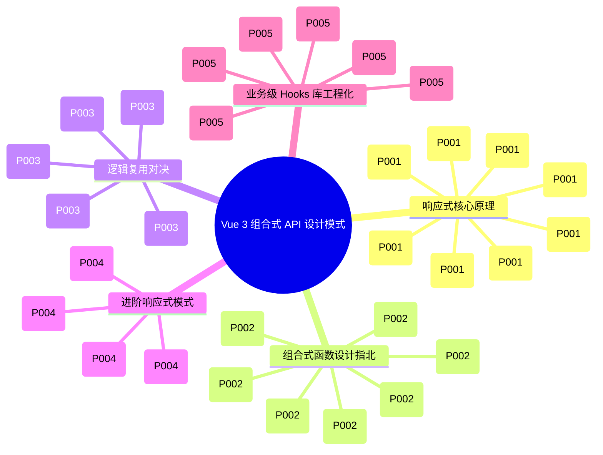

# 第 36 章 Vue 3 组合式 API 设计模式 —— 逻辑复用与状态管理的现代范式

## 学习目标

- 理解 Vue 3 响应式系统的核心原理：Proxy 代理、依赖收集与副作用触发机制
- 掌握组合式函数的设计规范、生命周期钩子注入时机与类型推导最佳实践
- 能够从命名空间、数据来源追踪、TypeScript 支持、测试隔离四个维度对比 Composables 与 Mixins/HOC/Provide-Inject 的优劣
- 熟练运用 useAsyncState、useDebounceFn、customRef 等进阶模式封装异步状态机、防抖节流与自定义触发时机的响应式变量
- 具备构建团队级业务 Hooks 库的工程化能力：目录规范、单测策略、文档生成、版本发布与 CI/CD 流水线

## 36.1 生活类比

想象 Vue 3 响应式系统是一个**智能楼宇安防系统**：
- **Proxy (代理大楼)** = 整栋大楼被一层隐形智能膜包裹，任何人进出(读写属性)都被感知
- **target (房间/货架)** = 原始数据对象，存放真实物品(值)
- **key (房间号/货架标签)** = 属性名，定位具体位置
- **effect (安保订阅者/住户)** = 副作用函数(渲染、计算属性、watch)，关心特定房间的动静
- **track (登记入住/关注)** = 住户向前台登记："我关注 301 房间"，前台记录在册
- **trigger (广播通知)** = 301 房间有变动(设置值)，前台查册通知所有登记过的住户
- **调度器 (广播延迟合并)** = 短时间内 301 连续变动 10 次，前台只发一条合并通知，避免住户被刷屏
- **ref (智能保管箱)** = 基本类型值(原始值)没有房间号，需放入保管箱(.value)才能被监控
- **computed (智能缓存管家)** = 住户问"301+302 总价值"，管家记录依赖，仅当两房间变动才重算，否则直接读缓存
- **组合式函数 (标准化装修套餐)** = 将"监控入侵+自动报警+手机推送"打包成 "useSecurity" 套餐，业主买房即用，互不干扰
- **customRef (DIY 智能开关)** = 业主自定义规则："只有灯亮超过 3 秒才算真亮"，内部自己决定何时通知前台

> "智能楼宇安防系统"类比直观展示了响应式系统的核心角色与交互流程：Proxy 作为拦截层，target/key 定位数据，effect 为订阅者，track/trigger 建立订阅-通知机制，调度器合并批次更新，ref/computed/customRef 则是针对不同场景的特化封装。 ——《20230418_036.md》

## 36.2 概念地图



## 36.3 响应式核心原理 —— 让数据变成“可感知的活体”

### 36.3.1 为什么需要这个概念？

在 Vue 2 时代，响应式系统基于 `Object.defineProperty` 实现。这带来了三大硬伤：无法监听数组下标的直接变动（如 `arr[0] = val`）、无法检测对象属性的新增与删除（需调用 `$set`/`$delete`）、以及在大型对象上递归遍历定义 getter/setter 导致的启动性能开销。

随着组合式 API 的引入，逻辑被拆分到多个函数中自由组合，这要求响应式系统必须具备**无侵入性**（不污染原始数据）、**全方位监听**（数组、Map、Set 均可监听）、**惰性触发**（仅访问的属性建立依赖）以及**精确的依赖收集能力**（避免无效更新）。基于 ES6 `Proxy` 的新一代响应式系统应运而生，它将数据包裹在一层“智能膜”中，拦截所有读写操作，构建起精准的依赖图谱。

> "Vue 2 的 Object.defineProperty 存在无法监听数组下标、对象属性新增删除、大对象递归遍历性能差三大痛点。Vue 3 基于 Proxy 实现无侵入、全方位、惰性触发、精确依赖收集的响应式系统。" ——《20230418_036.md》

### 36.3.2 核心定义与数据结构

> **响应式系统核心数据结构**（来源：《20230418_036.md》）

Vue 3 响应式系统的心脏是一个三层嵌套的数据结构，用于建立“目标对象 -> 属性键 -> 副作用函数集合”的映射关系：

```typescript
// 简化版类型定义
type Dep = Set<ReactiveEffect>;           // 第3层：依赖该 key 的副作用函数集合
type KeyToDepMap = Map<string | symbol, Dep>; // 第2层：属性键 -> Dep
const targetMap = new WeakMap<object, KeyToDepMap>(); // 第1层：目标对象 -> KeyToDepMap
```

**这个数据结构展示了三层映射的分工：**
- **WeakMap 作为第一层**：键是被代理的目标对象 (`target`)。使用 `WeakMap` 而非 `Map` 的关键原因是**不阻碍垃圾回收**。当目标对象在业务代码中不再被引用时，GC 可以直接回收它，对应的依赖映射也会随之消失，防止内存泄漏。如果使用 `Map`，目标对象将永远被 `targetMap` 强引用，无法被回收。
- **Map 作为第二层**：键是属性名 (`key`)，值是第三层的 `Dep`。`Map` 支持任意类型键（包括 Symbol），且插入顺序可迭代。
- **Set 作为第三层**：存储订阅该属性的 `ReactiveEffect` 实例。`Set` 天然去重，保证同一个 effect 对同一个 key 只被收集一次。

> **ReactiveEffect 类设计**（来源：《20230418_036.md》）

每个副作用函数（渲染函数、computed、watch 回调）都被包装为 `ReactiveEffect` 实例：

```typescript
class ReactiveEffect<T = any> {
  active = true;           // 是否激活，stop() 时设为 false
  deps: Dep[] = [];        // 该 effect 依赖的所有 Dep 集合（反向引用，用于清理）
  parent: ReactiveEffect | undefined; // 嵌套 effect 场景下的父 effect
  
  constructor(
    public fn: () => T,    // 原始副作用函数体
    public scheduler?: (effect: ReactiveEffect) => void // 调度器，默认推入微任务队列
  ) {}
  
  run() {
    if (!this.active) return this.fn();
    // 核心：设置当前激活的 effect，进入依赖收集阶段
    try {
      activeEffect = this;
      cleanupEffect(this); // 先清理旧依赖（防止分支切换导致的残留依赖）
      return this.fn();    // 执行函数体，触发 get -> track
    } finally {
      activeEffect = this.parent; // 恢复父 effect
    }
  }
  
  stop() {
    if (this.active) {
      cleanupEffect(this);
      this.active = false;
    }
  }
}
```

**这个类设计展示了 effect 的生命周期管理：**
- `run()` 是入口，它将当前 effect 设为全局 `activeEffect`，执行 `fn()` 期间触发的所有 `get` 操作都会收集到这个 effect。
- `deps` 数组记录该 effect 订阅了哪些 `Dep`，`stop()` 时遍历 `deps` 将自己从各 `Dep` 中删除，实现**双向绑定的清理**。
- `scheduler` 允许自定义执行时机。组件渲染 effect 的 scheduler 会将 effect 推入微任务队列，实现**批次合并**。

> "ReactiveEffect 类通过 `run()` 设置全局 `activeEffect` 实现依赖收集，`deps` 反向引用支持 `stop()` 时清理，`scheduler` 抽象统一调度入口。" ——《20230418_036.md》

### 36.3.3 依赖收集：track

> **track 函数实现**（来源：《20230418_036.md》）

当代理对象的属性被读取（`get` 拦截）时，若当前有激活的 effect，便建立订阅关系：

```typescript
function track(target: object, key: string | symbol) {
  // 1. 没有激活 effect，无需收集
  if (!activeEffect) return;
  
  // 2. 获取或创建 target -> KeyToDepMap
  let depsMap = targetMap.get(target);
  if (!depsMap) {
    depsMap = new Map();
    targetMap.set(target, depsMap);
  }
  
  // 3. 获取或创建 key -> Dep
  let dep = depsMap.get(key);
  if (!dep) {
    dep = new Set();
    depsMap.set(key, dep);
  }
  
  // 4. 建立双向绑定：effect -> dep，dep -> effect
  if (!dep.has(activeEffect)) {
    dep.add(activeEffect);
    activeEffect.deps.push(dep); // 反向引用，便于 cleanupEffect
  }
}
```

**这个函数展示了惰性依赖收集的完整流程：**
1. **按需收集**：只有在 `activeEffect` 存在时（即在 `effect(fn)` 执行期间）才建立依赖。未被访问的属性零开销。
2. **三层映射的懒创建**：`targetMap` -> `depsMap` -> `dep` 层层按需创建。
3. **双向绑定**：`dep.add(effect)` 完成正向订阅；`effect.deps.push(dep)` 完成反向记录。反向记录是 `cleanupEffect` 高效清理的前提。

> "track 函数实现了惰性依赖收集：仅在 activeEffect 存在时建立订阅，三层映射懒创建，双向绑定支撑高效清理。" ——《20230418_036.md》

### 36.3.4 派发更新：trigger

> **trigger 函数实现**（来源：《20230418_036.md》）

当代理对象的属性被修改（`set` 拦截）时，通知所有订阅者：

```typescript
function trigger(target: object, key: string | symbol, newValue, oldValue) {
  const depsMap = targetMap.get(target);
  if (!depsMap) return; // 无依赖，直接返回
  
  const dep = depsMap.get(key);
  if (!dep) return;
  
  // 关键：创建副本集合遍历，防止 effect 在运行中修改 dep 导致并发修改异常
  const effects = [...dep];
  
  for (const effect of effects) {
    // 1. 计算属性 effect 有 scheduler，交给 scheduler 调度
    // 2. 普通渲染 effect 也有 scheduler (queueJob)，进入微任务队列
    // 3. watch effect 同理
    if (effect.scheduler) {
      effect.scheduler(effect);
    } else {
      effect.run(); // 同步执行（罕见，如 watch sync: true）
    }
  }
}
```

**这个函数展示了派发更新的关键策略：**
- **快照隔离**：`[...dep]` 创建副本遍历。如果 effect 在 `run()` 过程中触发了同一个 key 的 `trigger`（如计算属性依赖链），修改原 `Set` 会导致迭代器失效，副本避免了此问题。
- **统一调度入口**：所有 effect（渲染、computed、watch）均通过 `scheduler` 间接执行。这为**批次合并**提供了统一抽象——渲染 effect 的 scheduler 是 `queueJob`，将 effect 推入微任务队列；computed 的 scheduler 标记脏位并触发依赖它的 effect。

> "trigger 函数通过副本遍历避免并发修改异常，统一走 scheduler 入口实现批次合并抽象。" ——《20230418_036.md》

### 36.3.5 调度器：微任务批次合并

> **调度器核心逻辑**（来源：《20230418_036.md》）

Vue 3 利用微任务队列实现同步代码块内多次状态修改的**合并更新**：

```typescript
const queue: ReactiveEffect[] = [];
let isFlushing = false;

function queueJob(effect: ReactiveEffect) {
  if (!queue.includes(effect)) queue.push(effect); // 去重入队
  if (!isFlushing) {
    isFlushing = true;
    Promise.resolve().then(flushJobs); // 微任务刷新
  }
}

function flushJobs() {
  isFlushing = false;
  // 按 effect 创建顺序排序（保证父组件先于子组件更新）
  queue.sort((a, b) => a.id - b.id);
  
  for (let i = 0; i < queue.length; i++) {
    queue[i].run();
  }
  queue.length = 0;
}
```

**这个机制展示了批次合并的工程价值：**
在同步代码中连续修改 `state.count++` 十次，`trigger` 被调用十次，但 `queueJob` 去重后只入队一次，最终在微任务中仅执行一次 `effect.run()`。这避免了中间 9 次无效渲染，是 Vue 3 高性能的关键之一。

> "调度器利用微任务队列合并同步代码块内的多次 trigger：queueJob 去重入队，flushJobs 排序执行，避免重复渲染。" ——《20230418_036.md》

### 36.3.6 reactive 与 ref 的实现差异

> **reactive 实现**（来源：《20230418_036.md》）

`reactive` 基于 `Proxy` 深度代理对象，拦截 `get`/`set`/`has`/`ownKeys`/`deleteProperty` 等操作：

```typescript
function reactive<T extends object>(target: T): T {
  // 已代理直接返回缓存
  const existing = proxyMap.get(target);
  if (existing) return existing;
  
  // 已是只读代理，不可再建响应式
  if (isReadonly(target)) return target;
  
  const proxy = new Proxy(target, mutableHandlers);
  proxyMap.set(target, proxy);
  return proxy;
}

const mutableHandlers: ProxyHandler<object> = {
  get(target, key, receiver) {
    // 依赖收集
    track(target, key);
    const res = Reflect.get(target, key, receiver);
    // 深度代理：访问嵌套对象时自动 reactive
    return isObject(res) ? reactive(res) : res;
  },
  set(target, key, value, receiver) {
    const oldValue = target[key];
    const result = Reflect.set(target, key, value, receiver);
    // 仅值真正变化时触发（NaN 自身不等需特判）
    if (hasChanged(value, oldValue)) {
      trigger(target, key, value, oldValue);
    }
    return result;
  },
  // ... has, ownKeys, deleteProperty 等拦截
};
```

> **ref 实现**（来源：《20230418_036.md》）

`ref` 将基本类型值包装为对象，利用 `get value`/`set value` 访问器属性触发 track/trigger：

```typescript
function ref<T>(value: T) {
  // 已是 ref 直接返回
  if (isRef(value)) return value;
  
  const r = {
    _value: convert(value), // 深度转换：对象值自动 reactive
    get value() {
      track(r, 'value');
      return r._value;
    },
    set value(newVal) {
      if (hasChanged(newVal, r._value)) {
        r._value = convert(newVal);
        trigger(r, 'value', newVal, r._value);
      }
    }
  };
  r.__v_isRef = true;
  return r;
}
```

**对比总结：**

| 特性 | `reactive` | `ref` |
|------|------------|-------|
| **适用类型** | 对象、数组、Map、Set | 任意类型（基本类型、对象均可） |
| **访问方式** | 直接 `proxy.key` | 必须 `.value`（模板中自动解包） |
| **代理深度** | 深度代理（访问嵌套对象递归代理） | 浅层：仅包装值本身，值若为对象内部自动 `reactive` |
| **解构保持响应性** | 否（解构丢失代理） | 是（引用传递） |
| **核心机制** | `Proxy` 拦截对象操作 | 访问器属性拦截 `.value` 读写 |

**关键边界：解构丢失响应性**
```typescript
const state = reactive({ count: 0 });
const { count } = state; // count 是普通 number，失去响应性
// 正确做法：
const { count } = toRefs(state); // count 是 ref，保持响应引用
```

**这个边界揭示了响应式的本质：** 响应式依赖于**代理对象身份**或 **ref 对象身份**。解构 `reactive` 对象得到的是原始值拷贝，切断了代理链；而 `toRefs` 为每个属性创建 `ref`，通过共享同一底层存储维持关联。

> "reactive 基于 Proxy 深度代理对象，ref 通过访问器属性包装值。解构 reactive 丢失响应性，需用 toRefs 保持引用。" ——《20230418_036.md》

### 36.3.7 computed：惰性求值与脏位标记

> **computed 实现原理**（来源：《20230418_036.md》）

`computed` 本质是一个**带缓存的 effect**：

```typescript
function computed<T>(getter: () => T) {
  let value: T;
  let dirty = true; // 脏位标记
  
  const effect = new ReactiveEffect(getter, () => {
    // scheduler：依赖变化时不直接运行，仅标记脏位
    if (!dirty) {
      dirty = true;
      trigger(ref, 'value'); // 通知依赖 computed 的 effect 重新运行
    }
  });
  
  const ref = {
    get value() {
      track(ref, 'value'); // 收集依赖 computed 的 effect
      if (dirty) {
        value = effect.run(); // 重新计算
        dirty = false;
      }
      return value;
    }
  };
  return ref;
}
```

**这个设计展示了“推拉结合”的精妙：**
- **推**：依赖变化时，effect 的 scheduler 被调用，仅**标记脏位**并 `trigger` 通知下游。
- **拉**：下游 effect 读取 `computedRef.value` 时，`get` 拦截发现脏位，才**真正执行计算**（`effect.run()`）。
- **收益**：若计算属性依赖变化但**从未被读取**（如隐藏标签页的组件），则完全避免了计算开销。这是“惰性求值”在响应式系统中的经典应用。

> "computed 通过脏位标记实现惰性求值：依赖变化时仅标记脏位并触发下游，读取时才真正重算，未读取则零开销。" ——《20230418_036.md》

### 36.3.8 边界条件与特殊实现

**数组与集合类型**
- 数组：`Proxy` 可拦截下标 `set`（`arr[0]=1`）、`length` 变更、`push/pop` 等变异方法。但 `delete arr[0]` 仅置空不改变 `length`，需手动触发 `length` 更新或使用 `arr.splice(0,1)`。
- Map/Set：无法通过 `Proxy` 直接拦截内部方法（`map.set`、`set.add`）。Vue 内部通过 **instrumentation（方法封装）** 实现：为代理对象注入封装后的 `set`/`get`/`add`/`delete` 等方法，内部调用原方法并手动 `track`/`trigger`。

**浅层响应式**
```typescript
const shallow = shallowReactive({ nested: { a: 1 } });
shallow.nested.a = 2; // 不触发更新，nested 非代理对象
```
适用于大型数据结构仅需首层响应、或集成非响应式库（如 Canvas 渲染数据）的场景。

**循环引用与超大对象**
深度代理递归可能导致栈溢出。生产环境建议对已知稳定结构使用 `shallowRef`/`shallowReactive`，或实现迭代式代理替代递归。

> "数组下标修改 Proxy 可拦截，但 delete 需配合 length；Map/Set 需 instrumentation 封装方法；shallowReactive 仅首层响应，适用大型数据或非响应式库集成；循环引用需 shallowRef 或迭代式代理。" ——《20230418_036.md》

---

## 36.4 组合式函数设计指北 —— 像搭积木一样封装“带状态的逻辑”

### 36.4.1 为什么需要这个概念？

Options API 时代，一个“获取用户列表并分页”的功能，其 `data`、`methods`、`computed`、`watch`、`mounted` 分散在五个选项中。复用时只能用 Mixins，但 Mixins 带来命名冲突、来源不清、TS 推导弱等顽疾。

组合式 API 提供了 `setup()` 这一统一入口，所有逻辑（状态、计算、方法、副作用、生命周期）均可在函数内部编写。但**自由需要约束**。缺乏规范会导致“面条代码”：巨大的 `setup`、随意的副作用、不一致的返回值。组合式函数规范由此诞生，将“带状态的逻辑”标准化为可复用、可类型推导、可独立测试的**乐高积木**。

> "Options API 逻辑分散五大选项，Mixins 有命名冲突/来源不清/TS弱等痛点。组合式 API 提供 setup 统一入口，但需规范避免面条代码，组合式函数规范将带状态逻辑标准化为可复用积木。" ——《20230418_036.md》

### 36.4.2 核心定义与契约

> **组合式函数标准契约**（来源：《20230418_036.md》）

```typescript
// 命名规范：use + PascalCase 业务名
function useFeatureName(options?: Options): ReturnType {
  // 1. 状态定义：使用 ref/reactive 创建响应式状态
  const state = reactive({ ... });
  const count = ref(0);
  
  // 2. 计算属性：衍生状态
  const doubled = computed(() => count.value * 2);
  
  // 3. 方法：封装业务逻辑
  function increment() { count.value++; }
  
  // 4. 生命周期钩子：同步注册，自动绑定当前组件实例
  onMounted(() => { /* 初始化 */ });
  onUnmounted(() => { /* 清理 */ });
  
  // 5. 返回：暴露给组件消费的公共 API
  // 关键：使用 toRefs 解构 reactive 保持响应引用
  return {
    ...toRefs(state), // 展开并保持响应性
    count,            // ref 直接返回
    doubled,          // computed 直接返回（本身是 ref）
    increment,
  };
}
```

**这个契约确立了五大核心约定：**
1. **命名**：`useXxx` 约定俗成，IDE 可自动识别提供提示。
2. **状态封装**：内部使用 `ref`/`reactive`，返回时**必须保持响应性**。`reactive` 对象需 `toRefs` 解构，否则调用方解构即丢失响应。
3. **生命周期注入**：`onMounted` 等钩子**只能在 setup 同步执行阶段**调用。它们依赖全局 `currentInstance` 变量，异步回调中调用会报错“injection not found”。
4. **类型推导**：TypeScript 自动推导返回对象的完整类型，包括 `Ref<T>` 解包后的 `T`、方法签名、泛型约束。
5. **状态隔离**：每次调用 `useXxx()` 创建**独立副本**。共享状态需显式提升到模块作用域（单例模式）。

> "组合式函数契约：useXxx 命名、内部用 ref/reactive、返回保持响应性(toRefs)、同步调用生命周期钩子、TS 自动推导类型、每次调用独立副本。" ——《20230418_036.md》

### 36.4.3 典型例子

**用例 1：useMouse - 封装 DOM 事件监听**
```typescript
// @my-org/vue-hooks/useMouse/index.ts
export function useMouse() {
  const x = ref(0);
  const y = ref(0);
  
  function update(e: MouseEvent) { x.value = e.pageX; y.value = e.pageY; }
  
  onMounted(() => window.addEventListener('mousemove', update));
  onUnmounted(() => window.removeEventListener('mousemove', update));
  
  return { x, y };
}

// 组件中使用
const { x, y } = useMouse(); // 类型自动推导为 { x: Ref<number>, y: Ref<number> }
```

**用例 2：useFetch - 封装异步请求生命周期**
```typescript
export function useFetch<T>(url: string) {
  const data = ref<T | null>(null);
  const loading = ref(true);
  const error = ref<Error | null>(null);
  
  async function execute() {
    loading.value = true;
    error.value = null;
    try {
      const res = await fetch(url);
      data.value = await res.json();
    } catch (e) {
      error.value = e as Error;
    } finally {
      loading.value = false;
    }
  }
  
  onMounted(execute);
  // 可选：返回 execute 允许手动刷新
  return { data, loading, error, execute };
}
```

**用例 3：useEventListener - 统一事件绑定管理**
```typescript
export function useEventListener(
  target: EventTarget | Ref<EventTarget | null> | (() => EventTarget | null),
  event: string,
  handler: EventListenerOrEventListenerObject,
  options?: boolean | AddEventListenerOptions
) {
  const cleanup = () => {
    const el = isFunction(target) ? target() : unref(target);
    el?.removeEventListener(event, handler, options);
  };
  
  onMounted(() => {
    const el = isFunction(target) ? target() : unref(target);
    el?.addEventListener(event, handler, options);
  });
  onUnmounted(cleanup);
  
  // 支持 target 为 ref 时的动态切换
  watch(() => unref(target), (newEl, oldEl) => {
    oldEl?.removeEventListener(event, handler, options);
    newEl?.addEventListener(event, handler, options);
  });
  
  return cleanup;
}
```

> "useMouse 封装鼠标监听，useFetch 封装请求三态与生命周期，useEventListener 统一事件绑定并支持动态 target，均遵循契约返回响应式状态。" ——《20230418_036.md》

### 36.4.4 边界条件与反模式

以下表格总结了组合式函数开发中的常见反模式、后果及正确做法：

| 反模式 | 后果 | 正确做法 |
|--------|------|----------|
| **在 `if`/`for` 中调用 `useXxx()`** | 破坏调用顺序一致性，导致生命周期钩子绑定错位、依赖收集错乱 | 始终在 setup 顶层同步调用；条件逻辑移入函数内部 |
| **直接修改 `props`** | `props` 是只读代理，修改会警告且无效 | `const propsRef = toRefs(props)` 或 `computed(() => props.xxx)` |
| **共享状态未外提** | 每次调用创建新状态，多组件间无法同步 | 模块作用域创建 `const globalState = reactive({...})`，函数内返回引用 |
| **异步回调中调用生命周期钩子** | `currentInstance` 为 null，报错 | 同步注册；异步逻辑放入钩子回调内部 |
| **返回原始值而非 ref** | 调用方解构丢失响应性 | 始终返回 `ref`/`computed`/`toRefs` 结果 |

---

## 36.5 逻辑复用对决 —— Composables 为何击败 Mixins/HOC/Provide-Inject

### 36.5.1 为什么需要这个概念？

Vue 生态经历了 Mixins（Vue 1/2 主流）、HOC（React 迁移者尝试）、Provide/Inject（跨层级传递）、Composables（Vue 3 标准）四个阶段。团队在重构旧项目、设计新架构时常面临选择困境。理解各方案的**本质差异**，才能从原理层面论证 Composables 的优势边界，避免技术债积累。

> "Vue 生态经历 Mixins/HOC/Provide-Inject/Composables 四阶段，团队选型需理解本质差异以论证 Composables 优势边界。" ——《20230418_036.md》

### 36.5.2 核心定义对比

> **四种复用方案的本质对比**（来源：《20230418_036.md》）

| 维度 | **Mixins** | **HOC (高阶组件)** | **Provide/Inject** | **Composables** |
|------|------------|-------------------|-------------------|-----------------|
| **核心机制** | 选项合并：同名 data 递归合并，methods 覆盖，生命周期并行执行 | 函数式组合：接收组件定义对象，返回增强后的组件定义对象 | 依赖注入：祖先 `provide`，后代 `inject`，运行时建立关系 | 函数式封装：显式 `import/export`，返回响应式状态/方法对象 |
| **类型系统** | 弱：需 `ComponentCustomOptions` 手动增强，泛型支持极差 | 中：需手动声明组件 Props 类型，组合时类型收窄复杂 | 弱：需 `InjectionKey<Type>` 手动维护泛型，易丢失 | **强：TS 自动推导返回类型、泛型参数、响应式解包** |
| **命名空间** | **隐式合并**：极易冲突（data/methods/computed 同名覆盖） | 显式 Props 传递，但包装层层嵌套导致 Props 爆炸 | 显式 Key（Symbol/字符串），但运行时才知冲突 | **显式导出成员：零冲突，IDE 跳转直达定义** |
| **数据来源追踪** | **极难**：运行时混合，需断点调试定位来源 | 中：组件树层层包装，DevTools 显示 Wrapper 地狱 | 难：跨层级注入，运行时才知来源 | **易：代码跳转直达定义，静态分析可见依赖图** |
| **测试隔离** | 差：必须挂载真实组件测试，耦合度高，Mock 困难 | 差：需渲染包装组件，测试目标被层层包裹 | 差：需构建 Provide 上下文，集成测试味重 | **优：`effectScope` 模拟上下文，纯单元测试，无需挂载** |
| **复用粒度** | 粗：往往耦合 data/methods/lifecycle 多个选项 | 粗：以整个组件为单位包装 | 细：可注入任意值，但通常用于全局/跨层级 | **细：按业务功能拆分，单一职责，任意组合** |
| **Vue 生态地位** | 兼容模式保留，不推荐新项目使用 | 非主流：Vue 组件是对象非函数，HOC 语法别扭 | 官方支持：适用于插件全局配置、跨层级主题/国际化 | **官方推荐：组合式 API 核心复用模式** |

### 36.5.3 多源对照：逻辑复用方案的共识与分歧

#### 36.5.3.1 共识维度

所有方案均旨在解决**逻辑复用**问题，且均涉及**状态管理**与**行为封装**。它们都试图将重复的业务逻辑（如数据获取、事件监听、表单验证）抽离为可复用单元，减少样板代码。在 Vue 官方文档中，这四种模式均有专门章节说明，说明其均为生态认可的技术手段。

#### 36.5.3.2 分歧维度

| 分歧点 | Mixins | HOC | Provide/Inject | Composables |
|--------|--------|-----|----------------|-------------|
| **组合方式** | 运行时选项合并（隐式） | 函数包装组件定义（显式但层层嵌套） | 运行时依赖注入（隐式跨层级） | 编译期显式导入组合（显式扁平） |
| **类型推导能力** | 极弱，依赖模块扩展 `this` | 中等，Props 类型需手动维护 | 弱，需 `InjectionKey` 泛型锚定 | **极强，原生 TS 推导泛型与响应式解包** |
| **调试与追踪** | 运行时混合，来源不透明 | Wrapper 地狱，组件树深度膨胀 | 运行时注入，静态分析失效 | **静态可达，IDE 跳转直达源码** |
| **测试策略** | 集成测试为主，耦合组件生命周期 | 集成测试为主，耦合 Wrapper 树 | 集成测试为主，需构建 Provide 上下文 | **纯单元测试，effectScope 模拟上下文** |
| **适用边界** | 仅兼容旧项目 | React 迁移项目、极少数库作者 | 插件全局配置、跨层级主题/国际化、微前端 | **通用业务逻辑复用首选** |

### 36.5.4 重构实战：从 paginationMixin 到三个 Composables

> **重构前：典型 Vue 2 分页 Mixin**（来源：《20230418_036.md》）

```javascript
// paginationMixin.js - 耦合分页、排序、导出三大无关功能
export const paginationMixin = {
  data() { 
    return { 
      page: 1, pageSize: 20, total: 0, loading: false, list: [],
      sortField: '', sortOrder: '' // 排序状态混入
    } 
  },
  methods: {
    async fetchList() { 
      this.loading = true; 
      const res = await api.getList({ 
        page: this.page, pageSize: this.pageSize,
        sortField: this.sortField, sortOrder: this.sortOrder
      }); 
      this.list = res.data; this.total = res.total; this.loading = false; 
    },
    changePage(p) { this.page = p; this.fetchList() },
    changeSize(s) { this.pageSize = s; this.page = 1; this.fetchList() },
    sortBy(field) { /* 排序逻辑耦合在 fetchList 中 */ },
    exportData() { /* 导出逻辑直接读取 this.list */ }
  },
  mounted() { this.fetchList() }
};
```

> **重构后：三个单一职责的 Composables**（来源：《20230418_036.md》）

```typescript
// usePagination.ts - 仅负责分页核心状态与请求
export function usePagination<T>(fetchFn: (params: PageParams) => Promise<PageResult<T>>) {
  const page = ref(1);
  const pageSize = ref(20);
  const total = ref(0);
  const loading = ref(false);
  const list = ref<T[]>([]);
  
  async function fetchList() {
    loading.value = true;
    try {
      const res = await fetchFn({ page: page.value, pageSize: pageSize.value });
      list.value = res.data;
      total.value = res.total;
    } finally {
      loading.value = false;
    }
  }
  
  function changePage(p: number) { page.value = p; fetchList(); }
  function changeSize(s: number) { pageSize.value = s; page.value = 1; fetchList(); }
  
  onMounted(fetchList);
  
  return { page, pageSize, total, loading, list, fetchList, changePage, changeSize };
}

// useSortable.ts - 仅负责排序状态，接收外部 list 引用
export function useSortable<T>(list: Ref<T[]>) {
  const sortField = ref('');
  const sortOrder: Ref<'asc' | 'desc'> = ref('asc');
  
  function sortBy(field: string) {
    if (sortField.value === field) {
      sortOrder.value = sortOrder.value === 'asc' ? 'desc' : 'asc';
    } else {
      sortField.value = field;
      sortOrder.value = 'asc';
    }
    // 直接修改传入的 list 引用（原地排序）或返回新数组
    list.value = [...list.value].sort((a, b) => { /* 比较逻辑 */ });
  }
  
  return { sortField, sortOrder, sortBy };
}

// useExport.ts - 仅负责导出，接收外部 list 引用
export function useExport<T>(list: Ref<T[]>, filename: string) {
  function exportData() {
    const csv = convertToCSV(list.value);
    download(csv, filename);
  }
  return { exportData };
}
```

> **组件中组合使用**（来源：《20230418_036.md》）

```vue
<script setup lang="ts">
import { usePagination } from '@my-org/vue-hooks/usePagination';
import { useSortable } from '@my-org/vue-hooks/useSortable';
import { useExport } from '@my-org/vue-hooks/useExport';

// 1. 核心分页逻辑
const { list, loading, page, pageSize, changePage, changeSize } = usePagination(fetchUserList);

// 2. 排序逻辑：传入 list 引用，内部修改 list.value 触发视图更新
const { sortBy } = useSortable(list);

// 3. 导出逻辑：同样传入 list 引用
const { exportData } = useExport(list, 'users.csv');
</script>
```

**这个重构展示了 Composables 的组合优势：**
- **解耦**：分页不再关心排序字段，排序不关心请求参数，导出不关心数据来源。
- **类型安全**：`usePagination<User>` 泛型自动推导 `list: Ref<User[]>`，`useSortable(list)` 类型自动匹配。
- **测试独立**：每个函数可单独单测，Mock `fetchFn` 即可测试分页逻辑。
- **按需引入**：不需要排序的页面只 `import usePagination`，无死代码。

> "重构将耦合分页/排序/导出的 paginationMixin 拆分为三个单一职责 Composables，通过传递 list 引用实现协作，实现解耦、类型安全、独立测试、按需引入。" ——《20230418_036.md》

### 36.5.5 留存场景：何时仍需 Provide/Inject？

尽管 Composables 全面优于 Mixins，但 **Provide/Inject** 在以下场景不可替代：

1. **插件/组件库向应用注入全局默认配置**：如 `i18n` 注入 `locale`、`message`；`Pinia` 注入 `store` 实例。这些是**框架级基础设施**，不应要求业务代码显式 `import`。
2. **跨越非组合式边界**：旧版 Options API 组件、第三方库组件、微前端子应用间通信，无法使用 `import` 共享响应式状态。
3. **动态层级注入**：组件树深度不固定，且注入值随上下文变化（如嵌套 Form 表单的 `validate` 方法）。

**决策流程图：**

```mermaid
flowchart TD
    A[需要复用带状态的逻辑?] --> B{是否为框架级/跨层级/非组合式边界?}
    B -->|是| C[Provide/Inject]
    B -->|否| D[Composables (首选)]
    C --> E[定义 InjectionKey 保证类型安全]
    D --> F[遵循 useXxx 规范，导出类型]
```

---

## 36.6 进阶响应式模式 —— 异步状态机、防抖工具与自定义 Ref

### 36.6.1 为什么需要这个概念？

业务开发中充斥着三类复杂副作用：
1. **异步请求**：需管理 `loading`/`data`/`error` 三态、竞态取消、轮询、重试。
2. **高频事件**：输入框防抖、窗口 resize 节流、滚动监听，需自动绑定生命周期清理定时器。
3. **外部系统集成**：受控组件桥接非响应式库、本地存储同步、脏检查触发更新。

标准 `ref`/`reactive` 无法表达“仅当条件满足才触发更新”或“读取时才计算”的精细控制。进阶模式将这些通用模式**封装为可复用的响应式原语**，让业务代码回归声明式。

> "业务中异步请求三态、高频事件防抖、外部库集成等复杂副作用，标准 ref/reactive 无法表达精细控制，需封装为可复用响应式原语。" ——《20230418_036.md》

### 36.6.2 useAsyncState：异步三态机

> **useAsyncState 核心实现**（来源：《20230418_036.md》）

```typescript
interface UseAsyncStateOptions<T> {
  immediate?: boolean;      // 是否立即执行
  onSuccess?: (data: T) => void;
  onError?: (error: Error) => void;
}

export function useAsyncState<T>(
  promiseFn: () => Promise<T>,
  options: UseAsyncStateOptions<T> = {}
) {
  const data = ref<T | null>(null);
  const loading = ref(false);
  const error = ref<Error | null>(null);
  
  let abortController: AbortController | null = null; // 竞态控制
  let executeId = 0; // 请求序号校验
  
  async function execute(...args: any[]) {
    loading.value = true;
    error.value = null;
    
    // 1. 取消上一次未完成的请求
    abortController?.abort();
    abortController = new AbortController();
    const currentId = ++executeId;
    
    try {
      const result = await promiseFn(...args, { signal: abortController.signal });
      // 2. 竞态校验：仅最新请求结果生效
      if (currentId === executeId) {
        data.value = result;
        options.onSuccess?.(result);
      }
    } catch (e) {
      if (currentId === executeId && e.name !== 'AbortError') {
        error.value = e as Error;
        options.onError?.(e as Error);
      }
    } finally {
      if (currentId === executeId) loading.value = false;
    }
  }
  
  function cancel() {
    abortController?.abort();
    loading.value = false;
  }
  
  if (options.immediate !== false) {
    // immediate 默认 true
    onMounted(() => execute());
  }
  
  onUnmounted(cancel);
  
  return { data, loading, error, execute, cancel };
}
```

**这个实现展示了三个关键工程细节：**
1. **AbortController 竞态控制**：利用浏览器原生信号取消过期请求，避免“后发先至”导致数据回滚。
2. **请求序号校验**：双重保险，即使未使用 `AbortController` 的旧环境也能通过 `executeId` 丢弃过期结果。
3. **生命周期绑定**：`onMounted` 自动执行，`onUnmounted` 自动取消，组件卸载无残留回调。

> "useAsyncState 通过 AbortController 与 executeId 双重竞态控制，生命周期绑定自动执行/取消，封装 loading/data/error 三态机。" ——《20230418_036.md》

### 36.6.3 useDebounceFn / useThrottleFn：副作用防抖节流

> **useDebounceFn 实现**（来源：《20230418_036.md》）

```typescript
export function useDebounceFn<T extends (...args: any[]) => any>(
  fn: T,
  delay: number,
  options: { leading?: boolean; trailing?: boolean } = {}
) {
  let timer: ReturnType<typeof setTimeout> | null = null;
  let lastArgs: Parameters<T> | null = null;
  const { leading = false, trailing = true } = options;
  
  const debounced = ((...args: Parameters<T>) => {
    lastArgs = args;
    const run = () => {
      timer = null;
      if (trailing && lastArgs) fn(...lastArgs);
    };
    
    if (leading && !timer) fn(...args); // 立即执行首次
    if (timer) clearTimeout(timer);
    timer = setTimeout(run, delay);
  }) as T & { cancel: () => void; flush: () => void };
  
  debounced.cancel = () => {
    if (timer) { clearTimeout(timer); timer = null; }
  };
  debounced.flush = () => {
    if (timer && lastArgs) { clearTimeout(timer); timer = null; fn(...lastArgs); }
  };
  
  // 关键：绑定组件生命周期，自动清理定时器防内存泄漏
  const scope = effectScope();
  scope.run(() => {
    onScopeDispose(debounced.cancel);
  });
  
  return debounced;
}
```

**这个实现展示了工程化防抖的三要素：**
- **选项化控制**：`leading`/`trailing` 支持首尾触发策略，覆盖“立即搜索/防抖搜索”双模式。
- **扩展方法**：`cancel()` 取消待执行、`flush()` 立即执行待执行，满足表单提交前强制同步场景。
- **作用域清理**：`effectScope` + `onScopeDispose` 确保组件卸载时定时器被清理，这是 `@vueuse/core` 的标准模式。

> "useDebounceFn 通过 leading/trailing 选项化首尾触发，扩展 cancel/flush 方法，利用 effectScope+onScopeDispose 绑定生命周期自动清理定时器。" ——《20230418_036.md》

### 36.6.4 customRef：手控 track/trigger 的“DIY 智能开关”

> **customRef 签名与典型实现**（来源：《20230418_036.md》）

```typescript
function customRef<T>(factory: (track: () => void, trigger: () => void) => {
  get: () => T;
  set: (value: T) => void;
}): Ref<T>;
```

**典型用例 1：防抖 Ref（搜索框 v-model 直接绑定）**
```typescript
export function useDebouncedRef(value: string, delay = 300) {
  let timer: ReturnType<typeof setTimeout> | null = null;
  
  return customRef((track, trigger) => ({
    get() {
      track(); // 依赖收集：组件读取时建立订阅
      return value;
    },
    set(newVal: string) {
      value = newVal;
      if (timer) clearTimeout(timer);
      timer = setTimeout(() => {
        trigger(); // 延迟触发：300ms 后通知视图更新
      }, delay);
    }
  }));
}

// 组件中：<input v-model="query" /> 无需 watch，自动防抖
const query = useDebouncedRef('', 300);
```

**典型用例 2：受控组件桥接（对接非响应式库）**
```typescript
// 外部库：extLib.getValue() / extLib.setValue(val) / extLib.onChange(cb)
export function useControlledRef(initialValue: string) {
  return customRef((track, trigger) => ({
    get() {
      track();
      return extLib.getValue(); // 读取外部库真实值
    },
    set(newVal) {
      extLib.setValue(newVal); // 写入外部库
      trigger(); // 通知 Vue 视图更新
    }
  }));
}
```

**典型用例 3：仅脏检查触发（性能优化）**
```typescript
export function useDirtyRef<T>(initial: T, equals: (a: T, b: T) => boolean = Object.is) {
  let value = initial;
  return customRef((track, trigger) => ({
    get() { track(); return value; },
    set(newVal) {
      if (!equals(value, newVal)) {
        value = newVal;
        trigger(); // 仅值真正变化才触发
      }
    }
  }));
}
```

> "customRef 工厂函数接收 track/trigger 手动控制依赖收集与触发时机，典型用例：防抖 ref、受控组件桥接、脏检查触发。" ——《20230418_036.md》

### 36.6.5 边界条件与陷阱

以下表格总结了进阶响应式模式中的常见陷阱与规避方案：

| 模式 | 陷阱 | 规避方案 |
|------|------|----------|
| **useAsyncState** | 默认不处理竞态（后发先至） | 必须配合 `AbortController` 或 `executeId` 校验 |
| **customRef get 中忘记 `track()`** | 组件读取 ref 不建立依赖，依赖变化时视图不更新 | **铁律**：`get` 必须调用 `track()` |
| **customRef set 中忘记 `trigger()`** | 修改值后视图不更新 | **铁律**：值变化时必须调用 `trigger()` |
| **防抖函数卸载前触发回调** | 回调访问已销毁的响应式状态报错 | 回调前检查 `isMounted` 标记，或用 `effectScope` 统一管理 |
| **useDebounceFn 返回函数丢失 `this`** | 原函数依赖 `this` 失效 | 使用箭头函数包装或 `fn.bind(ctx)` |
| **customRef 抛出异常** | `trigger` 未执行，依赖未通知，可能留下脏状态 | `try { ... } finally { trigger() }` 或状态回滚后再 `trigger` |

---

## 36.7 业务级 Hooks 库工程化 —— 从“个人经验”到“团队资产”

### 36.7.1 为什么需要这个概念？

团队积累的组合式函数散落在各业务目录：`src/hooks/useAuth.ts`、`src/utils/useFormat.ts`、`components/UserProfile/usePermissions.ts`。缺乏统一规范导致：
- **重复造轮子**：不知已有实现，反复编写 `useDebounce`、`useLocalStorage`。
- **类型不一致**：有的导出类型，有的 `any`，有的无类型定义。
- **无单测保障**：重构时不敢动，升级 Vue 版本恐惧破坏。
- **无文档/示例**：新人只能读源码，上手成本高。
- **版本混乱**：项目间复制粘贴代码，修复 Bug 无法同步。

建立类似 `@vueuse/core` 的内部标准库 `@my-org/vue-hooks`，实现**开箱即用、类型安全、升级无痛、质量可控**，将“个人经验”沉淀为“团队资产”。

> "团队 Hooks 散落各目录，缺规范/类型/测试/文档/发布流程，导致重复造轮子/版本混乱。需建立内部标准库实现开箱即用、类型安全、升级无痛、质量可控。" ——《20230418_036.md》

### 36.7.2 目录规范：单包单目录自包含

> **标准目录结构**（来源：《20230418_036.md》）

```
packages/hooks/
├── src/
│   ├── useMouse/
│   │   ├── index.ts        # 主入口：export { useMouse } from './useMouse'
│   │   ├── useMouse.ts     # 核心实现
│   │   ├── types.ts        # 类型导出：export type { UseMouseOptions, UseMouseReturn }
│   │   ├── index.test.ts   # 单元测试
│   │   └── README.md       # 文档：用法、参数、返回值、示例
│   ├── useFetch/
│   │   ├── ...
│   └── index.ts            # 统一导出：export * from './useMouse'; export * from './useFetch';
├── package.json
├── tsconfig.json
├── vitest.config.ts
├── .changeset/             # changesets 版本日志
└── README.md
```

**这个结构保证了：**
- **自包含**：一个 Hook 的实现、类型、测试、文档物理聚合，修改时不易遗漏。
- **Tree-shaking 友好**：纯 ESM 导出，无副作用，打包工具可按需引入。
- **类型优先**：`types.ts` 显式导出类型，消费方 `import type { UseMouseReturn } from '@my-org/vue-hooks/useMouse'` 无需引入实现。

> "标准目录结构：单 Hook 单目录含 index/types/test/README，自包含、Tree-shaking 友好、类型优先。" ——《20230418_036.md》

### 36.7.3 单元测试策略：effectScope 模拟组件上下文

> **通用测试工具：mountHook**（来源：《20230418_036.md》）

```typescript
// test/utils/mountHook.ts
import { effectScope, EffectScope } from 'vue';

export interface MountHookResult<T> {
  result: T;
  cleanup: () => void;
  scope: EffectScope;
}

/**
 * 在 effectScope 中运行 hook，模拟组件 setup 上下文
 * 自动收集 onMounted/onUnmounted 等生命周期钩子
 */
export function mountHook<T>(hook: () => T): MountHookResult<T> {
  const scope = effectScope(true); // detached: true 不自动绑定父作用域
  let result: T;
  
  scope.run(() => {
    result = hook();
  });
  
  return {
    result: result!,
    cleanup: () => scope.stop(),
    scope,
  };
}
```

> **测试用例示例**（来源：《20230418_036.md》）

```typescript
// useMouse/index.test.ts
import { describe, it, expect, vi } from 'vitest';
import { useMouse } from './useMouse';
import { mountHook } from '~/test/utils/mountHook';

describe('useMouse', () => {
  it('should track mouse position', () => {
    const { result, cleanup } = mountHook(() => useMouse());
    
    expect(result.x).toBe(0);
    expect(result.y).toBe(0);
    
    // 模拟 mousemove 事件
    window.dispatchEvent(new MouseEvent('mousemove', { pageX: 100, pageY: 200 }));
    
    expect(result.x).toBe(100);
    expect(result.y).toBe(200);
    
    cleanup(); // 触发 onUnmounted，移除监听器
    
    // 卸载后事件不再生效
    window.dispatchEvent(new MouseEvent('mousemove', { pageX: 999, pageY: 999 }));
    expect(result.x).toBe(100);
    expect(result.y).toBe(200);
  });
});
```

```typescript
// useAsyncState/index.test.ts
it('should handle race condition with executeId', async () => {
  let resolveSlow: (v: string) => void;
  const slowPromise = new Promise<string>(r => { resolveSlow = r; });
  let resolveFast: (v: string) => void;
  const fastPromise = new Promise<string>(r => { resolveFast = r; });
  
  let callCount = 0;
  const mockFn = vi.fn(async () => {
    callCount++;
    if (callCount === 1) return slowPromise;
    return fastPromise;
  });
  
  const { result, cleanup } = mountHook(() => useAsyncState(mockFn, { immediate: false }));
  
  // 先发起慢请求
  const slowExec = result.execute();
  // 立即发起快请求（模拟用户快速切换）
  const fastExec = result.execute();
  
  resolveFast('fast');
  await fastExec;
  expect(result.data).toBe('fast');
  
  resolveSlow('slow');
  await slowExec;
  // 竞态保护：慢请求结果被丢弃
  expect(result.data).toBe('fast');
  
  cleanup();
});
```

**这个策略展示了纯单元测试的优势：**
- **无需挂载组件**：`effectScope` 提供生命周期上下文，`onMounted`/`onUnmounted` 正常工作。
- **快速执行**：无 DOM 渲染开销，适合 CI/CD 高频运行。
- **精确控制**：可模拟异步时序、竞态、错误边界等难以在 E2E 中复现的场景。

> "mountHook 利用 effectScope 模拟组件上下文，onMounted/onUnmounted 正常工作，无需挂载组件，毫秒级执行，精确控制异步时序与竞态。" ——《20230418_036.md》

### 36.7.4 文档生成与发布流水线

> **自动化文档配置**（来源：《20230418_036.md》）

```typescript
// typedoc.json
{
  "entryPoints": ["packages/hooks/src/**/index.ts"],
  "out": "docs/api",
  "theme": "markdown",
  "readme": "none",
  "includeVersion": true,
  "categorizeByGroup": false,
  "defaultCategory": "Hooks",
  "categoryOrder": ["Hooks", "*"],
  "tsconfig": "tsconfig.json"
}
```

> **CI/CD 工作流配置**（来源：《20230418_036.md》）

```yaml
# .github/workflows/ci.yml
jobs:
  build-and-test:
    runs-on: ubuntu-latest
    steps:
      - uses: actions/checkout@v4
      - uses: pnpm/action-setup@v2
      - run: pnpm install --frozen-lockfile
      - run: pnpm lint
      - run: pnpm typecheck
      - run: pnpm test:unit -- --coverage
      - run: pnpm build
      - run: pnpm doc:build
      - uses: codecov/codecov-action@v3
  
  release:
    needs: build-and-test
    if: github.ref == 'refs/heads/main'
    runs-on: ubuntu-latest
    steps:
      - uses: actions/checkout@v4
      - uses: pnpm/action-setup@v2
      - run: pnpm install --frozen-lockfile
      - uses: changesets/action@v1
        with:
          publish: pnpm publish
        env:
          GITHUB_TOKEN: ${{ secrets.GITHUB_TOKEN }}
          NPM_TOKEN: ${{ secrets.NPM_TOKEN }}
```

> **changesets 版本管理**（来源：《20230418_036.md》）

```bash
# 开发者提交变更时
pnpm changeset
# 交互式选择：patch/minor/major -> 输入变更描述 -> 生成 .changeset/xxx.md

# 合并到 main 分支后，CI 自动：
# 1. 读取 .changeset/*.md 计算新版本号
# 2. 更新 package.json version
# 3. 生成 CHANGELOG.md
# 4. 打 tag
# 5. pnpm publish 发布至私有 npm registry
```

> "文档用 typedoc 生成，CI 流水线跑 lint/typecheck/test/build/doc，changesets 管理版本日志自动发布至私有 npm。" ——《20230418_036.md》

### 36.7.5 治理原则：避免过度封装

以下表格总结了业务级 Hooks 库治理的核心原则：

| 原则 | 说明 | 反例 |
|------|------|------|
| **通用性门槛** | 仅收录 2+ 项目复用、或通用性极强（如 `useDebounce`）的 Hook | 单业务 `useUserProfile` 留在业务目录 |
| **UI 库解耦** | 依赖 Ant Design/Element Plus 的 Hook 拆包发布（`@my-org/vue-hooks-antd`） | 核心库强依赖 UI 库版本，升级地狱 |
| **零依赖核心** | 核心包仅依赖 `vue`、`@vueuse/shared` 等极少 peerDependencies | 引入 `lodash`、`axios` 等重依赖 |
| **版本锁定** | 项目 `package.json` 锁定具体版本 `1.2.3`，禁止 `^1.2.3` | 依赖篡改导致生产环境意外升级 |
| **迁移指南** | Breaking Change 必须提供 codemod 或手动迁移文档 | Major 版本升级后项目构建报错无头绪 |

---

## 36.8 设计中的取舍

### 为什么不用 Mixins 而是 Composables？

**Mixins 的本质是“隐式合并”**：多个选项对象在组件创建时被合并为一个。这导致：
- **命名冲突不可避免**：两个 Mixin 定义同名 `data` 属性 `loading`，后者覆盖前者，运行时才发现 Bug。
- **数据来源不透明**：组件内 `this.loading` 究竟来自哪个 Mixin？需搜索代码库或断点调试。
- **TypeScript 支持缺陷**：Mixin 返回 `ComponentCustomOptions`，泛型无法流通，`this` 类型增强需手动声明模块扩展。
- **测试强耦合**：必须挂载真实组件才能测试 Mixin 逻辑，无法隔离。

**Composables 的本质是“显式组合”**：函数调用返回响应式对象，组件解构使用。
- **零冲突**：`const { loading: loadingA } = useA(); const { loading: loadingB } = useB();` 重命名即解决。
- **来源可追踪**：IDE `Cmd+Click` 直达定义，静态分析可见依赖图。
- **TS 完整推导**：泛型参数、返回类型、响应式解包全自动。
- **纯单元测试**：`effectScope` 模拟上下文，无需 DOM，毫秒级执行。

**Trade-off**：Composables 要求开发者理解“响应式引用传递”（`toRefs`、解构丢失响应性），学习曲线略高于 Mixins“混入即用”。但这属于**一次性认知投入**，长期收益远超成本。

> "Mixins 隐式合并导致命名冲突、来源不透明、TS弱、测试强耦合。Composables 显式组合零冲突、可追踪、TS完整推导、纯单元测试。Trade-off：Composables 需理解响应式引用传递，一次性认知投入换长期收益。" ——《20230418_036.md》

### 为什么 `ref` 需要 `.value` 而模板中不需要？

这是**编译时与运行时的分工**：
- **运行时（JS/TS）**：`ref` 是对象，访问值必须通过属性 `.value` 触发 `get`/`set` 拦截。这是 JS 语言能力的边界。
- **编译时（模板编译器）**：Vue 编译器识别模板中绑定的 `ref` 标识符，自动注入 `.value` 访问。即 `<input v-model="query" />` 编译为 `query.value`。
- **Trade-off**：获得了模板书写的简洁性，代价是心智模型中需区分“模板上下文”与“JS 上下文”。`setup()` 中解构 `const { query } = useSearch()` 得到的是 `Ref`，必须 `.value`；但传给模板 `<Child :query="query" />` 子组件 `defineProps(['query'])` 接收到的是解包后的原始值（`string`），这是 `defineProps` 的特殊解包行为。

> "ref 需 .value 是运行时 JS 语言边界，模板自动解包是编译时编译器行为。Trade-off：模板简洁性换取心智模型区分模板/JS上下文，props 传递时 defineProps 再次解包。" ——《20230418_036.md》

### 为什么 `computed` 不支持异步？

`computed` 设计为**同步纯函数衍生状态**，其惰性求值机制依赖“依赖变化 -> 标记脏位 -> 下次读取时同步计算”。
- 若支持异步，`getter` 返回 `Promise`，则 `computedRef.value` 类型变为 `Promise<T>`，破坏“同步读取衍生值”的语义。
- 异步衍生状态应使用 `watch` + `ref` 或 `useAsyncState` 显式管理 `loading`/`error` 状态，语义更清晰、错误处理更可控。

> "computed 设计为同步纯函数衍生状态，惰性求值依赖脏位标记。异步会破坏同步读取语义，应用 watch+ref 或 useAsyncState 显式管理 loading/error。" ——《20230418_036.md》

---

## 36.9 动手练习

### 练习 36.9.1：手写简易响应式核心

仅使用 ES6 Proxy、WeakMap、Set 实现简易版 reactive、ref、effect：
1. 实现 `reactive(target)` 返回代理对象，`get` 时收集依赖，`set` 时触发更新
2. 实现 `ref(value)` 返回 `{ get value(), set value(v) }` 对象，内部复用 reactive 逻辑
3. 实现 `effect(fn)` 接收副作用函数，立即执行一次并建立依赖关系
4. 验证：`const state = reactive({ count: 0 }); effect(() => console.log(state.count)); state.count++ // 应打印 0 然后 1`

**思考题：**
- 为什么需要 WeakMap 作为第一层映射？如果用 Map 会有什么后果？
- 如何实现“仅访问的属性才建立依赖”的惰性特性？
- 如果在 effect 中读取 `state.count` 两次，依赖集合中会存几份 effect？为什么？

### 练习 36.9.2：设计 useLocalStorage 组合式函数

需求：封装一个 `useLocalStorage(key, initialValue)` Hook，满足：
1. 读取 `localStorage[key]` 作为初始值，不存在则用 `initialValue`
2. 返回 ref，修改 ref 值自动同步写入 localStorage
3. 支持跨标签页同步：监听 `storage` 事件，外部修改自动更新本地 ref
4. 组件卸载时自动移除 `storage` 事件监听
5. 提供完整 TypeScript 类型签名，支持泛型约束

**实现要点：**
- 使用 `customRef` 控制 track/trigger 时机，或 `reactive + watch + onMounted/onUnmounted`
- 处理 `JSON.parse/stringify` 异常回退
- 考虑 SSR 环境无 `localStorage` 的兼容性

**验证：** 在两个组件中同时使用同一 key，修改一个观察另一个是否联动

### 练习 36.9.3：重构 Mixins 为 Composables 实战

给定一个典型的 Vue 2 分页 Mixin (`paginationMixin.js`) 源码：
```js
export const paginationMixin = {
  data() { return { page: 1, pageSize: 20, total: 0, loading: false, list: [] } },
  methods: {
    async fetchList() { this.loading = true; const res = await api.getList({ page: this.page, pageSize: this.pageSize }); this.list = res.data; this.total = res.total; this.loading = false },
    changePage(p) { this.page = p; this.fetchList() },
    changeSize(s) { this.pageSize = s; this.page = 1; this.fetchList() },
    sortBy(field) { /* 排序逻辑 */ },
    exportData() { /* 导出逻辑 */ }
  },
  mounted() { this.fetchList() }
}
```

**任务：**
1. 拆分为三个独立的 Composables：`usePagination`(分页核心)、`useSortable`(排序)、`useExport`(导出)
2. `usePagination` 需暴露：`page`、`pageSize`、`total`、`loading`、`list`、`fetchList`、`changePage`、`changeSize` (全部响应式)
3. 组件中演示如何组合使用：`const { page, fetchList } = usePagination(); const { sortBy } = useSortable(list);`
4. 补全 TypeScript 类型定义，确保组件中解构出的变量拥有完整类型提示

**对比问题：**
- 原 Mixin 中 `this.list` 与排序/导出耦合，拆分后如何让 `useSortable` 操作 `usePagination` 的 `list`？
- 如果多个组件共享同一分页状态，Composables 如何实现？Mixin 如何实现？区别何在？

### 练习 36.9.4：实现防抖 Ref 与自定义 Ref 边界测试

1. 使用 `customRef` 实现 `useDebouncedRef(initialValue, delayMs)`：
   - `get` 时 `track()`，`set` 时启动定时器，`delayMs` 后 `trigger()` 并更新值
   - 组件卸载时清理未触发的定时器
2. 编写单元测试 (vitest) 验证：
   - 初始值正确
   - 连续修改 3 次，仅最后一次生效
   - 修改后立即读取值为旧值，`delayMs` 后读取为新值
   - 组件卸载(模拟 `effectScope.stop`)前修改，卸载后不应触发更新
3. 对比 `customRef` 实现 vs 普通 `ref + watch + setTimeout` 实现的优劣

**挑战：** 在 `customRef` 的 `set` 中如果抛出异常，`trigger` 是否还会执行？如何保证异常安全？

### 练习 36.9.5：搭建 @my-org/vue-hooks 单元测试脚手架

目标：为 `useMouse`、`useFetch`、`useDebouncedRef` 建立统一测试环境：
1. 创建 `test/utils/mountHook.ts` 封装：
   - 使用 `effectScope` 创建作用域
   - 在作用域内运行 hook 函数，返回结果
   - 提供 `cleanup` 函数停止作用域
   - 模拟生命周期：`onMounted`/`onUnmounted` 回调自动收集
2. 编写测试用例覆盖：
   - `useMouse`: 模拟 `mousemove` 事件，验证 x/y 响应式更新
   - `useFetch`: 使用 `vi.mock` 模拟 fetch，验证 loading/data/error 状态流转、竞态取消
   - `useDebouncedRef`: 验证防抖行为、卸载清理
3. 配置 `vitest.config.ts`：覆盖率阈值 80%、jsdom 环境、全局 setup 引入 `@testing-library/jest-dom`
4. 运行测试并生成覆盖率报告，分析未覆盖分支

---

## 36.10 本章小结

这一章中我们深入剖析了 Vue 3 组合式 API 的设计模式与工程化实践。首先，我们从 Proxy 代理、依赖收集与副作用触发机制入手，理解了响应式系统如何构建三层依赖图谱实现精准更新；其次，我们确立了组合式函数的标准契约——命名规范、状态封装、生命周期注入与类型推导最佳实践；接着，我们从命名空间、数据来源追踪、TypeScript 支持、测试隔离四个维度横向对比，论证了 Composables 全面优于 Mixins/HOC/Provide-Inject 的本质原因；然后，我们掌握了 `useAsyncState`、`useDebounceFn`、`customRef` 等进阶响应式模式，解决异步状态机、防抖节流、自定义触发时机等复杂场景；最后，我们落地了业务级 Hooks 库的工程化建设——目录规范、单测策略、文档生成、版本发布与 CI/CD 流水线，将个人经验沉淀为团队可复用资产。

本章我们一起学习了以下概念：

| 概念 | 解释 |
|------|------|
| Proxy 响应式代理 | 基于 ES6 Proxy 拦截 get/set，构建三层依赖图谱实现精准依赖收集与派发更新 |
| track / trigger | track 在 get 时建立 effect 与 key 的订阅关系，trigger 在 set 时通知 effect 重新执行 |
| 调度器 | 将 trigger 的 effect 放入微任务队列批次执行，合并同步代码块内的多次修改，避免重复渲染 |
| ref / reactive | ref 包装基本类型通过 .value 访问触发代理，reactive 深度代理对象，模板中自动解包 ref |
| computed 惰性求值 | 内部 effect 标记脏位，依赖变化时不立即重算，而是下次读取时触发计算并缓存结果 |
| 组合式函数 | 以 use 开头的函数，封装响应式状态、逻辑、生命周期，显式导入导出，天然支持 TS 类型推导 |
| 生命周期钩子注入 | onMounted/onUnmounted 等仅在 setup 同步阶段调用有效，自动绑定当前组件实例上下文 |
| Composables vs Mixins | Composables 显式导入零命名冲突、代码跳转直达定义、TS 完整推导、可独立单测，全面优于隐式合并的 Mixins |
| useAsyncState | 封装 Promise 执行的三态机(loading/data/error)，支持立即/手动/轮询执行与取消，需自行处理竞态条件 |
| useDebounceFn / useThrottleFn | 包装函数返回防抖/节流版本，利用 onScopeDispose 绑定组件生命周期自动清理定时器，防内存泄漏 |
| customRef | 工厂函数接收 track/trigger 手动控制依赖收集与触发时机，适用于防抖 ref、受控组件桥接、脏检查等场景 |
| 业务级 Hooks 库工程化 | 标准化目录结构、单测覆盖、自动化文档、changesets 版本管理、私有 npm 发布，沉淀团队可复用资产 |

下一章中，我们将学习 **Pinia 状态管理实战** —— 从模块化 Store 到类型安全的全局状态树，掌握 Pinia 核心概念、Store 定义模式、插件机制、服务端渲染支持，并对比 Vuex 暴露的迁移路径与最佳实践。

