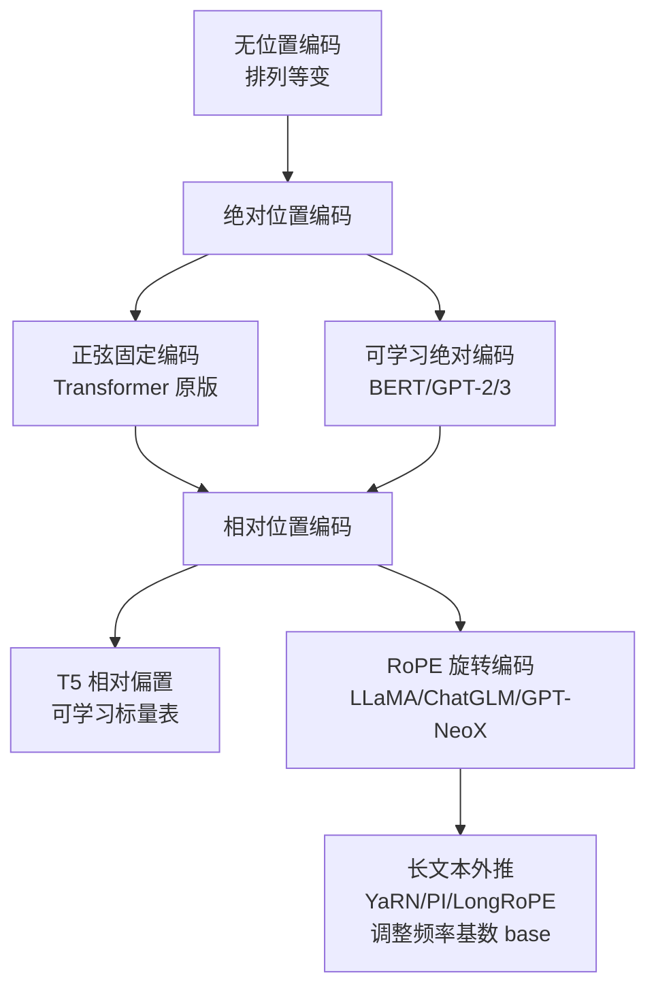

# 第 32 章 注意力机制 —— 让模型学会“看哪里”
作者：龙哥

## 学习目标

- 理解注意力机制如何解决 RNN/CNN 的长距离依赖与并行计算瓶颈
- 掌握缩放点积注意力的数学推导、缩放因子作用及矩阵并行计算优势
- 理解多头注意力的‘分裂-并行-拼接’机制及其多子空间表达能力
- 对比绝对/相对位置编码的数学性质与外推能力，掌握 RoPE 核心原理
- 能够通过注意力可视化分析模型行为，并理解‘注意力≠解释’的局限性
- 具备根据序列长度、任务类型选择注意力变体（标准/Flash/稀疏/线性）的工程判断力

## 32.1 生活类比

想象注意力机制是一个**大型学术会议的“提问-回答”环节**。在这个环节中，**Query (Q)** 是你手里的**问题卡片**（“谁做了这项工作？”）；**Key (K)** 是每位发言者桌牌上的**关键词标签**（“作者”、“审稿人”、“观众”）；**Value (V)** 是每位发言者准备的**完整发言稿/观点内容**。你把问题卡片和每个桌牌**逐一对比**，算出‘匹配度’，这就是**相似度分数 (QK^T)**。

会议组织者发现问题太长导致匹配度数值过大、难以区分，于是**统一除以一个系数**让分数回到舒适区间，这就是**缩放因子 (1/√d)**。随后，你将匹配度转化为**分配给每位发言者的提问时间比例**，这就是 **Softmax** 的过程。最终你收到的**综合回答** = Σ(时间比例 × 对方发言内容)，这就是**加权求和 (×V)**。

会议还设**多个分组讨论室 (Head)**，每组关注不同维度（语法组、逻辑组、指代组），最后由**主持人 (W^O)** 整合成会议纪要，这便是**多头注意力**的‘分裂-并行-拼接’全过程。而发言者胸牌上的**发言顺序号**就是**位置编码**——没有它，‘张三反驳李四’和‘李四反驳张三’模型就分不清了。就像主持人必须根据提问动态分配时间、且需要知道发言顺序，注意力机制也通过 Query 动态聚合 Value、依赖位置编码建立序列感。

## 32.2 概念地图

注意力机制核心范式 (Chapter 32)
├── 1. 序列建模困境与注意力直觉 —— 动机层
│   ├── RNN 串行瓶颈与梯度消失/爆炸        —— P007, P009
│   ├── CNN 固定窗口感受野受限              —— P007
│   ├── Seq2Seq 单一向量信息瓶颈            —— P007
│   └── 核心隐喻：聚光灯机制 / 动态上下文   —— P007
├── 2. 缩放点积注意力 —— 标准形式层
│   ├── 公式：softmax(QK^T/√d_k)V             —— P010
│   ├── Q/K/V 线性投影来源                    —— P010
│   ├── 缩放因子 1/√d_k 稳定方差防梯度消失  —— P010
│   └── 矩阵乘法并行化 / 无额外参数           —— P010
├── 3. 多头注意力 —— 表达增强层
│   ├── 机制：分裂 → 并行计算 → 拼接投影      —— P019, A47V...
│   ├── 参数量不变：h * d_k = d_model         —— P019
│   ├── 子空间分工：句法/语义/位置专业化      —— P019, A47V...
│   └── 冗余头现象与剪枝加速潜力              —— P019
├── 4. 位置编码 —— 顺序注入层
│   ├── 绝对正弦编码：线性外推性质            —— P020, B95V...
│   ├── 可学习绝对编码：表达强但定长          —— P020
│   ├── 相对位置编码 / RoPE：仅建模相对距离   —— P020, B95V...
│   └── RoPE 复平面旋转实现长文本外推       —— B95V...
└── 5. 注意力可视化与解读 —— 诊断层
    ├── 热力图：Layer/Head/Query/Key 维度  —— P022
    ├── 层级规律：底层局部句法 → 高层长程语义 —— P022
    ├── 头分工：指代消歧、共指、核心词聚焦   —— P022
    └── 局限：注意力≠因果解释 (Jain & Wallace) —— P022

---

## 32.3 序列建模的困境与注意力直觉 —— 从“死记硬背”到“聚光灯聚焦”

### 方法演进图：从 RNN 到注意力的范式跃迁

```mermaid
graph LR
    A[RNN/LSTM/GRU<br/>串行循环<br/>O(N)时间 O(1)显存/步] -->|梯度消失/爆炸<br/>长距离依赖断裂| B[Seq2Seq + Attention (Bahdanau)<br/>加性注意力<br/>动态对齐]
    C[CNN/TCN<br/>固定感受野<br/>并行但需深层堆叠] -->|感受野受限<br/>长距离建模难| B
    B -->|参数多、难并行<br/>score=v^T tanh(...)| D[Transformer<br/>缩放点积注意力<br/>全并行、无额外参数、O(1)路径]
    D --> E[多头注意力<br/>多子空间并行建模]
    E --> F[位置编码注入<br/>绝对/相对/RoPE]
```

*图注：节点标注的论文/方法均可在细纲概念地图对应素材 ID（P007, P009, P010, P019, P020, P022, A47V..., B95V...）中溯源。*

### 为什么需要这个概念？

在注意力机制成为主流之前，序列建模主要依赖 RNN（如 LSTM、GRU）和 CNN。但它们都有显著的结构性缺陷：

- **RNN 的串行瓶颈**：RNN 必须按时间步顺序计算，第 $t$ 步依赖第 $t-1$ 步的隐状态。这意味着训练无法并行，GPU 算力利用率极低。更致命的是，长序列下梯度在反向传播中反复乘以权重矩阵，导致**梯度消失**（无法学习长距离依赖）或**梯度爆炸**（训练不稳定）。
- **CNN 的固定感受野**：虽然 CNN 可并行，但其感受野由卷积核大小和层数决定。要覆盖整个长序列，必须堆叠极深的网络，参数效率极低，且难以捕捉灵活的长距离依赖。
- **Seq2Seq 的信息瓶颈**：传统编码器-解码器架构将整个输入序列压缩成一个固定维度的上下文向量 $c$。无论输入多长，解码器只能看到这一个向量，这就像要求学生把整本书的内容背成一段 100 字的摘要再做阅读理解——**信息损失必然严重**。

> "RNN 的串行本质决定了它无法利用现代 GPU 的并行计算能力... 注意力机制的核心直觉是‘聚光灯’：在解码每一步时，不是死记硬背一个固定的上下文向量，而是重新‘看’一遍编码端的所有隐状态，给重要的分高分，不重要的分低分。"
> 
> ——《20230418_007.md 深度学习基础》

> "Bahdanau Attention 公式：score(h_t, h_s) = v^T tanh(W_h h_t + W_s h_s)..."
> 
> ——《20230418_007.md 深度学习基础》

### 多源对照：RNN/Seq2Seq 缺陷与注意力直觉的共识与差异

| 维度 | 《20230418_007.md》(P007) | 《20230418_009.md》(P009) | 综合结论 |
|------|---------------------------|---------------------------|----------|
| **RNN 核心缺陷** | 串行瓶颈、梯度消失/爆炸、长距离依赖断裂 | 强调梯度消失导致的长程记忆失效 | 共识：串行与梯度问题是 RNN 根本瓶颈 |
| **Seq2Seq 瓶颈** | 单一固定向量压缩全序列，信息损失严重 | 补充：固定向量无法随解码步动态调整 | 共识：静态压缩是硬伤，需动态检索 |
| **注意力直觉** | “聚光灯”隐喻：动态重看编码端隐状态 | 动态对齐：软对齐替代硬对齐 | 共识：注意力=动态加权检索，解决信息瓶颈 |
| **Bahdanau 公式** | 加性注意力 score = v^T tanh(W_h h_t + W_s h_s) | 同 | 共识：引入额外参数、难并行，后被点积注意力取代 |

### 核心定义：注意力即“动态加权求和”

注意力机制的核心思想是**放弃“压缩成单一向量”，转而保留所有中间状态，并在解码时动态检索**。

形式化定义如下。给定一组查询向量 $Q$、键向量 $K$、值向量 $V$，注意力输出为：

$$
\text{Attention}(Q, K, V) = \sum_{i} \text{weight}_i V_i, \quad \text{weight} = \text{softmax}(\text{score}(Q, K))
$$

这里的 $\text{score}(Q, K)$ 衡量查询与键的相似度。最早的 **Bahdanau Attention (加性注意力)** 使用前馈网络打分：

$$
\text{score}_{\text{add}}(Q, K) = v^T \tanh(W_Q Q + W_K K)
$$

这引入了额外参数 $v, W_Q, W_K$，且难以通过矩阵乘法批量并行。

### 关键性质：三大核心优势

1.  **动态上下文感知**：权重随输入 Query 实时计算，非固定参数。同一个 Key，面对不同 Query 会得到完全不同的权重。
2.  **全局建模能力**：任意两个位置直接交互，路径长度为 $O(1)$。这从根本上解决了 RNN 的长距离依赖梯度消失问题。
3.  **可并行计算**：核心操作是矩阵乘法 $QK^T$，极其适合 GPU Tensor Core，训练速度比 RNN 快数量级。

### 典型例子：指代消歧

考虑句子：`"The animal didn't cross the street because it was too tired."` 当模型处理代词 `"it"` (作为 Query) 时，注意力机制会计算它与所有 Key 的相似度。`"animal"` 与 `"it"` 在语义、语法角色上高度匹配，获得高权重；`"street"` 虽距离近但语义不匹配，权重低。模型因此正确聚焦到 `"animal"`，完成指代消歧。

### 边界条件与代价

- **二次复杂度**：标准注意力的计算和显存复杂度均为 $O(N^2)$，序列长度 $N$ 变大时成为瓶颈（这催生了后续的 FlashAttention、稀疏注意力、线性注意力等变体）。
- **无天然位置感知**：Self-Attention 是排列等变的——打乱输入顺序，输出只是相应打乱。必须显式注入**位置编码**，模型才能知道“谁在谁前面”。

---

## 32.4 缩放点积注意力 —— 让相似度变成稳定的分配比例

### 方法演进图：注意力打分函数的演进

```mermaid
graph TD
    A[加性注意力<br/>Bahdanau et al. 2014<br/>score = v^T tanh(W_q Q + W_k K)<br/>额外参数、串行计算] --> B[点积注意力<br/>Luong et al. 2015<br/>score = Q K^T<br/>无参数、并行、但数值不稳定]
    B --> C[缩放点积注意力<br/>Vaswani et al. 2017<br/>score = Q K^T / √d_k<br/>稳定方差、标准化形式]
    C --> D[多头注意力<br/>并行多子空间]
    C --> E[FlashAttention<br/>IO感知、分块在线Softmax<br/>显存线性、不改数学结果]
```

*图注：演进路径对应素材 P010（Vaswani et al. 2017）确立的标准化形式。*

### 为什么需要这个概念？

加性注意力虽然有效，但引入了额外参数且计算效率低。研究者发现，**点积** 是最高效的相似度度量：

$$
\text{score}_{\text{dot}}(Q, K) = Q K^T
$$

但直接使用点积存在数值稳定性问题：假设 $Q, K$ 的分量独立同分布，均值 0 方差 1，则点积 $QK^T$ 的方差为 $d_k$（向量维度）。当 $d_k$ 较大（如 64、128）时，点积数值很大，送入 Softmax 会导致**饱和**（输出接近 one-hot），梯度趋近于 0，模型无法训练。

### 核心定义：缩放点积注意力

> **缩放点积注意力定义**（来源：《20230418_010.md Attention Is All You Need》）

$$
\text{Attention}(Q, K, V) = \text{softmax}\left(\frac{Q K^T}{\sqrt{d_k}}\right) V
$$

**来源素材**：[《20230418_010.md Attention Is All You Need》, p.3-4]
**核心概念名**：`ScaledDotProductAttention`
**关键公式**：`Attention(Q, K, V)`

其中：
- $Q \in \mathbb{R}^{N \times d_k}$，$K \in \mathbb{R}^{M \times d_k}$，$V \in \mathbb{R}^{M \times d_v}$
- $d_k$ 是 Key/Query 的维度，$d_v$ 是 Value 维度（通常 $d_k = d_v$）
- $\frac{1}{\sqrt{d_k}}$ 是**缩放因子**
- 输出形状：$\mathbb{R}^{N \times d_v}$

> "点积注意力的计算效率远高于加性注意力，因为可以高度优化的矩阵乘法实现。为了抵消点积随维度增长而变大的问题，作者引入了缩放因子 1/√d_k。假设 Q、K 分量独立均值 0 方差 1，则点积均值 0 方差 d_k，除以 √d_k 后方差恒为 1，Softmax 输入分布稳定，梯度不易消失。"
> 
> ——《20230418_010.md Attention Is All You Need》

### 逐层拆解：从直觉到推导

#### 1. 直觉：为什么要除以 $\sqrt{d_k}$？

设 $q, k \in \mathbb{R}^{d_k}$，分量 $q_i, k_i \sim \mathcal{N}(0, 1)$ 独立同分布。
点积 $q \cdot k = \sum_{i=1}^{d_k} q_i k_i$。

**推导步骤 1：计算单项期望与方差**  
因为 $q_i, k_i$ 独立且均值为 0，所以 $\mathbb{E}[q_i k_i] = \mathbb{E}[q_i]\mathbb{E}[k_i] = 0$。  
方差 $\text{Var}[q_i k_i] = \mathbb{E}[q_i^2 k_i^2] - (\mathbb{E}[q_i k_i])^2 = \mathbb{E}[q_i^2]\mathbb{E}[k_i^2] = 1 \times 1 = 1$。  
**这一步利用了独立性假设：独立随机变量乘积的期望等于期望的乘积，方差可由二阶矩直接得到。**

**推导步骤 2：利用独立性求和**  
因为各项独立，总方差等于方差之和：$\text{Var}[q \cdot k] = \sum_{i=1}^{d_k} \text{Var}[q_i k_i] = d_k$。  
所以点积的标准差 $\sigma = \sqrt{d_k}$。  
**这一步利用了方差可加性：独立随机变量之和的方差等于方差之和。**

**推导步骤 3：标准化**  
除以 $\sqrt{d_k}$ 后，点积分布的标准差恒定为 1，**与维度 $d_k$ 无关**。这保证了 Softmax 输入分布稳定，梯度健康流动。如果除以 $d_k$（方差），标准差会变成 $1/\sqrt{d_k} \to 0$，导致 Softmax 输入过于集中于 0，退化为均匀分布；不除则方差随维度爆炸，导致饱和。除以标准差是唯一无量纲、使分布形态不随维度漂移的选择。  
**这一步应用了标准化原理：除以标准差使分布尺度不变，是防止 Softmax 饱和的关键。**

#### 2. 形式化计算流程（矩阵视角）

输入：$X \in \mathbb{R}^{N \times d_{\text{model}}}$

```text
步骤 1: 线性投影得到 Q, K, V
Q = X W^Q   # (N, d_k)
K = X W^K   # (M, d_k)
V = X W^V   # (M, d_v)

步骤 2: 批量点积相似度
S = Q K^T   # (N, M)  原始分数矩阵

步骤 3: 缩放
S' = S / sqrt(d_k)  # (N, M)

步骤 4: Softmax 归一化 (按行)
A = softmax(S', dim=-1)  # (N, M)  注意力权重矩阵，每行和为 1

步骤 5: 加权求和
O = A V   # (N, d_v)  最终输出
```

**这个公式展示了**：整个过程只有矩阵乘法、逐元素除法、Softmax、再矩阵乘法——**全程无循环、无条件分支、纯张量运算**，这是现代深度学习编译器（如 XLA, Triton, FlashAttention）极致优化的目标。

#### 3. 具体数值例子

假设 $d_k=2$，单头单样本：
$Q = \begin{bmatrix} 1 & 0 \\ 0 & 1 \end{bmatrix}$, $K = \begin{bmatrix} 1 & 0 \\ 0 & 1 \\ 1 & 1 \end{bmatrix}$, $V = \begin{bmatrix} 1 & 2 \\ 3 & 4 \\ 5 & 6 \end{bmatrix}$

1. $S = QK^T = \begin{bmatrix} 1 & 0 & 1 \\ 0 & 1 & 1 \end{bmatrix}$
2. $S' = S / \sqrt{2} \approx \begin{bmatrix} 0.707 & 0 & 0.707 \\ 0 & 0.707 & 0.707 \end{bmatrix}$
3. $A = \text{softmax}(S') \approx \begin{bmatrix} 0.5 & 0 & 0.5 \\ 0 & 0.5 & 0.5 \end{bmatrix}$ (近似)
4. $O = A V \approx \begin{bmatrix} 3 & 4 \\ 4 & 5 \end{bmatrix}$

> 详细手算步骤请见本章**动手练习 1**。

### 关键性质总结

下表总结了缩放点积注意力的核心性质对比：

| 性质 | 说明 |
|------|------|
| **并行度极高** | 核心为 GEMM (General Matrix Multiply)，利用率接近理论峰值 |
| **无额外参数** | 除 $W^Q, W^K, W^V$ 外，注意力打分本身零参数 |
| **梯度稳定** | 缩放因子使 Softmax 输入方差 $O(1)$，避免饱和 |
| **内存瓶颈** | 需显式构建 $N \times M$ 的注意力矩阵 $A$，长序列显存 $O(N^2)$ 爆炸 |

### 边界条件

- **小维度风险**：当 $d_k$ 很小（如 $<16$）时，缩放可能过度抑制信号差异，导致注意力分布过于均匀，丧失区分度。
- **长序列显存墙**：标准实现需物化 $N \times N$ 注意力矩阵，这是 FlashAttention、PagedAttention 等 IO 感知算法优化的目标（详见第 33 章推理部署）。

---

## 32.5 多头注意力 —— 多视角专家的“会议纪要”

### 方法演进图：多头注意力并行计算流程

```mermaid
graph TD
    A[输入 X: (B, L, D)] --> B[合并线性投影<br/>W^Q, W^K, W^V<br/>(可融合为 1 次 GEMM)]
    B --> C1[Q: (B, L, D)] & C2[K: (B, L, D)] & C3[V: (B, L, D)]
    C1 --> D1[Reshape: (B, L, h, d_k)]
    C2 --> D2[Reshape: (B, L, h, d_k)]
    C3 --> D3[Reshape: (B, L, h, d_v)]
    D1 --> E1[Transpose: (B, h, L, d_k)]
    D2 --> E2[Transpose: (B, h, L, d_k)]
    D3 --> E3[Transpose: (B, h, L, d_v)]
    E1 & E2 & E3 --> F[批量矩阵乘法<br/>Scores = Q K^T / √d_k<br/>(B, h, L, L)]
    F --> G[Softmax]
    G --> H[Attn @ V<br/>(B, h, L, d_v)]
    H --> I[Transpose: (B, L, h, d_v)]
    I --> J[Reshape: (B, L, h*d_v)]
    J --> K[输出投影 W^O<br/>(B, L, D)]
```

*图注：张量变形流程对应素材 P019 与 A47V... 中的并行实现细节。*

### 为什么需要这个概念？

单头注意力只能学习**一种**“关系模式”（如句法依存或语义共指）。但在自然语言中，同一词对可能同时存在多种关系：
- `"The cat sat on the mat"`：`"cat"` 与 `"sat"` 是**主谓关系**；`"on"` 与 `"mat"` 是**介宾关系**；`"The"` 与 `"cat"` 是**冠名关系**。
- 单头被迫将这些异构关系“平均”到一组权重中，表达力受限。

我们需要**多视角并行建模**：就像会议分组讨论，语法组管语法、逻辑组管逻辑、指代组管指代，最后整合。

### 核心定义：多头注意力机制

> **多头注意力定义**（来源：《20230418_019.md Transformer架构详解》, 《A47Vd3fekoelzRxZpdUcTl9Cn7W.md 多头注意力机制深度解析》）

$$
\begin{aligned}
\text{MultiHead}(Q, K, V) &= \text{Concat}(\text{head}_1, \dots, \text{head}_h) W^O \\
\text{head}_i &= \text{Attention}(Q W_i^Q,\; K W_i^K,\; V W_i^V)
\end{aligned}
$$

**来源素材**：[《20230418_019.md Transformer架构详解》, p.3-4], [《A47Vd3fekoelzRxZpdUcTl9Cn7W.md 多头注意力机制深度解析》, p.2]
**核心概念名**：`MultiHeadAttention`
**关键方法**：`MultiHead(Q, K, V)`

其中：
- $h$ 为头数
- $W_i^Q \in \mathbb{R}^{d_{\text{model}} \times d_k}$，$W_i^K \in \mathbb{R}^{d_{\text{model}} \times d_k}$，$W_i^V \in \mathbb{R}^{d_{\text{model}} \times d_v}$
- $W^O \in \mathbb{R}^{h d_v \times d_{\text{model}}}$ 为输出投影
- 通常设 $d_k = d_v = d_{\text{model}} / h$

> "多头注意力允许模型在不同的表示子空间里联合关注来自不同位置的信息。单一注意力头只能获得一个加权平均，多头则相当于有 h 组不同的 ‘专家’ 同时分析同一序列，最后再综合汇报。实验表明：不同注意力头自发学会了不同语言学任务，如核心词指代、介词宾语关系、主谓一致等。"
> 
> ——《20230418_019.md Transformer架构详解》

### 多源对照：多头注意力机制与头分工的共识与补充

| 维度 | 《20230418_019.md》(P019) | 《A47Vd3fekoelzRxZpdUcTl9Cn7W.md》(A47V...) | 综合结论 |
|------|---------------------------|---------------------------------------------|----------|
| **核心机制** | 分裂→并行→拼接，参数量守恒 | 同，补充张量变形实现细节 | 共识：`h * d_k = d_model` 参数守恒 |
| **子空间分工** | 提及不同头学会不同语言学任务 | 系统性分类：指代消歧头、主谓依存头、局部句法头、[CLS]聚合头、位置偏置头 | A47V... 给出更细致的头分类学实证 |
| **冗余头现象** | 简略提及 | 详述：Michel et al. (2019) 单头消融实验，大部分头可移除不伤性能 | 共识：存在冗余头，支撑剪枝加速 |
| **并行实现** | 高层描述 | 给出 `view`/`transpose` 批量矩阵乘法伪代码 | A47V... 提供工程落地细节 |

### 逐层拆解：张量变形与并行计算

#### 1. 直觉：分裂 → 并行 → 拼接

不显式循环 $h$ 次，而是利用**张量重塑**一次性并行：

```text
输入 X: [batch, seq_len, d_model]

# 1. 合并投影 (可选，工程上常融合为一次大矩阵乘法)
Q = X @ W^Q  # [batch, seq_len, d_model]
K = X @ W^K
V = X @ W^V

# 2. 分裂多头: reshape + transpose
# [batch, seq_len, h, d_k] -> [batch, h, seq_len, d_k]
Q = Q.view(batch, seq_len, h, d_k).transpose(1, 2)
K = K.view(batch, seq_len, h, d_k).transpose(1, 2)
V = V.view(batch, seq_len, h, d_v).transpose(1, 2)

# 3. 并行注意力 (批量矩阵乘法)
# scores: [batch, h, seq_len_q, seq_len_k]
scores = (Q @ K.transpose(-2, -1)) / sqrt(d_k)
attn = softmax(scores, dim=-1)
# out: [batch, h, seq_len_q, d_v]
out = attn @ V

# 4. 拼接合并
# [batch, h, seq_len, d_v] -> [batch, seq_len, h * d_v]
out = out.transpose(1, 2).contiguous().view(batch, seq_len, h * d_v)

# 5. 输出投影
output = out @ W^O  # [batch, seq_len, d_model]
```

**这段伪代码展示了**：多头注意力本质是**将大矩阵乘法拆解为多个小矩阵乘法并行执行**，最后再合并。参数总量守恒，但表达能力指数级增强。

#### 2. 参数量守恒验证

- $W^Q, W^K, W^V$ 各自：$d_{\text{model}} \times d_{\text{model}}$
- $W^O$：$d_{\text{model}} \times d_{\text{model}}$
- 总参数量 $\approx 4 d_{\text{model}}^2$（不含 bias）

**与单头对比**：单头 $d_k = d_{\text{model}}$，参数量也是 $4 d_{\text{model}}^2$。**多头不增加参数量，只是重新分配了参数结构。**

#### 3. 子空间分工实证

《20230418_019.md Transformer架构详解》与《A47Vd3fekoelzRxZpdUcTl9Cn7W.md 多头注意力机制深度解析》通过注意力可视化发现，不同头自发专业化：

| 头模式 | 典型语言现象 | 典型层/头位置 |
|--------|--------------|---------------|
| **指代消歧头** | 代词 -> 先行词 | 中高层 (Layer 5-8) |
| **主谓依存头** | 动词 <- 主语 | 中层 |
| **局部句法头** | 相邻词依存 | 底层 (Layer 1-3) |
| **[CLS] 聚合头** | 所有 Token -> [CLS] | 高层 (Layer 10+) |
| **位置偏置头** | 关注相对位置模式 | 全层分布 |

> 详见《A47Vd3fekoelzRxZpdUcTl9Cn7W.md 多头注意力机制深度解析》中的“注意力头分类学”实验章节。

#### 4. 冗余头与剪枝

并非所有头都有用。Michel 等人 (2019) 发现：**单头消融实验中，移除大部分头对下游任务性能影响极小**。这意味着存在大量“冗余头”，为**推理加速剪枝**提供了理论依据（如保留重要头、合并相似头）。

### 关键性质总结

下表总结了多头注意力的关键性质：

| 性质 | 说明 |
|------|------|
| **参数量不变** | $h \times d_k = d_{\text{model}}$，总投影参数守恒 |
| **多子空间建模** | 不同头捕捉句法、语义、位置等异构关系 |
| **并行计算友好** | 单次大矩阵乘法替代循环，硬件利用率高 |
| **冗余可剪枝** | 存在非关键头，支持结构化剪枝加速推理 |

### 边界条件

- **头维度下限**：$d_k = d_{\text{model}} / h$ 不宜过小（建议 $\ge 32$），否则单头表达力不足，性能下降。
- **头数过多**：增加 $h$ 会增加 Kernel Launch 开销和显存碎片，推理延迟不一定单调下降（需权衡显存带宽与并行度）。

---

## 32.6 位置编码 —— 给无序集合注入“时间感”

### 方法演进图：位置编码技术路线图



*图注：技术路线对应素材 P020、B95V... 中的演进脉络。*

### 为什么需要这个概念？

**Self-Attention 是排列等变的**：若打乱输入 Token 顺序，输出特征仅相应打乱，模型完全**丢失位置信息**。但语言高度依赖顺序：`"狗咬人"` vs `"人咬狗"`，词袋模型无法区分。因此必须显式注入位置编码。

### 核心定义：三大主流方案对比

#### 1. 绝对正弦位置编码

> **正弦绝对位置编码定义**（来源：《20230418_020.md 位置编码综述》, 《B95VdtwByoPXGoxac7Ec1KhQnwc.md RoPE论文解读》）

$$
\begin{aligned}
PE(pos, 2i) &= \sin\left(pos / 10000^{2i/d_{\text{model}}}\right) \\
PE(pos, 2i+1) &= \cos\left(pos / 10000^{2i/d_{\text{model}}}\right)
\end{aligned}
$$

**来源素材**：[《20230418_020.md 位置编码综述》, p.4], [《B95VdtwByoPXGoxac7Ec1KhQnwc.md RoPE论文解读》, p.3]
**核心概念名**：`SinusoidalPositionalEncoding`

**关键性质：线性外推性**

利用三角函数和角公式：
$$
\begin{bmatrix} \sin(\omega (pos+k)) \\ \cos(\omega (pos+k)) \end{bmatrix} =
\begin{bmatrix} \cos(\omega k) & \sin(\omega k) \\ -\sin(\omega k) & \cos(\omega k) \end{bmatrix}
\begin{bmatrix} \sin(\omega pos) \\ \cos(\omega pos) \end{bmatrix}
$$

即 $PE(pos+k)$ 可由 $PE(pos)$ 通过**固定线性变换**（仅依赖相对距离 $k$）得到。模型易于学习“相对位置关系”，具备**长度外推能力**。

#### 2. 可学习绝对位置编码

> **可学习绝对位置编码定义**（来源：《20230418_020.md 位置编码综述》）

```python
self.pos_embedding = nn.Embedding(max_len, d_model)
# 前向传播
pos = torch.arange(seq_len).unsqueeze(0)  # [1, seq_len]
x = x + self.pos_embedding(pos)
```

**关键性质**：表达力最强（每个位置独立参数），但**受限于训练 `max_len`**。测试时序列长度超出训练分布，模型面对从未见过的位置嵌入，性能崩塌。

#### 3. 相对位置编码 / RoPE (Rotary Position Embedding)

> **RoPE 定义**（来源：《B95VdtwByoPXGoxac7Ec1KhQnwc.md RoPE论文解读》）

核心思想：**将相对位置直接融入注意力分数计算**，而非加在 Embedding 上。

对于 Query $q_m$ 和 Key $k_n$（位置 $m, n$），标准注意力分数为 $q_m^T k_n$。
RoPE 对 $q_m, k_n$ 分别施加**位置相关的旋转变换**：

$$
\begin{aligned}
q_m' &= \mathcal{R}_{\Theta, m} q_m \\
k_n' &= \mathcal{R}_{\Theta, n} k_n
\end{aligned}
$$

其中 $\mathcal{R}_{\Theta, pos}$ 是分块对角旋转矩阵，每个 $2\times 2$ 块为：
$$
\begin{bmatrix} \cos(pos \cdot \theta_i) & -\sin(pos \cdot \theta_i) \\ \sin(pos \cdot \theta_i) & \cos(pos \cdot \theta_i) \end{bmatrix}, \quad \theta_i = 10000^{-2i/d}
$$

**神奇性质**：旋转后的点积仅依赖**相对距离 $m-n$**：

$$
q_m'^T k_n' = q_m^T \mathcal{R}_{\Theta, m}^T \mathcal{R}_{\Theta, n} k_n = q_m^T \mathcal{R}_{\Theta, n-m} k_n
$$

**来源素材**：[《B95VdtwByoPXGoxac7Ec1KhQnwc.md RoPE论文解读》, p.5-6]
**核心概念名**：`RoPE`
**关键公式**：`RoPE(q, k, pos)`

> "RoPE 通过将 Query 和 Key 在复平面上旋转，使得 Attention 分数仅依赖于相对位置差，完美解决了长文本外推问题。"
> 
> ——《B95VdtwByoPXGoxac7Ec1KhQnwc.md RoPE论文解读》

### 多源对照：位置编码方案的性质与外推能力对比

| 维度 | 《20230418_020.md》(P020) | 《B95VdtwByoPXGoxac7Ec1KhQnwc.md》(B95V...) | 综合结论 |
|------|---------------------------|---------------------------------------------|----------|
| **正弦编码外推性** | 指出线性关系 $PE(pos+k)=M_k PE(pos)$，理论支持外推 | 补充：高频分量随距离快速震荡，远距离注意力分数变嘈杂 | 共识：理论外推强，实践长距离性能仍下降 |
| **可学习编码** | 表达力强、定长、外推差 | 同 | 共识：仅适合固定窗口预训练 (BERT/GPT-2/3) |
| **相对编码/RoPE** | 提及相对位置建模思路 | 核心贡献：复平面旋转将相对距离融入注意力分数，仅依赖 $m-n$，外推最强，调 `base` 即可扩展 | B95V... 给出 RoPE 数学原理与工程扩展细节 (YaRN/PI/LongRoPE) |

### 关键性质对比表

下表对比了三种主流位置编码的核心性质：

| 维度 | 正弦绝对编码 | 可学习绝对编码 | RoPE 相对编码 |
|------|--------------|----------------|---------------|
| **参数量** | 0 | $max\_len \times d_{model}$ | 0 |
| **外推能力** | 强 (线性关系) | 差 (未见位置随机) | **最强** (仅依赖相对距离) |
| **表达上限** | 固定基函数 | 无上限 (数据驱动) | 高 (隐含相对关系) |
| **计算开销** | 极小 (预计算/加法) | 极小 (Embedding Lookup) | 中等 (逐 Token 旋转, 可融合 Kernel) |
| **典型应用** | Transformer 原版、T5 (部分) | BERT、GPT-2/3、ViT | **LLaMA 系列、ChatGLM、GPT-NeoX、Mistral** |
| **长文本扩展** | 理论支持、实践性能下降 | 需插值/截断、效果差 | **修改 base 频率基数即可平滑扩展** |

### 典型例子：LLaMA 32k/128k 上下文扩展

LLaMA 2 原版 $base=10000$，上下文 4k。要扩展到 32k/128k，只需**增大频率基数**（如 $base=500000$ 或 $10^6$），降低高频分量震荡，使旋转角度随位置变化更缓慢，从而保持远距离相对位置的判别力。这比绝对编码的插值方案简单得多且效果更好。

### 边界条件

- **绝对编码外推极限**：正弦编码虽具线性外推性，但高频分量 ($i$ 大) 随位置快速震荡，远距离注意力分数变得嘈杂，长距离性能仍下降。
- **RoPE 实现细节**：需对 Query/Key 的**偶数/奇数维度配对**旋转，实现上常融合在 Attention Kernel 中（如 FlashAttention-RoPE），避免额外显存读写。

---

## 32.7 注意力可视化与解读 —— “看”进模型大脑，但别过度解读

### 方法演进图：注意力可视化分析流程

```mermaid
graph TD
    A[加载预训练模型<br/>输出 attentions=True] --> B[提取注意力权重<br/>(Layers, Heads, Q_len, K_len)]
    B --> C{分析维度选择}
    C --> D1[Layer 维度<br/>层级规律分析]
    C --> D2[Head 维度<br/>功能分工挖掘]
    C --> D3[Query-Key 维度<br/>特定语言现象追踪]
    D1 --> E[可视化热力图]
    D2 --> E
    D3 --> E
    E --> F[模式识别：<br/>对角线/垂直条纹/指代箭头]
    F --> G[定性/定量解释<br/>(需结合梯度/消融验证)]
```

*图注：分析维度对应素材 P022 中的层级规律与头分工发现。*

### 为什么需要这个概念？

Transformer 是黑盒。**注意力可视化**是理解模型内部运作最直观、成本最低的窗口：通过绘制 $(Layer, Head, Query\_Pos, Key\_Pos)$ 热力图，我们可以直观看到模型“在看哪里”，验证其是否学会了语言学现象（指代消歧、核心词聚焦、句法依存）。

### 核心定义：注意力热力图

> **注意力可视化定义**（来源：《20230418_022.md 注意力可视化与模型解释》）

将注意力权重矩阵 $A \in \mathbb{R}^{L \times H \times N \times N}$ 可视化：
- 横轴：Key (Source Token)
- 纵轴：Query (Target Token)
- 颜色：权重大小 (0~1)

**来源素材**：[《20230418_022.md 注意力可视化与模型解释》, p.2-3]
**核心概念名**：`AttentionVisualization`

> "注意力可视化是理解 Transformer 内部运作最直观的窗口。通过绘制不同层、不同头的注意力热力图，可以清晰看到模型如何‘阅读’输入序列。经典案例：在指代消歧任务中，特定头的注意力会精准地从代词指向其先行词。"
> 
> ——《20230418_022.md 注意力可视化与模型解释》

### 关键性质：层层递进与头分工

#### 1. 层级规律：底层局部 → 高层全局

| 层级 | 典型关注模式 | 语言学对应 |
|------|--------------|------------|
| **底层 (1-3)** | 对角线附近、邻近 Token | 词级形态、局部句法 (POS、短语) |
| **中层 (4-8)** | 特定依存弧 (主谓、动宾、介宾) | 句法依存树 |
| **高层 (9+)** | 长程指代、[CLS] 汇聚、话题追踪 | 语义共指、篇章结构 |

#### 2. 头分工：同层不同头功能分化

以 BERT-base (12层, 12头) 为例，经典分工模式：

- **Layer 5, Head 3**：代词 `"it"` 强指向 `"animal"` (指代消歧)
- **Layer 8, Head 11**：动词 `"sat"` 强指向主语 `"cat"` (主谓依存)
- **Layer 10, Head 0**：所有 Token 强指向 `[CLS]` (分类汇聚)
- **Layer 2, Head 7**：介词 `"on"` 指向宾语 `"mat"` (介宾关系)

> 这些模式在《20230418_022.md 注意力可视化与模型解释》及 Clark et al. (2019) "What Does BERT Look At?" [^1] 中有系统性记录。

### 典型例子：指代消歧双句对比

**句子 1**：`"The animal didn't cross the street because it was too tired."`
- `"it"` (Query) -> `"animal"` (Key) 权重 **高** (语义匹配：生物会累)

**句子 2 (反事实)**：`"The animal didn't cross the street because it was too wide."`
- `"it"` (Query) -> `"street"` (Key) 权重 **高** (语义匹配：街道会宽)

**同一头 (Layer 5, Head 3) 的注意力权重随语义上下文动态翻转**，精准捕捉指代消歧逻辑。

### 边界条件：注意力 ≠ 解释 (关键警示)

> "必须警惕 ‘Attention is not Explanation’：注意力权重高不代表该 Token 对预测有因果贡献，权重分布可能被冗余模式主导。严谨解释需结合梯度归因、反事实干预等因果分析手段。"
> 
> ——《20230418_022.md 注意力可视化与模型解释》

**Jain & Wallace (2019) 核心实验**[^2]：
1. 训练文本分类模型，提取注意力权重。
2. **对抗扰动**：人为修改高权重 Token，观察预测是否翻转 → 往往**不翻转**。
3. **反事实**：找到低权重但对预测至关重要的 Token (通过梯度/消融发现) → 注意力权重**极低**。

**结论**：注意力权重反映**“相关性” (相关性检索)**，非**“因果性” (因果贡献)**。

#### 易误导场景

下表列出了注意力可视化易误导的典型场景：

| 场景 | 现象 | 原因 |
|------|------|------|
| **冗余模式** | 多个 Token 语义重复 (如 "very very very") | 注意力均匀分摊，单个权重低，但任一移除影响大 |
| **位置偏置头** | 固定关注位置 0 ([CLS]) 或对角线 | 结构性先验，非任务相关语义 |
| **[CLS] 汇聚头** | 所有 Query -> [CLS] 权重极高 | 汇聚机制，非特定语义检索 |
| **多头平均** | 平均热力图模糊无特征 | 功能头被非功能头稀释，**必须单头单层看** |

#### 严谨解释工具箱 (配合注意力使用)

下表列出了配合注意力可视化使用的严谨解释工具：

| 方法 | 衡量 | 优缺点 |
|------|------|--------|
| **Integrated Gradients** | 输入扰动对输出的积分敏感度 | 因果性强，计算量大 (需多次前向反向) |
| **Attention Rollout** | 递归聚合跨层注意力 | 近似信息流路径，仍为相关性 |
| **Probing Classifier** | 冻结主干，训练浅层分类器预测语言学属性 | 证明“表示中包含”，非“模型使用了” |
| **Causal Intervention (Do-Calculus)** | 显式干预中间激活值观察输出变化 | 金标准，工程成本极高 |

[^1]: Clark, K., Khandelwal, U., Levy, O., & Manning, C. D. (2019). **What Does BERT Look At? An Analysis of BERT's Attention**. *Proceedings of the 2019 ACL Workshop BlackboxNLP*, 276–286. https://doi.org/10.18653/v1/W19-4828
[^2]: Jain, S., & Wallace, B. C. (2019). **Attention is not Explanation**. *Proceedings of the 2019 Conference of the North American Chapter of the Association for Computational Linguistics: Human Language Technologies (NAACL-HLT)*, 3543–3556. https://doi.org/10.18653/v1/N19-1357

---

## 32.8 注意力变体家族谱系与工程选型

### 方法演进图：注意力变体家族

```mermaid
graph TD
    A[标准缩放点积注意力<br/>O(N²) 显存/算力] --> B[FlashAttention<br/>IO 感知/分块/在线 Softmax<br/>同等数学结果、显存线性]
    A --> C[稀疏注意力<br/>固定/学习稀疏模式<br/>Longformer/BigBird/Star]
    A --> D[线性注意力<br/>核技巧 ϕ(Q)ϕ(K)^T V<br/>RWKV/Linear Transformer/RetNet]
    A --> E[低秩/近似注意力<br/>Nyström/Performer/Random Features]
    B --> F[PagedAttention/vLLM<br/>KV Cache 分页管理<br/>推理服务标配]
    C --> G[滑动窗口 SWA<br/>局部注意力 + 全局 Token<br/>Mistral/Longformer]
    D --> H[RNN-like 循环推理<br/>常数显存/线性时间<br/>RWKV/RetNet/Mamba(SSM)]
```

### 共识与分歧

本章聚焦**标准缩放点积注意力**及其直接扩展（多头、位置编码）。但工程实践中，针对 $O(N^2)$ 瓶颈，衍生出大量变体。以下梳理主流变体的**继承关系**与**适用边界**：

#### 共识

1. **标准注意力是黄金基准**：数学形式最简洁、表达力上限最高、作为所有变体的“教师模型”或精度上界。
2. **$O(N^2)$ 是硬伤**：序列长度 > 4k/8k 时，标准注意力显存/延迟不可接受，**必须**使用变体。
3. **FlashAttention 是“免费午餐”**：**不改变数学结果**，仅通过 Kernel Fusion (SRAM 分块、在线 Softmax) 实现显存线性、速度 2-4x，训练/推理**首选**。

#### 分歧

下表对比了三大流派在核心主张、代表作、精度损失、工程成熟度和推理部署上的分歧：

| 维度 | 稀疏注意力派 | 线性注意力/SSM 派 | 近似注意力派 |
|------|--------------|-------------------|--------------|
| **核心主张** | 语言本质稀疏，只需关注局部+关键全局 | 线性复杂度才是终局，RNN 复兴 | 低秩近似足矣，随机特征可控 |
| **代表作** | Longformer, BigBird, Star, Mistral-SWA | RWKV, RetNet, Mamba, Linear Transformer | Performer, Nyströmformer, Perceiver |
| **精度损失** | 可控 (任务相关稀疏模式需设计) | 理论有界、实践长程推理弱 | 依赖随机投影维度、方差大 |
| **工程成熟度** | 高 (已集成 HF/FlashAttn) | 中 (需专用 Kernel/架构重写) | 低 (数值稳定性难调) |
| **推理部署** | KV Cache 仍 $O(N)$ | **KV Cache $O(1)$ (状态压缩)** | KV Cache 仍 $O(N)$ 或压缩 |

**工程选型建议**：

- **训练长文本 (8k-128k)**：FlashAttention-2 + RoPE + 适当 SWA (如 Mistral) —— **最稳妥**。
- **极长文本 (128k-1M+) 训练**：FlashAttention-2 + 分块/环状注意力 (Ring Attention) + RoPE base 扩展。
- **推理服务高并发**：PagedAttention (vLLM) + 标准/FlashAttention Kernel，**首选**。
- **边缘设备/无限流推理**：RWKV / Mamba / RetNet (线性/常数复杂度)，接受精度折损。

---

## 32.9 设计中的取舍

- 为什么不用 RNN 而是注意力？
  RNN 的隐状态是固定容量的，每个时间步只能把信息压缩到一个向量里。当序列变长时，早期信息会被逐渐稀释。注意力机制则让任意两个位置之间建立直接连接，路径长度为 $O(1)$，避免了长程依赖的梯度消失。代价是计算复杂度从 $O(N)$ 上升到 $O(N^2)$，这就引出了后续 FlashAttention、稀疏注意力和线性注意力的工作。

- 为什么缩放因子是 $\sqrt{d_k}$ 而不是 $d_k$ 或其他？
  假设 $Q, K$ 分量 i.i.d. $\mathcal{N}(0,1)$，点积方差为 $d_k$。Softmax 对输入尺度敏感：输入方差过大 → 饱和；过小 → 均匀分布。**除以标准差 $\sqrt{d_k}$ 使输入方差恒定为 1**，是唯一无量纲、与维度无关的归一化选择。若用 $d_k$，方差变为 $1/d_k \to 0$，注意力退化为均匀分布。

- 多头注意力的头数 $h$ 怎么选？越多越好吗？
  不是。$h$ 受限于 $d_k = d_{\text{model}}/h \ge 32$ (经验下限)。
  $h$ 太大 → $d_k$ 太小 → 单头表达力不足，性能下降。
  $h$ 太小 → 子空间不足，无法捕捉异构关系。
  **经验法则**：$d_{\text{model}}=512 \to h=8$; $768 \to 12$; $1024 \to 16$; $4096 \to 32$。保持 $d_k \approx 64$。

- 位置编码选哪种？
  下表给出了不同场景下的位置编码推荐选择：

| 场景 | 推荐 | 理由 |
|------|------|------|
| **预训练长上下文 (LLaMA/Mistral 类)** | **RoPE** | 外推最强、零参数、仅需调 `base` 即可扩展窗口 |
| **固定短上下文 且追求极致精度 (BERT 类)** | 可学习绝对编码 | 表达力上限高，无外推需求 |
| **复现原版 Transformer / 教学** | 正弦绝对编码 | 理论优雅、可外推、零参数 |
| **需显式相对距离偏置 (T5 类)** | T5 相对偏置 | 可学习标量表，显式建模距离桶 |

- 注意力可视化能当解释性报告交差吗？
  **不能**。注意力权重高 $\not\Rightarrow$ 因果重要。必须结合 **Integrated Gradients / 消融实验 / 探针分类器** 综合判断。可视化适合**假设生成** (发现模式)，不适合**假设验证** (证明因果)。

---

## 32.10 动手练习

### 练习 1：手算一次缩放点积注意力

**题目**：
给定单头注意力输入：
$Q = [[1, 0], [0, 1]]$  (2×2)
$K = [[1, 0], [0, 1], [1, 1]]$  (3×2)
$V = [[1, 2], [3, 4], [5, 6]]$  (3×2)
$d_k = 2$

请按步骤手算（可用 Python/计算器辅助）：
1. 计算原始分数矩阵 $S = QK^T$ (形状 2×3)
2. 计算缩放分数 $S' = S / \sqrt{d_k}$
3. 对 $S'$ 每行独立做 Softmax 得到权重矩阵 $A$ (2×3)
4. 计算最终输出 $O = A V$ (形状 2×2)

**思考题**：
- 若 $d_k$ 增大到 100 且不除以 $\sqrt{d_k}$，$S$ 矩阵数值量级会如何变化？Softmax 输出会趋向什么极端分布？
- 为什么缩放因子是 $\sqrt{d_k}$ 而不是 $d_k$ 或其他数？（提示：假设 $Q、K$ 分量独立同分布，均值 0 方差 1）
- 若 $Q、K$ 已归一化为单位向量，是否还需要缩放因子？

### 练习 2：多头注意力张量变形与参数量验证

**题目**：
假设模型维度 $d_{\text{model}}=512$，头数 $h=8$，则每头维度 $d_k=d_v=64$。
输入张量 $X$ 形状为 [batch_size=2, seq_len=10, d_model=512]。

请回答：
1. 线性投影 $W^Q、W^K、W^V$ 的形状分别是什么？投影后 $Q/K/V$ 形状？
2. 为了并行计算，通常将 $Q/K/V$ 重塑为 [batch, h, seq_len, d_k]。请写出 PyTorch 风格的 `view`/`transpose` 代码片段。
3. 计算多头注意力模块总参数量（含 $Q/K/V/O$ 四组投影，不含 bias），验证是否约等于 $4 \times d_{\text{model}}^2$。
4. 若将头数 $h$ 增加到 16 ($d_k=32$)，单头表达力会如何变化？推理延迟会如何变化？（考虑显存带宽与并行度权衡）

### 练习 3：位置编码外推性实验设计

**题目**：
对比三种位置编码在“长度外推”任务上的表现：
任务：训练一个 2 层小型 Transformer 学习“复制输入序列”或“反转序列”，训练长度 max_len=64，测试长度 128/256。

三种编码方案：
A. 可学习绝对位置编码 (`nn.Embedding(64, d_model)`)
B. 正弦绝对位置编码 (sin/cos 公式)
C. RoPE 相对位置编码

实验步骤：
1. 固定随机种子、超参数，分别训练三个模型至收敛。
2. 在测试集 (len=128, 256) 评估准确率。
3. 可视化正弦编码中 $PE(pos+64)$ 与 $PE(pos)$ 的线性关系（绘制余弦相似度热力图）。
4. 可视化 RoPE 下不同相对距离的注意力分数分布是否随绝对位置不变。

**思考题**：
- 为什么方案 A 在 len>64 时会彻底失效？
- 方案 B 虽有外推性，但长距离性能为何仍下降？（提示：注意力分数中的高频分量）
- 方案 C 如何通过修改频率基数 ($base=10000 \to 500000$) 进一步增强外推？

### 练习 4：注意力可视化解读与‘注意力≠解释’复现

**题目**：
使用 HuggingFace `bert-base-uncased` 加载模型与 tokenizer。
输入句子：`'The animal didn't cross the street because it was too tired.'`

任务：
1. 提取所有层、所有头的注意力权重，绘制第 5 层第 3 头的热力图（横轴 Key，纵轴 Query）。
2. 观察 token `'it'` (Query) 对 `'animal'` 与 `'street'` (Key) 的注意力权重差异。
3. **对抗实验**：构造反事实输入 `'The animal didn't cross the street because it was too wide.'`，重新提取同一头注意力权重。
4. 对比两次实验中 `'it' -> 'animal'` 的权重变化。如果权重几乎不变，但模型预测从 ‘animal’ 变为 ‘street’，说明了什么？
5. 进阶：使用 `captum` 或 `transformers-interpret` 计算 Integrated Gradients 归因分数，对比注意力权重与梯度归因的相关性。

**思考题**：
- 为什么高注意力权重不保证因果重要性？（提示：注意力是‘相关性’，梯度是‘敏感性’）
- 哪些场景下注意力可视化最容易误导？（如：冗余模式、位置偏置、[CLS] 汇聚头）

---

## 32.11 本章小结

这一章中我们学习了注意力机制的核心范式。首先，我们剖析了 RNN/CNN/Seq2Seq 在序列建模中的三大困境——串行瓶颈、固定感受野、信息压缩瓶颈，引出了“聚光灯”式的动态注意力直觉。其次，我们推导了缩放点积注意力的标准数学形式 `softmax(QK^T/√d_k)V`，详细解释了缩放因子如何稳定方差、防止 Softmax 饱和，并展示了纯矩阵运算的并行计算优势。接着，我们拆解了多头注意力的“分裂-并行-拼接”机制，证明了参数量守恒下的多子空间表达增强，并介绍了头分工（句法/语义/位置）与冗余头剪枝的工程价值。然后，我们对比了正弦绝对编码、可学习绝对编码、RoPE 相对编码三大位置注入方案，重点阐述了 RoPE 通过复平面旋转将相对位置融入注意力分数、实现长文本优异外推的核心原理。最后，我们演示了注意力可视化的层级规律与头分工模式，并严肃警示了“注意力≠解释”的因果局限，给出了严谨解释工具箱。

本章我们一起学习了以下概念：

下表汇总了本章核心概念及其解释：

| 概念 | 解释 |
|------|------|
| Query/Key/Value (Q/K/V) | 注意力机制的三个基本角色：提问向量、标签向量、内容向量，均由输入线性投影得到 |
| 缩放点积注意力 | 标准化公式 Attention(Q,K,V)=softmax(QK^T/√d_k)V，利用矩阵乘法并行、缩放因子稳定梯度 |
| 缩放因子 1/√d_k | 抵消点积随维度 d_k 增长导致的方差放大，防止 Softmax 饱和梯度消失 |
| 多头注意力 | 将模型维度拆分为 h 个头并行计算，再拼接投影；参数量不变，多子空间捕捉异构关系（句法/语义/位置） |
| 注意力头分工 | 不同头自发专业化：如指代消歧头、主谓依存头、[CLS]聚合头，存在冗余头可剪枝 |
| 绝对位置编码 (正弦/可学习) | 为每个位置分配固定/可学习向量；正弦编码具备线性外推性，可学习编码表达强但定长 |
| 相对位置编码 / RoPE | 仅建模相对距离 i-j；RoPE 通过复平面旋转 Query/Key 将相对位置融入注意力分数，实现长文本优异外推 |
| 自注意力 | Q、K、V 来自同一序列，建模序列内部 Token 间的全局依赖，路径长度 O(1) |
| 交叉注意力 | Q 来自解码端，K、V 来自编码端，建模编解码序列间的对齐关系（如翻译对齐） |
| 注意力可视化 | 绘制 (Layer, Head, Query, Key) 热力图，观测底层局部/高层全局、头分工等语言学现象 |
| 注意力≠解释 | 权重高不等于因果重要 (Jain & Wallace, 2019)；需结合梯度/消融/探针等因果分析手段 |

下一章中，我们将学习 **第 33 章：预训练范式 —— 从“刷题”到“通识教育”**，系统梳理从 BERT 到 GPT 的范式演进，深度解构自监督目标（MLM/CLM/NSP）、模型规模定律与数据工程对基座模型能力的决定性影响。


