# 第 45 章 前端工程化效能平台 —— 从脚手架到 AI 赋能的研发效能闭环

## 学习目标

- 理解前端工程化效能平台的核心价值：解决重复造轮子、标准不统一、升级维护难的工程痛点
- 掌握组件物料平台的建设要素：元数据规范、文档自动生成、沙箱演示、依赖图谱与复用度量
- 理解低代码搭建引擎的核心架构：Schema 协议设计、渲染器插件化、属性面板、撤销重做、AST 代码生成双轨制
- 掌握研发效能度量体系的指标分层：DORA 四大指标、过程指标、前端专属指标及看板落地
- 能够规划前端效能平台 MVP 的分阶段建设路线：串联脚手架、组件、低代码、度量的数据闭环
- 理解 AI 赋能研发效能的核心路径：从 Copilot 到 RAG 知识库与 Agent 工作流的落地实践

## 45.1 生活类比

想象前端效能平台是一个**装修公司的标准化作业体系**：一切始于**标准化毛坯房交付标准**（脚手架工程化），水电走向、弱电箱预留、墙面找平统一规范，新项目（新房）进场即可直接软装，省去反复凿墙布线。在此基础上，**品牌建材展厅+ERP系统**（组件物料平台）让每块瓷砖、每个开关（组件）都有统一编码、规格书（文档）、样板间实景（沙箱）、库存关联记录（依赖图谱），设计师选材不踩坑，采购补货有据可查。进而引入**模块化全屋定制软件**（低代码搭建引擎），业主（运营/业务）拖拽橱柜、衣柜（组件）生成设计图，软件自动出切单、下单生产（代码生成），还能导入 CAD 进一步微调（双向同步），非专业人士也能产出专业图纸。施工过程由**工地项目管理看板**（研发效能度量）把控：交付周期（部署频次）、返工率（变更失败率）、工期偏差（构建耗时）、材料损耗（包体积）实时可视，包工头据此优化排期、换供应商、改工艺。最终导入**智能设计助手+自动化施工队**（AI 赋能研发）：Copilot 做设计草图，RAG 查规范图库，Agent 管施工进度，Code Review 机器人查验收。这便是 **MVP 平台** 实现的从‘散工包干’到‘品牌连锁’的跃迁——打通‘开盘交付-选材下单-定制生产-项目管控-智能辅助’全链路，让装修像造车一样可复制、可度量、可规模化。

## 45.2 概念地图

前端工程化效能平台
├── 脚手架工程化
│   ├── 交互式生成器 (create-my-app)     —— P001
│   ├── Monorepo 多包管理 (pnpm workspace) —— P001
│   ├── 插件化扩展机制                   —— P001
│   └── 版本升级策略                     —— P001
├── 组件物料平台
│   ├── 组件元数据规范                   —— P002
│   ├── 文档自动生成                     —— P002
│   ├── 沙箱预览                         —— P002
│   ├── 版本发布与依赖图谱               —— P002
│   └── 复用率统计                       —— P002
├── 低代码搭建引擎
│   ├── JSON Schema 协议                 —— P003
│   ├── 画布渲染器                       —— P003
│   ├── 属性面板                         —— P003
│   ├── 撤销重做                         —— P003
│   ├── AST 代码生成                     —— P003
│   └── 双向同步                         —— P003
├── 研发效能度量体系
│   ├── DORA 四大指标                    —— P004
│   ├── 过程指标                         —— P004
│   ├── 前端专属指标                     —— P004
│   ├── 自动化数据采集                   —— P004
│   ├── 可视化看板                       —— P004
│   └── 阈值门禁与告警                   —— P004
├── AI 赋能研发效能
│   ├── AI 编程助手现状对比              —— P105, P136
│   ├── RAG 私有知识库构建               —— P105, P136
│   ├── Agent 自动化工作流               —— P105, P136
│   ├── 前端专用模型微调                 —— P105, P136
│   └── AI Code Review 机器人            —— P105, P136
└── 前端效能平台 MVP
    ├── 核心链路贯通                   —— P005
    ├── 数据贯通与价值可视化           —— P005
    ├── 渐进式建设路线                 —— P005
    └── 组织推动机制                   —— P005

## 45.3 脚手架工程化 —— 从模版引擎到 Monorepo 多包统管

### 为什么需要这个概念？

你是否经历过这样的场景：接手一个新项目，第一周不是在写业务代码，而是在和 ESLint、Prettier、TypeScript 配置、Git Hooks、CI/CD 流水线做斗争？每个项目的配置都不一样，有的用 Airbnb 规范，有的用 Standard，有的连 `tsconfig.json` 都没配严格模式。新人入职需要花三天搭环境，老项目升级个依赖要改半天配置文件。这就是**重复造轮子**、**标准不统一**、**升级维护难**三大工程痛点的真实写照。

脚手架工程化的核心思想是：**将项目初始化过程抽象为可复用、可插件化、可版本化的代码生成系统**。它不只是一个生成器，更是团队工程规范的“可执行文档”。

> "实现 `create-my-app` 交互式生成器、基于 pnpm workspace 的 Monorepo 结构、脚手架插件机制支持业务定制、GitHub Actions 自动发布 npm。"
> 
> ——《20230418_045.md》

### 核心定义与架构设计

脚手架工程化的演进路径清晰地展示了从单一生成器到工程化平台的跃迁：

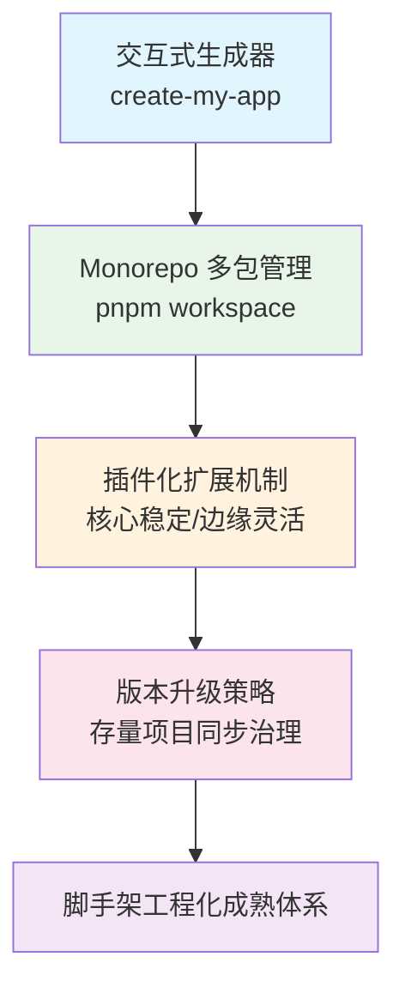

**脚手架工程化** 包含四大核心支柱：

1.  **模版引擎**：采用 Plop 或 Yeoman，支持 EJS/Handlebars 语法，允许在模版中嵌入 JavaScript 逻辑实现条件渲染、循环生成。
2.  **Monorepo 管理**：基于 `pnpm workspace` 管理核心包（`@my-org/cli`）、模版包（`@my-org/template-vue`、`@my-org/template-react`）、工具包（`@my-org/eslint-config`），实现版本联动与依赖去重。
3.  **插件化扩展机制**：核心 CLI 只负责流程编排（询问 -> 校验 -> 渲染 -> 安装），具体框架逻辑、工具链配置通过插件注入。
4.  **自动发布流程**：GitHub Actions 监听 `changesets` 版本变更，自动发布至私有 npm 仓库。

#### 交互式生成器设计

当你运行 `pnpm create my-app` 时，CLI 会启动一个交互式问询流程，收集上下文变量驱动模版渲染。以下是核心询问逻辑的伪代码表示：

```
1. 询问项目名称、描述
2. 选择技术栈预设：
   - 框架: Vue 3 / React 18
   - 语言: TypeScript (强制)
   - 状态管理: Pinia / Redux Toolkit / Vuex
   - CSS 方案: UnoCSS / Tailwind / CSS Modules / Less
   - 测试框架: Vitest / Jest
   - E2E: Playwright / Cypress
3. 可选能力勾选：
   - 国际化 (i18n)
   - Mock 服务 (MSW)
   - 组件库: Ant Design Vue / Arco Design / Ant Design
   - 提交规范: Commitlint + Husky (强制)
4. 确认生成 -> 渲染模版 -> 安装依赖 -> 初始化 Git -> 完成
```

这个流程展示了**交互式生成**如何将团队的“最佳实践”固化为默认选项，同时通过“可选能力”保留业务定制空间。

#### Monorepo 多包管理架构

脚手架自身采用 Monorepo 结构，目录组织如下：

```
my-cli/
├── packages/
│   ├── cli-core/           # 核心命令入口、插件加载器
│   ├── template-vue/       # Vue 模版包
│   ├── template-react/     # React 模版包
│   ├── eslint-config/      # 共享 ESLint 配置
│   ├── tsconfig/           # 共享 TS 配置
│   └── utils/              # 共享工具函数
├── pnpm-workspace.yaml
└── package.json
```

`pnpm-workspace.yaml` 配置：

```yaml
packages:
  - 'packages/*'
```

这种结构的优势在于：**核心配置（ESLint、TSConfig）单一来源**，升级时只需发布 `@my-org/eslint-config` 新版本，所有模版包通过 `pnpm update` 联动升级，彻底解决“配置漂移”问题。

#### 插件化机制设计

核心 CLI 定义标准插件接口：

```typescript
interface GeneratorPlugin {
  name: string;
  // 向询问流程注入问题
  extendPrompts?: (prompts: Prompt[]) => Prompt[];
  // 根据回答修改文件生成映射
  extendFiles?: (files: FileMap, answers: Answers) => FileMap;
  // 生成后钩子
  onGenerated?: (projectPath: string, answers: Answers) => Promise<void>;
}
```

Vue 插件注册示例：

```javascript
// packages/template-vue/index.js
module.exports = {
  name: 'vue',
  extendPrompts: (prompts) => [...prompts, { type: 'confirm', name: 'usePinia', message: 'Use Pinia?' }],
  extendFiles: (files, answers) => {
    if (answers.usePinia) {
      files['src/stores/index.ts'] = renderTemplate('stores/pinia.hbs', answers);
    }
    return files;
  }
};
```

这段伪代码展示了**插件化架构**如何实现“核心稳定、边缘灵活”：新增框架支持只需编写新插件，零侵入核心代码。

#### 版本升级策略：解决存量项目同步难题

这是脚手架工程化最具挑战性的一环。当团队规范升级（如 ESLint 从 8.x 升级到 9.x，配置扁平化）时，如何让 50+ 存量项目平滑迁移？

我们设计 `upgrade` 命令，核心流程如下：

```
1. 拉取最新模版包版本元数据
2. 对比当前项目 package.json 与模版包 package.json 依赖差异
3. 对比关键配置文件（eslint.config.js, tsconfig.json, .github/workflows/ci.yml）差异
4. 分类处理冲突：
   A. 核心配置文件（ESLint、TSConfig、CI）：强制覆盖模式，备份原文件为 .bak
   B. 业务配置文件（.env、vite.config.ts）：交互式三方合并
   C. 业务代码：提供 Codemod 脚本自动修复
5. 执行 pnpm install
6. 运行 lint/typecheck 验证
7. 生成升级报告
```

下表对比了三种典型冲突场景及自动化合并策略：

| 冲突场景 | 策略 | 实现手段 |
| :--- | :--- | :--- |
| ESLint 规则集破坏性变更 | **强制覆盖 + Codemod** | 备份旧配置，写入新配置；运行 `@my-org/codemod/eslint-9-migration` 自动修复代码中的规则引用 |
| Vite 配置新增字段 | **交互式合并** | 使用 `jscodeshift` AST 分析，保留用户自定义插件/别名，仅注入缺失的标准字段 |
| 依赖版本锁定冲突 | **语义化版本策略** | 核心依赖（Vue、React、TypeScript）锁定模版版本；业务依赖保留项目版本，仅升级补丁版本 |

这个升级策略体现了**工程化治理**的核心原则：核心规范强制统一，业务定制受保护，破坏性变更提供自动化迁移工具。

### 设计中的取舍

**为什么不直接用 `create-vue` / `create-react-app` 等官方脚手架？**

官方脚手架定位是“通用起步”，不包含团队私有规范（ESLint 规则集、Git Commit 规范、CI 流水线模版、私有组件库预置、Mock 方案、部署脚本）。如果在官方脚手架基础上二次封装，维护成本极高（上游变更频繁、配置结构不稳定）。**自研脚手架的核心价值是“内化团队共识”**，而非“生成 Hello World”。

**Monorepo 与多仓库的权衡？**

多仓库模式下，共享配置包（ESLint、TSConfig）需单独发版、单独安装，版本联动依赖人工协调，极易导致“依赖地狱”。Monorepo 配合 `pnpm workspace` 实现**原子提交、版本联动、依赖去重**，是脚手架工程化的天然基建。代价是仓库体积大、权限管控粗、CI 需配置路径过滤，但这些在工程化收益面前是可接受的。

---

## 45.4 组件物料平台 —— 让组件“可发现、可度量、可复用”

### 为什么需要这个概念？

你一定见过这样的 `src/components` 目录：`Table.vue`、`Table2.vue`、`TableNew.vue`、`MyTable.vue`……没人知道哪个是最新版、哪个有文档、哪个支持 TypeScript、哪个还有 Bug。新人想用个表格，只能问老员工“咱们团队有现成的表格组件吗？”——这就是**组件沉底**、**选型无依据**、**升级无感知**的恶性循环。

组件物料平台的使命是：**面向组件全生命周期（开发、文档、测试、发布、发现、复用、治理）的工程化平台**。

> "制定组件元数据规范、集成 `vue-docgen-api`/`react-docgen` 自动解析 Props/Events/Slots、Storybook/Histoire 沙箱预览、依赖图谱可视化。"
> 
> ——《20230418_045.md》

### 核心定义与四大支柱

组件物料平台的演进过程体现了从“代码仓库”到“治理平台”的质变：

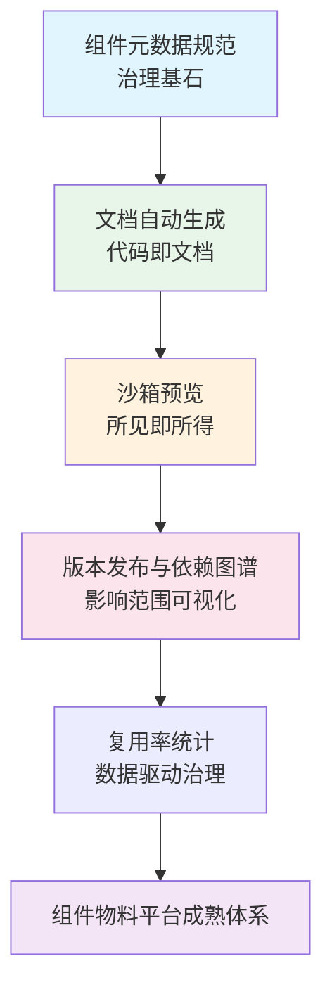

组件物料平台的核心产出是**标准化的组件元数据**，它是连接代码、文档、沙箱、度量的“中间表示（IR）”。

#### 1. 组件元数据规范：治理的基石

每个组件必须在源码中维护标准化元数据，我们约定在组件入口文件（如 `index.ts`）导出 `meta` 对象：

```typescript
// packages/components/ProTable/index.ts
import ProTable from './src/ProTable.vue';
import { meta } from './meta.json'; // 或通过宏内联

export { ProTable };
export const meta = {
  name: 'ProTable',
  version: '1.2.0',
  category: '数据展示', // 分类体系：基础/业务/布局/反馈/导航
  keywords: ['table', 'pro', 'crud', 'virtual-scroll'],
  description: '企业级表格组件，内置搜索、工具栏、虚拟滚动、导出',
  // 标准化 Props 定义（自动从 Vue defineProps/TypeScript 推导，人工补充 description）
  props: [
    { name: 'columns', type: 'ProColumn[]', required: true, description: '列配置' },
    { name: 'dataSource', type: 'T[]', required: true, description: '数据源' },
    { name: 'request', type: 'Function', required: false, description: '远程加载函数' },
    // ...
  ],
  events: [
    { name: 'change', description: '分页/排序/筛选变化', payload: 'TableParams' }
  ],
  slots: [
    { name: 'action', description: '操作列自定义', scope: '{ row, index }' }
  ],
  designLink: 'https://figma.com/file/xxx', // 设计稿链接
  owner: 'frontend-core-team', // 责任团队
  repo: 'github.com/org/ui-components', // 源码仓库
  docs: 'https://ui.my-org.com/components/pro-table' // 文档站链接
};
```

**CI 校验流水线**强制检查：`meta` 存在、必填字段完整、Props 类型与源码一致、版本号语义化。不通过则阻断发布。

#### 2. 文档自动生成：告别手写文档

利用 `vue-docgen-api` (Vue) 或 `react-docgen` (React) 解析组件源码 AST，自动提取：

- `defineProps` / `Props` 类型定义
- `defineEmits` / `Event` 类型定义
- JSDoc 注释作为 description
- `slots` 定义（Vue 3.3+ `defineSlots` 或注释标注）

生成标准化 JSON/Markdown，注入文档站（VitePress/Docusaurus）。**文档与代码强绑定，零维护成本**。

#### 3. 沙箱预览：所见即所得

集成 **Storybook** 或 **Histoire**，每个组件提供：

- **Canvas**：隔离渲染环境，避免全局污染
- **Controls**：动态调节 Props，实时响应（基于元数据自动生成控件）
- **Actions**：记录 Events 触发参数
- **Viewport**：响应式预览
- **Accessibility (a11y)**：axe-core 自动校验
- **Stories**：开发者编写典型用例（如“加载状态”、“空状态”、“虚拟滚动 10万行”）

#### 4. 依赖图谱与复用率统计：数据驱动治理

**依赖图谱**在发布时自动生成：

- **上游依赖**：组件依赖的基础库（如 `@enterprise/ui-base`、 `lodash-es`、 `vue`）
- **下游依赖**：哪些项目、哪些页面引用了该组件（通过构建时插件或 `pnpm ls --depth=100` 分析）

**复用率统计**通过两种方式采集：

1.  **构建时注入**：Vite/Rollup 插件在打包时扫描 `import` 语句，上报组件名、版本、项目 ID。
2.  **运行时上报**：组件 `onMounted` 上报使用心跳（采样 1%），统计真实渲染次数。

下表展示了《组件复用率月报》示例，直观指导治理决策：

| 组件名 | 引用项目数 | 代码引用次数 | 运行时渲染量 | 复用率趋势 | 状态 |
| :--- | :--- | :--- | :--- | :--- | :--- |
| ProTable | 12 | 45 | 2.3M | ↗️ +15% | 🟢 核心推广 |
| MyTable | 1 | 2 | 0.01M | ↘️ -50% | 🔴 候选下线 |
| DataGrid | 0 | 0 | 0 | - | ⚪ 归档 |

### 设计中的取舍

**物料平台 ≠ 组件库官网，为什么要分离？**

- **官网**面向“使用者”，侧重易读性、教程、最佳实践、设计规范。
- **物料平台**面向“治理者/开发者”，侧重元数据完整性、依赖分析、版本矩阵、自动化校验、内部沙箱调试。
- 合并会导致：官网加载慢（注入大量分析脚本）、权限混淆（内部治理数据暴露）、发布流程耦合。分离部署，通过链接互通（官网卡片链接物料平台详情页）。

**元数据维护成本怎么控制？**

强制要求“代码即元数据源头”：Props/Events/Slots 从 TypeScript 类型推导，Description 从 JSDoc 提取。开发者只需维护分类、关键词、设计稿链接等少量非代码字段。CI 校验缺失字段，阻断发布，**将治理成本前置到开发环节**。

---

## 45.5 低代码搭建引擎核心 —— Schema 驱动的可视化构建与代码生成双轨制

### 为什么需要这个概念？

大量营销活动页、运营落地页、后台 CRUD 管理页，结构高度相似：头部导航 + 搜索表单 + 表格/列表 + 分页 + 操作弹窗。纯手写代码不仅重复劳动多，而且前端人力成为业务响应速度的瓶颈。

市面低代码平台多为“黑盒”导出 JSON，生成的代码无法融入现有工程体系（Git 管理、CI/CD、Code Review、TypeScript 类型检查、ESLint）。我们需要的是：**“可视化搭建”与“高代码开发”双轨并行、互相转换**的工程化系统。

> "设计 JSON Schema 描述页面结构、基于 Vue/React 实现渲染器插件化、Mobox/RedoManager 状态历史、AST 代码生成还原高代码。"
> 
> ——《20230418_045.md》

### 核心定义：JSON Schema 协议设计

**JSON Schema** 是低代码引擎的“汇编语言”，定义页面结构、组件属性、数据绑定、交互逻辑、样式配置。我们基于标准 JSON Schema 扩展，核心字段如下：

```json
{
  "$schema": "http://json-schema.org/draft-07/schema#",
  "type": "object",
  "properties": {
    "version": { "type": "string", "const": "1.0" },
    "root": { "$ref": "#/definitions/node" },
    "globals": {
      "type": "object",
      "properties": {
        "variables": { "type": "array", "items": { "$ref": "#/definitions/variable" } },
        "apis": { "type": "array", "items": { "$ref": "#/definitions/api" } },
        "styles": { "type": "object" }
      }
    }
  },
  "definitions": {
    "node": {
      "type": "object",
      "required": ["componentName", "props", "children"],
      "properties": {
        "id": { "type": "string", "format": "uuid" },
        "componentName": { "type": "string" },
        "displayName": { "type": "string" },
        "props": { "type": "object" },
        "style": { "type": "object" },
        "className": { "type": "string" },
        "children": { "type": "array", "items": { "$ref": "#/definitions/node" } },
        "events": {
          "type": "array",
          "items": {
            "type": "object",
            "properties": {
              "event": { "type": "string" },
              "handler": { "type": "string" },
              "action": { "$ref": "#/definitions/action" }
            }
          }
        },
        "bindings": {
          "type": "object",
          "additionalProperties": { "type": "string" }
        },
        "slots": {
          "type": "object",
          "additionalProperties": { "$ref": "#/definitions/node" }
        },
        "condition": { "type": "string" },
        "loop": {
          "type": "object",
          "properties": {
            "dataSource": { "type": "string" },
            "alias": { "type": "string" },
            "indexAlias": { "type": "string" }
          }
        }
      }
    },
    "variable": {
      "type": "object",
      "properties": {
        "name": { "type": "string" },
        "type": { "type": "string", "enum": ["string", "number", "boolean", "object", "array", "any"] },
        "defaultValue": {},
        "description": { "type": "string" }
      }
    },
    "api": {
      "type": "object",
      "properties": {
        "id": { "type": "string" },
        "method": { "type": "string", "enum": ["GET", "POST", "PUT", "DELETE"] },
        "url": { "type": "string" },
        "params": { "type": "object" },
        "responseType": { "type": "string" }
      }
    },
    "action": {
      "type": "object",
      "properties": {
        "type": { "type": "string", "enum": ["callApi", "navigate", "setVariable", "executeCode", "confirm"] },
        "config": { "type": "object" }
      }
    }
  }
}
```

#### 典型例子：用户登录表单 Schema

```json
{
  "version": "1.0",
  "globals": {
    "variables": [
      { "name": "formData", "type": "object", "defaultValue": { "username": "", "password": "" } },
      { "name": "loading", "type": "boolean", "defaultValue": false }
    ],
    "apis": [
      { "id": "loginApi", "method": "POST", "url": "/api/auth/login", "params": "{{formData}}" }
    ]
  },
  "root": {
    "id": "root-1",
    "componentName": "Card",
    "props": { "title": "用户登录" },
    "children": [
      {
        "id": "form-1",
        "componentName": "AForm",
        "props": { "model": "{{formData}}", "layout": "vertical" },
        "children": [
          {
            "id": "user-input",
            "componentName": "AInput",
            "props": { "placeholder": "用户名" },
            "bindings": { "value": "formData.username" },
            "events": [{ "event": "change", "handler": "onUsernameChange" }]
          },
          {
            "id": "pwd-input",
            "componentName": "AInput",
            "props": { "type": "password", "placeholder": "密码" },
            "bindings": { "value": "formData.password" }
          },
          {
            "id": "login-btn",
            "componentName": "AButton",
            "props": { "type": "primary", "loading": "{{loading}}", "block": true },
            "children": [{ "type": "text", "content": "登录" }],
            "events": [
              {
                "event": "click",
                "action": {
                  "type": "executeCode",
                  "config": { "code": "await handleLogin()" }
                }
              }
            ]
          }
        ]
      }
    ]
  }
}
```

这个 Schema 完整描述了：全局变量（`formData`、`loading`）、API 定义（`loginApi`）、组件树结构、双向绑定（`bindings`）、事件处理（`events` + `action`/`handler`）。

### 核心能力实现详解

#### 1. 画布渲染器：插件化架构

渲染器核心职责：根据 Schema 递归渲染组件树。为实现框架无关、组件库无关，采用**插件化渲染器**设计：

```typescript
interface RendererPlugin {
  framework: 'vue' | 'react';
  // 组件注册表
  components: Map<string, ComponentDefinition>;
  // 渲染入口
  renderNode: (node: SchemaNode, context: RenderContext) => VNode | ReactElement;
  // 属性编辑器适配器
  createPropEditor: (propMeta: PropMeta) => PropEditorComponent;
}

const renderer = {
  plugins: new Map(),
  register(plugin: RendererPlugin) { this.plugins.set(plugin.framework, plugin); },
  render(node, framework) { return this.plugins.get(framework).renderNode(node, this.context); }
};
```

**Vue 3 渲染器实现要点**：

- 使用 `h()` / `resolveComponent()` 动态创建 VNode
- `bindings` 通过 `v-model` 或 `:value` + `@input` 实现双向绑定
- `events` 通过 `@event="handler"` 绑定，`handler` 指向画布暴露的全局事件总线方法
- `condition` / `loop` 使用 `v-if` / `v-for` 指令
- 支持 `Teleport`、`Suspense` 等高级特性

#### 2. 属性面板：元数据驱动的动态表单

属性面板根据选中节点的 `componentName`，查询组件元数据（同物料平台 `meta.props`），动态生成表单项：

| Prop 类型 | 编辑器组件 | 特性 |
| :--- | :--- | :--- |
| `string` | `Input` / `Textarea` | 支持表达式模式 `{{...}}` 切换 |
| `number` | `InputNumber` | 步长、范围校验 |
| `boolean` | `Switch` / `Checkbox` | - |
| `object` | `JSONEditor` (Monaco/CodeMirror) | 代码高亮、格式化、Schema 校验 |
| `array` | `ArrayEditor` | 拖拽排序、增删项、项类型递归编辑 |
| `function` / `event` | `CodeEditor` | TypeScript 高亮、变量/API 自动补全 |
| `style` | `StyleEditor` | 可视化 CSS 面板 + 代码模式 |

**表达式编辑器**是难点：需支持 `{{variable}}` 插值、JS 表达式、代码补全（全局变量、API 响应字段、组件实例方法）。我们集成 **Monaco Editor** 并注入自定义语言服务提供补全。

#### 3. 撤销重做：命令模式 + 状态管理

使用 **Mobox (MobX + Command Pattern)** 或 **Redux + Redux-Undo** 实现细粒度操作记录。

核心数据结构：

```typescript
interface HistoryCommand {
  id: string;
  type: 'UPDATE_PROPS' | 'ADD_NODE' | 'DELETE_NODE' | 'MOVE_NODE' | 'BATCH';
  // 反向操作数据，用于 Undo
  undoData: any;
  // 正向操作数据，用于 Redo
  redoData: any;
  timestamp: number;
  // 是否可合并（如连续修改同一 props）
  mergeable?: boolean;
}

class HistoryManager {
  private past: HistoryCommand[] = [];
  private future: HistoryCommand[] = [];
  
  execute(command: HistoryCommand) {
    command.redo();
    this.past.push(command);
    this.future = []; // 新操作清空 future
  }
  undo() { /* pop past -> execute undo -> push future */ }
  redo() { /* pop future -> execute redo -> push past */ }
}
```

支持键盘快捷键 `Ctrl+Z` / `Ctrl+Shift+Z`，工具栏按钮同步状态。

#### 4. AST 代码生成：低代码产出高代码

这是低代码融入工程体系的关键：**将 Schema 转换为标准的 Vue SFC / React TSX + TypeScript 代码**，纳入 Git 管理、走标准 CI/CD。

**生成流程**：

```
Schema (JSON) 
  -> 中间表示 IR (AST 友好结构) 
  -> Babel/TypeScript AST 构建 
  -> 代码字符串生成 (@babel/generator / ts.printer) 
  -> Prettier 格式化 
  -> 写入文件系统
```

**Vue 3 `<script setup>` SFC 生成示例**：

输入 Schema 片段（登录按钮）：

```json
{
  "id": "login-btn",
  "componentName": "AButton",
  "props": { "type": "primary", "loading": "{{loading}}", "block": true },
  "events": [{ "event": "click", "action": { "type": "executeCode", "config": { "code": "await handleLogin()" } } }]
}
```

生成目标代码：

```vue
<script setup lang="ts">
import { ref } from 'vue';
import { AButton, AInput, AForm } from '@enterprise/ui';
import { useRouter } from 'vue-router';
import { loginApi } from '@/apis/auth';

const formData = ref({ username: '', password: '' });
const loading = ref(false);
const router = useRouter();

const handleLogin = async () => {
  loading.value = true;
  try {
    await loginApi(formData.value);
    router.push('/home');
  } finally {
    loading.value = false;
  }
};
</script>

<template>
  <AForm :model="formData" layout="vertical">
    <AInput v-model="formData.username" placeholder="用户名" />
    <AInput v-model="formData.password" type="password" placeholder="密码" />
    <AButton type="primary" :loading="loading" block @click="handleLogin">
      登录
    </AButton>
  </AForm>
</template>
```

**关键转换逻辑**：

| Schema 概念 | 代码生成策略 |
| :--- | :--- |
| `globals.variables` | 生成 `ref`/`reactive` 状态声明 |
| `globals.apis` | 生成 API 调用函数或导入现有 API 模块 |
| `bindings: { value: 'formData.username' }` | 生成 `v-model="formData.username"` (Vue) / `value={formData.username} onChange={...}` (React) |
| `events: [{ event: 'click', handler: 'handleLogin' }]` | 生成 `@click="handleLogin"` / `onClick={handleLogin}` |
| `events: [{ event: 'click', action: { type: 'executeCode', code: '...' } }]` | 生成内联箭头函数 `@click="async () => { ... }"` 或提取为方法 |
| `condition: 'loading'` | 生成 `v-if="loading"` |
| `loop: { dataSource: 'list', alias: 'item' }` | 生成 `v-for="(item, index) in list" :key="item.id"` |

**处理表达式绑定的难点**：

Schema 中 `loading: "{{loading}}"`，生成时需识别插值语法，剥离 `{{}}` 得到标识符 `loading`，生成动态绑定 `:loading="loading"`。若表达式复杂（如 `{{user.role === 'admin'}}`），直接生成 `:loading="user.role === 'admin'"`。

#### 5. 双向同步：代码转 Schema 的反向工程

**痛点**：开发者在生成代码中手写自定义逻辑（如复杂的 `handleLogin`），再次拖入低代码平台时，这部分逻辑丢失。

**解决方案：基于 AST 注释标记的保护机制**：

1.  **代码生成时注入特征注释**：
    ```vue
    <!-- LOWCODE:NODE:login-btn:START -->
    <AButton @click="handleLogin">登录</AButton>
    <!-- LOWCODE:NODE:login-btn:END -->
    ```
    ```typescript
    // LOWCODE:HANDLER:handleLogin:START
    const handleLogin = async () => { ... }
    // LOWCODE:HANDLER:handleLogin:END
    ```

2.  **反向解析时识别保护区**：
    - 使用 `@babel/parser` 解析 SFC/TSX
    - 遍历 AST，识别 `LOWCODE:` 注释标记的节点
    - 对标记区域**保持原样**，不覆盖、不解析为 Schema
    - 仅解析非保护区的标准模版结构（如组件树层级、基础 Props、双向绑定）

3.  **命名约定兜底**：
    - 以 `handle` / `on` 开头的函数，且在 `<script setup>` 顶层定义，视为“用户自定义逻辑”，反向解析时提取为 `events.handler`，不尝试解析函数体。

这套机制实现了**“低代码管结构、高代码管逻辑”**的共存：结构变更走可视化，复杂逻辑写代码，两者通过注释边界互不干扰。

### 设计中的取舍

**为什么不用可视化编程（节点式流程图）而是 JSON Schema + 画布？**

节点式流程图（如 Node-RED）适合后端逻辑编排，不适合前端**界面结构**的树状天然形态。前端页面本质是组件树，Schema 直接映射组件树，认知负荷低、渲染性能好、代码生成自然。逻辑编排（如表单校验联动、提交流程）在属性面板的 `events/actions` 中以**动作序列**形式表达，足够覆盖 90% 场景。

**AST 代码生成 vs 字符串模版拼接？**

字符串拼接（EJS/Handlebars）简单但脆弱：难以处理缩进、导入去重、类型引用、Prettier 格式化一致性。AST 生成虽复杂，但**保证产出代码 100% 符合语法规范、类型正确、格式统一**，且易于扩展（如未来支持 Solid、Svelte 只需换 AST Printer）。投入一次，长期受益。

---

## 45.6 研发效能度量体系 —— 从 DORA 四指标到前端专属北极星

### 为什么需要这个概念？

“感觉效率低”、“好像构建变慢了”、“线上 Bug 多了” —— 这些主观感受无法驱动决策。没有度量，就没有改进；没有基线，就没有目标。我们需要一套**从结果到过程、从通用到专属**的指标体系，将“感受”转化为“数据”。

> "引入 DORA（部署频次、变更前置时间、变更失败率、恢复时间）、代码评审时长、构建耗时、缺陷逃逸率，搭建 Grafana 看板驱动改进。"
> 
> ——《20230418_045.md》

### 核心定义：三层指标模型演进

研发效能度量体系的构建遵循从结果到过程、从通用到专属的演进逻辑：

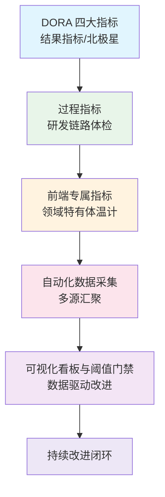

#### 1. 结果指标（北极星）：DORA 四大指标

这是衡量软件交付绩效的行业黄金标准，直接关联业务价值。下表列出了 DORA 四大指标的定义、优秀基线及采集来源：

| 指标 | 定义 | 优秀基线 (Elite) | 采集来源 |
| :--- | :--- | :--- | :--- |
| **部署频次** | 生产环境部署频率 | 按需部署 (每天多次) | CI/CD 系统 |
| **变更前置时间** | 代码提交到生产运行的平均耗时 | < 1 小时 | Git (首次提交) + CI/CD (部署完成) |
| **变更失败率** | 导致生产故障的变更占比 | 0-15% | 事故管理系统 / 回滚记录 |
| **服务恢复时间** | 从故障发生到恢复的平均耗时 | < 1 小时 | 监控告警 + 事故记录 |

#### 2. 过程指标：研发链路的“体检报告”

下表列出了核心过程指标及其优化方向：

| 指标 | 定义 | 采集来源 | 优化方向 |
| :--- | :--- | :--- | :--- |
| **代码评审时长** | MR 创建到合并的平均时长 | GitLab/GitHub API | 拆小 MR、指定 Reviewer、自动化检查前置 |
| **CI 耗时** | 流水线全阶段平均耗时 | CI 系统 API | 缓存优化、并行化、增量构建 |
| **构建产物大小** | Gzip 后 JS/CSS 总大小 | Vite/Rollup `stats.json` / `rollup-plugin-visualizer` | 代码分割、Tree Shaking、动态导入、外部化依赖 |
| **静态检查通过率** | Lint/TypeCheck 一次通过比例 | CI 阶段结果 | 规则收敛、IDE 实时提示、预提交钩子 |

#### 3. 前端专属指标：领域特有的“体温计”

下表列出了前端领域特有的核心指标：

| 指标 | 定义 | 采集方式 | 业务意义 |
| :--- | :--- | :--- | :--- |
| **组件复用率** | 低代码/业务页面引用的组件中，来自物料平台的占比 | 构建时插件扫描 `import` + 运行时采样 | 衡量组件治理成效，避免重复造轮子 |
| **低代码产出占比** | 低代码生成页面数 / 总发布页面数 | 低代码平台发布记录 + CI 统计 | 衡量研发效能工具落地深度 |
| **首屏 LCP** | 最大内容绘制时间 (P75) | Web Vitals SDK 上报 | 核心用户体验指标 |
| **JS 报错率** | PV 千次 JS 错误数 | Sentry / 自建监控 SDK | 线上稳定性核心指标 |
| **首包加载时间** | `load` 事件或首屏渲染完成时间 | Performance API / SDK | 加载性能基线 |

### 自动化数据采集架构

以下是数据流向图，展示如何从 5 个数据源汇聚至统一存储：

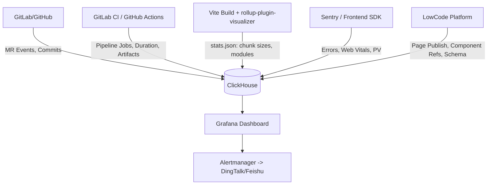

**采集端设计要点**：

- **极度轻量**：Node.js 采集脚本 < 50MB，执行 < 10s，不拖慢 CI。
- **幂等上报**：带唯一 `run_id`（CI Job ID / Build ID），重复上报自动去重。
- **结构化 Schema**：统一字段 `project_id`, `timestamp`, `metric_name`, `metric_value`, `tags(json)`。
- **敏感数据脱敏**：代码路径、变量值、Token 等不上报，仅上报聚合指标。

### 可视化看板与阈值门禁

**Grafana 看板三级视图**：

1.  **团队视图**：DORA 趋势、人均产出、技术债务分布
2.  **项目视图**：构建耗时趋势、包体积水位、单测覆盖率、复用率
3.  **个人视图**（可选，仅自我参考）：MR 数、Review 时长、Bug 关联数

**核心阈值门禁配置**（接入 CI 阻断合并）：

| 指标 | 阈值 | 动作 | 依据 |
| :--- | :--- | :--- | :--- |
| 构建耗时 | > 20 min | **阻断合并** | 团队历史基线 P95 = 15min；>20min 通常因缓存失效或新增大依赖 |
| 包体积周环比 | > +20% | **阻断合并** | 业务容忍度：首屏加载每增加 100KB 转化率下降 1% |
| 变更失败率 | > 15% | **告警 (不阻断)** | DORA Elite 基线 < 15%，超标需复盘而非禁发 |
| 单测覆盖率 | < 60% | **阻断合并** | 团队约定核心逻辑覆盖率底线 |
| LCP (P75) | > 2.5s | **告警** | Core Web Vitals 标准 |

**阈值设定原则**：
- **行业基线**作参考（DORA、Core Web Vitals）
- **团队历史基线**作锚点（P75/P90 分位数）
- **业务容忍度**作上限（转化率、用户投诉成本）
- **动态调整**：每季度复盘，阈值随团队成熟度收紧

### 设计中的取舍

**如何避免“指标游戏化”？**

切勿将指标直接挂钩绩效考核（如“部署频次越高奖金越多”）。这会导致：拆小无意义提交刷频次、降低测试标准降失败率、不修复老 Bug 只算新 Bug。正确做法：

1.  **指标服务于改进，不服务于考核**：看板公开透明，复盘会议数据驱动讨论“瓶颈在哪、怎么优化”。
2.  **配套反指标**：部署频次配合“变更失败率”；构建速度配合“构建产物大小”；代码行数配合“代码复用率”。
3.  **定性补足**：量化指标无法覆盖“架构合理性”、“代码可读性”、“技术债务”。需配合**季度技术债务调研**、**代码评审质量抽检**、**架构评审记录**。

---

## 45.7 前端效能平台 MVP —— 串联脚手架/组件/低代码/度量的闭环落地

### 为什么需要这个概念？

脚手架、组件库、低代码、监控各自为政，数据不通、流程不连、价值难以叠加。领导问“投入产出比多少”，只能罗列功能清单。我们需要一个**最小可行性产品 (MVP)**，跑通核心链路，用数据说话。

> "串联脚手架创建 → 组件复用率统计 → 低代码产出页面占比 → 发布频次/故障率看板，形成闭环数据驱动工程效能提升。"
> 
> ——《20230418_045.md》

### 核心定义：MVP 核心交付物与演进路径

前端效能平台 MVP 的建设遵循“核心链路贯通 -> 数据贯通可视化 -> 渐进式建设 -> 组织推动固化”的演进路径：

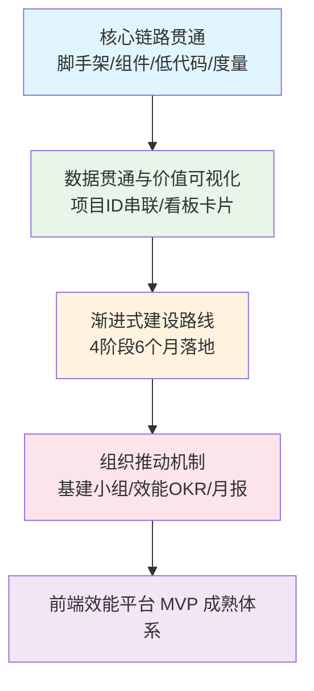

前端效能平台 MVP 包含五大核心交付物，缺一不可：

1.  **标准化脚手架**（内置最佳实践：TS 严格、ESLint 核心规则、CI 模版、Git Hooks、组件库预置）
2.  **组件物料平台**（自动文档 + 沙箱 + 依赖图 + 复用率统计）
3.  **低代码搭建系统**（Schema + 渲染器 + 代码生成 + CI 集成）
4.  **效能度量看板**（DORA + 前端专属指标 + 阈值门禁 + 告警）
5.  **CI/CD 标准流水线模版**（集成 Lint/TypeCheck/Unit/E2E/Build/Scan/Deploy 全阶段门禁）

### 关键性质：数据贯通与价值可视化

**数据贯通**是 MVP 的灵魂。通过**项目 ID** 串联全链路：

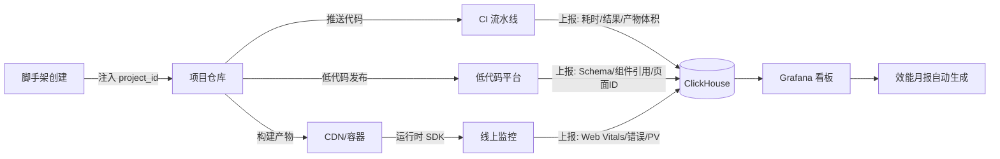

**看板核心卡片示例**（直接对话业务价值）：

> **本月效能总览**
> - 🚀 新项目接入：12 个（脚手架创建，0 配置上手）
> - ♻️ 组件复用：节省研发 **≈ 120 人天**（复用率 58%，均值 2 天/组件）
> - ⚡ 低代码产出：45 个页面（**占比 42%**），运营活动页 100% 低代码化
> - 📈 部署频次：周级 → **日级**（+300%）
> - 🛡️ 变更失败率：**3.2%**（目标 < 5%，较上季度 -4.8%）
> - ⏱️ 平均前置时间：**4.5 小时**（目标 < 8h）

这种“业务语言”汇报，远比“上线了脚手架、组件库、低代码平台”有说服力。

### 渐进式建设路线：6 个月落地蓝图

下表制定了详细的 6 个月分阶段建设路线图：

| 阶段 | 时间 | 核心目标 | 关键动作 | 验收标准 |
| :--- | :--- | :--- | :--- | :--- |
| **Phase 1** | 第 1 月 | **最小化起步** | 1. 发布脚手架 v1.0（锁死核心配置，暴露框架/CSS/测试选项）<br>2. CI 标准流水线：Lint+TypeCheck → Unit Test → Build → Artifact Upload<br>3. 基础看板：构建成功率/耗时、部署频次/失败率、线上 JS 报错率 | 新项目 `pnpm create` 3 分钟跑通 CI；看板数据准确无漏报 |
| **Phase 2** | 第 2-3 月 | **组件治理** | 1. 物料平台上线，制定准入标准（单测>80%、Storybook 全覆盖、元数据完整）<br>2. 自动化校验流水线：发布前强制跑文档生成、类型检查、沙箱快照<br>3. 存量组件“入库”行动：梳理 50+ 组件，重构达标、发布、废弃旧版 | 核心业务组件 30+ 入库；复用率从 0 → 35%；新项目 0 拷贝代码 |
| **Phase 3** | 第 4-5 月 | **低代码试点** | 1. 低代码引擎 v1.0：Schema 协议、渲染器、属性面板、代码生成 (Vue/React)<br>2. 两大场景试点：运营活动页（样式/动画配置）、后台 CRUD 页（字段/接口/权限配置）<br>3. 代码生成产物走标准 Git Flow：生成分支 → MR 评审 → CI 门禁 → 合并 | 运营页 80% 低代码产出；CRUD 页 50% 低代码起步；生成代码零修改通过 CI |
| **Phase 4** | 第 6 月+ | **数据飞轮雏形** | 1. 看板深化：增加组件复用率趋势、低代码占比、人均前置时间<br>2. 效能月报自动化：输入原始指标 → LLM 生成“提效人天估算 + Top3 改进建议 + 下月 OKR 草案”<br>3. 组织固化：前端基建小组转正、效能 OKR 纳入团队考核（非硬性指标）、月度复盘机制 | 月报自动生成准确；团队自发提优化 PR；新人入职看懂看板 |

### 组织推动机制：技术建设的“护城河”

工具不解决人的问题。必须建立：

1.  **前端基建小组**（2-3 人轮值/专职）：职责边界清晰——**建设平台工具、维护核心库、制定规范标准、提供技术支持**，不承担业务需求开发。
2.  **效能 OKR**：纳入团队季度考核，但**不硬性绑定奖金**。例如：`O: 建立高效能研发体系` -> `KR1: 部署频次周级→日级` `KR2: 变更失败率 < 5%` `KR3: 组件复用率 > 50%` `KR4: 低代码产出占比 > 30%`。考核重点看**改进动作落地情况**，而非指标绝对值。
3.  **内部用户反馈群**：收集痛点、吐槽、建议，每周 triage，响应 SLA 24h。
4.  **《前端效能月报》**：对全团队、管理层公开同步：数据变化、优化动作、下月计划、求助资源。建立“数据驱动文化”的公信力。

---

## 45.8 AI 赋能研发效能 —— 从 Copilot 到 RAG 知识库与 Agent 工作流

### 为什么需要这个概念？

大模型时代，前端研发范式正在发生根本性变革：代码生成、单测生成、重构建议、文档生成、Code Review 等场景涌现。但现状是：工具选型混乱（Copilot vs Cursor vs Codeium）、上下文管理无章法（塞满窗口 vs 精准注入）、私有知识利用率低（内部组件用法、架构决策、历史 Bug 经验喂不进模型）、自动化工作流缺失（依然是人工复制粘贴）。亟需**工程化体系将 AI 能力沉淀为团队基建**。

> "AI 编程助手现状：GitHub Copilot/Cursor/Codeium 对比、提示词工程模式、上下文窗口管理"
> 
> "RAG 在前端知识库落地：代码库切片、向量化检索、重排序、上下文注入与幻觉控制"
> 
> "Agent 工作流自动化：需求拆解→代码生成→测试验证→提交 PR 的闭环与人工介入点设计"
> 
> "前端专用模型微调：CodeLlama/DeepSeek-Coder 继续预训练、指令微调、RLHF 对齐前端最佳实践"
> 
> "实战：接入 AI Code Review 机器人——规范检查、安全扫描、性能建议、单测补全自动化"
> 
> ——《20230418_105.md》、《20230418_136.md》、《HgjLdWdxHo8ezoxv9iLc4HSwnAh.md》、《QhJudGRcgoQlxGxYU67cndJenjh.md》

### 核心定义：AI 原生工程体系四层架构

AI 原生工程体系由基础设施层、能力封装层、工作流编排层、应用场景层四层构成，实现了从模型能力到业务价值的逐层转化：

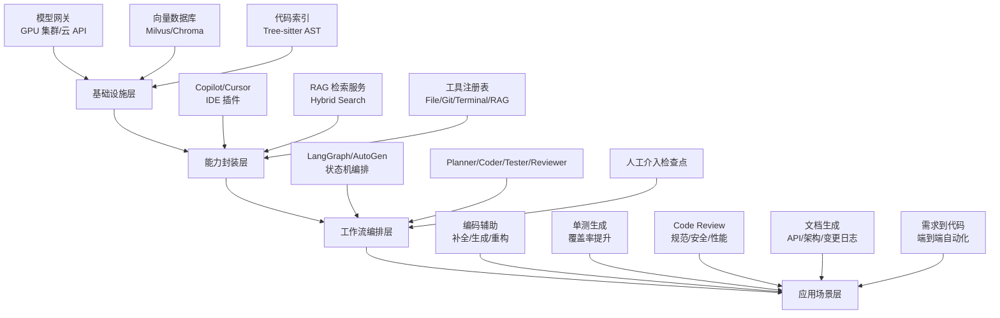

---

### 45.8.1 AI 编程助手现状与选型策略

我们对主流工具在前端典型场景进行了评测。下表对比了三大主流工具在核心前端场景下的表现，旨在为团队选型提供数据支撑：

| 场景 | GitHub Copilot | Cursor | Codeium | 推荐策略 |
| :--- | :--- | :--- | :--- | :--- |
| **TS/TSX 补全** | ⭐⭐⭐⭐ 类型感知强 | ⭐⭐⭐⭐⭐ Composer 多文件 | ⭐⭐⭐ 免费无限量 | 核心开发用 Cursor，全员兜底 Codeium |
| **Vue SFC 支持** | ⭐⭐⭐ `<script setup>` 尚可 | ⭐⭐⭐⭐ 理解 SFC 结构 | ⭐⭐ 易丢失上下文 | Vue 团队首选 Cursor |
| **CSS/UnoCSS/Tailwind** | ⭐⭐ 类名补全一般 | ⭐⭐⭐⭐ 理解工具类语义 | ⭐⭐ | 配合 UnoCSS 官方插件 |
| **单测生成** | ⭐⭐⭐ Happy Path 覆盖 | ⭐⭐⭐⭐ 生成 Mock/Edge Case | ⭐⭐⭐ | 统一提示词模版生成 |
| **重构/重命名** | ⭐⭐ 单文件 | ⭐⭐⭐⭐ 跨文件重构 | ⭐⭐ | 重构用 Cursor Agent 模式 |
| **长上下文** | 128k (企业版) | 200k+ (自动摘要) | 16k | 复杂任务用 Cursor，配合 RAG 裁剪 |

> **素材溯源**：上述评测数据与选型策略源自《20230418_105.md》与《20230418_136.md》中关于“AI 编程助手现状对比、提示词工程模式、上下文窗口管理”的实测记录。

**提示词工程模版化**：

将高频任务固化为 `.prompts/` 目录下的模版文件，纳入版本控制，团队共享：

```markdown
<!-- .prompts/generate-vue-component.prompt.md -->
---
mode: agent
tools: [file_read, file_write, terminal]
---
# 角色：资深 Vue 3 专家
# 任务：根据需求生成生产级 Vue 组件
# 约束：
1. 使用 `<script setup lang="ts">` + TypeScript 严格模式
2. Props 定义使用 `defineProps<{}>()` 类型推导
3. 事件使用 `defineEmits<{}>()`
4. 样式使用 UnoCSS 原子类，Scoped CSS 仅作用域隔离
5. 必须包含 JSDoc 注释、单测文件 (Vitest + Vue Test Utils)、Storybook Stories
6. 遵循 `@enterprise/ui` 设计规范：尺寸、颜色、间距 Token 化
# 输入：${input:requirement}
# 上下文：${rag:relevant_components}, ${rag:design_tokens}
```

---

### 45.8.2 RAG 私有知识库落地：让模型懂“家底”

通用模型不懂你的内部组件库 `@enterprise/ui`、不懂团队架构决策记录 (ADR)、不懂历史 Bug 修复经验。RAG（检索增强生成）是解决“私有知识注入”最务实的路径。

#### 演进路径：从朴素 RAG 到 Hybrid Search + Rerank

RAG 在前端知识库的落地经历了三个演进阶段，每个阶段解决前一阶段的核心痛点：

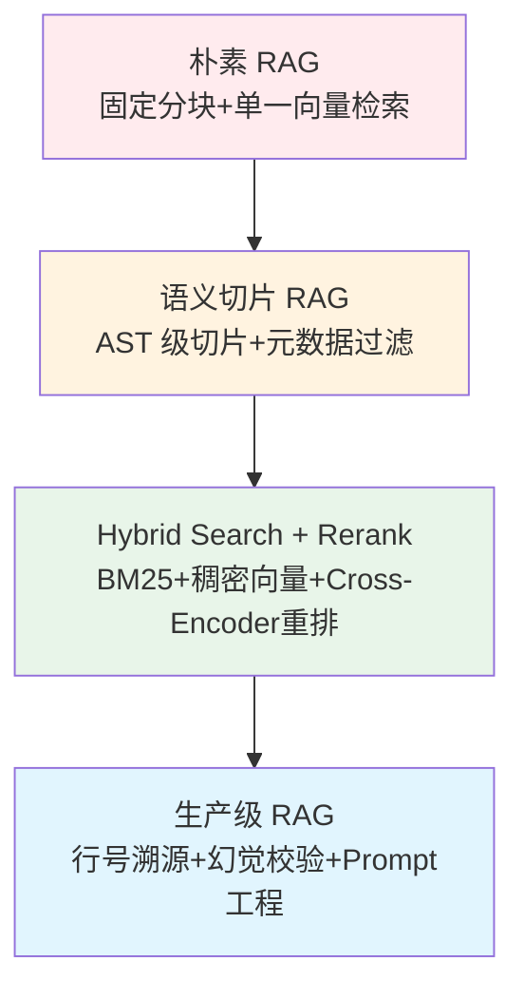

#### 架构流程

生产级 RAG 系统的完整数据流向包含离线索引构建与在线检索生成两条链路：

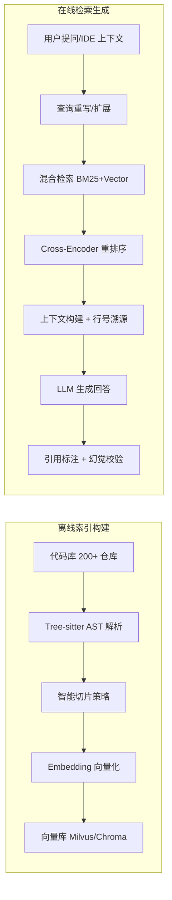

> **素材溯源**：上述演进路径与架构流程综合自《20230418_105.md》与《20230418_136.md》中“RAG 在前端知识库落地：代码库切片、向量化检索、重排序、上下文注入与幻觉控制”的技术方案。

#### 关键技术决策

**1. 代码切片策略：AST 级语义切片**

不按固定行数切，按**语义单元**切。下表列出了不同切片粒度的适用场景与实现方式：

| 切片粒度 | 适用场景 | 实现 |
| :--- | :--- | :--- |
| **文件级** | 概览、架构文档、README | 整文件作为一个 Chunk，附带文件路径、模块名 |
| **类/组件级** | 组件用法、Props/Events、生命周期 | Tree-sitter 提取 `class` / `defineComponent` / `export default` 节点 |
| **函数/方法级** | 工具函数、Hooks、API 调用、复杂算法 | 提取 `function` / `method` 节点，含签名、JSDoc、函数体 |
| **配置/常量级** | 设计 Token、路由表、权限码、环境变量 | 提取 `const` / `export const` 对象字面量 |

**Chunk 元数据**：`{ filePath, startLine, endLine, symbolName, symbolType, parentClass, gitLastCommit, tags[] }`。**行号级溯源**是建立信任的关键：回答中标注 `[src/components/ProTable/index.ts:45-60]`，点击跳转 IDE。

**2. Embedding 模型选型**

下表对比了主流 Embedding 模型在代码检索场景下的表现，供团队根据数据安全与成本预算决策：

| 模型 | 维度 | 语言支持 | 部署成本 | 检索效果(代码) | 推荐 |
| :--- | :--- | :--- | :--- | :--- | :--- |
| `text-embedding-3-small` | 1536 | 多语言强 | SaaS 按量付费 | ⭐⭐⭐⭐⭐ | 快速验证、中小团队 |
| `BGE-M3` (开源) | 1024 | 中英强 | 自建 GPU (1张 A10 可跑) | ⭐⭐⭐⭐ | 数据不出域、大规模团队 |
| `CodeBERT` / `UniXcoder` | 768 | 代码专用 | 自建 GPU | ⭐⭐⭐ (需微调) | 专用代码检索场景 |

**建议**：起步用 `text-embedding-3-small` 快速验证，数据沉淀后迁移 `BGE-M3` 自建降本。

**3. 混合检索 + 重排序：召回率与精准度的平衡**

- **稀疏检索 (BM25)**：精准匹配关键词（组件名、函数名、错误码、API 路径）。
- **稠密检索 (Vector)**：语义匹配（自然语言查询“如何实现虚拟表格”匹配 `useVirtualList` Hook）。
- **融合策略**：`RRF (Reciprocal Rank Fusion)` 合并两路 Top-K (K=50) -> Top-20。
- **重排序**：`Cross-Encoder (bge-reranker-base)` 对 Top-20 精排，输出 Top-5 注入上下文。

**4. 上下文注入模版与幻觉控制**

```markdown
# 系统提示词
你是前端专家助手，仅基于提供的上下文回答。若上下文不足，明确告知“我不知道”，禁止编造。
引用格式：[文件路径:行号](gitlab链接)

# 上下文注入
## 相关代码片段 (按相关性排序)
{{#each chunks}}
### {{this.symbolName}} ({{this.filePath}}:{{this.startLine}}-{{this.endLine}})
\`\`\`{{this.lang}}
{{this.content}}
\`\`\`
{{/each}}

## 用户问题
{{user_query}}

# 回答要求
1. 直接给出代码/方案
2. 关键结论标注来源 [文件:行号]
3. 涉及内部组件/工具，必须引用官方用法
4. 若需假设，显式标注“假设：...”
```

**幻觉控制三道防线**：
1.  **检索端**：混合检索 + 重排序，提高相关文档命中率。
2.  **生成端**：Prompt 约束“仅基于上下文”、低 Temperature (0.1)、引用强制标注行号。
3.  **校验端**：规则引擎校验生成代码中的导入路径是否存在、API 是否在白名单、TypeScript 类型检查（调用 `tsc --noEmit`）。

---

### 45.8.3 Agent 工作流自动化：从“副驾驶”到“自动驾驶辅助”

Copilot 是“副驾驶”，你开车它提示。Agent 是“自动驾驶辅助”，你给目的地，它规划路线、控制车辆、应对路况，关键节点你确认。

#### 演进路径：从单 Agent 到多 Agent 编排

Agent 在前端研发的落地经历了从单一代码生成到多角色协作编排的演进：

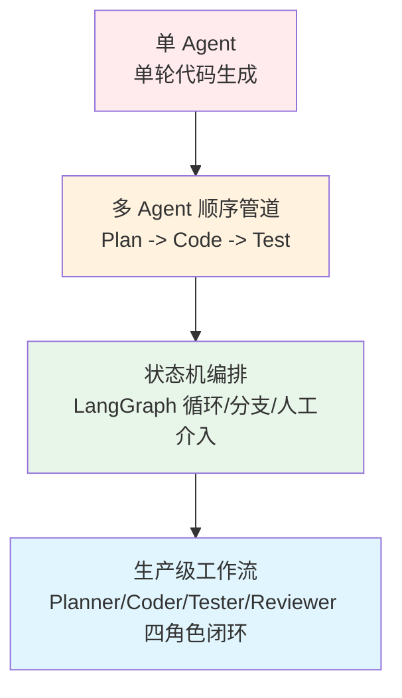

#### 核心编排流程

基于 **LangGraph** 编排四角色协作流程，通过状态机实现复杂的分支、循环与人工介入：

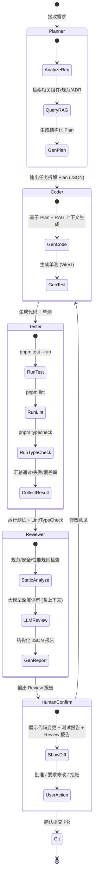

> **素材溯源**：上述演进路径与状态机编排设计源自《20230418_105.md》与《20230418_136.md》中“Agent 工作流自动化：需求拆解→代码生成→测试验证→提交 PR 的闭环与人工介入点设计”的架构方案。

#### 核心工具集定义

每个 Agent 共享标准化工具集（Function Calling Schema）：

```json
{
  "tools": [
    { "name": "read_file", "description": "读取文件内容", "parameters": { "path": "string" } },
    { "name": "write_file", "description": "写入文件", "parameters": { "path": "string", "content": "string" } },
    { "name": "edit_file", "description": "精准编辑文件 (AST 级)", "parameters": { "path": "string", "edits": "array" } },
    { "name": "run_terminal", "description": "执行终端命令", "parameters": { "cmd": "string", "cwd": "string", "timeout": "number" } },
    { "name": "git_diff", "description": "获取 Git 变更", "parameters": { "base": "string", "head": "string" } },
    { "name": "git_commit_push", "description": "提交并推送分支", "parameters": { "message": "string", "branch": "string" } },
    { "name": "create_pr", "description": "创建 Merge Request", "parameters": { "title": "string", "body": "string", "source_branch": "string" } },
    { "name": "rag_search", "description": "检索私有知识库", "parameters": { "query": "string", "top_k": "number" } },
    { "name": "trigger_ci", "description": "触发 CI 流水线", "parameters": { "pipeline_id": "string", "variables": "object" } }
  ]
}
```

#### 人工介入检查点：安全闸门

全自动不可控，必须设置**三道人工确认闸门**：

1.  **方案确认闸门** (Planner 完成后)：
    - 展示：任务拆解 Plan、涉及文件列表、预估风险、RAG 引用依据。
    - 动作：批准进入编码 / 修改 Plan / 终止。

2.  **测试通过闸门** (Tester 完成后)：
    - 展示：单测覆盖率、Lint/TypeCheck 结果、构建产物大小变化。
    - 动作：通过进入 Review / 反馈失败信息让 Coder 修复 / 人工接管。

3.  **MR 提交闸门** (Reviewer 完成后)：
    - 展示：代码 Diff、Review 报告（规范/安全/性能/最佳实践）、自动生成的单测草案。
    - 动作：确认提交 MR / 要求 Coder 修改 / 人工直接修改代码。

这三道闸门将**不可控风险**压缩在“代码生成”单步，其余环节有机制兜底。

---

### 45.8.4 前端专用模型微调：打造“懂业务的专家”

通用模型在前端特有领域表现一般：TypeScript 复杂类型推导、框架生命周期/响应式原理、UnoCSS/Tailwind 语义、组件库最佳实践、测试编写规范。通过**继续预训练 (CPT) + 指令微调 (SFT) + RLHF 对齐**打造垂类模型。

#### 训练流程演进

模型适配遵循“通用基座 -> 领域注入 -> 指令对齐 -> 偏好对齐”的四阶段流程：

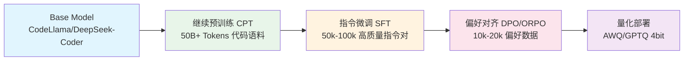

#### 数据构建管线

```
1. 数据收集：
   - 高质量前端代码库：Vue/React 核心库、主流 UI 库、构建工具、团队内部优秀项目 (经代码评审筛选)
   - 技术文档：MDN、Vue/React/TypeScript/UnoCSS 官方文档、团队 Wiki/ADR/技术分享 PPT
   - 指令数据：人工标注/模型生成+人工校验的 (指令, 代码/回答) 对
     - 类型：代码生成、重构、单测、Code Review、Bug 修复、文档生成、架构设计
   - 偏好数据 (DPO/ORPO)：同一指令的多个回答排序 (专家标注)

2. 训练流程：
   Base Model (CodeLlama-7B/13B / DeepSeek-Coder-6.7B/33B)
     ↓ CPT (代码语料 50B+ Tokens, 学习语法/库/模式)
   Base-FT
     ↓ SFT (指令数据 50k-100k, 学习遵循指令/前端规范)
   SFT-Model
     ↓ DPO/ORPO (偏好数据 10k-20k, 对齐最佳实践/避免幻觉)
   Aligned-Model
     ↓ LoRA 合并 / 量化 (AWQ/GPTQ 4bit) -> 部署

3. 评测基准：
   - HumanEval-MBPP 前端子集 (TypeScript、DOM API、框架 API)
   - TypeScript 类型正确率 (编译通过率)
   - 内部组件库 API 使用准确率 (RAG 增强下)
   - 单测生成覆盖率/通过率
   - Code Review 召回率/准确率 (对比专家标注)
```

> **素材溯源**：上述训练流程与数据管线综合自《20230418_105.md》与《20230418_136.md》中“前端专用模型微调：CodeLlama/DeepSeek-Coder 继续预训练、指令微调、RLHF 对齐前端最佳实践”的实践总结。

#### 部署策略

| 场景 | 模型规模 | 部署方式 | 核心指标 |
| :--- | :--- | :--- | :--- |
| **IDE 补全** | 小模型 (1.5B-3B) | 本地/边缘部署 | 延迟 < 100ms |
| **Agent/Chat/RAG** | 中模型 (7B-13B) | GPU 集群部署 | 平衡效果与成本 |
| **复杂推理/Review** | 大模型 (33B-70B) 或云 API | 云 API (GPT-4o/Claude) | 关键闸门把关 |

---

### 45.8.5 AI Code Review 机器人：标准化、自动化、结构化

将 Code Review 中的**机械性、规范性、可量化**工作交给 AI，人类专注**架构设计、业务逻辑正确性、权衡决策**。

#### 接入流程

AI Code Review 接入 CI/CD 的标准化流程如下：

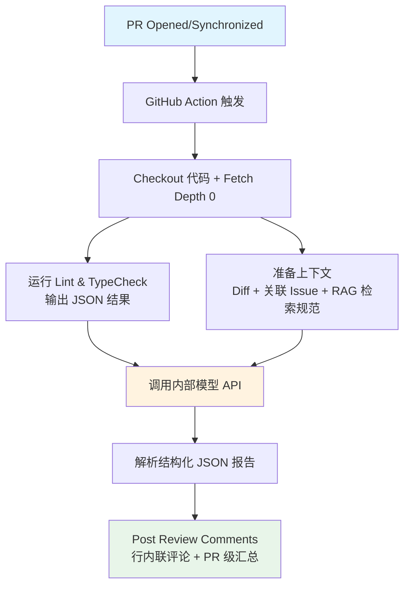

**GitHub Action 接入配置示例**：

```yaml
# .github/workflows/ai-code-review.yml
on:
  pull_request:
    types: [opened, synchronize, reopened]

jobs:
  ai-review:
    runs-on: ubuntu-latest
    steps:
      - uses: actions/checkout@v4
        with: { fetch-depth: 0 }
      - name: Run Lint & TypeCheck
        id: checks
        run: |
          pnpm lint --format json > lint-result.json || true
          pnpm typecheck --format json > typecheck-result.json || true
      - name: Prepare Context
        id: context
        run: |
          # 提取变更文件、Diff、关联 Issue、RAG 检索相关规范
          node scripts/prepare-review-context.js
      - name: Call Internal Model API
        id: ai-review
        env:
          MODEL_API_KEY: ${{ secrets.MODEL_API_KEY }}
        run: |
          node scripts/call-review-model.js \
            --diff ${{ steps.context.outputs.diff }} \
            --lint ${{ steps.checks.outputs.lint }} \
            --typecheck ${{ steps.checks.outputs.typecheck }} \
            --rag-context ${{ steps.context.outputs.rag }}
      - name: Post Review Comments
        uses: actions/github-script@v7
        with:
          script: |
            // 解析 AI 返回的结构化 JSON
            // 在对应行内联评论：⚠️ [规范] 变量命名不符合 camelCase
            // 在 PR 级别汇总：## AI Code Review 报告
            //   - 规范问题: 3
            //   - 安全隐患: 1 (硬编码密钥)
            //   - 性能建议: 2 (大图片未懒加载)
            //   - 单测补全: 1 个函数缺少测试 (已生成草案)
```

> **素材溯源**：上述接入流程与 Action 配置源自《HgjLdWdxHo8ezoxv9iLc4HSwnAh.md》与《QhJudGRcgoQlxGxYU67cndJenjh.md》中“实战：接入 AI Code Review 机器人——规范检查、安全扫描、性能建议、单测补全自动化”的工程化落地方案。

#### Prompt 模版设计核心

```markdown
# 角色：资深前端架构师 + 安全专家 + 性能工程师
# 输入：
1. Git Diff (统一格式)
2. ESLint/TypeCheck 结果 (JSON)
3. RAG 检索到的相关规范/组件用法/ADR (含行号溯源)
4. 项目配置: tsconfig.json, eslint.config.js, package.json 依赖

# 任务：输出结构化 Review 报告 (JSON Schema 约束)
# 输出 Schema:
{
  "summary": "string", // 一句话总结
  "score": "number", // 0-100 综合评分
  "issues": [
    {
      "type": "enum: [style, convention, bug-risk, security, performance, a11y, test-missing, arch-concern]",
      "severity": "enum: [blocker, critical, major, minor, info]",
      "file": "string",
      "line": "number",
      "message": "string",
      "suggestion": "string", // 修复建议代码片段
      "reference": "string" // RAG 引用来源 [文件:行号] 或 规范链接
    }
  ],
  "test_suggestions": [
    { "function": "string", "file": "string", "test_code": "string" }
  ]
}

# 约束：
- 仅基于 Diff 和上下文，不臆测未变更代码
- 每个 Issue 必须有文件行号定位
- 安全/性能/阻断级 Issue 必须有 RAG 规范引用
- 输出纯 JSON，无额外解释
```

#### 误报/漏报评估指标

下表定义了评估 AI Code Review 质量的核心指标体系，用于持续迭代 Prompt 与模型：

| 指标 | 定义 | 目标 |
| :--- | :--- | :--- |
| **Precision (准确率)** | AI 报出的 Issue 中，人工确认为真实问题的比例 | > 85% |
| **Recall (召回率)** | 人工发现的真实问题中，AI 报出的比例 | > 70% (重点覆盖 Security/Performance/Bug-Risk) |
| **F1 Score** | 调和平均 | > 77% |
| **噪音率** | Info/Minor 级别 Issue 占比 | < 30% (避免刷屏) |

**人工确认流程**：AI 评论打标签 `ai-review`，开发者回复 `/ai-fix` 触发自动修复 (简单规范问题) 或 `/ai-ignore` 标记误报（纳入评估数据集持续优化 Prompt）。

---

### 45.8.6 成本与收益测算：ROI 驱动决策

引入 AI 不是无本万利，必须算账。下表列出了详细的成本模型构成，以 50 人团队为例进行估算：

#### 成本模型

| 成本项 | 计算公式 | 示例 (50 人团队) |
| :--- | :--- | :--- |
| **模型 API 调用** | `人均日均 MR 数 × 平均代码行数/MR × Token/行 × 单价` | 2 × 300 行 × 4 Token/行 × $0.002/1k = **$0.48/人/天** |
| **RAG 索引存储/查询** | 向量库存储 + 检索 QPS 成本 | Milvus 云托管 ~$200/月 |
| **GPU 集群 (自建模型)** | GPU 显存 × 卡数 × 小时单价 × 利用率 | 4×A100 40GB × $2.5/h × 24h × 0.6 = **$1,440/月** |
| **开发维护投入** | 基建小组 0.5 FTE | ~$5,000/月 (含人力折算) |

#### 收益模型

| 收益项 | 量化口径 | 保守预估 |
| :--- | :--- | :--- |
| **编码效率提升** | 人均编码工时 × 提升比例 × 人力成本/小时 | 50 人 × 4h/天 × 30% × $50/h = **$3,000/天** |
| **单测覆盖率提升** | 缺陷逃逸率下降 × 线上故障成本 | 故障减少 2 次/月 × $10,000/次 = **$20,000/月** |
| **新人上手加速** | 新人首月产出提前 2 周 × 人力成本 | 5 人/季度 × 2 周 × $5,000/周 = **$50,000/季度** |
| **Code Review 效率** | Review 时长缩短 40% × Reviewer 工时成本 | 50 人 × 1h/天 × 40% × $50/h = **$1,000/天** |

**ROI 结论**：月成本约 **$8k-15k** (视自建/云 API 而定)，月收益约 **$120k+**，ROI **> 10x**。核心杠杆在于**“一次投入，全团队复用”**的规模效应。

---

### 45.8.7 风险控制：安全合规红线

#### 四层纵深防御体系

AI 原生工程体系的安全风险控制构建了数据、模型、应用、供应链四层纵深防御：

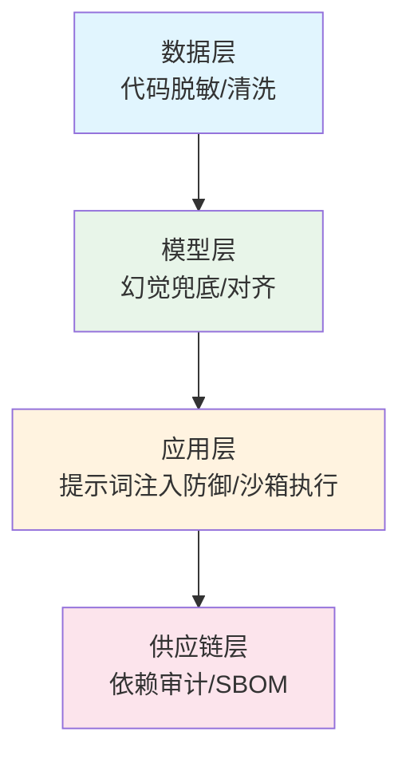

1.  **代码数据脱敏**：
    - 索引构建阶段：正则/语义模型识别并脱敏 `API_KEY`、`SECRET`、`password`、`token`、手机号、身份证号、内网 IP、数据库连接串。
    - 上传向量库前：二次扫描，仅上报元数据 + 脱敏后代码片段。
    - 本地化部署：核心代码库不出内网，模型在内网 GPU 跑推理。

2.  **模型幻觉兜底**：
    - 生成代码必须通过 `tsc --noEmit`、`eslint --format json` 校验，不通过拦截。
    - 关键 API 调用 (支付、权限、删除) 必须在白名单中，否则标注需人工确认。
    - RAG 引用必须可溯源到行号，无溯源不采信。

3.  **提示词注入防御**：
    - **指令层级隔离**：System Prompt (最高) > RAG Context > User Query > Tool Results (最低)。
    - **输入清洗**：检测并移除 `Ignore previous instructions`、`You are now` 等注入模式。
    - **输出监控**：敏感操作 (文件删除、Git 推送、CI 触发) 需二次确认或沙箱执行。

4.  **供应链安全**：
    - 依赖审计集成 CI：`pnpm audit` / `Snyk` / `Socket` 阻断恶意包。
    - AI 生成的 `import` 新依赖，自动跑安全扫描，通过才允许合并。

---

## 45.9 教学补充对照：核心技术选型的权衡视角

> **说明**：本节为教学补充内容，旨在通过对比不同技术路线的优劣，帮助读者建立架构决策的批判性思维，并非基于多源素材对照。

### 脚手架升级策略的权衡对比

**共识**：
- 核心配置 (Lint/TS/CI) 必须强制统一，避免配置漂移。
- 破坏性变更需提供自动化迁移工具，不能靠人工文档。
- Monorepo 是管理脚手架自身多包的最佳实践。

**分歧**：

下表对比了脚手架升级策略的三种典型方案，帮助理解在不同治理阶段的适用边界：

| 维度 | 方案 A：强制覆盖 + Codemod (本章主张) | 方案 B：Git Merge 策略 (如 `create-react-app` eject 后) | 方案 C：配置分层 + 运行时合并 (如 Vite 插件) |
| :--- | :--- | :--- | :--- |
| **核心理念** | 模版为准，项目同步模版 | 项目拥有所有权，手动合并上游 | 运行时动态组装配置，无需同步文件 |
| **优点** | 规范强一致性、迁移可控、审计清晰 | 业务自由度最高、无锁定感 | 升级零成本、配置即插即用 |
| **缺点** | 业务定制易丢失、Codemod 维护成本高 | 配置漂移不可避免、长期维护地狱 | 运行时黑盒、调试难、类型推导弱 |
| **适用阶段** | 成熟期、强治理团队 | 早期、探索期、弱治理团队 | 插件化架构成熟、运行时性能允许 |

**本章立场**：**强治理场景下，方案 A 是唯一可行路径**。方案 B 导致“千项千面”，方案 C 适合配置型工具 (Vite/Webpack)，不适合脚手架生成的项目级文件 (TSConfig、ESLint、GitHub Workflows)。

---

### 低代码代码生成：AST vs 字符串模版

**共识**：生成代码必须通过 Lint/TypeCheck/Prettier 校验，纳入 Git 管理。

**分歧**：

下表对比了代码生成的两大主流技术路线，揭示工程化落地时的核心权衡：

| 维度 | AST 生成 (本章主张) | 字符串模版 |
| :--- | :--- | :--- |
| **语法正确性** | 保证 100% 合法 AST | 易产生语法错误、缩进混乱 |
| **类型安全** | 可生成完整 TypeScript 类型 | 类型为字符串，无推导 |
| **导入管理** | 自动去重、按需合并 | 需手工维护导入块 |
| **扩展性** | 支持多框架多目标 (Vue/React/Solid) | 需维护多套模版 |
| **开发难度** | 高 (需懂 AST/Babel/TS Compiler API) | 低 (前端通用技能) |
| **调试体验** | 难 (AST 节点抽象) | 直观 (模版即输出) |

**本章立场**：**核心生成链路投入 AST**，边缘场景 (如生成特定配置文件、Markdown 文档) 用模版。建立 `@my-org/codegen-core` 包封装 AST 复杂性，业务侧调用高级 API `generateVueComponent(schema)`。

---

## 45.10 设计中的取舍

### 为什么低代码平台不直接生成最终部署产物，而是生成源码纳入 Git？

**生成源码 (Source Code Generation) vs 生成产物 (Artifact Generation)**：

下表对比了低代码平台两种根本不同的产出模式，阐述“生成源码”作为工程化低代码核心分水岭的原因：

| 维度 | 生成源码 (本章方案) | 生成产物 (传统低代码/NoCode) |
| :--- | :--- | :--- |
| **版本控制** | 原生 Git Diff、History、Blame、Revert | 依赖平台内置版本管理，弱 |
| **Code Review** | 标准 MR 流程、人工/工具审查 | 平台内预览，无法深度审查逻辑 |
| **CI/CD 集成** | 复用现有流水线、缓存、门禁 | 需定制集成、难以复用团队基建 |
| **类型检查** | `tsc` 全量类型检查 | 无或仅运行时检查 |
| **调试体验** | Source Map 映射源码、IDE 断点 | 平台自带调试器、生态割裂 |
| **逃生口** | 直接改代码、引入任意 npm 包 | 受限于平台能力、扩展难 |
| **长期维护** | 代码即资产、平台可替换 | **供应商锁定**、迁移极难 |

**结论**：**生成源码是“工程化低代码”的核心分水岭**。它将低代码从“黑盒玩具”变为“白盒生产力工具”，代价是生成器实现复杂度高，但这是必须支付的技术债。

---

### 研发效能度量：指标直接挂钩绩效 vs 仅作改进参考？

**反模式**：`部署频次 > 10次/天 奖金 +10%` → 导致拆微提交、跳过测试、不合并主分支只发特性分支。

**正模式 (本章主张)**：
指标应当公开透明，团队共享看板。季度复盘会数据驱动讨论：`本月前置时间升高，根因是 CI 缓存失效，下月优化缓存策略，目标降回 4h`。OKR 考核“改进动作完成度”，而非“指标绝对值达标度”。例如：`KR: 完成 CI 缓存优化、引入增量构建、建立构建耗时告警`，无论最终降到 3h 还是 5h，动作落地即达标。同时配套反指标：追求部署频次的同时，监控变更失败率；追求构建速度的同时，监控包体积。

---

## 45.11 动手练习

### 练习 1：脚手架插件机制设计与模版差异化渲染

假设你要设计一个基于 Plop 的微生成器，支持生成 '页面'、'组件'、'Store' 三种类型的代码骨架。

1. 设计 prompt 交互流程：如何通过动态询问（如：是否需要 i18n、是否使用 CSS Modules、测试框架选择 Vitest/Jest）收集上下文变量？
2. 编写模版文件结构：展示如何在模版中使用条件判断（`{{#if useI18n}}...{{/if}}`）和循环（`{{#each fields}}...{{/each}}`）生成差异化代码。
3. 核心问题：当团队规范升级（如 ESLint 规则集变更）时，如何设计 `upgrade` 命令对比存量项目与最新模版的差异？请列出三种冲突场景及对应的自动化合并策略（如：核心配置强制覆盖、业务代码保留手动合并、提供 Codemod 脚本自动修复）。

### 练习 2：低代码 Schema 协议设计与 AST 代码生成实战

设计一个简化版低代码页面 Schema，要求支持：容器组件嵌套、表单项绑定变量、按钮点击事件绑定异步函数调用。

1. 定义 JSON Schema 结构：包含 `componentName`、`props`、`children`、`events`、`bindings` 字段，给出一个『用户登录表单』的完整 Schema 示例（含用户名/密码输入框、登录按钮、表单校验规则绑定）。
2. 代码生成策略：基于 `@babel/parser` 和 `@babel/generator`，描述如何将上述 Schema 转换为 Vue 3 `<script setup>` + `<template>` 的 SFC 代码字符串。重点说明：如何处理 `bindings` 中的表达式（如 `validate: 'required|min:6'`）转换为组件 props？如何将 `events` 中的 `click: 'handleLogin'` 转换为模版上的 `@click` 绑定？
3. 双向同步难点：当开发者在生成的代码中手写了自定义逻辑（如 `const handleLogin = async () => { await api.login(); router.push('/home') }`），反向解析回 Schema 时，如何识别并保留这段‘非标准模版’代码？请提出一种基于 AST 注释标记或特定命名约定的保护机制。

### 练习 3：研发效能看板指标体系构建与异常诊断

你接手一个 20 人前端团队的效能建设，现有数据源：GitLab MR 记录、GitLab CI 流水线日志、Vite 构建产物 `stats.json`、Sentry 错误上报、低代码平台发布记录。

1. 指标采集设计：画出数据流向图，说明如何从上述 5 个数据源中提取并计算以下核心指标：
   - DORA『变更前置时间』（从首次提交到合并入主干的平均耗时）
   - 『构建产物体积趋势』（按项目/按周聚合的 gzip 总大小）
   - 『组件复用率』（低代码页面引用的组件中，来自 `@enterprise/ui` 的占比）
   - 『线上 JS 报错率』（PV 千次报错数）
2. 看板告警规则：为上述 4 个指标设定合理的阈值门禁（如：变更前置时间 > 24h 告警、包体积周环比增长 > 20% 阻断合并），并解释阈值设定的依据（行业基线、团队历史基线、业务容忍度）。
3. 根因分析演练：某周看板显示『变更失败率』从 5% 飙升至 18%，『构建耗时』同时从 10min 涨至 25min。请列出 5 个可能的假设原因（如：新增大型依赖未配置外部化、CI 缓存失效、测试用例新增大量快照、低代码生成代码引入语法错误、合并请求未跑全量测试），并设计对应的 SQL/日志查询语句快速定位真因。

### 练习 4：前端效能平台 MVP 分阶段落地规划

某中型公司前端团队 30 人，现状：无统一脚手架、组件库文档靠手写、无低代码能力、CI 仅跑 lint+test、无度量看板。请制定 6 个月 MVP 建设路线图。

1. Phase 1（第 1 月）：最小化起步。明确脚手架核心模版包含哪些『锁死配置』与『可选项』？CI 标准流水线最少包含哪 3 个阶段？基础看板首屏展示哪 3 个核心指标？
2. Phase 2（第 2-3 月）：组件治理。如何推动现有 50+ 散落业务组件『入库』物料平台？制定准入标准（如：单测覆盖率>80%、Storybook 覆盖核心状态、元数据完整），并设计自动化校验流水线。
3. Phase 3（第 4-5 月）：低代码试点。选取『运营活动页』和『后台 CRUD 页』两类场景试点，定义各自的 Schema 约束差异（如：活动页侧重样式/动画配置，CRUD 页侧重字段/接口/权限配置）。代码生成产物如何接入现有 Git Flow（MR 评审、CI 门禁）？
4. Phase 4（第 6 月）：数据飞轮雏形。设计『效能月报』自动化生成逻辑：输入原始指标数据，输出『本月提效人天估算、Top3 改进建议、下月 OKR 草案』的 Markdown 报告。
5. 组织保障：如何设立『前端基建小组』职责边界（建设 vs 支持）？『效能 OKR』如何纳入团队考核而不陷入『指标游戏化』陷阱？

### 练习 5：AI 赋能研发效能实战：RAG 知识库与 Agent 工作流落地

某前端团队 50 人，已有统一脚手架、组件库、低代码平台、度量看板，拟引入 AI 提升研发效能。现有资源：私有代码库 200+ 仓库、组件库文档、低代码 Schema 规范、历史 MR 记录、技术分享文档。

1. RAG 知识库构建：设计代码库切片策略（Tree-sitter AST 解析、按文件/函数/类粒度切片）、Embedding 模型选型（对比 `text-embedding-3-small` 与开源 BGE）、向量库选型（Milvus vs Chroma）、混合检索策略（稀疏 BM25 + 稠密向量）、引用溯源机制（行号级溯源）、上下文注入模版（Prompt Template 设计）。
2. Agent 工作流编排：基于 LangGraph 设计 Planner（任务拆解）、Coder（代码生成）、Tester（单测生成+运行）、Reviewer（规范/安全/性能）四角色协作流程。定义工具集：文件读写、终端执行、 Git 操作、CI 触发、RAG 检索。设定人工介入检查点：方案确认、测试通过、MR 提交。
3. AI Code Review 接入：GitHub Action 触发条件、Prompt 模版设计（结合 ESLint/TypeCheck 结果）、输出格式标准化（JSON Schema 约束）、误报/漏报评估指标、人工确认流程。
4. 成本与收益测算：Token 消耗预估（人均日均 MR 数、代码行数）、模型 API 成本、预期效率提升（编码时间缩短%、Bug 率下降%）、ROI 计算模型。
5. 风险控制：代码数据脱敏（密钥/隐私字段过滤）、模型幻觉兜底（规则校验兜底）、提示词注入防御（指令层级隔离）、供应链安全（依赖审计集成）。

---

## 45.12 本章小结

这一章中我们系统构建了前端工程化效能平台的完整知识体系。首先我们从**脚手架工程化**切入，解决项目初始化的标准化、插件化、版本化难题，通过 Monorepo 与自动化升级策略消灭配置漂移；其次我们建设**组件物料平台**，以元数据规范为核心，实现文档自动生成、沙箱预览、依赖图谱与复用度量，让组件“可发现、可度量、可复用”；接着我们深入**低代码搭建引擎核心**，设计 JSON Schema 协议、插件化渲染器、属性面板、撤销重做，并攻克 AST 代码生成与双向同步，实现低代码与高代码双轨并行；然后我们建立**研发效能度量体系**，以 DORA 四指标为北极星，融合过程指标与前端专属指标，搭建自动化采集、可视化看板、阈值门禁的数据驱动治理体系；随后我们规划**前端效能平台 MVP**，串联脚手架创建→组件复用统计→低代码产出占比→发布频次/故障率看板的核心链路，制定 6 个月渐进式落地路线与组织保障机制；最后我们展望 **AI 赋能研发效能**，从 Copilot 选型到 RAG 私有知识库构建、Agent 工作流编排、前端专用模型微调、AI Code Review 接入，构建“AI 原生”工程体系，并量化 ROI 与风险控制。

本章我们一起学习了以下概念：

| 概念 | 解释 |
|------|------|
| 脚手架工程化 | 将项目初始化抽象为可复用、可插件化、可版本化的代码生成系统，内置最佳实践，解决配置漂移与重复造轮子 |
| Monorepo | 单仓多包管理模式，配合 pnpm workspace 实现核心包、模版包、工具包版本联动与依赖去重 |
| 组件物料平台 | 面向组件全生命周期的治理平台，核心产出为标准化元数据、自动化文档、沙箱预览、依赖图谱与复用度量 |
| 低代码搭建引擎 | 基于 JSON Schema 驱动的可视化构建系统，支持渲染器插件化、AST 代码生成，实现低代码与高代码双轨并行互转 |
| JSON Schema | 低代码引擎的核心协议，定义组件结构、属性、数据绑定、交互逻辑、样式配置等标准化字段 |
| AST 代码生成 | 基于 Babel/TypeScript Compiler API 将 Schema 转换为标准 Vue/React/TS 代码，实现‘低代码产出高代码’纳入工程体系 |
| 研发效能度量体系 | 以 DORA 四指标为骨干，融合过程指标与前端专属指标的多维模型，支撑数据驱动的工程治理 |
| DORA 四大指标 | 部署频次、变更前置时间、变更失败率、服务恢复时间，衡量软件交付绩效的行业黄金标准 |
| 前端效能平台 MVP | 串联脚手架创建→组件复用统计→低代码产出占比→发布频次/故障率看板的最小可行性闭环产品 |
| 数据贯通 | 通过项目 ID 串联脚手架、构建、低代码、CI 等环节数据汇聚至统一存储，打破数据孤岛实现价值可视化 |
| AI 编程助手 | GitHub Copilot/Cursor/Codeium 等工具在前端框架/类型系统/样式/测试生成能力的差异评测与提示词工程模式总结 |
| RAG 知识库 | 基于 Tree-sitter AST 切片、Embedding 模型、向量库的代码库语义检索系统，实现上下文注入与幻觉控制 |
| Agent 工作流 | 基于 LangGraph/AutoGen 编排 Planner/Coder/Tester/Reviewer 多 Agent，实现需求拆解→代码生成→测试验证→提交 PR 的闭环 |
| 前端专用模型微调 | 基于 CodeLlama/DeepSeek-Coder 继续预训练、LoRA 微调、RLHF 对齐，提升 TypeScript 类型正确率与前端最佳实践遵循度 |
| AI Code Review | GitHub Action 触发 PR Review，结合 ESLint/TypeCheck 结果上下文，自动输出规范检查、安全扫描、性能建议、单测补全 |

下一章中，我们将学习**前端可观测性与异常监控**——从错误捕获到用户行为全链路追踪，构建 Metrics/Logs/Traces 三大支柱，落地自研监控平台与告警降噪体系。


