# 第 25 章 综合实战：企业级中后台前端架构落地全过程

## 学习目标

- 掌握技术选型决策矩阵与 ADR 记录方法，实现架构决策的量化、可追溯与动态演进
- 理解 Monorepo 仓库治理的核心优势（原子提交、依赖去重、版本联动）与工程化配置要点
- 掌握基础设施封装层（@enterprise/ui、@enterprise/request、RBAC、动态路由）的设计原则与零侵入业务实践
- 理解 Schema 驱动开发的单一数据源理念，能设计 ProTable/ProForm/ProChart 通用组件与代码生成器
- 掌握质量门禁流水线的分阶段拦截体系（Lint/TypeCheck/Unit/E2E/Build/Scan/Deploy）与量化阈值设定
- 建立架构演进与知识沉淀机制：技术债务清单、重构 ADR、组件复用率报告、分层技术分享体系
- 理解 AI 赋能前端工程化的核心范式：Prompt Engineering、RAG、Agent、代码生成与自动化测试

## 25.1 生活类比

想象建设一座“智能城市”的全过程：技术选型决策矩阵是城市总体规划图纸，在动工前对比地铁还是 BRT、集中供暖还是分户供暖，用加权评分锁定方案，并写下《规划决策备忘录》（ADR），十年后新市长也能看懂当年为什么这么选。Monorepo 仓库治理是地下统一管廊（综合管廊），水、电、气、光纤、通讯走同一条隧道（单仓），维修挖一次路（原子提交），管线共享支架（依赖去重），新增管线只需申请接入（workspace:*），避免了满城挖坑（多仓乱象）。基础设施封装层是城市标准化“市政接口”，楼盘开发商（业务代码）只需对接标准的水电燃气接口（@enterprise/*），不管地下换了燃气公司（Ant Design->Arco）还是升级供水管网（Axios->Fetch），楼盘不用返工（零侵入）。Schema 驱动开发是“装配式建筑”预制构件，不用现场砖砌瓦砌（手写 CRUD），工厂按图纸（Schema）预制好墙板、楼板、窗户（ProTable/ProForm），运到现场吊装拼接。业主改需求（改字段）只需改图纸（单一数据源），工厂自动出新构件。质量门禁流水线是建筑验收的“关卡闸机”，地基（Lint/TypeCheck）不合格不让盖楼，结构（Unit/E2E）不达标不让封顶，消防/环保/节能（Scan/性能/安全/无障碍）指标超红线直接停工整改（阻断合并），最终拿到“竣工验收备案表”（ArgoCD同步）才能交付入住。架构演进与知识沉淀是城市“更新改造局”+“城市档案馆”，定期巡查危旧楼（技术债务清单）、发改造红头文件（重构 ADR）、统计标准件使用率淘汰滞销品（复用率报告）、组织规划师研讨会（分层分享），形成《城市建设白皮书》指导下一个十年。AI 赋能前端工程化是城市“智能大脑”与“自动化建造队”，Prompt Engineering 是给大脑下达精准指令（结构化提示词），RAG 是接入外部知识库（代码库切片/向量检索），Agent 是自主执行复杂任务的机器人（需求拆解->代码生成->测试验证），AI Code Review 是 24 小时不眠的质检员，模型微调是培养懂业务的专家顾问。

## 25.2 概念地图

```mermaid
graph TD
    Ch25[第25章 综合实战：企业级中后台前端架构落地全过程]
    
    Ch25 --> U1[1. 技术选型决策矩阵]
    U1 --> U11[量化决策维度]
    U1 --> U12[ADR 结构化记录]
    U1 --> U13[一票否决指标]
    U1 --> U14[定期复盘机制]
    
    Ch25 --> U2[2. Monorepo 仓库治理]
    U2 --> U21[pnpm-workspace.yaml]
    U2 --> U22[目录结构标准]
    U2 --> U23[Changesets 版本联动]
    U2 --> U24[CI 增量策略]
    
    Ch25 --> U3[3. 基础设施封装层]
    U3 --> U31[@enterprise/ui]
    U3 --> U32[@enterprise/request]
    U3 --> U33[RBAC 三位一体]
    U3 --> U34[动态路由注册]
    U3 --> U35[可观测性内置]
    
    Ch25 --> U4[4. Schema 驱动开发]
    U4 --> U41[Schema 四大元数据]
    U4 --> U42[通用组件三件套]
    U4 --> U43[代码生成器]
    U4 --> U44[单一数据源链路]
    U4 --> U45[渐进式增强]
    
    Ch25 --> U5[5. 质量门禁流水线]
    U5 --> U51[七阶段拦截]
    U5 --> U52[量化红线阈值]
    U5 --> U53[GitOps 发布]
    U5 --> U54[多层左移防御]
    U5 --> U55[DORA 可视化看板]
    
    Ch25 --> U6[6. 架构演进与知识沉淀]
    U6 --> U61[技术债务清单]
    U6 --> U62[重构提案 ADR]
    U6 --> U63[组件复用率报告]
    U6 --> U64[分层分享体系]
    U6 --> U65[数据驱动治理]
    U6 --> U66[知识资产管理]
    
    Ch25 --> U7[7. AI 赋能前端工程化]
    U7 --> U71[Prompt Engineering 标准化]
    U7 --> U72[RAG 知识库落地]
    U7 --> U73[Agent 自动化工作流]
    U7 --> U74[AI Code Review 机器人]
    U7 --> U75[前端专用模型微调]
```

## 25.3 技术选型决策矩阵 —— 为架构选型装上“导航仪”

### 25.3.1 为什么需要这个概念？

面对 Vue/React、Vite/Webpack、Pinia/Redux 等海量技术组合，靠直觉选型极易导致技术债务与团队分歧。缺乏量化依据时，技术决策容易演变为“话语权之争”而非“工程权衡”。项目初期决策影响全周期，事后重构成本指数级上升，必须在起跑线建立科学决策机制。

> "产出《技术选型决策文档》（Vue/React、Pinia/Redux、Vite/Webpack、CSS 方案、测试框架）"
> 
> ——《20230418_117.md》

> "矩阵思维：单体项目可复制放大，低门槛高复制性是隐性大项目标识"
> 
> ——《AiCrd19EAoPvvPx0HSJczxk3nfC.md》

### 25.3.2 核心定义

**技术选型决策矩阵** 是一种将候选方案按维度（生态成熟度、团队熟悉度、性能指标、长期维护成本、招聘市场供给等）打分加权，输出可视化对比表单的工程化决策工具。

**ADR (Architecture Decision Records)** 是记录决策背景、备选方案、最终决策、后果及替代方案的结构化文档，纳入版本控制成为组织资产。

### 25.3.3 关键性质

| 性质 | 说明 |
|------|------|
| 可追溯 | 半年后新成员可通过 ADR 理解“为什么当年选 Vue 而非 React” |
| 可量化 | 将主观偏好转化为加权评分，便于跨团队对齐预期 |
| 动态演进 | 预设触发重评条件（如重大版本发布、团队技能结构变化、业务形态转型） |

### 25.3.4 方法演进：从直觉决策到量化治理

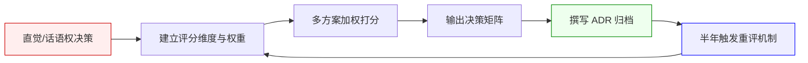

这个流程图展示了技术选型从主观臆断向量化、可追溯、可演进工程化流程的演进路径。

### 25.3.5 决策矩阵构建方法

我们采用加权评分模型，将决策问题形式化为：

$$
S_i = \sum_{j=1}^{n} w_j \times s_{ij}
$$

其中：
- $S_i$ 为方案 $i$ 的总分
- $w_j$ 为维度 $j$ 的权重（$\sum w_j = 1$）
- $s_{ij}$ 为方案 $i$ 在维度 $j$ 上的得分（通常 1-5 分）
- $n$ 为决策维度数量

这个公式将多维度的定性评估转化为单一的定量指标，便于横向对比不同技术方案的综合得分。

下表列出了构建决策矩阵时推荐的标准评分维度与权重分配，团队可根据业务场景自行调整：

| 维度 | 权重 | 评分标准（5分制） |
|------|------|-------------------|
| 生态成熟度 | 0.20 | 5=顶级生态/文档完善/周边丰富；1=小众/文档缺失/坑多 |
| 团队熟悉度 | 0.25 | 5=核心成员深度实战/可内部分享；1=全员零基础/需外包培训 |
| 性能指标 | 0.15 | 5=首屏/运行时/包体积均达标；1=存在明显性能短板 |
| 长期维护成本 | 0.20 | 5=版本稳定/迁移平滑/LTS长；1=频繁破坏性更新/维护模式 |
| 招聘市场供给 | 0.10 | 5=人才库充足/薪资合理；1=稀缺/溢价高/流失快 |
| 非功能性约束 | 0.10 | 一票否决项：合规/信创/私有化部署等硬性要求 |

### 25.3.6 典型例子：状态管理选型

我们对比 Pinia 与 Redux Toolkit，展示如何使用决策矩阵进行量化对比：

| 维度 | 权重 | Pinia 得分 | Redux 得分 | Pinia 加权 | Redux 加权 |
|------|------|------------|------------|------------|------------|
| 生态成熟度 | 0.20 | 4 | 5 | 0.80 | 1.00 |
| 团队熟悉度 | 0.25 | 5 | 2 | 1.25 | 0.50 |
| 性能指标 | 0.15 | 5 | 4 | 0.75 | 0.60 |
| 长期维护成本 | 0.20 | 5 | 3 | 1.00 | 0.60 |
| 招聘市场供给 | 0.10 | 4 | 5 | 0.40 | 0.50 |
| **总计** | **1.00** |  |  | **4.20** | **3.20** |

该表格展示了在团队核心技术栈为 Vue 的前提下，Pinia 凭借团队熟悉度与维护成本优势大幅领先。

### 25.3.7 ADR 结构化记录模版

```markdown
# ADR-001: 状态管理选型 Pinia

## 状态
Accepted

## 背景
新中后台项目需选定状态管理方案，候选：Pinia、Redux Toolkit、Vuex 4。

## 决策
采用 Pinia 作为唯一状态管理方案。

## 后果
- 正面：TypeScript 类型推导极佳、Composition API 原生支持、体积极小（~1.5KB）、无需手写 Action Type 常量
- 负面：生态工具（如 Redux DevTools 时间旅行）不如 Redux 成熟、跨框架复用受限

## 替代方案
- Redux Toolkit：团队无 React 经验，学习成本高
- Vuex 4：维护模式，TypeScript 支持较弱

> **参考标准**：业界通用的 ADR 模版（如 Michael Nygard 的 ADR 模版、Thoughtworks Technology Radar 记录格式）建议在“替代方案”节点补充决策矩阵评分对比表，增强决策的可追溯性与说服力。
```

### 25.3.8 一票否决机制与定期复盘

非功能性需求（首屏性能 < 1.5s、信创国产化兼容、私有化部署离线安装）设为**一票否决指标**。若任一候选方案在否决项上不达标，直接淘汰，不参与加权计算。

> "初始化 `pnpm-workspace.yaml`、生成标准化模版项目"
> 
> ——《20230418_117.md》

**重评触发条件清单：**
- 核心依赖发布重大版本（如 Vue 3 -> 4、React 18 -> 19）
- 团队技能结构变化（新增 30%+ 特定技能成员）
- 业务形态转型（中后台 -> 低代码平台 / 多端同构）
- 发生严重生产事故且根因指向技术选型

---

## 25.4 Monorepo 仓库治理 —— 让多包协作像单仓一样顺滑

### 25.4.1 为什么需要这个概念？

中后台业务往往拆分为：UI 组件库、请求层、业务组件、工具函数、多个子应用，多仓库管理依赖升级、代码复用、版本发布极其痛苦。传统多仓模式下，跨仓重构需开多个 PR、CI 耗时长、原子提交困难，严重拖累交付效率。包管理器（pnpm/yarn workspace）已原生支持 Monorepo，工具链成熟度满足生产落地。

> "初始化 `pnpm-workspace.yaml`、生成标准化模版项目"
> 
> ——《20230418_117.md》

> "Monorepo 多包管理、脚手架插件机制支持业务定制"
> 
> ——《20230418_118.md》

### 25.4.2 核心定义

**Monorepo** 是在单一代码仓库中管理多个相关联的 Package（Package 可独立版本、独立发布、独立构建）的代码组织策略。

**pnpm-workspace.yaml** 声明工作区包路径（如 `packages/*`、`apps/*`），配合 `pnpm install` 实现依赖提升、幽灵依赖规避、硬链接节省磁盘。

### 25.4.3 关键性质

| 性质 | 说明 |
|------|------|
| 原子提交 | 跨包重构（如修改组件库 API 同步更新所有子应用）仅需 1 个 PR、1 次 CI |
| 依赖去重 | 共享依赖提升至根节点 `node_modules/.pnpm`，磁盘占用降低 50%+，安装速度提升 2-3 倍 |
| 版本联动 | 配合 Changesets 实现“改动包自动生成 changelog、版本号自动递增、发布时自动更新依赖包版本” |

### 25.4.4 方法演进：从多仓混乱到单仓治理

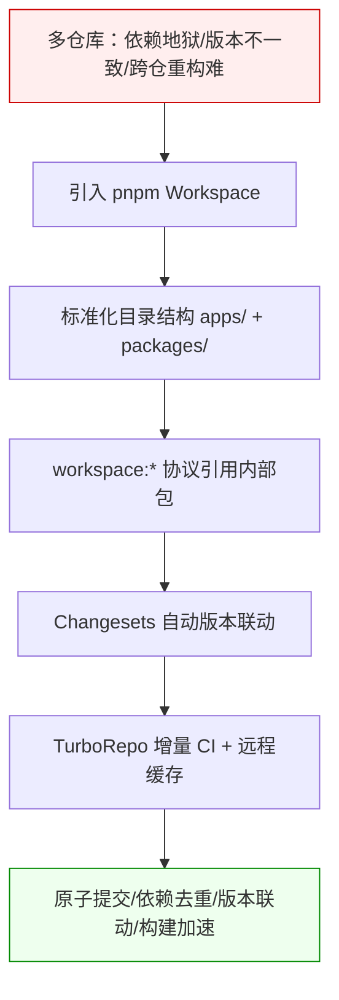

这个流程图展示了 Monorepo 治理从混乱多仓走向标准化、自动化、高效能协作的演进路径。

### 25.4.5 标准目录结构

```text
enterprise-frontend/
├── apps/
│   ├── admin/          # 主后台应用
│   ├── mobile/         # 移动端/H5 应用
│   └── portal/         # 门户/营销页
├── packages/
│   ├── ui/             # @enterprise/ui 组件库
│   ├── request/        # @enterprise/request 请求层
│   ├── shared-config/  # ESLint/TS/Prettier 共享配置
│   ├── hooks/          # @enterprise/hooks 通用组合式函数
│   └── utils/          # @enterprise/utils 工具函数库
├── pnpm-workspace.yaml
├── package.json
└── turbo.json          # TurboRepo 管道配置
```

### 25.4.6 pnpm-workspace.yaml 关键配置

```yaml
# pnpm-workspace.yaml
packages:
  - "apps/*"
  - "packages/*"
  
# 可选：忽略特定目录防止误装
# ignored:
#   - "apps/**/test/**"
```

上述配置声明了工作区包的查找路径，`pnpm install` 会将所有包的依赖提升至根目录的 `.pnpm` 存储区，通过硬链接实现磁盘去重与安装加速。

**依赖引用协议：**

```json
// apps/admin/package.json
{
  "dependencies": {
    "@enterprise/ui": "workspace:*",
    "@enterprise/request": "workspace:*",
    "@enterprise/hooks": "workspace:*"
  }
}
```

开发时 `workspace:*` 直接软链接到 `packages/*` 源码（热更新生效）；发布时 `pnpm publish` 自动替换为锁定版本号（如 `^2.3.1`）。

### 25.4.7 Changesets 版本联动流程

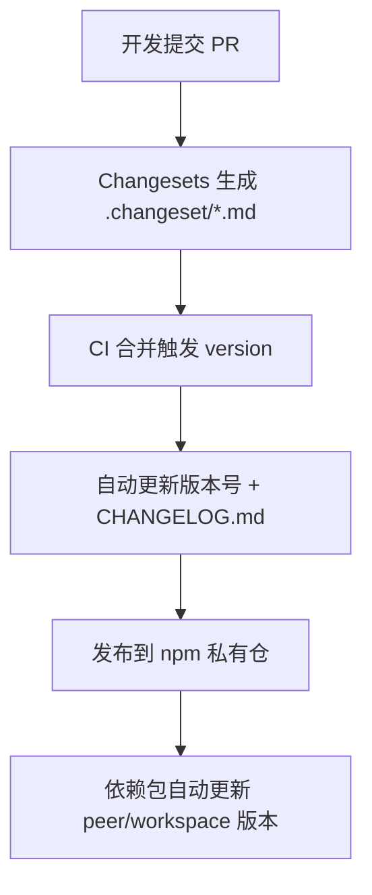

**关键命令：**

```bash
# 1. 记录变更（开发者执行）
pnpm changeset
# 交互式选择：patch/minor/major + 摘要描述

# 2. 版本号落盘（CI 执行）
pnpm changeset version
# 自动 bump 版本、生成 CHANGELOG、更新依赖包版本

# 3. 发布（CI 执行）
pnpm changeset publish
# 仅发布有变更的包，自带 tag + git push
```

### 25.4.8 CI 增量构建策略

利用 `pnpm --filter` 与 TurboRepo 实现精准受影响包分析：

```json
// turbo.json
{
  "$schema": "https://turbo.build/schema.json",
  "pipeline": {
    "build": {
      "dependsOn": ["^build"],
      "outputs": ["dist/**", ".next/**"],
      "cache": true
    },
    "lint": { "cache": true },
    "typecheck": { "cache": true },
    "test": { 
      "dependsOn": [],
      "outputs": ["coverage/**"],
      "cache": true
    }
  }
}
```

上述 TurboRepo 配置定义了任务间的依赖关系与缓存策略，`dependsOn: ["^build"]` 确保依赖包先构建，`cache: true` 开启远程缓存复用。

**CI 脚本示例（GitHub Actions）：**

```yaml
# .github/workflows/ci.yml
jobs:
  affected:
    runs-on: ubuntu-latest
    outputs:
      packages: ${{ steps.filter.outputs.packages }}
    steps:
      - uses: actions/checkout@v4
        with:
          fetch-depth: 0  # 需要完整历史计算 affected
      - uses: pnpm/action-setup@v2
      - name: Compute affected packages
        id: filter
        run: |
          # 计算变更文件影响的包 + 依赖这些包的下游
          AFFECTED=$(pnpm --filter="..." --filter="[origin/main]" list --parsable --depth=-1 2>/dev/null | sed 's/.*\///' | sort -u)
          echo "packages=$AFFECTED" >> $GITHUB_OUTPUT

  lint-typecheck-test:
    needs: affected
    if: needs.affected.outputs.packages != ''
    runs-on: ubuntu-latest
    strategy:
      matrix:
        pkg: ${{ fromJson(needs.affected.outputs.packages) }}
    steps:
      - uses: actions/checkout@v4
      - uses: pnpm/action-setup@v2
      - run: pnpm install --frozen-lockfile
      - run: pnpm --filter=${{ matrix.pkg }} run lint
      - run: pnpm --filter=${{ matrix.pkg }} run typecheck
      - run: pnpm --filter=${{ matrix.pkg }} run test
```

这个 CI 配置展示了如何利用 TurboRepo 的远程缓存与 pnpm 的过滤器，仅对变更包及其下游执行构建测试，大幅缩短 CI 耗时。

### 25.4.9 边界条件与对策

| 挑战 | 对策 |
|------|------|
| 仓库体积随历史增长 | `git clone --depth=1` 浅克隆 CI；大型二进制资产走 Git LFS；定期 `git gc` 与分支清理 |
| 权限管控粒度粗 | 敏感业务（风控/支付核心）拆分独立私有仓库，通过 `workspace:*` 引入公共包 |
| CI 缓存策略复杂 | TurboRepo 远程缓存（Vercel/自建 S3）+ `pnpm --filter=... --filter=dependents` 精准增量 |

---

## 25.5 基础设施封装层 —— 造好“轮子”让业务跑得飞快

### 25.5.1 为什么需要这个概念？

直接在业务代码中裸用 Ant Design、Axios、Vue Router 会导致：API 耦合业务逻辑、切换底层库成本高、横切关注点（鉴权、国际化、异常、监控）散落各处。每个项目重复造“封装轮子”浪费人力，且质量参差不齐，缺乏统一技术标准。中后台高频场景（CRUD 表格、复杂表单、权限控制、主题切换）需沉淀为开箱即用的“企业级脚手架能力”。

> "封装 `@enterprise/ui` 组件库（基于 Ant Design/Arco Design）"
> 
> "`@enterprise/request` 统一错误/Loading/Token 刷新"
> 
> "RBAC 权限指令/组件、动态路由注册、i18n/a11y 基线、Sentry/自建监控 SDK 接入"
> 
> ——《20230418_117.md》至《20230418_126.md》

### 25.5.2 核心定义与架构分层

```mermaid
graph TB
    subgraph 业务层
        B1[页面组件]
        B2[业务 Hooks]
    end
    
    subgraph 基础设施封装层 @enterprise/*
        I1[@enterprise/ui<br/>组件库二次封装]
        I2[@enterprise/request<br/>请求层封装]
        I3[@enterprise/rbac<br/>权限体系]
        I4[@enterprise/router<br/>动态路由/菜单]
        I5[@enterprise/i18n<br/>国际化]
        I6[@enterprise/obs<br/>可观测性 SDK]
    end
    
    subgraph 底层依赖
        D1[Ant Design / Arco Design]
        D2[Axios / Fetch]
        D3[Vue Router / Pinia]
        D4[Sentry / 自建监控]
    end
    
    B1 --> I1
    B1 --> I2
    B1 --> I3
    B1 --> I4
    B1 --> I5
    B1 --> I6
    I1 --> D1
    I2 --> D2
    I3 --> D3
    I4 --> D3
    I5 --> D3
    I6 --> D4
```

这个架构分层图展示了基础设施封装层如何作为“适配器”层，隔离业务代码与底层技术栈变更。

### 25.5.3 方法演进：从裸用底层库到零侵入封装层

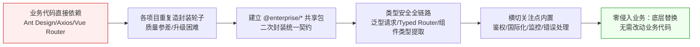

这个流程图展示了基础设施封装层从“裸用底层库”演进到“统一封装、类型安全、横切内置、零侵入业务”的完整路径。

### 25.5.4 @enterprise/ui：组件库二次封装

**设计原则：**
- **统一契约**：暴露标准化 Props/Events/Slots，内部适配 Ant Design/Arco Design 差异
- **类型安全**：利用 `vue-component-type-helpers` 或 `ComponentPropsWithoutRef` 提取完整类型
- **主题变量注入**：CSS Variables + Design Tokens，支持运行时动态切换主题/暗黑模式
- **权限指令内置**：`v-auth` 指令自动按钮级权限控制

**关键实现片段：**

```typescript
// packages/ui/src/components/ProTable/index.ts
import type { ComponentPublicInstance } from 'vue'
import type { TableColumnCtx } from 'element-plus/es/components/table/src/table-column/defaults'

// 统一列配置类型（Schema 驱动核心）
export interface ProTableColumn<T = any> {
  prop: string
  label: string
  width?: string | number
  sortable?: boolean | 'custom'
  searchable?: boolean
  fixed?: boolean | 'left' | 'right'
  // 逃逸口：自定义渲染函数
  render?: (row: T, index: number, column: TableColumnCtx<T>) => VNode | string
  // 表单联动配置
  form?: ProFormItemSchema
  // 权限控制
  auth?: string | string[]
}

// 组件暴露的方法类型（供 ref 调用）
export interface ProTableExpose<T = any> {
  reload: () => Promise<void>
  getSelectedRows: () => T[]
  clearSelection: () => void
  toggleColumn: (prop: string, visible: boolean) => void
}
```

上述代码定义了 `ProTable` 组件的核心类型契约：列配置支持声明式属性与函数式渲染逃逸口，暴露方法满足外部命令式调用需求。这种设计使得 `ProTable` 能作为 Schema 驱动开发的核心运行时组件，既保证类型安全，又通过 `render` 函数与 `form` 联动配置支持复杂业务场景。

### 25.5.5 @enterprise/request：统一请求层

**核心能力矩阵：**

| 能力 | 实现要点 |
|------|----------|
| 统一错误码处理 | 响应拦截器匹配 `code !== 200` 统一弹窗/Message，401 触发登录态刷新 |
| Loading 自动管理 | 基于请求计数器 + `v-loading` 指令/全局 Loading 实例，可配置 `showLoading: false` 关闭 |
| Token 无感刷新 | 401 拦截 -> 单飞刷新 Token（防并发锁） -> 重放原请求队列 |
| 拦截器链 | `requestInterceptors` / `responseInterceptors` 数组，支持插件式注册（日志、埋点、签名） |
| Mock/MSW 切换 | 环境变量 `VITE_MOCK_MODE=msw` 切换 Service Worker 拦截，零侵入业务代码 |

**类型安全全链路：**

```typescript
// packages/request/src/index.ts
import axios, { AxiosRequestConfig, AxiosResponse } from 'axios'

// 泛型响应包装
export interface ApiResponse<T> {
  code: number
  message: string
  data: T
  traceId: string
}

// 核心请求函数：泛型推导出 data 类型
export function request<T = any>(config: AxiosRequestConfig): Promise<ApiResponse<T>>
export function request<T = any>(url: string, config?: AxiosRequestConfig): Promise<ApiResponse<T>>

// 业务调用示例
interface User { id: string; name: string; roles: string[] }
const { data } = await request<User>('/api/user/profile')
// data 类型自动推导为 User
```

上述代码通过泛型参数 `T` 实现了从请求配置到响应数据的类型全链路推导，业务代码仅需定义 `User` 接口即可获得完整的类型提示。

### 25.5.6 RBAC 三位一体权限体系

```mermaid
graph LR
    A[后端返回权限码列表<br/>['user:create', 'user:delete']] --> B(Pinia Store: userStore.permissions)
    B --> C1[v-auth 指令<br/>元素级显隐]
    B --> C2[Auth 组件<br/>组件级包裹]
    B --> C3[路由守卫<br/>页面级拦截]
    C1 --> D[业务页面]
    C2 --> D
    C3 --> D
```

**使用示例：**

```vue
<!-- 1. 指令级：细粒度按钮控制 -->
<el-button v-auth="'user:create'">新增用户</el-button>
<el-button v-auth="['user:update', 'user:delete']">批量操作</el-button>

<!-- 2. 组件级：整块区域权限 -->
<Auth :permissions="['report:export']" fallback="无导出权限">
  <ProTable :columns="columns" :request-api="fetchReport" />
</Auth>

<!-- 3. 路由级：页面准入 -->
// router/modules/system.ts
{
  path: 'user',
  component: () => import('@/views/system/user/index.vue'),
  meta: { roles: ['admin', 'system:user:view'] }
}
```

### 25.5.7 动态路由注册全流程

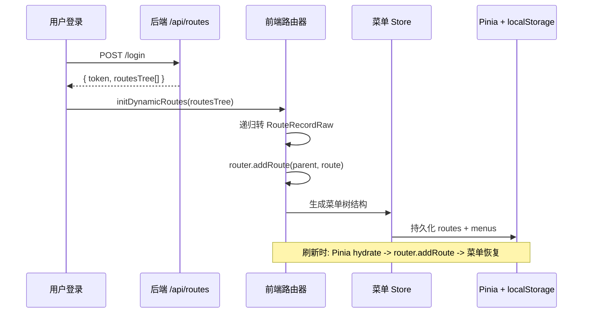

### 25.5.8 可观测性内置

| 埋点位置 | 上报字段 | 用途 |
|----------|----------|------|
| 请求拦截器 | `traceId`、`apiPath`、`duration`、`statusCode` | 链路追踪/性能分析/错误率统计 |
| 组件渲染 | `componentName`、`renderTime`、`propsSize` | 组件性能热力图/大屏监控 |
| 错误边界 | `errorStack`、`componentStack`、`userId`、`route` | Sentry 告警/根因定位/影响面评估 |

---

## 25.6 Schema 驱动开发 —— 让配置生成代码，告别重复 CRUD

### 25.6.1 为什么需要这个概念？

中后台 80% 页面是“列表+详情/表单”的 CRUD 变体，手写 Vue/React 模板代码极其机械、易出错、维护成本高。后端接口字段、前端表单校验、表格列、搜索条件、Excel 导出列定义高度同构，单源头维护可消灭不一致。非技术人员（产品/运营）可通过可视化配置平台直接生成页面，释放研发带宽。

> "沉淀 `ProTable`/`ProForm`/`ProChart` 通用组件、Schema 驱动页面生成"
> 
> "典型 CRUD 页面标准化、复杂表单/表格/可视化组件封装"
> 
> ——《20230418_117.md》至《20230418_126.md》

### 25.6.2 核心定义

**Schema** 是描述页面结构的 JSON 对象，包含四大元数据：

```typescript
interface PageSchema {
  // 字段元数据
  fields: FieldSchema[]
  // 布局结构
  layout: LayoutSchema
  // 交互动作
  actions: ActionSchema[]
  // 接口映射
  api: ApiSchema
}

interface FieldSchema {
  // 唯一标识
  name: string
  // 显示标签
  label: string
  // 组件类型：input/select/date-picker/tree-select/editor/upload/...
  type: string
  // 校验规则
  validator?: ValidatorRule[]
  // 选项数据（静态/异步）
  options?: Option[] | (() => Promise<Option[]>)
  // 组件透传 Props
  props?: Record<string, any>
  // 表格列配置
  tableColumn?: Partial<ProTableColumn>
  // 表单项配置
  formItem?: Partial<ProFormItemSchema>
  // 可见性/只读/禁用 表达式
  visible?: boolean | ((formValues) => boolean)
  readonly?: boolean | ((formValues) => boolean)
  // 字段联动依赖
  dependencies?: string[]
}
```

### 25.6.3 方法演进：从手写模板到 Schema 驱动全链路

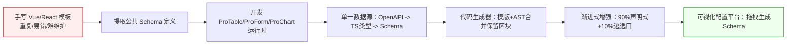

这个流程图展示了 Schema 驱动开发从手写模板走向声明式运行时、代码生成、可视化搭建的完整演进路径。

### 25.6.4 单一数据源链路

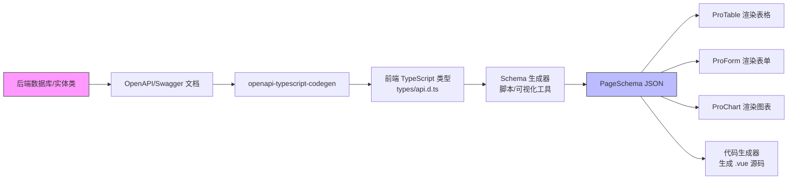

这个数据流图展示了从后端实体到前端渲染的“单一数据源”链路：字段变更只需在源头修改，经代码生成器流转至 Schema，驱动所有下游渲染与生成。

### 25.6.5 ProTable/ProForm/ProChart 运行时解释执行

**核心运行时逻辑（以 ProTable 为例）：**

```vue
<!-- packages/ui/src/components/ProTable/ProTable.vue -->
<script setup lang="ts">
import { ref, computed, watch } from 'vue'
import type { ProTableColumn, ProTableExpose } from './types'

interface Props {
  columns: ProTableColumn[]
  requestApi: (params: any) => Promise<{ list: any[]; total: number }>
  rowKey: string
  settingsKey?: string
}

defineExpose<ProTableExpose>({
  reload: loadData,
  getSelectedRows: () => selectedRows.value,
  clearSelection: () => { selectedRows.value = [] },
  toggleColumn: (prop, visible) => { /* 更新列显隐配置 */ }
})

// 1. 搜索表单自动生成：筛选 searchable: true 的列
const searchColumns = computed(() => 
  props.columns.filter(c => c.searchable).map(c => ({
    prop: c.prop,
    label: c.label,
    type: c.form?.type || 'input',
    options: c.form?.options,
    props: c.form?.props
  }))
)

// 2. 分页参数映射（适配后端约定）
const pageParams = computed(() => ({
  pageNum: pagination.value.page,
  pageSize: pagination.value.pageSize,
  ...searchForm.value
}))

// 3. 加载数据
async function loadData() {
  loading.value = true
  try {
    const { list, total } = await props.requestApi(pageParams.value)
    tableData.value = list
    pagination.value.total = total
  } finally {
    loading.value = false
  }
}

// 4. 列设置持久化
const settingsKey = props.settingsKey || `pro-table-${props.rowKey}`
const columnSettings = ref(loadSettings(settingsKey))
watch(columnSettings, v => saveSettings(settingsKey, v), { deep: true })
</script>

<template>
  <div class="pro-table-container">
    <!-- 搜索栏自动生成 -->
    <ProForm :columns="searchColumns" v-model="searchForm" @submit="loadData" inline />
    
    <!-- 表格主体 -->
    <el-table 
      :data="tableData" 
      :columns="visibleColumns" 
      :row-key="rowKey"
      v-loading="loading"
    >
      <!-- render 逃逸口渲染自定义单元格 -->
      <template #default="scope">
        <component 
          v-for="col in visibleColumns" 
          :key="col.prop"
          :is="col.render ? 'CustomCell' : 'DefaultCell'"
          :row="scope.row" 
          :column="col"
        />
      </template>
    </el-table>
    
    <!-- 分页 + 列设置面板 -->
    <Pagination v-model:page="pagination.page" v-model:page-size="pagination.pageSize" :total="pagination.total" />
    <ColumnSettingsPanel :columns="props.columns" v-model:visible="columnSettings" />
  </div>
</template>
```

上述组件展示了 `ProTable` 的核心运行时逻辑：根据 Schema 自动生成搜索表单、处理分页参数映射、执行数据加载、持久化列设置，并通过 `render` 函数逃逸口支持复杂单元格定制。

### 25.6.6 代码生成器：从 Schema 到源码

**生成流水线：**

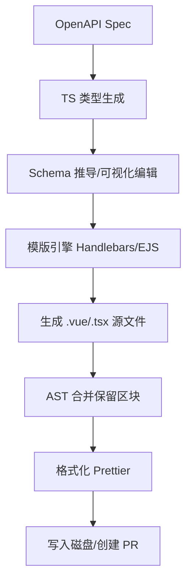

**模版片段（Handlebars）：**

```handlebars
<!-- templates/page/ProTablePage.hbs -->
<template>
  <ProTable 
    :columns="columns"
    :request-api="fetch{{pascalCase entityName}}List"
    row-key="{{rowKey}}"
    settings-key="{{kebabCase entityName}}-table"
  />
</template>

<script setup lang="ts">
import { {{pascalCase entityName}}Schema } from '@/schemas/{{kebabCase entityName}}'
import { fetch{{pascalCase entityName}}List } from '@/api/{{kebabCase entityName}}'

// [CUSTOM_BEGIN: imports]
// 此处保留手写导入，重新生成时不覆盖
// [CUSTOM_END: imports]

const columns = {{pascalCase entityName}}Schema.fields
  .filter(f => f.tableColumn !== false)
  .map(f => ({ ...f.tableColumn, prop: f.name, label: f.label }))
</script>
```

**保留区块策略（AST 合并）：**

```typescript
// 生成器核心逻辑：基于 jscodeshift 合并
import { readFileSync, writeFileSync } from 'fs'
import j from 'jscodeshift'

function mergeGeneratedWithExisting(generatedCode: string, existingPath: string) {
  const existingSource = readFileSync(existingPath, 'utf-8')
  const generatedAst = j(generatedCode)
  const existingAst = j(existingSource)
  
  // 1. 找到所有 [CUSTOM_BEGIN: xxx] ... [CUSTOM_END: xxx] 区块
  const customBlocks = existingAst.find(j.CommentBlock)
    .filter(c => c.value.includes('CUSTOM_BEGIN'))
    .map(c => extractBlock(existingSource, c))
  
  // 2. 将自定义区块注入生成的 AST 对应位置
  customBlocks.forEach(block => {
    generatedAst.find(j.CommentBlock, { value: `CUSTOM_BEGIN: ${block.name}` })
      .replaceWith(block.content)
  })
  
  writeFileSync(existingPath, generatedAst.toSource({ quote: 'single' }))
}
```

上述代码生成器利用 `jscodeshift` 解析 AST，识别并保留标记为 `[CUSTOM_BEGIN]` 到 `[CUSTOM_END]` 的手写代码区块，实现“重复生成不覆盖业务逻辑”的核心能力。

### 25.6.7 渐进式增强：90% Schema + 10% 逃逸口

| 场景 | Schema 声明式覆盖 | 逃逸口方案 |
|------|-------------------|------------|
| 标准 CRUD | 100% | 无需逃逸 |
| 字段联动/级联 | `dependencies` + `asyncOptions` | 无需逃逸 |
| 复杂校验 | `validator: [(rule, value) => Promise]` | 无需逃逸 |
| 自定义单元格渲染 | `render: (row) => h(Tag, row.status)` | `render` 函数 |
| 复杂表单布局 | `layout: { type: 'grid', cols: 2 }` / `tabs` / `steps` | `layout.render` |
| 非标准交互（拖拽/画板/实时协同） | 不覆盖 | **Slots 插槽** / **组合式 API `useProForm()` 完全接管** |

---

## 25.7 质量门禁流水线 —— 让“不合格代码”无法入库

### 25.7.1 为什么需要这个概念？

代码评审靠人肉无法覆盖：性能退化、安全漏洞、无障碍缺陷、包体积超标、类型错误、测试覆盖率下降均需自动化工具拦截。“跑通流程 ≠ 质量达标”，必须建立量化指标阈值（性能预算、覆盖率底线、严重漏洞零容忍）作为 CI 红线，自动阻断合并。反馈越左移成本越低：本地 pre-commit -> CI Pipeline -> 预发布环境 -> 生产监控，构建多层防御体系。

> "配置 GitLab CI/GitHub Actions：Lint/TypeCheck/Unit/E2E/Build/Scan/Deploy"
> 
> "性能预算/安全扫描/axe 无障碍阈值阻断"
> 
> "ArgoCD 金丝雀发布、混沌工程演练回滚"
> 
> ——《20230418_117.md》至《20230418_126.md》

### 25.7.2 核心定义：七阶段流水线

```mermaid
graph LR
    A[代码推送 PR] --> B[Lint<br/>ESLint/Stylelint/Markdownlint]
    B --> C[TypeCheck<br/>tsc --noEmit]
    C --> D[Test:Unit<br/>Vitest + Coverage]
    D --> E[Test:E2E<br/>Playwright 核心链路]
    E --> F[Build<br/>Vite 生产构建]
    F --> G[Scan<br/>漏洞/密钥/体积分析]
    G --> H[Deploy<br/>ArgoCD GitOps 同步]
    
    style B fill:#ffe,stroke:#333
    style C fill:#ffe,stroke:#333
    style D fill:#efe,stroke:#333
    style E fill:#efe,stroke:#333
    style F fill:#eef,stroke:#333
    style G fill:#fee,stroke:#333
    style H fill:#efe,stroke:#333
```

### 25.7.3 方法演进：从事后检查到左移防御体系

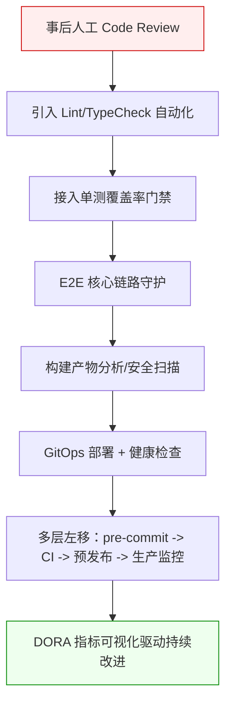

这个流程图展示了质量门禁从单一事后审查演进为分阶段拦截、多层左移、数据驱动改进的完整体系。

### 25.7.4 量化红线阈值表

下表定义了流水线各阶段的量化红线阈值，超过阈值将阻断合并：

| 指标类别 | 具体指标 | 阈值（阻断合并） | 采集工具 |
|----------|----------|------------------|----------|
| 代码规范 | ESLint Error | 0 个 | ESLint |
| 类型安全 | TypeScript Error | 0 个 | `tsc --noEmit` |
| 测试覆盖率 | Statements/Branches/Functions/Lines | ≥ 80%（核心包 ≥ 95%） | Vitest + c8/istanbul |
| 包体积 | 首屏 JS gzip | < 500 KB | `rollup-plugin-visualizer` / `vite-bundle-analyzer` |
| 性能预算 | LCP / CLS / INP | < 2.5s / < 0.1 / < 200ms | Lighthouse CI / WebPageTest |
| 安全漏洞 | 高危/严重漏洞 | 0 个 | `pnpm audit` / Snyk / Trivy |
| 密钥泄露 | Secret Scan | 0 个 | GitLeaks / TruffleHog |
| 无障碍 | axe-core 违规 | 0 个（Critical/Serious） | axe-playwright / Lighthouse CI |

### 25.7.5 GitOps 发布与 ArgoCD 配置

```yaml
# argocd/application.yaml
apiVersion: argoproj.io/v1alpha1
kind: Application
metadata:
  name: enterprise-frontend
  namespace: argocd
spec:
  project: production
  source:
    repoURL: https://github.com/org/enterprise-frontend.git
    targetRevision: main
    path: manifests/overlays/production
  destination:
    server: https://kubernetes.default.svc
    namespace: frontend
  syncPolicy:
    automated:
      prune: true
      selfHeal: true
      allowEmpty: false
    syncOptions:
      - CreateNamespace=true
      - PrunePropagationPolicy=foreground
    retry:
      limit: 5
      backoff:
        duration: 5s
        factor: 2
        maxDuration: 3m
  # 生命周期钩子
  hooks:
    - name: pre-sync-migration
      kind: Job
      # 跑数据库迁移/冒烟测试
    - name: post-sync-healthcheck
      kind: Job
      # 健康检查：HTTP 200 / 关键 API 可用
```

上述 ArgoCD 配置定义了 GitOps 发布流程：通过 `pre-sync` 钩子执行数据库迁移与冒烟测试，`post-sync` 钩子执行健康检查，配合自动化同步策略（`prune`、`selfHeal`）与重试机制，确保部署过程的安全性与可恢复性。

### 25.7.6 多层左移防御体系

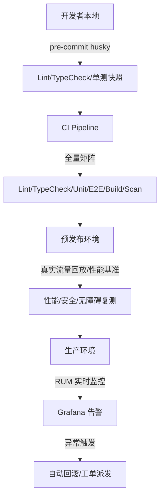

**本地 pre-commit 配置（.husky/pre-commit）：**

```bash
#!/usr/bin/env sh
. "$(dirname -- "$0")/_/husky.sh"

# 仅检查暂存文件，极速反馈
pnpm lint-staged

# lint-staged.config.js
export default {
  '*.{vue,ts,js,jsx,tsx}': ['eslint --fix', 'prettier --write'],
  '*.{css,scss,less}': ['stylelint --fix', 'prettier --write'],
  '*.md': ['markdownlint --fix', 'prettier --write']
}
```

上述配置通过 Husky 在 `pre-commit` 钩子触发 `lint-staged`，仅对暂存文件执行格式化与静态检查，实现毫秒级反馈，将质量门禁前移到开发者本地。

### 25.7.7 可视化看板：DORA 四大指标

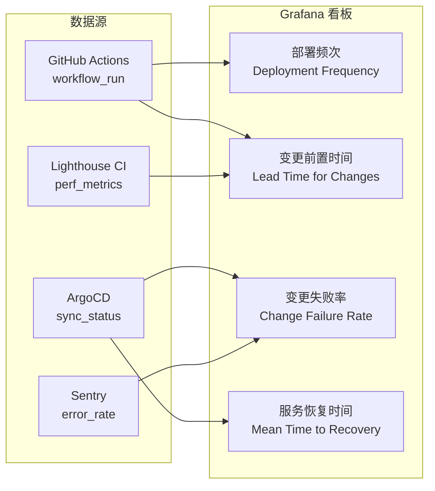

---

## 25.8 架构演进与知识沉淀 —— 让系统在变化中进化

### 25.8.1 为什么需要这个概念？

业务快速迭代必然产生技术债务（硬编码配置、组件重复造轮子、类型 `any` 泛滥、测试缺失），不主动治理会拖垮交付速度。团队隐性知识（踩坑经验、最佳实践、架构决策背景）流失风险高，需显性化沉淀为组织资产。技术栈演进（Vue 3 -> 4、Vite 5 -> 6、新 CSS 特性、WASM 落地）需要有计划的预研与平滑升级路径。

> "定期产出《技术债务清单》《重构提案 ADR》《组件复用率报告》"
> 
> "建立团队技术周会/月度深度分享/季度架构评审机制"
> 
> "沉淀《前端架构演进白皮书》"
> 
> ——《20230418_117.md》至《20230418_126.md》

### 25.8.2 核心定义与治理闭环

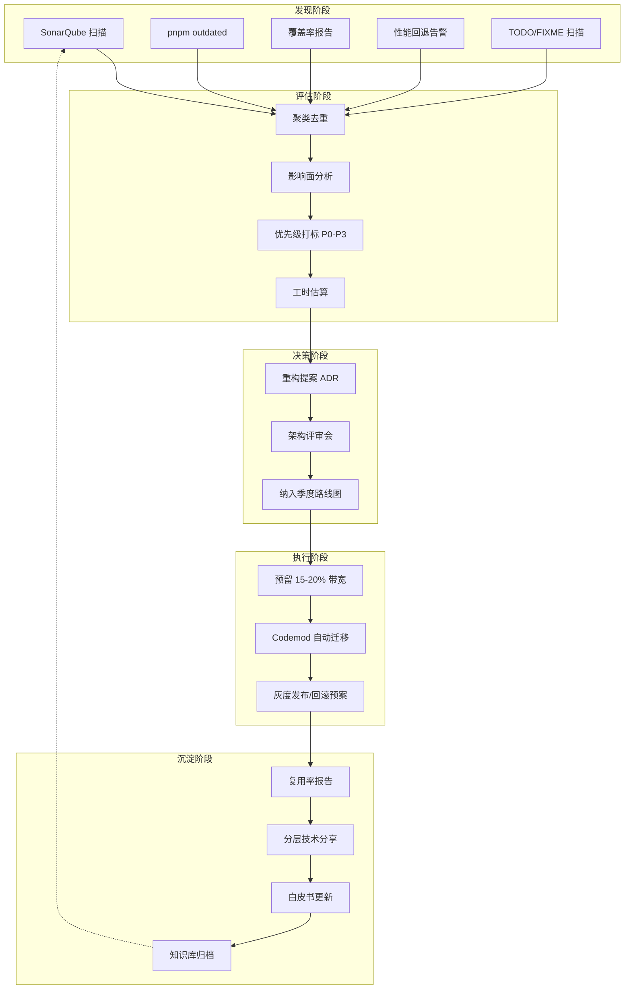

这个时序图展示了从技术债务发现到知识沉淀的完整治理闭环，形成持续演进的飞轮效应。

### 25.8.3 方法演进：从被动修补到主动治理

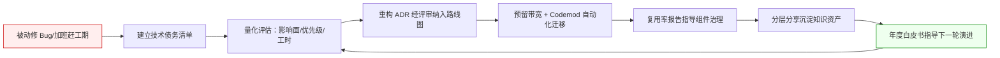

这个流程图展示了架构演进从被动修补走向主动治理、数据驱动、知识飞轮的战略层面演进路径。

### 25.8.4 技术债务清单标准化字段

下表定义了技术债务清单的标准化记录字段：

| 字段 | 说明 | 示例 |
|------|------|------|
| ID | 唯一标识 | DEBT-2024-001 |
| 分类 | 代码/依赖/架构/测试/文档 | 依赖 |
| 描述 | 具体问题 | `core-js@2` 存在原型污染漏洞，需升级至 3.x |
| 影响面 | 模块/人数/频次 | 全站/12人/每日构建 |
| 优先级 | P0(立即)/P1(本冲刺)/P2(本季度)/P3(待定) | P0 |
| 预估工时 | 人日 | 3md |
| 责任人 | Owner | @zhangsan |
| 状态 | 待处理/进行中/已解决/已忽略 | 进行中 |
| 关联 ADR | 重大重构关联 ADR 编号 | ADR-045 |

### 25.8.5 重构提案 ADR 实例：Ant Design v4 -> v5 升级

```markdown
# ADR-045: 组件库升级 Ant Design v4 -> v5

## 状态
Accepted

## 背景
- Ant Design v4 于 2023 年停止维护，无安全补丁
- v5 引入 CSS-in-JS (React) / CSS Variables (Vue)，主题能力质变，包体积减少 15%
- 当前代码库 200+ 组件引用，约 80 个破坏性 API 变更

## 备选方案评估矩阵

| 方案 | 成本(人日) | 收益 | 风险 | 周期 | 评分 |
|------|------------|------|------|------|------|
| 就地升级 | 60 | 高 | 极高(一次性全量改动) | 2周 | ⭐⭐ |
| 并行双版本灰度 | 90 | 高 | 可控(逐应用迁移) | 3个月 | ⭐⭐⭐⭐⭐ |
| 迁移至 Arco Design | 120 | 中 | 高(生态差异/团队学习) | 4个月 | ⭐⭐⭐ |

上述矩阵从成本、收益、风险、周期四个维度对比了三种升级策略，并行双版本灰度方案综合评分最高。

## 决策
采用**并行双版本灰度**策略：
1. Monorepo 引入 `@enterprise/ui-v4` 与 `@enterprise/ui-v5` 共存
2. 编写 Codemod 脚本覆盖 80% 破坏性 API（`ConfigProvider` 迁移、`Form` API 统一、Icon 组件替换）
3. 子应用按业务优先级逐个迁移：`apps/portal` -> `apps/mobile` -> `apps/admin`
4. 每迁移一个应用跑全量 E2E + 视觉回归测试
5. 回滚预案：Git revert + ArgoCD 回滚部署，RTO < 10 分钟

## 后果
- 正面：零停机平滑升级、主题系统现代化、长期维护保障
- 负面：3 个月维护双版本依赖、节点模块体积临时增加 ~15%

## 替代方案
- 若 v5 在 Vue 生态稳定性不足，可回退至 Arco Design 方案（已完成 PoC 验证）
```

### 25.8.6 组件复用率报告驱动治理

```typescript
// packages/ui/scripts/generate-reuse-report.ts
interface ComponentUsageStats {
  name: string
  importCount: number        // 被引用次数
  consumerApps: string[]     // 消费应用列表
  customBranches: number     // 定制化分支数（fork/扩展组件）
  bundleSize: number         // gzip KB
  maintenanceCost: 'high' | 'medium' | 'low'
  recommendation: 'keep' | 'enhance' | 'deprecate' | 'merge'
}

// 判定逻辑
function evaluate(stats: ComponentUsageStats): ComponentUsageStats {
  if (stats.importCount < 5 && stats.customBranches === 0) {
    stats.recommendation = 'deprecate'  // 僵尸组件
  } else if (stats.importCount > 50 && stats.customBranches > 3) {
    stats.recommendation = 'enhance'    // 高价值但定制多，下沉配置
  } else if (stats.customBranches > 5) {
    stats.recommendation = 'merge'      // 定制过多，合并回标准组件
  } else {
    stats.recommendation = 'keep'
  }
  return stats
}
```

上述脚本定义了组件复用率统计的核心指标与判定逻辑：通过 `importCount` 识别高频复用组件，通过 `customBranches` 发现定制化过度的组件，进而给出 `deprecate/enhance/merge/keep` 四类治理建议。

**治理动作映射：**

| 推荐动作 | 触发条件 | 处理方式 |
|----------|----------|----------|
| deprecate | 引用 < 5 且无定制 | 标记弃用、文档下线、下个大版本移除 |
| enhance | 引用 > 50 且定制 > 3 | 提炼通用配置项、减少定制分支 |
| merge | 定制 > 5 | 重构标准组件吸收通用定制、废弃分支 |
| keep | 其他 | 维持现状 |

### 25.8.7 分层技术分享体系

| 频次 | 形式 | 时长 | 内容要求 | 产出物 |
|------|------|------|----------|--------|
| 周会 | 轻量分享 | 15min | 踩坑复盘/新特性尝鲜/工具推荐 | 会议纪要 + 代码片段 |
| 月度 | 深度分享 | 1h | 源码解析/架构复盘/性能优化实战 | PPT + Demo 仓库 + 复盘文档 |
| 季度 | 架构评审 | 2h | ADR 评审/路线图对齐/技术债务专项 | 评审决议 + 更新路线图 |
| 年度 | 白皮书发布 | - | 全年架构演进总结/技术选型复盘/下一年规划 | 《前端架构演进白皮书》 |

---

## 25.9 AI 赋能前端工程化新范式 —— 从“手写代码”到“智能研发闭环”

### 25.9.1 为什么需要这个概念？

大模型能力跃迁使 AI 能胜任代码生成、重构、测试、文档、评审等全链路研发任务，但缺乏工程化落地范式导致“玩具化”应用。团队面临：Prompt 管理混乱、上下文窗口不足、幻觉风险、私有代码泄露、模型能力与业务场景错位等工程化挑战。需要建立“提示词即代码、RAG 即知识库、Agent 即自动化、Review 即质检、微调即专家”的系统性工程体系。

> "AI 编程助手现状：GitHub Copilot/Cursor/Codeium 对比、提示词工程模式、上下文窗口管理"
> 
> "RAG 在前端知识库落地：代码库切片、向量化检索、重排序、上下文注入与幻觉控制"
> 
> "Agent 工作流自动化：需求拆解→代码生成→测试验证→提交 PR 的闭环与人工介入点设计"
> 
> "前端专用模型微调：CodeLlama/DeepSeek-Coder 继续预训练、指令微调、RLHF 对齐前端最佳实践"
> 
> "实战：接入 AI Code Review 机器人——规范检查、安全扫描、性能建议、单测补全自动化"
> 
> ——《HgjLdWdxHo8ezoxv9iLc4HSwnAh.md》

### 25.9.2 核心定义与全景架构

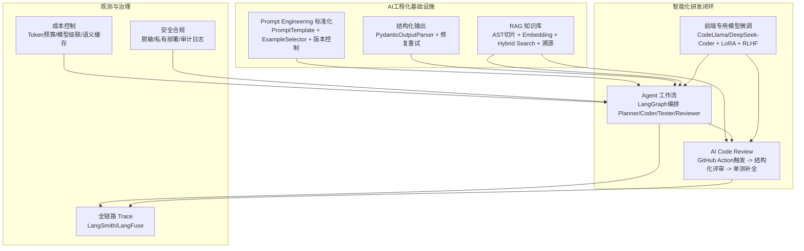

这个架构图展示了 AI 赋能前端工程化的三大支柱：基础设施层、智能化研发闭环、观测与治理。

### 25.9.3 方法演进：从辅助编码到智能研发闭环

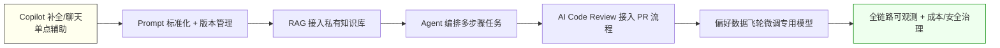

这个流程图展示了 AI 辅助前端研发从单点补全工具演进为标准化、知识化、自动化、专用化、可观测的系统性工程体系的演进路径。

### 25.9.4 Prompt Engineering 标准化

**结构化提示词模版（PromptTemplate）：**

```python
# prompts/code_generation/system_prompt.py
from langchain.prompts import PromptTemplate

CODE_GEN_SYSTEM_PROMPT = PromptTemplate(
    template="""你是资深前端架构师，擅长 Vue 3 + TypeScript + Pinia + @enterprise/* 生态开发。

## 核心约束
1. 严格遵循团队《前端编码规范 v2.3》
2. 仅使用 @enterprise/ui 组件库，禁止直接引入 Ant Design/Element Plus
3. 所有 API 调用必须通过 @enterprise/request
4. 权限控制使用 v-auth 指令 / Auth 组件
5. 类型定义引用 @enterprise/shared-types
6. 生成代码必须通过 ESLint/TypeCheck/单测

## 输出格式
{format_instructions}

## 少样本参考
{examples}
""",
    input_variables=["format_instructions", "examples"]
)
```

上述 `PromptTemplate` 将核心约束（规范、组件库、请求层、权限、类型、质量门禁）固化为结构化模版，通过 `format_instructions` 与 `examples` 变量实现输出格式约束与动态少样本注入，确保生成代码符合团队工程化标准。

**动态少样本检索（ExampleSelector）：**

```python
# 基于语义相似度从向量库检索最相关的 3 个示例
from langchain.example_selectors import SemanticSimilarityExampleSelector
from langchain.vectorstores import Chroma
from langchain.embeddings import HuggingFaceEmbeddings

example_selector = SemanticSimilarityExampleSelector(
    vectorstore=Chroma(
        persist_directory="./.prompt_examples",
        embedding_function=HuggingFaceEmbeddings(model_name="BAAI/bge-small-zh-v1.5")
    ),
    k=3
)
```

上述代码展示了如何通过 `SemanticSimilarityExampleSelector` 实现动态少样本检索：根据当前任务语义，从向量库中自动召回最相关的 3 个历史最佳实践示例注入 Prompt，显著提升生成代码的规范一致性。

### 25.9.5 RAG 知识库落地：代码库变知识图谱

**索引构建流水线：**

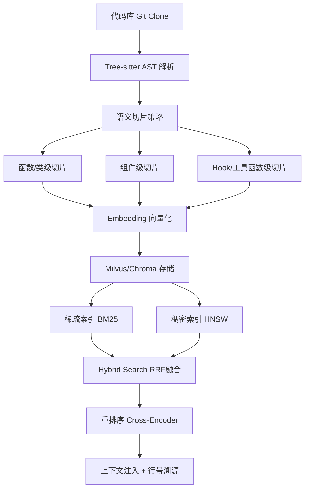

**关键参数配置：**

下表列出了 RAG 知识库落地各环节的关键技术选型建议：

| 环节 | 选型建议 | 理由 |
|------|----------|------|
| AST 解析器 | Tree-sitter (TypeScript/TSX/Vue) | 增量解析快、语言支持全、错误恢复强 |
| 切片粒度 | 函数/类/组件级（保留上下文 50 行） | 平衡检索精度与 Token 消耗 |
| Embedding 模型 | BGE-small-zh-v1.5 / text-embedding-3-small | 中文代码语义理解佳/维度低/延迟低 |
| 向量库 | Milvus (生产) / Chroma (开发) | Milvus 支持十亿向量、混合检索、多租户 |
| 混合检索 | BM25 + 向量 RRF (Reciprocal Rank Fusion) | 关键词精准匹配 + 语义模糊召回互补 |
| 重排序 | BGE-reranker-base / Cohere Rerank | 提升 Top-K 精度，过滤噪声 |

### 25.9.6 Agent 自动化工作流：从需求到 PR

**LangGraph 编排示例：**

```python
# agents/development_workflow.py
from langgraph.graph import StateGraph, END
from typing import TypedDict, List, Optional

class DevState(TypedDict):
    prd: str                    # 产品需求文档
    tasks: List[Task]           # 拆解任务
    code_files: Dict[str, str]  # 生成的代码文件
    test_results: TestResult    # 测试结果
    review_comments: List[ReviewComment]  # 评审意见
    human_approval: bool        # 人工审批
    pr_url: Optional[str]       # PR 链接

# 定义节点
def planner(state: DevState) -> DevState:
    """Planner: PRD -> 任务拆解 + 技术方案"""
    tasks = llm.invoke(PLANNER_PROMPT.format(prd=state['prd']))
    return {**state, 'tasks': tasks}

def coder(state: DevState) -> DevState:
    """Coder: 任务 -> 代码生成 (并行)"""
    code_files = {}
    for task in state['tasks']:
        if task.type == 'codegen':
            code = llm.invoke(CODER_PROMPT.format(
                task=task, 
                context=retrieve_context(task, rag_store),  # RAG 检索上下文
                schemas=load_schemas()
            ))
            code_files[task.file_path] = code
    return {**state, 'code_files': code_files}

def tester(state: DevState) -> DevState:
    """Tester: 代码 -> 单测生成 + 运行验证"""
    test_files = generate_tests(state['code_files'])
    result = run_tests(test_files)  # Vitest + Playwright
    return {**state, 'test_results': result}

def reviewer(state: DevState) -> DevState:
    """Reviewer: 代码 + 测试结果 -> 结构化评审"""
    comments = llm.invoke(REVIEWER_PROMPT.format(
        code=state['code_files'],
        tests=state['test_results'],
        eslint=run_eslint(state['code_files']),
        typecheck=run_tsc(state['code_files'])
    ))
    return {**state, 'review_comments': comments}

def human_gate(state: DevState) -> DevState:
    """人工审批检查点：关键路径必须人工确认"""
    if state['review_comments'].has_blocking_issue:
        # 创建 PR Draft，等待人工 Review
        pr = create_draft_pr(state['code_files'], state['review_comments'])
        wait_for_approval(pr)
    return {**state, 'human_approval': True, 'pr_url': pr.url}

def merge_deploy(state: DevState) -> DevState:
    """合并部署"""
    merge_pr(state['pr_url'])
    return state

# 构建图
workflow = StateGraph(DevState)
workflow.add_node("planner", planner)
workflow.add_node("coder", coder)
workflow.add_node("tester", tester)
workflow.add_node("reviewer", reviewer)
workflow.add_node("human_gate", human_gate)
workflow.add_node("merge_deploy", merge_deploy)

workflow.set_entry_point("planner")
workflow.add_edge("planner", "coder")
workflow.add_edge("coder", "tester")
workflow.add_edge("tester", "reviewer")
workflow.add_edge("reviewer", "human_gate")
workflow.add_edge("human_gate", "merge_deploy")
workflow.add_edge("merge_deploy", END)

app = workflow.compile()
```

上述 LangGraph 编排代码定义了一个完整的开发工作流状态机：从 PRD 拆解任务，到并行生成代码、生成并运行测试、结构化评审、人工审批闸门，最终合并部署。每个节点职责单一，状态显式流转，支持断点续跑与人工介入。

### 25.9.7 AI Code Review 机器人：GitHub Actions 集成

```yaml
# .github/workflows/ai-code-review.yml
name: AI Code Review
on:
  pull_request:
    types: [opened, synchronize, reopened]

jobs:
  ai-review:
    runs-on: ubuntu-latest
    timeout-minutes: 10
    steps:
      - uses: actions/checkout@v4
        with:
          fetch-depth: 0
      
      - name: Collect Context
        id: context
        run: |
          # 收集变更文件、ESLint/TypeCheck 结果、关联 Issue
          CHANGED_FILES=$(git diff --name-only origin/${{ github.base_ref }}...HEAD)
          ESLINT_OUTPUT=$(pnpm lint --format=json 2>/dev/null || echo '[]')
          TSC_OUTPUT=$(pnpm typecheck 2>&1 | head -200)
          echo "files<<EOF" >> $GITHUB_OUTPUT
          echo "$CHANGED_FILES" >> $GITHUB_OUTPUT
          echo "EOF"
          echo "eslint<<EOF" >> $GITHUB_OUTPUT
          echo "$ESLINT_OUTPUT" >> $GITHUB_OUTPUT
          echo "EOF"
          echo "tsc<<EOF" >> $GITHUB_OUTPUT
          echo "$TSC_OUTPUT" >> $GITHUB_OUTPUT
          echo "EOF"
      
      - name: Call Internal LLM API
        id: llm
        env:
          LLM_API_KEY: ${{ secrets.LLM_API_KEY }}
          LLM_ENDPOINT: ${{ secrets.LLM_ENDPOINT }}
        run: |
          # 构造 Prompt：规范检查/安全扫描/性能建议/单测补全
          PROMPT=$(cat <<'EOF'
          你是资深前端 Code Reviewer，请对以下变更进行结构化评审：
          
          ## 变更文件
          ${{ steps.context.outputs.files }}
          
          ## ESLint 结果
          ${{ steps.context.outputs.eslint }}
          
          ## TypeCheck 结果
          ${{ steps.context.outputs.tsc }}
          
          ## 输出格式 (JSON)
          {
            "summary": "整体评价: APPROVE / REQUEST_CHANGES / COMMENT",
            "issues": [
              {
                "file": "src/views/UserList.vue",
                "line": 42,
                "severity": "ERROR|WARNING|SUGGESTION",
                "category": "RULE|SECURITY|PERFORMANCE|TEST|BEST_PRACTICE",
                "message": "具体问题描述",
                "suggestion": "修复建议代码片段",
                "rule_id": "vue/no-unused-components"
              }
            ],
            "generated_tests": [
              {
                "file": "src/views/UserList.spec.ts",
                "code": "测试代码内容..."
              }
            ]
          }
          EOF
          )
          
          RESPONSE=$(curl -s -X POST "$LLM_ENDPOINT" \
            -H "Authorization: Bearer $LLM_API_KEY" \
            -H "Content-Type: application/json" \
            -d "{\"prompt\": \"$PROMPT\", \"temperature\": 0.1, \"max_tokens\": 4096}")
          
          echo "review<<EOF" >> $GITHUB_OUTPUT
          echo "$RESPONSE" >> $GITHUB_OUTPUT
          echo "EOF"
      
      - name: Post Review Comment
        uses: actions/github-script@v7
        with:
          script: |
            const review = JSON.parse(`${{ steps.llm.outputs.review }}`)
            let body = `## 🤖 AI Code Review\n\n**Summary**: ${review.summary}\n\n`
            
            if (review.issues.length > 0) {
              body += `### Issues (${review.issues.length})\n\n`
              review.issues.forEach(issue => {
                const icon = issue.severity === 'ERROR' ? '🔴' : issue.severity === 'WARNING' ? '🟡' : '💡'
                body += `${icon} **${issue.file}:${issue.line}** [${issue.category}] ${issue.message}\n`
                if (issue.suggestion) {
                  body += `\`\`\`diff\n${issue.suggestion}\n\`\`\`\n`
                }
                body += `\n`
              })
            }
            
            if (review.generated_tests?.length > 0) {
              body += `### 📝 建议补充单测\n\n`
              review.generated_tests.forEach(t => {
                body += `\`\`\`typescript\n${t.code}\n\`\`\`\n`
              })
            }
            
            github.rest.issues.createComment({
              issue_number: context.issue.number,
              owner: context.repo.owner,
              repo: context.repo.repo,
              body
            })
```

上述 GitHub Actions 工作流实现了 AI Code Review 机器人：PR 提交时自动收集变更文件与静态检查结果，调用内部 LLM API 生成结构化评审意见（含问题定位、修复建议、单测补全），自动回写 PR 评论，实现 24/7 无人值守代码质检。

### 25.9.8 反馈闭环与模型迭代

```mermaid
graph LR
    A[AI Review 输出建议] --> B[开发者确认/拒绝]
    B --> C{标记}
    C -->|确认采纳| D[正样本]
    C -->|拒绝/误报| E[负样本]
    D --> F[偏好数据集 DPO/RLHF]
    E --> F
    F --> G[模型迭代训练]
    G --> H[新版本部署]
    H --> A
    H --> I[A/B 测试对比]
    I --> J[准确率/召回率/修复率看板]
```

### 25.9.9 前端专用模型微调实战

**训练语料构建：**

下表展示了构建前端专用模型微调训练语料的数据源与处理方式：

| 数据源 | 处理方式 | 产出格式 |
|--------|----------|----------|
| 内部组件库源码 | Tree-sitter 提取组件定义/Props/Events/Slots/示例 | Instruction: "实现一个 ProTable 列配置" + Response: 完整代码 |
| 工具函数库 | 函数签名 + JSDoc + 单测用例 | Instruction: "写一个防抖函数" + Response: 代码+类型+测试 |
| 最佳实践文档 | Markdown 切片 + QA 对生成 | Instruction: "如何处理 Token 无感刷新" + Response: 方案+代码 |
| 代码审查历史 | PR Diff + Review Comment 配对 | Instruction: "Review 这段代码" + Response: 结构化评审意见 |

**LoRA 配置参考：**

```yaml
# training/lora_config.yaml
model_name: "codellama/CodeLlama-7b-hf"
lora_r: 64
lora_alpha: 128
lora_dropout: 0.05
target_modules:
  - "q_proj"
  - "v_proj"
  - "k_proj"
  - "o_proj"
  - "gate_proj"
  - "up_proj"
  - "down_proj"
  
# 训练超参
learning_rate: 2e-4
num_train_epochs: 3
per_device_train_batch_size: 4
gradient_accumulation_steps: 8
warmup_ratio: 0.03
bf16: true
gradient_checkpointing: true
```

上述配置采用 LoRA 低秩适配技术，仅训练注意力投影矩阵与前馈网络的低秩分解矩阵，大幅降低显存占用与训练成本，同时保持模型对通用编码能力的保留。

**显存估算（CodeLlama-7B + LoRA r=64）：**

| 组件 | 显存占用 |
|------|----------|
| 模型权重 (BF16) | ~14 GB |
| LoRA 适配器 | ~0.2 GB |
| 梯度/优化器状态 (8-bit AdamW) | ~6 GB |
| 激活值 (序列长度 4096) | ~4 GB |
| **总计** | **~24.2 GB** (单张 A10G/A100 30GB 可跑) |

**评测基准设计：**

| 评测维度 | 数据集 | 指标 |
|----------|--------|------|
| 通用编码能力 | HumanEval-MBPP 前端子集 (JS/TS/Vue) | Pass@1 |
| TypeScript 类型正确率 | 自建 TS 类型推导测试集 (500 例) | 类型错误率 < 5% |
| 组件库 API 使用准确率 | @enterprise/ui 组件调用测试集 (200 例) | API 正确率 > 95% |
| 项目规范遵循度 | 违规代码修复测试集 (100 例) | 修复准确率 > 90% |

### 25.9.10 边界条件与风险控制

| 风险 | 缓解措施 |
|------|----------|
| 幻觉生成错误代码 | 所有 AI 生成代码必须经 CI/CD 验证；关键路径（支付/安全/核心业务）强制人工双审 |
| 上下文窗口不足 | 任务拆解 + RAG 检索相关上下文 + 摘要压缩历史对话 |
| 私有代码泄露 | 私有化部署模型 / 数据脱敏（密钥/内部接口替换为占位符） / 禁用训练数据收集 |
| 成本失控 | Token 预算设定（单次 PR Review < 50k tokens）；模型级联（小模型过滤/大模型生成）；语义缓存命中复用 |
| 灾难性遗忘 | 微调混合通用代码语料 (CodeSearchNet) + 正则化约束 (EWC/KL) |
| 学到坏习惯 | 训练数据清洗：剔除反模式代码、标注“反面教材”负样本、RLHF 对齐人工偏好 |

---

## 25.10 多源对照

本章整合了两大来源的工程化实践：

### 共识

1. **Monorepo 是中后台规模化的标配**：`20230418_117-126.md` 与 `HgjLdWdxHo8ezoxv9iLc4HSwnAh.md` 均主张单仓多包管理，配合 pnpm/Changesets/TurboRepo 落地。
2. **基础设施封装层是复用核心**：二次封装 UI/请求/权限/路由，实现零侵入业务与类型安全全链路。
3. **Schema 驱动消灭重复 CRUD**：单一数据源从后端接口流向前端渲染，配合代码生成器与运行时解释执行双模式。
4. **质量门禁必须量化且左移**：七阶段流水线 + 量化阈值 + GitOps 发布 + 多层防御体系。
5. **架构演进需显性化治理**：技术债务清单 + 重构 ADR + 复用率报告 + 分层分享 + 白皮书形成闭环。

### 分歧

| 维度 | 传统工程化视角 (`20230418_117-126.md`) | AI 原生视角 (`HgjLdWdxHo8ezoxv9iLc4HSwnAh.md`) |
|------|----------------------------------------|-----------------------------------------------|
| 代码生成 | 模版引擎 + AST 合并，确定性生成 | LLM + RAG + Agent，概率性生成 + 人工审批 |
| 知识管理 | 文档/ADR/白皮书/分享会，人工沉淀 | 代码库向量化 + RAG 检索 + 偏好数据飞轮，自动化沉淀 |
| 质量保障 | 静态分析/测试/扫描工具链 | AI Review + 传统工具链双轨制，AI 补全单测/扫描盲区 |
| 技能模型 | 开发者写代码、写测试、写文档 | 开发者设计系统、审代码、管数据、训模型 |
| 迭代周期 | 季度发布/半年重构 | 持续微调/周级模型迭代/实时偏好学习 |

---

## 25.11 设计中的取舍

**为什么不用多仓库而坚持 Monorepo？**

多仓库在权限隔离、独立部署上有优势，但对于强耦合的中后台体系（共享 UI、请求层、权限、配置），跨仓重构的协调成本（多 PR、版本锁定、发布同步）远超 Monorepo 的缺点。通过 `pnpm --filter` 增量 CI、TurboRepo 远程缓存、敏感业务拆子仓，可在享受原子提交红利的同时规避权限与体积风险。

**为什么不用完全的低代码平台而选择 Schema 驱动 + 代码生成？**

纯低代码平台（可视化拖拽生成应用）在复杂交互、版本控制、代码审查、IDE 智能提示、调试体验上存在天然短板。Schema 驱动 + 代码生成保留了“代码即真理”的工程化优势：生成物纳入 Git、可 Diff、可 Review、可调试、可重构，同时通过“保留区块”策略兼顾定制化需求，实现“低代码生产力 + 高代码可控性”的平衡。

**为什么不完全依赖 AI 生成代码而保留人工审批闸门？**

当前 LLM 仍存在幻觉、上下文遗漏、安全合规风险。人工审批不是“怀疑 AI”，而是建立**责任归属链路**：生产代码必须有人类为正确性背书。AI 负责“生成+自测+自审”，人类负责“定夺+兜底”，这是工程化落地的底线。

---

## 25.12 动手练习

### 练习 1：技术选型决策矩阵实战演练

**场景**：团队需在 Vue 3 + Pinia + Vite 与 React 18 + Redux Toolkit + Webpack 5 两套技术栈中二选一，用于新中后台项目。

**任务**：
1. 设计决策矩阵维度（至少 6 个），并给出权重分配理由（权重之和=100）。
2. 为每个维度设定评分标准（1-5 分），并对两套栈分别打分。
3. 计算加权总分，输出决策建议。
4. 编写一份精简版 ADR 记录（含背景、决策、后果、替代方案）。

**思考题**：
- 若半年后团队新增 3 名仅有 React 经验的成员，如何触发重评机制？
- 如何设置“一票否决”指标应对突发合规要求（如必须支持信创国产化浏览器）？

### 练习 2：Monorepo 仓库拓扑设计与增量 CI 验证

**场景**：规划一个包含 2 个子应用、3 个共享包的 Monorepo 结构。

**任务**：
1. 绘制目录树结构（apps/、packages/），标注每个包的职责与内部依赖关系（用 workspace:* 协议）。
2. 编写 pnpm-workspace.yaml 关键配置。
3. 设计 CI 增量构建脚本：当修改 `packages/ui` 时，自动触发 `apps/admin` 和 `apps/mobile` 的类型检查与单测，但不触发无关包构建。

**思考题**：
- 如何解决“幽灵依赖”导致的本地能跑通、CI 报错的问题？
- 当 `packages/shared-config` 更新 ESLint 规则导致全仓代码需修复时，如何控制单次 PR 范围与回滚风险？

### 练习 3：Schema 驱动的 ProTable 组件最小原型实现

**目标**：实现一个极简版 `ProTable`，接收 Schema 配置自动渲染表格、搜索、分页、列设置持久化。

**任务**：
1. 定义 `TableSchema` TypeScript 接口，包含 `columns[]`（prop/label/width/sortable/searchable/fixed/render）、`requestApi`（分页查询函数）、`rowKey`、`settingsKey`（localStorage 键名）。
2. 实现核心逻辑：
   - 根据 `columns` 渲染 `<el-table>` / `<table>`，支持 `render` 插槽函数自定义单元格。
   - 搜索表单自动生成：筛选 `searchable: true` 的列，渲染输入/选择器，提交时合并参数调用 `requestApi`。
   - 分页：自动处理 `page`/`pageSize` 与后端约定字段映射。
   - 列设置持久化：勾选显示/隐藏、拖拽排序、固定列，变更写入 `localStorage[settingsKey]`，刷新恢复。
3. 编写一个演示 Schema：用户管理表格（姓名、角色、状态、操作列），状态列用 `render` 渲染 Tag，操作列渲染编辑/删除按钮。

**思考题**：
- 如何通过 `render` 逃逸口支持“复杂交互单元格”（如可编辑单元格、下拉菜单）而不污染 Schema 纯粹性？
- 若后端接口字段新增/删除，前端仅改 Schema 一处即可生效，这一链路的自动化脚本如何设计（OpenAPI -> Schema）？

### 练习 4：质量门禁阈值收紧策略与误报治理

**场景**：遗留项目接入质量流水线，首月覆盖率仅 45%、Lint Error 200+、bundle 800KB。

**任务**：
1. 制定 6 个月分阶段收紧计划表（月度覆盖率/Lint/BodySize/性能指标目标值）。
2. 设计“存量豁免、增量达标”机制：配置 ESLint `overrideConfig` 忽略存量目录、Vitest `exclude` 排除旧测试、Vite `build.chunkSizeWarningLimit` 动态调整。
3. 定义 E2E 脆弱用例自动重跑与标记流程：失败重跑 2 次 -> 仍失败自动创建 Issue 并打 `flaky` 标签 -> 连续 3 次流水线失败自动禁用该用例并通知 Owner。

**思考题**：
- 如何平衡“零容忍高危漏洞”与“依赖升级导致 Breaking Change 无法立即修复”的矛盾？
- 性能预算（LCP/CLS/INP）在 CI 中如何采集（Lighthouse CI / WebPageTest / 真实用户 RUM 数据回流）？各有何优劣？

### 练习 5：技术债务清单量化与重构 ADR 撰写

**场景**：某中后台项目运行 2 年，积累大量技术债务。

**任务**：
1. 设计《技术债务清单》表格字段：ID/分类(代码/依赖/架构/测试/文档)/描述/影响面(模块/人数/频次)/优先级(P0-P3)/预估工时/责任人/状态/关联 ADR。
2. 从 SonarQube 导出 50 条 Code Smell、pnpm outdated 导出 30 个滞后依赖、覆盖率报告导出 10 个低覆盖核心模块，演示如何聚类去重生成 15 条标准化债务条目。
3. 针对“组件库从 Ant Design v4 升级 v5”这一重大重构，撰写完整 ADR。

**思考题**：
- 如何建立“债务偿还预算制”：每季度规划预留 15% 带宽，如何在 OKR 中量化考核？
- 组件复用率报告如何指导债务优先级：复用率<20%且高维护成本的组件，是优先下线还是优先重构？

### 练习 6：AI 赋能前端工程化实战：搭建团队级 RAG 知识库与 Code Review 机器人

**目标**：基于团队代码库与文档，构建 RAG 知识库并接入 PR 流程，实现自动化代码审查。

**任务**：
1. 设计 RAG 索引构建流程：代码库切片策略、Embedding 模型选型、向量库配置、混合检索（稀疏+稠密）参数。
2. 定义 Code Review 机器人 Prompt 模板：包含规范检查、安全扫描、性能建议、单测补全四大维度的结构化输出格式。
3. 编写 GitHub Actions 工作流：PR 提交触发 -> 调用内部模型 API -> 输出结构化评审意见 -> 回写 PR Comment。
4. 设计反馈闭环：开发者对机器人建议的确认/拒绝 -> 作为偏好数据微调模型 -> 迭代提升准确率。

**思考题**：
- 如何处理代码库中的敏感信息（密钥、内部接口）在 RAG 检索中的脱敏？
- 团队现有 ESLint/TypeCheck 结果如何作为上下文注入 Prompt，避免重复报错？
- 如何量化 AI Code Review 的 ROI：对比人工 Review 耗时、漏报率、误报率、修复率？

### 练习 7：前端专用模型微调实战：基于 CodeLlama 构建团队专属编码助手

**场景**：团队积累了大量高质量前端代码（组件库、工具库、最佳实践），希望微调开源模型形成专属助手。

**任务**：
1. 准备训练语料：收集内部代码、清洗去重、构建指令微调数据集（Prompt-Completion 对）、划分训练/验证集。
2. 配置 LoRA 低秩适配参数：rank、alpha、dropout、target_modules，估算显存占用与训练时长。
3. 设计评测基准：HumanEval-MBPP 前端子集、TypeScript 类型正确率、组件库 API 使用准确率、项目规范遵循度。
4. 制定部署方案：量化（GGUF/AWQ）、推理服务、IDE 插件集成、A/B 测试对比基线模型。

**思考题**：
- 如何防止微调后模型出现“灾难性遗忘”，丢失通用编码能力？
- 训练数据中包含的最佳实践与反模式如何平衡，避免模型学到坏习惯？
- 团队规模较小（<20人）时，微调投入产出比如何评估，是否优先选择 RAG 方案？

---

## 25.13 本章小结

这一章中我们学习了企业级中后台前端架构的全过程落地实战。首先，我们建立了**技术选型决策矩阵**与 **ADR 记录机制**，用量化评分替代主观争论，为架构决策装上可追溯、可演进的“导航仪”；其次，我们落地了 **Monorepo 仓库治理**，通过 pnpm workspace、Changesets 版本联动、TurboRepo 增量 CI，让多包协作像单仓一样顺滑；接着，我们构建了**基础设施封装层**（@enterprise/ui/request/rbac/router/i18n/obs），实现零侵入业务、类型安全全链路、可观测性内置；然后，我们深入 **Schema 驱动开发**，以单一数据源驱动 ProTable/ProForm/ProChart 及代码生成器，彻底告别重复 CRUD；随后，我们建立了**质量门禁流水线**七阶段拦截体系与量化红线阈值，配合 GitOps 发布与多层左移防御，让不合格代码无法入库；再然后，我们制定了**架构演进与知识沉淀**机制，通过技术债务清单、重构 ADR、复用率报告、分层分享体系、白皮书，构建数据驱动的持续进化闭环；最后，我们探索了 **AI 赋能前端工程化新范式**，从 Prompt Engineering 标准化、RAG 知识库、Agent 自动化工作流、AI Code Review 到前端专用模型微调，打通智能化研发全链路。

本章我们一起学习了以下概念：

| 概念 | 解释 |
|------|------|
| 技术选型决策矩阵 | 多维度加权评分量化架构决策，配合 ADR 实现可追溯、动态演进 |
| ADR (Architecture Decision Records) | 结构化记录决策背景、备选、决策、后果，纳入版本控制成为组织资产 |
| Monorepo | 单仓多包管理，实现原子提交、依赖去重、版本联动，配合 pnpm/Changesets 落地 |
| 基础设施封装层 (@enterprise/*) | 二次封装 UI/请求/权限/路由/国际化/监控，实现零侵入业务、类型安全全链路、可观测性内置 |
| Schema 驱动开发 | 以 JSON Schema 为单一数据源驱动 ProTable/ProForm/ProChart 及代码生成，实现声明式 CRUD 与渐进式增强 |
| 质量门禁流水线 | 七阶段拦截（Lint/TypeCheck/Unit/E2E/Build/Scan/Deploy）+ 量化红线阈值 + GitOps 发布 + 多层左移防御 |
| 架构演进与知识沉淀 | 技术债务清单、重构 ADR、复用率报告、分层分享体系、白皮书，构建数据驱动的持续进化机制 |
| AI 赋能前端工程化 | Prompt Engineering/RAG/Agent/AI Code Review/模型微调，构建智能化研发闭环，实现降本增效与规模化复制 |

感谢你读到了这里，恭喜你，你已经完成了这本《前端工程化体系构建与实战》教程的全部 25 章内容！从提示工程基石到推理增强、从智能体架构到 RAG 系统、从前端工程化基建到 TypeScript 类型体操、从 Vue 生态全家桶到微前端、从性能安全到可观测性、从跨端开发到 WebAssembly、从图形渲染到 AI 编程辅助、从架构治理到国际化无障碍、从部署发布到面试职业成长、从前沿追踪到综合实战——我们一起走过了现代前端工程师成长的完整知识图谱。愿这套体系化的知识脚手架，成为你在技术浪潮中稳健前行的“导航仪”与“装备库”。技术无止境，保持好奇，持续建构，我们下一段旅程见！


