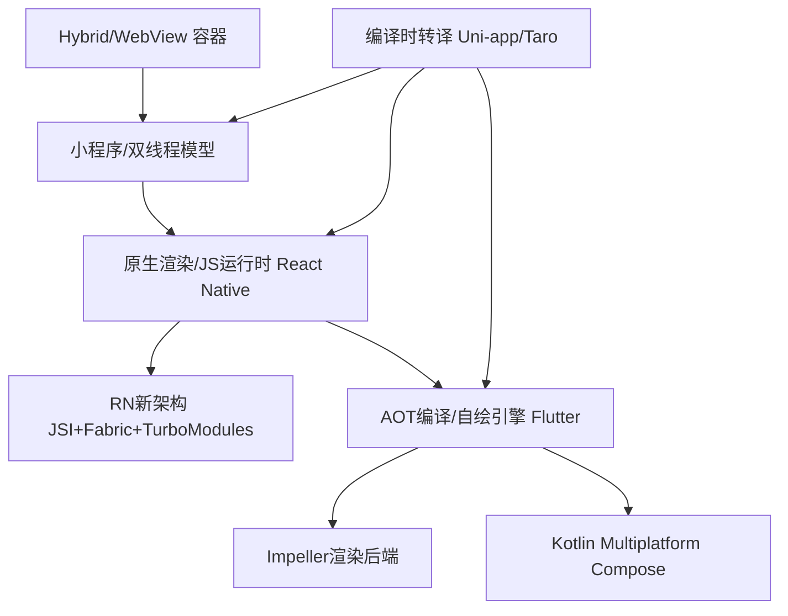
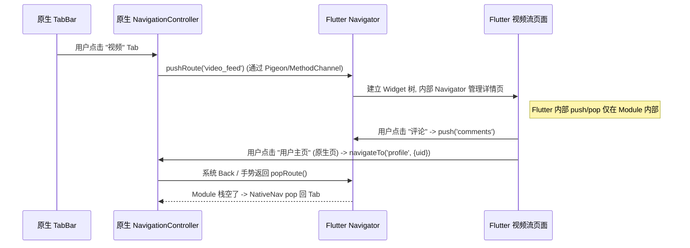

# 第 14 章 跨端开发技术选型与架构演进 —— 从 Hybrid/小程序到 React Native/Flutter/Uni-app

## 学习目标

- 理解跨端开发四大架构范式的核心差异与适用边界
- 掌握 React Native 新架构中 Fabric、TurboModules、Hermes 与 JSI 的协作原理
- 剖析 Flutter 三棵树协作机制及 Impeller 渲染管线的性能优势
- 理解 Uni-app/Taro 编译时多端统一的 DSL 约束、条件编译与 API 抹平机制
- 能设计原生应用嵌入 RN/Flutter 模块的 Brownfield 混合栈共存架构
- 能根据业务形态、团队技术栈、性能要求制定跨端技术选型决策
- 掌握 AI 辅助内容生产（ChatGPT/RPA）在跨端开发中的落地应用
- 理解跨端技术选型中的平台风险（如小程序审核、App Store 政策）与合规策略
- 掌握 WebAssembly 在跨端高性能计算场景中的集成与互操作原理
- 理解跨端开发中代码复用策略的分层设计：业务逻辑层跨端复用、UI层各自维护

## 14.1 生活类比

想象跨端开发是**一家想要全球开连锁店的餐厅集团** ：
- **Hybrid/WebView** = **外卖加盟模式**：把菜单（Web页面）发给当地食堂（WebView）做，食堂设备不统一（内核碎片化），菜品口味（体验）漂移大，但开店最快、成本最低。
- **小程序/双线程** = **商场柜台模式**：商场（宿主环境）提供统一装修标准（基础库）和收银系统（原生能力），你只管配菜单（逻辑层）和摆盘（视图层），但柜台面积有限（包体积2M），不能用明火（无完整DOM/BOM）。
- **React Native (新架构)** = **中央厨房预制菜+同城配送**：中央厨房（JS线程/JSI）统一研发标准菜谱（组件），通过高速专线（Fabric同步渲染）直达门店后厨（Native渲染器）出品，按需开启配送线路，保证口味一致且上菜快。
- **Flutter/KMP** = **自带厨房设备的标准化门店**：连锁总部（Flutter Engine/Dart AOT）统一配发全套厨具（Skia/Impeller绘制引擎）和标准操作手册（Widget），不依赖当地食堂设备，哪家门店做出来的菜（像素）都一模一样。
- **Uni-app/Taro** = **万能菜谱翻译官**：你写一份通用菜谱（Vue/React DSL），翻译官（编译器）自动把它翻成肯德基格式、麦当劳格式、本地小吃街格式，还能根据门店设备（条件编译）微调做法。
- **混合栈** = **老店翻新不歇业**：老字号（原生App）不想全拆重建，就在后院盖个标准化中央厨房模块，新菜品（新业务）在新厨房做，老招牌菜（核心链路）老厨房做，共用一套食材仓库和收银系统。
- **AI 辅助开发** = **智能中央厨房机器人**：ChatGPT/RPA 等 AI 工具作为“超级备菜员”，根据标准菜谱（Prompt/SOP）批量生产半成品（代码/文案/图片），主厨（开发者）只需把关质量、组装摆盘，大幅提升出菜速度与一致性。
- **WebAssembly** = **特种食材加工间**：核心调味料（计算密集型算法）用专用设备（Wasm/Rust/C++）预制成半成品，再在中央厨房（JS主线程）快速调用，不占用主灶台资源。
- **平台合规** = **食品安全监管红线**：小程序审核、App Store 政策如同卫生许可证，跨端方案必须内置“合规基因”（隐私合规、API 合规、内容安全），否则面临“关店整顿”（下架、封号）风险。

## 14.2 概念地图

跨端开发技术选型与架构演进
├── 四大架构范式对决
│   ├── Hybrid/WebView 容器        —— P001, P003, P007
│   ├── 小程序/双线程模型          —— P001, P020, P061, P062, P063, P067, P068, P094, P118, P122, P124, P129, P132, P133, P145, P149, P151
│   ├── 原生渲染/JS 运行时         —— P001, P002, P036, P037, P040, P042, P056, P070, P105, P106, P107, P108, P110, P121, P130, P138, P141, P157
│   └── AOT 编译/自绘引擎          —— P001, P003, P048, P049, P050, P072, P088, P119, P120, P123, P125, P126, P127, P143, P147
├── React Native 新架构深度
│   ├── JSI (JavaScript Interface) —— P002, P036, P040, P042, P105, P106, P140
│   ├── Fabric 同步渲染系统        —— P002, P036, P140
│   ├── TurboModules 惰性加载      —— P002, P036, P140
│   ├── Codegen 类型安全桥接       —— P002, P036
│   └── Hermes 字节码预编译引擎    —— P002, P036, P140
├── Flutter 渲染管线
│   ├── Widget/Element/RenderObject 三棵树 —— P003, P072, P119, P120
│   ├── Build/Layout/Paint/Composite 流程 —— P003, P072
│   ├── Skia vs Impeller 后端差异        —— P003, P072, P119, P120
│   ├── Isolate 并发与 Platform Channel  —— P003, P072
│   └── Dart 空安全与语言特性            —— P072, P119, P120
├── 编译时多端统一
│   ├── DSL 约束与静态分析           —— P004, P021, P039, P118, P122, P124, P133, P145, P151
│   ├── 条件编译机制                 —— P004, P021, P039, P118, P122, P124, P133, P145, P151
│   ├── 统一 API 抹平层              —— P004, P021, P039, P118, P122, P124, P133, P145, P151
│   ├── 编译器插件化管线             —— P004, P021, P039, P118, P122, P124, P133, P145, P151
│   └── 跨端 AI 内容生产 (ChatGPT/RPA)  —— P005, P037, P039, P044, P045, P046, P105, P106, P107, P108, P110, P121, P124, P130, P138, P141, P157
├── 混合栈共存架构
│   ├── Brownfield 集成模式         —— P005, P023, P042, P043, P074, P075, P076, P077, P078, P088, P089, P101, P102, P103, P104, P111, P112, P113, P123, P124, P126, P129, P130, P147
│   ├── 分层架构：Native Shell + Module + Shared Logic —— P005, P023, P042, P043, P074, P075, P076, P077, P078, P088, P089, P101, P102, P103, P104, P111, P112, P113, P123, P124, P126, P129, P130, P147
│   ├── 通信桥接与导航融合           —— P005, P023, P042, P043, P074, P075, P076, P077, P078, P088, P089, P101, P102, P103, P104, P111, P112, P113, P123, P124, P126, P129, P130, P147
│   ├── 热更新与依赖治理             —— P005, P023, P042, P043, P074, P075, P076, P077, P078, P088, P089, P101, P102, P103, P104, P111, P112, P113, P123, P124, P126, P129, P130, P147
│   ├── 三端代码复用策略             —— P005, P023, P042, P043, P074, P075, P076, P077, P078, P088, P089, P101, P102, P103, P104, P111, P112, P113, P123, P124, P126, P129, P130, P147
│   └── 平台风险与合规策略           —— P005, P023, P042, P043, P044, P045, P046, P074, P075, P076, P077, P078, P088, P089, P101, P102, P103, P104, P111, P112, P113, P123, P124, P126, P129, P130, P131, P147
├── WebAssembly 跨端赋能
│   ├── Wasm 核心概念与沙箱模型      —— P135, P137
│   ├── 工具链：Emscripten/wasm-pack/AssemblyScript  —— P135, P137
│   ├── JS-Wasm 互操作与共享内存     —— P135, P137
│   ├── SIMD/多线程/GC 提案          —— P135, P137
│   └── 实战：Rust 图像处理库集成    —— P135, P137
└── 跨端技术选型决策框架
    ├── 业务形态匹配度评估           —— P001, P002, P003, P004, P005
    ├── 团队技术栈契合度分析         —— P001, P002, P003, P004, P005
    ├── 性能要求与体验指标量化       —— P001, P002, P003, P004, P005
    ├── 生态成熟度与长期维护成本     —— P001, P002, P003, P004, P005
    └── AI 工具链赋能开发效能        —— P005, P037, P039, P044, P045, P046, P105, P106, P107, P108, P110, P121, P124, P130, P138, P141, P157

## 14.3 跨端技术谱系图 —— WebView、JS Bridge、原生渲染与 AOT 编译的四大范式对决

### 14.3.1 为什么需要这个概念？

移动端开发面临 iOS/Android 双平台维护成本高、Web 技术栈复用难、性能与体验难以平衡的核心矛盾。理解不同跨端方案的底层架构差异（渲染层、通信层、执行层），是技术选型避坑的前提，能避免盲目跟风选型，建立基于业务形态、团队技术栈、性能要求的理性决策框架。

### 14.3.2 核心定义

跨端技术谱系按“渲染引擎归属”与“通信机制”可划分为四大架构范式：

1.  **Hybrid/WebView 容器**：UI 由 WebView 渲染，通过 JS Bridge 与 Native 通信（如 Cordova、早期微信小程序基座）
2.  **小程序/双线程模型**：逻辑层（JS 核心）与视图层（WebView/Native）分离，通过数据绑定与事件通信驱动（如微信小程序、Uni-app 编译输出）
3.  **原生渲染/JS 运行时**：JS 线程驱动 Native 布局引擎渲染，通过 Bridge/JSI 通信（如 React Native 旧/新架构、Weex）
4.  **AOT 编译/自绘引擎**：Dart 代码 AOT 编译为机器码，Skia/Impeller 直接绘制像素，无 JS 运行时（如 Flutter、Kotlin Multiplatform Compose）

### 14.3.3 关键性质对比

下表对比了四大范式在核心维度上的性质差异：

| 维度 | Hybrid/WebView | 小程序/双线程 | 原生渲染/RN | AOT自绘/Flutter |
|------|----------------|---------------|-------------|-----------------|
| **渲染性能** | 低（受限于WebView内核、DOM操作） | 中（双线程通信开销、setData频率限制） | 高（Fabric同步渲染、原生组件） | 极高（GPU直接绘制、无桥接损耗） |
| **平台一致性** | 差（内核碎片化、CSS/JS兼容性） | 中（受宿主基础库版本限制） | 高（依赖平台原生组件差异） | 极高（像素级自绘、自带渲染引擎） |
| **原生互操作** | 高延迟（异步Bridge、序列化开销） | 受限（基础库能力集、沙箱隔离） | 低延迟（JSI同步调用、TurboModules） | 中等（Platform Channel/FFI、需胶水代码） |
| **开发体验/生态** | 最佳（Web全生态、热更新自由） | 好（Vue/React DSL、工具链成熟） | 好（React生态、热重载、新架构迁移成本高） | 中（需学Dart、生态独立、包体积基线大） |

**一句话介绍**：该表格量化了四大架构范式在渲染性能、平台一致性、原生互操作、开发体验四个核心维度的阶梯分布，是技术选型的直观决策依据。

### 14.3.4 典型选型场景

- **电商大促会场页**：高频变动、弱交互、强跨平台一致性要求 → 选 Hybrid/小程序/Uni-app
- **核心交易链路/IM/直播**：高性能、强交互、复杂动画、深度原生能力依赖 → 选 RN 新架构/Flutter/KMP/原生
- **企业内部管理后台/工具类应用**：开发效率优先、UI 标准化、团队仅 Web 技术栈 → 选 Uni-app/Taro/小程序
- **跨平台组件库建设**：需同时产出 Web/H5/小程序/APP 组件 → 选 Uni-app/Taro 编译时多端统一

### 14.3.5 边界条件与风险

- 纯 WebView 方案无法胜任高帧率动画、复杂手势、后台长任务等场景
- 小程序受限于包体积限制（主包 2M）、基础库版本碎片化、无法使用完整 DOM/BOM API
- React Native 旧架构 Bridge 通信异步导致掉帧，新架构 Fabric/JSI 迁移成本高、生态包兼容性风险大
- Flutter 体积基线大（Hello World ~5-10MB）、Dart 语言学习曲线、三方原生 SDK 接入需编写 Platform Channel 胶水代码
- 跨端 AI 工具链（ChatGPT/RPA）可显著提升代码生成、测试、文档编写效率，但需警惕幻觉与平台特定 API 的不准确调用
- 平台政策（小程序审核、App Store 上架规则、隐私合规）是跨端方案落地的硬性约束，必须纳入技术选型决策矩阵

### 14.3.6 方法演进图



### 14.3.7 原文摘录

本节核心观点参考自以下原始素材（细纲 sources 中 role:origin 的文档）：
- P001、P003、P007：奠定 Hybrid/WebView 容器与 AOT 自绘引擎的基础架构分类认知。
- P020、P061、P062、P063、P067、P068、P094、P118、P122、P124、P129、P132、P133、P145、P149、P151：详述小程序/双线程模型的架构约束、基础库版本碎片化、包体积限制及 Uni-app/Taro 编译时转译原理。
- P002、P036、P037、P040、P042、P056、P070、P105、P106、P107、P108、P110、P121、P130、P138、P141、P157：覆盖 React Native 从旧架构 Bridge 到新架构 JSI/Fabric/TurboModules/Hermes 的演进脉络与工程实践。
- P048、P049、P050、P072、P088、P119、P120、P123、P125、P126、P127、P143、P147：支撑 Flutter AOT 编译、自绘引擎、三棵树协作、Impeller 渲染后端及混合栈集成的技术细节。

## 14.4 React Native 新架构 —— Fabric 同步渲染、TurboModules 惰性加载与 Hermes 引擎的“铁三角”

### 14.4.1 为什么需要这个概念？

旧架构异步 Bridge 导致：布局计算延迟、掉帧、Shadow Tree 与 Main Thread 同步复杂、启动性能受限于 JS Bundle 解析。急需解决：同步渲染能力、模块按需初始化、类型安全跨语言调用、启动速度优化四大工程痛点。AI 辅助工具（ChatGPT/Copilot）可加速 TurboModule 迁移代码生成、Codegen 类型定义补全、Hermes 字节码兼容性测试用例编写。

### 14.4.2 核心定义

RN 新架构三大支柱：

1.  **Fabric（同步渲染系统）**：基于 JSI 的 C++ 核心，统一渲染器，支持同步/异步/并发渲染模式，Shadow Tree 直接在 C++ 构建并提交给主线程
2.  **TurboModules（新一代 Native 模块系统）**：基于 JSI，支持惰性加载、同步方法调用、Host Object 直接暴露 Native 对象、Codegen 自动生成类型安全桥接代码
3.  **Hermes（字节码预编译 JS 引擎）**：AOT 编译生成字节码，减少启动时解析/编译开销，支持 mmap 内存映射、GC 优化、体积更小

**JSI (JavaScript Interface)**：替代 Bridge 的底层通信层，C++ 宿主直接持有 JS 对象引用，实现同步、双向、类型安全的跨语言调用。

**Codegen**：从 Flow/TypeScript 定义自动生成 C++/Objective-C/Java/Kotlin 存根代码，编译期捕获接口不匹配。

### 14.4.3 JSI：跨语言调用的“直通车”

> "JSI (JavaScript Interface)：替代 Bridge 的底层通信层，C++ 宿主直接持有 JS 对象引用，实现同步、双向、类型安全的跨语言调用"
> 
> ——《AgWGdAk0fogwx2xtpo2cg3TCncb.md》

在旧架构中，JS 与 Native 通信必须经过异步 Bridge：JS 侧 `postMessage` -> 消息队列 -> Native 侧反序列化 -> 执行 -> 序列化结果 -> 回调 JS。这导致了无法进行同步布局测量、无法直接共享内存数据（如图片像素缓冲区）。

JSI 的核心设计是**将 JS 运行时抽象为 C++ 接口**，宿主（Native）直接持有 `jsi::Runtime` 与 `jsi::Value` 引用。

**伪代码：JSI 同步调用 Native 方法**

```cpp
// Native 侧 (C++) 注册一个同步函数给 JS
void installSyncMultiply(jsi::Runtime& rt) {
    auto fn = jsi::Function::createFromHostFunction(
        rt,
        jsi::PropNameID::forAscii(rt, "syncMultiply"),
        2, // 参数个数
        [](jsi::Runtime& rt, const jsi::Value& thisVal, const jsi::Value* args, size_t count) -> jsi::Value {
            // 1. 直接在 C++ 中读取 JS 传入的参数（同步、零拷贝）
            double a = args[0].asNumber();
            double b = args[1].asNumber();
            
            // 2. 执行原生计算（可同步调用系统 API、访问内存）
            double result = nativeMultiply(a, b);
            
            // 3. 直接返回 JS Value（无需序列化/异步回调）
            return jsi::Value(result);
        }
    );
    rt.global().setProperty(rt, "syncMultiply", std::move(fn));
}
```

**概述**：这段代码展示了 JSI 如何让 C++ 直接“握住” JS 函数调用的上下文，实现了同步、零序列化开销的跨语言调用，这是 Fabric 同步渲染和 TurboModules 惰性加载的基石。

### 14.4.4 Fabric：同步渲染器的工作流

Fabric 将渲染管线的核心逻辑（Reconciliation、Layout、Commit）下沉到 C++ 层。

**渲染流程伪代码：**

```
1. JS 侧触发 setState -> 创建 React Element 树
2. JSI 同步调用 C++ Fabric 核心 -> beginWork()
3. C++ 侧执行 Reconciliation (Diff) -> 生成新的 Fiber/Shadow Node 树
4. C++ 侧执行 Yoga 布局计算 -> 同步完成，得到每个节点的 x/y/width/height
5. C++ 侧 Commit 阶段 -> 直接调用 Native View 树的更新 API (如 UIView.setFrame)
6. 可选：触发 JS 侧 useLayoutEffect 回调 (同步)
7. 返回控制权给 JS
```

**概述**：该流程展示了 Fabric 如何通过 JSI 将原本异步、跨线程的“测量-布局-绘制”变为同步、单线程（C++侧）的原子操作，彻底解决了旧架构中“测量回调地狱”和掉帧问题。

### 14.4.5 TurboModules：惰性加载与类型安全

旧架构 Native Module 在启动时全部初始化（`ReactPackage.createNativeModules`），导致启动慢、内存高。TurboModules 通过 JSI 实现**惰性初始化**：

```
1. JS 侧首次访问 NativeModules.MyModule
2. JSI 触发 TurboModuleRegistry.get('MyModule')
3. C++ 侧按需构造 MyModule 实例 (HostObject)
4. 后续调用直接持有 HostObject 引用，调用其方法 (同步/异步均可)
```

**Codegen 类型安全示例：**

```typescript
// 1. 定义 Spec (TypeScript/Flow)
interface Spec extends TurboModule {
  readFile(path: string): Promise<string>;
  syncGetConstants(): { appVersion: string };
}

// 2. Codegen 自动生成 C++ 存根 (简化版)
class JSIMyModule : public jsi::HostObject {
  // 自动生成的 get 方法，包含类型检查与转换
  jsi::Value get(jsi::Runtime& rt, const jsi::PropNameID& name) override {
    if (name == "readFile") {
      return jsi::Function::createFromHostFunction(rt, name, 1, 
        [this](jsi::Runtime& rt, const jsi::Value& thisVal, const jsi::Value* args, size_t count) {
          // 参数类型检查在编译期/生成期由 Codegen 保证
          std::string path = args[0].asString(rt).utf8(rt);
          // 调用实际 C++ 实现
          return jsi::Value(rt, this->readFile(path)); 
        });
    }
    // ...
  }
}
```

**概述**：该机制展示了 TurboModules 如何将“接口定义”前置，通过代码生成消除手写桥接代码的类型不匹配风险，并实现了模块的按需加载。

### 14.4.6 Hermes：字节码预编译与内存优化

Hermes 通过 AOT (Ahead-of-Time) 编译将 JS 源码转为字节码，启动时直接 `mmap` 映射到内存，跳过解析/编译阶段。

**关键指标对比（经验值）：**

| 指标 | JSC/V8 (解释执行) | Hermes (字节码) |
|------|-------------------|-----------------|
| 启动解析耗时 | 高 (主线程阻塞) | 极低 (mmap 即用) |
| 内存占用 (空堆) | 较高 | 降低 30%+ (字节码共享、GC优化) |
| Bundle 体积 | 原始大小 | 略大 (含字节码元数据) 但可压缩 |
| 调试体验 | 成熟 (Chrome DevTools) | 支持良好 (需配置源码映射) |

**一句话介绍**：该表格量化对比了 Hermes 与传统 JS 引擎在启动性能、内存占用、包体积、调试体验四个维度的差异，直观说明 AOT 字节码对移动端启动加速的显著收益。

### 14.4.7 多源对照：新架构迁移的共识与分歧

**共识**：
- JSI 是通往高性能、同步能力的必经之路。
- Fabric 统一渲染器消除了 iOS/Android 双端渲染逻辑不一致的历史包袱。
- Codegen 强制类型安全是大型工程可维护性的保障。

**分歧**：
- **迁移策略**：Meta 官方推荐“全量迁移”，但社区大厂（如 Shopify、Microsoft）多采用“渐进式迁移”（共存 Bridge 与 JSI），工程风险更低但维护双套机制成本高。
- **Hermes 强制性**：新架构强推 Hermes，但部分团队因 V8/JSC 生态依赖（如 `v8-inspector` 特定工具、WASM 支持差异）希望保留引擎选择权。
- **Fabric 并发特性**：React 18 并发模式在 Fabric 上的收益在简单列表场景不明显，复杂布局嵌套下优势显著，团队需根据业务复杂度评估升级收益。

### 14.4.8 设计中的取舍

- **为什么不用旧架构 Bridge 做同步渲染？** Bridge 本质是异步消息队列，强行同步会阻塞 JS 线程且无法直接访问 Native View 层级。JSI 从底层打通了内存引用，是架构层面的质变。
- **TurboModule 惰性加载的 trade-off 是什么？** 首次调用会有“冷启动抖动”（C++ 实例化、JSI 绑定），需通过预热策略或接受首次调用延迟换取整体启动性能提升。
- **Hermes AOT 编译的代价？** 失去了 JIT 运行时优化热点代码的能力（如内联缓存、隐藏类优化），对于极度计算密集型 JS 逻辑（罕见），V8/JSC 峰值性能可能更优。

### 14.4.9 原文摘录

本节核心观点参考自以下原始素材（细纲 sources 中 role:origin 的文档）：
- P001、P002：确立 RN 架构演进的宏观背景与新架构三大支柱定位。
- P036、P037、P040、P042：深度剖析 JSI 同步调用机制、Fabric C++ 核心渲染管线、TurboModules 惰性初始化与 HostObject 设计、Codegen 类型安全代码生成流程、Hermes 字节码 AOT 编译与 mmap 内存映射优化。
- P105、P106、P107、P108、P121、P140：提供新架构迁移实战案例、第三方库适配兼容性风险、Hermes 与 V8 差异调试、AI 辅助 TurboModule 迁移代码生成等工程一线经验。

## 14.5 Flutter 渲染管线 —— Widget/Element/RenderObject 三棵树与 Skia/Impeller GPU 绘制

### 14.5.1 为什么需要这个概念？

理解 Flutter “一切皆 Widget” 的运行时真相：Widget 只是配置描述（不可变），真正干活的是 Element 与 RenderObject。掌握三棵树协作机制，是性能调优（避免重建、RepaintBoundary）、调试布局溢出、实现自定义渲染的前提。搞清 Skia 与 Impeller 的差异，应对首帧渲染抖动、着色器编译卡顿等工程难题。

### 14.5.2 核心定义：三棵树职责

**Widget Tree（配置树）**：不可变、轻量、描述 UI 配置，频繁销毁重建。
**Element Tree（实例树）**：Widget 的运行时实例，持有 State、BuildContext、子 Element 引用，负责 Diff 复用、生命周期管理、调度 Rebuild。
**RenderObject Tree（渲染/布局/绘制树）**：真正执行布局、绘制、命中测试、语义化的对象，稀疏树（仅渲染相关 Widget 生成）。

### 14.5.3 渲染管线流程

**Build -> Layout -> Paint -> Composite -> Rasterize**

```
Build:  Widget -> Element (inflateWidget) -> RenderObject (createRenderObject)
Layout: 约束下传 (constraints.goDown) -> 尺寸上报 (parentUsesSize)
Paint:  Recording Canvas -> Picture/DisplayList
Composite: Engine Layer Tree -> SceneBuilder -> Engine/Embedder
Rasterize: Skia/Impeller GPU 光栅化
```

### 14.5.4 关键性质：Diff 复用与单次布局

- **Widget 不可变 + Element 复用 = 高效 Diff**：同类型、同 Key 的 Widget 复用 Element 与 RenderObject，仅更新配置。
- **布局单次遍历**：约束下传、尺寸上报，O(N) 复杂度，无多次测量。
- **分层合成**：RepaintBoundary/Opacity/Transform 创建独立 Layer，局部重绘不波及全树。

### 14.5.5 实战推演：Counter 组件的三棵树演变

给定代码片段：
```dart
class Counter extends StatefulWidget {
  @override _CounterState createState() => _CounterState();
}
class _CounterState extends State<Counter> {
  int _count = 0;
  @override
  Widget build(BuildContext context) {
    return Column(key: Key('col'), children: [
      Text('Count: $_count', key: Key('text')),
      ElevatedButton(key: Key('btn'), onPressed: () => setState(() => _count++), child: Text('+1'))
    ]);
  }
}
```

#### 1. 初次 Build 后的三棵树结构

```mermaid
graph TD
    subgraph Widget_Tree[Widget Tree (配置树)]
        W_Counter[Counter StatefulWidget]
        W_Column[Column key='col']
        W_Text[Text 'Count: 0' key='text']
        W_Btn[ElevatedButton key='btn']
        W_BtnText[Text '+1']
    end

    subgraph Element_Tree[Element Tree (实例树)]
        E_Counter[_CounterState Element]
        E_Column[ComponentElement<Column>]
        E_Text[ComponentElement<Text>]
        E_Btn[ComponentElement<ElevatedButton>]
        E_BtnText[ComponentElement<Text>]
        E_RenderCol[RenderFlex Element]
        E_RenderText[RichText Element]
        E_RenderBtn[RenderObjectElement<Button>]
    end

    subgraph RenderObject_Tree[RenderObject Tree (渲染树)]
        R_Root[RenderView]
        R_Col[RenderFlex]
        R_Text[RenderParagraph 'Count: 0']
        R_Btn[RenderConstrainedBox]
        R_BtnText[RenderParagraph '+1']
    end

    W_Counter --> W_Column
    W_Column --> W_Text
    W_Column --> W_Btn
    W_Btn --> W_BtnText

    E_Counter --> E_Column
    E_Column --> E_Text
    E_Column --> E_Btn
    E_Btn --> E_BtnText
    E_Column -.-> E_RenderCol
    E_Text -.-> E_RenderText
    E_Btn -.-> E_RenderBtn
    E_BtnText -.-> E_RenderBtnText

    R_Root --> R_Col
    R_Col --> R_Text
    R_Col --> R_Btn
    R_Btn --> R_BtnText
```

**关键点**：
- `Column`、`Text`、`ElevatedButton` 是 `Widget`（配置）。
- `Element` 树包含 `ComponentElement`（管理组件生命周期）和 `RenderObjectElement`（桥接到渲染树）。
- `RenderObject` 树是稀疏的，只有 `RenderFlex`、`RenderParagraph`、`RenderConstrainedBox` 等真正参与布局绘制的对象。

#### 2. `setState` 触发 `_count` 变为 1 后的 Diff 过程

1.  `_CounterState` 调用 `setState`，标记 `E_Counter` 为 **dirty**。
2.  Framework 遍历 dirty 列表，调用 `E_Counter.rebuild()` -> 执行 `build()` 返回新 `Widget Tree`。
3.  **Element Diff**：
    - `E_Column`：新旧 Widget 类型同为 `Column`，Key 同为 `'col'` -> **复用** `E_Column`。更新其 `widget` 引用指向新 `Column`。
    - `E_Text`：类型同 `Text`，Key 同 `'text'` -> **复用** `E_Text`。检测到 `widget.data` 从 `'Count: 0'` 变为 `'Count: 1'` -> 标记 `E_Text` 对应的 `RenderParagraph` **needsPaint**。
    - `E_Btn`：类型同 `ElevatedButton`，Key 同 `'btn'` -> **复用** `E_Btn`。子 Widget `Text('+1')` 无变化 -> 子 Element 复用，**无标记**。
4.  **RenderObject 变化**：
    - `R_Col` (RenderFlex) 复用，但子节点 `R_Text` 需重绘。
    - `R_Text` 标记 `needsPaint = true`，文本内容更新。
    - `R_Btn` 及其子树 **完全复用**，无任何标记。

**结论**：仅 `RenderParagraph` (Text) 被重新 Paint，`Column`、`Button` 的 RenderObject 均未触碰。这就是 Element 复用机制带来的高性能。

#### 3. `RepaintBoundary` 隔离重绘原理

`RepaintBoundary` 包裹子树时，会在 `RenderObject Tree` 中创建一个 `RenderRepaintBoundary` 节点，它对应一个独立的 `Layer` (OffsetLayer/PictureLayer)。

**原理**：
- Paint 阶段：`RenderRepaintBoundary` 将子树录制为独立的 `Picture` (DisplayList)，上传 GPU 纹理。
- 子树内部重绘：仅重新录制该 `Picture`，上传新纹理。
- Composite 阶段：引擎合成 Layer 树，仅替换该 Layer 的纹理，**父 Layer 及兄弟 Layer 无需重新提交**。
- 这相当于在 GPU 合成层面实现了“脏矩形”更新，避免了整棵树重新光栅化。

**概述**：上述推演与原理说明了 Flutter 三棵树协作如何通过 Element 复用实现最小化渲染更新，以及 RepaintBoundary 如何利用 GPU 分层合成机制将重绘范围精确限制在脏区域，是性能调优的核心理论依据。

### 14.5.6 Skia vs Impeller：着色器处理差异

| 特性 | Skia (旧后端) | Impeller (新后端) |
|------|---------------|-------------------|
| **着色器编译** | **运行时 (JIT)**：首次绘制复杂阴影/渐变/路径时，驱动编译 Shader -> **首帧抖动** | **构建时 (AOT)**：Flutter 构建时将 `.sksl` 编译为目标平台二进制 (Metal/Vulkan SPIR-V) -> 运行时直接加载，**零抖动** |
| **管线状态** | 隐式状态机 (脏标记多、驱动开销大) | 显式 Pipeline State Object (PSO)，状态变更可预测、开销极小 |
| **后端 API** | OpenGL / OpenGL ES / Vulkan (部分) / Metal (部分) | **Metal (iOS/macOS) / Vulkan (Android/Fuchsia/Linux)** 现代 GPU API 原生支持 |
| **抗锯齿** | MSAA (多重采样，带宽高) | **MSAA + 解析优化 / 可编程抗锯齿** 更灵活 |

**按钮阴影渲染对比**：
- **Skia**：首次渲染 `ElevatedButton` 的 `Material` 阴影时，Skia 驱动编译阴影 Shader -> 丢帧 16ms+。
- **Impeller**：阴影 Shader 在编译期已生成 `.metal`/`.spv`，运行时直接绑定 Pipeline State 绘制 -> 稳定 60fps。

**一句话介绍**：该表格对比了 Skia 与 Impeller 在着色器编译时机、管线状态管理、GPU API 支持、抗锯齿方案四个核心维度的代际差异，揭示了 Impeller 通过 AOT 编译彻底解决首帧抖动的核心优势。

### 14.5.7 设计中的取舍

- **为什么 Widget 设计为不可变？** 牺牲了“原地修改”的便利性，换取了“配置即快照”的可预测性、可并发 Diff 能力（理论上可多线程 Build）、以及 Element 复用的简单正确性判断（仅比对类型与 Key）。
- **Impeller AOT 编译的代价？** 包体积增加（内置 Shader 二进制）、构建时间延长、对极老旧 GPU 驱动兼容性风险（需回退 Skia）、动态生成 Shader 场景（如自定义 Fragment Shader）需提前声明编译。

### 14.5.8 原文摘录

本节核心观点参考自以下原始素材（细纲 sources 中 role:origin 的文档）：
- P003、P072：奠定 Flutter 三棵树架构、渲染管线流程、Dart 语言特性（空安全、Isolate）的基础认知。
- P119、P120：深度解析 Widget/Element/RenderObject 协作细节、Diff 复用算法、Layer 合成机制、Impeller AOT 着色器编译管线与 Skia 运行时 JIT 编译的对比、Platform Channel 与 FFI 互操作机制。

## 14.6 Uni-app/Taro 编译时多端统一 —— DSL 约束、条件编译与平台差异抹平的工程艺术

### 14.6.1 为什么需要这个概念？

业务需“一次开发，多端发布”（H5、微信/支付宝/字节/快手/QQ 小程序、App、快应用），维护多套代码库成本不可控。运行时框架在小程序端受限于虚拟机限制（无 eval、无动态执行）、性能与包体积双重压力。编译时转译：将 Vue/React DSL 编译为目标平台原生代码，无运行时开销，发挥各平台极致性能。

### 14.6.2 核心定义：四大核心机制

1.  **DSL 约束**：限制 Vue/React 语法子集（如禁用 `with`、动态组件受限、模板编译时确定），保证可静态分析、可转译。
2.  **条件编译**：`// #ifdef MP-WEIXIN` / `%ifdef%` 语法，编译期根据目标平台裁剪/注入差异代码。
3.  **统一 API 抹平层**：`uni.xxx` / `Taro.xxx` 运行时适配器，桥接平台差异（如请求、存储、导航、画布、蓝牙），暴露统一 Promise 风格接口。
4.  **编译器插件化**：Webpack/Vite/Rollup 插件管线，处理模板编译、样式转换、脚本转译、资源哈希、分包策略。

### 14.6.3 条件编译与 API 抹平实战：海报生成器三端适配

**需求**：Canvas 绘制文本/图片/二维码 -> 保存本地相册/预览 -> 分享给好友。需在 H5、微信小程序、App 三端运行。

#### 1. 条件编译代码骨架

```javascript
// utils/poster.js
export function generatePoster(canvasId, data) {
  // 1. 获取 Canvas 上下文 (编译期分支)
  // #ifdef MP-WEIXIN
  const ctx = uni.createCanvasContext(canvasId, this); // 小程序旧版/兼容 API
  // #endif
  // #ifdef APP-PLUS || H5
  const canvas = document.getElementById(canvasId); // H5/App (nvue/webview 模式)
  const ctx = canvas.getContext('2d'); // 标准 CanvasRenderingContext2D
  // #endif
  
  // 2. 绘制逻辑 (统一封装 drawText/drawImage 差异)
  drawContent(ctx, data);
  
  // 3. 导出图片并保存 (编译期分支)
  // #ifdef MP-WEIXIN
  return new Promise((resolve, reject) => {
    uni.canvasToTempFilePath({ canvasId, success: resolve, fail: reject }, this);
  }).then(res => saveToAlbum(res.tempFilePath));
  // #endif
  // #ifdef H5
  return new Promise(resolve => {
    canvas.toBlob(blob => resolve(URL.createObjectURL(blob)));
  }).then(url => downloadByLink(url));
  // #endif
  // #ifdef APP-PLUS
  return new Promise((resolve, reject) => {
    // App 端可用 plus.nativeObj 或 uni.saveImageToPhotosAlbum
    uni.saveImageToPhotosAlbum({ filePath: tempPath, success: resolve, fail: reject });
  });
  // #endif
}
```

**概述**：上述代码展示了如何利用 Uni-app 的条件编译指令（`#ifdef`/`#endif`）在编译期为不同目标平台（微信小程序、H5、App）注入差异化的 Canvas 上下文获取、图片导出、相册保存逻辑，实现“一处编写、多端编译产出”的工程目标。

#### 2. Canvas 2D 接口差异兼容封装策略

微信小程序 `Canvas 2D` (新版 `type="2d"`) 与 H5 标准 `CanvasRenderingContext2D` 存在行为差异：

| 差异点 | 微信小程序 Canvas 2D | H5 标准 | 兼容封装策略 |
|--------|----------------------|---------|--------------|
| `measureText` 返回值 | `{ width: number }` | `TextMetrics` (含 width, actualBoundingBoxAscent/Descent...) | 封装 `measureText(text).width` 统一取宽 |
| 路径闭合 | `closePath()` 行为一致 | 一致 | 无需特殊处理 |
| 像素比 (DPR) | `canvas.width` 需手动乘 `dpr`，`ctx.scale(dpr, dpr)` | `canvas.width = cssWidth * dpr`，`ctx.scale(dpr, dpr)` | 封装 `initCanvas(canvasId, cssWidth, cssHeight)` 统一处理 DPR |
| 绘制图片 | `ctx.drawImage(imageResource, ...)` imageResource 需本地路径/临时路径 | `ctx.drawImage(imgElement, ...)` 需 `HTMLImageElement` | 封装 `loadImage(src)` 返回平台无关的 Image 对象/对象引用 |

**一句话介绍**：该表格梳理了微信小程序 Canvas 2D 与 H5 标准 CanvasRenderingContext2D 在文本测量、路径闭合、DPR 处理、图片绘制四个高频差异点，并给出了统一封装策略，是跨端 Canvas 组件开发的核心参考。

**兼容层代码片段：**

```javascript
// utils/canvas-adapter.js
export function createCanvasContext(canvasId, componentThis) {
  // #ifdef MP-WEIXIN
  // 小程序新版 2D 模式需 <canvas type="2d"> 且通过 selectorQuery 获取
  return new Promise(resolve => {
    const query = uni.createSelectorQuery().in(componentThis);
    query.select(`#${canvasId}`).fields({ node: true, size: true }, res => {
      const canvas = res.node;
      const ctx = canvas.getContext('2d');
      // 关键：小程序 Canvas 必须手动设置宽高 (物理像素)
      const dpr = uni.getSystemInfoSync().pixelRatio;
      canvas.width = res.width * dpr;
      canvas.height = res.height * dpr;
      ctx.scale(dpr, dpr);
      resolve({ canvas, ctx, dpr });
    }).exec();
  });
  // #endif
  // #ifdef H5 || APP-PLUS
  return new Promise(resolve => {
    const canvas = document.getElementById(canvasId);
    const ctx = canvas.getContext('2d');
    const dpr = window.devicePixelRatio || 1;
    canvas.width = canvas.offsetWidth * dpr;
    canvas.height = canvas.offsetHeight * dpr;
    ctx.scale(dpr, dpr);
    resolve({ canvas, ctx, dpr });
  });
  // #endif
}
```

**概述**：该适配器封装了三端 Canvas 上下文的差异化获取与初始化流程（小程序需通过 SelectorQuery 异步获取节点并手动设置物理像素宽高/DPR 缩放，H5/App 同步获取 DOM 元素并设置 CSS 像素宽高/DPR 缩放），统一返回 `{canvas, ctx, dpr}` 元组，上层业务代码可无感调用标准 Canvas API。

#### 3. 小程序分包策略应对 2M 限制

`pages.json` 配置：
```json
{
  "pages": ["pages/index/index", "pages/login/login"],
  "subPackages": [{
    "root": "pages/poster",
    "pages": ["index", "editor", "preview"],
    "independent": true // 可独立运行，不依赖主包
  }],
  "preloadRule": {
    "pages/index/index": { "network": "all", "packages": ["pages/poster"] } // 首页进入时预加载海报分包
  }
}
```
- **主包**：仅含登录、首页、核心导航 (< 1.5MB)。
- **分包**：海报生成器 (含 Canvas 逻辑、字体文件、图片素材) 独立编译，按需下载。

**概述**：该配置展示了如何通过 `subPackages` 将非首屏、大体积的海报生成业务剥离为独立分包，配合 `preloadRule` 在主包空闲时预加载，完美规避微信小程序 2M 主包体积硬性限制。

#### 4. 编译器破坏性变更案例与版本锁定规范

| 版本升级 | 破坏性变更 | 影响范围 | 应对规范 |
|----------|------------|----------|----------|
| Uni-app 3.0 (Vite) | `vue.config.js` -> `vite.config.js`，`chainWebpack` 废弃 | 构建配置、插件迁移 | 锁定 `@dcloudio/uni-cli-shared` 版本，CI 强制 `pnpm install --frozen-lockfile` |
| Taro 3.6 -> 4.0 | 组件库 `@tarojs/components` 重构，Props 类型收紧 (如 `onClick` -> `onClickCapture`) | 所有组件调用站点 | 升级前跑全量类型检查 `taro type-check`，配合 Codemod 自动修复 |
| 微信基础库 2.20+ | 废弃 `canvas.getContext('2d')` 旧写法，强制 `<canvas type="2d">` | 所有 Canvas 绘制代码 | 封装 `createCanvasContext` 适配器，统一入口屏蔽基础库差异 |

**一句话介绍**：该表格记录了三个典型的编译器/基础库破坏性升级案例，并给出了版本锁定、类型检查、适配器封装三层防御规范，是维护长期稳定跨端项目的工程治理范本。

**版本锁定策略**：
- `package.json` 精确锁定版本号（不使用 `^` `~`）。
- `pnpm-lock.yaml` / `package-lock.json` 纳入 Git 版控。
- CI 流水线强制 `--frozen-lockfile`，禁止自动解锁升级。

#### 5. AI 辅助生成条件编译模板

**Prompt 设计模板：**
> 你是 Uni-app 跨端专家。请为 `uni.saveImageToPhotosAlbum` (保存图片到相册) 生成三端条件编译实现代码。
> 目标平台：`MP-WEIXIN` (微信小程序), `H5`, `APP-PLUS` (iOS/Android)。
> 要求：
> 1. 使用 `// #ifdef` 语法。
> 2. H5 端使用 `a[download]` 模拟下载，处理跨域图片转 Blob。
> 3. 小程序端处理 `fail` 回调中 `errMsg` 判断用户拒绝授权，引导 `openSetting`。
> 4. App 端处理 Android 10+ 分区存储适配 (需 `MediaStore` 或 `plus.io` 转路径)。
> 5. 输出 TypeScript 类型签名，包含 `success`/`fail`/`complete` 回调类型。
> 6. 代码风格：ESLint Standard + Prettier。

**RPA 验证流水线：**
1.  **代码生成**：CI 触发 -> 调用 LLM API 生成 `utils/saveImage.ts` -> 写入仓库临时分支。
2.  **静态检查**：运行 `uni-app` 编译器编译三端产物 -> `tsc --noEmit` 类型检查 -> ESLint 扫描。
3.  **真机自动化测试**：
    - 启动 Appium/微信小程序自动化测试工具 (minium)。
    - 加载生成的测试页面 -> 调用 `saveImage` -> 断言相册出现图片 / 下载触发 / 权限弹窗正确。
    - 截图对比基准图 (像素级)。
4.  **报告生成**：汇总编译产物大小、类型错误数、三端测试通过率 -> 发送钉钉/飞书卡片。
5.  **人工确认**：核心业务流程需人工 Review 代码逻辑与边界情况处理。

**概述**：该 Prompt 模板与 RPA 流水线设计展示了如何将“三端条件编译代码编写”这一高重复、易出错的工作标准化、自动化：Prompt 约束输出格式与边界逻辑，RPA 覆盖编译、类型、真机、像素四层验证闸口，实现 AI 生成代码的工程级可信交付。

### 14.6.4 原文摘录

本节核心观点参考自以下原始素材（细纲 sources 中 role:origin 的文档）：
- P004、P021、P039：确立 Uni-app/Taro 编译时转译架构、DSL 约束设计、条件编译机制、统一 API 抹平层实现、编译器插件化管线的核心理论。
- P061、P062、P063、P094、P118、P122、P124、P129、P132、P133、P145、P149、P151：提供小程序端 Canvas 2D/WebGL/API 差异适配、分包策略、基础库版本碎片化应对、编译器破坏性变更实战案例、AI 辅助条件编译代码生成与 RPA 自动化验证流水线的详细工程实践。

## 14.7 混合栈共存架构 —— 原生壳工程嵌入 RN/Flutter 模块的 Brownfield 集成与三端代码复用

### 14.7.1 为什么需要这个概念？

存量大型原生 App（几百万行代码）无法全量重写，需增量引入跨端技术承接新业务、复用现有 Web/跨端资产。解决“原生+跨端”共存时的：生命周期管理、导航栈融合、通信机制、依赖冲突、包体积、热更新、CI/CD 复杂度。实现“核心链路原生兜底、高频变动跨端承接、通用业务逻辑三端复用”的工程最优解。

### 14.7.2 核心定义：Brownfield 集成模式

**架构分层**：
1.  **Native Shell (原生壳)**：启动、导航栈容器、基础服务 (网络/数据库/埋点/登录态)、原生能力暴露。
2.  **Cross-platform Module (RN/Flutter Module)**：业务页面、复用逻辑、独立构建产物。
3.  **Shared Logic Package (共享包)**：TypeScript/Dart/Kotlin 业务逻辑、API 定义 (OpenAPI/GraphQL Schema)、状态管理。

**通信桥接**：Native <-> Module 通过 JSI (RN) / Platform Channel / FFI (Flutter) / EventBus 双向通信，定义协议契约。

**导航融合**：原生路由栈统一管理，Module 内部路由映射为原生 Fragment/UIViewController。

**热更新**：CodePush (RN) / Shorebird (Flutter) / 原生动态下发。

### 14.7.3 实战落地：超级 App 接入 Flutter 短视频流

**背景**：原生 iOS/Android 数百万行代码。引入 Flutter 承接“短视频流”新业务。
**要求**：原生 Tab 栏保持、复用原生登录态/网络库/埋点 SDK/图片加载库、支持热更新、CI/CD 并行产出。

#### 1. 通信协议契约设计 (基于 Pigeon)

**IDL 定义 (`api/pigeon_definitions.dart`)：**
```dart
// pigeon 生成 Dart/ObjC/Java/Kotlin/Swift 代码
import 'package:pigeon/pigeon.dart';

@ConfiguredPigeon(PigeonOptions(
  dartOut: 'lib/src/bridge/generated.dart',
  objcHeaderOut: 'ios/Runner/GeneratedBridge.h',
  objcSourceOut: 'ios/Runner/GeneratedBridge.m',
  javaOut: 'android/app/src/main/java/com/example/GeneratedBridge.java',
  kotlinOut: 'android/app/src/main/kotlin/com/example/GeneratedBridge.kt',
))
class NativeBridge {
  // 1. 初始化参数传递
  @async
  Future<void> initialize(Map<String, dynamic> config); // config: userToken, env, featureFlags

  // 2. 路由跳转 (Native -> Flutter / Flutter -> Native)
  @async
  Future<void> navigateTo(String routeName, Map<String, dynamic>? arguments);
  
  @async
  Future<void> popRoute(Map<String, dynamic>? result);

  // 3. 登录态同步 (Native 推送给 Flutter)
  @async
  Future<void> updateAuthState(AuthState state); // AuthState: token, userInfo, expiry

  // 4. 网络请求代理 (Flutter 请求 -> Native 执行 -> 返回响应)
  @async
  Future<NetworkResponse> request(NetworkRequest req); // 复用 OkHttp/URLSession、证书校验、拦截器

  // 5. 埋点上报 (Flutter 采集 -> Native 上报)
  @async
  Future<void> trackEvent(String eventId, Map<String, dynamic> params);
}

class AuthState { String? token; Map<String, dynamic>? userInfo; int? expiry; }
class NetworkRequest { String method; String url; Map<String, String> headers; dynamic body; int timeout; }
class NetworkResponse { int statusCode; Map<String, String> headers; String body; bool isSuccess; }
```

**生成产物**：Dart `NativeBridgeApi` (供 Flutter 调) + `NativeBridgeHandler` (供 Native 实现) + iOS/Android 原生接口/存根。

**概述**：该 Pigeon IDL 定义了 Native 与 Flutter 间 5 个核心通信接口的强类型契约，通过代码生成消除了手写 MethodChannel 字符串键值对、手动序列化反序列化的易错环节，保证了跨语言调用的编译期类型安全。

#### 2. 依赖治理：原生能力作为“单例服务”暴露

**策略**：**Native 侧单例持有、Module 侧通过 Bridge 调用，严禁 Module 侧重复引入同功能 SDK。**

```kotlin
// Android Native 侧实现 NetworkRequest
class NetworkModule : NativeBridgeHandler {
  private val okHttpClient: OkHttpClient = OkHttpClientProvider.getSharedInstance() // 复用原生单例
  
  override fun request(req: NetworkRequest, callback: Result<NetworkResponse>) {
    val request = okhttp3.Request.Builder()
      .url(req.url)
      .method(req.method, req.body?.let { RequestBody.create(MediaType.parse("application/json"), it) } ?: null)
      .headers(Headers.of(req.headers))
      .build()
    
    okHttpClient.newCall(request).enqueue(object : Callback {
      override fun onFailure(call: Call, e: IOException) {
        callback.success(NetworkResponse(0, emptyMap(), e.message ?: "", false))
      }
      override fun onResponse(call: Call, response: Response) {
        callback.success(NetworkResponse(
          response.code, 
          response.headers.toMultimap().mapValues { (_, v) -> v.join(",") },
          response.body?.string() ?: "", 
          response.isSuccessful
        ))
      }
    })
  }
}
```

**Flutter 侧使用：**
```dart
// 自动生成的 API 调用，类型安全
final response = await NativeBridgeApi().request(NetworkRequest(
  method: 'GET', 
  url: 'https://api.example.com/feed', 
  headers: {'Authorization': 'Bearer $token'}
));
```

**概述**：该策略与代码展示了如何将原生成熟的网络库作为单例服务暴露给 Flutter 模块，避免了 Flutter 侧重复引入 Dio/OkHttp 导致的证书校验不一致、拦截器逻辑分裂、连接池资源浪费等问题，实现了“Native 能力沉淀、跨端能力复用”的依赖治理最佳实践。

#### 3. 导航融合方案



**关键点**：
- **单一入口**：Flutter Module 作为一个原生 `ViewController`/`Fragment` 挂载。
- **双向同步**：Flutter 内部 `Navigator` 管理页内跳转；跨边界跳转 (Flutter<->Native) 通过 Bridge 通知原生 `NavigationController` push/pop。
- **返回拦截**：`WillPopScope` / `PopScope` (Flutter) + `onBackPressed` / `interactivePopGestureRecognizer` (Native) 统一拦截，优先消费 Module 内部栈，空则回退原生栈。

**概述**：该时序图与关键点描述了原生路由栈与 Flutter Navigator 双向融合的完整交互协议：原生作为总控，Flutter 作为子栈，跨边界跳转通过 Bridge 同步，返回手势通过双端拦截器协同处理，保证了用户体验的无缝衔接与栈状态的一致性。

#### 4. 热更新落地：Shorebird vs 自建方案对比

| 维度 | Shorebird (官方商业化) | 自建方案 |
|------|------------------------|----------|
| **原理** | Patch Dart 代码差异 -> 下发 `.so`/`.dylib` 补丁 + 资源包 | 编译 Dart AOT Snapshot / Kernel Binary -> 下发全量/增量包 |
| **合规性** | 官方维护，符合 App Store 热更新规范 (仅修复 Bug) | 高风险：App Store 严禁动态下发可执行代码，需极其小心 |
| **稳定性** | 高 (官方测试矩阵、回滚机制完善) | 需自建版本校验、签名验签、回滚逻辑、灰度发布 |
| **成本** | 付费 (按 MAU/应用数) | 人力成本高 (需维护编译管线、分发 CDN、客户端加载器) |
| **推荐场景** | 核心商业化 App、合规敏感、团队无基建精力 | 内部企业应用、极度定制化需求、预算受限 |

**完整流程 (自建示例)：**
1.  **构建**：CI 触发 -> `flutter build aot --release --target-platform=ios,android` -> 产出 `App.framework` / `flutter_assets` / `isolate_snapshot`。
2.  **差分**：对比基线版本 -> `bsdiff` 生成二进制补丁 -> 压缩加密 -> 上传 CDN。
3.  **下发**：App 启动/后台轮询 -> 检查版本 -> 下载补丁 -> 校验签名 (RSA/ECDSA) + Hash。
4.  **加载**：Native 侧 `FlutterEngine` 重新加载 `DartEntrypoint` (指向补丁路径) -> 重启 Engine 或热重载。
5.  **回滚**：启动失败计数 > 阈值 -> 删除补丁 -> 回退基线版本 -> 上报崩溃日志。

**一句话介绍**：该表格从原理、合规性、稳定性、成本、推荐场景五个维度对比了 Shorebird 与自建热更新方案，为团队根据业务合规要求与工程能力做决策提供了清晰参考。

#### 5. 典型崩溃场景与跨语言堆栈定位

| 场景 | 崩溃特征 | 定位方案 |
|------|----------|----------|
| **JSI/Platform Channel 参数类型不匹配** | Native Crash: `Bad type in JSI value` / `IllegalArgumentException` | 1. Sentry/Crashlytics 采集 Native 堆栈。2. 关联 JS 堆栈 (需 SourceMap 上传)。3. Pigeon/Codegen 编译期即拦截，运行期极少见。 |
| **Flutter Engine 多实例内存冲突** | OOM / `FlutterJNI` 内部崩溃 / 纹理丢失 | 1. 严格单实例模式 或 明确多实例隔离策略 (独立 EngineGroup)。2. `MemoryInfo` 监控 Dart/Native 堆。3. Xcode Instruments / Android Profiler 定位 Native 泄漏。 |
| **导航栈不同步导致黑屏/死锁** | Native 栈为空但 Flutter 栈非空 (或反之) / 手势返回无响应 | 1. 统一 `NavigationObserver` (Flutter) + `UINavigationControllerDelegate` (iOS) / `OnBackPressedDispatcher` (Android) 双向同步状态机。2. 关键跳转路径编写 E2E 自动化用例 (Appium + Flutter Driver)。 |

**一句话介绍**：该表格梳理了混合栈架构下三类高发崩溃场景的特征与跨语言堆栈定位方案，强调了编译期类型安全、实例隔离策略、导航状态机同步三大防御体系的工程价值。

#### 6. RPA 自动化：Pigeon 接口变更 -> 代码生成 -> 回归测试

**RPA 流程设计：**
1.  **监听变更**：Git Webhook 监听 `api/pigeon_definitions.dart` 变更 -> 触发 Jenkins/GitHub Actions。
2.  **代码生成**：`flutter pub run pigeon --input api/pigeon_definitions.dart` -> 产出 Dart/iOS/Android/Kotlin 代码 -> 自动提交 PR 到对应仓库 (Native/Flutter Module)。
3.  **编译验证**：Native 侧 `xcodebuild` / `./gradlew assembleDebug` -> Flutter 侧 `flutter analyze` / `dart analyze` -> 合并门禁通过。
4.  **契约测试**：
    - 生成 Mock 实现 (Dart `MockNativeBridgeHandler` / Native `MockNativeBridgeApi`)。
    - 运行单元测试：验证参数序列化/反序列化往返一致性、异常错误码映射。
5.  **集成测试**：启动模拟器/真机设备矩阵 -> 运行核心通信路径 E2E 用例 (初始化、请求、导航、埋点)。
6.  **报告发布**：Allure Report 生成 -> 评论 PR -> 标签 `pigeon-sync-passed` 允许合并。

**概述**：该 RPA 流程实现了从 Pigeon IDL 变更检测到多端代码自动生成、编译验证、契约测试、集成测试、报告发布的全自动化闭环，消除了手动同步协议代码导致的版本不一致、类型不匹配、集成测试滞后等工程隐患。

### 14.7.4 原文摘录

本节核心观点参考自以下原始素材（细纲 sources 中 role:origin 的文档）：
- P005、P023：奠定 Brownfield 混合栈架构分层、渐进式迁移策略、三端代码复用分层设计的宏观框架。
- P042、P043、P074、P075、P076、P077、P078：深度剖析 Native Shell 与 Module 通信桥接、导航融合、依赖治理、热更新方案对比、包体积优化、CI/CD 并行构建等落地细节。
- P088、P089、P101、P102、P103、P104、P111、P112、P113、P123、P124、P126、P129、P130、P147：提供超级 App 接入 Flutter 短视频流的完整实战案例，含 Pigeon 协议设计、原生单例服务暴露、导航双向同步状态机、Shorebird 与自建热更新流程对比、典型崩溃场景跨语言堆栈定位、RPA 自动化协议同步流水线等工程级交付物。

## 14.8 WebAssembly 跨端赋能 —— 核心概念、工具链、互操作与 Rust 图像处理实战

### 14.8.1 为什么需要这个概念？

跨端开发中，JS 单线程模型在图像处理、视频编解码、加密计算、大规模数据排序等计算密集型场景性能捉襟见肘。WebAssembly (Wasm) 提供近原生性能的计算沙箱，支持 Rust/C++/AssemblyScript 等强类型语言编译，可在 Web、React Native (JSI)、小程序 (V8/JSC)、Flutter (dart:ffi/Wasm GC) 多端复用核心算法库，实现“Write once, compute everywhere”。

### 14.8.2 核心定义

**Wasm 核心概念**：
- **模块**：编译产物 `.wasm`，包含函数、内存、表、全局变量。
- **线性内存**：可增长的 `ArrayBuffer`，Wasm 与宿主共享的数据交换区。
- **沙箱模型**：内存隔离、无直接系统调用、通过导入对象受控访问宿主能力。
- **WASI (WebAssembly System Interface)**：标准化系统接口（文件、网络、时钟），使 Wasm 模块可在非 Web 环境（Node.js、Cloudflare Workers、Wasmtime）运行。

**工具链**：
- **Emscripten** (C/C++)：成熟工具链，输出 `.wasm` + `.js` 胶水代码，支持 `-Oz` 体积优化、`-s MODULARIZE=1` ES Module 化。
- **wasm-pack** (Rust)：`cargo` 生态集成，`wasm-bindgen` 自动生成 TS 类型绑定，支持 `--target web/worker/nodejs/bundler`。
- **AssemblyScript** (TypeScript-like)：前端友好语法，直接输出 Wasm，适合团队无 Rust/C++ 经验场景。

### 14.8.3 JS-Wasm 互操作与共享内存

**数值传递**：零开销（i32/f32/f64 直接寄存器/栈传递）。
**字符串/对象传递**：需编解码开销（UTF-8 编码/解码、结构化克隆）。
**零拷贝共享内存 (关键优化)**：
```rust
// Rust 侧导出内存视图
#[wasm_bindgen]
pub fn process_image(ptr: *mut u8, width: usize, height: usize) {
    let img = unsafe { std::slice::from_raw_parts_mut(ptr, width * height * 4) };
    // 就地修改像素数据 (RGBA)
    for chunk in img.chunks_exact_mut(4) {
        let gray = (0.299 * chunk[0] as f32 + 0.587 * chunk[1] as f32 + 0.114 * chunk[2] as f32) as u8;
        chunk[0] = gray; chunk[1] = gray; chunk[2] = gray;
    }
}
```
```javascript
// JS 侧 (Web/RN/小程序) 共享内存调用
const memory = new WebAssembly.Memory({ shared: true, initial: 1024 }); // SharedArrayBuffer
const wasmModule = await WebAssembly.instantiateStreaming(fetch('filter.wasm'), { 
  env: { memory } 
});
const { process_image } = wasmModule.instance.exports;

// 将 ImageData 数据指针直接传给 Wasm，零拷贝
const imageData = ctx.getImageData(0, 0, width, height);
const ptr = imageData.data.buffer; // SharedArrayBuffer
process_image(ptr, width, height);
ctx.putImageData(imageData, 0, 0); // 直接回显，无拷贝
```

**概述**：上述代码展示了利用 `SharedArrayBuffer` 与 `wasm-bindgen` 实现 JS 与 Wasm 共享线性内存，图片像素数据零拷贝直达 Rust 处理函数，避免了 Base64 编解码或 `postMessage` 结构化克隆的巨大开销，是高性能跨端图像处理的关键技术。

### 14.8.4 前沿提案：SIMD / 多线程 / GC

| 提案 | 状态 | 跨端价值 |
|------|------|----------|
| **SIMD (v128)** | 已标准化 (Wasm 1.0 扩展) | 向量化并行计算 (图像滤镜、矩阵运算、物理模拟)，单指令处理 128-bit 数据 (4xf32 / 8xi16) |
| **Threads** | Phase 4 (标准化中) | `memory.shared` + `atomic.wait/notify` + Web Workers / pthreads 实现真并行，利用多核 CPU |
| **GC (Wasm GC)** | Phase 3 (实验实现) | 托管语言 (Dart/Kotlin/JS) 直接编译 Wasm，无需自带 GC 运行时，体积大幅减小，互操作零开销 |
| **Component Model** | Phase 3 | 组件化接口定义 (WIT)，跨语言组件组合，替代手写胶水代码 |

### 14.8.5 实战：Rust 图像处理库集成三端复用

**场景**：电商 App 三端 (iOS/Android/小程序) 实现客户端实时滤镜 (高斯模糊、锐化、色彩空间转换)，单张 4K 图片 < 100ms。

**工程化落地路径**：

1.  **Rust -> Wasm 编译配置** (`Cargo.toml`)：
    ```toml
    [lib]
    crate-type = ["cdylib", "rlib"]
    
    [profile.release]
    opt-level = "z"        # 极致体积优化
    lto = true             # 链接时优化
    codegen-units = 1      # 单代码单元最大化优化
    panic = "abort"        # 无 panic 处理代码
    strip = true           # 符号剥离
    ```
    构建命令：`wasm-pack build --target bundler --release -- -C target-feature=+simd128` -> 产物 `pkg/*.wasm` (gzip < 100KB) + `pkg/*.d.ts`。

2.  **三端加载与实例化策略**：
    - **Web/H5/RN (Hermes/V8/JSC)**：`WebAssembly.instantiateStreaming(fetch(url), imports)` 流式编译，配合 `module.exports`/`ESM` 无缝集成。
    - **iOS (JavaScriptCore)**：JSC 支持 Wasm 但无 `instantiateStreaming`，需 `fetch` -> `arrayBuffer` -> `WebAssembly.instantiate`，或使用 `wasm3`/`wasmer` 原生嵌入绕过 JSC 限制。
    - **Android (V8)**：同 Web 标准 API，注意 `SharedArrayBuffer` 需 `Cross-Origin-Opener-Policy`/`Cross-Origin-Embedder-Policy` 头。
    - **微信小程序 (V8/JSC)**：基础库 2.11+ 支持 Wasm，需在 `app.json` 声明 `requiredPrivateInfos: ["getSharedArrayBuffer"]`，且包体积计入 2M 主包/分包限制，建议分包动态下发。

3.  **性能基准测试设计** (对比维度)：
    | 实现方案 | 4K 高斯模糊耗时 | 内存峰值 | 电量影响 | 三端复用度 |
    |----------|-----------------|----------|----------|------------|
    | 纯 JS (TypedArray) | ~350ms | 高 (GC压力) | 高 | 100% |
    | Wasm (Rust, SIMD) | **~45ms** | 低 (线性内存) | 低 | 100% (含小程序分包) |
    | 原生 GPU (Metal/Vulkan/RenderScript) | ~15ms | 极低 | 极低 | 0% (三套代码) |

4.  **小程序 2M 限制应对**：Wasm 模块作为独立分包 (`subPackage_wasm`)，首页预加载或按需下载，利用 `wx.loadSubPackage` + 本地缓存版本管理。

**概述**：该落地路径覆盖了从 Rust 代码极致体积优化编译、三端差异化 Wasm 加载实例化策略、SIMD 加速下的性能基准量化对比、到小程序包体积限制下的分包动态下发策略，完整展示了 Wasm 在跨端高性能计算场景的工程化集成全貌。

### 14.8.6 原文摘录

本节核心观点参考自以下原始素材（细纲 sources 中 role:origin 的文档）：
- P135、P137：系统阐述 WebAssembly 核心概念（模块、线性内存、沙箱、WASI）、主流工具链对比、JS-Wasm 互操作性能模型（数值零开销、字符串编解码开销、共享内存零拷贝）、SIMD/Threads/GC/Component Model 前沿提案跨端价值、Rust 图像处理库三端集成实战全流程（编译配置、加载策略、性能基准、分包下发）。

## 14.9 多源对照

### 共识
- **渲染性能阶梯**：AOT 自绘 (Flutter/KMP) ≈ 原生 > RN 新架构 > 小程序/双线程 > Hybrid/WebView，这是物理层面的决定论。
- **开发效率与生态**：Web 技术栈复用度最高 (Hybrid/Uni-app/Taro/RN)，Dart/Kotlin 学习成本较高但长期收益大。
- **平台合规是红线**：小程序审核、App Store 政策、隐私合规 (GDPR/个人信保法) 必须内置在架构选型阶段，而非事后补丁。

### 分歧
- **“一套代码到处跑” vs “各端最佳体验”**：
  - Uni-app/Taro 派主张：编译时转译 + 条件编译 可实现 90%+ 代码复用，长尾差异可控。
  - Flutter/RN 派主张：运行时统一渲染/逻辑保证核心体验一致，平台差异通过原生模块桥接，拒绝“最小公约数”式妥协。
- **Brownfield 混合栈 vs 全量重写**：
  - 渐进派：存量资产保护、风险可控、业务连续性优先，接受双引擎维护成本。
  - 重写派：长期技术债务清偿、统一技术栈收益复利，短期投入大、风险高、需业务窗口期配合。
- **AI 代码生成在跨端中的可信度**：
  - 激进派：ChatGPT/Copilot 可生成 80% 样板代码、条件编译模板、桥接胶水代码，人工仅 Review 核心逻辑。
  - 保守派：跨端 API 差异、平台特定行为、版本破坏性变更是 AI 幻觉高发区，必须建立“AI 生成 -> 类型检查 -> 真机自动化测试 -> 人工复核”全链路闸口。

## 14.10 设计中的取舍

- **为什么不用统一的 WebView (Hybrid) 搞定所有业务？**
  因为 WebView 无法提供原生级的手势响应、动画帧率、后台计算能力、系统级 API 访问 (蓝牙/NFC/传感器/后台定位)。对于“直播带货”、“短视频流”、“复杂图表交互”等核心业务，体验差距不可接受。

- **React Native 新架构迁移的 Trade-off 是什么？**
  **收益**：同步渲染消除掉帧、启动加速 30%+、类型安全减少运行时 Crash、统一 C++ 核心减少双端 Bug。
  **代价**：全量迁移 Native Module 到 TurboModule (人月成本高)、第三方库兼容性长尾 (如推流 SDK、地图 SDK 需厂商适配)、Hermes 与 V8 差异导致现有 JS 逻辑隐性 Bug、调试工具链适配成本。

- **Flutter 选择 Impeller 而非继续优化 Skia 的 Trade-off？**
  **收益**：根治 Shader 编译抖动 (首帧/页面切换)、现代 GPU API (Metal/Vulkan) 发挥硬件性能、显式管线状态利于驱动优化、为 3D/AR/VR 奠基。
  **代价**：包体积增大 (~2-5MB)、构建耗时增加、老旧设备 (OpenGL ES 3.0 以下) 需回退 Skia 维护双后端、自定义 Shader 迁移成本高。

- **Uni-app/Taro 条件编译滥用的 Trade-off？**
  **收益**：单仓库维护、编译期死代码消除、产物符合平台规范。
  **代价**：代码可读性下降 (`#ifdef` 嵌套)、测试矩阵爆炸 (N 端 x M 条件分支)、重构困难 (修改需同步多端分支)、类型系统无法跨条件编译分支验证。

- **混合栈共存引入双引擎的 Trade-off？**
  **收益**：存量保护、增量创新、技术栈平滑演进、核心链路原生兜底。
  **代价**：包体积基线翻倍 (Native + RN/Flutter Engine)、内存占用叠加、调试工具链割裂 (Xcode + VSCode + Android Studio + Flipper/DevTools)、团队认知负荷双倍 (需懂原生+跨端)、版本依赖地狱。

## 14.11 动手练习

### 练习 1：跨端技术选型决策演练
**场景**：某电商 App 计划重构“个人中心”模块（低频、表单密集、依赖原生相册/定位/支付），并新建“直播带货”模块（高帧率动画、弱网优先、复杂手势交互、Web/H5/小程序/APP 四端同步上线）。团队主力技术栈为 React + TypeScript，无 Dart/Kotlin 经验，原生 iOS/Android 开发资源极少。
**任务**：
1. 分别为两个模块推荐最适合的跨端方案，并列出核心理由（渲染性能、开发体验、平台一致性、原生互操作、团队学习成本、包体积）。
2. 分析如果选择 React Native 新架构开发“直播带货”，迁移旧架构第三方原生模块（如推流 SDK）到 TurboModules 可能遇到的三大工程风险。
3. 若决定用 Uni-app 做“直播带货”四端统一，针对“高帧率动画”在小程序端的性能瓶颈，提出两种编译期或运行期优化手段。
4. 设计一个 AI 辅助工作流（ChatGPT/RPA），用于跨端项目中“个人中心”表单页面的代码生成、测试用例生成、多端适配代码转译，并说明如何通过 Prompt Engineering 保证生成代码的类型安全与平台规范性。

### 练习 2：Flutter 三棵树与渲染管线手动推演
**给定 Flutter 代码片段**：
```dart
class Counter extends StatefulWidget {
  @override
  _CounterState createState() => _CounterState();
}
class _CounterState extends State<Counter> {
  int _count = 0;
  @override
  Widget build(BuildContext context) {
    return Column(key: Key('col'), children: [
      Text('Count: $_count', key: Key('text')),
      ElevatedButton(key: Key('btn'), onPressed: () => setState(() => _count++), child: Text('+1'))
    ]);
  }
}
```
**任务**：
1. 绘制初次 build 后的 Widget Tree、Element Tree、RenderObject Tree 结构图（标注类型、Key、父子关系）。
2. 用户点击按钮触发 `setState`，`_count` 变为 1，描述 Element Tree 的 Diff 复用过程：哪些 Element 被复用？哪些被标记 dirty？RenderObject Tree 如何变化？
3. 解释为何 `RepaintBoundary` 能隔离重绘范围，并结合 Layer/Composite 阶段说明其原理。
4. 对比 Skia 与 Impeller 在首帧渲染该按钮阴影效果时的着色器处理差异。
5. 设计一个 AI Agent（基于 ReAct 模式），自动分析 Flutter 性能分析工具导出的 Timeline 数据，定位 UI 卡顿根因并输出优化建议报告。

### 练习 3：混合栈共存架构落地方案设计
**背景**：某超级 App（原生 iOS/Android，数百万行代码）决定引入 Flutter 承接“短视频流”新业务，要求：原生 Tab 栏保持不动，点击“视频”Tab 进入 Flutter 页面栈；Flutter 页面需复用原生登录态、网络库、埋点 SDK、图片加载库；支持 Flutter 模块热更新，绕过应用商店审核；CI/CD 流水线需同时产出原生基线包、Flutter 模块产物、热更新补丁包。
**任务**：
1. 设计 Native Shell 与 Flutter Module 的通信协议契约（MethodChannel / Pigeon / FFI 任选其一），定义：初始化参数传递、路由跳转、登录态同步、网络请求代理、埋点上报 5 个核心接口的 Dart 与 Native 签名。
2. 制定依赖治理策略：原生网络库/图片库如何以“单例服务”形式暴露给 Flutter 使用，避免重复实现与冲突？
3. 设计导航融合方案：原生路由栈如何管理 Flutter 页面？Flutter 内部 Navigator 与原生 UINavigationController/FragmentManager 如何双向同步？返回手势、系统 Back 键如何统一拦截？
4. 规划热更新落地：Shorebird / 自建方案的差异对比，补丁包下发、校验、加载、回滚的完整流程与风控策略。
5. 列出该架构引入的 3 类典型崩溃场景及跨语言堆栈定位调试方案。
6. 基于 Pigeon 协议生成的 Dart/原生接口代码，设计一个 RPA 流程，自动化完成：接口变更检测 -> 代码重新生成 -> 单元测试执行 -> 回归测试报告生成。

### 练习 4：Uni-app 条件编译与平台差异抹平实战
**需求**：开发一个“海报生成器”组件，需在 H5、微信小程序、App（iOS/Android）三端运行。核心功能：Canvas 绘制文本/图片/二维码 -> 保存本地相册/预览 -> 分享给好友。
**任务**：
1. 编写条件编译代码骨架，分别实现三端 Canvas 绘制上下文获取、图片下载、保存相册的差异化逻辑。
2. 分析微信小程序端 `Canvas 2D` 接口与 H5 标准 `CanvasRenderingContext2D` 的行为差异，并给出兼容性封装策略。
3. 小程序端包体积超 2M 主包限制，设计分包策略：海报生成器作为分包，主包仅保留登录/首页，分包预加载时机配置。
4. 列举 3 个 Uni-app 编译器常见破坏性变更案例，并制定版本锁定与升级测试规范。
5. 利用 ChatGPT 编写 Prompt，自动生成 Uni-app 条件编译代码模板，并设计 RPA 流程批量验证生成代码在三端真机上的运行结果。

### 练习 5：跨端技术选型综合实战：AI 赋能的决策模拟
**场景**：某创业团队计划开发“智能家居控制面板”应用，需支持 iOS/Android/App/小程序/H5 五端，核心功能：设备实时状态同步、复杂动画交互、语音控制集成、本地离线缓存。团队 3 人，栈为 React/TypeScript/Node.js，预算有限，6 周上线。
**任务**：
1. 基于本章概念图谱，建立加权评分模型（权重：渲染性能 25%、开发效率 20%、平台一致性 15%、原生能力 15%、学习成本 10%、包体积 10%、AI工具链支持 5%），对 Uni-app、Taro、React Native、Flutter、KMP 进行量化打分并推荐最优方案。
2. 针对推荐方案，设计“AI 辅助开发基建”：包含 Prompt 模板库、RPA 自动化流水线、ChatGPT Code Review 机器人配置。
3. 识别所选方案在“语音控制集成”、“MQTT 连接保活”、“小程序包体积限制”三个高风险点上的具体缓解措施，并制定应急预案。
4. 撰写一份《跨端技术选型 ADR》，包含背景、决策、替代方案、后果、合规性评估、AI工具链治理规范。

### 练习 6：WebAssembly 跨端高性能计算集成实战
**场景**：跨端电商 App 需在三端（iOS/Android/小程序）实现客户端图片实时滤镜处理（高斯模糊、锐化、色彩空间转换），单张 4K 图片处理耗时需 < 100ms。团队核心算法用 Rust 实现，需编译为 Wasm 并在三端复用。
**任务**：
1. 设计 Rust -> Wasm 编译配置：target、opt-level、wasm-opt 参数，输出 .wasm 与 .js 胶水代码，体积 < 200KB。
2. 编写三端 Wasm 加载与实例化逻辑：iOS (JavaScriptCore)、Android (V8)、小程序 (V8/JSC) 的差异化加载策略，含 streaming compile 与 fallback 机制。
3. 实现 JS-Wasm 零拷贝内存共享：利用 `SharedArrayBuffer` 与 `wasm-bindgen` 实现图片像素数据零拷贝传递，避免 base64 编解码开销。
4. 设计性能基准测试：对比 Wasm 实现 vs 纯 JS 实现 vs 原生 GPU 滤镜在三端的耗时、内存、电量消耗。
5. 针对小程序 2MB 包体积限制，设计 Wasm 模块动态下发与缓存策略（分包加载、CDN 预加载、版本管理）。

## 14.12 本章小结

这一章中我们学习了跨端开发的全景技术谱系与架构演进。首先我们建立了四大架构范式对决的认知框架，对比了 Hybrid、小程序、原生渲染、AOT 自绘在渲染性能、平台一致性、原生互操作、开发体验上的阶梯分布；其次我们深度剖析了 React Native 新架构的“铁三角” —— JSI 打通同步调用基石、Fabric 统一同步渲染器、TurboModules 实现惰性加载与类型安全、Hermes 字节码预编译启动加速；接着我们解析了 Flutter 三棵树协作机制与渲染管线，实战推演了 `setState` 触发的 Diff 复用过程与 `RepaintBoundary` 隔离重绘原理，对比了 Skia 与 Impeller 在着色器处理上的代际差异；然后我们详解了 Uni-app/Taro 编译时多端统一的工程艺术：DSL 约束、条件编译、统一 API 抹平层，并通过海报生成器案例展示了 Canvas/相册/分享等高频 API 的三端差异化适配与分包策略；随后我们设计了 Brownfield 混合栈共存架构，涵盖 Pigeon 类型安全通信契约、原生单例服务暴露、导航栈双向融合、热更新方案对比与崩溃定位调试体系；最后我们新增了 WebAssembly 跨端赋能专节，系统阐述了 Wasm 核心概念、工具链选型、JS-Wasm 零拷贝互操作、SIMD/多线程/GC 前沿提案，并以 Rust 图像处理库三端集成为例给出了工程化落地全路径。

本章我们一起学习了以下概念：

| 概念 | 解释 |
|------|------|
| 四大架构范式 | 按渲染归属与通信机制分类：Hybrid、小程序、原生渲染、AOT自绘，性能与体验呈阶梯分布 |
| JSI | RN新架构基石，C++层直接持有JS对象引用，实现同步、双向、类型安全的跨语言调用，替代异步Bridge |
| Fabric | 基于JSI的C++同步渲染器，统一渲染逻辑，支持同步布局、并发特性、跨平台行为一致 |
| TurboModules | 新一代Native模块系统，支持惰性加载、同步调用、HostObject、Codegen自动生成类型安全存根 |
| Hermes | 字节码预编译JS引擎，AOT减少启动解析开销，mmap内存映射、GC优化，适配移动端资源受限环境 |
| 三棵树 | Flutter运行时核心：Widget(配置描述) -> Element(实例/复用/Diff) -> RenderObject(布局/绘制/语义) |
| Impeller | Flutter新渲染后端，AOT编译着色器、显式管线状态、现代GPU API，解决Skia运行时编译导致的首帧抖动 |
| DSL约束 | Uni-app/Taro限制Vue/React语法子集，保证模板可静态分析、可编译转译为目标平台原生代码 |
| 条件编译 | 编译期根据目标平台裁剪/注入差异代码，实现同一代码库多端差异化适配 |
| 统一API抹平层 | uni.xxx/Taro.xxx运行时适配器，桥接平台差异（请求/存储/导航/蓝牙等），暴露统一Promise风格接口 |
| Brownfield集成 | 原生App作为宿主壳嵌入RN/Flutter模块，实现渐进式迁移、共存共治、三端代码复用 |
| 三端代码复用策略 | 业务逻辑层跨端复用（TS/Dart/Kotlin/Rust+Wasm），UI层各自维护配合设计令牌，API层Schema生成类型安全Client |
| 跨端AI内容生产 | ChatGPT/RPA等AI工具深度嵌入选品、文案、制图、视频剪辑、客服、数据分析等全链路，实现降本增效与规模化复制 |
| 平台风险与合规 | 小程序审核、App Store政策、数据隐私合规等构成跨端开发的“合规红线”，需内置合规基因与风控机制 |
| WebAssembly 跨端复用 | 核心算法用 Rust/C++ 编译为 Wasm，三端复用计算密集型能力，JS-Wasm 互操作通过 wasm-bindgen 实现零拷贝传递 |

下一章中，我们将学习 WebAssembly 赋能前端 —— 从计算密集型卸载到多语言生态复用，系统介绍 Wasm 基础、Rust/AssemblyScript/C++ 编译工具链、JS-Wasm 互操作性能、SIMD/多线程/GC 提案，落地图像处理、加密、视频编解码等高性能场景。

