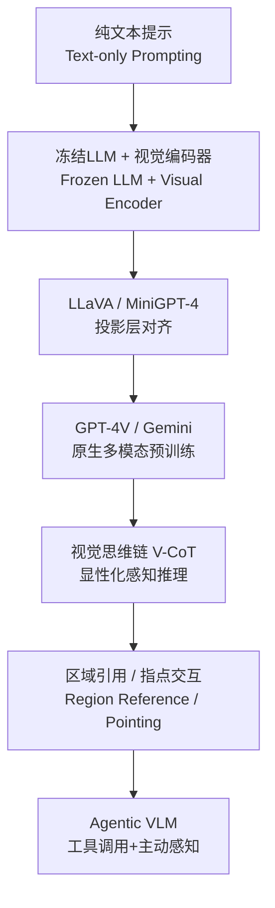
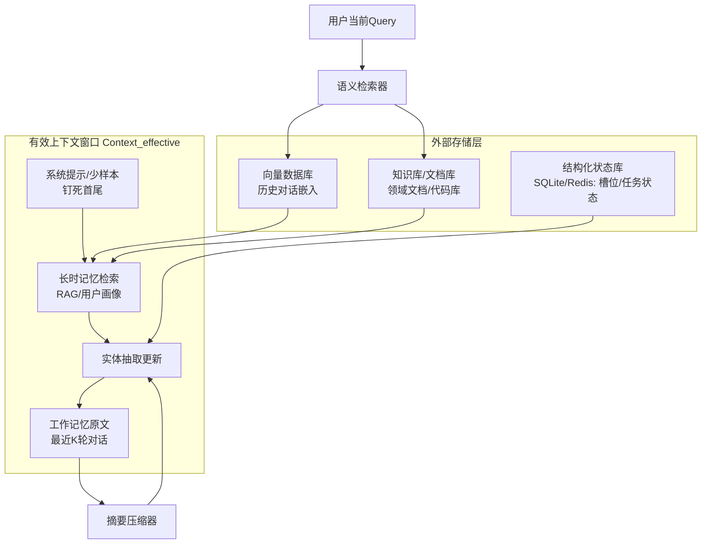
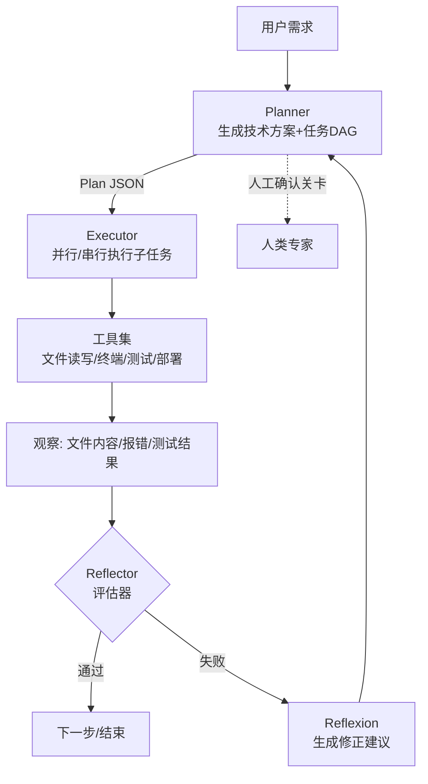
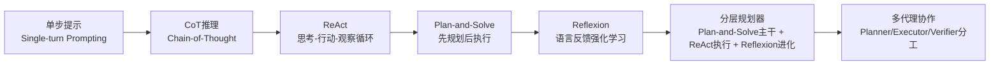

# 第 4 章 多模态与复杂交互 —— 突破文本模态边界
作者：龙哥

## 学习目标

- 理解视觉语言模型提示的独特组件（图像Token、区域引用）与视觉思维链策略
- 掌握多轮对话中上下文窗口溢出的成因，以及摘要压缩、检索式历史、分层记忆的工程化缓解方案
- 理解LLM代理规划范式（ReAct、Plan-and-Solve、Reflexion）的核心差异与适用边界
- 掌握长上下文‘失落中间’现象的本质，并能运用关键信息前置、结构化标记、分块摘要等注意力引导策略
- 能根据任务模态（单图/多图/视频）、对话长度、任务复杂度选择合适的提示工程与上下文管理组合策略

## 4.1 生活类比

想象多模态与复杂交互是一场“多专家协作的悬疑案件侦破”。视觉语言模型就像一位兼具“法医+目击者”双重身份的侦探：图像Token是现场照片像素级的证据，区域引用是侦探手中的放大镜或红圈标记，指示“重点看这个伤口”，视觉思维链则是侦探的“现场勘察笔录”，先记录现象（观察），再分析线索（推理），最后定性（结论）。上下文工程好比一块“有限容量的案发现场白板”：工作记忆是白板核心区挂着的“最近3天行动日志”，短时记忆是白板侧边的“案情阶段性摘要”，长时记忆是架子上的“历史卷宗库”（向量检索），需要时调阅，而“钉死首尾”则是“案件核心指令”与“铁律”永远钉在白板最显眼的顶部和底部。代理规划相当于“总指挥的作战地图”：ReAct是“边打边侦察”的游击战术，灵活但易迷失；Plan-and-Solve是“详细作战计划”再发兵，稳健但缺乏应变；Reflexion是“复盘会”，打完一仗总结教训，修正下一步计划。长上下文/失落中间则是“超长卷宗的阅读陷阱”：现象是侦探阅读百页卷宗时，开头结尾记得清，中间关键线索却“视而不见”；对策是把“致命证据”抽出来单独装订成“重点材料”夹在卷宗最前面（前置），或在页边贴“重要”便利贴（结构化标记），或让助手先写“分章摘要”再汇总（Map-Reduce）。

> **类比贯穿提示**：本章各核心小节将反复呼应上述侦破类比中的角色与工具，帮助你建立跨模态、跨轮次、跨任务的统一心智模型。

## 4.2 概念地图

多模态与复杂交互
├── 视觉语言模型提示
│   ├── 多模态提示组件          —— P001 (20230418_088.md, 20230418_089.md)
│   │   ├── 图像Token序列
│   │   ├── 区域引用标记（坐标/框）
│   │   └── 跨模态交互标记（<image>）
│   ├── 视觉思维链              —— P001 (20230418_088.md, 20230418_089.md)
│   │   ├── 观察→分析→推理→结论
│   │   └── 显性化感知过程
│   ├── 典型任务模式            —— P001 (20230418_088.md, 20230418_089.md)
│   │   ├── 图表问答（描述先行）
│   │   ├── 视觉定位（坐标引导）
│   │   └── 多图对比（强制编号）
│   └── 边界与局限              —— P001 (20230418_088.md, 20230418_089.md)
│       ├── 密集文本OCR短板
│       ├── 多图顺序混淆
│       └── 思维链幻觉风险
├── 多轮对话与上下文工程
│   ├── 核心挑战                —— P002 (20230418_090.md, 20230418_091.md)
│   │   ├── 窗口溢出
│   │   ├── 关键信息稀释
│   │   └── 一致性漂移
│   ├── 分层记忆架构            —— P002 (20230418_090.md, 20230418_091.md)
│   │   ├── 工作记忆（近期原文）
│   │   ├── 短时记忆（对话摘要）
│   │   └── 长时记忆（向量库/画像）
│   ├── 压缩与检索策略          —— P002 (20230418_090.md, 20230418_091.md)
│   │   ├── 摘要压缩+实体抽取
│   │   ├── 语义检索式历史召回
│   │   └── 系统提示/少样本钉死首尾
│   └── 典型落地场景            —— P002 (20230418_090.md, 20230418_091.md)
│       ├── 客服机器人（3轮+摘要+画像）
│       └── 编程助手（当前文件+依赖摘要+规范）
├── LLM代理规划与任务分解
│   ├── 核心定义                —— P003 (20230418_092.md, 20230418_093.md)
│   │   ├── Planning（结构化执行计划）
│   │   ├── Task Decomposition（递归拆解）
│   │   └── Self-Reflection（执行后验证）
│   ├── 主流范式对比            —— P003 (20230418_092.md, 20230418_093.md)
│   │   ├── ReAct（思考-行动-观察循环）
│   │   ├── Plan-and-Solve（先规划后执行）
│   │   └── Reflexion（语言强化学习修正）
│   ├── 关键性质                —— P003 (20230418_092.md, 20230418_093.md)
│   │   ├── 规划粒度权衡
│   │   ├── 基座模型推理上限依赖
│       └── 早期决策错误放大
│   └── 典型应用                —— P003 (20230418_092.md, 20230418_093.md)
│       ├── AutoGPT式调研分解
│       └── 代码生成全流程Agent
└── 长上下文处理策略
├── 失落中间现象            —— P004 (20230418_094.md, 20230418_111.md)
│   ├── U型注意力曲线（首尾高、中间低）
│   └── 关键证据位于中间易被忽略
├── 注意力引导策略          —— P004 (20230418_094.md, 20230418_111.md)
│   ├── 关键信息前置/后置
│   ├── 结构化标记（XML/Markdown/分隔符）
│   ├── 分块摘要/Map-Reduce
│   └── 检索重排序（相关性倒序）
├── 典型实践                —— P004 (20230418_094.md, 20230418_111.md)
│   ├── 合同审查（风险条款前置）
│   └── 代码库问答（Top-K倒序排列）
└── 边界条件                —— P004 (20230418_094.md, 20230418_111.md)
    ├── 超越实际注意力跨度失效
    ├── 过度引导指令消耗Token
    └── 多跳推理需显式引用溯源

## 4.3 视觉语言模型提示：图文对齐与视觉思维链

### 4.3.1 多模态提示组件

当我们从纯文本交互转向视觉语言模型（VLM）时，提示的“语法”发生了根本性扩展。素材指出，多模态提示的独特组件包括图像Token序列与区域引用标记 [P001, 20230418_088.md]。在纯文本时代，上下文是一维的Token流；而在VLM中，图像被编码器（如CLIP ViT）压缩为一段向量序列（Image Tokens），这段序列必须通过特殊的跨模态交互标记（如`<image>`）插入到文本Token流的特定位置。

你可以把`<image>`标记理解为告诉模型：“接下来的这一段向量不是文字，而是一张图的压缩表示，请调用你的视觉编码器投影层来理解它”。如果没有这个显式标记，模型会尝试用语言模型的嵌入层去解码图像向量，产生乱码般的语义。正如侦探需要在笔录上盖章“附件：现场照片”才能让卷宗系统识别并调取影像资料，`<image>`标记就是跨模态交互的“盖章动作”。

> "多模态提示的独特组件包括图像Token序列与区域引用标记。"
> 
> ——《20230418_088.md，P001》

### 4.3.2 多模态提示的形式化定义

一个标准的VLM提示输入可以形式化为三元组的拼接序列：

$$
\mathcal{P}_{VLM} = [T_{sys}, \quad (T_{user}^{(1)}, I^{(1)}), \quad (T_{user}^{(2)}, I^{(2)}), \dots, T_{inst}]
$$

其中：
- $T_{sys}$：系统提示（纯文本），对应侦探的“铁律”与“人设”，钉死在首部。
- $T_{user}^{(i)}$：第 $i$ 轮用户文本指令，对应侦探收到的“调查指令”。
- $I^{(i)} = \{ \texttt{<image>}, \mathbf{v}_1, \dots, \mathbf{v}_N, \texttt{<region>}_{coord} \}$：第 $i$ 轮视觉输入，包含**图像起始标记**`<image>`、**$N$ 个图像Token向量** $\mathbf{v}_j$、以及可选的**区域引用标记**（如归一化坐标 `<box><x1><y1><x2><y2></box>` 或指点坐标 `<point><x><y></point>`）。

**公式逐步推导与解释**：
1. **序列化必要性**：Transformer只能处理一维Token序列，因此必须将二维图像“扁平化”为向量序列 $\mathbf{v}_1 \dots \mathbf{v}_N$。这是将视觉信号接入语言模型的物理前提。
2. **跨模态边界标记**：`<image>` 相当于在序列中插入一个特殊的“模态切换符”，通知模型后续Token来自视觉投影层而非词嵌入层。这正如侦探在卷宗中插入“附件开始”标签，告知阅卷人后续材料性质变更。
3. **区域引用作为语义锚点**：`<region>_{coord}` 在图像Token流中打上“语义锚点”，使文本指令（如“红框里是什么”）能精准对齐到图像特定感受野，这正是侦探用红圈标记“重点看这个伤口”的计算实现。
4. **多轮交织结构**：$(T_{user}^{(i)}, I^{(i)})$ 的交替排布，保证了视觉与语言在对话维度上的时序对齐，对应侦探“看一份材料、记一笔笔录、再看下一份”的工作流。

**作用概述**：该公式定义了VLM提示的核心结构——文本与视觉在Token层面交织，而非简单拼接。首尾的系统提示与指令构成了跨模态交互的稳定边界（钉死首尾），中间的多轮图文对则构成了动态的推理上下文。

### 4.3.3 视觉思维链：显性化感知过程

素材强调，视觉推理的提示策略需显式引导模型进行感知与推理的分步骤输出 [P001, 20230418_088.md]。这正是**视觉思维链（Visual Chain-of-Thought, V-CoT）**的核心思想。

标准文本CoT是“让模型逐步推理”，而V-CoT必须先解决“让模型逐步**看**”。我们设计的提示模版通常包含四个显性阶段：

**观察阶段**：描述图像全局构图、主要物体、颜色、布局、文字区域（OCR）。对应侦探“到达现场第一眼看到什么”，这是感知的原始记录，要求模型尽可能详尽地复述视觉内容，避免过早抽象。

**分析阶段**：定位任务相关区域，解读图表坐标轴、表格表头、几何关系、文本语义。对应侦探“拿出放大镜看红圈里的伤口细节”，这是目标导向的选择性感知，将观察聚焦到与问题相关的视觉证据上。

**推理阶段**：基于观察到的证据，进行逻辑演算、数值计算、因果推导。对应侦探“根据伤口形态推断凶器与作案手法”，这是纯逻辑操作，不再涉及新的视觉感知。

**结论阶段**：给出最终答案，并可选择性引用观察阶段的具体证据（如“基于观察到的Q3柱状图高度为...”）。对应侦探“最终定性：这是一起预谋杀人案”，形成可验证的完整推理链条。

**伪代码：视觉思维链提示模版构造算法**

```
FUNCTION BuildVCoTPrompt(task_instruction, image_refs, few_shot_examples=[]):
    prompt = SYSTEM_PROMPT_VLM  # 定义角色：严谨的视觉分析师
    
    FOR each (ex_img, ex_cot, ex_ans) IN few_shot_examples:
        prompt += USER: [ex_img] + "请分析图片并回答：" + ex_instruction
        prompt += ASSISTANT: 
            "【观察】" + ex_cot.observation + "\n"
            "【分析】" + ex_cot.analysis + "\n"
            "【推理】" + ex_cot.reasoning + "\n"
            "【结论】" + ex_ans
    
    # 当前任务
    prompt += USER: [image_refs] + task_instruction + "\n"
    prompt += "请按以下格式逐步思考：\n"
    prompt += "【观察】...\n【分析】...\n【推理】...\n【结论】..."
    
    RETURN prompt
```

**算法作用说明**：该算法展示了如何通过结构化少样本示例“钉死”V-CoT的输出格式。`SYSTEM_PROMPT_VLM` 设定“严谨视觉分析师”人设，对应侦探的“职业操守”；少样本循环将标准化的“勘察笔录格式”内化为模型的行为模式；最终拼接当前任务的图像引用与指令，强制模型将隐性的视觉感知过程外显为可验证的文本步骤，便于人工审计与错误诊断。

### 4.3.4 典型任务模式

根据素材 [P001, 20230418_088.md] [P001, 20230418_089.md]，我们总结三种高频任务模式及其提示要点。下表展示了不同任务类型对应的核心提示策略与关键组件：

| 任务类型 | 核心提示策略 | 关键组件 |
| :--- | :--- | :--- |
| **图表问答** | **描述先行**：强制模型先输出图表类型、坐标轴定义、数据趋势，再提取数值计算。此策略直接对应V-CoT的**观察阶段**，要求模型完成对图表元数据的完整结构化描述。 | `<image>` + 结构化输出约束 |
| **视觉定位** | **坐标引导**：用户提供或模型预测归一化坐标 `<box>0.1,0.2,0.5,0.6</box>`，提示模型聚焦该区域Token。 | 区域引用标记 + 区域裁剪/高分辨率编码 |
| **多图对比** | **强制编号**：提示中显式标注 `Image 1: <img1>`, `Image 2: <img2>`，指令要求“对比Image 1和Image 2的差异”。 | 多`<image>`标记 + 显式索引 |

**图表问答（描述先行）深度解析**：此模式要求模型在回答具体数值问题前，必须完成对图表元数据的完整结构化描述。例如面对一张双轴折线图，模型需先输出：“图表类型：双轴折线图；X轴：时间（月度）；左Y轴：营收（亿元）；右Y轴：同比增长率（%）；趋势：营收整体上升，增长率波动下降”。这一“描述先行”过程，实质上是强制模型将视觉像素转化为结构化语义符号，为后续数值提取建立坐标系，防止模型直接猜测数值导致幻觉。这正如侦探在作证前必须先完整描述“现场布局、物证分布”，而非直接跳到“凶手是谁”。

**视觉定位（坐标引导）深度解析**：当任务涉及“图中红框区域的文字内容”或“箭头指向的组件名称”时，纯文本指令“看那个红框”对模型无效，因为模型没有视觉注意力机制理解“那个”。工程解法是将区域坐标（归一化 `[x1,y1,x2,y2]` 或绝对像素）作为特殊Token序列 `<region>x1,y1,x2,y2</region>` 插入图像Token流中，或在高分辨率编码器（如LLaVA-HD、MiniCPM-V）中对该区域进行RoI Align裁剪放大。这相当于给侦探一张“已标注重点区域的放大照片”，消除了歧义。

**多图对比（强制编号）深度解析**：输入多张图像时（如对比两版合同扫描件、前后对比照片），模型极易混淆图像顺序，导致“将图1的特征归因于图2”。必须在文本指令中显式建立索引映射：`Image 1 (合同版本A): <img1> ... Image 2 (合同版本B): <img2> ... 任务：对比Image 1和Image 2在第7条款的差异`。同时，在图像Token流层面，不同图像的`<image>`标记间需插入显式文本分隔符，防止视觉编码器输出的Token序列在拼接时发生语义渗透。

### 4.3.5 边界与局限

**密集文本OCR短板**：当图像为全页扫描文档、密集表格时，VLM自带视觉编码器分辨率有限（通常 336x336 或 448x448），OCR错误率高。这是**密集文本OCR短板**的典型表现。工程对策是先用专用OCR工具（如PP-OCR、Tesseract、Azure Form Recognizer）提取文本作为文本上下文注入，VLM仅负责布局理解、表格结构识别与跨模态推理。

**多图顺序混淆**：当输入超过3-4张图时，模型极易搞混图像顺序，这是**多图顺序混淆**问题。必须在文本指令中反复强调编号，且在图像Token流插入前显式插入文本索引标记。对于视频帧序列（如 32 帧），更需引入时序位置编码或显式帧号Token。

**思维链幻觉风险**：V-CoT的“观察”阶段可能产生“似是而非”的细节描述（如编造图表上不存在的数据点），后续推理链条将构建在错误观察之上，这就是**思维链幻觉风险**。缓解方案包括引入“自我验证”步骤（要求模型在结论后复核观察与推理的一致性），或要求模型在观察阶段标注置信度（如“观察到Q3柱状图高度约为1.2亿，置信度80%”）。

### 4.3.6 方法演进图：从单模态到多模态提示



这张演进图展示了多模态提示从“外挂视觉模块”到“原生统一建模”，再到“结构化推理与交互”的技术路线图。来源：P001 (20230418_088.md, 20230418_089.md)。

## 4.4 多轮对话与上下文工程：状态压缩与记忆管理

### 4.4.1 核心挑战：窗口溢出与信息稀释

素材明确指出，长对话面临三大核心挑战：窗口溢出、关键信息稀释、一致性漂移 [P002, 20230418_090.md]。LLM的上下文窗口（Context Window）是固定大小的“短期记忆缓冲区”。当对话轮次累积超过窗口容量 $W$ 时，最早的 Token 必须被丢弃（滑动窗口）或压缩。

**窗口溢出**：这是最直接的物理限制。随着对话轮次增加，累积 Token 数 $L_{total}$ 最终超越模型最大上下文长度 $L_{max}$。此时系统必须做出选择：截断最早历史（滑动窗口）、压缩历史、或引入外部存储。截断会导致“前因后果断裂”，如用户第 1 轮设定的“人设：资深律师”在第 50 轮被挤出窗口，模型开始以默认人设回复，造成严重的体验断层。

**关键信息稀释**：即使未溢出，海量无关闲聊 Token 会稀释注意力权重，导致模型“关注不到”早期的关键指令（如人设定义、任务约束）。这与第 4.6 节将讨论的“失落中间”现象同根同源——就像白板上杂乱无章的便利贴遮挡了核心线索，侦探（模型）的视线被干扰，无法聚焦“案件核心指令”。注意力机制的计算是 Softmax 归一化，上下文中每增加一个无关 Token，关键 Token 获得的注意力概率就下降一点。

**一致性漂移**：长对话中，模型对早期确立的事实、人设、任务目标的遵循度会随轮次衰减。例如用户第 2 轮指定“代码风格遵循 Google Python Style Guide”，第 20 轮模型可能生成不符合规范的代码，因为该约束在中间被大量中间对话稀释，且未被显式重申。这是“关键信息稀释”在行为层面的投影。

> "解决长对话中的上下文窗口溢出、一致性漂移问题，引入摘要记忆与检索式对话历史。"
> 
> ——《20230418_090.md，P002》

### 4.4.2 分层记忆架构：工程化的认知模型

借鉴认知科学，素材 [P002, 20230418_090.md] [P002, 20230418_091.md] 提出构建**分层记忆架构**，将单一上下文窗口拆解为三层不同存取特性的存储：

**分层记忆架构定义：**

$$
\begin{aligned}
\text{Context}_{effective} &= \underbrace{T_{sys} \oplus T_{few\_shot}}_{\text{钉死锚点}} \oplus \\
&\quad \underbrace{\mathcal{R}_{semantic}(Q, \mathcal{M}_{long})}_{\text{长时记忆检索}} \oplus \\
&\quad \underbrace{S_{short}(\mathcal{H}_{recent})}_{\text{短时记忆摘要}} \oplus \\
&\quad \underbrace{\mathcal{H}_{raw}^{(last\ k)}}_{\text{工作记忆原文}}
\end{aligned}
$$

**公式逐步推导与解释**：
1. **钉死锚点** ($T_{sys} \oplus T_{few\_shot}$)：系统提示与少样本示例永远固定在窗口首尾，不参与淘汰。这是“案件核心指令”与“铁律”永远钉在白板最显眼顶部和底部的数学表达，保证人设与任务约束的绝对优先级。符号 $\oplus$ 表示序列拼接操作（全书统一定义）。
2. **长时记忆检索** ($\mathcal{R}_{semantic}(Q, \mathcal{M}_{long})$)：根据当前 Query $Q$ 从向量库 $\mathcal{M}_{long}$ 召回相关历史片段、用户画像或领域知识。$\mathcal{R}_{semantic}$ 表示语义检索算子（通常为向量相似度 Top-K + 重排序）。实现“按需调阅历史卷宗”，不占用固定窗口配额，解决超长周期一致性问题。
3. **短时记忆摘要** ($S_{short}(\mathcal{H}_{recent})$)：将早期对话 $\mathcal{H}_{recent}$ 压缩为流程性摘要并配合关键实体抽取保留槽位信息。$S_{short}$ 表示摘要算子（可由小模型或主模型执行）。在Token预算约30-40%的份额内保留核心事实与决策，对应白板侧边的“案情阶段性摘要”。
4. **工作记忆原文** ($\mathcal{H}_{raw}^{(last\ k)}$)：保留最近 $k$ 轮对话原文，占据约20-30%预算。保证细节、语气与精确措辞的即时可用，对应白板核心区的“最近3天行动日志”。

**作用概述**：这个公式展示了如何在有限窗口内通过“外部存储+检索+压缩”组合拳，最大化有效信息密度。四个分量各司其职，共同构成了一个既能保持长期一致性、又能精准处理近期细节的动态上下文。

### 4.4.3 压缩与检索策略详解

**1. 摘要压缩 + 实体抽取（Summarization + Entity Extraction）**
单纯让LLM总结对话会丢失槽位信息（Slot Values）。工程化做法是**双通道压缩**：
- **通道A（语义摘要）**：小模型/低成本模型生成流程性摘要（“用户询问退款政策->客服解释条款->用户提供订单号”）。
- **通道B（实体抽取）**：用正则/小模型/NER提取关键实体：`{order_id: "20231001", product: "Phone X", policy_version: "v3.2"}`。
- **注入方式**：摘要作为文本注入；实体以结构化JSON或`Key: Value`列表注入，或作为“系统提示追加”注入。

> "状态压缩技术包括对话摘要、关键实体抽取、滑动窗口与语义检索融合。"
> 
> ——《20230418_091.md，P002》

**2. 语义检索式历史召回**
替代“最近 $N$ 轮”的滑动窗口，构建对话历史向量索引（每轮或每话题一段）。当前 Query 向量化后检索 Top-K 相关历史片段。

**检索 vs 滑动窗口的权衡：** 下表对比了两种策略在多个工程维度上的优劣：

| 维度 | 定长滑动窗口 | 语义检索式历史 |
| :--- | :--- | :--- |
| **Token效率** | 低（包含大量无关闲聊） | 高（仅召回相关片段） |
| **细节保真度** | 高（原文保留） | 中（依赖分段粒度，可能丢失上下文衔接） |
| **长期一致性** | 差（早期指令随窗口滑动丢失） | 优（核心指令可存入长时记忆库永久保留） |
| **工程复杂度** | 低（FIFO队列） | 高（向量库、嵌入模型、检索延迟、重排序） |
| **失效模式** | 硬截断导致前因后果断裂 | 召回失败/语义漂移导致关键轮次缺失 |

### 4.4.4 典型落地场景配置

**场景 A：客服机器人（窗口 4k Token）**
- 系统提示 + 少样本：800 Token（钉死首尾）
- 工作记忆：最近 3 轮原文 ~ 600 Token
- 短时记忆：历史摘要 + 实体槽位 ~ 1000 Token
- 长时记忆检索：用户画像标签 + 相关知识库片段 ~ 1600 Token

**场景 B：编程助手（窗口 8k-32k Token）**
- 系统提示（编码规范）：1000 Token
- 工作记忆：当前编辑文件上下文 + 最近 2 轮对话 ~ 3000 Token
- 短时记忆：相关依赖文件摘要（函数签名、类定义）~ 2000 Token
- 长时记忆检索：项目架构文档、历史 Issue 解决方案（RAG召回）~ 2000 Token

### 4.4.5 边界条件与反模式

素材 [P002, 20230418_091.md] 提示了三大边界风险：

**外部结构化状态存储必要性**：当对话超长（>50轮）且强依赖早期细节时，纯压缩失效，必须引入**外部结构化状态存储**（如SQLite记录任务状态、用户偏好表），上下文仅注入“当前状态快照”。例如编程助手需维护“当前项目文件树、依赖图、已完成任务清单”，这些结构化状态不应靠摘要维持，而应由外部状态机管理，上下文仅注入当前快照。

**摘要幻觉污染风险**：若摘要模型能力弱于主模型，会引入“摘要幻觉”污染上下文，对策是用主模型自身做摘要（成本高），或引入“摘要校验器”对比实体一致性。例如摘要模型将“用户要求用 React”误写为“用户要求用 Vue”，后续所有代码生成将偏离技术栈。必须建立摘要-实体一致性校验管线。

**隐式语言/模态切换线索丢失**：在多语言/代码切换场景下，压缩可能丢失语言切换的隐式线索，对策是在实体抽取中显式记录“当前编程语言”、“当前自然语言”。例如对话从 Python 讨论切换到 SQL 编写，若摘要仅记录“讨论数据库查询”，模型可能继续用 Python 伪代码生成 SQL。

### 4.4.6 方法演进图：上下文工程架构分层



这张架构图展示了分层记忆在上下文窗口内的空间分配，以及外部存储如何通过检索与压缩回路支撑三层记忆的动态更新。来源：P002 (20230418_090.md, 20230418_091.md)。

## 4.5 LLM代理规划与任务分解：从单步到复杂目标达成

### 4.5.1 核心定义：规划、分解、反思三位一体

素材 [P003, 20230418_092.md] 将代理核心能力拆解为三个概念：
- **Planning（规划）**：生成结构化执行计划。输出格式通常为 JSON/DAG/步骤列表，包含 `subtask_id, description, tool, args, dependency, expected_output`。
- **Task Decomposition（任务分解）**：将高层目标递归拆解至**原子动作粒度**（可直接由工具执行）。如“写一个网站” -> “设计数据库Schema” -> “生成SQL” -> “执行迁移”。
- **Self-Reflection（自我反思）**：执行后对比 `Expected Output` 与 `Actual Observation`，若不符，生成 `Reflection Note` 触发**重规划**或**参数修正**。

> "剖析Planning、Task Decomposition、Self-Reflection在自主代理中的提示实现模式。"
> 
> ——《20230418_092.md，P003》

### 4.5.2 主流范式对比：ReAct vs Plan-and-Solve vs Reflexion

素材 [P003, 20230418_092.md] [P003, 20230418_093.md] 对比了三大范式，我们将其工程化特性整理为下表：

| 维度 | **ReAct** (Reasoning + Acting) | **Plan-and-Solve** | **Reflexion** (语言强化学习) |
| :--- | :--- | :--- | :--- |
| **核心循环** | `Thought -> Action -> Observation` 循环，交织推理与行动 | `Plan(全局) -> Execute(逐步) -> (可选) Replan` | `Trial -> Reflection(语言反馈) -> Updated Policy -> Retry` |
| **规划时机** | **在线、逐步** 生成下一步动作 | **离线、一次性** 生成全局计划（DAG/列表） | **事后、迭代** 更新策略/提示/少样本池 |
| **适用任务** | 探索性、不可预测环境（网页导航、科研调研） | 确定性、流程固定任务（代码生成、数据处理管线） | 高价值、可重复、需长期优化任务（SQL生成、复杂规划） |
| **Token开销** | 低（单步），但累积高 | 高（前置全局规划） | 极高（多次试错+反思生成） |
| **鲁棒性** | 易因单步错误累积偏离（“幻觉漂移”） | 规划错误则全盘皆错，缺乏运行时纠偏 | 引入“语言奖励模型”评估轨迹，显式修正错误 |
| **工程落地难点** | 停止条件判定、循环检测、工具调用格式约束 | 规划粒度控制、动态环境下的重规划触发机制 | 反思质量评估、避免“过度反思”陷入分析瘫痪 |

> "ReAct、Plan-and-Solve、Reflexion等范式的对比与适用边界分析。"
> 
> ——《20230418_093.md，P003》

**ReAct 伪代码结构：**

```
WHILE not DONE and steps < MAX_STEPS:
    Thought = LLM(Context + "Thought: ")
    Action, Action_Input = Parse(LLM(Context + Thought + "Action: "))
    Observation = ToolExecutor(Action, Action_Input)
    Context += Thought + Action + Observation
    IF "Final Answer" in Thought: BREAK
```

**算法作用说明**：ReAct 将推理与行动交织在一个循环中。`Thought` 是侦探的“现场分析”，`Action` 是“调取监控/传唤证人”，`Observation` 是“取证结果”。循环持续直到侦探在 `Thought` 中给出“Final Answer”。这种“边打边侦察”适合探索性任务，但单步错误会像游击战迷失方向一样累积偏离。

**Plan-and-Solve 伪代码结构：**

```
Plan = LLM("Generate a step-by-step plan in JSON: " + Task)
FOR step IN Plan.steps:
    Observation = Execute(step)  # 可并行执行无依赖步骤
    IF Observation FAILS:
        Plan = Replan(Plan, step, Observation)  # 局部重规划
```

**算法作用说明**：Plan-and-Solve 先由“总指挥”制定详细作战计划（`Plan`），再按部就班执行。`Plan` 为 JSON 格式的 DAG，包含依赖关系，支持无依赖步骤并行执行。执行失败时触发 `Replan` 进行局部修正。这对应“详细作战计划再发兵”，稳健但缺乏应变。

**Reflexion 核心机制：**
引入**评价器**（Evaluator，可为LLM自身或单独RM），对轨迹 $\tau$ 打分 $R(\tau)$。若 $R < \theta$，生成自然语言反思 $r = \text{LLM}(\tau, \text{"What went wrong?"})$，将 $r$ 注入下一次尝试的上下文或更新少样本池。这就是“复盘会”机制：打完一仗总结教训，修正下一步计划。

### 4.5.3 关键性质与工程权衡

**规划粒度权衡**：在规划粒度权衡上，太粗（如“开发后端”）会导致执行时歧义大，工具调用参数错误率高；太细（如“定义User类的id字段类型为UUID”）则导致规划Token爆炸，计划脆弱，微小环境变化即需重规划。工程经验建议粒度对齐**工具接口粒度**，即一个Tool调用对应一个Plan步骤。这相当于作战地图的缩放级别：太粗看不清战术细节，太细则地图铺不开。

**基座模型推理上限依赖**：代理能力强依赖**基座模型推理上限**：7B 以下模型几乎无法生成可用的多步 Plan（逻辑断层、格式错误、幻觉工具）。对策是小模型场景下将规划**外置化**——由强模型（或人类）离线生成“标准作业程序SOP”库，小模型仅做“检索SOP -> 参数填充 -> 执行”。这正如总指挥战力不足时，改用“成熟作战手册”指导部队行动。

**早期决策错误放大**：**早期决策错误放大**（蝴蝶效应）是长链路规划的核心风险：Plan 第一步选错技术栈会导致后续所有代码生成均无效。工程护栏包括在关键决策节点（架构选型、数据库Schema、生产环境写操作）强制 `Human-in-the-loop` 确认，以及引入轻量级验证器（类型检查、单测运行、静态分析）作为“观察”反馈给Reflexion机制。这相当于在作战计划关键节点设置“师长亲自把关”关卡。

### 4.5.4 典型应用架构：代码生成全流程 Agent

结合素材 [P003, 20230418_093.md] 典型应用，一个工程化的代码生成 Agent 架构如下：



这个架构图展示了**规划-执行-反思**闭环，以及关键的人工确认介入点。来源：P003 (20230418_092.md, 20230418_093.md)。

### 4.5.5 方法演进图：代理规划范式演进



这张演进图描绘了代理规划从单步推理到分层协作的技术演进路径。来源：P003 (20230418_092.md, 20230418_093.md)。

## 4.6 长上下文处理策略：失落中间现象与注意力引导

### 4.6.1 失落中间现象：注意力的 U 型偏见

素材 [P004, 20230418_094.md] 实验揭示：Transformer在长序列中对中间Token关注权重系统性偏低，形成**U型注意力曲线**（首尾高、中间低）。这不是模型“记不住”，而是**注意力分配机制的固有偏好**——在因果注意力掩码下，前向传播时早期Token积累了更多残差连接梯度，后期Token临近预测位置梯度强，中间Token“两头不靠”。

**定量表征（来源：[P004, 20230418_094.md] [P004, 20230418_111.md]）：**
设序列长度 $L$，位置 $i$ 的平均注意力权重 $\bar{A}_i$。实验观测到：
$$
\bar{A}_i \propto \begin{cases} 
\text{High} & i \in [0, 0.15L] \cup [0.85L, L] \\
\text{Low} & i \in [0.3L, 0.7L]
\end{cases}
$$

**公式逐步推导与解释**：
1. **因果掩码非对称性**：Transformer 因果注意力只能关注“过去”，位置 $i$ 只能被 $j > i$ 的位置关注。早期位置（小 $i$）拥有更多未来位置可被关注，积累的注意力分数期望值更高。
2. **残差连接梯度累积**：早期 Token 经过更多层的残差累加，其表征在后续层中被反复“读取”，形成强信号；后期 Token 临近输出层，梯度直接回传强，也受到充分优化。
3. **中间夹心层困境**：中间位置 $i \in [0.3L, 0.7L]$ 既没有足够的“未来关注者”，又距离输出层较远，梯度衰减，导致注意力权重系统性偏低。

若关键证据（Key Evidence $E_k$）位于中间区间 $[0.3L, 0.7L]$，模型回答正确率显著下降（可能降至随机猜测水平）。这正如侦探阅读百页卷宗时，开头结尾记得清，中间关键线索却“视而不见”。

> "实验揭示长上下文‘中间遗忘’规律，提出关键信息前置、分块摘要等缓解策略。"
> 
> ——《20230418_094.md，P004》

**作用概述**：该公式量化揭示了“失落中间”并非模型容量不足，而是注意力机制几何结构导致的必然偏置。工程上必须通过外部干预（前置、标记、分块）将关键证据 $E_k$ 移动到高注意力区 $[0, 0.15L] \cup [0.85L, L]$，或通过结构化标记在中间区建立“捷径”。

### 4.6.2 注意力引导策略工具箱

针对上述现象，素材 [P004, 20230418_094.md] [P004, 20230418_111.md] 提出四大类工程化引导策略：

#### 策略 1：关键信息前置/后置
**原理**：利用首尾高注意力区，将最关键的指令、少样本、检索证据强制放置于窗口首尾。

**实施模版：**
```
[系统提示 + 核心指令 + 少样本示例]  <-- 首部锚点 (高注意力)
[检索到的关键证据片段 E_k (按相关性倒序，最相关在最前)]  <-- 前置关键证据
[次要背景材料 / 长文档主体 / 历史对话摘要]  <-- 中间低注意力区（允许遗忘）
[用户当前 Query + 输出格式约束]  <-- 尾部锚点 (高注意力)
```

**代价**：打破文档自然顺序，可能破坏多跳推理所需的上下文关联；需在提示中显式声明“材料已重排，请忽略原始顺序”。

#### 策略 2：结构化标记
**原理**：显式语义边界（XML标签、Markdown标题、特殊分隔符）充当“注意力锚点”，帮助模型在中间区域快速定位语义块，而非逐Token阅读。

**对比示例：**

> **无标记（易失焦）：**
> 合同正文共50页...第23页第3条...乙方可随时单方面终止合同无需赔偿...第45页...
>
> **有标记（引导聚焦）：**
> ```xml
> <Contract>
>   <Chapter id="1" title="总则">...</Chapter>
>   ...
>   <Chapter id="7" title="终止条款">
>     <Clause id="7.3" risk_level="HIGH">
>       乙方可随时单方面终止合同无需赔偿
>     </Clause>
>   </Chapter>
> </Contract>
> ```
> 指令：“重点分析 `<Clause risk_level="HIGH">` 标记的条款。”

结构化标记将“隐式位置偏置”转化为“显式语义检索”，模型可通过注意力机制直接跳转到高风险标签区域。这正如在卷宗页边贴“重要”便利贴，侦探无需逐页翻阅即可定位致命证据。

#### 策略 3：分块摘要 / Map-Reduce
**原理**：将长文档分块（Chunk），每块独立摘要，最后汇总。将 $O(L^2)$ 注意力计算降为 $O(N \cdot (L/N)^2) = O(L^2/N)$，同时规避中间遗忘。

**Map-Reduce 流程：**

```
FUNCTION MapReduceQA(long_doc, question, chunk_size, overlap):
    chunks = Split(long_doc, chunk_size, overlap)  # 滑动窗口分块保留边界上下文
    
    # Map 阶段：并行处理每个块
    partial_answers = PARALLEL_MAP(chunks, lambda chunk:
        LLM(f"基于以下材料回答问题，若无相关信息回复'无'：\n{chunk}\n\n问题：{question}")
    )
    
    # Filter：丢弃"无"答案
    relevant = [ans for ans in partial_answers if "无" not in ans]
    
    # Reduce 阶段：汇总
    final_prompt = "综合以下片段回答：\n" + "\n---\n".join(relevant) + f"\n\n问题：{question}"
    RETURN LLM(final_prompt)
```

**算法作用说明**：该算法实现了“分而治之”的长文本处理逻辑：Map阶段并行提取各块相关信息，Filter阶段去噪，Reduce阶段融合生成最终答案。**局限（素材 [P004, 20230418_111.md]）**：跨块关联信息丢失（如“第1章定义的术语在第10章使用”）。改进：**重叠分块** + **全局术语表/索引预提取** 注入 Reduce 阶段。

> "注意力引导技术包括：指令强制聚焦、结构化标记、检索重排序、分层摘要。"
> 
> ——《20230418_111.md，P004》

#### 策略 4：检索重排序
**原理**：RAG检索得到 Top-K 片段后，不按文档原序排列，而是**按相关性分数倒序**（或“最相关在首、次相关在尾”三明治结构）排列注入上下文。

**排序策略对比：** 下表对比了三种排序方式的适用场景与风险：

| 排序方式 | 适用场景 | 失效风险 |
| :--- | :--- | :--- |
| **文档原序** | 严格时序/因果依赖任务（如日志分析、代码执行_trace_) | 关键证据在中间 -> 遗忘 |
| **相关性倒序** | 事实问答、单跳检索、关键条款定位 | 破坏上下文连贯性，多跳推理困难 |
| **三明治序** | 平衡场景：最相关首尾，次相关中间 | Token消耗大，需精细预算分配 |

### 4.6.3 典型实践案例

**案例 1：合同审查（风险条款前置）**
- **输入**：100页合同 PDF（~80k Token），窗口 128k。
- **流程**：
    1.  规则/小模型快速扫描定位高风险关键词（“单方面终止”、“免责”、“违约金”）。
    2.  提取高风险条款块（含上下文 500 Token），构建“风险清单”注入**首部**。
    3.  全文分章节标记（XML）注入中部。
    4.  指令：“优先参考开头的风险清单逐条核对，引用原文章节号。”
- **效果**：将关键条款召回率从 ~40%（原文直接塞入）提升至 >90%。

**案例 2：代码库问答**
- **输入**：用户问“UserService 中如何处理密码加密？”，代码库 50 文件。
- **流程**：
    1.  向量检索 Top-10 相关代码片段。
    2.  **重排序**：Cross-Encoder 打分，按分数倒序。
    3.  注入：`[系统提示] + [Top-1 片段] + [Top-2 片段] + ... + [用户问题]`。
- **效果**：核心实现文件（如 `password_util.py` `auth_service.py`）稳居首位，模型直接定位核心逻辑。

### 4.6.4 边界条件：何时策略失效？

素材 [P004, 20230418_111.md] 指出三大硬性边界：

**超越实际注意力跨度失效**：当有效上下文超过模型实际注意力跨度（模型声称 128k，实测有效注意力可能仅 32k）时，即使前置也会因中间堆积过多 Token 导致首尾注意力被稀释，必须压缩/检索，物理上缩短上下文。

**过度引导指令消耗 Token**：过度引导指令（如“请重点阅读第 3、5、7、9、11 段”）本身消耗大量 Token 且易被模型忽略，对策是用结构化标记替代自然语言指令。

**多跳推理需显式引用溯源**：多跳推理需跨段落综合信息（证据A在开头，证据B在结尾，需推导A->B），单纯前置无法解决，对策是强制模型输出 `Citation: [Doc_1, Ln 10-20]`，或采用 **Iterative Retrieval-CoT**（检索-推理交织）。

### 4.6.5 方法演进图：长上下文处理策略演进


这张演进图描绘了从被动接受上下文到主动构建上下文、再到模型原生能力进化的技术路径。来源：P004 (20230418_094.md, 20230418_111.md)。

## 4.7 多源对照

### 4.7.1 视觉思维链的“显性化”深度分歧

**共识**：V-CoT 通过结构化输出（观察→分析→推理→结论）显著提升复杂视觉推理准确率。

**分歧**：
- **《20230418_088.md，P001》视角（感知驱动）**：主张**细粒度感知先行**，即“观察”阶段应尽可能详尽（像素级描述、OCR全文识别），认为推理错误多源于感知遗漏。
- **《20230418_089.md，P001》视角（任务驱动）**：主张**目标导向的选择性感知**，即“观察”阶段应由问题引导，只描述任务相关区域（如“只看Q3柱状图”），避免无关视觉噪声干扰推理，且能节省 Token。

**综合建议**：简单任务（图表问答）用任务驱动；复杂开放任务（场景理解、几何证明）用感知驱动+区域引用聚焦。

### 4.7.2 代理规划范式的“灵活性 vs 可控性”权衡

**共识**：ReAct 灵活、Plan-and-Solve 可控、Reflexion 可进化，三者互补而非互斥。

**分歧**：
- **《20230418_092.md，P003》**：倾向 **Plan-and-Solve 作为主干**，ReAct 作为执行层的局部策略（即：全局Plan -> 每步用ReAct执行 -> 失败触发Reflexion重规划）。认为纯ReAct在长链路任务中不可控。
- **《20230418_093.md，P003》**：强调 **Reflexion 是核心进化引擎**，主张即使有完美Plan，也必须引入Reflexion机制应对环境不确定性（工具报错、网页变更），并探讨“语言奖励模型”训练以量化反思质量。

**工程共识架构**：**分层规划器**——顶层 Plan-and-Solve 生成 DAG，中层 ReAct 执行节点并处理局部异常，底层 Reflexion 积累经验更新少样本池/提示模版。

### 4.7.3 上下文压缩与检索的融合边界

**共识**：摘要压缩与语义检索是互补的，均用于突破窗口限制。

**分歧**：
- **《20230418_090.md，P002》**：侧重**摘要压缩为主**，检索作为补充。主张构建高质量摘要+实体槽位作为短时记忆核心，认为检索召回率不稳定、延迟高，不适合作为主通道。
- **《20230418_091.md，P002》**：侧重**检索为主**，摘要作为兜底。主张长时记忆应全量向量化存储，依赖高质量 Embedding + Reranker 实现精准召回，摘要仅用于“全局概览”类查询。

**工程融合方案**：**双通道并行**——短时记忆走“摘要+实体槽位”（低延迟、保真度高），长时记忆走“向量检索+重排序”（覆盖面广、可扩展），通过“查询分类器”路由：事实回忆类走检索，流程复盘类走摘要。

### 4.7.4 Map-Reduce 跨块关联丢失的改进路径

**共识**：Map-Reduce 会丢失跨块关联信息（如定义在前、使用在后）。

**分歧**：
- **《20230418_094.md，P004》**：提出**重叠分块 + 全局索引**方案，工程成熟度高但 Token 消耗大。
- **《20230418_111.md，P004》**：提出**两阶段检索（Iterative Retrieval）**：Map 阶段不直接答题，而是让模型输出“需要的跨块关键信息清单”；系统据此在全文二次检索补充片段，再进入 Reduce 阶段。即：**Map 生成查询 -> 检索补充 -> Reduce 融合**。

**技术路线对比**：重叠分块属于“空间冗余”策略，简单粗暴但消耗随文档长度线性增长；两阶段检索属于“智能补全”策略，Token 消耗仅随关联复杂度增长，但引入额外推理轮次延迟。工程上建议：文档 < 200k Token 用重叠分块；> 200k Token 用两阶段检索。

## 4.8 设计中的取舍

**问：为什么不用“无限上下文/线性注意力”模型直接塞原文，而要搞这么复杂的上下文工程？**  
**答：** 虽然线性注意力（如RWKV、Mamba、Linear Transformer）理论上支持无限长度，但目前主流最强模型（GPT-4、Claude 3、Llama 3）仍基于标准Softmax Attention，**工程落地必须基于现有最强基座模型**。且线性注意力模型在复杂推理、指令遵循上仍有性能差距。上下文工程是“在模型能力跃迁前，榨干现有模型性价比的必经之路”。这就像在更好的“超大白板”发明前，必须学会在有限白板上高效布局案件材料。

**问：视觉思维链增加了输出 Token 和延迟，值得吗？**  
**答：** **值得，但在高并发低延迟场景（实时客服、游戏NPC）不值得**。V-CoT 通常增加 2-5 倍输出 Token 和 1.5-3 倍首包延迟。工程分级策略：简单视觉问答（OCR、分类）走**零样本直出**；复杂推理（图表分析、几何、医学影像）走**V-CoT**；极致延迟敏感场景走**蒸馏小模型模拟V-CoT隐状态**（知识蒸馏）。这是在“详细勘察笔录”与“口头汇报”之间根据案件紧急程度做取舍。

**问：ReAct 的循环检测怎么做？防止 Agent 陷入“尝试工具A失败->尝试工具B失败->再试工具A”的死循环。**  
**答：** **工程方案**：维护 `Action History Set` (工具名+参数哈希)。若 `(Action, Args_Hash)` 在最近 $N$ 步重复出现 > 2 次，强制触发 `Reflection` 或 `Replan`，并注入指令：“你已尝试过此操作且失败，请分析原因并尝试新策略或请求人工帮助”。这相当于给侦探设置“已排查清单”，避免重复踩坑。

**问：Map-Reduce 丢失跨块关联，除了重叠分块还有什么方案？**  
**答：** **两阶段检索**：Map 阶段不直接答题，而是让模型输出“需要的跨块关键信息清单”；系统据此在全文二次检索补充片段，再进入 Reduce 阶段。即：**Map 生成查询 -> 检索补充 -> Reduce 融合**。这相当于助手先写分章摘要时标注“本章引用了第1章的定义”，总指挥据此补齐第1章原文再汇总。

**问：分层记忆中摘要模型弱于主模型导致幻觉，如何对策？**  
**答：** **三重保障**：1) **主模型自摘要**：关键会话段落（如需求确认、架构决策）强制用主模型生成摘要，成本可控；2) **实体一致性校验器**：摘要生成后，用 NER/规则提取实体，与原文实体集对比，不一致则标记重写；3) **摘要版本控制**：保留最近 N 版摘要，检测到幻觉可回滚。这相当于“档案员写摘要 -> 侦探核对关键人名地名 -> 存档备查”的质检流程。

**问：小模型（<7B）无法规划，外置化 SOP 库怎么落地？**  
**答：** **离线构建 + 在线检索 + 参数化执行**：1) 由强模型/专家离线将领域任务（如“开发REST API”、“数据迁移”）分解为标准化 SOP（JSON格式 DAG，含步骤、工具、参数模版、验收标准）；2) 运行时，小模型仅做“意图分类 -> 检索匹配 SOP -> 填充参数 -> 顺序执行”；3) 执行异常时，回退到强模型远程规划或人工介入。这相当于“总参谋部预案库 -> 前线指挥官按图索骥 -> 突发情况请求增援”。

**问：结构化标记真的比自然语言指令更省 Token 且更有效吗？**  
**答：** **是**。对比：“请重点阅读第3、5、7章的终止条款、违约条款、管辖条款”（~30 Token，模型需解析自然语言定位） vs `<Clause risk=HIGH>` 标记嵌入文档（~5 Token/处，模型注意力直接锚定）。标记复用性强：一次标注，多任务受益；且可由规则/小模型自动打标，不消耗推理 Token。这是“便利贴”比“口头嘱咐”高效的根本原因。

**问：迭代检索-推理（Iterative Retrieval-CoT）替代单纯前置，核心优势是什么？**  
**答：** **动态证据链构建**。单纯前置是静态的“把我认为重要的放前面”，但模型真正需要的证据往往在推理过程中才发现（如推理到第3步发现缺少第1章的定义）。Iterative Retrieval-CoT 让模型在 CoT 中显式输出 `Need_Evidence: "定义X的原文"`，系统即时检索注入，再继续推理。这相当于侦探审讯中随时喊“把第15页卷宗拿来”，而非开庭前一次性堆满桌子。

## 4.9 动手练习

### 练习 1：多模态提示设计与视觉思维链实战
**场景**：你需要让 GPT-4V 分析一张复杂的财务报表截图（包含多个表格、图表、备注文字），回答‘Q3 营收同比增长率是多少？’。
**任务**：
1. 设计一个包含`<image>`标记、区域引用（如表格区域坐标）的多模态 Prompt 模版。
2. 编写引导‘视觉思维链’的指令，要求模型先输出：图表类型识别 → 关键坐标轴/表头定位 → 目标数值提取 → 计算过程 → 最终答案。
3. 列举该 Prompt 在以下边界条件下可能失效的原因：
   - 报表截图模糊、分辨率低
   - 报表跨页，关键数据在两张图中
   - 模型幻觉出一个不存在的‘Q3 总计’行

### 练习 2：多轮对话上下文工程：压缩与检索的权衡
**场景**：构建一个代码助手 Agent，上下文窗口 8k Token。当前对话已进行 20 轮，包含：需求讨论、架构设计、3 个文件的完整代码、报错堆栈、修复方案讨论。
**任务**：
1. 设计一个分层记忆填充方案，分配 Token 预算给：系统提示、近 3 轮原文、历史摘要、用户偏好画像、相关代码片段检索结果。说明你的分配理由。
2. 如果用户突然问‘第 5 轮我们讨论的那个单例模式的线程安全问题怎么解决的？’，你的检索式历史召回策略如何确保召回那段对话？向量检索可能失败吗？
3. 对比‘定长滑动窗口(最近 4k Token)’与‘摘要+检索’两种策略在‘长期一致性人设’和‘近期细节追溯’两个维度的优劣。

### 练习 3：代理规划范式选择与失败诊断
**场景**：目标‘自动完成一个包含前后端的用户注册登录模块开发，并部署到测试环境’。
**任务**：
1. 分别用 ReAct、Plan-and-Solve、Reflexion 三种范式写出该任务的前 3 步高层规划伪代码/结构化输出。
2. 分析：若基座模型是 7B 开源模型，哪种范式最可能失败？为什么？
3. 运行中途，后端启动报错‘端口被占用’。ReAct 范式下 Agent 可能如何错误循环？Plan-and-Solve 如何处理？Reflexion 会触发什么机制？
4. 设计一个‘人工确认关卡’插入点，防止 Agent 误删生产数据库配置。

### 练习 4：长上下文‘失落中间’缓解方案对比实验设计
**场景**：有一份 100k Token 的法律合同语料，其中第 40k-45k 位置藏着一句‘乙方可随时单方面终止合同无需赔偿’的关键陷阱条款。模型上下文窗口 128k。
**任务**：
1. 设计 4 个实验组 Prompt 策略：
   - A组：原文直接塞入（对照组）
   - B组：关键信息前置（将该条款移到开头）
   - C组：结构化标记（给每章加`<Chapter><Title>`标签）+指令‘重点阅读终止条款’
   - D组：Map-Reduce（分章摘要→汇总问答）
2. 预测四组在‘发现陷阱条款’准确率上的排序，并解释理论依据（注意力机制、Token位置偏置、信息丢失）。
3. 如果合同长 500k Token，超出窗口，D 组 Map-Reduce 会丢失什么跨章节关联信息？如何改进？

## 4.10 本章小结

这一章中我们学习了如何突破纯文本模态的限制，构建具备多模态感知、长程记忆、自主规划与长上下文推理能力的复杂交互系统。首先我们剖析了视觉语言模型提示的独特组件——图像Token、区域引用与跨模态标记，并确立了视觉思维链（观察→分析→推理→结论）作为复杂视觉推理的核心范式；其次我们建立了分层记忆架构（工作/短时/长时记忆），通过摘要压缩、实体抽取、语义检索式历史召回解决多轮对话的窗口溢出与信息稀释难题；接着我们对比了 ReAct、Plan-and-Solve、Reflexion 三大代理规划范式的适用边界，揭示了规划粒度权衡、基座模型依赖与早期决策放大等关键工程约束；然后我们深入分析了长上下文“失落中间”现象的注意力机制成因，并给出了关键信息前置、结构化标记、分块摘要 Map-Reduce、检索重排序四大注意力引导策略工具箱；最后我们讨论了各策略的失效边界与组合落地模式。

本章我们一起学习了以下概念。下表汇总了核心概念及其解释：

| 概念 | 解释 |
|------|------|
| 多模态提示组件 | 文本指令+图像Token+区域引用+跨模态标记，构成VLM输入的最小完整单元 |
| 视觉思维链 | 引导模型输出‘观察→分析→推理→结论’结构化步骤，将隐性视觉感知显性化 |
| 分层记忆架构 | 工作记忆(近期原文)+短时记忆(摘要)+长时记忆(向量库/画像)，解决上下文窗口有限问题 |
| 检索式对话历史 | 基于语义相似度召回相关历史轮次，优于定长滑动窗口，平衡Token预算与信息相关性 |
| ReAct范式 | 思考-行动-观察循环，适合探索性任务，但单步错误易累积导致偏离 |
| Plan-and-Solve范式 | 先全局生成结构化执行计划(DAG/步骤列表)再执行，适合确定性流程，运行时灵活性弱 |
| Reflexion/自我反思 | 执行后对比预期与实际，触发重规划或参数修正，引入语言层面的强化学习修正机制 |
| 失落中间现象 | Transformer在长序列中对中间Token关注权重系统性偏低，导致关键证据位于中间时被忽略 |
| 注意力引导策略 | 关键信息前置/后置、结构化标记、分块摘要、检索重排序等手段强制模型聚焦关键段落 |
| Map-Reduce长文本处理 | 超长文档先分块摘要(Map)再汇总(Reduce)，规避中间遗忘，但可能丢失跨块关联信息 |

下一章中，我们将学习**安全、评估与工程落地** —— 把提示装进生产系统，聚焦对抗鲁棒性、自动化评测体系、提示版本管理、成本控制与合规护栏，完成从原型到生产的“最后一公里”建设。


