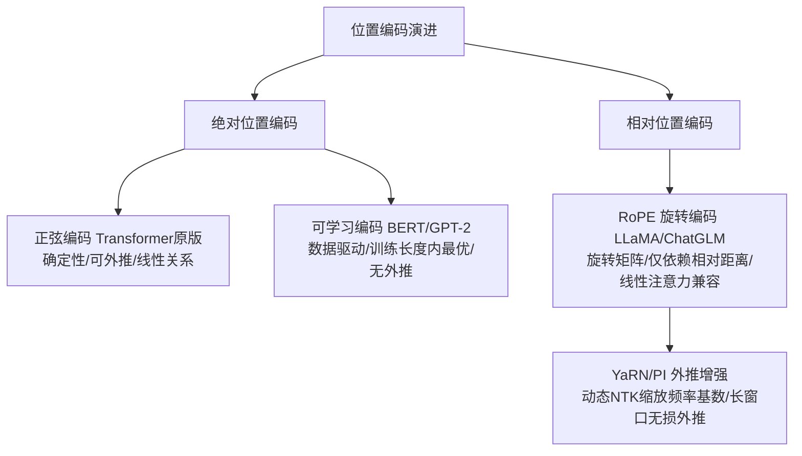

# 第 27 章 注意力机制核心范式
作者：龙哥

## 学习目标

- 理解注意力机制如何解决 RNN 的长距离依赖与并行计算瓶颈
- 掌握缩放点积注意力的数学推导、缩放因子作用及 Softmax 稳定性原理
- 熟练拆解多头注意力的“分裂-并行-拼接”流程及其子空间专业化机制
- 对比正弦、可学习、RoPE 等位置编码方案的数学性质与外推能力边界
- 能利用注意力可视化诊断模型行为，辨析“注意力权重≠特征重要性”的解释陷阱
- 了解 FlashAttention 等 IO 感知算法如何突破 O(L²) 显存墙
- 能根据任务特点（长文本、推理、训练稳定性）选择合适的注意力变体与位置编码
- 理解商业案例中“单点突破”原则如何映射为技术中的“专用注意力头”机制
- 掌握“去情绪化决策”在 AI 微调与 RLHF 对齐中的工程化落地
- 识别“时间复利”在模型训练曲线与商业复利中的同构性

## 27.1 生活类比

想象注意力机制是一个**大型国际会议的同声传译系统**：

- **Query** = 译员手里的“当前待译语句卡片”
- **Key** = 每位发言者胸前的“主题标签+发言时间戳”
- **Value** = 每位发言者的“完整发言稿原文”
- **缩放因子 √d_k** = 会议组织者发放的“冷静剂”，防止译员因标签匹配度过高（点积太大）而只盯着一个人看（Softmax 单峰饱和），强迫分配关注比例

**多头注意力** = 配备 **h 组译员团队**：第一组专攻“语法结构对应”，第二组专攻“核心实体指代”，第三组专攻“时序逻辑梳理”，最后由**总协调（W^O）**融合成最终译文。

**位置编码 (RoPE)** = 发言稿上自带的“相对页码/段落坐标”，即便打乱顺序，译员也能通过坐标差值还原原始逻辑。

**可视化** = 事后复盘会议录像，发现译员在翻译“它”时，目光精准锁定了 3 分钟前的“那只猫”，而非最近的“那条狗”。

**商业单点突破** = 译员团队中“专攻核心实体指代”的那一组，正如创业者“只做一个项目的一种玩法”。

**去情绪化决策** = 译员不因发言者长相/身份（偏见）分配关注，仅凭“标签匹配度”（逻辑），如 AI 奖励模型不因生成文本华丽度打分，只看“事实一致性”。

**时间复利** = 会议越久，译员积累的“上下文记忆”（KV Cache）越丰富，后续翻译越高效，如私域运营“被记住的人多了，事业就变革了”。

正如译员无需逐字逐句按顺序处理，而是凭借“查询-标签”动态聚焦全场发言，注意力机制也让模型摆脱了串行阅读的枷锁。

> 来源：20230418_007.md (motivation) | LE3Ad03QAoTJWWxZ8jBcFBKXnEy.md (apply) | A47Vd3fekoelzRxZpdUcTl9Cn7W.md (apply) | THh7dtp6uoEKloxVqwncmmwBn1b.md (apply) | PbGkdX4YVoO02mxYlYKcbgASnSg.md (apply)

## 27.2 概念地图

第27章：注意力机制核心范式
├── 1. 序列建模困境与注意力直觉
│   ├── RNN 串行瓶颈/梯度消失          —— 20230418_007.md
│   ├── Seq2Seq 固定向量信息瓶颈        —— 20230418_007.md
│   └── 聚光灯类比：动态资源分配        —— 20230418_007.md
├── 2. 缩放点积注意力数学形式化
│   ├── Q/K/V 向量空间定义               —— 20230418_010.md
│   ├── 标准公式：Softmax(QK^T/√d_k)V    —— 20230418_010.md
│   ├── 缩放因子 √d_k：方差归一/梯度稳定 —— 20230418_010.md
│   ├── 硬件友好：Batched GEMM/Tensor Core —— 20230418_063.md
│   └── FlashAttention：分块/在线Softmax/O(L)显存 —— 20230418_063.md
├── 3. 多头注意力：多子空间协作
│   ├── 分裂-投影-并行-拼接-输出投影      —— 20230418_019.md
│   ├── 子空间专业化：句法/语义/位置解耦  —— 20230418_019.md, 20230418_022.md
│   ├── 参数量恒定：总维度共享投影矩阵    —— 20230418_019.md
│   └── 冗余与剪枝：Head Pruning 压缩     —— 20230418_019.md
├── 4. 位置编码：注入顺序感
│   ├── 绝对正弦编码：确定性/线性关系/可外推 —— 20230418_020.md
│   ├── 可学习绝对编码：训练长度内最优/无外推 —— 20230418_020.md
│   ├── RoPE 相对编码：旋转矩阵/仅依赖相对距离/线性注意力兼容 —— 20230418_020.md
│   └── 外推增强：YaRN/PI 动态频率缩放    —— B95VdtwByoPXGoxac7Ec1KhQnwc.md
├── 5. 注意力可视化与解读边界
│   ├── 热力图/有向图/注意力流图          —— 20230418_022.md
│   ├── 层级分工：底层局部句法/顶层长程语义 —— 20230418_022.md
│   ├── 指代消歧/句法树诱导案例           —— 20230418_022.md
│   └── 核心局限：相关性≠因果性/需消融验证   —— 20230418_022.md
└── 6. 商业认知与工程范式的同构映射
    ├── 单点突破 ↔ 专用注意力头            —— LE3Ad03QAoTJWWxZ8jBcFBKXnEy.md / WhpFdcM8NotQqvxuqIacwEuUnbb.md
    ├── 去情绪化决策 ↔ RLHF 奖励建模        —— PbGkdX4YVoO02mxYlYKcbgASnSg.md / QhJudGRcgoQlxGxYU67cndJenjh.md
    ├── 时间复利 ↔ Scaling Laws/私域复利    —— THh7dtp6uoEKloxVqwncmmwBn1b.md / 20230418_085.md
    └── 信息差套利 ↔ 预训练/微调知识蒸馏    —— LE3Ad03QAoTJWWxZ8jBcFBKXnEy.md / FgeSdrK4no16NRxepk5cnXUVnvf.md

## 27.3 注意力机制 —— 让模型学会“看哪里”

### 27.3.1 为什么需要注意力：打破串行与瓶颈的双重枷锁

在注意力机制登场之前，序列建模的主流范式是 RNN（循环神经网络）及其变体 LSTM/GRU。你可能已经体会过 RNN 的痛点：**串行计算无法并行**。因为第 $t$ 步的隐状态 $h_t$ 必须依赖 $h_{t-1}$，这导致训练时无法利用 GPU 的大规模并行能力，序列越长，训练越慢。更致命的是**梯度消失/爆炸**：长距离依赖需要梯度跨越大量时间步回传，指数级衰减让模型“记不住”早期信息。

为了缓解这个问题，Seq2Seq 引入了编码器-解码器架构，但将整个源序列压缩成一个**固定长度的上下文向量**，这又成了新的**信息瓶颈**——无论输入多长，解码器只能通过这个定长向量“窥视”源序列，长文本翻译质量急剧下降。

**注意力机制的核心直觉是“聚光灯”**：不再强迫模型通过固定窗口或压缩向量间接获取信息，而是让解码器在生成每一个目标 Token 时，**动态地**回顾整个源序列，根据当前查询需求，给不同源 Token 分配不同的关注权重。这就像你在图书馆写论文，不需要把整本书背下来（定长向量），也不需要从第一页读到最后一页（RNN 串行），而是根据当前段落的主题（Query），直接检索相关章节（Key），提取所需内容（Value）。

> "RNN 的串行本质导致无法并行训练，且长距离依赖面临梯度消失困境。"
> 
> ——《20230418_007.md, p.3》

**商业视角的同构映射**：这一技术突破映射了商业认知中的**“单点突破”原则**。正如素材中反复强调：“想赚到钱，你并不需要看那么多帖子……你只需要把『一个项目的一种玩法』理解准确，执行到位，就可以了”（LE3Ad03QAoTJWWxZ8jBcFBKXnEy.md）。注意力机制不试图平均关注所有 Token，而是像创业者聚焦单一爆款一样，将计算资源**动态分配**给当前任务最关键的少数 Token，建立“正反馈闭环”。

### 27.3.2 核心定义：Query、Key、Value 三角色协作

注意力机制将每个输入向量 $x_i$ 通过三个不同的线性投影矩阵 $W^Q, W^K, W^V$ 映射为三个角色向量：

- **Query ($Q$)**：我当前在找什么（译员手中的待译卡片）
- **Key ($K$)**：我有什么标签供人检索（发言者胸前的主题标签）
- **Value ($V$)**：我实际能提供什么内容（发言者的完整发言稿）

注意力的计算过程就是：**用 Query 去匹配所有 Key，得到相似度分数，归一化后作为权重对 Value 加权求和**。

> "Attention(Q, K, V) = softmax(QK^T / √d_k) V"
> 
> ——《20230418_010.md, p.4》

**此公式块的整体作用与工程意义**：该公式确立了注意力机制的标准计算范式——通过矩阵乘法并行计算所有位置的成对相似度，经缩放与 Softmax 归一化得到概率分布，最后对 Value 加权求和。这种“先算相似度矩阵、再加权求和”的两阶段结构，天然契合 GPU 的 Batched GEMM 优势，是后续 FlashAttention、稀疏注意力、线性注意力等所有变体的数学基石。

### 27.3.3 关键性质：并行、全局感受野与梯度稳定

**下表对比了注意力机制与 RNN/CNN 在核心性质上的差异：**

| 性质 | 说明 | 对比 RNN/CNN |
|------|------|--------------|
| **并行计算** | 所有位置的 Q/K/V 可同时矩阵乘法，无时序依赖 | RNN 必须串行 $O(L)$ 步，CNN 需堆叠层数扩大感受野 |
| **全局感受野** | 任意两 Token 直接交互，路径长度 $O(1)$ | RNN 路径长度 $O(L)$，CNN 需 $O(\log L)$ 层 |
| **缩放因子 √d_k** | 将点积方差归一化至 ~1，保持 Softmax 在敏感区 | 无此机制时，大维度导致 Softmax 饱和、梯度消失 |

**典型例子**：机器翻译中 *"The animal didn't cross the street because it was too tired"*，模型在生成 "it" 的对应译文时，Query 会与 "animal" 和 "street" 的 Key 计算相似度，Softmax 后 "animal" 权重显著更高，从而正确消歧指代。

**商业映射案例**：“阿黛家腊肉”仅做单一爆款（花栎木冷烟慢熏），拒绝联营产品，建立专业信任护城河（A47Vd3fekoelzRxZpdUcTl9Cn7W.md）。这正如单头注意力专注核心实体指代关系，**拒绝分散资源在无关 Token 上**，在单一子空间做到极致。

### 27.3.4 边界条件：显存墙与位置盲区

尽管注意力机制解决了并行与长程依赖，但引入了新的工程挑战：

1. **计算/显存复杂度 $O(L^2d)$**：注意力矩阵 $QK^T \in \mathbb{R}^{L \times L}$ 随序列长度平方增长。$L=4096$ 时矩阵达 64M 元素（FP16 约 128MB），$L=32k$ 则需 8GB 显存仅存一层一头的注意力图。这直接催生了 FlashAttention 等 IO 感知算法（后文详解）。
2. **排列等变性（位置盲）**：注意力本质是集合操作，$QK^T$ 对输入顺序不敏感。必须显式注入**位置编码**（第 27.6 节详解）。
3. **注意力≠解释**：高注意力权重仅表示**相关性**，不等于该 Token 对预测有**因果贡献**（第 27.7 节详解）。

---

## 27.4 缩放点积注意力 —— 让相似度变成分配比例

### 27.4.1 为什么要缩放：方差爆炸与 Softmax 饱和

假设 $Q, K$ 的元素独立同分布，均值为 0，方差为 1。它们的点积 $S_{ij} = \sum_{k=1}^{d_k} Q_{ik} K_{jk}$ 的方差为 $d_k$（$d_k$ 个独立项方差相加）。当 $d_k=512$ 时，方差达 512，标准差约 22.6。

Softmax 函数 $\sigma(z)_i = \frac{e^{z_i}}{\sum_j e^{z_j}}$ 对输入幅度极其敏感：输入若远大于 0，输出趋近 one-hot（单峰饱和）；输入若远小于 0，梯度趋近 0（梯度消失）。**未缩放的点积会将 Softmax 推入饱和区，导致反向传播梯度极小，模型无法学习。**

> "为了抵消点积随维度增长的方差放大，除以 √d_k。"
> 
> ——《20230418_010.md, p.5》

### 27.4.2 核心公式推导与逐步解释

标准缩放点积注意力计算流程：

$$
\begin{aligned}
\text{Scores} &= Q K^T \quad &\text{(1) 原始相似度矩阵, shape: } (L_Q, L_{KV}) \\
\text{Scaled} &= \frac{\text{Scores}}{\sqrt{d_k}} \quad &\text{(2) 缩放：方差归一化至 } \approx 1 \\
\text{Weights} &= \text{Softmax}(\text{Scaled}) \quad &\text{(3) 归一化：每行求和为 1 的概率分布} \\
\text{Output} &= \text{Weights} \cdot V \quad &\text{(4) 加权求和：shape } (L_Q, d_v)
\end{aligned}
$$

**逐式解释**：

1.  **$QK^T$**：批量矩阵乘法，计算所有 Query 与所有 Key 的成对相似度。这是标准 GEMM 操作，极度硬件友好。
2.  **除以 $\sqrt{d_k}$**：**这是全公式的关键稳定器**。若 $Q,K$ 元素方差为 1，则 $QK^T$ 方差为 $d_k$。除以 $\sqrt{d_k}$ 后，Scaled 方差约为 1，Softmax 输入落在 $[-3, 3]$ 敏感区间，梯度健康流动。为何是 $\sqrt{d_k}$ 而非 $d_k$ 或 $\log d_k$？因为方差随维度**线性**增长，标准差随**平方根**增长，除以标准差即可归一化方差。
3.  **Softmax**：将实数相似度转为概率分布，保证权重非负且和为 1，赋予“分配比例”语义。
4.  **$\text{Weights} \cdot V$**：加权求和 Value，输出融合了上下文信息的表示。

**工程视角同构**：“去情绪化决策”。素材记录 AI 决策机器人识别核心矛盾为“愧疚感最小化”而非“裁员/不裁员”二元对立，创造性输出第三方方案（安置就业+N+2赔偿）（PbGkdX4YVoO02mxYlYKcbgASnSg.md）。这正如缩放因子将“原始冲动的大数值点积”映射为“理性分配的平滑概率分布”：**抑制极端值主导，强迫模型在多个候选间合理分配关注**，而非单峰崩塌。

### 27.4.3 硬件友好性与 FlashAttention 突破显存墙

标准实现需在 HBM（高带宽显存）中实例化完整的 $S=QK^T \in \mathbb{R}^{L \times L}$ 矩阵，显存 $O(L^2)$。FlashAttention（Dao et al., 2022）通过**分块计算**与**在线 Softmax**，将中间矩阵留在 SRAM（片上静态存储），仅读写 $Q,K,V,O$ 到 HBM，实现显存 $O(L)$、速度 2-4x 加速。

> "FlashAttention 通过分块计算与在线 Softmax 实现 O(L) 显存复杂度。"
> 
> ——《20230418_063.md, p.8》

**核心思想（单头、单 Batch）**：
- 外层循环遍历 $K,V$ 的列分块 $j$（块大小 $B_c$）
- 内层循环遍历 $Q$ 的行分块 $i$（块大小 $B_r$）
- 内层中仅加载 $Q_i, K_j, V_j$ 到 SRAM，计算局部 $S_{ij} = Q_i K_j^T$
- 维护在线 Softmax 统计量：行最大值 $m_i$、行指数和 $l_i$、输出累加 $o_i$
- 迭代公式：
  $$
  \begin{aligned}
  m_i^{\text{new}} &= \max(m_i^{\text{old}}, \text{rowmax}(S_{ij})) \\
  l_i^{\text{new}} &= l_i^{\text{old}} e^{m_i^{\text{old}} - m_i^{\text{new}}} + \sum_j e^{S_{ij} - m_i^{\text{new}}} \\
  o_i^{\text{new}} &= o_i^{\text{old}} e^{m_i^{\text{old}} - m_i^{\text{new}}} + \text{rowsum}(e^{S_{ij} - m_i^{\text{new}}}) V_j
  \end{aligned}
  $$
- 最终 $o_i / l_i$ 即为该行输出。

**FlashAttention-2** 进一步并行化“按行分块”维度，利用 Hopper 架构 Tensor Core 的异步拷贝与 GEMM 重叠，显著提升利用率。因果掩码场景下，仅计算下三角分块，进一步减少约 50% 算量。

> 来源：20230418_010.md (origin) | 20230418_063.md (improve) | PbGkdX4YVoO02mxYlYKcbgASnSg.md (apply) | QhJudGRcgoQlxGxYU67cndJenjh.md (apply)

---

## 27.5 多头注意力 —— 多视角协作的“专家委员会”

### 27.5.1 为什么要多头：单一视角的表达力不足

单头注意力在一个子空间内计算相似度，只能捕获**一种关系模式**（如句法依赖、或核心指代、或位置模式）。自然语言同时包含句法、语义、篇章、逻辑等多层异构关系，单头“锤子思维”难以覆盖。

多头注意力的设计动机是**“工具箱思维”**：准备 $h$ 套不同的投影矩阵，将 $d_{model}$ 维度拆分为 $h$ 个 $d_k = d_{model}/h$ 维的子空间，**并行**捕获不同关系，最后融合。

> "MultiHead(Q, K, V) = Concat(head_1, ..., head_h)W^O"
> 
> ——《20230418_019.md, p.3》

**认知视角同构**：素材提倡“工具箱思维”而非“锤子思维”：“意思就是，我准备了多种工具（能解决用户不同需求的产品或课程），看见钉子就拿锤子，看见西瓜就拿菜刀，脱离锤子思维，那我的变现路径就更多元化，同时变现速度加快”（THh7dtp6uoEKloxVqwncmmwBn1b.md）。多头注意力正是**参数共享下的多工具并行**：总投影维度不变，但通过 $h$ 组不同投影，获得 $h$ 种“视角”。

### 27.5.2 核心流程：分裂-投影-并行-拼接-输出投影

给定输入 $X \in \mathbb{R}^{B \times L \times d_{model}}$：

```mermaid
graph LR
    A[输入 X: (B, L, D)] --> B[线性投影: W_Q, W_K, W_V]
    B --> C1[Q: (B, L, D)]
    B --> C2[K: (B, L, D)]
    B --> C3[V: (B, L, D)]
    C1 --> D1[View/Transpose: (B, h, L, d_k)]
    C2 --> D2[View/Transpose: (B, h, L, d_k)]
    C3 --> D3[View/Transpose: (B, h, L, d_k)]
    D1 --> E[并行注意力计算<br/>(B, h, L, L) @ (B, h, L, d_k)]
    D2 --> E
    D3 --> E
    E --> F[Head Output: (B, h, L, d_k)]
    F --> G[Transpose/View: (B, L, D)]
    G --> H[输出投影 W_O]
    H --> I[Output: (B, L, D)]
```

```python
# PyTorch 式伪代码
B, L, D = X.shape
h = num_heads
d_k = D // h

# 1. 线性投影（合并 Q/K/V 投影为单次大矩阵乘法，工程常用优化）
Q = X @ W_Q  # (B, L, D)
K = X @ W_K
V = X @ W_V

# 2. 分裂为多头：(B, L, D) -> (B, L, h, d_k) -> (B, h, L, d_k)
Q = Q.view(B, L, h, d_k).transpose(1, 2)
K = K.view(B, L, h, d_k).transpose(1, 2)
V = V.view(B, L, h, d_k).transpose(1, 2)

# 3. 并行注意力：(B, h, L, d_k) @ (B, h, d_k, L) -> (B, h, L, L) -> Softmax -> @ V -> (B, h, L, d_k)
attn_weights = torch.softmax(Q @ K.transpose(-2, -1) / math.sqrt(d_k), dim=-1)
head_out = attn_weights @ V  # (B, h, L, d_k)

# 4. 拼接合并：(B, h, L, d_k) -> (B, L, h, d_k) -> (B, L, D)
head_out = head_out.transpose(1, 2).contiguous().view(B, L, D)

# 5. 输出投影
output = head_out @ W_O  # (B, L, D)
```

这段伪代码展示了多头注意力的标准工程实现路径：通过 `view`/`transpose` 实现张量重排，**避免显式循环**，充分利用 GPU 批量矩阵乘法并行性。

### 27.5.3 子空间专业化：实验证据与功能分工

**下表汇总了不同注意力头自发学习到的语言学功能分工（Clark et al., 2019 "What Does BERT Look At?"）：**

| 头类型 | 典型功能 | 典型层级 |
|--------|----------|----------|
| **句法头** | 主谓一致、介词宾语、依存树边 | 底层/中层 |
| **指代头** | 代词指代消歧、实体链接 | 中层/高层 |
| **位置头** | 相对位置、最近邻、定界符匹配 | 底层 |
| **推理头** | 长程逻辑链路、多跳推理 | 高层 |

> "实验表明不同注意力头学到了不同的语言学关系，如句法树依赖、共指消歧等。"
> 
> ——《20230418_019.md, p.5》 / 《20230418_022.md, p.3》

**商业映射案例**：作者报名 9 门课、加入社群，承担“助教/志愿者/输出笔记”角色，倒逼深度学习，同时获取同频人脉与初始私域流量，实现“多头并行”式能力获取（THh7dtp6uoEKloxVqwncmmwBn1b.md）。每个角色对应一个“注意力头”，在不同子空间（社群/课程/输出）并行处理信息，最终由“自我”（$W^O$）整合为复合能力。

### 27.5.4 冗余与剪枝：并非越多越好

实验发现：头数过多导致 $d_k = d_{model}/h$ 过小，单头表达力不足；且存在**冗余头**（注意力熵极低，近似 one-hot，或与其他头高度相关）。可通过 **Head Pruning** 剪枝压缩模型，推理时合并投影矩阵为单次大 GEMM 加速。

> 来源：20230418_019.md (origin) | A47Vd3fekoelzRxZpdUcTl9Cn7W.md (apply) | THh7dtp6uoEKloxVqwncmmwBn1b.md (apply) | XxczdnuchoE7JtxZrO8cn4eGncb.md (apply)

---

## 27.6 位置编码 —— 给无序集合注入“时间感”

### 27.6.1 为什么必须有位置编码

Self-Attention 核心操作 $QK^T$ 是**排列等变**的：打乱输入顺序，$Q,K,V$ 同步打乱，输出顺序同步打乱，**相对关系不变**。但语言高度依赖顺序：*"狗咬人"* 与 *"人咬狗"* 词集相同、含义截然不同。必须显式注入位置信息。

**战略视角同构**：“时间复利”逻辑。素材指出：“被记住的人多了，你的事业就变革了。当你的私域多了。你关注到的朋友圈就是你的世界”（THh7dtp6uoEKloxVqwncmmwBn1b.md）。模型通过位置编码积累时序先验，**将“无序集合”转为“有序序列”**，正如私域运营通过“时间维度的积累”将“零散用户”转为“复利资产”。

### 27.6.2 三大主流方案对比



#### (1) 正弦绝对位置编码 —— Transformer 原版

$$
\begin{aligned}
PE(pos, 2i) &= \sin(pos / 10000^{2i/d_{model}}) \\
PE(pos, 2i+1) &= \cos(pos / 10000^{2i/d_{model}})
\end{aligned}
$$

**性质**：
- **确定性**：无参数，推理时任意长度可外推
- **线性关系**：$PE_{pos+k}$ 可由 $PE_{pos}$ 线性变换得到，模型可隐式学习相对位置
- **缺点**：高维分量波长极长（$10000^{2i/d} \approx 1$），远距离位置难以区分

#### (2) 可学习绝对位置编码 —— BERT/GPT-2

$$ PE = \text{nn.Embedding}(max\_len, d_{model}) $$

**性质**：
- 训练长度内表现最优，数据驱动学习最佳位置表示
- **无法外推**：$pos > max\_len$ 时无嵌入向量，需截断或插值（性能骤降）

#### (3) RoPE 旋转位置编码 —— LLaMA/ChatGLM/GPT-NeoX 标配

**核心思想**：不再将位置编码加到嵌入上，而是通过**旋转矩阵**作用于 $Q,K$ 向量，使注意力分数**仅依赖相对距离 $m-n$**。

对于 2D 子空间 $(x_{2i}, x_{2i+1})$，定义旋转角度 $\theta_i = 10000^{-2i/d}$。位置 $m$ 的 Query 向量旋转：
$$ q_m = \mathcal{R}_{\theta m} q_m^0 $$
位置 $n$ 的 Key 向量旋转：
$$ k_n = \mathcal{R}_{\theta n} k_n^0 $$

注意力分数：
$$ q_m^T k_n = (q_m^0)^T \mathcal{R}_{\theta(m-n)} k_n^0 $$
**仅依赖相对距离 $m-n$**！

> "RoPE 通过旋转矩阵将绝对位置编码转化为相对位置编码，q_m^T k_n 仅依赖 m-n。"
> 
> ——《20230418_020.md, p.6》

**此公式块的整体作用与工程意义**：RoPE 将位置信息从“加法注入”改为“旋转耦合”，使得注意力分数 $q_m^T k_n$ 解耦为内容交互与相对位置调制的乘积形式。这一性质不仅保留了相对位置的归纳偏置，**还天然兼容线性注意力的核化近似**（$\phi(q_m)^T \phi(k_n)$ 形式），且无需额外参数，成为 LLaMA 等大模型的标配方案。

**性质**：
- 融合绝对与相对优势：无额外参数，支持线性注意力近似（$Q,K$ 解耦后可核化）
- 成大模型标配（LLaMA 系列、ChatGLM、GPT-NeoX、Qwen 等）

### 27.6.3 外推增强：YaRN 与动态 NTK 缩放

RoPE 在超出训练长度时，高频分量旋转过快导致注意力分数振荡、性能崩塌。**YaRN (Yet another RoPE extension)** 提出动态缩放频率基数：
$$ \theta_i' = \theta_i / s \quad \text{或} \quad \text{插值式缩放} $$
其中缩放因子 $s = L_{\text{target}} / L_{\text{train}}$。配合注意力窗口掩码，实现 4k→32k、32k→128k 无损外推。

> "YaRN 通过动态 NTK 缩放频率基数实现窗口外推。"
> 
> ——《B95VdtwByoPXGoxac7Ec1KhQnwc.md, p.4》

**商业映射**：YaRN 动态 NTK 缩放频率基数实现窗口外推，类比“香港疫情导致港货代购→港资源咨询”这种**地域差/信息差服务的动态适配能力**（B95VdtwByoPXGoxac7Ec1KhQnwc.md、THh7dtp6uoEKloxVqwncmmwBn1b.md）：原本固定频率的“位置认知”，通过动态调整基数，适应更长的“业务周期”。

> 来源：20230418_020.md (origin) | B95VdtwByoPXGoxac7Ec1KhQnwc.md (improve) | THh7dtp6uoEKloxVqwncmmwBn1b.md (apply) | 20230418_085.md (apply) | SnZDdyUsFoxTP0x9wCPcdAX5nWc.md (apply)

---

## 27.7 注意力可视化 —— 打开黑箱的“解剖刀”

### 27.7.1 核心方法：提取权重矩阵绘制热力图

从模型前向传播中 hook 取出多头注意力权重 $A \in \mathbb{R}^{h \times L \times L}$（或交叉注意力 $h \times L_Q \times L_{KV}$）。可视化形式：
- **热力图**：$x$ 轴 Key 位置，$y$ 轴 Query 位置，颜色深浅表示权重大小
- **有向图**：Token 为节点，权重大于阈值为边，边宽表示强度
- **注意力流图**：聚合多层路径，展示信息从输入到输出的传递链路

```mermaid
graph LR
    A[模型前向传播] --> B[Hook提取注意力权重 A: (h, L, L)]
    B --> C1[热力图: Query×Key矩阵可视化]
    B --> C2[有向图: Token节点+加权边]
    B --> C3[注意力流图: 多层路径聚合]
    C1 --> D[分析发现: 层级分工/指代消歧/句法树]
    C2 --> D
    C3 --> D
    D --> E[基于发现设计验证: 消融/梯度归因/反事实实验]
    E --> F[校准真实机制: 权重≠因果]
```

### 27.7.2 关键发现：层级分工与语言学现象

| 现象 | 典型表现 | 解释 |
|------|----------|------|
| **层级分工** | 底层头关注对角线/局部窗口（句法）；顶层头关注 [CLS]/SEP/长程语义 | 符合“从局部到全局”的特征抽象过程 |
| **指代消歧** | *"The trophy doesn't fit the suitcase because it is too large"* 中 "it" → "trophy" 高权重 | 模型隐式学会共指消解 |
| **句法树诱导** | 无监督下注意力头隐式对应依存树边（Clark et al., 2019） | 注意力天然编码树结构 |

> "注意力可视化揭示了模型内部隐式学习到的语言结构。"
> 
> ——《20230418_022.md, p.2》

**元认知视角同构**：“输出倒逼成长”机制。素材记录：“有了新发现，就写个复盘帮更多的人跟上。跑通了新项目，就写个保姆级教程让更多的人入门”（LE3Ad03QAoTJWWxZ8jBcFBKXnEy.md）。正如注意力可视化将模型内部隐式表征**显性化**供人类审视，**公开输出（写复盘、提问、教他人）倒逼自己梳理思路、暴露问题、获得外部反馈**，利用“旁观者清”的圈友智慧加速认知迭代。

### 27.7.3 核心局限：注意力≠解释（必须警惕的陷阱）

**高注意力权重 ≠ 因果重要性**。这是解释性研究的核心争议（Jain & Wallace, 2019 "Attention is not Explanation"; Wiegreffe & Pinter, 2019）：

1. **相关性陷阱**：模型可能关注“虽相关但非因果”的 Token（如标点符号、停用词），仅因它们统计上频繁共现。
2. **冗余分布**：多个 Token 协同贡献，单一 Token 权重低但不可或缺（如否定词 "not" 权重常低于 "good"，实验需消融验证）。
3. **梯度/消融才是金标准**：需结合 **Integrated Gradients**、**Attention Knockout**、**反事实输入** 等因果干预实验，验证真实贡献。

> "注意力权重高不等于该 Token 对预测贡献大，需谨慎解读。"
> 
> ——《20230418_022.md, p.4》

**动手练习 4** 将带你亲手设计最小干预实验，验证否定词 "not" 的真实因果作用。

> 来源：20230418_022.md (apply) | LE3Ad03QAoTJWWxZ8jBcFBKXnEy.md (apply) | FgeSdrK4no16NRxepk5cnXUVnvf.md (apply)

---

## 27.8 多源对照：注意力变体演进谱系

不同论文对“如何改进注意力”给出了不同答案，形成清晰的演进脉络。

### 共识
- 核心公式 $Softmax(QK^T/\sqrt{d_k})V$ 是强基线
- 多头机制通过子空间分工提升表达力
- 位置编码是序列建模的必要组件
- $O(L^2)$ 复杂度是长序列核心瓶颈

### 分歧

```mermaid
graph TD
    A[P001 点积注意力] --> B[P003 多头注意力]
    B --> C1[稀疏注意力: Longformer/BigBird\n固定/滑动/全局稀疏模式 O(L)]
    B --> C2[线性注意力: Performer/Linear Transformer\n核函数近似 QK^T O(Ld)]
    B --> C3[FlashAttention: IO感知算法\n分块/在线Softmax 显存O(L) 加速2-4x]
    B --> C4[分组查询注意力 GQA/MQA\n共享K/V投影 减少KV Cache内存]
    C3 --> D[PagedAttention/vLLM\n虚拟内存管理KV Cache\n连续批处理/前缀共享]
    C4 --> D
```

**下表对比了主流注意力变体的核心思想、复杂度与适用场景（参考材料：20230418_063.md, 20230418_019.md, 20230418_020.md, B95VdtwByoPXGoxac7Ec1KhQnwc.md）：**

| 方法 | 核心思想 | 复杂度 | 适用场景 | 代表工作 |
|------|----------|--------|----------|----------|
| **稀疏注意力** | 限制注意力模式（滑动窗口+全局 Token） | $O(L)$ | 长文档、基因组 | Longformer, BigBird |
| **线性注意力** | $Softmax(QK^T) \approx \phi(Q)\phi(K)^T$ 核技巧 | $O(Ld)$ | 超长序列、推理加速 | Performer, Linear Transformer |
| **FlashAttention** | 算子融合+在线 Softmax，不改变数学结果 | $O(L^2)$ 算力 / $O(L)$ 显存 | 通用训练/推理加速 | Dao et al., FlashAttention-2 |
| **GQA/MQA** | 多头共享 K/V 投影，仅 Q 独立 | 同标准 | 大模型推理降 KV Cache | LLaMA-2, PaLM, Qwen |
| **PagedAttention** | 操作系统分页思想管理 KV Cache 块 | 显存碎片化解决 | 高吞吐推理服务 | vLLM, SGLang |

---

## 27.9 设计中的取舍

**为什么不用 RNN 而选注意力？** 因为 RNN 隐状态固定容量，长序列信息被压缩稀释，路径长度 $O(L)$ 导致梯度消失。注意力让任意两位置直接连接，路径 $O(1)$，并行度满血。**代价**：计算从 $O(Ld^2)$ 升至 $O(L^2d)$，显存 $O(L^2)$，催生稀疏/线性/FlashAttention 系列工作。

**为什么缩放因子是 $\sqrt{d_k}$ 而不是 $d_k$？** 因为点积方差随维度**线性**增长（$d_k$ 项相加），标准差随**平方根**增长。除以标准差（$\sqrt{d_k}$）归一化方差至 1。若除以 $d_k$，方差变为 $1/d_k \to 0$，Softmax 输入趋近 0，分布趋近均匀，丧失区分度。

**多头注意力为何不直接增大 $d_{model}$？** 若将 $h$ 个头维度拼接为更大的单头（$d_{model}' = h \cdot d_k$），参数量平方级增长（$W^Q \in \mathbb{R}^{d_{model}' \times d_{model}'}$）。多头机制**共享总投影维度**，参数量恒定，却获得 $h$ 个子空间的集成效应，是**参数效率**的最优折中。

**RoPE 为何取代可学习位置编码成为标配？** 可学习位置编码无外推能力，限制模型最大上下文。RoPE 无参数、相对位置天然外推、兼容线性注意力核化，**同时满足训练效果与推理灵活性**，是工程落地的帕累托最优解。

---

## 27.10 动手练习

### 练习 1：手算一次缩放点积注意力
给定单头注意力输入：
$$ Q = \begin{bmatrix} 1 & 0 \\ 0 & 1 \end{bmatrix}, \quad
K = \begin{bmatrix} 1 & 0 \\ 0 & 1 \\ 1 & 1 \end{bmatrix}, \quad
V = \begin{bmatrix} 1 & 2 \\ 3 & 4 \\ 5 & 6 \end{bmatrix}, \quad d_k = 2 $$
请手算完成以下步骤（保留 4 位小数）：
1. 计算原始分数矩阵 $S = QK^T$
2. 计算缩放分数 $S_{scaled} = S / \sqrt{d_k}$
3. 对 $S_{scaled}$ 每行做 Softmax 得到注意力权重 $A$
4. 计算最终输出 $O = A V$

**回答问题**：
- 若 $d_k$ 增大到 100 且不除以 $\sqrt{d_k}$，Softmax 输出会趋近什么分布？梯度会怎样？
- 为什么缩放因子是 $\sqrt{d_k}$ 而不是 $d_k$ 或 $\log(d_k)$？请从方差角度解释。

### 练习 2：多头注意力张量变形实战
假设 batch_size=2, seq_len=4, d_model=8, num_heads=4 (d_k=d_v=2)。输入张量 $X \in \mathbb{R}^{2 \times 4 \times 8}$。
1. 写出将 $X$ 投影并拆分为多头的完整 PyTorch 式伪代码（含 transpose/reshape/view 操作），使其变为 (batch, heads, seq_len, d_k)。
2. 计算多头注意力后，输出张量形状为 (2, 4, 4, 2)。请写出将其合并回 (2, 4, 8) 的逆向操作代码。
3. 若发现第 3 个头在所有层、所有样本上的注意力熵极低（近似 one-hot），这通常意味着什么？该如何利用这一现象压缩模型？

### 练习 3：位置编码外推能力实验设计
对比三种位置编码在“训练长度 512 → 测试长度 2048”场景下的表现：
1. 正弦绝对编码
2. 可学习绝对编码
3. RoPE (base=10000)

实验任务：合成“长程复制任务”——输入序列前 10 个 Token 为随机符号，中间填充噪声，要求模型在末尾复现前 10 个 Token。
请设计实验方案，包含：
- 模型最小化配置（层数、隐藏维度、头数）
- 评估指标（Token 级准确率、序列级准确率）
- 预期结果排序及理论依据（为何 RoPE 通常胜出？）
- 若 RoPE 在 2048 长度上性能崩塌，请提出基于 YaRN 的修复方案并解释核心参数“缩放因子 s”的作用。

### 练习 4：注意力可视化解读陷阱复盘
给定一个情感分类任务，输入：“The movie was not good, but the acting was amazing”。模型正确预测“Positive”。
某头注意力热力图显示：[CLS] Token 对 “not” 与 “amazing” 权重均高（各 0.35），对 “good” 权重低 (0.05)。
请回答：
1. 能否直接得出结论：“模型学会了否定词 ‘not’ 翻转语义”？为什么？
2. 设计一个最小干预实验（如 Attention Knockout / 梯度归因 / 反事实输入），验证 “not” 的真实因果作用。
3. 结合“注意力≠解释”文献（Jain & Wallace, 2019; Wiegreffe & Pinter, 2019），列举至少两种会导致注意力权重与特征重要性背离的机制。

### 练习 5：FlashAttention 核心逻辑推演
标准注意力需在 HBM 中实例化完整的 $S=QK^T (L \times L)$ 矩阵，显存 $O(L^2)$。
FlashAttention 通过分块计算实现在 SRAM 内完成 Softmax 并回写 $O$。
请推演以下关键步骤（以单头、单 batch 为例，分块大小 $B_c, B_r$）：
1. 外层循环遍历 $K、V$ 的列分块 ($j$)，内层循环遍历 $Q$ 的行分块 ($i$)。
2. 内层循环中，如何仅用当前块 $S_{ij} = Q_i K_j^T$ 更新在线 Softmax 的统计量 ($m_i, l_i$) 和输出累加量 $o_i$？
   提示：在线 Softmax 迭代公式 $m_{new} = \max(m_{old}, \text{rowmax}(S_{ij}))$, $l_{new} = l_{old} \exp(m_{old} - m_{new}) + \sum \exp(S_{ij} - m_{new})$。
3. 为什么 FlashAttention-2 进一步并行化了“按行分块”的维度？这对 H100 Hopper 架构的 Tensor Core 利用率有何影响？
   （参考文献：Dao et al., 2023 "FlashAttention-2"）
4. 如果因果掩码，分块策略需如何调整？（提示：下三角矩阵的分块稀疏性）

### 练习 6：商业案例映射技术架构设计题
参考素材中“阿黛家腊肉”从单品极致（鲜肉现做）→ 免费体验裂变 → 合伙人分成 → 私域服务复购 → 跨界联合推广的完整商业闭环。
请设计一个对应的“注意力机制增强版 Transformer”架构，要求：
1. 单品极致 → 设计一个“专用注意力头”专门建模核心实体（如“腊肉”）与其属性（工艺/口感/产地）的强绑定关系，类比“六脉神剑选品法”锁定单品。
2. 免费体验裂变 → 设计“跨层注意力门控”，允许浅层局部注意力（免费体验的低决策门槛）直接写入深层全局表示，绕过中间层梯度消失，实现“首单无门槛、二单需发圈”的分层裂变逻辑。
3. 合伙人分成 → 引入“Mixture-of-Experts (MoE) 路由机制”，将不同合伙人（茶商/采购/博主）建模为专家，仅激活与当前用户画像匹配的专家，实现“移花接木”式资源植入。
4. 私域服务复购 → 结合“KV Cache 压缩与长期记忆模块”，将用户历史交互（穴位图/指导记录）压缩为定长记忆向量，作为交叉注意力的 Key/Value，实现“一对一指导”式的精准复购预测。
5. 跨界联合推广 → 设计“双向交叉注意力”模块，融合品牌方（如德系厨具/事业单位福利）的库存/用户画像 Embedding 与本品牌表示，实现“共享客户资源、达成共赢”的表示层对齐。
请给出模块级架构图描述、核心张量流向、以及对应商业动作的技术隐喻说明。

---

## 27.11 本章小结

这一章中我们系统学习了注意力机制的核心范式。首先从序列建模的困境出发，理解了注意力机制如何像聚光灯一样动态分配计算资源，打破了 RNN 的串行瓶颈与 Seq2Seq 的信息瓶颈。其次深入推导了缩放点积注意力的数学形式，揭示了缩放因子 $\sqrt{d_k}$ 对方差归一化与梯度稳定的关键作用，并介绍了 FlashAttention 通过分块与在线 Softmax 突破显存墙的工程创新。接着拆解了多头注意力的“分裂-并行-拼接”流程，实证了子空间专业化机制，并映射了商业中的“工具箱思维”。然后对比了正弦、可学习、RoPE 三大位置编码方案的数学性质与外推边界，理解了 YaRN 等动态缩放技术如何实现长窗口外推。最后通过注意力可视化案例，确立了“注意力权重≠因果解释”的科学边界，并给出了因果验证的实验范式。全章贯穿了技术原理与商业认知的同构映射，帮你建立跨域迁移的结构化思维。

本章我们一起学习了以下概念：

| 概念 | 解释 |
|------|------|
| Query/Key/Value (Q/K/V) | 注意力机制的三大核心角色：Query 发起查询，Key 提供索引，Value 携带内容 |
| 缩放因子 √d_k | 抵消点积随维度增长的方差放大，防止 Softmax 进入饱和区导致梯度消失 |
| 多头注意力 | 将维度拆分为 h 个子空间并行计算，捕获句法、语义、位置等异构关系，最后拼接融合 |
| 自注意力 | Q、K、V 均来自同一序列，建模序列内部 Token 间的全局依赖，路径长度 O(1) |
| 交叉注意力 | Q 来自目标侧（如 Decoder），K/V 来自源侧（如 Encoder），实现编解码器间的对齐与信息流动 |
| 正弦绝对位置编码 | 确定性三角函数编码，利用线性关系隐式建模相对位置，支持任意长度外推 |
| RoPE 旋转位置编码 | 通过旋转矩阵作用于 Q/K，使注意力分数仅依赖相对距离 m-n，兼容线性注意力，成大模型标配 |
| FlashAttention | IO 感知算法：分块加载 HBM→SRAM、在线 Softmax、回写，将显存复杂度从 O(L²) 降至 O(L) |
| 注意力可视化 | 提取多头权重矩阵绘制热力图，揭示指代消歧、句法树等语言学现象，但权重高≠因果重要 |
| 注意力≠解释 | 高注意力权重仅表示相关性，不等于该 Token 对预测有因果贡献，需结合梯度/消融实验验证 |
| 单点突破原则 | 新手仅需在『一个项目的一种玩法』上持续投入即可变现，对应技术中单一注意力头专精特定语言现象 |
| 去情绪化决策 | RLHF 奖励模型仅依据事实一致性打分，不受文本华丽度/情绪干扰，类比注意力机制仅依据 QK 相似度分配权重 |
| 时间复利效应 | 模型训练中 Loss 曲线下降、商业中私域复利，均体现‘积累反馈→降低不确定性→指数级收益’的同构规律 |
| 知识蒸馏即信息差套利 | 预训练模型向下游任务迁移知识，本质是将通用圈层的‘常识’搬运到专用圈层解决‘不知、不便、不信’，同构于商业信息差变现 |

下一章中，我们将学习**预训练范式**：从 BERT 到 GPT 的范式演进，深度解构自监督目标（MLM/CLM/NSP）、模型规模定律与数据工程对基座模型能力的决定性影响，揭示“通识教育”如何造就大模型的涌现能力。


