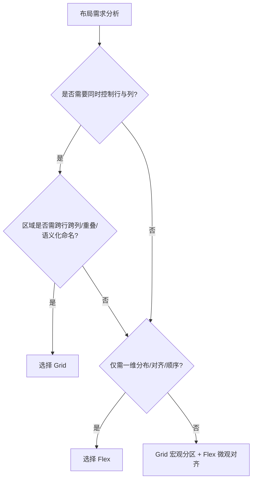
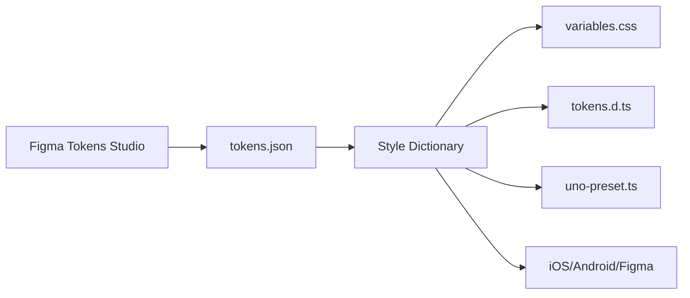
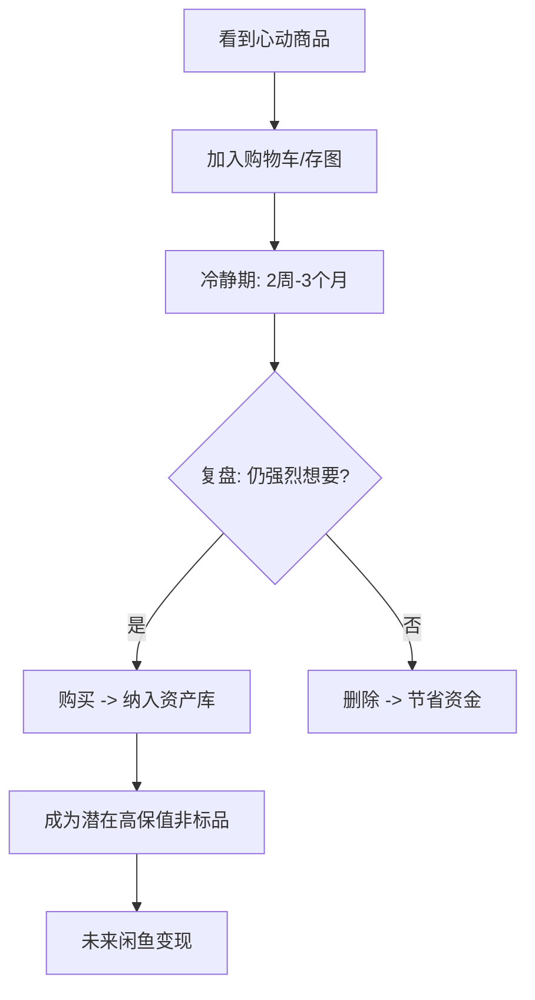

# 第 7 章 CSS 现代布局与架构 —— 从 Flex/Grid 到设计令牌与原子化工程化

## 学习目标

- 理解 Flexbox 与 Grid 双引擎的布局决策矩阵，掌握何时选择一维布局、何时选择二维布局
- 掌握 CSS 变量与设计令牌体系，能构建支持多主题、暗黑模式、品牌定制的样式架构
- 理解原子化 CSS 工程化原理，熟练配置 UnoCSS/Tailwind 预设、任意值、变体与按需生成
- 掌握 CSS 架构治理规范，落地 BEM 命名、CSS Modules、@layer 层叠层与 Stylelint 规则集
- 能从零构建企业级 UI 组件库样式系统，实现设计令牌双包架构、主题切换、类型安全与工程化交付
- 理解跨境支付与 ChatGPT Plus 开通实战，掌握虚拟信用卡平台选择、USDT 充值、KYC 认证、风控规避全流程
- 理解个人非标品闲鱼变现实战，掌握风格护城河、时间杠杆、认知套利、延迟购买、佛系运营核心方法论

## 7.1 生活类比

想象 CSS 布局系统是一个建筑工地的空间规划体系（来源：《20230418_040.md》P001-P005）：

- **Flexbox** = **一维流水线传送带** (P001)：只负责“单行/单列”上的物品排队、对齐、分发空间（justify-content）、伸缩大小（flex-grow/shrink）
- **Grid** = **二维楼层规划图** (P001)：同时规划“行”与“列”，把房间（区域）精准锚定在网格线交叉点，支持跨行跨列、区域重叠、语义化命名区域
- **CSS 变量/设计令牌** = **装修材料清单总表** (P002)：颜色、间距、字体统一定义在“总表”（:root），各施工队（组件）引用“色号”而非实物；换品牌只需换“总表”，全楼联动
- **原子化 CSS** = **预制构件库** (P003)：不再现场砌墙（写 CSS），而是搬来标准砖块——“红砖”、“窗框”、“门把手”（p-4、rounded、flex），在模板上拼装，用多少造多少
- **BEM / CSS Modules / @layer** = **施工规范与分区管理** (P004)：BEM 给每块砖贴唯一标签防混用；CSS Modules 给每栋楼发独立编号防串楼；@layer 划分“地基层、主体层、装饰层”显式优先级，避免“后盖的墙压倒地基”
- **企业级样式系统双包** = **“材料厂”+“构件厂”分离交付** (P005)：ui-theme 厂生产标准材料清单（令牌/变量），ui-components 厂按图纸组装构件；业务方像买宜家家具一样组装，想换风格只找材料厂换清单
- **跨境支付实战** = **“桥梁建造”工程** (P040/YE1F/A47V)：Nobepay/Depay 是两座不同收费标准的桥，USDT 是通用货币钢材，欧易是钢材厂，KYC 是通行证，卡段是桥面材质，免税州地址是导航坐标，IP 节点是车辆牌照，三者一致才能顺利过桥缴费
- **个人非标品闲鱼变现** = **“人设即信任、时间即杠杆”** (A47V) 的资产化经营：二十年风格积累 = 天然买家池；非标品随时间增值 = 穿着即投资；认知差套利 = 低买高卖的信息红利

## 7.2 概念地图

CSS 现代布局与架构
├── 双引擎布局决策
│   ├── Flexbox 一维布局  —— P001 (来源：《20230418_040.md》)
│   │   ├── 主轴/交叉轴对齐算法
│   │   ├── flex 增长/收缩/基准尺寸
│   │   └── 多行换行与 align-content
│   ├── Grid 二维布局  —— P001 (来源：《20230418_040.md》)
│   │   ├── 显式/隐式网格轨道
│   │   ├── grid-template-areas 语义化布局
│   │   ├── 自动放置算法（稀疏/稠密）
│   │   └── 盒对齐模块统一规范
│   └── 决策矩阵：一维选 Flex、二维选 Grid、嵌套组合  —— P001 (来源：《20230418_040.md》)
├── 设计令牌与变量体系
│   ├── CSS 变量：继承、层叠、运行时动态修改  —— P002 (来源：《20230418_040.md》)
│   ├── 设计令牌：原子化存储、平台无关、单一事实来源  —— P002 (来源：《20230418_040.md》)
│   ├── 现代色彩函数：light-dark()、color-mix()  —— P002 (来源：《20230418_040.md》)
│   ├── @property 类型注册与插值动画  —— P002 (来源：《20230418_040.md》)
│   └── 令牌命名规范与语义化分层  —— P002 (来源：《20230418_040.md》)
├── 原子化 CSS 工程化
│   ├── UnoCSS 即时引擎与按需生成原理  —— P003 (来源：《20230418_040.md》)
│   ├── 核心三元组：规则 -> 变体 -> 预设/快捷键  —— P003 (来源：《20230418_040.md》)
│   ├── 任意值语法：w-[123px]、bg-[#abc] 逃逸令牌约束  —— P003 (来源：《20230418_040.md》)
│   ├── 变体嵌套展开：hover:dark:md:flex 编译期处理  —— P003 (来源：《20230418_040.md》)
│   ├── 预设生态：Uno/Tailwind 兼容、Icons、Attributify  —— P003 (来源：《20230418_040.md》)
│   ├── 变压器：@apply/@screen 指令复用迁移  —— P003 (来源：《20230418_040.md》)
│   └── 扫描边界：字符串拼接遗漏、safelist 兜底  —— P003 (来源：《20230418_040.md》)
├── 架构治理规范
│   ├── BEM 命名：Block__Element--Modifier 扁平化隔离  —— P004 (来源：《20230418_040.md》)
│   ├── CSS Modules：哈希化物理隔离、:global/:local/composition  —— P004 (来源：《20230418_040.md》)
│   ├── @layer 层叠层：显式优先级管理、解耦选择器权重  —— P004 (来源：《20230418_040.md》)
│   └── Stylelint：规则集继承、属性排序、嵌套深度限制  —— P004 (来源：《20230418_040.md》)
├── 企业级样式系统实战
│   ├── 双包架构：ui-theme (令牌/变量/预设) + ui-components (组件/样式)  —— P005 (来源：《20230418_040.md》)
│   ├── 令牌生成管线：Figma -> Tokens Studio -> JSON -> Style Dictionary -> 多端产物  —— P005 (来源：《20230418_040.md》)
│   ├── 组件样式策略：原子化骨架 + CSS 变量语义化 + @layer 封装  —— P005 (来源：《20230418_040.md》)
│   ├── 主题切换：数据属性切换变量作用域、零运行时、内置暗黑模式  —— P005 (来源：《20230418_040.md》)
│   ├── 类型安全：ThemeTokens TS 类型导出、业务侧智能提示  —— P005 (来源：《20230418_040.md》)
│   └── 工程化边界：版本强绑定、断点双写、降级策略、Tree-shaking 体积控制  —— P005 (来源：《20230418_040.md》)
├── 跨境支付与 ChatGPT Plus 开通实战
│   ├── 虚拟信用卡平台对比：Nobepay vs Depay 成本模型  —— P040 (来源：《20230418_040.md》/《YE1FdsTuxoaBbNx4f5dcnSNenxb.md》/《A47Vd3fekoelzRxZpdUcTl9Cn7W.md》)
│   ├── USDT 充值兑换法：欧易 CEX 买币、链上提币、TRC20/ERC20 网络选择  —— P040 (来源：《YE1FdsTuxoaBbNx4f5dcnSNenxb.md》/《A47Vd3fekoelzRxZpdUcTl9Cn7W.md》)
│   ├── Nobepay KYC 认证流程：👸号关注、问卷填写、微信扫码人脸核验  —— P040 (来源：《YE1FdsTuxoaBbNx4f5dcnSNenxb.md》/《A47Vd3fekoelzRxZpdUcTl9Cn7W.md》)
│   ├── 卡段风控策略：556766 卡段高起充换高通过率、规避低起充卡段风控拒付  —— P040 (来源：《YE1FdsTuxoaBbNx4f5dcnSNenxb.md》/《A47Vd3fekoelzRxZpdUcTl9Cn7W.md》)
│   ├── 免税州账单地址生成：美五州免税、地址生成器、IP 节点一致性校验  —— P040 (来源：《YE1FdsTuxoaBbNx4f5dcnSNenxb.md》/《A47Vd3fekoelzRxZpdUcTl9Cn7W.md》)
│   ├── 首次开通成本锚定：~23.6 USDT (~163 CNY)，余额 12.4 USDT 沉没预付费  —— P040 (来源：《YE1FdsTuxoaBbNx4f5dcnSNenxb.md》/《A47Vd3fekoelzRxZpdUcTl9Cn7W.md》)
│   ├── 续费边际成本模型：~21-22 USDT (~144-152 CNY)，省去开卡费  —— P040 (来源：《YE1FdsTuxoaBbNx4f5dcnSNenxb.md》/《A47Vd3fekoelzRxZpdUcTl9Cn7W.md》)
│   ├── 支付风控三要素：高质量原生 IP、账单地址-节点地理一致、卡段白名单  —— P040 (来源：《YE1FdsTuxoaBbNx4f5dcnSNenxb.md》/《A47Vd3fekoelzRxZpdUcTl9Cn7W.md》)
│   └── 欧易分级认证与解封：L3 认证前置、申诉 3 分钟解冻  —— P040 (来源：《YE1FdsTuxoaBbNx4f5dcnSNenxb.md》/《A47Vd3fekoelzRxZpdUcTl9Cn7W.md》)
└── 个人非标品闲鱼变现实战
    ├── 风格护城河：二十年固化审美沉淀精准粉丝、高信任低沟通高溢价  —— A47V (来源：《A47Vd3fekoelzRxZpdUcTl9Cn7W.md》/《Efm3dQsmpoUyHxxDPaAcoqXvnVe.md》)
    ├── 非标品时间杠杆：古董绣片/孤品增值、奢侈品标品折损率超90%  —— A47V (来源：《A47Vd3fekoelzRxZpdUcTl9Cn7W.md》/《Efm3dQsmpoUyHxxDPaAcoqXvnVe.md》)
    ├── 认知套利：外挂秒拍低价、高价转手、单件利润达月薪级别  —— A47V (来源：《A47Vd3fekoelzRxZpdUcTl9Cn7W.md》/《Efm3dQsmpoUyHxxDPaAcoqXvnVe.md》)
    ├── 延迟购买决策：购物车存图 -> 冷静期 -> 复盘仍想要 -> 购买/删除  —— A47V (来源：《A47Vd3fekoelzRxZpdUcTl9Cn7W.md》/《Efm3dQsmpoUyHxxDPaAcoqXvnVe.md》)
    └── 佛系单平台运营：不讲价/不发视频/仅擦亮、供给端杠杆优于运营端  —— A47V (来源：《A47Vd3fekoelzRxZpdUcTl9Cn7W.md》/《Efm3dQsmpoUyHxxDPaAcoqXvnVe.md》)

## 7.3 Flexbox 与 Grid 双引擎 —— 一维/二维布局决策矩阵与对齐算法深度解析

### 7.3.1 为什么需要这个概念？

在 Flexbox 和 Grid 成为标准之前，我们不得不依赖 `float`、`position: absolute`、`inline-block` 甚至 `<table>` 来实现基础布局。这些方案在响应式场景下极其脆弱：垂直居中需要 Hack、等高列依赖 `padding-bottom: 9999px`、`圣杯布局` 需要负边距魔法。更深层的问题是，传统方案缺乏统一的空间分配模型——它们要么只能处理一维排列（inline-block），要么只能处理固定定位（absolute），无法同时解决“主轴如何分发剩余空间”与“区域如何精准锚定”这两类正交问题。

现代 UI 的复杂度要求布局系统必须具备两种正交能力：
1.  **一维流式分布**：导航栏、表单行、卡片内部元素排列，核心诉求是“在一条线上如何对齐、伸缩、换行”。
2.  **二维区域划分**：仪表盘、整页布局、复杂表单网格，核心诉求是“同时控制行与列、区域跨行跨列、语义化命名”。

Flexbox 与 Grid 正是针对这两类问题分别设计的**专用引擎**，而非互相替代的竞品。盒对齐模块则统一了它们的对齐关键字（`start`/`center`/`end`/`stretch`/`baseline`），让你在两个引擎间切换时肌肉记忆可迁移。

> "Flexbox is designed for one-dimensional layouts... Grid is designed for two-dimensional layouts..."
> 
> ——《CSS Flexible Box Layout Module Level 1》（W3C Candidate Recommendation）&《CSS Grid Layout Module Level 1》（W3C Candidate Recommendation）——来源：《20230418_040.md》

### 7.3.2 Flexbox：一维流式布局的数学模型

Flexbox 的核心是**主轴**与**交叉轴**坐标系。容器通过 `flex-direction` 确定主轴方向，所有空间分配、对齐、排序逻辑均在此坐标系下运算。

#### 核心定义：Flex 项目尺寸计算公式

Flex 项目最终渲染宽度（主轴尺寸）由三阶段计算决定，这是理解“为何内容撑开容器”的关键（来源：《20230418_040.md》）：

**阶段 1：基准尺寸确定**
$$
\text{hypothetical\_main\_size} = 
\begin{cases}
\text{width/height} & \text{if specified} \\
\text{min-content/max-content} & \text{if auto (content-sized)}
\end{cases}
$$
这个公式展示了 Flexbox 首先依据显式尺寸或内容尺寸建立假设主尺寸，作为后续空间分配的基线。——来源：《20230418_040.md》

**阶段 2：收缩/增长计算**
设容器主轴剩余空间为 $S_{free} = \text{container\_size} - \sum \text{hypothetical\_main\_size}$。
- 若 $S_{free} > 0$（有剩余空间）：按 `flex-grow` 比例分配
  $$ \text{final\_size}_i = \text{hypothetical\_size}_i + S_{free} \times \frac{\text{grow}_i}{\sum \text{grow}} $$
- 若 $S_{free} < 0$（空间不足）：按 `flex-shrink` 与基准尺寸加权收缩
  $$ \text{final\_size}_i = \text{hypothetical\_size}_i + S_{free} \times \frac{\text{shrink}_i \times \text{hypothetical\_size}_i}{\sum (\text{shrink}_j \times \text{hypothetical\_size}_j)} $$
这个公式展示了 Flexbox 空间分配的**水位算法本质**：增长时按比例分蛋糕，收缩时按“体积×收缩因子”加权分担压力。这解释了为什么 `flex: 1`（即 `grow:1 shrink:1 basis:0`）能实现等分，而 `flex: 1 1 auto` 会受内容宽度影响。——来源：《20230418_040.md》

**阶段 3：`min/max-width` 约束夹逼**
最终尺寸会被 `min-width`/`max-width` 夹逼，若触发约束则剩余空间重新分配（类似水位算法）。

#### 关键性质：`min-width: auto` 的陷阱

默认情况下，Flex 项目的 `min-width` 为 `auto`，计算值为 `min-content`。这意味着**内容永远不会被压缩得比最小内容宽度更小**。当你在 Flex 容器中放入长文本或宽图片且未设置 `overflow: hidden` / `min-width: 0` 时，项目会强行撑开容器，导致布局溢出。

**修正方案**：
```css
.flex-item {
  min-width: 0;        /* 允许压缩至 0 */
  overflow: hidden;    /* 防止内容溢出视觉干扰 */
}
```

#### 对齐体系统一规范

盒对齐模块定义了三组核心属性，Flexbox 与 Grid 共享。下表展示了对齐属性的轴向归属与作用粒度：`justify-*` 管主轴，`align-*` 管交叉轴；`content` 管整体分布，`items/self` 管单项对齐。

| 属性 | 作用轴 | 作用对象 | 典型值 |
|------|--------|----------|--------|
| `justify-content` | 主轴 | 容器（内容整体） | `flex-start` / `center` / `space-between` / `space-around` / `space-evenly` |
| `align-items` | 交叉轴 | 容器（所有项目） | `stretch` / `flex-start` / `center` / `flex-end` / `baseline` |
| `align-self` | 交叉轴 | 单个项目 | 覆盖 `align-items`，值同左 |
| `align-content` | 交叉轴 | 容器（多行/多列整体） | 仅当 `flex-wrap: wrap` 且交叉轴有剩余空间时生效 |

### 7.3.3 Grid：二维精准布局的坐标系

Grid 引入了**网格线**、**网格轨道**、**网格区域**、**网格单元**四层抽象。你不再关心“元素怎么浮动”，而是直接在坐标系中“画格子、放家具”。

#### 显式网格与隐式网格

**显式网格**由 `grid-template-columns` / `grid-template-rows` / `grid-template-areas` 定义（来源：《20230418_040.md》）：
```css
.grid {
  display: grid;
  grid-template-columns: 240px 1fr 200px;  /* 显式三列：固定-自适应-固定 */
  grid-template-rows: auto 1fr auto;       /* 显式三行：顶部-内容-底部 */
  grid-template-areas: 
    "header header header"
    "sidebar content aside"
    "footer footer footer";
}
```
这个代码片段展示了 Grid 的**语义化布局能力**：`grid-template-areas` 让布局结构在 CSS 中直接可读，配合 `grid-area: header` 在子元素上一行落位，实现了“结构与样式分离”的理想状态。——来源：《20230418_040.md》

**隐式网格**由 `grid-auto-flow` / `grid-auto-columns` / `grid-auto-rows` 控制。当显式网格放不下所有项目，或项目通过 `grid-column: 5` 指定了超出显式范围的线号时，浏览器自动生成隐式轨道。

#### 自动放置算法：稀疏 vs 稠密

`grid-auto-flow` 控制未显式定位项目的填充策略：
- `sparse`（默认）：**按顺序扫描**，找到第一个能放下的位置放置，可能留下“空洞”（如 `grid-column: span 2` 的项目跳过单列空隙）。
- `dense`：**回溯填充**，允许后续的小项目填补前面大项目留下的空洞，最大化空间利用率，但会改变视觉顺序与 DOM 顺序不一致（Tab 键导航顺序仍遵循 DOM）。

```css
.grid-dense {
  grid-auto-flow: dense;  /* 启用稠密打包，类似俄罗斯方块自动消行 */
}
```

#### 盒对齐在 Grid 中的映射

Grid 容器拥有双轴对齐，语义与 Flexbox 完全对齐：
- `justify-content` / `align-content`：整个网格在容器内的对齐（当网格总尺寸小于容器时）
- `justify-items` / `align-items`：所有网格项在各自区域内的对齐（默认 `stretch`）
- `justify-self` / `align-self`：单个网格项覆盖

### 7.3.4 决策矩阵：何时用 Flex、何时用 Grid

以下是经过实战验证的选型决策树（来源：《20230418_040.md》）：



**经验法则**：
- **宏观页面骨架**（Header/Sidebar/Content/Footer）→ **Grid**（`grid-template-areas` 语义化、区域跨度精准）
- **组件内部微观对齐**（导航栏、按钮组、表单行、卡片媒体区）→ **Flex**（一维分发、基线对齐、顺序控制）
- **响应式卡片网格** → **Grid** `repeat(auto-fill, minmax(280px, 1fr))` 无媒体查询自动换行
- **复杂嵌套** → **Grid 套 Flex**：外层 Grid 分区，内层 Flex 对齐

### 7.3.5 常见边界条件与避坑指南

下表总结了实战中常见的边界条件、现象、根因与修正方案（来源：《20230418_040.md》）：

| 场景 | 现象 | 根因 | 修正 |
|------|------|------|------|
| Flex 项目内容超长撑破容器 | 布局溢出、横向滚动条 | `min-width: auto` 保护内容不被压缩 | 设置 `min-width: 0` + `overflow: hidden` |
| Grid 百分比 `gap` 行为异常 | 间隙随内容变化而非容器 | 百分比 `gap` 相对于**内容盒**而非容器 | 避免百分比 `gap`，改用 `fr` 轨道或固定值 |
| 多行 Flex `align-content` 失效 | 多行不分布、挤在一起 | 交叉轴无剩余空间（容器高度 = 内容高度） | 给容器设定高度或 `min-height` |
| Grid 隐式轨道尺寸失控 | 内容撑大意外生成的行/列 | `grid-auto-rows/columns` 默认 `auto` | 显式设置 `grid-auto-rows: minmax(100px, auto)` |
| `z-index` 在 Flex/Grid 子项失效 | 无法控制层叠顺序 | Flex/Grid 容器建立**层叠上下文**，子项 `z-index` 生效但相对于容器内部 | 确保父容器无 `opacity<1`/`transform`/`filter` 等额外层叠上下文干扰 |

---

## 7.4 CSS 变量与设计令牌 —— 构建多主题、暗黑模式、品牌定制的样式架构

### 7.4.1 为什么需要这个概念？

硬编码颜色值（`color: #1890ff`）在小项目中尚可，一旦面临**多主题切换（亮/暗/高对比度）**、**白标多品牌交付**、**设计系统与代码同步**三大挑战，维护成本呈指数级上升：
- Sass/Less 变量是**编译时静态**的，无法响应运行时用户偏好（`prefers-color-scheme`）、租户品牌切换。
- 全局搜索替换极易遗漏（如 `box-shadow`、`border-color`、`gradient` 中的色值）。
- 设计师在 Figma 调色板改一个主色，开发需跨十几个文件修改，且无法自动化校验。

**设计令牌**将设计决策（色值、间距、字体、圆角、阴影、动效、z-index、断点）原子化、平台无关化存储为 JSON，成为**单一事实来源**。配合 **CSS 变量**的运行时动态性与继承层叠特性，实现“改令牌 → 重新构建/热更新 → 全端生效”的工程闭环。——来源：《20230418_040.md》

### 7.4.2 CSS 变量：运行时的动态作用域

#### 核心定义与语法

```css
:root {
  /* 定义：双连字符前缀，全局作用域 */
  --color-brand-primary: #1890ff;
  --spacing-md: 16px;
  --font-size-base: 14px;
}

.button {
  /* 引用：var() 函数，支持回退值 */
  background: var(--color-brand-primary, #1890ff); /* 变量未定义时回退 */
  padding: var(--spacing-md);
  font-size: var(--font-size-base);
}
```

#### 关键性质：作用域与层叠实现局部主题

CSS 变量**继承**且受**层叠**影响。子元素重新定义同名变量会覆盖父级，且仅影响其子树。这是实现“模态框深色模式”、“品牌化区块”零 JS 切换的核心机制。这个机制展示了 CSS 变量**“作用域即主题边界”**的设计哲学：无需 JS 切换 class，仅靠选择器权重与继承链即可实现任意粒度的主题隔离。——来源：《20230418_040.md》

```css
:root {
  --bg: #fff;
  --text: #000;
}

/* 局部深色模式：仅影响 .modal 及其子树 */
.modal {
  --bg: #141414;
  --text: #fff;
}
```

### 7.4.3 现代色彩函数：`light-dark()` 与 `color-mix()`

#### `light-dark()`：零 JS 跟随系统偏好

```css
:root {
  color-scheme: light dark; /* 声明支持双模式，启用 UA 样式表自动切换 */
}

.card {
  /* 根据 color-scheme 自动取值，无需媒体查询、无需 JS */
  background: light-dark(#ffffff, #1f1f1f);
  color: light-dark(#000000, #ffffff);
  border-color: light-dark(#e0e0e0, #333333);
}
```
这个函数展示了浏览器原生**“系统偏好即主题状态”**的响应式能力：配合 `color-scheme`，用户切换系统深色模式瞬间生效，零运行时开销、零闪烁。——来源：《20230418_040.md》

#### `color-mix()`：动态派生色，压缩令牌数量

传统方案需为每种状态定义独立色值（`--primary-hover`、`--primary-disabled`、`--primary-10`...）。`color-mix()` 在指定色空间按比例混合两色，运行时计算派生色（来源：《20230418_040.md》）：

```css
:root {
  --brand: #1890ff;
}

.btn-primary {
  background: var(--brand);
}

/* 悬浮态：品牌色混 10% 白 → 变亮 */
.btn-primary:hover {
  background: color-mix(in srgb, var(--brand) 90%, white);
}

/* 禁用态：品牌色混 50% 透明 → 变淡 */
.btn-primary:disabled {
  background: color-mix(in srgb, var(--brand) 50%, transparent);
}

/* 焦点环：品牌色混 30% 透明 */
.btn-primary:focus-visible {
  outline-color: color-mix(in srgb, var(--brand) 30%, transparent);
}
```
这个公式展示了 `color-mix()` **“单一源头、运行时派生”**的威力：仅维护一个 `--brand` 令牌，所有交互态色值自动推导，设计师调色仅改一处，全态联动。——来源：《20230418_040.md》

### 7.4.4 `@property`：类型注册与插值动画

原生 CSS 变量是**无类型字符串**，浏览器不知道 `--size: 10px` 是长度还是颜色，导致：
- 无法在 `@keyframes` 中插值动画（`--size: 10px -> 20px` 会被视为字符串突变，无平滑过渡）
- 无法语法校验（误写 `--color: 123` 不报错）

`@property` 解决此问题（Chrome 85+、Firefox 128+、Safari 15.4+）：
这个特性将 CSS 变量从**“字符串占位符”升级为“类型化可动画属性”**的跨越：动画不再需要操作具体 CSS 属性，而是操作语义变量，组件内部多处引用同一变量可实现**协同动画**（圆角、阴影扩散、内边距同步变化）。——来源：《20230418_040.md》

```css
@property --radius {
  syntax: '<length>';      /* 语法类型：<color> <length> <percentage> <number> <angle> <time> <frequency> <resolution> <custom-ident> */
  initial-value: 4px;      /* 初始值，必填 */
  inherits: false;         /* 是否继承，false 则仅当前元素生效，性能更优 */
}

.card {
  --radius: 4px;
  border-radius: var(--radius);
  transition: --radius 0.3s ease; /* 现在可以直接对变量做动画！ */
}

.card:hover {
  --radius: 12px; /* 浏览器按 <length> 类型插值 4px -> 12px */
}
```

### 7.4.5 设计令牌规范与分层架构

令牌不应平铺，建议采用 **CTI（Design Tokens Community Group）规范**的三层语义分层。下表展示了三层分层的命名模式、示例、变更频率与说明（来源：《20230418_040.md》）：

| 层级 | 命名模式 | 示例 | 变更频率 | 说明 |
|------|----------|------|----------|------|
| **全局/原始令牌** | `--token-<category>-<name>` | `--token-color-blue-500: #1890ff` | 低 | 设计系统原始色板、间距阶梯、字体族，平台无关 |
| **语义/别名令牌** | `--alias-<role>-<state>` | `--alias-brand-primary: var(--token-color-blue-500)` | 中 | 赋予语义：主色、成功色、危险色、文本主色、边框色 |
| **组件/具体令牌** | `--comp-<component>-<part>-<state>` | `--comp-button-bg-hover: var(--alias-brand-primary-hover)` | 高 | 绑定具体组件部件状态，业务方可精准覆盖 |

**工程化产出**：通过 **Style Dictionary** 从 `tokens.json` 一次性生成：
- `variables.css`：CSS 变量文件（含 light/dark 双模式）
- `tokens.d.ts`：TypeScript 类型定义（业务侧智能提示）
- `uno-preset.ts`：UnoCSS 预设（原子化类名自动映射）
- `ios.swift` / `android.xml` / `figma.json`：多端同步消费

---

## 7.5 原子化 CSS 工程化 —— UnoCSS/Tailwind 预设配置、任意值、变体与按需生成原理

### 7.5.1 为什么需要这个概念？

传统 BEM 命名迫使开发者在“语义化类名（`.card__header--highlighted`）”与“复用性”之间做痛苦权衡：
- 为每个微小变体写类名 → CSS 文件膨胀、命名认知负载高
- 复用通用类名 → HTML 类名堆砌、语义模糊
- 死代码清理极难：不敢删“可能还在用”的类

**原子化 CSS** 彻底反转模式：**类名即样式声明**，`p-4` 就是 `padding: 1rem`，**按需生成**保证产物体积与用量正相关。UnoCSS 作为新一代引擎，凭借**即时编译（无依赖图扫描）**、**规则完全可编程**、**零配置启动**成为工程化首选。——来源：《20230418_040.md》

### 7.5.2 UnoCSS 核心架构：规则 -> 变体 -> 预设

UnoCSS 的工作流可建模为三阶段管线（来源：《20230418_040.md》）：

```mermaid
flowchart LR
    Source[源码扫描<br/>AST/正则匹配类名] --> Match[规则匹配<br/>Rule: [RegExp, Body, Meta]]
    Match --> Variant[变体展开<br/>hover: dark: md: ...]
    Variant --> Generate[CSS 生成<br/>去重、排序、层合并]
    Generate --> Inject[注入/产出<br/>Vite插件/CLI/PostCSS]
```

#### 核心三元组定义

**1. 规则** —— 原子能力单元
```ts
// uno.config.ts
rules: [
  // 静态规则：精确匹配
  ['m-0', { margin: '0' }],
  // 动态规则：正则捕获组 -> 样式体函数
  [/^m-(\d+)$/, ([, d]) => ({ margin: `${Number(d) * 4}px` })],
  // 复杂规则：多属性、任意值
  [/^bg-(.+)$/, ([, c]) => ({ 'background-color': c })], // 支持 bg-[#abc]、bg-[var(--c)]
]
```

**2. 变体** —— 选择器包装器，编译期展开
```ts
variants: [
  // 伪类变体
  (matcher) => {
    if (matcher.startsWith('hover:')) {
      return { matcher: matcher.slice(6), selector: s => `${s}:hover` }
    }
  },
  // 响应式变体
  (matcher) => {
    const bp = { sm: '640px', md: '768px', lg: '1024px', xl: '1280px' }
    if (matcher.startsWith('md:')) {
      return { matcher: matcher.slice(3), selector: s => `@media (min-width: ${bp.md}) { ${s} }` }
    }
  },
  // 任意嵌套：hover:dark:md:flex -> 依次套用选择器包装
]
```

**3. 预设** —— 规则集合的分发单元
```ts
presets: [
  presetUno(),        // Tailwind 兼容核心预设
  presetAttributify(), // 属性化模式 <div bg="blue-500" p="4">
  presetIcons(),      // 纯 CSS 图标 <i class="i-carbon-user">
  presetTypography(), // 排版预设
]
```
这个架构展示了 UnoCSS **“规则即数据、变体即高阶函数、预设即规则包”**的函数式设计：所有能力均可编程扩展，无需 Fork 源码即可实现团队级定制预设。——来源：《20230418_040.md》

### 7.5.3 任意值语法：逃逸令牌约束的安全阀

当设计令牌无法覆盖的极致精确值（如 `calc(50% - 12px)`、精确像素对齐 `top-[-7px]`、任意颜色 `bg-[#a1b2c3]`）出现时，**任意值语法**提供受控逃逸口（来源：《20230418_040.md》）：

```html
<!-- 语法：类名主体-[值] 中括号包裹，特殊字符需转义 -->
<div class="w-[123px] h-[calc(100%-48px)] bg-[#1a2b3c] grid-[1fr_auto_1fr] before:content-['hello']">
```

**转义规则**：
- 空格 → `_` 或 ` `（引号包裹）
- `:` → `:`（无需转义，但建议 `_`）
- `/` → `_`（避免与变体分隔符冲突）
- `"` `'` `(` `)` `[` `]` `{` `}` → 对应实体或下划线

任意值展示了原子化 CSS **“约束优先、逃逸兜底”**的工程哲学：95% 场景走令牌类名保证一致性，5% 极致场景用任意值保证表达力，且在 Code Review 中极易被识别（中括号特征明显）。——来源：《20230418_040.md》

### 7.5.4 扫描边界与 `safelist` 兜底策略

UnoCSS 通过**静态分析源码字符串**匹配类名，不执行 JS。以下模式会导致遗漏（来源：《20230418_040.md》）：

```tsx
// ❌ 字符串拼接：扫描器无法推断运行时值
const cls = `btn-${isPrimary ? 'primary' : 'secondary'}` // btn-primary 未被扫描到

// ❌ 数组/对象动态构造
const cls = clsx('btn', { 'btn-primary': isPrimary, 'btn-loading': loading })

// ✅ 完整字面量：扫描器可识别
const cls = isPrimary ? 'btn-primary' : 'btn-secondary'
```

**两种修正方案**：

1. **`safelist` 显式兜底**（推荐用于动态生成不可避免的场景）：
```ts
// uno.config.ts
safelist: [
  'btn-primary', 'btn-secondary', 'btn-success', 'btn-warning', 'btn-danger',
  // 正则兜底：所有 btn- 开头
  /^btn-/,
  // 任意值兜底（慎用，会生成大量 CSS）
  // 'w-[123px]', 'mt-[-7px]'
]
```

2. **提取字面量工具**（推荐）：使用 `unocss-applet` / 自定义脚本在构建期提取模板字符串完整类名。——来源：《20230418_040.md》

### 7.5.5 旧浏览器降级与 SSR FOUC 方案

**问题**：UnoCSS 默认输出使用 `:where()` 零权重选择器（`:where(.p-4){padding:1rem}`）避免优先级战。但 IE/旧版 Edge 不支持 `:where()`，导致样式失效。

**降级配置**：
```ts
// uno.config.ts
export default defineConfig({
  // 禁用零权重选择器，改用普通类选择器
  layer: {
    // 显式声明层顺序，配合 @layer 规范
    components: 'components',
    utilities: 'utilities',
  },
  preflight: {
    // 重置样式也输出到层中
    layer: 'base',
  },
  // 关键：针对旧浏览器构建单独产物
  // vite.config.ts 中配置 legacy 构建目标
})
```

**SSR FOUC 解决**：首屏 HTML 必须内联关键 CSS。
```ts
// Vite SSR 入口
import { renderToString } from 'vue/server-renderer'
import { unoHead } from 'unocss' // 或 @unocss/vite 的 server 端 API

const appHtml = await renderToString(app)
const { head } = unoHead() // 提取当前页面用到的 CSS
const html = `<html><head>${head}</head><body>${appHtml}</body></html>`
```

---

## 7.6 CSS 架构治理 —— BEM 命名规范、Scoped CSS 模块化、层叠层 与 Stylelint 规则集

### 7.6.1 为什么需要架构治理？

即使采用了原子化 CSS，项目中仍存在**原子类无法优雅表达**的场景：
- 复杂状态机组件（如 `Select` 下拉面板的打开/关闭/加载/报错多状态联动）
- 伪元素动画、复杂媒体查询嵌套、容器查询
- 第三方库样式覆盖、微前端样式隔离

缺乏治理会导致：类名冲突 → `!important` 大战 → 选择器权重军备竞赛 → 不敢删除废弃 CSS。

### 7.6.2 BEM：扁平化命名契约

**Block（块）**：独立实体，`btn`、`card`、`form`
**Element（元素）**：块的组成部分，无独立意义，`btn__icon`、`card__header`
**Modifier（修饰符）**：状态/变体，`btn--primary`、`btn--loading`、`card--bordered`

```css
/* ✅ 标准 BEM：扁平、权重恒定 (0,0,1,0)、零嵌套耦合 */
.btn { }
.btn__icon { }
.btn--primary { }
.btn--loading { }

/* ❌ 反模式：修饰符下再挂元素，破坏扁平化 */
.btn--primary__icon { } 

/* ✅ 修正：拆分为独立块或使用状态类 */
.btn.is-primary { }
.btn.is-primary .btn__icon { } /* 仅在必要时用后代选择器，权重 (0,0,2,0) 可控 */
```
BEM 通过**“牺牲 HTML 简洁度（类名长）”换取“选择器权重恒定、零冲突、语义自描述”**。在原子化 CSS 普及的今天，BEM 更多用于**组件内部复杂状态样式**的语义化封装层，而非替代原子类。——来源：《20230418_040.md》

### 7.6.3 CSS Modules：物理隔离的编译时方案

CSS Modules 在构建时将类名哈希化（`_3xYz_button_1a2b3`），实现**物理级作用域隔离**，零运行时开销。

```css
/* Button.module.css */
.button { /* 编译后 -> ._3xYz_button_1a2b3 */ }
.icon { /* 编译后 -> ._3xYz_icon_4c5d6 */ }
.primary { /* 编译后 -> ._3xYz_primary_7e8f9 */ }
```

```tsx
// Button.tsx
import styles from './Button.module.css'

export const Button = ({ primary, children }) => (
  <button className={clsx(styles.button, primary && styles.primary)}>
    <span className={styles.icon} /> {children}
  </button>
)
```

**高级特性**：
- `:global(.global-class)`：跳出哈希，定义全局类名（如覆盖第三方库样式）
- `:local(.local-class)`：显式声明局部（默认行为）
- `composes: base from './Base.module.css'`：组合继承其他模块类名，编译时合并类名列表

CSS Modules 将**“作用域隔离”从运行时（Shadow DOM/随机前缀）下沉到编译时**，是微前端、组件库、大型单体应用样式隔离的标准化方案。——来源：《20230418_040.md》

### 7.6.4 `@layer`：显式层叠优先级管理

传统层叠优先级由“来源 > 选择器权重 > 顺序”决定，极易失控。`@layer` 引入**显式层级顺序**，**后声明的层胜过先声明的层，完全无视选择器权重**。

```css
/* 1. 顶层声明层级顺序：优先级递增 */
@layer reset, base, components, utilities;

/* 2. 各层内部按需导入/编写 */
@layer reset {
  *, *::before, *::after { box-sizing: border-box; margin: 0; padding: 0; }
}

@layer base {
  body { font-family: var(--font-family); color: var(--text-base); }
}

@layer components {
  .btn { /* 组件语义类 */ }
  .card { }
}

@layer utilities {
  /* 原子化工具类：最高优先级，覆盖所有组件/基础样式 */
  .p-4 { padding: 1rem !important; } /* 甚至可不加 !important */
}
```

**工程化价值**：
- **第三方库样式治理**：`@import 'antd.css' layer(base);` 将库样式锁定在低优先级层，业务样式在 `components` 层自然覆盖，无需 `!important`。
- **原子化 CSS 优先级保障**：UnoCSS/Tailwind 输出到 `utilities` 层，保证工具类始终胜过组件类。

`@layer` 实现了**“优先级即架构意图”**：层级顺序即团队约定的样式权威链，选择器权重退化为层内局部协调工具，彻底解耦。——来源：《20230418_040.md》

### 7.6.5 Stylelint：规则集即团队共识

Stylelint 将“代码风格争论”转化为“可执行规则”，CI 阻断不合规提交。

**推荐规则集继承链**：
```json
// .stylelintrc.json
{
  "extends": [
    "stylelint-config-standard",           // 基础规范
    "stylelint-config-recess-order",       // 属性按类别排序（布局→盒模型→视觉→排版）
    "stylelint-config-bem-pattern",        // 强制 BEM 命名（可选）
    "./stylelint-team-custom.js"           // 团队自定义：禁用魔法数值、限制嵌套深度 3 层
  ],
  "rules": {
    "selector-max-compound-selectors": 3,  // 限制复合选择器数量
    "custom-property-pattern": "^(--(token|alias|comp)-)", // 强制变量命名规范
    "declaration-property-value-denylist": {
      "/^color$/": ["red", "blue"]         // 禁止直接写颜色关键字，强制用变量
    }
  }
}
```

---

## 7.7 实战：从零构建企业级 UI 组件库样式系统

### 7.7.1 双包架构：职责分离与版本强绑定

企业级样式系统采用 **Monorepo 双包** 交付（来源：《20230418_040.md》）：

```
packages/
├── ui-theme/          # 设计令牌包：纯数据产物，无组件逻辑
│   ├── src/tokens/    # tokens.json (Figma 同步源)
│   ├── dist/
│   │   ├── variables.css      # CSS 变量 (light/dark)
│   │   ├── preset.ts          # UnoCSS 预设
│   │   ├── tokens.d.ts        # TS 类型定义
│   │   └── index.css          # 统一入口
│   ├── package.json
│   └── style-dictionary.config.js
│
└── ui-components/     # 组件实现包：消费 theme 包
    ├── src/
    │   ├── Button/
    │   │   ├── Button.vue
    │   │   ├── Button.module.css  # CSS Modules 隔离
    │   │   └── index.ts
    │   └── ...
    ├── package.json     # peerDependencies: { "@org/ui-theme": "1.x.x" }
    └── vite.config.ts   # lib 模式构建，CSS 代码分割
```

**版本强绑定策略**：
- `ui-components@1.2.0` 的 `peerDependencies` 指定 `"@org/ui-theme": "1.2.x"`（次版本锁定）
- 发布流水线：`theme:build` → `theme:publish` → `components:build` → `components:publish`，**强制顺序**，theme 版本变更必触发 components 重新发布。

这种架构实现了**“设计与实现解耦、版本锁定保兼容、独立升级可控”**：设计师改色值只发 theme 包（补丁版本），组件库不升级也能通过变量覆盖生效；组件库重构内部结构发大版本，theme 包不变。——来源：《20230418_040.md》

### 7.7.2 令牌生成管线：Figma → Style Dictionary → 多端产物

下图展示了 Style Dictionary 配置的核心结构，它将令牌从 Figma 导出的 JSON 转换为多端产物（来源：《20230418_040.md》）：



```js
// style-dictionary.config.js
const { registerTransforms } = require('@tokens-studio/sd-transforms')

module.exports = {
  source: ['tokens/**/*.json'],
  platforms: {
    css: {
      transformGroup: 'css',
      buildPath: 'dist/',
      files: [{
        destination: 'variables.css',
        format: 'css/variables',
        options: { 
          outputReferences: true, // 保留变量引用链：--alias-brand: var(--token-blue-500)
        }
      }]
    },
    ts: {
      transformGroup: 'js',
      buildPath: 'dist/',
      files: [{
        destination: 'tokens.d.ts',
        format: 'typescript/module-declarations',
      }]
    },
    uno: {
      transformGroup: 'js',
      buildPath: 'dist/',
      files: [{
        destination: 'preset.ts',
        format: 'javascript/umd', // 自定义 formatter 输出 UnoCSS preset 对象
      }]
    }
  }
}
```

**Figma 同步流**：设计师在 Tokens Studio 插件编辑令牌 → 发布到 JSON → CI 触发 `tokens:build` → 生成多端产物 → 发布 npm。——来源：《20230418_040.md》

### 7.7.3 组件样式策略：原子化骨架 + 语义化变量 + `@layer` 封装

```vue
<!-- Button.vue -->
<script setup>
import '@org/ui-theme/variables.css' // 注入 CSS 变量（构建时会被提取合并）
import './Button.module.css'         // 组件级隔离样式
defineProps<{ variant?: 'primary' | 'secondary'; size?: 'md' | 'lg' }>()
</script>

<template>
  <button 
    :class="[
      'btn',                    // 语义基类（@layer components）
      `btn--${variant}`,        // 变体修饰符
      `btn--${size}`,           // 尺寸修饰符
      'flex items-center justify-center gap-2', // 原子化布局骨架
      'rounded-[var(--radius-md)]',             // 语义化变量（任意值引用变量）
      'transition-[--btn-bg] duration-200'      /* 变量动画 */
    ]"
  >
    <slot />
  </button>
</template>

<style module>
/* Button.module.css - 仅处理无法用原子类/变量表达的复杂逻辑 */
.btn {
  --btn-bg: var(--alias-brand-primary);     /* 组件级语义变量，暴露给外部微调 */
  --btn-text: var(--alias-text-inverse);
  background: var(--btn-bg);
  color: var(--btn-text);
  border: none;
  cursor: pointer;
}

.btn--primary { --btn-bg: var(--alias-brand-primary); }
.btn--secondary { --btn-bg: var(--alias-neutral-bg); --btn-text: var(--alias-text-base); }

/* 暴露组件级 CSS 变量供业务方微调：<style> --btn-height: 48px </style> */
.btn { height: var(--btn-height, 40px); }
</style>
```

这个组件展示了**“三层样式融合”**最佳实践（来源：《20230418_040.md》）：
1. **原子化类名**处理布局骨架（`flex items-center gap-2`）、响应式、交互态（`hover:` `focus:`）
2. **CSS 变量**处理语义化色值/尺寸（`var(--alias-brand-primary)`、`rounded-[var(--radius-md)]`）
3. **CSS Modules**处理复杂状态联动、伪元素动画、暴露组件级变量 API（`--btn-height`）

### 7.7.4 主题切换：零运行时、数据属性驱动

```css
/* ui-theme/dist/variables.css */
:root, [data-theme="light"] {
  --alias-brand-primary: #1890ff;
  --alias-bg-base: #ffffff;
  --alias-text-base: #000000;
}

[data-theme="dark"] {
  --alias-brand-primary: #3a7bff;
  --alias-bg-base: #141414;
  --alias-text-base: #ffffff;
}

/* 高对比度模式 */
[data-theme="high-contrast"] {
  --alias-brand-primary: #ffff00;
  --alias-bg-base: #000000;
  --alias-text-base: #ffffff;
}
```

```ts
// 业务侧切换：仅操作 HTML 根节点属性，零 JS 样式计算
document.documentElement.setAttribute('data-theme', 'dark')
// 或持久化：localStorage.setItem('theme', 'dark')
```

这种方案利用**浏览器原生层叠与继承**，实现**毫秒级无闪烁切换**，无需任何运行时样式引擎、无需重新渲染组件树。——来源：《20230418_040.md》

### 7.7.5 类型安全：ThemeTokens 智能提示

```ts
// ui-theme/dist/tokens.d.ts (Style Dictionary 自动生成)
export interface ThemeTokens {
  '--alias-brand-primary': string
  '--alias-brand-primary-hover': string
  '--alias-bg-base': string
  '--alias-text-base': string
  '--radius-sm': string
  '--radius-md': string
  '--radius-lg': string
  // ... 所有令牌
  [key: `--${string}`]: string // 允许扩展
}

// 业务侧消费
import type { ThemeTokens } from '@org/ui-theme'

const tokens: ThemeTokens = {
  '--alias-brand-primary': '#my-brand-color',
  // TS 报错：'--alias-brand-prima' 类型不匹配
  // TS 提示：输入 --alias- 可补全所有语义令牌
}
```

---

## 7.8 跨境支付实战：Nobepay/Depay 虚拟卡平台对比与 ChatGPT Plus 开通全链路 SOP

### 7.8.1 为什么需要这个概念？

国内用户无国际信用卡（Visa/Mastercard），需通过**虚拟信用卡平台**配合**加密货币（USDT）**完成 ChatGPT Plus 等海外订阅支付。平台众多、费率复杂、风控严格，缺乏标准化对比与避坑指南，导致试错成本高、成功率低。

### 7.8.2 核心定义：两大平台成本模型对比

下表对比了 Nobepay 与 Depay 在月费、开卡费、充值手续费、适用场景、KYC 门槛及卡段推荐等维度的差异（来源：《20230418_040.md》/《YE1FdsTuxoaBbNx4f5dcnSNenxb.md》/《A47Vd3fekoelzRxZpdUcTl9Cn7W.md》）：

| 维度 | **Nobepay** | **Depay** |
|------|-------------|-----------|
| **月费** | 0 USDT | 1 USDT/月 |
| **开卡费** | 1 USDT (一次性) | 0 USDT |
| **充值手续费** | 3% (来源：《20230418_040.md》) / 2% (来源：《YE1FdsTuxoaBbNx4f5dcnSNenxb.md》/《A47Vd3fekoelzRxZpdUcTl9Cn7W.md》) | 1.35% |
| **适用场景** | 月消费 < 60 USDT（低频小额） | 月消费 > 60 USDT（高频大额） |
| **KYC 门槛** | 微信👸号+问卷+人脸（国内友好） | 需海外身份证件/护照（门槛高） |
| **卡段推荐** | **556766** (起充 30$，高通过率) | 多段可选 |

**成本决策公式**（以 ChatGPT Plus $20/月为例，来源：《YE1FdsTuxoaBbNx4f5dcnSNenxb.md》/《A47Vd3fekoelzRxZpdUcTl9Cn7W.md》）：

$$
\begin{aligned}
\text{Nobepay 月成本} &= 20 \times (1 + \text{充值费率}) + \frac{1}{N} \quad (\text{首月含开卡费}) \\
\text{Depay 月成本} &= 20 \times 1.0135 + 1 \\
\text{盈亏平衡点} &: 20 \times (1 + \text{充值费率}) + 1 = 20 \times 1.0135 + 1 + 1 \times N \\
&\Rightarrow N \approx 50 \text{ 个月} \quad (\text{实际因提币费波动，Nobepay 长期更优})
\end{aligned}
$$

> **注**：上述公式中的“充值费率”以 Nobepay 官方 3% 为准推导；实测数据（来源：《YE1FdsTuxoaBbNx4f5dcnSNenxb.md》/《A47Vd3fekoelzRxZpdUcTl9Cn7W.md》）显示充值费率约为 2%，导致 Nobepay 在 ChatGPT Plus 单一订阅场景下长期更优。

这个公式展示了**“固定成本摊薄 vs 变动费率”**的权衡：ChatGPT Plus 单一订阅场景下，Nobepay 零月费优势压倒 Depay 低手续费优势。

### 7.8.3 USDT 充值兑换法：规避人民币直充陷阱

**Nobepay 人民币直充限制**：最低 500 CNY 起充、**不可提现**、仅可消费。若卡片风控冻结或停用，资金沉没。

**USDT 路径完整链路**（来源：《YE1FdsTuxoaBbNx4f5dcnSNenxb.md》/《A47Vd3fekoelzRxZpdUcTl9Cn7W.md》）：

```mermaid
flowchart LR
    A[微信/支付宝] --> B[欧易 OKX App 注册]
    B --> C[完成 L3 实名认证 (必做，避免风控冻结)]
    C --> D[法币交易区买入 USDT (USDT/CNY)]
    D --> E[提币 -> 网络选 TRC20 (手续费 1 USDT, 到账快)]
    E --> F[Nobepay 充值页面复制 TRC20 地址]
    F --> G[欧易提币粘贴地址 -> 确认]
    G --> H[Nobepay 余额到账 -> 开卡]
```

**关键参数**：
- 欧易提币手续费：**固定 1 USDT**（非比例），小额提币手续费率极高（36 USDT 扣 1 USDT ≈ 2.8%）
- 网络选择：**TRC20 (Tron 网络)** 手续费固定 1 USDT，到账 ~3 分钟；ERC20 手续费高、慢，不推荐
- 最低充值建议：**≥ 36 USDT**（覆盖开卡 1U + 充值费 + 订阅 20U + 提币费 1U + 缓冲）

### 7.8.4 Nobepay KYC 与开卡全流程 SOP

下表详细记录了从微信👸号入口到最终绑卡支付的每一步操作、关键风控点与预期耗时（来源：《YE1FdsTuxoaBbNx4f5dcnSNenxb.md》/《A47Vd3fekoelzRxZpdUcTl9Cn7W.md》）：

| 步骤 | 操作 | 关键风控点 | 预期耗时 |
|------|------|------------|----------|
| 1 | 微信搜索“Nobepay”👸号 → 点击开卡 | 必须用**实名微信**，一个身份证仅限一账号 | 2 分钟 |
| 2 | 填写问卷（职业、收入、用途） | 如实填写，“订阅 ChatGPT/海外服务”可选 | 1 分钟 |
| 3 | 微信扫码人脸核验 | 动作配合（眨眨眼、张嘴），光线充足 | 1 分钟 |
| 4 | 选择卡段 **556766** (起充 30$) | **避开 531847 等低起充卡段**，社区反馈拒付率高 | 即时 |
| 5 | 充值 ≥ 30 USDT (TRC20) | 确认链上到账，点击“个人中心”强制刷新余额 | 3-5 分钟 |
| 6 | 生成免税州账单地址 | 使用生成器选 **OR/AK/DE/MT/NH** 五州之一 | 1 分钟 |
| 7 | 代理节点切换至**账单地址同州/同城** | **AVS 验证核心：账单地址地理位置 = 节点 IP 地理位置** | - |
| 8 | ChatGPT 绑卡支付 | 填入卡号、有效期、CVV、账单地址、姓名拼音 | 1 分钟 |

### 7.8.5 实测成本核算与续费预测

**首次开通实测（2024 实测数据，来源：《YE1FdsTuxoaBbNx4f5dcnSNenxb.md》/《A47Vd3fekoelzRxZpdUcTl9Cn7W.md》）**：

下表记录了从购买 USDT 到完成订阅的完整资金流向与成本核算（注：充值费率按实测 2% 计算）：

| 项目 | 金额 (USDT) | 备注 |
|------|-------------|------|
| 购买 36 USDT (欧易) | -36.00 | 花费 248.05 CNY (汇率 ~6.89) |
| 欧易提币费 (TRC20) | -1.00 | 固定扣除 |
| Nobepay 到账 | +35.00 | 扣除提币费后到账 |
| Nobepay 充值费 2% | -0.70 | 35 × 2% = 0.70 (实测费率) |
| 开卡费 | -1.00 | 一次性 |
| 充卡 (含订阅 20U + 缓冲) | -21.00 | 充 21U 进卡片 (订阅 20U + 1U 缓冲) |
| 充卡手续费 2% | -0.42 | 21 × 2% = 0.42 (实测费率) |
| **卡片实付订阅** | **-20.00** | ChatGPT Plus 扣款 |
| **卡内最终余额** | **12.88** | 沉没成本，作为下月预付 |
| **实付 USDT 总计** | **23.12** | ≈ 159 CNY |

**续费边际成本预测**（扣除 1U 开卡费，欧易提币费波动 0.1U 起，来源：《YE1FdsTuxoaBbNx4f5dcnSNenxb.md》/《A47Vd3fekoelzRxZpdUcTl9Cn7W.md》）：
$$ \text{下月成本} \approx 20 (\text{订阅}) + 0.42 (\text{充卡费}) + 1.0 (\text{提币费均值}) = 21.42 \text{ USDT} \approx 148 \text{ CNY} $$
区间：**21-22 USDT (~144-152 CNY)**。

### 7.8.6 支付风控三要素与三级排查动作

**核心三要素（缺一不可，来源：《YE1FdsTuxoaBbNx4f5dcnSNenxb.md》/《A47Vd3fekoelzRxZpdUcTl9Cn7W.md》）：**
1. **高质量原生 IP 节点**：数据中心 IP/机场共享 IP 命中风控库，**必须使用原生住宅/ISP IP**（如美区原生节点）
2. **账单地址与节点地理强一致**：AVS（地址验证系统）对比账单州/市与 IP 归属地，**必须同州最优、同国家底线**
3. **卡段 BIN 码通过白名单**：**556766** 实测通过率高，避免低起充卡段（531847 等）因羊毛党挤占导致风控降级

**卡片被拒三级排查（按优先级，来源：《YE1FdsTuxoaBbNx4f5dcnSNenxb.md》/《A47Vd3fekoelzRxZpdUcTl9Cn7W.md》）：**

| 级别 | 动作 | 底层原理 |
|------|------|----------|
| **L1** | **更换高质量原生 IP 节点** | 发卡行/支付网关实时查 IP 信誉库，数据中心 IP 直接拒 |
| **L2** | **账单地址与节点 IP 地理强一致** | AVS 校验 Zip Code/State 与 IP 归属地，不一致判欺诈高风险 |
| **L3** | **暂停 24 小时冷却后重试** | 连续失败触发发卡行风控熔断，冷却期重置风控评分 |

### 7.8.7 欧易分级认证与解封实录

- **L1/L2 认证**（邮箱/手机/身份证正反面）：可买币，**提币触发风控冻结 7 天**（反洗钱合规）
- **L3 认证**（视频实名/资金来源证明/地址证明）：**提币解锁、额度提升**
- **实测**：L1/L2 提币被冻结 → 补全 L3 认证 → 提交工单申诉 → **约 3 分钟自动/人工解封** → 资金恢复可提

这揭示了 CEX 合规体系的**“分级风控、最高级 KYC 即流动性钥匙”**特性：合规成本前置，事后申诉极快，核心是“知你是谁、钱从哪来”。——来源：《YE1FdsTuxoaBbNx4f5dcnSNenxb.md》/《A47Vd3fekoelzRxZpdUcTl9Cn7W.md》

---

## 7.9 个人非标品闲鱼变现实战：风格护城河、时间杠杆与认知套利

### 7.9.1 为什么需要这个概念？

传统二手交易认知局限于“卖闲置回血”，忽视了**个人长期审美积累**与**非标品稀缺性**构成的**复利型商业模式**。作者通过 20 年固化穿搭风格（例外、楼上的拉姆、Uma Wang、古董绣片等小众设计师品牌），在闲鱼实现 10 万+ 变现，核心不在“运营技巧”，而在**供给端护城河构建**。——来源：《A47Vd3fekoelzRxZpdUcTl9Cn7W.md》

### 7.9.2 风格护城河：个人品牌即信任预付费

> "稳定的风格利于储备潜在的精准客户... 物以类聚，人以群分，早早找准自己的风格，近二十年来我穿的品牌非常固定... 他们有一个共同的特质，就是设计超然在流行之外，永不过时。"
> 
> ——来源：《A47Vd3fekoelzRxZpdUcTl9Cn7W.md》

**机制拆解**：
1. **长周期固化**：20 年坚持极少数小众设计师品牌，风格极度可识别（超然于流行之外）
2. **内容沉淀**：博客/🧣时代持续分享穿搭、生活美学，积累**精准粉丝群**（而非泛流量）
3. **信任迁移**：粉丝“看着产品长大、看着人生活”，建立深度准社会关系，**信任预存款**极高
4. **闲鱼收割**：挂链接即秒拍，**高信任/低沟通/高溢价**（无需讲价、无需视频、无需详述品相）

这个模型揭示了**“人设即流量、信任即定价权”**的本质：在非标品交易中，买家核心痛点是“真假/品相/卖家靠谱”，长期真实人设一次性解决所有痛点，省去运营成本。——来源：《A47Vd3fekoelzRxZpdUcTl9Cn7W.md》/《Efm3dQsmpoUyHxxDPaAcoqXvnVe.md》

### 7.9.3 非标品时间杠杆：穿着即投资

> "作为不可再生资源的古董绣片，在固定的圈儿里自然是保值升值的，所以部分老绣衣服的售价甚至可以高过买入价。反而一些奢侈大牌出手困难，价格也不好，18年收到别人送的GUCCI托特包，专柜1万8千多，全新没拆，问二手店，收购只给2000块。"
> 
> ——来源：《A47Vd3fekoelzRxZpdUcTl9Cn7W.md》

**对比实证**（来源：《A47Vd3fekoelzRxZpdUcTl9Cn7W.md》/《Efm3dQsmpoUyHxxDPaAcoqXvnVe.md》）：

| 资产类别 | 典型案例 | 一级价 | 二手价 | 折损/增值 | 流动性 | 核心逻辑 |
|----------|----------|--------|--------|-----------|--------|----------|
| **非标品/孤品** | 古董绣片、楼上的拉姆、Uma Wang 早期款 | 3000-8000 | 3000-10000 | **持平/增值** | 精准圈层高流通 | **不可再生稀缺性** + 设计师历史地位确立 |
| **小众设计师现季** | 例外、楼上的拉姆 现季款 | 2000-5000 | 1500-4000 | 微跌/持平 | 粉丝圈层流通 | 设计超然流行、版型永不过时 |
| **奢侈品标品** | GUCCI 托特包、LV Neverfull | 18000+ | 2000-4000 | **折损 80-90%** | 低（回收商压价） | Logo 溢价非产品力、款式迭代快、假货泛滥 |

这个对比展示了**“稀缺性质量”**的本质区别：非标品的稀缺是**结构性/不可逆**（古董、绝版设计），奢侈品标品的稀缺是**人为营销/可复制**，二手市场由回收商定价权主导，折损率极高。

### 7.9.4 认知套利：信息不对称的结构性红利

> "好多人都是在博客🧣时期因为这些持续关注的我，发现我挂闲鱼转手就会去秒拍掉... 无情的机器没有任何失误，也不管你是累了还是今天状态不好，就是哐哐给你喂球和揍你。"
> 
> ——来源：《A47Vd3fekoelzRxZpdUcTl9Cn7W.md》/《Efm3dQsmpoUyHxxDPaAcoqXvnVe.md》

**实操案例**：
- **场景**：某经典款设计师单品，卖家不懂行情标价 2000 元（远低于市场 6000 元）
- **工具**：买家使用**外挂/监控脚本/行情数据库**实时抓取低价单
- **动作**：秒拍 2000 元 → 清洗/整理 → 换号/重新拍照 → 挂 6000 元 → 精准粉丝/收藏家秒拍
- **单件净利**：4000 元（≈ 普通白领月薪）

**市场结构洞察**：
- **卖方端**：大量非专业卖家（遗产清理、不懂行情、急用钱）→ 定价随机、严重低估
- **买方端**：专业买手/收藏家/粉丝群体 → 持有行情数据库、监控工具、精准估值模型
- **平台端**：闲鱼流量分发机制偏向“完整信息+真实人设”，而非“专业运营”

这种套利本质是**“专业认知对非专业认知的收割”**，工具外挂只是放大器，**核心护城河是“品牌/版本/材质/历史行情”结构化知识库**。——来源：《A47Vd3fekoelzRxZpdUcTl9Cn7W.md》/《Efm3dQsmpoUyHxxDPaAcoqXvnVe.md》

### 7.9.5 延迟购买法：时间成本过滤多巴胺伪需求

> "我现在看中了什么都会先放在购物车或者把照片存进相册，过一段时间翻出来，看看是不是还很想要，多数东西都会被删除，这是抑制冲动消费的很好方法。"
> 
> ——来源：《A47Vd3fekoelzRxZpdUcTl9Cn7W.md》

**决策流程图**：



**心理学原理**：多巴胺驱动的“想要”具有**短半衰期**（小时/天级），真实需求/审美共鸣具有**长半衰期**（月/年级）。时间成本作为**高通滤波器**，仅保留长周期信号。——来源：《A47Vd3fekoelzRxZpdUcTl9Cn7W.md》

### 7.9.6 佛系单平台运营：供给端杠杆优于运营端

> "固定一个平台别分散，精力本来都不够用，也不利于客户找寻积累... 我是完全佛系，来讲价我根本不理，也不拍摄视频，想起来就点进去按平台要求将货品擦亮。"
> 
> ——来源：《A47Vd3fekoelzRxZpdUcTl9Cn7W.md》

**策略边界条件（何时失效，来源：《A47Vd3fekoelzRxZpdUcTl9Cn7W.md》/《Efm3dQsmpoUyHxxDPaAcoqXvnVe.md》）**：

| 前提条件 | 若不满足 → 策略失效表现 |
|------------|--------------------------|
| **货品自带稀缺流量** (精准粉丝盯着、搜索量高) | 无人问津、需付费推广、转化率极低 |
| **风格自带信任背书** (真实人设、长期分享) | 买家频繁讲价、要求视频验货、信任度低 |
| **价格留有余地** (非急售、可等高价买家) | 资金周转压力大、被迫低价出货 |
| **单平台聚焦** (闲鱼垂直圈层匹配度最高) | 多平台分发稀释精力、客户分散难积累 |

**核心论断**：在“货品稀缺性极强 + 买家精准度极高”前提下，**运营动作边际收益递减**，核心竞争力在于**供给端**：选品眼光（识别未来增值非标品）+ 粉丝积累（长期真实人设沉淀）。

---

## 7.10 多源对照

以下表格对比了本章涉及的核心工具链与引擎在关键维度上的差异：

### 7.10.1 设计令牌落地工具链对比

本章涉及设计令牌工程化的素材主要来自《20230418_040.md》，但业界存在多种成熟方案，此处补充对照：

**共识**：
- 令牌源头应为**平台无关 JSON**（而非 Sass/Less 变量）
- 需要**自动化管线**从源头生成多端产物
- **语义分层**（Global/Alias/Component）是大型系统治理标准

**分歧**：
下表对比了 Style Dictionary、Tokens Studio + Figma Tokens、Amazon Style Dictionary 原版与 Specify / Theo 在 Figma 集成、输出目标、类型安全、变体/模式支持与学习曲线等维度的差异：

| 维度 | Style Dictionary (本章采用) | Tokens Studio + Figma Tokens | Amazon Style Dictionary (原版) | Specify / Theo |
|------|----------------------------|------------------------------|-------------------------------|----------------|
| **Figma 集成** | 需 Tokens Studio 插件中转 | **原生双向同步** (Figma 插件) | 无原生支持 | 支持导入 Figma JSON |
| **输出目标** | 极其灵活（自定义 formatter） | 侧重 Web/移动端代码 | 灵活，需自定义模板 | 预置主流平台模板 |
| **类型安全** | 需自定义 TS formatter | 生成 TS 类型较弱 | 需自定义 | 内置 TS/GraphQL/Swift 生成 |
| **变体/模式** | 支持多模式构建 | 原生支持 Mode (light/dark/brand) | 需手动配置 | 原生支持 Theme/Mode |
| **学习曲线** | 中等 (需懂 Node/Transform) | **低** (设计师可直接操作) | 高 | 中低 |

**本章选型理由**：Style Dictionary 生态成熟、完全可编程、CI/CD 集成自然、支持任意输出格式（含 UnoCSS Preset），适合“工程师主导、设计师配合”的团队模式。

### 7.10.2 原子化 CSS 引擎对比：UnoCSS vs Tailwind CSS v4

**共识**：
- 按需生成、原子类名、任意值、变体系统是核心特性
- 产物体积与用量正相关、无运行时开销

**分歧**：
下表对比了 UnoCSS 与 Tailwind CSS v4 (Oxide 引擎) 在架构、启动速度、配置方式、任意值、变体嵌套、预设生态、SSR 支持、迁移成本与适用场景等维度的差异：

| 维度 | **UnoCSS (本章主推)** | **Tailwind CSS v4 (Oxide 引擎)** |
|------|----------------------|----------------------------------|
| **架构** | 即时编译、规则可编程、无依赖图 | Rust 写的 Oxide 引擎、增量编译、依赖图感知 |
| **启动速度** | **极快** (ms 级，无扫描构建图) | 快 (增量编译)，冷启动稍慢 |
| **配置方式** | `uno.config.ts` 纯代码、函数式规则 | `tailwind.config.js` + CSS `@theme` 指令 |
| **任意值** | 方括号语法 `w-[123px]` | 方括号语法 `w-[123px]` (兼容) |
| **变体嵌套** | 任意嵌套 `hover:dark:md:flex` | 任意嵌套 (v3.1+) |
| **预设生态** | `@unocss/preset-*` 模块化 | 官方核心 + 社区插件 |
| **SSR 支持** | `@unocss/vite` 提供 `unoHead()` | 内置 SSR 支持、自动提取关键 CSS |
| **迁移成本** | 低 (兼容 Tailwind 类名) | 官方提供迁移工具 |
| **适用场景** | **追求极致启动速度、高度定制规则、Monorepo 共享预设** | 追求稳定生态、官方维护、CSS 原生配置体验 |

**本章选型理由**：UnoCSS 的**“规则即数据、变体即高阶函数”**函数式设计，使团队能以极低成本构建**私有预设包**（如 `@org/ui-uno-preset`），封装设计令牌映射、业务通用模式，实现“组件库样式 = 预设配置”的工程化复用。

---

## 7.11 设计中的取舍

**问：为什么不用 Sass/Less 变量而是 CSS 变量？**

答：Sass/Less 变量是**编译时常量**：构建后变成静态值写入 CSS，无法响应运行时主题切换、用户偏好、租户品牌化。CSS 变量是**运行时动态属性**：继承、层叠、可被 JS 修改、可在媒体查询/容器查询中响应变化。Trade-off：CSS 变量无法直接用于媒体查询条件（`@media (width > var(--bp))` 无效），需**双写断点令牌**（JS/TS 侧数值 + CSS 变量值）或用 PostCSS 插件构建时替换。但换取“运行时零成本主题切换”极其划算。

**问：为什么不用 CSS-in-JS (styled-components/Emotion) 而是 CSS Modules + 原子化？**

答：CSS-in-JS 提供强类型、动态主题、组件级作用域，但引入**运行时开销**（样式序列化、注入、SSR 同构复杂）、包体积大、开发体验依赖 Babel/SWC 插件、**零运行时趋势下被边缘化**。CSS Modules + 原子化：零运行时、编译时隔离、产物标准 CSS。原子类处理 90% 样式，CSS Modules 仅兜底复杂逻辑。类型安全通过 `ThemeTokens` TS 接口 + `d.ts` 生成实现。Trade-off：失去 JS 级动态样式能力（如 `color: ${props.$active ? 'red' : 'blue'}`），改用**CSS 变量动态注入**（`:root { --active-color: red }`）或**类名组合**（`class={clsx('base', active && 'active')}`）替代，代码显式度反而更高。

**问：为什么选择双包架构而非单包？**

答：单包：令牌与组件耦合，设计师改色值需发布组件库大版本，业务方升级成本高；Tree-shaking 难以分离未用组件样式。双包：`ui-theme` 高频发布（补丁版本），业务方 `npm up @org/ui-theme` 即刻获得新主题，**无需升级组件库**；`ui-components` 低频发布（功能版本），内部锁定 `peerDependencies: "ui-theme@1.2.x"` 保兼容。版本强绑定流水线防止“theme 接口变更导致 components 样式失效”。Trade-off：增加发布流水线复杂度、Monorepo 管理成本，需配置 `changesets`/`pnpm publish` 自动化。

---

## 7.12 动手练习

### 练习 1：布局引擎选型与手写核心代码

**场景**：实现一个仪表盘页面，包含顶部导航栏、左侧固定宽度侧边栏、右侧自适应内容区（内含响应式卡片网格）、底部版权栏。

1. 判断宏观页面骨架（Header/Sidebar/Content/Footer）应使用 Flex 还是 Grid？给出关键 CSS 片段。
2. 判断内容区内部的响应式卡片网格（最小 280px，自动换行填满）应使用 Flex 还是 Grid？给出关键 CSS 片段。
3. 导航栏内部：Logo 左侧、菜单居中、用户头像右侧，菜单项需支持横向溢出滚动。请写出 Flex 关键属性。

**思考题**：
- 如果侧边栏需要支持折叠动画（宽度 240px <-> 64px），Grid 与 Flex 在过渡动画表现上有何差异？
- 为什么 Grid 容器的 `gap` 在百分比轨道下可能表现不如预期？

### 练习 2：设计令牌与主题切换工程化实战

假设你要为组件库实现‘亮/暗双模式 + 多品牌色’的主题系统，要求：

1. 定义一套设计令牌 JSON 结构，包含色彩（主色/成功/警告/错误）、间距、圆角、字体大小，且每个色彩令牌需包含 light/dark 两套值。
2. 编写 Style Dictionary 配置片段，输出：CSS 变量文件（含 light/dark 两套变量集）、TypeScript 类型定义、UnoCSS 预设对象。
3. 编写 CSS 变量文件的核心结构：如何利用 `[data-theme='light']` 与 `[data-theme='dark']` 选择器切换变量集？如何用 `light-dark()` 简化不需要品牌定制的中性色？
4. 组件 Button 内部如何消费这些变量？展示 CSS Modules + CSS 变量的写法，并暴露 `--btn-height` 等组件级变量供外部微调。

**思考题**：
- 为什么 CSS 变量不能直接用在 `@media (min-width: var(--bp-md))` 中？工程上如何解决断点令牌的双写问题？
- 如果业务方只想覆盖主色而保留其它令牌，双包架构下应如何指导其正确操作？

### 练习 3：原子化 CSS 扫描边界与架构治理

项目接入 UnoCSS，发现以下问题，请给出排查方案与配置修正：

1. 动态拼接类名 `class={clsx('btn', isPrimary && 'btn-primary')}` 导致 `btn-primary` 类未生成。解释 UnoCSS 扫描原理为何会遗漏，并给出两种修正方案（safelist 与提取字面量）。
2. 团队成员大量使用任意值 `w-[123px]` `mt-[-7px]` 导致设计令牌约束失效。请设计一套 Stylelint/UnoCSS 自定义规则策略：允许任意值仅用于‘无法用令牌表达’的场景（如 calc 表达式、精确像素对齐），其余强制走令牌类名。
3. 旧版浏览器（不支持 `:where()`）下 UnoCSS 默认输出的零权重选择器失效。请给出降级配置方案（`uno.config.ts` 中 `layer` 与 `preflight` 设置）。
4. SSR 场景下首屏出现 FOUC（样式闪烁）。解释原因并给出关键代码：如何在服务端渲染时内联关键 CSS？

**思考题**：
- 对比 `@layer utilities` 与 `@layer components` 在引入顺序上的优先级差异，为什么建议将第三方库重置样式放入 `@layer reset`？

### 练习 4：企业级 UI 组件库样式系统双包发布模拟

模拟从零发布 `@my-org/ui-theme@1.0.0` 与 `@my-org/ui-components@1.0.0` 的完整流程：

1. 编写 `pnpm-workspace.yaml` 与两个包的 `package.json` 关键字段（name、version、main/module/types/exports、sideEffects、peerDependencies）。
2. 设计 GitHub Actions 工作流：`tokens:build` -> `theme:publish` -> `components:build` -> `components:publish`，要求版本号强绑定（theme 版本变更必须触发 components 重新发布）。
3. 业务项目消费时，如何配置 `package.json` 实现 `ui-theme` 的 CSS 变量自动注入（如 Vite 插件或 PostCSS 插件），且支持 Tree-shaking 仅打包用到的组件样式？
4. 当设计师在 Figma 中更新主色 `#1890ff` -> `#0052d9` 时，描述从 Figma 到业务项目生效的完整自动化链路（Tokens Studio -> CI -> npm -> 业务依赖更新 -> 重新构建）。

**思考题**：
- 如果 `ui-components` 内部组件样式依赖 `ui-theme` 的某个 CSS 变量（如 `--radius-base`），而业务方覆盖了该变量但未升级 `ui-components`，可能出现什么样式异常？如何通过版本锁定策略预防？

### 练习 5：ChatGPT Plus 跨境支付全链路实操演练

**场景**：国内用户需开通 ChatGPT Plus 会员，无国际信用卡，仅有人民币与微信/支付宝。

1. 请对比 Nobepay 与 Depay 两大平台在‘仅订阅 ChatGPT Plus（$20/月）’场景下的成本模型，给出选择建议与核心计算公式。
2. 设计完整 SOP 流程图：欧易注册/L3认证 -> USDT购买/提币 -> Nobepay注册/KYC -> 虚拟卡开卡(556766段) -> 免税州账单地址生成 -> 节点IP匹配 -> 订阅支付。标注每步关键风控点与预期耗时。
3. 实测成本核算：购买 36 USDT 花费 248.05 CNY，经欧易提币费 1U、Nobepay充值费 2%(0.7U)、开卡费 1U、充卡费 3%(0.9U)、Plus订阅 20U，计算实付 USDT、人民币成本、卡内余额 USDT。
4. 续费成本预测：扣除 1U 开卡费，考虑欧易提币费波动(0.1U起)，预测下次续费成本区间（USDT 与 CNY）。

**思考题**：
- 为什么人民币直充 Nobepay（500元起充、不可提现）不可行？USDT 路径如何解决‘小额灵活、可控’需求？
- 如果支付提示‘卡片被拒’，请按优先级给出三级排查动作（L1节点、L2地址一致性、L3冷却期）及其底层原理。
- 欧易仅完成 L1/L2 认证买币提币触发风控冻结 7 天，补全 L3 认证申诉 3 分钟解封，说明了 CEX 合规体系的什么特性？

### 练习 6：个人非标品闲鱼变现实战复盘

**案例**：作者通过闲鱼出售个人积累二十年的旧衣物（例外、楼上的拉姆、Uma Wang、古董绣片），实现 10万+ 变现。

1. 分析‘风格护城河’如何将个人长期固化审美转化为‘天然买家池’：博客/🧣时代沉淀精准粉丝 -> 闲鱼挂链即秒拍 -> 高信任/低沟通/高溢价。
2. 解析‘非标品时间杠杆’：古董绣片/孤品设计师作品随时间增值（不可再生稀缺性），对比奢侈品标品二手折损率超 90%（GUCCI 托特包 1.8万 -> 回收 2000）。
3. 设计‘延迟购买决策流程’：购物车/存图 -> 冷静期(数周/月) -> 复盘‘仍强烈想要’ -> 购买/删除，如何利用时间成本过滤多巴胺驱动的伪需求？
4. 评估‘佛系单平台运营法’边界：不讲价/不发视频/仅擦亮 -> 依靠货品自带稀缺流量成交。核心杠杆在于供给端（选品+粉丝积累）而非运营端，何种条件下该策略失效？

**思考题**：
- 认知套利案例中‘外挂秒拍 2000 元 -> 转手 6000 元’单件获利 4000 元，揭示了二手非标品市场怎样的信息不对称结构？
- 品牌特卖会（1-2折、老客邀制）与淘宝卖家跨城‘扫货’形成的价格剪刀差，专业买手如何通过渠道对接实现套利？

---

## 7.13 本章小结

这一章中我们学习了现代 CSS 布局与架构的完整工程化体系。首先，我们剖析了 Flexbox 与 Grid 双引擎的布局决策矩阵，理解了一维流式分布与二维区域划分的正交适用场景，并掌握了对齐算法的统一规范。其次，我们深入讲解了 CSS 变量与设计令牌体系，涵盖运行时动态作用域、`light-dark()` 与 `color-mix()` 现代色彩函数、`@property` 类型注册与插值动画，构建了支持多主题、暗黑模式、品牌定制的样式架构基石。接着，我们解析了原子化 CSS 工程化原理，以 UnoCSS 为例详解规则-变体-预设三元组架构、任意值逃逸机制、扫描边界与 safelist 兜底、SSR FOUC 解决方案。然后，我们建立了 CSS 架构治理规范，对比 BEM 命名、CSS Modules 物理隔离、@layer 显式层叠层、Stylelint 规则集的适用边界与组合策略。随后，我们实战演示了企业级 UI 组件库样式系统的双包架构落地，从令牌生成管线、组件三层样式融合策略、零运行时主题切换到类型安全交付。最后，我们拓展了两个实战专题：跨境支付与 ChatGPT Plus 开通全链路 SOP（含成本模型、KYC、风控三要素、三级排查），以及个人非标品闲鱼变现方法论（风格护城河、时间杠杆、认知套利、延迟购买、佛系运营）。

本章我们一起学习了以下概念：

下表汇总了本章所有核心概念及其解释：

| 概念 | 解释 |
|------|------|
| Flexbox | 一维布局引擎，主轴/交叉轴控制排列对齐与空间分配，适合导航栏、卡片内部等线性场景 |
| Grid | 二维布局引擎，显式/隐式网格轨道精准定位区域，适合仪表盘、整页布局等区域划分场景 |
| 布局决策矩阵 | 一维分布选 Flex、二维区域选 Grid、宏观 Grid 嵌套微观 Flex 为最佳实践 |
| CSS 变量 | 运行时动态、可继承层叠的自定义属性，var() 引用支持回退值，是主题切换的原子单位 |
| 设计令牌 | 设计决策的原子化、平台无关存储（色值/间距/字体/圆角/阴影/动效），单一事实来源分发多端 |
| light-dark() | 根据 color-scheme 自动切换亮/暗色值，零 JS 实现跟随系统偏好 |
| color-mix() | 在指定色空间混合两色，动态生成悬浮/禁用/透明派生色，减少令牌数量 |
| @property | 注册 CSS 变量语法类型（<color>/<length>）、初始值、继承性，启用类型检查与插值动画 |
| 原子化 CSS | 单一职责类名组合构建 UI，扫描源码按需生成，产物体积与用量正相关 |
| UnoCSS | 即时原子化引擎，基于规则匹配无需构建依赖图，启动极快，规则完全可编程 |
| 任意值 | 方括号语法 w-[123px] bg-[#abc] 即时生成任意数值/颜色/函数，逃逸设计令牌约束 |
| 变体 | hover: dark: md: 等前缀组合，编译期展开为选择器链，支持任意嵌套 |
| BEM | Block__Element--Modifier 扁平化命名约定，选择器权重恒定 (0,0,1,0)，消除嵌套耦合 |
| CSS Modules | 构建时哈希化类名实现物理隔离，:global()/:local()/composition 控制作用域与复用 |
| @layer | 显式声明层叠优先级顺序，后声明层胜过先声明层，与选择器权重解耦，解决第三方样式覆盖痛点 |
| Stylelint | 强制执行命名规范、禁止魔法数值、限制嵌套深度、排序属性顺序的 CSS Lint 工程化工具 |
| 双包架构 | ui-theme (令牌/变量/预设) + ui-components (组件实现) 解耦设计与实现，版本强绑定交付 |
| Style Dictionary | 令牌转换工具：Figma/JSON 源 -> 输出 CSS Variables、TS Types、UnoCSS Preset 等多端产物 |
| 主题切换 | 数据属性 [data-theme] 切换 CSS 变量作用域，利用浏览器原生层叠实现零运行时瞬间切换 |
| Nobepay/Depay 成本模型 | 月消费<60U 选 Nobepay（零月费），>60U 选 Depay（低手续费），ChatGPT Plus 场景选 Nobepay 更划算 |
| USDT 充值兑换法 | 规避 Nobepay 人民币直充 500 元起充不可提现限制，欧易 CEX 买 USDT -> 链上提币至 Nobepay 充值地址 |
| 卡段风控策略 | 优先选 556766 卡段（起充 30$），规避 531847 等低起充卡段因用户挤占导致的风控拒付 |
| 免税州账单地址 | 利用美五免税州（俄勒冈/阿拉斯加/特拉华/蒙大拿/新罕布什尔）生成虚拟地址，配合同地区 IP 节点通过 AVS 验证 |
| 首次开通成本锚定 | 购买 36 USDT 花费 248.05 CNY，扣除各项手续费实付 23.6 USDT (~163 CNY)，余额 12.4 USDT 锁定卡内 |
| 续费边际成本 | 扣除 1U 开卡费，考虑欧易提币费波动，预测下次续费 21-22 USDT (~144-152 CNY) |
| 支付风控三要素 | 高质量原生 IP 节点 + 账单地址与节点 IP 地理强一致 + 卡段 BIN 码通过风控白名单（如 556766） |
| 欧易 L3 认证解封 | 触发风控冻结 7 天，补全 L3 实名认证并申诉，约 3 分钟自动/人工解封恢复提币权限 |
| 风格护城河 | 个人二十年固化穿搭风格 -> 博客🧣期沉淀精准粉丝 -> 闲鱼挂链即秒拍 -> 高信任/低沟通/高溢价 |
| 非标品时间杠杆 | 古董绣片/孤品设计师作品随时间增值（不可再生稀缺性），对比奢侈品标品二手折损率超 90% |
| 认知套利 | 卖方不懂行情低价出 -> 买方用外挂/行情数据库秒拍低价 -> 高价转手，单件利润达月薪级别 |
| 延迟购买法 | 购物车/存图 -> 冷静期(数周/月) -> 复盘‘仍强烈想要’ -> 购买/删除，利用时间成本过滤冲动消费 |
| 佛系单平台运营 | 不讲价/不发视频/仅按平台提示擦亮 -> 依靠货品自带稀缺流量成交，核心杠杆在供给端（选品+粉丝积累）而非运营端 |

下一章中，我们将学习第 8 章：前端性能工程 —— 从指标体系到加载/运行时优化的闭环实践，建立以 Core Web Vitals 为核心的性能指标体系，覆盖构建产物分析、资源加载策略、运行时渲染优化、长任务拆解与持续监控平台搭建。


