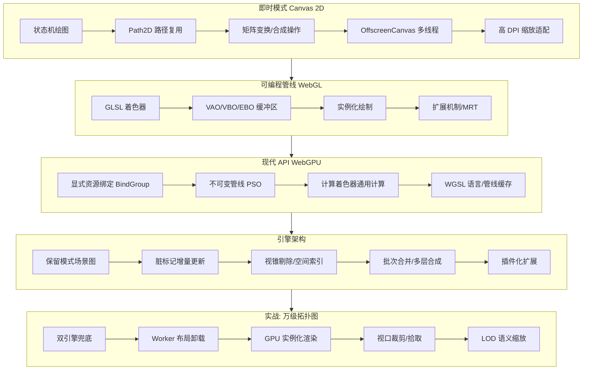
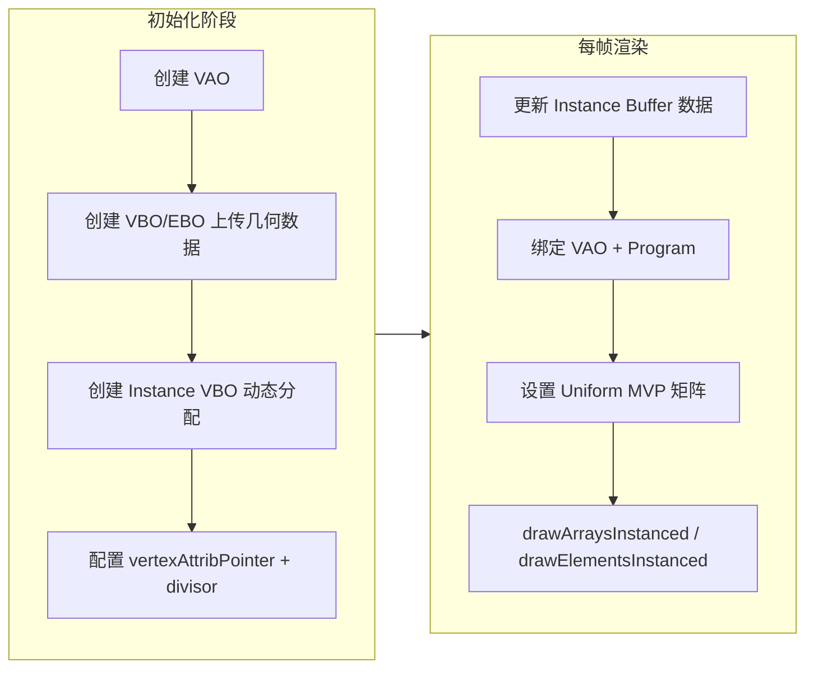
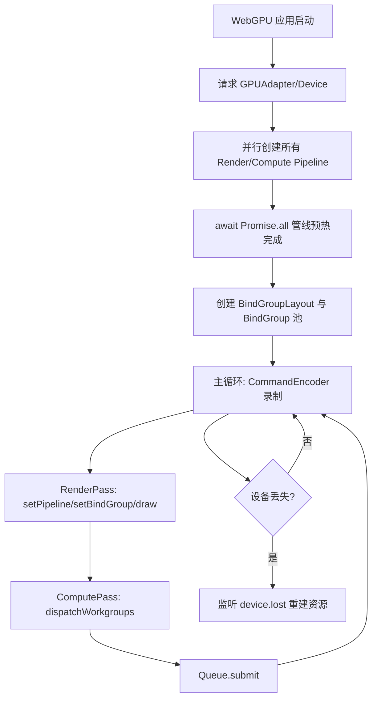
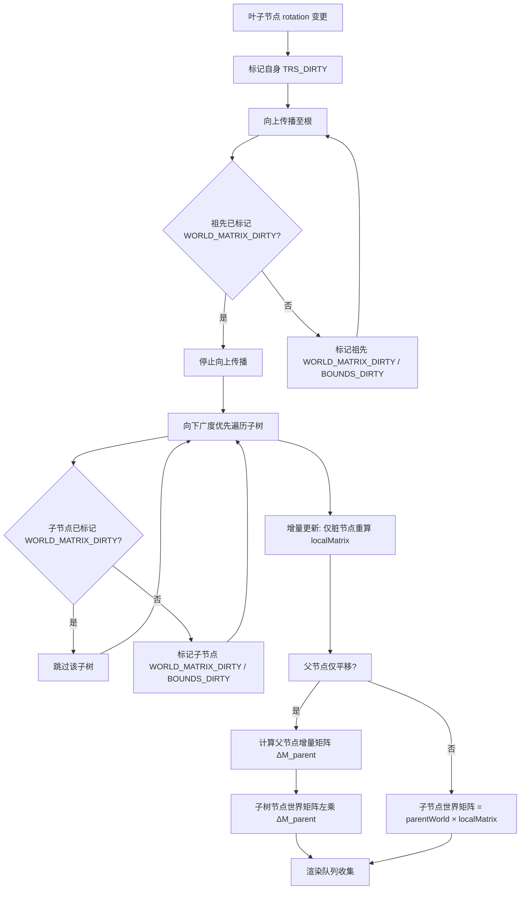
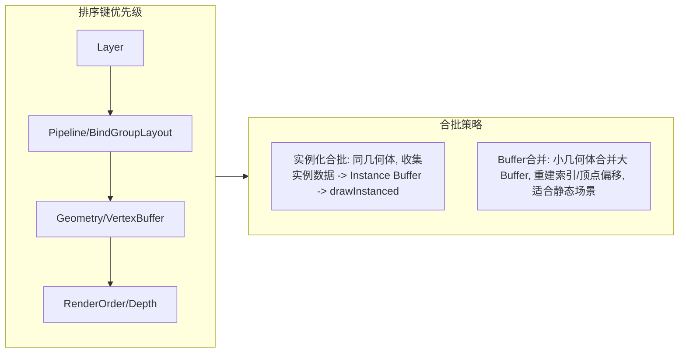
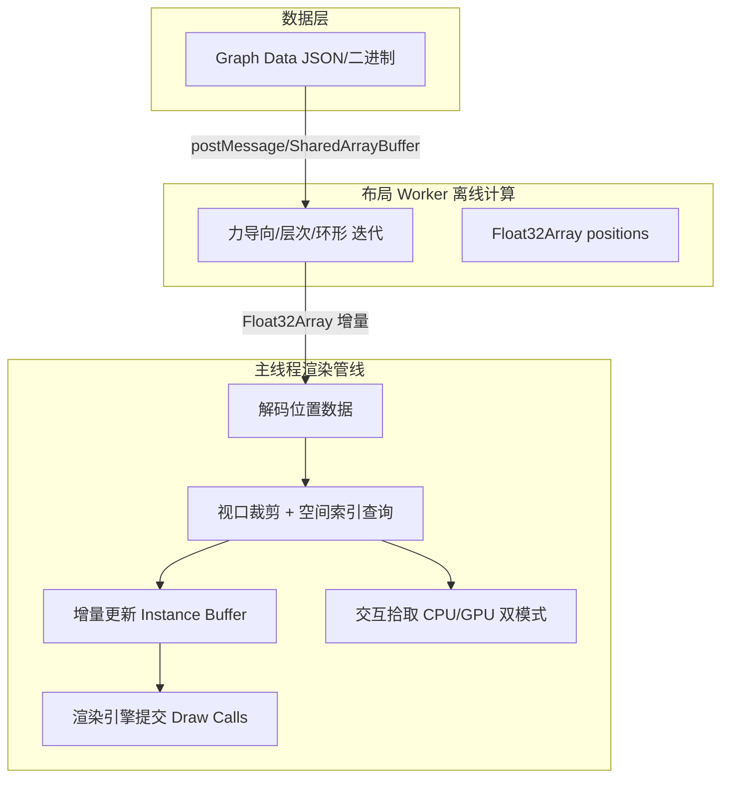
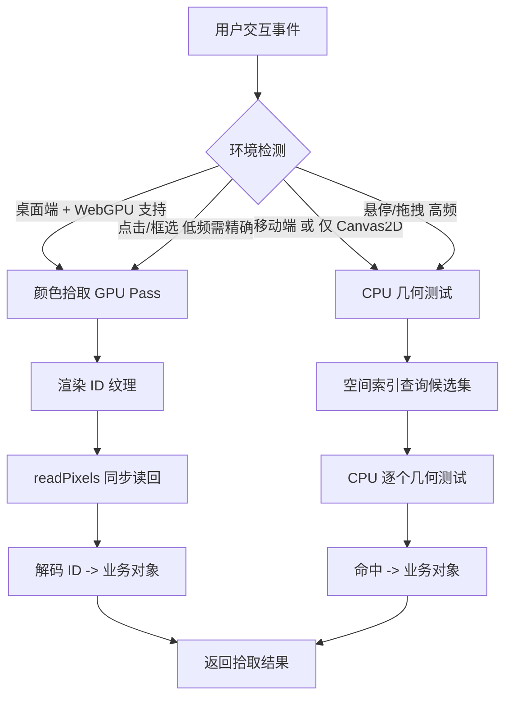

# 第 16 章 前端图形渲染进阶 —— Canvas 2D/WebGL/WebGPU 与可视化引擎架构设计

## 学习目标

- 理解 Canvas 2D 即时模式渲染的核心 API 与状态机模型，掌握路径复用、矩阵变换、合成操作及离屏渲染优化技巧
- 掌握 WebGL 可编程管线的着色器编写、缓冲区管理（VAO/VBO/EBO）、属性分发、纹理单元绑定及实例化绘制优化
- 理解 WebGPU 现代图形 API 的显式资源绑定模型、管线状态对象（PSO）、绑定组布局、计算着色器通用计算能力及 WGSL 着色语言特性
- 掌握渲染引擎架构设计的核心模块：保留模式场景图、脏标记增量更新、视锥剔除、渲染批次合并、多层合成策略与插件化扩展机制
- 能够综合运用双引擎兜底、Web Worker 布局卸载、GPU 实例化渲染、视口裁剪、交互拾取等技术，构建支持 10 万节点的高性能拓扑图可视化引擎
- 掌握 WebGL 与 WebGPU 中处理高 DPI 显示的缩放策略与帧缓冲区配置差异
- 理解 WebGL 扩展机制（如 OES_element_index_uint、WEBGL_draw_buffers）对渲染能力的解锁作用
- 了解 WebGPU 管线缓存与异步编译对首帧渲染性能的影响及预热策略
- 掌握渲染引擎中脏标记系统的传播优化：父子层级脏标记合并与增量矩阵计算
- 理解基于四叉树/均匀网格的空间索引在视口裁剪与拾取测试中的构建与查询复杂度

## 16.1 生活类比

想象图形渲染管线是一个**现代化建筑工地**。在这个工地上，不同的技术栈扮演着截然不同的角色，共同完成从蓝图到实体的构建过程。

**Canvas 2D 就像是一支灵活的装修队**。他们工具简单（刷子、滚筒），直接在墙面（画布）上作画，即时模式“想画就画”，非常适合小面积精细装修（图表、2D 游戏）。但他们不保留蓝图，下次重画时全凭记忆，若墙面太大、图案太复杂，效率就会大打折扣。

**WebGL 则像是一支传统施工队**。他们需要详细的图纸（着色器 GLSL），材料（Buffer、Texture）得提前按规格打包运到现场（显存）。工头（CPU）通过对讲机（Draw Call）指挥工人（GPU）干活。这种状态机模型像“一根绳子拴所有人”，换个任务全员都得切换状态，效率受限于指挥频率。扩展机制像“临时申请特种设备”，审批通过了才能用新工艺。

**WebGPU 则是一座智能模块化建筑工厂**。GPUDevice 是工厂总控台；Pipeline (PSO) 是预制好的标准化生产线（渲染管线/计算管线），一旦建好不可变，切换极快，管线缓存像“生产线模具”，预热后即刻生产；BindGroup 是标准化物料托盘，显式绑定 Buffer、Texture、Sampler，换任务只需换托盘；Compute Shader 是通用加工车间，不只盖房，还能加工零件（物理模拟、布局计算）；CommandEncoder/Queue 是自动化物流调度系统，支持多线程预录指令（CommandBuffer），最后统一发运。

**渲染引擎架构则是项目管理层**。场景图是建筑 BIM 模型（保留模式），树状管理所有构件（节点），自动计算世界坐标；脏标记是变更通知单，只重新处理变动的楼层，父子层级合并通知单、增量计算结构位移；视锥剔除是视野范围划定，只施工看得见的区域；批次合并是集中采购/集中施工，同材质同工艺一次性搞定；Layer 合成是分层施工图，地基/主体/装修/外立面分层并行，最后合成交付。

**高性能拓扑图实战则是一项超大型城市规划项目（10 万节点）**。双引擎兜底是主力军（WebGPU）加后备军；Worker 布局是规划院离线算好坐标，只发坐标表给现场；实例化渲染是标准化预制构件（节点/边），现场只摆放位置（Instance Buffer）；视口裁剪是只盖在视野内的楼，四叉树/均匀网格像“分区地籍图”，快速定位施工区；拾取交互是给每栋楼贴隐形二维码（颜色拾取）或发 GPS 坐标（几何测试）。

下面通过一张方法演进图，直观展示从即时模式到现代 GPU 编程、再到引擎架构与实战的技术演进脉络：



## 16.2 概念地图

前端图形渲染进阶
├── Canvas 2D 即时模式渲染
│   ├── 路径绘制与复用 (Path2D)         —— P001
│   ├── 变换矩阵数学 (3x3 齐次矩阵)      —— P001
│   ├── 合成操作 (globalCompositeOperation) —— P001
│   ├── 命中测试 (isPointInPath/反向变换)   —— P001
│   ├── 离屏缓存优化 (OffscreenCanvas/Worker) —— P001
│   ├── 高 DPI 缩放策略 (devicePixelRatio) —— P001
│   └── 路径长度限制与分段绘制           —— P001
├── WebGL 可编程管线
│   ├── GLSL ES 着色器 (顶点/片元)       —— P002
│   ├── 缓冲区管理 (VAO/VBO/EBO)          —— P002
│   ├── Attribute/Uniform/Varying 机制     —— P002
│   ├── 纹理单元与采样器                   —— P002
│   ├── 实例化绘制 (Instanced Draw)        —— P002
│   ├── 扩展机制 (OES_element_index_uint)  —— P002
│   ├── 多渲染目标 (WEBGL_draw_buffers)    —— P002
│   └── 高 DPI 缓冲区配置                  —— P002
├── WebGPU 现代图形 API
│   ├── GPUDevice/Queue 核心接口           —— P003
│   ├── 管线状态对象 (Render/Compute Pipeline) —— P003
│   ├── 显式资源绑定 (BindGroup/Layout)      —— P003
│   ├── 计算着色器 (Compute Shader)          —— P003
│   ├── WGSL 着色语言                       —— P003
│   ├── 管线缓存与异步编译                  —— P003
│   ├── 纹理格式与采样器配置                —— P003
│   └── 错误处理与设备丢失恢复              —— P003
├── 渲染引擎架构设计
│   ├── 场景图与保留模式                     —— P004
│   ├── 脏标记增量更新系统                   —— P004
│   ├── 视锥剔除与空间索引                   —— P004
│   ├── 批次合并 (状态/几何/材质)            —— P004
│   ├── 多层合成策略                         —— P004
│   ├── 插件化扩展机制                       —— P004
│   ├── 父子层级脏标记合并优化               —— P004
│   └── 增量世界矩阵计算                     —— P004
└── 高性能拓扑图可视化实战
    ├── 双引擎兜底架构 (WebGPU/Canvas2D)   —— P005
    ├── Web Worker 布局计算卸载             —— P005
    ├── GPU 实例化渲染节点/边               —— P005
    ├── 视口裁剪与空间索引加速              —— P005
    ├── 交互拾取 (颜色拾取/几何测试)         —— P005
    ├── 语义缩放与平滑动画 (LOD/插值)        —— P005
    ├── 四叉树/均匀网格空间索引构建          —— P005
    └── 拾取测试查询复杂度分析              —— P005

## 16.3 Canvas 2D 即时模式渲染 —— 像画家一样在画布上挥毫

### 16.3.1 为什么需要 Canvas 2D？

浏览器原生提供 2D 绘图能力，无需复杂的着色器编程，适合图表、简单动画、图片处理等非 3D 场景。即时模式下开发者直接发出绘制指令，状态即代码，心智模型简单，上手快。同时，它解决了 DOM 元素过多导致的性能瓶颈（如万级节点拓扑图），通过单一 Canvas 统一绘制大幅降低内存占用。

> "掌握 `Path2D` 复用路径、矩阵变换数学、`globalCompositeOperation` 混合模式、事件坐标反向变换拾取、OffscreenCanvas 多线程渲染、高 DPI 缩放策略、路径长度限制与分段绘制。"
> 
> ——《20230418_040.md》（P001）

### 16.3.2 核心定义与关键性质

**即时模式** 是 Canvas 2D 的核心范式：每帧调用 `draw()` 重绘整个场景，画布不保留对象树，开发者需自行维护场景状态（节点位置、样式等）。这与保留模式（如 SVG、渲染引擎场景图）形成鲜明对比。

**核心 API 集合** (`CanvasRenderingContext2D`)：
- **路径**：`Path2D` 对象支持路径的构建、缓存与复用，避免每帧重复调用 `moveTo`/`lineTo`/`arc` 产生的 JS 开销。
- **变换**：基于 3x3 齐次矩阵实现平移、缩放、旋转、倾斜。`transform(a,b,c,d,e,f)` 直接操作矩阵，`setTransform()` 重置并设置。
- **合成**：`globalCompositeOperation` 控制新旧像素混合模式（如 `source-over`、`lighter`、`destination-out`），实现光效、遮罩、橡皮擦等效果。
- **绘图**：`fill`/`stroke`/`drawImage`/`fillText` 等最终光栅化指令。

**状态机模型** 是理解 Canvas 2D 的关键。绘图状态（颜色、线宽、字体、变换矩阵、裁剪区域等）全局唯一。`save()` 将当前状态压栈，`restore()` 弹栈恢复。这像是一个“画笔属性栈”，合理使用可避免状态污染，但频繁调用也有微小开销。

**坐标系变换数学**：Canvas 使用 3x3 齐次矩阵。这是为了在 2D 平面上用矩阵乘法统一表示平移、旋转、缩放等变换。普通的 2x2 矩阵只能表示线性变换（旋转、缩放、错切），无法表示平移。引入齐次坐标，将二维点 $(x, y)$ 表示为三维向量 $(x, y, 1)^T$，即可用 3x3 矩阵统一所有仿射变换：
$$
M = \begin{bmatrix} a & c & e \\ b & d & f \\ 0 & 0 & 1 \end{bmatrix}
$$
对应 `transform(a, b, c, d, e, f)`。向量 $(x, y, 1)^T$ 乘以 $M$ 得到屏幕坐标：
$$
\begin{bmatrix} x' \\ y' \\ 1 \end{bmatrix} = 
\begin{bmatrix} a & c & e \\ b & d & f \\ 0 & 0 & 1 \end{bmatrix}
\begin{bmatrix} x \\ y \\ 1 \end{bmatrix}
=
\begin{bmatrix} ax + cy + e \\ bx + dy + f \\ 1 \end{bmatrix}
$$
这段公式展示了齐次矩阵如何将平移融入矩阵乘法：通过在向量末尾添加 1，平移分量 $e, f$ 可以直接通过矩阵乘法的加法项引入，而无需额外的向量加法运算。同时，Canvas 状态机中变换累乘遵循**右乘新变换**的约定：$M_{new} = M_{current} \times T_{new}$。这意味着 `translate -> rotate -> scale` 的调用顺序，实际作用顺序是 scale 最先作用于局部坐标，rotate 次之，translate 最后。这与 CSS `transform` 顺序一致，但与数学教科书“先平移再旋转”的直觉相反，请务必牢记。

**高 DPI 缩放策略**：这是最常见的坑。Canvas 元素有两套尺寸：CSS 像素（`style.width/height` 或属性 `width/height` 无单位时）和设备像素（`canvas.width/height` 属性设置的绘图缓冲区大小）。默认 1:1 映射，在 `devicePixelRatio=2` 屏幕上会被浏览器拉伸 2 倍，导致模糊。正确做法：
```javascript
const dpr = window.devicePixelRatio || 1;
canvas.width = cssWidth * dpr;
canvas.height = cssHeight * dpr;
canvas.style.width = cssWidth + 'px';
canvas.style.height = cssHeight + 'px';
ctx.scale(dpr, dpr); // 将绘图坐标系放大 dpr 倍，1 单位 = 1 设备像素
```
这段公式展示了：通过将绘图缓冲区扩大 `dpr` 倍，同时用 `ctx.scale(dpr, dpr)` 将逻辑坐标系放大 `dpr` 倍，我们在逻辑坐标系（CSS 像素）下编写代码，自动映射到物理像素，从而保证锐度。其数学本质是构建一个从 CSS 坐标到设备坐标的缩放矩阵 $S(dpr, dpr)$，使得逻辑坐标 $(x_{css}, y_{css})$ 经变换后落在物理像素中心。

**命中测试**：Canvas 无原生事件分发。两种主流方案：
1. 几何反向变换：将鼠标屏幕坐标乘以**当前变换矩阵的逆矩阵** $M^{-1}$，映射回模型局部坐标系，再做简单的矩形/圆形/多边形包含判断。
2. `isPointInPath(path, x, y)`：在当前变换矩阵下直接测试路径。注意：路径必须是当前绘制路径或 `Path2D` 对象，且受当前 `transform` 影响。

**离屏渲染与多线程**：`OffscreenCanvas` 将画布与 DOM 分离，可传递给 `Worker`。在 Worker 中获取上下文 `offscreenCanvas.getContext('2d')` 绘制，主线程仅负责交互与合成。这避免了复杂绘制阻塞主线程，是高性能 2D 应用的标配。

**路径长度限制**：浏览器对单个路径的顶点数有隐性限制（通常 65535 点）。超长路径（如高精度地图边界、海量折线图）会导致绘制失败或崩溃。解决方案：拆分为多个 `Path2D` 对象，或使用 `moveTo`/`lineTo` 分段绘制并 `stroke` 多次。

### 16.3.3 典型例子与边界条件

- **ECharts/Chart.js**：利用 `Path2D` 缓存复杂图形路径（如扇形、圆角矩形），结合 `globalCompositeOperation='lighter'` 实现光效叠加。
- **图片编辑器滤镜预览**：`drawImage` + `filter` 属性（`blur()`, `brightness()` 等）实时渲染，导出时复用相同逻辑。
- **万节点拓扑图**：节点数据存储于 `Float32Array`，每帧遍历调用 `arc`/`rect` 批量绘制，配合 `OffscreenCanvas` 计算布局。

**边界条件**：
- 频繁创建 `Path2D` 对象导致 GC 压力，复杂静态图形应预构建并缓存 `Path2D` 实例。
- 即时模式不保留场景图，无法原生支持 CSS 动画/选择器，需自行实现场景图层或引入保留模式库。

```mermaid
flowchart TD
    A[Canvas 2D 渲染帧开始] --> B{是否有静态复杂图形?}
    B -- 是 --> C[复用缓存的 Path2D 对象]
    B -- 否 --> D[构建新 Path2D]
    C --> E[应用变换矩阵 transform/setTransform]
    D --> E
    E --> F[设置 globalCompositeOperation]
    F --> G[fill/stroke/drawImage 绘制]
    G --> H{高 DPI 屏幕?}
    H -- 是 --> I[canvas.width = cssWidth * dpr; ctx.scale(dpr, dpr)]
    H -- 否 --> J[直接绘制]
    I --> K[帧结束]
    J --> K
```

## 16.4 WebGL 可编程管线 —— 向 GPU 发送指令的“汇编语言”

### 16.4.1 为什么需要 WebGL？

Canvas 2D 无法满足大规模粒子、自定义着色效果、3D 场景等高性能/高自由度需求。WebGL 暴露 GPU 可编程管线（顶点/片元着色器），让开发者完全掌控顶点变换与像素着色过程。它解决了 Draw Call 过多导致的 CPU-GPU 通信瓶颈，通过实例化绘制、合并 Buffer 实现万级物体高效渲染。

> "深入 GLSL ES 语法、顶点/片元着色器协作、VAO/VBO/EBO 缓冲区管理、纹理单元与采样器、实例化绘制减少 Draw Call、扩展机制解锁高级能力、多渲染目标支持延迟渲染、高 DPI 缓冲区配置。"
> 
> ——《20230418_040.md》（P002）

### 16.4.2 核心定义：着色器与缓冲区

**着色器** 是运行在 GPU 上的小程序，用 GLSL ES 编写（类 C 语法）。
- **顶点着色器**：输入 `attribute`（逐顶点数据）、`uniform`（全局常量）、`varying`（传递给片元）。输出 `gl_Position`（裁剪空间坐标，齐次坐标 `vec4`）。
- **片元着色器**：输入 `varying`（插值后）、`uniform`、纹理采样器 `sampler2D`。输出 `gl_FragColor` 或 `gl_FragData[n]`。

**缓冲区管理** 是 WebGL 性能的基石：
- **VBO (Vertex Buffer Object)**：存储顶点属性数据（位置、法线、UV、颜色等），`ARRAY_BUFFER` 目标。
- **EBO (Element Buffer Object)**：存储索引数据，`ELEMENT_ARRAY_BUFFER` 目标，配合 `drawElements` 实现顶点复用。
- **VAO (Vertex Array Object)**：**核心优化对象**。封装“顶点输入状态”：哪些属性启用、每个属性绑定哪个 VBO、步长、偏移、归一化、除数。绑定 VAO 一次性恢复所有顶点属性配置，避免每帧重复调用 `vertexAttribPointer`/`enableVertexAttribArray`。

**属性分发细节**：
```javascript
// 典型设置流程
gl.bindVertexArray(vao);
gl.bindBuffer(gl.ARRAY_BUFFER, vbo);
gl.vertexAttribPointer(loc, size, type, normalized, stride, offset);
gl.enableVertexAttribArray(loc);
// 实例化属性关键：
gl.vertexAttribDivisor(loc, 1); // 1 = 每实例更新一次，0 = 每顶点更新
```
`vertexAttribDivisor` 是实例化渲染的开关。除数为 1 时，顶点着色器通过 `gl_InstanceID` 索引该属性 Buffer，实现每个实例不同数据。

**Uniform 与纹理单元**：Uniform 通过 `gl.uniform*` 系列设置，按 Program 存储。纹理需激活单元 `gl.activeTexture(gl.TEXTURE0 + unit)`，绑定 `gl.bindTexture(gl.TEXTURE_2D, tex)`，再将单元索引 `unit` 传给 Uniform `gl.uniform1i(loc, unit)`。

### 16.4.3 实例化绘制：万级渲染的核心手法

**实例化渲染** 让单次 Draw Call 绘制同一几何体的 N 个副本，每副本拥有独立属性（矩阵、颜色、ID）。

**顶点着色器核心逻辑**：
```glsl
attribute vec3 a_position; // 基础几何
attribute vec2 a_instancePos; // 实例位置
attribute vec4 a_instanceColor; // 实例颜色
uniform mat4 u_projView; // MVP 矩阵

void main() {
  vec3 worldPos = a_position + vec3(a_instancePos, 0.0); // 简化：仅平移
  gl_Position = u_projView * vec4(worldPos, 1.0);
  v_color = a_instanceColor;
}
```
配合 `gl.drawArraysInstanced(gl.TRIANGLES, 0, baseVertexCount, instanceCount)`。

**扩展机制解锁能力**：
- `OES_element_index_uint`：启用后 `drawElements` 支持 `UNSIGNED_INT` 索引，突破 65535 顶点限制，大网格渲染必备。
- `WEBGL_draw_buffers`：片元着色器输出多个 `gl_FragData[i]`，同时渲染到多个附件（Position/Normal/Albedo），延迟渲染/后处理基础。

**高 DPI 缓冲区配置**：同 Canvas 2D，需手动设置 `canvas.width = cssWidth * dpr`，`gl.viewport(0, 0, canvas.width, canvas.height)`。Framebuffer 附件纹理尺寸也须同步放大。

### 16.4.4 典型例子与边界条件

- **粒子系统**：单个 Buffer 存位置/速度/生命周期，顶点着色器模拟物理更新，`drawArraysInstanced` 一次绘制 10 万粒子。
- **实例化渲染拓扑图边**：边几何体为单位线段，Instance Buffer 存起止点坐标/颜色，顶点着色器按实例 ID 变换拉伸。
- **后处理链**：渲染到 Framebuffer 纹理 -> 全屏三角形采样 -> 片元着色器叠加 Bloom/FXAA/ColorGrading。

**边界条件**：
- GLSL ES 1.00 无整数纹理、无几何着色器、无计算着色器，复杂算法需多 Pass 或模拟。
- `uniform` 数量/向量长度受限（如 `MAX_VERTEX_UNIFORM_VECTORS` 通常 256），大规模骨骼动画需用 Texture Buffer 存矩阵。
- 移动端 GPU 带宽敏感，过度采样/高分辨率 Framebuffer 易成性能杀手，需 Tile-based 渲染优化。



## 16.5 WebGPU 现代图形 API —— 显式控制 GPU 的“现代操作系统”

### 16.5.1 为什么需要 WebGPU？

WebGL 状态机模型隐式依赖多，难以多线程录制命令，驱动开销大，无法充分发挥现代 GPU（Vulkan/Metal/DX12）性能。WebGPU 引入显式资源管理、管线状态对象（PSO）、绑定组布局，映射现代图形 API，支持计算着色器通用计算。它解决了 WebGL 无法高效实现的：多线程命令缓冲录制、渲染/计算管线复用、细粒度资源生命周期与同步控制。

> "对比 WebGL 状态机模型，理解 WebGPU 显式资源绑定、渲染管线状态对象、计算着色器通用计算能力、WGSL 着色语言、管线缓存优化首帧性能、错误处理与设备丢失恢复。"
> 
> ——《20230418_040.md》（P003）

### 16.5.2 核心定义：显式资源绑定模型

WebGPU 的核心设计是**显式**与**不可变**。

**GPUDevice 与 Queue**：
- `GPUDevice`：工厂，创建所有资源（`createBuffer`、`createTexture`、`createBindGroupLayout`、`createRenderPipeline`、`createComputePipeline`、`createCommandEncoder`）。
- `GPUQueue`：提交端，`queue.submit([commandBuffer])`，写入数据 `queue.writeBuffer(buffer, offset, data)`、`queue.copyExternalImageToTexture(...)`。

**管线状态对象 (PSO)**：`GPURenderPipeline` / `GPUComputePipeline`。
创建时一次性定义所有固定状态：**着色器模块、顶点缓冲区布局、绑定组布局、混合状态、深度/模板状态、图元拓扑**。创建后**不可变**。切换管线 = 切换整套硬件状态，极快。

**显式资源绑定：BindGroup 与 BindGroupLayout**。
这是与 WebGL 最大的不同。WebGL 隐式绑定“当前绑定的纹理/Buffer 给当前 Program 的 Uniform”。WebGPU 要求：
1. 定义 `BindGroupLayout`：描述符集结构。如 `@group(0) @binding(0) var<uniform> u_projView: mat4x4<f32>;` 对应 `{ binding: 0, visibility: GPUShaderStage.VERTEX, buffer: { type: 'uniform' } }`。
2. 创建 `BindGroup`：将实际资源（Buffer、TextureView、Sampler）绑定到 Layout 的槽位。
3. 绘制/计算时：`pass.setBindGroup(0, bindGroup, dynamicOffsets?)`。

**优势**：驱动无需在 Draw Call 时校验/推导资源绑定合法性；多线程录制命令时，只需传递 `BindGroup` 句柄；资源生命周期与同步显式可控。

**计算着色器**：`GPUComputePipeline` 仅需 Compute Shader 入口点 + `BindGroupLayout`。调度：`pass.dispatchWorkgroups(x, y, z)`。Workgroup 内共享内存 `var<workgroup> shared: array<f32, 256>;`，屏障 `workgroupBarrier()`。这让 GPU 成为通用并行计算器，物理模拟、布局计算、图像处理全 GPU 离线成为可能。

**WGSL (WebGPU Shading Language)**：强类型、模块化、指针/数组/结构体一等公民，编译目标 SPIR-V。矩阵**列主序**（`mat4x4<f32>` 即 4 列 `vec4<f32>`），构造函数语法 `vec3<f32>(1.0, 2.0, 3.0)`，内置函数命名规范（`select`, `dot`, `cross`）。与 GLSL 差异大，迁移建议统一维护 WGSL 源码，必要时转译。

### 16.5.3 管线缓存与首帧性能

**管线缓存机制**：`device.createRenderPipelineAsync(descriptor)` 返回 `Promise<GPURenderPipeline>`。浏览器在后台编译驱动相关二进制。首帧渲染前**必须**预热：并行创建所有 Pipeline，`await Promise.all(pipelines.map(p => p))`。否则首帧会卡顿数百毫秒（驱动编译）。

**错误处理与设备丢失**：
- `device.lost`：Promise，解析为 `GPUDeviceLostInfo`（`reason: 'destroyed' | 'lost'`）。需监听并尝试重建。
- `device.onuncapturederror`：错误非阻塞，回调 `event.error`（`GPUValidationError`/`GPUOutOfMemoryError`/`GPUInternalError`）。调试依赖资源创建时的 `label` 字段（显示在 DevTools/错误信息中）。

### 16.5.4 典型例子与边界条件

- **百万节点力导向布局**：计算着色器读位置/速度 Buffer，写新位置，`storage` 绑定读写同 Buffer，无需 CPU 往返。
- **可视化引擎双引擎兜底**：WebGPU 优先，降级 Canvas 2D；核心渲染逻辑抽象为 `RenderPassEncoder` 统一接口。
- **后处理 Pipeline**：预创建 `RenderPipeline`（含 BindGroupLayout），每帧仅更新 `BindGroup` 资源视图，避免管线重建。

**边界条件**：
- 浏览器支持度：Chrome/Edge 稳定支持，Firefox/Safari 需开启标志位或等待版本更新，生产环境需 Polyfill（如 `webgpu-polyfill` 基于 WebGL2 模拟）。
- 无几何/曲面细分/网格着色器，复杂几何处理仍需顶点着色器+计算着色器预处理或 CPU 端生成。
- `bindGroup` 创建开销较大，动态资源更新建议使用 `dynamicOffset` 或预分配 `BindGroup` 池复用。



## 16.6 渲染引擎架构设计 —— 从即时模式到保留模式的工程化跃迁

### 16.6.1 为什么需要渲染引擎？

直接调用 Canvas/WebGL/WebGPU API 导致业务逻辑与渲染细节强耦合，难以复用、测试、扩展。即时模式每帧手动遍历绘制，无法自动脏检查、视锥剔除、批次合并，大规模场景性能不可控。我们需要一层**保留模式抽象**：场景图管理对象树、脏标记驱动增量更新、渲染器封装底层 API 差异、插件机制支撑物理/动画/后处理。

> "设计保留模式场景图节点、脏标记增量更新、空间索引加速拾取/剔除、渲染批次合并状态变更、Layer 合成策略、插件机制扩展后处理/物理/动画、父子脏标记合并与增量矩阵计算。"
> 
> ——《20230418_040.md》（P004）

### 16.6.2 核心定义：场景图与脏标记系统

**场景图** 是树状结构，节点持有：
- 变换：`position`/`rotation`/`scale` (TRS) -> 合成局部矩阵 `localMatrix`。
- 几何：`Geometry` 引用（顶点 Buffer、索引 Buffer、拓扑）。
- 材质：`Material` 引用（Shader、Uniforms、Textures、RenderState：Blend/Depth/Stencil）。
- 可见性、层级、拾取 ID 等。

父变换影响子节点世界矩阵：$M_{world} = M_{parentWorld} \times M_{local}$。

**脏标记系统** 是增量更新的引擎。标记类型：
- `TRS_DIRTY`：TRS 变更，需重算 `localMatrix`。
- `WORLD_MATRIX_DIRTY`：自身或祖先 `localMatrix` 变更，需重算 `worldMatrix`。
- `BOUNDS_DIRTY`：几何/变换变更，包围盒需更新。
- `RENDER_DIRTY`：材质/几何/可见性变更，渲染数据需重组。

**传播规则**：节点标记 `TRS_DIRTY` -> 向上传播至根（标记祖先 `CHILD_TRANSFORM_DIRTY` 可选） -> 向下传播至子树（标记所有后代 `WORLD_MATRIX_DIRTY`、`BOUNDS_DIRTY`）。
**优化：父子层级脏标记合并**。若父节点已标记 `WORLD_MATRIX_DIRTY`，子节点无需重复标记（遍历时父脏自然导致子脏）。实现：向上传播时，遇到已标记 `WORLD_MATRIX_DIRTY` 的祖先即停止向上；向下传播使用广度/深度优先，跳过已标记节点。

**增量世界矩阵计算**：若仅父节点平移（$M_{parent} = T_{new} \times M_{parentOld}$），子节点世界矩阵 $M_{childWorld} = M_{parent} \times M_{childLocal} = T_{new} \times M_{parentOld} \times M_{childLocal} = T_{new} \times M_{childWorldOld}$。即子节点世界矩阵左乘父节点的**增量矩阵** $\Delta M_{parent}$。避免子树完全重算（需访问子节点 `localMatrix` 并乘法），仅需遍历子树左乘 $\Delta M$。这在大场景微小平移（如相机移动）时极其高效。这段公式展示了：父节点局部变换的增量 $\Delta M_{parent}$ 可以直接左乘到子节点的世界矩阵上，从而避免对整个子树进行完整的矩阵重算（即 $M_{parent} \times M_{local}$），显著降低计算量。

下面用流程图展示脏标记的传播与合并过程：



### 16.6.3 视锥剔除与空间索引

**视锥剔除**：相机提取 6 个平面组成 `Frustum`。节点包围球/盒与视锥相交测试（Separating Axis Theorem）。不可见节点及其子树直接跳过渲染队列收集。

**空间索引加速**：
- **均匀网格**：空间划分为固定大小格子，对象按包围盒插入格子。构建 O(N)，查询 O(1) 平均。适合分布均匀、动态更新频繁场景（拓扑图节点位置每帧微调）。
- **四叉树/八叉树**：自适应细分。查询 O(log N)。适合分布稀疏/聚集场景。动态更新开销大（对象跨格子需移除重插）。

拓扑图视口裁剪常选**均匀网格**：节点大小相近、分布相对均匀、每帧位置微变，网格重建/增量更新极快。

### 16.6.4 批次合并与多层合成

**渲染队列构建流程**：
1. 遍历场景图（脏标记驱动增量更新世界矩阵/包围盒）。
2. 视锥剔除 -> 收集可见 `RenderObject` { geometry, material, worldMatrix, renderOrder, layer }。
3. **排序**：首键 `layer`（渲染层顺序），次键 `material.id`/`pipeline.id`（状态变更最小化），三键 `geometry.id`（顶点缓冲区切换最小化），四键 `renderOrder`（透明度排序）。
4. **合批**：遍历排序列表，连续相同 (Pipeline, BindGroupLayout, BlendState, DepthState) 的对象合并为一个 `Batch`。合并方式包括两种主要策略：



**多层合成策略**：`Layer` 按渲染顺序/后处理需求分组。
- 背景层：不清除深度，渲染天空盒/网格。
- 主层：清除颜色/深度，渲染不透明/透明物体。
- UI 层：正交相机，禁用深度测试，渲染 HUD/文字。
- 高光/后处理层：渲染到离屏纹理，全屏通道合成。
每层独立 `RenderPass`（WebGPU）或 Framebuffer（WebGL），合成时按顺序混合。

### 16.6.5 插件化扩展机制

引擎核心提供生命周期钩子：
- `onUpdate(dt)`：逻辑更新（物理、动画、布局 Worker 通信）。
- `onBeforeRender(camera)`：相机 Culling、队列构建、合批。
- `onRenderPass(pass)`：自定义 RenderPass（后处理、阴影、自定义效果）。
- `onAfterRender()`：读回像素、性能统计。
插件注册：`engine.use(plugin)`，插件内部可访问 `engine.renderer`、`engine.scene`、`engine.resourcePool`。

### 16.6.6 资源池化与透明物体排序

**资源池化**：Buffer/Texture/Pipeline/BindGroup 统一池管理，引用计数回收，避免频繁创建销毁触发 GC 与驱动抖动。`resourcePool.acquire(descriptor)` -> 使用 -> `resourcePool.release(handle)`。

**透明物体排序问题**：Painter's Algorithm（按深度后向前绘制）失效于**相交三角形**（无法线性排序）。工程妥协：按包围盒中心距相机距离排序。缺陷：大物体包围盒中心远但前表面近，导致穿模。严谨方案：Order Independent Transparency (OIT, Weighted Blended / Depth Peeling) 或深度剥离，但性能开销大，移动端慎用。

## 16.7 高性能拓扑图可视化实战 —— 10 万节点的工程化落地

### 16.7.1 为什么要实战拓扑图？

真实业务场景（依赖分析、知识图谱、网络拓扑）常涉及 10 万+ 节点/边，原生 DOM/SVG 完全无法承载。需要端到端解决方案：布局计算卸载主线程、GPU 实例化渲染、视口裁剪、交互拾取、流畅动画，验证前四节技术选型的工程可行性。

> "技术选型 WebGPU/Canvas2D 双引擎兜底、Web Worker 布局计算、GPU 实例化渲染节点/边、视口裁剪、交互拾取、平滑缩放平移动画、四叉树/均匀网格空间索引构建与查询、LOD/聚类渲染架构。"
> 
> ——《20230418_040.md》（P005）

### 16.7.2 核心架构：双引擎兜底与数据流

**双引擎兜底**：统一 `IRenderEngine` 接口（`init`、`resize`、`render(scene, camera)`、`destroy`）。
- `WebGPUEngine`：实例化渲染 + 计算着色器布局/后处理。
- `Canvas2DEngine`：`OffscreenCanvas` + `Path2D` 缓存 + Worker 布局。
运行时特性检测 `navigator.gpu ? new WebGPUEngine() : new Canvas2DEngine()`。

**数据驱动单向流**：
```
Graph Data (JSON/二进制) 
    -> Layout Worker (力导向/层次/环形 迭代) 
    -> Float32Array positions (SharedArrayBuffer 或 postMessage 传输) 
    -> Main Thread: 解码 -> 更新 Instance Buffer -> RenderEngine.render()
```
主线程仅做：相机控制、视口裁剪、Buffer 上传、拾取、渲染提交。无布局计算逻辑。

下面用流程图展示完整的数据流与渲染管线：



### 16.7.3 GPU 实例化渲染节点与边

**节点**：几何体为单位四边形或圆（三角形扇/条）。Instance Buffer 结构：
```rust
// WGSL / GLSL 对应
struct Instance {
  position: vec2<f32>,  // 中心
  size: f32,            // 半径/边长
  color: vec4<f32>,     // 颜色
  pickingId: u32,       // 拾取 ID
  // 可选: rotation, uvOffset(for atlas), ...
}
```
顶点着色器：
```wgsl
@vertex fn vs_main(
  @location(0) pos: vec2<f32>, // 单位几何 [-1,1] 或 [0,1]
  @location(1) inst: Instance, // instance buffer, step_mode = Instance
  @builtin(instance_index) idx: u32
) -> @builtin(position) vec4<f32> {
  let worldPos = inst.position + pos * inst.size;
  return camera.projView * vec4<f32>(worldPos, 0.0, 1.0);
}
```
**边**：几何体为单位线段（两顶点）。Instance Buffer 存 `startPos, endPos, color, width, pickingId`。顶点着色器根据 `gl_VertexID` (0/1) 选起止点，沿方向展开宽度（或几何着色器模拟，WebGPU 无几何着色器，顶点着色器展开）。

### 16.7.4 视口裁剪与空间索引

**CPU 端视口裁剪流程**：
1. 相机矩阵 `viewProj`，视口矩形 `[-1,1]x[-1,1]` (NDC) 或屏幕像素矩形。
2. 计算视口在**世界坐标**下的包围盒：`viewProj.inverse() * viewRectCorners`。
   这段公式展示了：将 NDC 空间的视口四个角点（[-1,-1], [1,-1], [1,1], [-1,1]）乘以 `viewProj` 的逆矩阵，即可得到世界坐标系下的视口包围盒，用于后续空间索引查询。
3. 空间索引（均匀网格/四叉树）查询与该包围盒相交的实例 ID 列表。
4. 仅上传可见实例数据到 Instance Buffer（或 `drawInstanced` 指定 `firstInstance`/`instanceCount` 分段提交）。

**均匀网格构建**：
- 网格大小 = 视口平均可见节点数经验值（如 100x100 单元，每单元约 10 节点）。
- 构建：遍历所有节点位置，计算网格坐标 `(floor(x/cellSize), floor(y/cellSize))`，追加到 `grid[cellKey]` 数组。
- 更新：节点位移时，检查是否跨格子，跨则从旧格子移除、加入新格子（双向链表或索引数组+标记重建）。
- 查询：视口世界包围盒覆盖的网格范围 `[minX, maxX] x [minY, maxY]`，合并这些格子的节点 ID。

**复杂度**：构建 O(N)，查询 O(K + M) (K=覆盖格子数, M=结果数)。动态场景增量更新极快。

### 16.7.5 交互拾取：双模式适配

**方案 A：颜色拾取（GPU 精确，需额外 Pass）**
1. 创建离屏 `RenderPass`（WebGPU）或 Framebuffer（WebGL），附件：`R8UI`/`RGBA8` 纹理。
2. 着色器输出 `pickingId` 编码颜色：`vec4( id & 0xFF, (id>>8)&0xFF, (id>>16)&0xFF, (id>>24)&0xFF ) / 255.0`。
3. 渲染可见实例（同渲染 Pass，但无光照/材质，仅输出 ID）。
4. `readPixels` / `queue.readTexture` 读取鼠标坐标像素 -> 解码 ID -> 映射回业务数据。
**优点**：像素级精确，支持任意几何（SDF/纹理透明度）。**缺点**：额外渲染通道 + GPU->CPU 读回同步（`readPixels` 阻塞管线），移动端 10-20ms。

**方案 B：CPU 空间索引几何测试（无 GPU 同步，近似）**
1. 复用视口裁剪的空间索引（均匀网格/四叉树）。
2. 鼠标屏幕坐标 -> 世界坐标射线/点（相机逆矩阵）。
3. 查询索引获得候选节点 ID 列表。
4. CPU 端逐个做精确几何测试：圆 `distance(pt, center) < radius`，矩形 `pointInRect`，边 `distanceToSegment`。
**优点**：无 GPU 同步，主线程微任务即可完成，延迟 < 1ms。**缺点**：几何近似（如边展开宽度、圆角矩形难精确），需容差。

**动态切换策略**：桌面端/WebGPU 优先颜色拾取（精确）；移动端/Canvas2D 降级 CPU 几何测试（低延迟）；或“悬停用 CPU 几何，点击确认用颜色拾取”。

下面用决策流程图展示拾取模式的动态选择逻辑：



### 16.7.6 语义缩放 (LOD) 与平滑动画

**语义缩放**：根据相机 `zoom` (scale) 动态调整渲染细节：
- `zoom < 0.1`：节点渲染为单像素点/隐藏，边简化为线段/隐藏，标签全隐。
- `0.1 <= zoom < 0.5`：节点圆点，边线段，仅重要节点显示标签。
- `0.5 <= zoom < 2`：节点图标/形状，边带箭头/标签，全部标签显示。
- `zoom >= 2`：节点详情面板、高清纹理、边曲线细分。
实现：引擎维护 `LODLevel` 状态，`RenderObject` 生成时根据 Level 选择几何体/Shader/是否渲染标签。

**平滑动画**：
- 相机：目标 `viewProj` 与当前 `viewProj` 插值（`lerp` 或弹簧阻尼 `spring`）。
- 节点位置：布局 Worker 输出目标位置，主线程每帧 `currentPos = lerp(currentPos, targetPos, factor)`。
- 边：`dashOffset` 线性递减实现“流动”动画，或路径曲线控制点插值。

### 16.7.7 性能基准与边界条件

**基准参考**：10 万节点、20 万边，WebGPU 实例化 60 FPS，Canvas2D Offscreen 30 FPS，内存 < 200MB。

**边界条件与扩展**：
- **超大图 (> 50 万节点)**：单帧实例数据上传带宽成瓶颈。需分层级渲染（簇/聚合节点，LOD 到聚类圆圈）或服务端渲染瓦片（如 Mapbox 风格）。
- **边交互复杂**：弯曲/箭头/标签实例化难度大，常单独渲染层或用 SDF 纹理在片元着色器程序化绘制。
- **移动端降级**：减少实例属性精度（`float16`/`unorm8x4`）、简化 Shader（去光照/阴影）、限制最大实例数（视口裁剪更激进）。
- **无障碍访问**：Canvas 无语义 DOM，需同步生成隐形 SVG/ARIA 树供屏幕阅读器遍历，或实现虚拟光标导航。

## 16.8 多源对照

本章核心概念主要基于单一综合素材源 `20230418_040.md`（P001-P005）构建，涵盖了从 Canvas 2D 到 WebGL、WebGPU、渲染引擎架构及实战的完整知识体系。由于素材为单一章节大纲，暂无多源冲突或互补视角需要对照。若后续引入 Three.js、PixiJS、AntV G6 等具体库源码分析，将补充“库实现差异”对照。

### 共识
- 即时模式适合简单场景，保留模式配合脏标记/剔除/合批是高性能复杂场景标配。
- 实例化渲染是海量同构物体（节点/边/粒子）的核心手段。
- WebGPU 显式绑定/PSO/计算着色器是现代图形编程方向，WebGL 通过扩展勉强追赶。
- 离屏/Worker 卸载主线程是高性能交互应用必经之路。

### 分歧
- **不同主流渲染引擎的工程取舍差异**：Three.js、PixiJS、AntV G6、Deck.gl 等库在脏标记粒度设计、批次合并排序键优先级、透明物体排序妥协方案（如 OIT 实现细节）、实例化 Buffer 更新策略等方面存在显著差异。例如 Three.js 采用对象级脏标记并配合 `Object3D.updateMatrixWorld` 强制更新，而 PixiJS 更侧重于显式的 `transform.updateTransform` 调用；AntV G6 在拓扑图场景下针对边的实例化采用 SDF 程序化绘制而非几何展开。这些差异反映了通用引擎与领域专用引擎在抽象层级与性能权衡上的不同选择。

## 16.9 设计中的取舍

### 为什么不用 SVG/ DOM 而是 Canvas/WebGL/WebGPU？

SVG/DOM 保留模式天然支持事件、CSS、无障碍，但每个图形元素是一个 DOM 节点。10 万节点 = 10 万+ DOM 节点，内存占用巨大（~百 MB），样式计算/布局/合成开销指数级上升，主线程长任务严重，交互卡顿。Canvas/WebGL/WebGPU 单一绘图上下文，数据驱动，GPU 并行光栅化，内存可控（Buffer 紧凑存储），是大规模可视化唯一可行路径。

### 为什么 WebGL 不直接用，而要封装渲染引擎/双引擎？

WebGL 状态机 API 极其繁琐易错（绑定点、启用位、Uniform 位置查询），业务代码极易耦合渲染细节。渲染引擎提供：
- **保留模式场景图**：声明式描述“画什么”，而非命令式“怎么画”。
- **跨 API 抽象**：统一接口屏蔽 WebGL/WebGPU/Canvas2D 差异，业务代码零迁移成本。
- **自动优化**：脏标记、剔除、合批、实例化自动应用，避免手工优化遗漏/失效。
代价：引擎本身复杂度高，学习曲线陡峭，调试需深入理解底层。双引擎兜底增加了维护两套后端代码的成本，但换来了兼容性与性能的平衡。

### 实例化渲染 vs 合并大 Buffer？

下表对比了实例化渲染与合并大 Buffer 两种合批策略的适用场景与特性：

| 维度 | 实例化渲染 | 合并大 Buffer |
|------|------------|---------------|
| **适用场景** | 同几何体、大量实例、动态属性 | 少量不同几何体、静态场景、无实例属性 |
| **顶点着色器** | 需 `instance_id` 分支读取实例 Buffer | 普通顶点着色器，数据已烘焙在大 Buffer |
| **更新开销** | 仅更新 Instance Buffer (小) | 需重建整个大 Buffer (大) 或 subData 碎片化 |
| **Draw Call** | 1 次 | 1 次 |
| **灵活性** | 高（实例随时增删/改属性） | 低（拓扑固定，增删需重建） |

拓扑图节点/边**高度动态**（布局每帧变、交互高亮变色），实例化是唯一选择。

### 颜色拾取 vs CPU 几何测试？

下表对比了两种拾取方案在精度、延迟、带宽与实现复杂度上的权衡：

| 维度 | 颜色拾取 | CPU 几何测试 |
|------|----------|--------------|
| **精度** | 像素级精确（含透明度/复杂形状） | 近似（需几何简化模型） |
| **延迟** | 高（GPU->CPU 同步阻塞 ~10-20ms） | 低 (纯 CPU, <1ms) |
| **带宽** | 读回 1-4 字节 | 无 |
| **实现复杂度** | 需额外 Pass/Shader/Framebuffer | 复用空间索引，几何数学简单 |
| **适用场景** | 精确交互（点击/框选）、复杂几何 | 高频交互（悬停/拖拽）、简单几何、移动端 |

工程上常**混用**：悬停/拖拽用 CPU 几何测试（流畅），点击/框选确认用颜色拾取（精确）。

## 16.10 动手练习

### 练习 1：Canvas 2D 变换矩阵与命中测试手算
1. 给定一个矩形节点：局部坐标系下位于 (100, 100)，宽 50，高 30。
2. 当前 Canvas 变换矩阵（SVGMatrix 顺序）为：scale(2, 1.5) → rotate(45deg) → translate(200, 100)。
3. 计算该节点在屏幕坐标系下的四个顶点坐标。
4. 鼠标点击屏幕坐标 (320, 250)，请通过**反向变换矩阵**将其映射回节点局部坐标系，判断是否命中该矩形。
5. 如果节点层级嵌套（父节点有 transform），反向变换的矩阵乘法顺序应如何调整？
6. 在高 DPI 屏幕（devicePixelRatio=2）下，Canvas 绘制缩放与坐标映射需做何调整？

### 练习 2：WebGL 实例化渲染管线设计
1. 需渲染 50,000 个相同三角形（顶点数据固定），每个三角形拥有独立的：位置、颜色、缩放、旋转角度。
2. 设计 VBO/IBO/EBO 布局：基础几何体 Buffer 与 Instance Buffer 如何分离？顶点着色器中 `gl_InstanceID` 如何使用？
3. 编写顶点着色器核心逻辑：从 Instance Buffer 读取实例属性，构建模型矩阵，结合 MVP 矩阵输出 `gl_Position`。
4. 分析：若实例数增加至 500,000，`drawArraysInstanced` 单次调用可能遇到什么硬件/驱动限制？应如何分批次提交？
5. 启用 `OES_element_index_uint` 扩展后，索引缓冲区最大支持多少顶点？这对大规模网格渲染有何意义？

### 练习 3：WebGPU BindGroup 与 Compute Shader 实战
1. 实现一个简易的 GPU 粒子系统（10,000 粒子），每帧在 Compute Shader 中更新位置：`pos += vel * dt`，边界反弹。
2. 定义 `BindGroupLayout`：包含只读 Uniform Buffer（dt、边界）、存储缓冲区（位置、速度，读写）。对应的 WGSL 结构体定义是什么？
3. 编写 Compute Shader 入口点：`@compute @workgroup_size(64)`，如何计算全局索引并边界检查？如何实现边界反弹逻辑？
4. 渲染阶段：如何复用位置 Buffer 作为顶点着色器的只读存储缓冲区？`GPURenderPipeline` 的顶点缓冲区布局应如何配置（stepMode: 'instance'）？
5. 管线缓存机制下，如何实现渲染管线与计算管线的预热编译，避免首帧卡顿？

### 练习 4：渲染引擎脏标记与批次合并算法
1. 场景图包含 1000 个节点，树深 5 层。某叶子节点修改了 `rotation`。
2. 描述脏标记传播流程：从该叶子到根节点，哪些标记会被置位（TRS_DIRTY, WORLD_MATRIX_DIRTY, BOUNDS_DIRTY 等）？如何避免重复传播？父子层级脏标记如何合并？
3. 渲染队列构建阶段：遍历场景图收集可见 `RenderObject`。设计一个批次合并算法：按 (Pipeline, BindGroupLayout, BlendState) 分组，组内再按几何体合并。伪代码实现核心分组逻辑。
4. 透明物体排序问题：Painter's Algorithm 失效场景举例（相交三角形），工程上常用的妥协方案（按包围盒中心距排序）有何缺陷？
5. 增量世界矩阵计算：若仅父节点平移，子节点世界矩阵如何通过增量矩阵快速更新，而非完全重算？

### 练习 5：万级拓扑图性能剖析与优化决策
1. 某拓扑图场景：80,000 节点，150,000 边。WebGPU 模式下首帧渲染 45ms，后续帧 16ms（目标 16.6ms）。Profile 显示：
   - `GPUQueue.writeBuffer` (Instance Buffer 更新) 耗时 8ms
   - `beginRenderPass` 至 `endRenderPass` 耗时 6ms
   - `readPixels` (颜色拾取) 耗时 12ms（仅交互时触发）
2. 针对 `writeBuffer` 耗时：提出**增量更新**策略（仅上传位移 > 阈值的实例），如何设计 CPU 端脏实例索引数组？
3. 针对渲染通道耗时：分析是否为顶点/片元着色器 ALU 瓶颈还是带宽/光栅化瓶颈？建议用 WebGPU 时间查询（`writeTimestamp`）如何区分？
4. 针对拾取耗时：对比**颜色拾取**与**CPU 空间索引几何测试**在移动端 GPU/CPU 的优劣势，给出动态切换策略。
5. 若需支持 500,000 节点，单 Buffer 实例化方案面临何种内存/带宽瓶颈？需引入何种 LOD/聚类渲染架构？
6. 四叉树与均匀网格在动态场景下的构建/更新开销对比，拓扑图视口裁剪选哪种更优？

## 16.11 本章小结

这一章中我们学习了前端图形渲染的完整技术栈：从 Canvas 2D 的即时模式入门，掌握路径复用、矩阵变换、合成操作、离屏渲染与高 DPI 适配；深入 WebGL 可编程管线，理解 GLSL 着色器、VAO/VBO/EBO 缓冲区管理、实例化绘制与扩展机制；跨越到 WebGPU 现代 API，掌握显式资源绑定、管线状态对象、计算着色器、WGSL 语言与管线缓存预热；进而构建渲染引擎架构，设计保留模式场景图、脏标记增量更新、视锥剔除、批次合并、多层合成与插件化机制；最后综合实战，落地 10 万节点拓扑图可视化引擎，覆盖双引擎兜底、Worker 布局卸载、GPU 实例化渲染、视口裁剪空间索引、双模式拾取、语义缩放与平滑动画。

本章我们一起学习了以下概念：

| 概念 | 解释 |
|------|------|
| Canvas 2D 即时模式 | 状态机绘图模型，适合 2D 非 3D 场景，核心优化点为 Path2D 复用、矩阵变换、OffscreenCanvas 多线程、高 DPI 缩放、路径分段绘制 |
| WebGL 可编程管线 | GLSL 着色器控制 GPU，VAO 封装顶点状态，实例化绘制减少 Draw Call，受限于状态机模型与驱动开销，扩展机制解锁高级能力，多渲染目标支持延迟渲染 |
| WebGPU 现代 API | 显式资源绑定、不可变 PSO、BindGroup 机制、计算着色器通用计算、WGSL 强类型语言，映射 Vulkan/Metal/DX12，管线缓存优化首帧性能，错误处理机制完善 |
| 渲染引擎架构 | 保留模式场景图 + 脏标记增量更新 + 视锥剔除 + 批次合并 + 多层合成 + 插件化，实现业务与渲染解耦，父子脏标记合并与增量矩阵计算提升更新效率 |
| GPU 实例化渲染 | 单份几何体 + 实例属性 Buffer，一次 Draw Call 绘制海量同构物体（节点/边/粒子），核心高性能手段 |
| 双引擎兜底策略 | WebGPU 优先发挥现代 GPU 性能，降级 Canvas 2D/OffscreenCanvas 保证兼容性，统一抽象接口层 |
| Web Worker 布局卸载 | 力导向等计算密集型布局算法移出主线程，仅传输 Float32Array 位置增量，避免阻塞交互 |
| 视口裁剪与空间索引 | CPU 端四叉树/均匀网格筛选可见实例，结合相机矩阵反向变换，仅上传可见子集数据，查询复杂度 O(log n) |
| 交互拾取方案 | 颜色拾取（离屏渲染 ID 编码颜色 readPixels）与 CPU 几何测试（空间索引加速）双模式适配 |
| 语义缩放 (LOD) | 根据缩放级别动态调整渲染细节（隐藏标签/简化几何/降级纹理），平衡性能与视觉效果 |

下一章中，我们将学习前端智能化与 AI 编程辅助 —— 从 Copilot 到 RAG 知识库与 Agent 工作流，探索大模型时代前端研发范式的变革。


