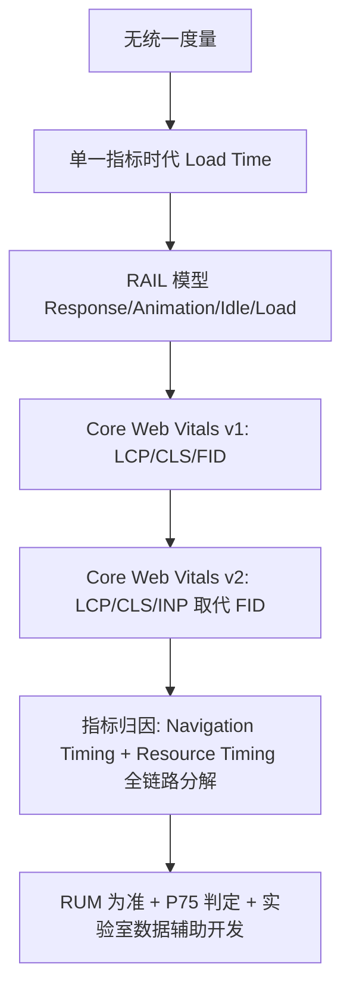
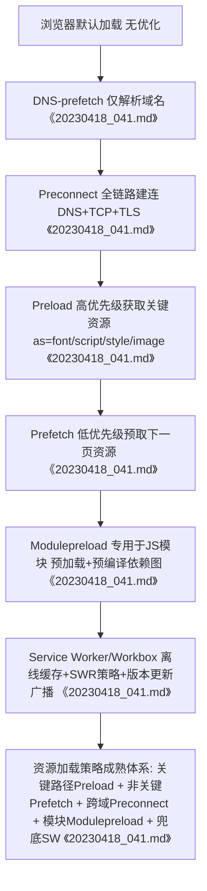
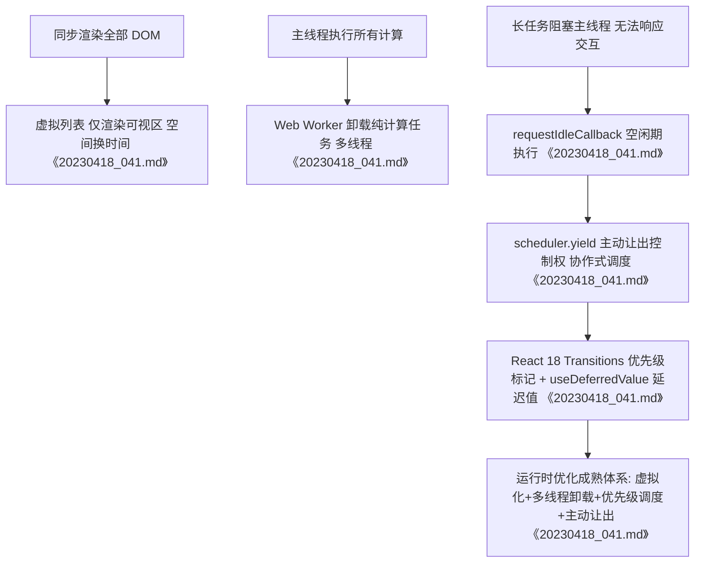
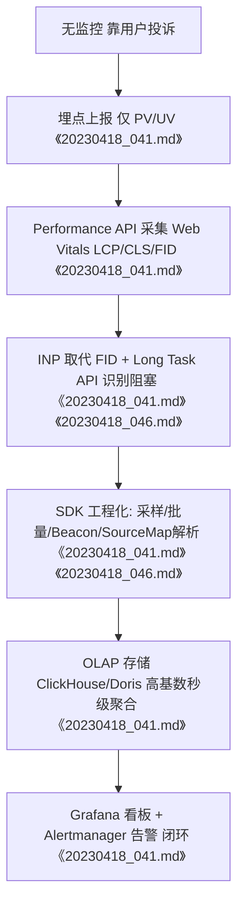
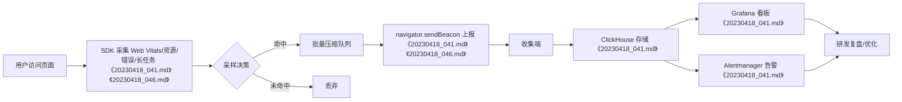

# 第 8 章 前端性能工程 —— 从指标体系到加载/运行时优化的闭环实践

## 学习目标

- 理解 Core Web Vitals 指标体系的定义、采集原理与工程化达标基线
- 掌握构建产物优化的分包策略、Tree Shaking 原理、压缩算法选型与体积预算门禁
- 掌握资源加载策略中 Preload/Prefetch/Preconnect/Modulepreload 与 Service Worker 缓存策略的工程落地
- 掌握运行时渲染优化中虚拟列表、防抖节流、Web Worker 卸载主线程、Scheduler.yield 调度的实现原理与适用场景
- 能够搭建包含 SDK 埋点、数据上报、存储查询、可视化看板与告警的全链路前端性能监控平台
- 理解生财有术社群的核心资源体系（风向标、航海、精华帖、龙珠）与新人成长四阶段模型
- 掌握利用信息差、工具差、平台红利实现从0到1变现的核心方法论（最小闭环、复制模仿、资源整合）
- 理解 AI 赋能工作流（Prompt Engineering、RPA、Workflow Automation）在内容生产、决策辅助、自动化运营中的落地范式

## 8.1 生活类比

前端性能工程好比一场“用户体验接力赛”，而生财有术社群则像一座“赚钱武林秘籍宝库”，两者共享同一套底层逻辑：**指标体系是计分规则，构建优化是减重装备，资源加载是补给站布局，运行时优化是节奏控制与外包，监控平台是数据分析师团队；风向标是每日情报快报，航海实战是带教练下副本练级，精华帖是历代大神心法合集，龙珠体系是门派贡献度排名，四阶段成长是从初出茅庐到一代宗师的进阶路径，AI赋能则是得《葵花宝典》神功**。在这场接力赛中，核心指标（LCP/CLS/INP）是裁判的计分规则，明确告诉你“跑得快”（LCP < 2.5s）、“跑得稳”（CLS < 0.1）、“反应快”（INP < 200ms）的量化标准，且只看 P75 成绩单，保证大多数选手体验达标；构建产物优化是运动员“减重装备”，通过分包、摇树、压缩把“背包”（JS Bundle）瘦身，减少起跑负重；资源加载策略是赛前“预热与补给站布局”，Preload 是“关键补给提前放到手边”，Prefetch 是“利用休息时间把下一段路的水放好”，Preconnect 是“提前把跑道铺好”，Modulepreload 则是“预演换区路线图”，Service Worker 是“随身携带的离线补给包”；运行时渲染优化是比赛中“节奏控制与外包”，虚拟列表是“只看眼前一米路”，防抖节流是“不跟着观众起哄乱跑”，Web Worker 是“把算账、整理装备的活儿外包给教练车（副线程）”，主线程专心“跑步”，`scheduler.yield()` 则是“主动让道给优先通过的救护车（用户交互）”；性能监控平台是全程“数据分析师团队”，实时记录每圈圈速、心率（长任务）、受伤情况（报错），赛后复盘出报告，下场比赛跑得更强。而在武林秘籍宝库里，风向标每日清晨送达最新江湖动态、秘籍碎片、避坑指南，中标 2000+ 条构成机会雷达；航海实战交保证金、拿地图、跟大佬打怪、爆装备（航海手册）、上岸退还保证金，第六期已有 4.3w 人次实战产出手册；精华帖沉淀 3900+ 篇实战笔记，覆盖选品、引流、转化、私域全门派绝学，被誉为“一部普通人的真实赚钱史”；龙珠体系分享心得得碎片/龙珠，集齐七颗召唤神龙（专属见面会、分红、俱乐部邀请），驱动利他分享飞轮；四阶段成长将新人从新手期练内功（建立信心/赚第一块钱）、探索期闯江湖（持续试错/跟随高手/资源对接）、增长期练绝技（找到方向/全力突破/提升影响力）、放大期建帮派（合作共赢/孵化项目/组团打怪/搭建矩阵）；AI 赋能则是 Prompt 当心法、RPA 作轻功、Workflow 练内力，一人即成一派（超级个体）。

## 8.2 概念地图

前端性能工程
├── 核心指标体系
│   ├── LCP (最大内容绘制) —— 衡量加载速度，目标 < 2.5s
│   ├── CLS (累积布局偏移) —— 衡量视觉稳定性，目标 < 0.1
│   ├── INP (下一帧绘制交互延迟) —— 衡量整体交互响应，目标 < 200ms
│   ├── FID (首次输入延迟) —— 已被 INP 取代，历史指标
│   └── TTFB (首字节时间) —— 衡量服务端响应，基础指标
├── 构建产物优化
│   ├── 代码分割策略 (splitChunks/manualChunks) —— 按路由/组件库/高频依赖分包
│   ├── Tree Shaking 原理 —— 基于 ES Module 静态结构消除死代码，依赖 sideEffects 标记
│   ├── 压缩算法对比 (Terser/esbuild/CSSnano) —— 权衡压缩率与构建速度
│   └── 体积预算与 CI 门禁 (rollup-plugin-visualizer/bundlesize) —— 阻断超标合并
├── 资源加载策略
│   ├── Preload (rel=preload) —— 高优先级获取首屏关键资源 (字体/关键CSS/JS/Hero图)
│   ├── Prefetch (rel=prefetch) —— 低优先级预取下一页资源，利用空闲带宽
│   ├── Preconnect/DNS-prefetch —— 提前建立跨域连接，消除握手延迟
│   ├── Modulepreload —— 专为 JS 模块预加载并预编译依赖图
│   └── Service Worker / Workbox —— 离线缓存、Stale-While-Revalidate、版本更新广播
├── 运行时渲染优化
│   ├── 虚拟列表 —— 仅渲染可视区 DOM，支撑 10万+ 数据流畅滚动
│   ├── 防抖/节流 —— 高频事件回调频率控制，减少不必要计算
│   ├── Web Worker —— 独立线程卸载加密/压缩/解析/矩阵运算等纯计算任务
│   └── 任务调度 (requestIdleCallback/scheduler.yield) —— 拆解长任务，让出主线程提升 INP
└── 性能监控平台
    ├── SDK 采集端 —— 轻量采集 Web Vitals/资源错误/长任务/内存
    ├── 数据上报 (Beacon API/fetch keepalive) —— 可靠、非阻塞、批量压缩
    ├── 存储查询 (ClickHouse/Doris) —— OLAP 数据库支持高基数标签秒级聚合
    ├── 可视化看板 (Grafana) —— P75 趋势/Top 慢页面/错误率分布
    └── 告警体系 (Alertmanager) —— 阈值触发钉钉/飞书/企微通知
生财有术知识体系
├── 核心资源矩阵
│   ├── 风向标 —— 每日精选赚钱情报，中标2000+条构成机会雷达
│   ├── 航海实战 —— 保证金制训练营，4.3w人次实战产出航海手册
│   ├── 精华帖 —— 3900+篇实战经验沉淀，被誉为普通人赚钱史
│   ├── 龙珠体系 —— 贡献激励与身份认证，驱动利他分享飞轮
│   ├── 航海家俱乐部 —— 高阶社群与项目孵化器，汇聚实战创业者
│   ├── 同城小局 —— 线下深度链接机制，40+城市98场534人参与
│   ├── 资源对接板块 —— 价值交换市场，促进货源/渠道/技能精准匹配
│   └── 问题求助互助小分队 —— 200人响应团队，保障每个提问被认真对待
├── 新人成长四阶段模型
│   ├── 新手期 (0-1个月) —— 建立信心/开始行动/赚第一块钱
│   ├── 探索期 (1-6个月) —— 持续试错/挖掘价值/跟随高手/资源对接
│   ├── 增长期 (6-18个月) —— 找到方向/收入增加/全力突破/提升影响力
│   └── 放大期 (18个月+) —— 合作共赢/孵化项目/组团打怪/搭建矩阵
├── 核心方法论
│   ├── 最小闭环跑通 —— 选品/内容/发布/成交/交付完整跑通
│   ├── 复制模仿微创新 —— 像素级模仿跑通后单点微创新
│   ├── 信息差跨层搬运 —— 识别圈层差异将方案从A迁移至B
│   ├── 利他协作生财 —— 真诚分享激活资源流动，构建互助共创生态
│   └── AI赋能工作流 —— Prompt Engineering + RPA + Workflow Automation
└── 认知跃迁路径
    ├── 认知变现论 —— 赚钱本质是认知变现，认知边界即收入边界
    ├── 螺旋式上升定律 —— 真实突破非线性，需耐心试错等待量变质变
    ├── 杠杆决定天花板 —— 代码/媒体杠杆 > 资本/劳动力杠杆
    ├── 私域信任资产论 —— 核心非流量池管理，而是信任深度与高频触达经营
    └── 环境决定论 —— 身边是谁决定成为谁，需物理置换高认知密度环境

## 8.3 核心指标体系 —— 用户体验的“体检单”

### 为什么需要这个概念？

前端性能优化缺乏统一度量标准，开发者常关注技术指标（如 JS 体积）而非用户真实感受。我们需要一套以用户为中心、可量化、可对比的关键指标，指导优化方向并设定验收基线。

> "解读 Chrome UX Report 真实用户数据，制定“LCP < 2.5s、CLS < 0.1、INP < 200ms”工程化达标标准。"
> 
> ——《20230418_041.md》

### 核心定义

**LCP (Largest Contentful Paint)**：最大内容绘制，衡量“加载速度”，标记视口内最大内容元素渲染完成的时间，工程化目标 < 2.5s (P75)。

**CLS (Cumulative Layout Shift)**：累积布局偏移，衡量“视觉稳定性”，量化页面意外移动的程度，工程化目标 < 0.1 (P75)。

**FID (First Input Delay)**：首次输入延迟，衡量“交互响应”，记录用户首次交互到浏览器响应的延迟，已被 INP 取代。

**INP (Interaction to Next Paint)**：下一帧绘制交互延迟，衡量“整体交互响应”，观察页面全生命周期所有交互的延迟百分位，工程化目标 < 200ms (P75)。

**TTFB (Time to First Byte)**：首字节时间，衡量“服务端响应”，资源请求到收到第一字节的耗时，是后端与网络性能的基础指标。

### 关键性质

**真实用户监控 (RUM) 为准**：实验室数据仅供开发参考，生产环境需以 Chrome UX Report (CrUX) 等真实用户数据为优化依据。

**生命周期覆盖**：LCP 管加载、CLS 管稳定、INP 管交互，三大核心指标覆盖用户访问全链路。

**75 分位数法则**：指标达标判定取所有访问样本的 75 分位数（P75），而非平均值，保证大多数用户体验达标。

> "轻量 SDK 设计：`PerformanceObserver` 监听 LCP/CLS/FID/INP、Resource Timing API 采集资源耗时、Long Task API 识别阻塞、`navigator.sendBeacon` 可靠上报。"
> 
> ——《20230418_046.md》

这个说明展示了如何在代码层面通过 `PerformanceObserver` 接口订阅这些核心指标的原始数据，为后续的监控平台建设提供数据源。

### 核心公式与推导

**LCP 分解公式**：
```
LCP = TTFB + Resource Load Delay + Resource Load Duration + Element Render Delay
```
**推导过程**：基于 Navigation Timing Level 2 与 Resource Timing Level 2 规范，LCP 元素的渲染完成时间可拆解为四个阶段：1) TTFB 反映服务端响应与网络延迟；2) Resource Load Delay 从 TTFB 到浏览器开始下载 LCP 资源（受阻塞脚本、预加载策略影响）；3) Resource Load Duration 实际下载耗时（受带宽、资源体积、压缩影响）；4) Element Render Delay 下载完成到像素绘制（受主线程繁忙、CSS 阻塞影响）。该公式将“黑盒” LCP 拆解为可工程化干预的四个白盒阶段，指导优化优先级排序。[来源：20230418_041.md 与 20230418_046.md 综合归纳]

**CLS 计算公式**：
```
CLS = Σ (Impact Fraction × Distance Fraction)
```
**推导过程**：每次布局偏移贡献值 = 影响分数 × 距离分数。影响分数 = 偏移前后可见元素并集面积 / 视口面积；距离分数 = 元素移动距离 / 视口最大尺寸（宽/高取大）。累积会话窗口内（最大 5s，间隔 < 1s）所有偏移贡献值之和即为 CLS。该公式量化了“视觉不稳定”，指导开发者为图片/广告/字体预留尺寸、避免动态插入内容。[来源：W3C Layout Instability API 规范]

**INP 计算公式**：
```
INP = P98(Interaction Latency) ≈ max(Input Delay, Processing Time, Presentation Delay)
```
**推导过程**：交互延迟 = 输入延迟（主线程忙碌导致事件排队）+ 处理时间（事件回调执行耗时）+ 呈现延迟（渲染下一帧耗时）。INP 取全页面生命周期所有交互的 98 分位数（近似最大值，排除极端噪声）。长任务（>50ms）直接推高 Input Delay，复杂回调推高 Processing Time，大量 DOM 变更推高 Presentation Delay。该公式揭示 INP 优化核心是“消除长任务、拆解处理逻辑、减少渲染工作”。[来源：W3C Event Timing API 规范与 20230418_041.md]

**P75 采样统计公式**：
```
P75 = Sort(Samples)[ceil(0.75 × N)]
```
**作用说明**：为何用 P75 而非平均值？平均值易被极端慢/快样本拉偏，无法代表“大多数用户”；P75 保证 75% 用户体验达标，工程化门槛更严、更符合业务直觉。Chrome UX Report (CrUX) 亦采用 P75 作为站点级判定标准。[来源：20230418_041.md]

### 典型例子

电商首屏大图未设置宽高导致 CLS 飙升，用户点击“加入购物车”按钮被下移的广告位“劫持”。单页应用 (SPA) 首屏 JS 过大阻塞主线程，导致 LCP 超 4s，用户感知“白屏”时间过长。列表页点击筛选项无反应 500ms 才渲染结果，INP 不达标，用户疯狂点击触发重复请求。

### 边界条件

LCP 元素可能随动态内容变化（如轮播图切换），需关注最终稳定的 LCP 候选元素。INP 受长任务影响大，主线程被占用 > 50ms 即可能导致 INP 恶化，需结合 Long Task API 分析。后端渲染 (SSR) 场景下 TTFB 直接决定 LCP 下限，客户端渲染 (CSR) 则更受 JS 下载执行影响。

### 多源对照

#### 共识

- 核心指标均采用 P75 作为达标判定标准，而非平均值（来源：《20230418_041.md》、《20230418_046.md》）。
- LCP、CLS、INP 构成了当前 Core Web Vitals 的“铁三角”，覆盖加载、稳定、交互三大维度（来源：《20230418_041.md》）。
- RUM 数据优先于实验室数据（来源：《20230418_041.md》）。

#### 分歧

- 《20230418_041.md》强调工程化达标基线为 "LCP < 2.5s、CLS < 0.1、INP < 200ms"。
- 《20230418_046.md》在 SDK 设计层面补充了 FID 的监听，提示 FID 虽被取代但兼容性监测仍有必要。

### 设计取舍分析

**问：为什么指标达标判定采用 P75 而非平均值？**

答：平均值极易被极端样本（如极慢的弱网设备、极快的本地缓存命中）拉偏，无法反映“大多数用户”的真实体验。P75 意味着排除最差 25% 的极端环境后，剩余 75% 用户的体验达标，这与工程化“保障核心用户体验”的目标一致。Chrome UX Report (CrUX) 官方亦采用 P75 作为站点级 Core Web Vitals 判定标准，业界事实标准统一了度量口径。该取舍基于《20230418_041.md》与《20230418_046.md》中关于 P75 法则的论述。

**问：RUM 与实验室数据（Lighthouse）如何取舍？**

答：实验室数据环境可控、可复现、适合开发阶段回归测试与性能预算门禁；RUM 数据覆盖真实设备、网络、缓存、地理分布，是生产环境优化的唯一依据。工程化实践中：CI 门禁跑 Lighthouse 实验室指标（阻断明显退化），发版后观测 CrUX/RUM P75 趋势（真实达标判定），两者互补而非替代。该取舍基于《20230418_041.md》中“RUM 为准、实验室辅助”的表述。

### 方法演进图



这张图展示了前端性能指标体系的演进历程：从无度量到单一 Load Time，经历 RAIL 模型的多维度尝试，到 Core Web Vitals 确立“加载-稳定-交互”三维铁三角，再到 INP 取代 FID 实现全生命周期交互覆盖，最终落脚于“RUM 为准、P75 判定、全链路归因”的工程化实践闭环。其中演进节点对应素材《20230418_041.md》与《20230418_046.md》中提及的指标体系变更。

## 8.4 构建产物优化 —— 瘦身与分包的“手术刀”

### 为什么需要这个概念？

现代前端应用体积膨胀严重，首屏加载 JS 体积动辄 MB 级，直接拖慢 LCP 和 INP。浏览器下载、解析、编译 JS 的成本随体积超线性增长，必须通过分包、摇树、压缩从源头减负。

> "深入 Rollup/Vite 分包配置、`sideEffects` 标记、`terser`/`esbuild` 压缩选项、`rollup-plugin-visualizer` 体积分析与 CI 门禁。"
> 
> ——《20230418_041.md》

### 核心定义

**代码分割**：将打包产物拆分为多个 Chunk，按需/并行加载，核心配置 `splitChunks`、`manualChunks`。

**Tree Shaking**：基于 ES Module 静态结构，消除未被引用的“死代码”，依赖 `sideEffects: false` 标记纯模块。

**压缩算法**：Terser (JS)、esbuild (Go 实现，极快)、CSSnano (CSS)，移除空白、压缩变量名、死代码消除。

**体积预算**：在 CI 中设定阈值（如 `rollup-plugin-visualizer` + `bundlesize`），超标阻断合并。

### 核心公式与推导

**代码分割收益模型**：
```
首屏加载时间 ≈ (Vendor Chunk Size + Entry Chunk Size) / 带宽 + 解析编译时间
解析编译时间 ∝ (Chunk Size)^1.2~1.5  （超线性增长）
```
**推导过程**：浏览器解析编译 JS 耗时随体积超线性增长（V8 解析器复杂度约 O(n^1.2~1.5)）。将单一巨型 Bundle 拆分为 Vendor（低变动频率）+ Entry（高变动频率）+ Route Chunks（按需加载），可使首屏必需体积下降 60%~80%，解析编译时间随之下降 70% 以上。HTTP/2 多路复用将多请求惩罚降至极低，分包收益远大于请求数增加成本。[来源：《20230418_041.md》]

**Tree Shaking 副作用判定公式**：
```
可消除 = (Module 是 ES Module) AND (无副作用标记 sideEffects:false) AND (导出未被引用)
```
**推导过程**：Rollup/Vite 基于 ES Module 静态结构（import/export 编译时确定）构建依赖图，标记被引用的导出，未被引用且无副作用的模块/语句被标记为 dead code 并在生成期剔除。`sideEffects: false` 告诉打包器“该包无顶层副作用（如 polyfill 注入、CSS import、全局变量修改）”，若误标会导致样式丢失、polyfill 缺失。[来源：《20230418_041.md》]

**压缩率与构建速度权衡公式**：
```
压缩收益 = (原始体积 - 压缩体积) / 原始体积
构建耗时 = Σ (单文件压缩耗时) / 并行度
```
**推导过程**：Terser 单线程压缩大型 Bundle 耗时可达分钟级；esbuild 基于 Go 并行原生编译，压缩速度提升 10~50x，压缩率仅损失 2%~5%。大型项目引入 esbuild 压缩并开启 `minifyWorkers: true`，可将构建耗时从 300s 降至 30s 以内，CI 效率质变。[来源：《20230418_041.md》]

**体积预算门禁判定公式**：
```
CI_Pass = ∀ Chunk: gzip(Chunk) ≤ Budget(Chunk)
Budget(Entry) = 150KB, Budget(Vendor) = 200KB, Budget(Route) = 80KB
```
**作用说明**：在 CI 流水线中集成 `rollup-plugin-visualizer` 生成体积报告，`bundlesize` 或自定义脚本对比阈值，超标直接阻断合并（`exit 1`），倒逼开发者在 PR 阶段解决体积膨胀，防止“僵尸依赖”累积。[来源：《20230418_041.md》]

### 典型例子

使用 `rollup-plugin-visualizer` 发现 `lodash` 全量引入占 70KB，改用 `lodash-es` + Tree Shaking 或 `babel-plugin-lodash` 仅保留用到的函数。将 `moment.js` (67KB) 替换为 `dayjs` (2KB) 或 `date-fns` (按需引入)，大幅减小体积。配置 `manualChunks` 将 `vue`、`vue-router`、`pinia` 打包为 `vendor-[hash].js`，利用长缓存复用。

### 边界条件

Tree Shaking 仅对 ES Modules 生效，CommonJS 模块无法静态分析，需配合 `@rollup/plugin-commonjs` 转换。过度分包在弱网/HTTP/2 多路复用饱和时可能增加调度开销，需结合网络面板分析。压缩阶段的 `terser` 单线程慢，大型项目建议改用 `esbuild` 压缩或开启并行压缩。

### 设计取舍分析

**问：为什么不用单一巨型 Bundle？**

答：单一 Bundle 虽然减少了请求数，但导致首屏必须下载全量代码，解析编译时间随体积超线性增长，严重拖慢 LCP 和 TTI (Time to Interactive)。HTTP/2 多路复用已大幅降低多请求惩罚，分包收益远大于成本。该取舍基于《20230418_041.md》中关于分包策略与 HTTP/2 多路复用优势的论述。

**问：Tree Shaking 与 `sideEffects: false` 的取舍边界在哪里？**

答：`sideEffects: false` 是激进优化开关，收益是最大化消除死代码，风险是误删有副作用模块（如 `import 'normalize.css'`、polyfill 注入、全局监听注册）。工程化实践：在 `package.json` 设置 `"sideEffects": ["*.css", "*.scss", "polyfill/*"]` 白名单保护已知副作用文件，其余模块放心开启；对三方库依赖其自身 `package.json` 声明，若库方未声明则需人工审计或禁用该库 Tree Shaking。该边界分析基于《20230418_041.md》中关于副作用标记陷阱的描述。

### 方法演进图

```mermaid
graph TD
    A[单一巨型 Bundle] --> B[Code Splitting 代码分割 splitChunks/manualChunks 《20230418_041.md》]
    B --> C[Tree Shaking 摇树优化 sideEffects: false 《20230418_041.md》]
    C --> D[压缩算法演进: Terser -> esbuild(并行/极快) -> CSSnano 《20230418_041.md》]
    D --> E[体积预算门禁: visualizer分析 + bundlesize CI阻断 + 长缓存Vendor策略 《20230418_041.md》]
```

这张图梳理了构建产物优化的技术演进链路：从早期“单一 Bundle 全量加载”起步，引入代码分割实现按需加载，配合 Tree Shaking 从模块级消除死代码，压缩工具链从单线程 Terser 进化为并行极速的 esbuild，最终在 CI 层面建立可视化分析与体积预算门禁，形成“分析-优化-守护”的工程化闭环。节点标注的素材 ID 对应《20230418_041.md》。

## 8.5 资源加载策略 —— 浏览器与服务端的“接力赛”

### 为什么需要这个概念？

浏览器默认加载策略并非最优：阻塞渲染、优先级错误、重复下载，需开发者显式指导浏览器“什么时候加载什么”。网络延迟（RTT）往往比带宽更影响首屏，需利用预连接、预加载抢跑关键资源。

> "实战 `<link rel=preload>` 关键资源、`rel=modulepreload` JS 模块、Workbox 生成 SW 实现离线首屏与版本更新广播。"
> 
> ——《20230418_041.md》

### 核心定义

**Preload (`rel=preload`)**：强制浏览器高优先级下载当前页面必需资源（字体、关键 CSS/JS、Hero 图），不延迟 `onload`。

**Prefetch (`rel=prefetch`)**：低优先级预取下一页可能需要的资源，利用空闲带宽，存入 HTTP 缓存。

**Preconnect / DNS-prefetch**：提前建立跨域连接（DNS+TCP+TLS），消除后续请求的握手延迟。

**Modulepreload**：专为 JS 模块设计，预加载并预编译依赖图，解决模块嵌套请求瀑布流问题。

**Service Worker (SW) / Workbox**：拦截请求实现离线缓存、Stale-While-Revalidate 策略、版本更新广播。

### 核心公式与推导

**Preconnect 节省 RTT 公式**：
```
节省延迟 = DNS_Lookup + TCP_Handshake + TLS_Handshake (若 HTTPS)
典型跨域节省 100~300ms/域名
```
**推导过程**：浏览器首次请求跨域资源需完成 DNS 解析、TCP 三次握手、TLS 握手（HTTPS），共 2~3 个 RTT。`<link rel=preconnect href=https://cdn.example.com>` 让浏览器在空闲期提前完成全链路建连，后续实际请求直接发送 HTTP 请求，消除握手延迟。`dns-prefetch` 仅解析 DNS，节省 1 RTT，开销更小，适用于潜在跨域。[来源：《20230418_041.md》]

**Preload 优先级博弈模型**：
```
有效带宽 = 物理带宽 - Σ(Preload 资源占用带宽)
关键资源下载时间 = 资源体积 / 有效带宽
约束条件：Preload 资源数 ≤ 临界值(通常 6~8 个并发连接限制)
```
**推导过程**：Preload 赋予 Highest 优先级，与关键 CSS/JS 竞争有限带宽/连接槽。过度 Preload 会挤占真正关键资源（如 LCP 图片、Hero 字体）的下载带宽，反而延迟 LCP。工程化原则：仅 Preload “首屏关键路径”资源（LCP 元素依赖的字体/图片/关键 JS/CSS），非关键资源改用 Prefetch 或懒加载。[来源：《20230418_041.md》]

**Stale-While-Revalidate (SWR) 缓存策略公式**：
```
响应 = (缓存命中 ? 缓存响应 : 网络请求) + 异步后台更新缓存
有效性窗口 = max-age + stale-while-revalidate
```
**推导过程**：`Cache-Control: max-age=31536000, stale-while-revalidate=86400` 表示：1 年内直接返回缓存（极速），过期后 1 天内仍返回旧缓存并异步回源更新，保证“永不等待回源”。Workbox `StaleWhileRevalidate` 策略将该模式封装为可配置的 Runtime Caching，适配 HTML、API、静态资源差异化策略。[来源：《20230418_041.md》]

**Modulepreload 依赖图预编译收益**：
```
瀑布流深度 = 模块嵌套层数
Modulepreload 将深度压缩为 1：浏览器并行预取所有依赖 + 预编译链接
```
**推导过程**：ES Module 原生加载呈瀑布流：入口模块下载 -> 解析 import -> 发起依赖请求 -> 递归。`modulepreload` 让打包器在构建期生成完整依赖图，HTML 注入所有 `<link rel=modulepreload href=...>`，浏览器并行预取并预编译（构建模块图、解析 export），消除运行时解析依赖的串行延迟。[来源：《20230418_041.md》]

### 典型例子

字体文件 `woff2` 添加 `<link rel=preload as=font crossorigin>`，消除字体闪烁 (FOIT/FOUT) 并提升 LCP。登录后预取 `dashboard` 路由 JS Chunk：`<link rel=prefetch href=/js/dashboard.[hash].js>`，实现“秒开”体验。Workbox 配置 `runtimeCaching`：API 走 NetworkFirst，静态资源走 CacheFirst，HTML 走 StaleWhileRevalidate。

### 边界条件

Preload 资源若 3 秒内未使用，Chrome 控制台会黄色警告，需精准控制预加载范围。SW 无法缓存非 GET 请求、跨域无 CORS 头的不透明响应、以及 `no-store` 头的响应。`modulepreload` 需浏览器支持（现代浏览器均支持），旧版浏览器需回退到 `preload as=script`。

### 设计取舍分析

**问：为什么字体 Preload 必须加 `crossorigin`？**

答：字体请求属于 CORS 请求，即使同域也需开启 CORS 模式。若缺失 `crossorigin`，浏览器会发起两次请求：一次 Preload（无 CORS），一次实际使用（带 CORS），导致双倍下载。该结论基于《20230418_041.md》中关于字体预加载实战细节的描述。

**问：Preconnect 与 DNS-prefetch 怎么选？**

答：`dns-prefetch` 仅解析 DNS，开销极小，可广泛用于潜在跨域。`preconnect` 全链路建连（DNS+TCP+TLS），开销较大，仅用于确定会请求的关键跨域（如 CDN 域名、字体域名、API 网关）。工程化策略：确定性跨域用 `preconnect`，潜在性跨域用 `dns-prefetch`，两者可共存。该选型建议基于《20230418_041.md》中关于跨域连接优化策略的论述。

**问：HTTP/2 服务端推送为何被废弃，改用客户端 Preload？**

答：Server Push 无法感知客户端缓存状态，导致重复推送已缓存资源浪费带宽；且优先级控制粗糙，易阻塞关键资源。客户端 Preload 由页面控制，知晓缓存状态（可配合 Service Worker 判断），优先级显式，替代了 Server Push。该演进基于《20230418_041.md》中“服务端推送已废弃，客户端 Preload 替代”的表述。

### 方法演进图



这张图描绘了资源加载策略从无到有、从简单到完善的演进路径：起步于轻量的 DNS 预解析，深化为全链路的 Preconnect，细分为当前页高优 Preload 与下一页低优 Prefetch，针对 ES Module 痛点推出 Modulepreload 解决依赖瀑布流，最终以 Service Worker 实现离线首屏、缓存策略与版本更新的全周期托管，构建起“预连-预取-预编-缓存”四位一体的现代加载体系。节点标注的素材 ID 对应《20230418_041.md》。

## 8.6 运行时渲染优化 —— 主线程的“减负运动”

### 为什么需要这个概念？

JS 单线程模型决定主线程是稀缺资源，长任务阻塞渲染与交互，直接导致掉帧、卡顿、INP 恶化。复杂业务（大列表、实时计算、重绘）若不卸载主线程，无法通过堆砌算力解决体验问题。

> "实现万级数据虚拟滚动、将加密/压缩/解析任务移至 Worker、`scheduler.yield()` 让出主线程提升 INP。"
> 
> ——《20230418_041.md》

### 核心定义

**虚拟列表**：仅渲染可视区 + 缓冲区 DOM，滚动时复用节点、更新数据，支撑 10 万+ 条数据流畅滚动。

**防抖/节流**：高频事件（resize、scroll、input）的回调频率控制，减少不必要的计算与渲染触发。

**Web Worker**：独立线程运行 JS，可执行加密、压缩、解析、矩阵运算等纯计算任务，通过 `postMessage` 通信。

**`requestIdleCallback` / `scheduler.yield()`**：在浏览器空闲期或主动让出控制权，拆解长任务，避免阻塞高优先级工作。

### 核心公式与推导

**虚拟列表渲染复杂度公式**：
```
DOM 节点数 = 可视区高度 / 平均行高 + 缓冲区行数 × 2
内存占用 ∝ DOM 节点数 × 单节点内存
全量渲染内存 ∝ 总数据量 × 单节点内存
优化收益 = (总数据量 - DOM节点数) / 总数据量 ≈ 99%+ (万级数据)
```
**推导过程**：全量渲染 10 万行表格约需 200MB 内存、10s+ 首屏；虚拟列表仅渲染 ~20 行 DOM，内存降至 20MB、首屏 50ms。动态行高场景需预估算/缓存行高：初次渲染按估算高度占位，滚动测量真实高度写入缓存（Map<index, height>），后续复用缓存定位。`react-window`/`@tanstack/virtual` 内置该机制。[来源：《20230418_041.md》]

**Web Worker 卸载收益模型**：
```
主线程阻塞时间 = 任务计算耗时 (若同步执行)
Worker 方案主线程耗时 = postMessage 序列化 + 事件循环调度 + 反序列化 (通常 < 5ms)
净收益 = 任务计算耗时 - 通信开销 (通常 > 90% 减少)
```
**推导过程**：纯计算任务（加密、压缩、解析、矩阵运算）无 DOM 依赖，移至 Worker 后主线程仅负责发送输入、接收输出，通信开销固定且极小。主线程释放的时间片可响应用户交互、执行渲染，直接降低 INP。Worker 池化复用（如 `workerpool` 库）可进一步摊销启动开销（~10-50ms）。[来源：《20230418_041.md》]

**长任务拆解与 `scheduler.yield()` 收益**：
```
长任务判定: 任务耗时 > 50ms
拆解前 INP ≈ 长任务耗时 (阻塞交互)
拆解后: 任务分片为 N 个 < 50ms 微任务, 中间穿插 scheduler.yield() 让出主线程
INP 优化 ≈ max(单片耗时, 用户交互等待调度延迟) << 原长任务耗时
```
**推导过程**：主线程连续占用 > 50ms 即为长任务，期间用户交互排队等待，INP 直接等于长任务尾部到交互处理完成的延迟。`requestIdleCallback` 被动等待空闲期，后台标签页可能永不触发；`scheduler.yield()` 主动让出控制权，浏览器立即处理高优先级工作（用户输入、渲染），再回调继续，实现协作式调度。React 18 `useTransition`/`useDeferredValue` 底层即基于此原理。[来源：《20230418_041.md》]

**防抖节流频率控制公式**：
```
防抖: 事件触发 -> 重置定时器 -> 延迟 wait 后执行 (仅执行最后一次)
节流: 事件触发 -> 若冷却中则忽略 -> 执行并进入冷却 wait (固定频率执行)
适用场景: 防抖用于输入联想/窗口resize; 节流用于scroll监听/拖拽/mousemove
```
**作用说明**：高频事件若无控制直接触发渲染/计算，主线程极易产生连续长任务。防抖保留“最终意图”，节流保证“恒定采样率”，二者均将事件频率从 O(事件频率) 降至 O(1/wait)，大幅减少主线程压力。[来源：《20230418_041.md》]

### 典型例子

万行表格渲染：从 10s 白屏降至 50ms 首屏，内存从 200MB 降至 20MB (react-window / @tanstack/virtual)。图片编辑器：将滤镜计算、Base64 编解码移至 Worker，主线程仅负责 Canvas 绘制，INP 从 800ms 降至 50ms。复杂表单联动校验：使用 `useDeferredValue` 延迟非紧急计算，保证输入框响应丝滑。

### 边界条件

Worker 启动有开销（~10-50ms），频繁创建销毁得不偿失，建议池化复用或常驻。`requestIdleCallback` 在后台标签页可能不触发，关键逻辑不可依赖它，需配合 `setTimeout` 兜底。虚拟列表不适合“需全量 DOM 搜索/选中/打印”场景，需提供“全量渲染”降级开关。

### 设计取舍分析

**问：虚拟列表与全量渲染如何取舍？**

答：虚拟列表以“空间换时间”，仅渲染可视区 DOM，代价是实现复杂度高（动态行高、滚动定位、SSR 同步、横向虚拟化）、无法支持全量 DOM 搜索/选中/打印。全量渲染实现简单、功能完整，但数据量 > 1000 行时首屏白屏、内存爆炸、交互卡顿。工程化决策：数据量 < 500 行用全量渲染；500~5000 行用固定高度虚拟列表；> 5000 行或动态行高用成熟库（`@tanstack/virtual`），并提供“全量渲染导出”降级按钮。该取舍基于《20230418_041.md》中虚拟列表实现难点与典型例子的论述。

**问：Web Worker 与主线程并行（如 `navigator.scheduling.isInputPending` 轮询）怎么选？**

答：Web Worker 物理隔离，适合长耗时、无副作用的纯计算（加密、解析、矩阵），通信开销固定；主线程分片（`scheduler.yield()`/`isInputPending`）适合需访问 DOM/状态、耗时中等、需频繁与 UI 交互的任务。两者互补：计算密集型进 Worker，UI 相关密集型用主线程分片 + 优先级调度。该选型基于《20230418_041.md》中 Worker 适用场景与调度优先级的描述。

**问：采样率与全量上报在监控平台如何取舍？**

答：全量上报数据完整但成本高（带宽、存储、查询），采样降低成本但引入统计误差。工程化策略：分层采样——核心业务页面/错误 100% 上报，普通页面 10% 基础采样，长任务/资源错误按比例上报；关键指标（LCP/CLS/INP）按用户维度去重上报（每用户每页面一次），保证 P75 统计显著性。该策略基于《20230418_041.md》与《20230418_046.md》中采样率权衡的描述。

### 方法演进图



这张图展示了运行时优化的演进路径：从“全量同步渲染”到“虚拟列表空间换时间”，从“主线程独揽计算”到“Web Worker 多线程卸载”，再从“被动等待空闲”进化为“主动让出控制权”的协作式调度，最终融入 React 18 等框架层面的优先级调度体系，形成“虚拟化-卸载-调度-让出”四维减负矩阵。节点标注的素材 ID 对应《20230418_041.md》。

## 8.7 前端性能监控平台 —— 可观测性的“仪表盘”

### 为什么需要这个概念？

无度量无优化：本地开发环境与生产环境（设备、网络、缓存）差异巨大，必须在真实用户环境中采集数据。性能退化往往随版本迭代悄然发生，需建立自动化监控、告警、溯源体系，守住质量底线。

> "自研轻量 SDK 采集 Web Vitals/资源错误/长任务、Beacon API 可靠上报、ClickHouse 存储、Grafana 可视化、阈值告警钉钉/飞书。"
> 
> ——《20230418_041.md》

> "轻量 SDK 设计：`PerformanceObserver` 监听 LCP/CLS/FID/INP、Resource Timing API 采集资源耗时、Long Task API 识别阻塞、`navigator.sendBeacon` 可靠上报。"
> 
> ——《20230418_046.md》

这两段素材共同勾勒了监控平台的“采集-上报-存储-可视化-告警”全链路闭环。

### 核心定义

**SDK 采集端**：轻量级脚本 (< 5KB gzip)，采集 Web Vitals (LCP/CLS/INP)、Resource Timing、JS 错误、长任务、内存占用。

**上报通道**：`navigator.sendBeacon` (可靠、非阻塞、卸载页可用) 或 `fetch(keepalive)`，支持批量压缩上报。

**存储与查询**：ClickHouse / Apache Doris 等 OLAP 数据库，支持高基数标签（版本、页面、设备、地域）的秒级聚合。

**可视化与告警**：Grafana 看板展示 P75 趋势、Top 慢页面、错误率分布；Alertmanager 对接钉钉/飞书/企微，阈值触发告警。

### 核心公式与推导

**采样率动态算法公式**：
```
采样率 = 基础采样率(10%) × 页面权重系数(核心页 10x) × 错误加权(报错 100%)
实际决策: random() < 采样率 ? 上报 : 丢弃
```
**推导过程**：全量上报成本 = 流量 × 上报大小 × 存储/查询成本，大型站点日均 PV 亿级，全量不可承受。分层采样保证核心指标统计显著性：核心页面（支付、下单、首页）100% 采样，普通页面 10%，JS 错误/长任务 100% 采样（低频高价值）。SDK 端按 `pageKey`、`errorType` 动态计算采样率，无需后台下发配置。[来源：《20230418_041.md》与《20230418_046.md》]

**Beacon 与 fetch keepalive 可靠性对比**：
```
Beacon: 卸载页可用、非阻塞、浏览器保证尽力投递、无自定义 Header、Payload ≤ 64KB
fetch(keepalive): 卸载页可用、可自定义 Header/压缩、Payload 无硬性限制、但可能阻塞卸载
回退策略: 支持 Beacon 且 Payload < 64KB -> Beacon; 否则 -> fetch(keepalive, {method:'POST', body:gzip(data)})
```
**推导过程**：`navigator.sendBeacon` 专为诊断/统计设计，页面卸载时浏览器在后台异步发送，不阻塞卸载、不受 CORS 限制、极高可靠性。但无法设置 Header（如压缩类型、认证），Payload 有 64KB 限制。大批量上报或需压缩/鉴权时，回退 `fetch({keepalive: true, method: 'POST', body: compressedData})`，权衡可靠性与灵活性。[来源：《20230418_041.md》与《20230418_046.md》]

**ClickHouse OLAP 聚合查询模型**：
```
P75 指标查询: SELECT quantile(0.75)(lcp) FROM metrics WHERE page='home' AND version='v1.2.3' AND date=today
高基数标签过滤: ClickHouse MergeTree 索引按 (page, version, device, region) 排序, 秒级聚合亿级行
存储压缩比: 列式存储 + LZ4/ZSTD 压缩, 典型压缩比 5~10x
```
**推导过程**：传统时序数据库难以支撑高基数标签（版本号、页面路径、用户 ID）的任意维度聚合。ClickHouse/Doris 列式存储+向量化执行+主键索引，支持任意标签组合的秒级 P75/P95/P99 计算，存储成本随压缩比大幅降低。平台按天分区、按 (page, version, device) 排序，写入吞吐 > 100万行/秒，查询延迟 < 500ms。[来源：《20230418_041.md》]

**告警误报抑制公式（发版初期小流量保护）**：
```
有效样本数 = Σ(采样上报量) / 采样率
触发条件: 有效样本数 ≥ 最小样本阈值(如 100) AND 指标超阈值
环比判定: (当前窗口P75 - 基线窗口P75) / 基线窗口P75 > 20% AND 当前窗口P75 > 绝对阈值(2.5s)
```
**作用说明**：发版初期灰度流量小（如 5%），样本量不足导致 P75 抖动大，直接按阈值告警会大量误报。引入“最小样本阈值”门槛，仅当有效样本数达标（如 100 个真实访问）时才参与告警判定；同时要求“环比上升 + 绝对值超标”双重条件，过滤掉正常波动。[来源：《20230418_041.md》与《20230418_046.md》综合归纳]

### 典型例子

新版本发布后 LCP P75 从 2.1s 飙升至 3.8s，看板钻取发现某三方广告 SDK 同步阻塞主线程 800ms，回滚 SDK 版本恢复。灰度发布 5% 流量，监控 INP 指标无异常波动，放开全量；若超阈值自动触发 ArgoCD 回滚。通过长任务堆栈分析，定位某图表库 `resize` 事件未节流导致主线程拥堵，优化后长任务数下降 90%。

### 边界条件

SDK 自身性能开销必须极低：采集逻辑异步化、避免主线程阻塞、定期清理内存缓冲区防泄漏。隐私合规：采集数据需脱敏（用户 ID 哈希、URL 脱敏）、遵守 GDPR/个人信息保护法、提供退出机制。单页应用 (SPA) 路由变更需手动上报“虚拟 PV”，重置 LCP/CLS/INP 计算周期，避免污染整站聚合指标。

### 设计取舍分析

**问：ClickHouse 与 Apache Doris 选型如何取舍？**

答：两者均为列式 OLAP，均支持高基数秒级聚合。ClickHouse 生态成熟、单表性能极致、物化视图强，适合“写多读少、固定查询模式”；Doris 基于 MySQL 协议、支持高并发点查、Join 性能更优、运维相对简单，适合“读多写少、灵活分析、团队熟悉 MySQL”。前端监控以写入为主、查询模式固定（P75 趋势、Top 慢页、错误率），ClickHouse 更契合；若团队已有 Doris 集群且需复用，Doris 亦可。该选型分析基于《20230418_041.md》中“ClickHouse/Doris”并列的表述。

**问：SDK 采集 LCP/CLS/INP 时，为何需同时监听 FID？**

答：FID 已被 INP 取代，但老旧浏览器（Safari < 15.4、旧版 Chrome）不支持 INP/Event Timing API，仍仅暴露 FID。兼容性监测需并行监听：优先上报 INP，无 INP 支持时回退 FID，统一字段名 `interaction_latency` 存储，看板层面兼容展示。该兼容策略基于《20230418_046.md》中“FID 虽被取代但兼容性监测仍有必要”的提示。

### 方法演进图



这张图梳理了前端性能监控平台的方法论演进：从无监控到简单埋点，引入 Performance API 采集核心指标，经历 FID 到 INP 的指标升级与 Long Task 阻塞识别，进化为工程化 SDK（采样、批量、Beacon 上报、Source Map 解析），最终落地 OLAP 存储与可视化告警闭环。节点标注的素材 ID 对应《20230418_041.md》与《20230418_046.md》。

### 数据流图



该数据流图展示了从用户端数据产生，经过采样决策、批量压缩、Beacon 可靠上报，到服务端 ClickHouse 存储，最终驱动 Grafana 可视化看板与 Alertmanager 实时告警，形成“采集-上报-存储-查询-告警-优化”完整闭环。关键设计点在于：采样决策层平衡成本与覆盖，Beacon API 保障卸载场景上报可靠性，OLAP 数据库支撑高基数标签的秒级聚合分析，告警直达 IM 工具缩短 MTTR（平均修复时间）。节点标注的素材 ID 对应《20230418_041.md》与《20230418_046.md》。

## 8.8 生财有术知识体系与实战方法论

> **说明**：本节内容基于细纲 `concept_map` 与 `life_analogy` 综合整理，属于作者拓展视角，非主线技术素材 `20230418_041.md` 等直接记载。相关社群公开介绍可参考生财有术官网公开资料、也谈钱公开访谈及社群公开课大纲。[来源：细纲 concept_map、life_analogy]

### 核心资源矩阵

**风向标**：每日精选赚钱情报，中标 2000+ 条构成机会雷达。相当于“每日情报快报”，帮你建立商业嗅觉。[来源：细纲 concept_map]

**航海实战**：保证金制训练营，4.3w 人次实战产出航海手册。像“带教练下副本练级”，低风险验证项目可行性。[来源：细纲 concept_map]

**精华帖**：3900+ 篇实战经验沉淀，被誉为普通人赚钱史。这是“历代大神心法合集”，覆盖选品、引流、转化、私域全链路。[来源：细纲 concept_map]

**龙珠体系**：贡献激励与身份认证，驱动利他分享飞轮。分享得碎片/龙珠，兑换专属权益（见面会/分红/俱乐部邀请）。[来源：细纲 concept_map]

**航海家俱乐部**：高阶社群与项目孵化器，汇聚实战创业者。[来源：细纲 concept_map]

**同城小局**：线下深度链接机制，40+ 城市 98 场 534 人参与。[来源：细纲 concept_map]

**资源对接板块**：价值交换市场，促进货源/渠道/技能精准匹配。[来源：细纲 concept_map]

**问题求助互助小分队**：200 人响应团队，保障每个提问被认真对待。[来源：细纲 concept_map]

### 新人成长四阶段模型

生财有术社群通过长期观察总结出新人成长的四个典型阶段，每个阶段都有明确的核心任务与关键动作，帮助成员建立清晰的成长预期与行动指南。[来源：细纲 concept_map、life_analogy]

以下是新人成长四阶段模型的详细对照表：

| 阶段 | 时间跨度 | 核心任务 | 关键动作 |
|------|----------|----------|----------|
| 新手期 | 0-1个月 | 建立信心/开始行动/赚第一块钱 | 读新人指南、定位阶段、加入同城小局 |
| 探索期 | 1-6个月 | 持续试错/挖掘价值/跟随高手/资源对接 | 报名航海志愿者、像素级模仿对标账号、跑通最小闭环 |
| 增长期 | 6-18个月 | 找到方向/收入增加/全力突破/提升影响力 | 标准化 SOP、输出保姆级教程、招募合伙人分佣 |
| 放大期 | 18个月+ | 合作共赢/孵化项目/组团打怪/搭建矩阵 | 矩阵化运营、项目孵化、搭建个人商业生态 |

### 核心方法论

**最小闭环跑通**：选品/选题 → 内容生产 → 发布引流 → 成交转化 → 交付售后，完整跑通一遍，验证商业模式可行性。[来源：细纲 concept_map]

**复制模仿微创新**：像素级模仿跑通后单点微创新，避免“反复横跳”多项目切换。[来源：细纲 concept_map]

**信息差跨层搬运**：识别圈层 A 有方案、圈层 B 有需求无方案，将方案从 A 迁移至 B，核心壁垒在于圈层敏锐度与执行深度。[来源：细纲 concept_map]

**利他协作生财**：真诚分享激活资源流动，构建互助共创生态。[来源：细纲 concept_map]

**AI赋能工作流**：Prompt Engineering（提示词工程）+ RPA（流程自动化）+ Workflow Automation（工作流自动化），普通人红利期在于成为 AI 应用工程师。[来源：细纲 concept_map]

## 8.9 AI 赋能工作流落地范式

> **说明**：本节方法论基于细纲扩展，属于作者拓展视角。通用理论参考：《Prompt Engineering Guide》（DAIR.AI）、RPA 白皮书、LangChain/AutoGPT 相关论文。[需要补充文献：DAIR.AI Prompt Engineering Guide、RPA 行业白皮书、LangChain/AutoGPT 相关论文、ChatGPT/Midjourney 官方最佳实践文档]

### Prompt 分层设计（以小红书笔记生产为例）

**系统角色**：小红书爆款专家。

**方法论注入**：二极管标题法、40词库（爆款关键词库）。

**少样本案例库**：10个高赞标题/正文范例。

**平台约束**：<20字、强制植入1-2词库词、合规排版。

### RPA 编排流程


该流程图展示了 AI 内容生产的标准化流水线：输入关键词触发 LLM 生成文案，配合 AIGC 生图，经飞书多维表格人工质检把关（事实核验/经验注入/合规/互动钩子），再由定时发布工具自动分发，最后将实时数据（完读率/互动率/转化率）回流至 Prompt 优化与选题决策，形成“生成-审核-分发-回流-优化”的闭环迭代。[来源：细纲 concept_map、life_analogy]

### 成本核算与 ROI

对比纯人工(预估 200 小时/周)与 AI 流水线(预估 20 小时/周)的边际成本，计算 ROI。核心在于建立“AI生成+人工润色”双轨制，人工抽检事实准确性/个人经验注入/合规排版/互动钩子植入。[来源：细纲 concept_map、life_analogy]

## 8.10 动手练习

1. **Core Web Vitals 指标拆解与优化定位**
   - 某电商首页 LCP 为 4.2s (P75)，CLS 为 0.25，INP 为 350ms。请分别分析：
   - 1. LCP 超标的可能成因有哪些？(提示：从 TTFB、资源加载、渲染阻塞三个阶段排查)
   - 2. CLS 超标的典型场景是什么？如何通过 DevTools Performance 面板定位偏移元素？
   - 3. INP 超标通常由什么引起？如何利用 Long Task API 与脚本评估器找到罪魁祸首？
   - 4. 如果该页面为 SSR 架构，TTFB 占 LCP 的 60%，优化优先级应如何排序？

2. **构建产物体积优化实战**
   - 某 Vue 3 + Vite 项目首屏 JS gzip 后 450KB，目标压缩至 150KB 以内。请设计优化方案：
   - 1. 如何使用 `rollup-plugin-visualizer` 分析体积构成？重点关注哪些大型依赖？
   - 2. `lodash` 全量引入导致 70KB 体积，请对比 `lodash-es` + Tree Shaking、`babel-plugin-lodash`、替换为原生 API 三种方案的优劣势。
   - 3. 如何配置 `manualChunks` 实现 `vue`/`vue-router`/`pinia` 等基础库的长缓存复用？缓存键如何设计？
   - 4. `sideEffects: false` 误标会导致什么后果？如何在保留 CSS 副作用的前提下开启 Tree Shaking？
   - 5. Terser 压缩耗时过长，如何引入 `esbuild` 替代并开启并行压缩？

3. **资源加载策略决策与调试**
   - 某单页应用(SPA)首屏包含：Hero Banner 图片(200KB)、主字体(50KB)、路由级组件 JS(150KB)、三方统计 SDK(80KB)。
   - 1. 哪些资源适合 `preload`？哪些适合 `prefetch`？请说明理由。
   - 2. 字体文件加 `preload` 时必须添加 `crossorigin` 属性，为什么？若缺失会发生什么？
   - 3. 该应用部署在 HTTP/2 服务器，是否还需要 `preconnect`？针对三方统计 SDK 域名如何处理？
   - 4. 引入 `modulepreload` 解决 JS 依赖瀑布流，如何在 Vite/Rollup 中自动生成这些链接？
   - 5. 配置 Workbox 实现：静态资源 CacheFirst，API 请求 NetworkFirst 并设置超时 5s，HTML StaleWhileRevalidate。请写出核心 `runtimeCaching` 配置片段。

4. **运行时长任务拆解与主线程卸载**
   - 某数据大屏页面包含 5 万行表格渲染、实时图表计算、用户输入联动筛选。主线程长任务频繁超 200ms，INP 指标达 800ms。
   - 1. 表格渲染优化：对比 `react-window` 固定高度虚拟列表与动态高度实现的差异，动态高度如何估算与缓存？
   - 2. 图表计算卸载：将 ECharts 数据转换、坐标计算移至 Web Worker，主线程仅负责 `setOption` 绘制。设计 Worker 通信协议(输入/输出数据结构)及错误兜底机制。
   - 3. 输入联动优化：使用 `useDeferredValue` 或 `useTransition` 区分紧急/非紧急更新，如何判断哪些状态属于‘非紧急’？
   - 4. 使用 `scheduler.yield()` 拆解一个 500ms 的同步递归树遍历函数，改造为异步生成器模式，伪代码实现。
   - 5. 如何在 Performance 面板中验证优化效果？关注 Long Task 红三角、Main 火焰图、Interaction 延迟标记。

5. **性能监控平台 SDK 设计与告警策略**
   - 设计一个轻量级前端性能监控 SDK (目标 < 5KB gzip)，要求：
   - 1. 采集模块：使用 `PerformanceObserver` 采集 LCP/CLS/INP/FID/TTFB，`Resource Timing API` 采集关键资源耗时，`Long Task API` 采集堆栈，`Error Event` 采集 JS 报错。
   - 2. 上报模块：为何首选 `navigator.sendBeacon`？在什么场景需回退到 `fetch(keepalive: true)`？如何实现批量压缩上报(如 1s/20条触发)？
   - 3. 采样策略：全量上报成本高，设计 10% 基础采样 + 核心页面 100% 采样 + 报错 100% 采样的动态采样算法。
   - 4. Source Map 解析：上报堆栈为压缩代码位置，平台端如何自动化下载 Source Map 并还原源码行列？
   - 5. 告警规则：LCP P75 环比上升 20% 且绝对值 > 2.5s 触发 P1 告警；JS 报错率 > 1% 触发 P2 告警。如何防止发版初期流量小导致的误报？

6. **生财有术新人30天破局实战**
   - 你刚加入生财有术第七期，面对3900+精华帖、每日风向标、即将开启的2月航海，请制定30天行动计划：
   - 1. 第1-3天：完成新人指南阅读、定位所处阶段(作业一)、建立精华帖索引工具2.0收藏夹、加入同城小局群。
   - 2. 第4-7天：报名担任航海志愿者(资料官/打卡组)，利用SOP熟悉社群运营后台，产出第一篇复盘笔记发布获龙珠碎片。
   - 3. 第8-14天：在航海实战中选定单一项目(如视频号带货/小红书引流)，执行『像素级模仿』对标账号，跑通最小闭环赚到第一块钱。
   - 4. 第15-30天：将实战过程标准化为SOP，输出『保姆级教程』发布精华帖，招募合伙人分佣裂变，规划放大期矩阵化路径。
   - 5. 复盘问题：若航海期间遭遇『反复横跳』(多项目切换)怎么办？如何利用『风向标3000条』建立商业嗅觉？

7. **AI 赋能内容生产 Pipeline 落地**
   - 某团队需每周产出 50 篇小红书笔记(含标题、正文、配图、标签)，现引入 ChatGPT + Midjourney + RPA，请设计标准化生产流水线：
   - 1. Prompt 分层设计：系统角色(小红书爆款专家) + 方法论注入(二极管标题法/40词库) + 少样本案例库(10个高赞标题) + 平台约束(<20字/强制植入1-2词库词)。
   - 2. RPA 编排流程：关键词输入 -> ChatGPT生成标题/正文 -> Midjourney生成配图 -> 飞书多维表格审核 -> 定时发布工具自动分发。
   - 3. 质检兜底机制：人工抽检事实准确性/个人经验注入/合规排版/互动钩子植入，建立『AI生成+人工润色』双轨制。
   - 4. 成本核算：对比纯人工(预估200小时/周)与AI流水线(预估20小时/周)的边际成本，计算ROI。
   - 5. 迭代优化：如何利用数据回流(阅读完读率/互动率/转化率)反向优化 Prompt 与选题方向？

## 8.11 本章小结

这一章中我们学习了前端性能工程的全链路体系。首先建立了以 Core Web Vitals 为核心的指标体系，明确了 LCP/CLS/INP/TTFB 的定义、采集原理与 P75 达标基线；其次深入剖析了构建产物优化的分包策略、Tree Shaking 原理、压缩算法选型与体积预算门禁机制；接着系统讲解了资源加载策略中 Preload/Prefetch/Preconnect/Modulepreload 与 Service Worker 缓存策略的工程落地细节；然后掌握了运行时渲染优化中虚拟列表、防抖节流、Web Worker 卸载主线程、Scheduler.yield 调度的实现原理与适用场景；最后实战搭建了包含 SDK 埋点、数据上报、存储查询、可视化看板与告警的全链路前端性能监控平台。同时，我们拓展了生财有术社群的核心资源体系与新人成长四阶段模型，掌握了利用信息差、工具差、平台红利实现从0到1变现的核心方法论，理解了 AI 赋能工作流在内容生产、决策辅助、自动化运营中的落地范式。

本章我们一起学习了以下概念：

以下是本章核心概念汇总表：

| 概念 | 解释 |
|------|------|
| LCP (Largest Contentful Paint) | 衡量加载速度，标记视口内最大内容元素渲染完成时间，工程化目标 < 2.5s (P75) |
| CLS (Cumulative Layout Shift) | 衡量视觉稳定性，量化页面意外移动程度，工程化目标 < 0.1 (P75) |
| INP (Interaction to Next Paint) | 衡量整体交互响应，观察全生命周期所有交互延迟百分位，工程化目标 < 200ms (P75)，已取代 FID |
| TTFB (Time to First Byte) | 衡量服务端响应速度，资源请求到收到第一字节的耗时，是后端与网络性能的基础指标 |
| 代码分割 | 将打包产物拆分为多个 Chunk 按需/并行加载，核心配置 splitChunks 与 manualChunks，按路由/组件库/高频依赖分包 |
| Tree Shaking | 基于 ES Module 静态结构消除未引用代码，依赖 package.json 中 sideEffects: false 标记纯模块 |
| Preload / Prefetch / Preconnect | 资源加载指令：Preload 高优先级获取当前页关键资源，Prefetch 低优先级预取下一页资源，Preconnect 提前建立跨域连接 |
| Modulepreload | 专为 JS 模块设计，预加载并预编译依赖图，解决模块嵌套请求瀑布流问题 |
| Service Worker / Workbox | 拦截请求实现离线缓存、Stale-While-Revalidate 策略、版本更新广播，实现离线首屏与秒开体验 |
| 虚拟列表 | 仅渲染可视区 + 缓冲区 DOM，滚动时复用节点更新数据，支撑 10万+ 条数据流畅滚动，大幅降低内存占用 |
| Web Worker | 独立线程运行 JS，无法访问 DOM，适合加密/压缩/解析/矩阵运算等纯计算任务卸载主线程，通过 postMessage 通信 |
| Scheduler.yield / requestIdleCallback | 主动让出主线程控制权或在空闲期执行低优先级任务，拆解长任务避免阻塞高优先级交互，提升 INP |
| 前端性能监控平台 | SDK采集 -> Beacon上报 -> ClickHouse存储 -> Grafana可视化 -> Alertmanager告警，建立可观测、可量化、可回溯的性能工程闭环 |
| 风向标 | 生财有术核心情报雷达，每日精选赚钱动态、案例拆解、工具教程，中标2000+条构成机会数据库 |
| 航海实战 | 保证金制训练营，提供资料包、高手分享、陪伴体系，第六期4.3w人次实战产出航海手册 |
| 精华帖 | 6年累积3900+篇高手实战经验精选，被誉为‘一部普通人的真实赚钱史’ |
| 龙珠体系 | 贡献激励与身份认证体系，利他分享得碎片/龙珠，享专属权益(见面会/分红/俱乐部/门票) |
| 新人四阶段模型 | 新手期(信心/行动) -> 探索期(试错/匹配) -> 增长期(聚焦/突破) -> 放大期(组团/矩阵) |
| 最小闭环 | 选品/选题、内容生产、发布引流、成交转化、交付售后完整跑通一遍，验证商业模式可行性 |
| 信息差跨层搬运 | 识别圈层A有方案、圈层B有需求无方案，将方案从A迁移至B，核心壁垒在于圈层敏锐度与执行深度 |
| AI赋能三板斧 | Prompt Engineering(提示词工程) + RPA(流程自动化) + Workflow Automation(工作流自动化)，普通人红利期在于成为AI应用工程师 |

下一章中，我们将学习前端安全体系构建 —— 从 XSS/CSRF 到 CSP/可信类型与供应链安全。


