# 第 24 章 综合实战：企业级中后台前端架构落地全过程

## 学习目标

- 理解企业级中后台前端架构的全生命周期落地流程：从技术选型、基建搭建到业务开发、质量保障、发布运维与演进规划
- 掌握技术选型决策矩阵与 ADR 记录方法，建立可追溯、可复盘的架构决策治理体系
- 掌握 Monorepo 仓库初始化、标准化脚手架生成与 pnpm Workspace 依赖管理最佳实践
- 掌握 UI 组件库二次封装、统一请求层、RBAC 权限体系、动态路由、国际化无障碍基线、异常监控等核心基建模块的工程化落地
- 掌握 Schema 驱动的 CRUD 页面标准化开发模式，提升典型业务页面的生产效率与一致性
- 了解微前端架构在中后台场景下的接入策略、沙箱隔离、共享依赖治理与通信机制
- 掌握 CI/CD 流水线设计、质量门禁阈值设定、GitOps 交付、金丝雀灰度发布与回滚演练体系
- 建立技术债务识别、量化评估、ADR 驱动重构的持续治理机制，以及团队技术分享与知识沉淀的工程文化体系

## 24.1 生活类比

想象搭建企业级中后台前端架构，就像**盖一座现代化的“智能商业大厦”**。在动土前，我们需要《建筑设计规范》与《工程会议纪要》——即**技术选型矩阵与 ADR**；通过量化评分选定钢筋品牌（框架）、电梯型号（构建工具）、物业公司（状态管理），并将每次重大变更（改梁换柱）的理由、利弊、责任人永久存档，防止后人拍脑袋决策。接着建立**“预制构件工厂”+“标准图纸”**——即 **Monorepo 与标准化脚手架**：公共设施（UI库、请求层、工具函数）在工厂统一预制、版本管理；新楼层（子应用/业务包）拿来即用，保证水电管线（规范、配置）从地基就对齐，避免每层楼自行挖沟铺管。大厦入住后，需要一套**“智能物业管理系统”**——即 **二次封装/请求层/RBAC/动态路由**：统一安保（权限指令）、通行证（动态路由）、弱电箱（请求层Token刷新）、多语言标识牌（i18n）、无障碍坡道（a11y）、火灾报警系统（监控SDK），租户（业务开发）只需专注装修内部（业务逻辑）。装修环节推行**“模块化精装修套餐”**——即 **Schema 驱动开发**：标准户型（列表/表单/详情）不再现场砌墙砖瓦（手写代码），而是选定风格配置单（Schema），工厂预制好模块吊装到位，交付周期从月变周，且自带验收合格证（类型/测试/无障碍）。大厦运营采用**“商业综合体招商运营”**模式——即 **微前端接入**：基座=商场主体（主入口、中庭、消防核心筒），子应用=品牌专柜（独立装修、独立结算、独立人员），共享依赖=商场统一提供的中央空调/网络/物流接口（React/Vue/UI库单例），避免每个专柜自建锅炉房。验收交付建立**“分级验收与应急预案”**——即 **CI/CD 质量门禁/灰度/回滚**：从材料进场检验（Lint/TypeCheck）、样板间验收（Unit/E2E）、消防验收（安全/性能/无障碍），到试营业（金丝雀1%->100%）、正式开业；一旦发现隐患，启动预案（回滚/熔断）将损失控制在最小范围，并复盘形成新规范。长期运营依靠**“大厦全生命周期运营手册”**——即 **技术债务治理与知识沉淀**：定期体检（债务清单）、局部翻新（重构ADR/绞杀者模式）、物业经验沉淀（技术分享/白皮书），让大厦越住越顺手、越老越值钱，而非越修越烂。

## 24.2 概念地图

第24章 综合实战：企业级中后台前端架构落地全过程
├── 1. 项目启动：技术选型与基建基因
│   ├── 技术选型决策矩阵  —— P001, P002, P003, P004, P005, P006, P007, P008, P009, P010
│   ├── 架构决策记录 (ADR)  —— P001, P011, P012, P013, P014
│   ├── Monorepo 仓库初始化 (pnpm Workspace)  —— P002, P045, P034
│   └── 标准化脚手架模版  —— P002, P045, P034
├── 2. 基础设施建设：核心能力封装
│   ├── UI 组件库二次封装 (@enterprise/ui)  —— P003, P040, P045, P124
│   ├── 统一请求层 (@enterprise/request)  —— P003, P035, P040
│   ├── RBAC 权限体系与动态路由  —— P004, P038
│   ├── 国际化 (i18n) 与无障碍 (a11y) 工程化基线  —— P005, P019, PbGkdX4YVoO02mxYlYKcbgASnSg
│   └── 异常监控与全链路可观测性  —— P006, P046, P133
├── 3. 核心业务开发：效率与规范并重
│   ├── Schema 驱动 CRUD 页面标准化 (ProTable/ProForm/ProChart)  —— P007, P045, P099
│   ├── 微前端子应用接入与共享依赖治理  —— P008, P043, P010
│   └── 业务单测/E2E 用例编写规范  —— P003, P039
├── 4. 质量保障与发布：自动化防线
│   ├── CI/CD 流水线与质量门禁 (Lint/TypeCheck/Unit/E2E/Scan/Perf/A11y)  —— P009, P039, P041, P042, PU9Id4IPMoZ3QdxLzZUcEPBRnWO
│   ├── GitOps 持续交付 (ArgoCD)  —— P009, P010, PU9Id4IPMoZ3QdxLzZUcEPBRnWO
│   ├── 金丝雀灰度发布与蓝绿部署  —— P010, PU9Id4IPMoZ3QdxLzZUcEPBRnWO
│   └── 回滚演练与混沌工程  —— P010, PU9Id4IPMoZ3QdxLzZUcEPBRnWO
└── 5. 架构演进与知识沉淀：持续进化
    ├── 技术债务识别、量化与重构提案 (ADR驱动)  —— P011, KJ0CdYG18oMFStxpa17cxS0wnyt
    ├── 组件复用率统计与度量驱动  —— P011, P045
    ├── 团队技术分享体系化 (周会/月度/季度)  —— P012, YE1FdsTuxoaBbNx4f5dcnSNenxb, KJ0CdYG18oMFStxpa17cxS0wnyt
    └── 《前端架构演进白皮书》沉淀  —— P012, KJ0CdYG18oMFStxpa17cxS0wnyt

## 24.3 技术选型决策矩阵与 ADR 记录 —— 为架构决策建立「可追溯的法庭」

### 24.3.1 为什么需要这个概念？

中后台项目技术栈众多（框架、状态管理、构建工具、CSS 方案等），凭直觉或习惯选型极易导致后期维护灾难、团队认知分裂、技术债务隐性积累。你需要一套结构化的方法，将隐性经验显性化，建立决策时的上下文、备选方案、权衡理由与后果预期，便于新人 onboarding 和未来复盘。根据《20230418_117.md》等 10 份实战素材（P001-P010）记录，团队在项目启动阶段需产出《技术选型决策文档》，涵盖 Vue/React、Pinia/Redux、Vite/Webpack、CSS 方案、测试框架等核心选项；同时依据《KJ0CdYG18oMFStxpa17cxS0wnyt.md》（P011-P014）推行 `adr-cli` 管理决策文档，标题/背景/决策/后果/替代方案、状态、关联 Issue、Markdown 渲染门户、Git 历史不可篡改溯源。

### 24.3.2 核心定义

**技术选型决策矩阵**（来源：《20230418_117.md》等 P001-P010）

以评估维度（成熟度、生态、团队熟悉度、性能、长期维护成本、招聘市场供给等）为行，备选方案为列，打分加权得出推荐选型的量化工具。

**架构决策记录 (ADR, Architecture Decision Record)**（来源：《KJ0CdYG18oMFStxpa17cxS0wnyt.md》 P011-P014）

单页文档，记录“背景(Context) -> 决策(Decision) -> 后果(Consequences) -> 替代方案(Alternatives) -> 状态(Status)”，纳入代码仓库版本控制。

> "推行 `adr-cli` 管理决策文档：标题/背景/决策/后果/替代方案、状态、关联 Issue、Markdown 渲染门户、Git 历史不可篡改溯源。"
> 
> ——《KJ0CdYG18oMFStxpa17cxS0wnyt.md》

### 24.3.3 关键性质

**不可篡改性**：ADR 一旦合入主分支仅能新增“废弃/替代”记录，禁止修改历史，保证决策考古的真实性。

**强制关联性**：每个 ADR 必须关联 Issue/PR/设计文档，形成“需求-决策-实现”闭环证据链。

**状态机流转**：`Proposed -> Accepted -> Superseded/Deprecated`，明确决策生命周期。

### 24.3.4 典型例子

**选型矩阵实例**：对比 Vite vs Webpack，在“冷启动速度、HMR 性能、生态插件、团队熟悉度、SSR 支持”五维打分，Vite 以 4.6/5.0 胜出，ADR 记录决定采用 Vite 5 + SWC。

**ADR 实例**：`ADR-0003: 采用 pnpm Monorepo 管理多包`，背景：多业务线共享组件/工具库；决策：pnpm workspace + changesets；后果：安装速度提升 40%，但需解决幽灵依赖问题。

### 24.3.5 边界条件

矩阵权重设定主观性强，需全栈架构师、Tech Lead、核心开发共同投票确权，避免一人独断。ADR 粒度把控：仅记录“重大、难以逆转、跨团队影响”的决策（如框架选型、数据库选型），避免流水账式记录微小配置调整。遗留系统改造时，需补录“隐性决策” ADR，还原历史上下文，防止重复踩坑。

### 24.3.6 方法演进图

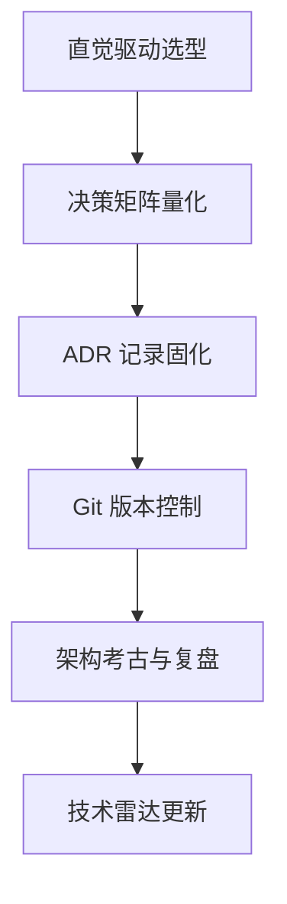

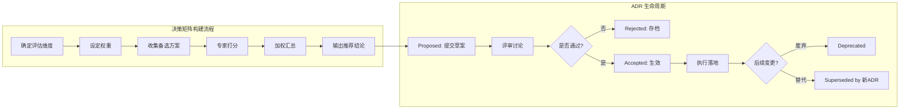

## 24.4 Monorepo 仓库初始化与标准化模版 —— 让“新项目创建”变成“npm create enterprise-app”

### 24.4.1 为什么需要这个概念？

企业级中后台通常包含：主应用、微前端子应用、共享 UI 组件库、共享工具库、共享类型定义、BFF 聚合层、文档站点等多个包。单仓多包（Polyrepo）会导致版本同步地狱、代码复用碎片化、重构跨仓库极其困难。你需要一套标准化的脚手架工具，将最佳实践固化为模版，新项目/新包一键生成，保证工程规范从 Day 1 就到位。根据《20230418_117.md》（P002）等实战素材，需初始化 `pnpm-workspace.yaml`、生成标准化模版项目；《20230418_045.md》（P045）实现 `create-my-app` 交互式生成器、基于 pnpm workspace 的 Monorepo 结构、脚手架插件机制支持业务定制、GitHub Actions 自动发布 npm；《20230418_034.md》（P034）整合 ESLint、Prettier、Husky、lint-staged、Commitlint，落地规范化的提交流程与代码风格统一。

### 24.4.2 核心定义

**Monorepo**（来源：《20230418_117.md》 P002、《20230418_045.md》 P045、《20230418_034.md》 P034）

单一代码仓库管理多个关联 Package，利用包管理器（pnpm/yarn/npm）的 Workspace 机制实现依赖链接、提升、锁文件统一。

**标准化模版**（来源：《20230418_045.md》 P045、《20230418_034.md》 P034）

包含预置配置的 `package.json`、`.github/workflows`、`.husky`、`.vscode`、`vite.config.ts`、`tsconfig.json`、`.eslintrc.cjs` 等引导文件的脚手架包（如 `create-enterprise-app`）。

### 24.4.3 关键性质

**依赖去重与磁盘效率**：pnpm 硬链接/符号链接机制，`node_modules` 扁平化，节省 50%+ 磁盘空间，安装速度提升 2-3 倍。

**原子化提交与版本联动**：配合 Changesets，单次 PR 可同时版本升级 `@enterprise/ui`、`@enterprise/utils` 及主应用，生成统一 Changelog。

**代码共享零成本**：`import { Button } from '@enterprise/ui'` 即用，无需发布 npm 再安装，热更新即时生效。

### 24.4.4 典型例子

**目录结构**：

```text
├── apps/
│   ├── admin-main          # 主应用
│   └── admin-sub-user      # 子应用
├── packages/
│   ├── ui                  # 组件库
│   ├── utils               # 工具库
│   ├── types               # 类型定义
│   ├── request             # 请求层
│   └── config              # 共享配置
├── pnpm-workspace.yaml
└── package.json
```

**脚手架交互**：

```bash
pnpm create @enterprise/app my-new-micro-app \
  -- --framework=vue --ui=arco --router=vue-router --state=pinia
```

### 24.4.5 边界条件

**构建性能陷阱**：Monorepo 规模膨胀时，全量构建极慢。必须配合 Turborepo/Nx 实现增量构建、远程缓存、任务编排，仅构建受影响包。

**权限隔离难题**：Monorepo 默认全员可读全仓代码，涉及核心算法/加密逻辑/薪资体系等敏感包需拆分至独立私有仓库，通过 npm 私服引入。

**包管理器锁定**：团队必须强制统一 pnpm 版本（通过 `packageManager` 字段 + Corepack），禁止混用 yarn/npm 导致锁文件冲突。

### 24.4.6 方法演进图

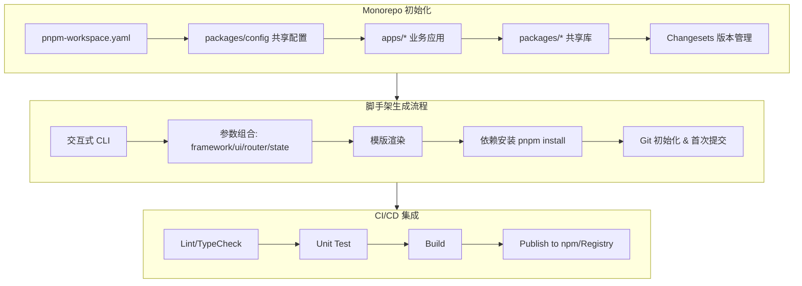

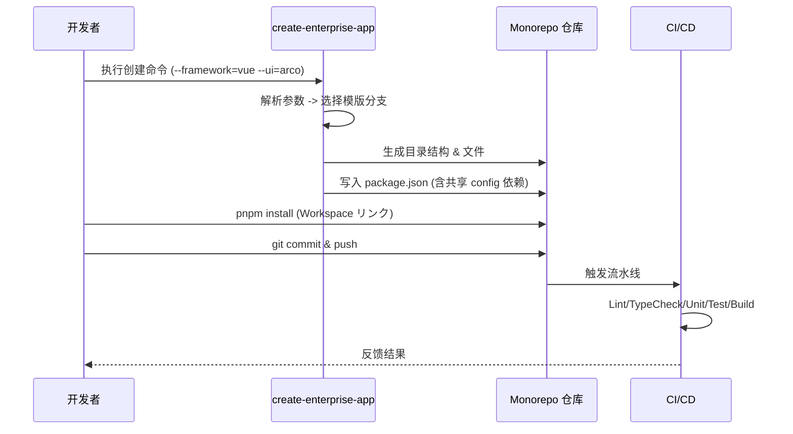

## 24.5 UI 组件库二次封装与请求层统一 —— 造好“手中的刀”，再砍“业务的木”

### 24.5.1 为什么需要这个概念？

直接使用 Ant Design/Arco Design 等原生组件库，会导致业务代码耦合第三方 API，升级组件库版本时全量改动；且无法统一封装企业级通用逻辑（如表格内置权限列、表单自动校验、弹窗统一销毁、国际化适配）。网络请求层缺乏统一封装，会导致每个 API 调用分散处理 Loading、Token 刷新、错误码映射、取消重复请求，极难维护和做全链路监控。根据《20230418_117.md》（P003）、《20230418_045.md》（P045）、《20230418_040.md》（P040），需封装 `@enterprise/ui` 组件库（基于 Ant Design/Arco Design）、`@enterprise/request` 统一错误/Loading/Token 刷新；制定组件元数据规范、集成 `vue-docgen-api`/`react-docgen` 自动解析 Props/Events/Slots、Storybook/Histoire 沙箱预览；整合设计令牌、原子化工具类、组件级变量、暗黑模式适配，输出 `@my-org/ui-theme` 与 `@my-org/ui-components` 双包发布流程。

### 24.5.2 核心定义

**二次封装组件库 (`@enterprise/ui`)**（来源：《20230418_117.md》 P003、《20230418_045.md》 P045、《20230418_040.md》 P040、《20230418_124.md》 P124）

在基础组件库之上，封装业务通用高阶组件（`ProTable`、`ProForm`、`ProCard`、`ProModal`）、设计令牌主题包、图标规范、无障碍属性注入，对外暴露稳定的企业级 API。

**统一请求层 (`@enterprise/request`)**（来源：《20230418_117.md》 P003、《20230418_035.md》 P035、《20230418_040.md》 P040）

基于 Axios/Ky/Fetch 封装，内置：请求/响应拦截器、TypeScript 泛型响应体、自动错误码弹窗/跳转登录、请求去重、自动取消上一请求、Mock/真实环境切换、OpenAPI 类型自动生成集成。

### 24.5.3 关键性质

**API 稳定性契约**：二次封装层吸收底层组件库 Breaking Change，业务侧仅升级 `@enterprise/ui` 版本即可平滑过渡。

**Schema 驱动能力**：`ProTable`/`ProForm` 支持 JSON Schema 配置化渲染，配合低代码平台实现“零代码生成 CRUD 页面”。

**类型安全全链路**：请求层通过 `openapi-typescript`/`orval` 从后端 Swagger 生成 TS 类型，实现“后端改字段 -> 前端编译报错 -> 定位修改”的强类型保护。

### 24.5.4 典型例子

**ProTable 封装**：内置列宽拖拽持久化、多选/单选/展开行、工具栏（刷新/密度/列设置/导出）、服务端分页/排序/过滤参数标准化映射、行内编辑/详情弹窗插槽。

**请求层 Token 无感刷新**：

```text
1. 拦截 401 响应
2. 判断是否正在刷新 Token
3. 是 -> 将当前请求加入等待队列
4. 否 -> 调用刷新接口 -> 更新存储
5. 重放原请求队列 -> 释放等待者
```

### 24.5.5 边界条件

**过度封装反模式**：不要把所有 Ant Design 组件都包一层，仅封装“高频使用+含业务逻辑+需扩展”的组件（如 Table/Form/Modal/Select），简单组件（Button/Input/Tag）直接透传或极薄包装。

**请求层不可做业务强耦合**：`@enterprise/request` 只处理通用横切关注点（认证、错误、日志、类型），具体业务参数拼接、数据转换应在 API 服务层（`/api/user.ts`）处理。

**版本升级风险**：基础组件库大版本升级（如 Antd v4 -> v5）需建立专项迁移小组，先在 `@enterprise/ui` 内部适配，产出迁移指南与 Codemod 脚本，再通知业务升级。

### 24.5.6 方法演进图

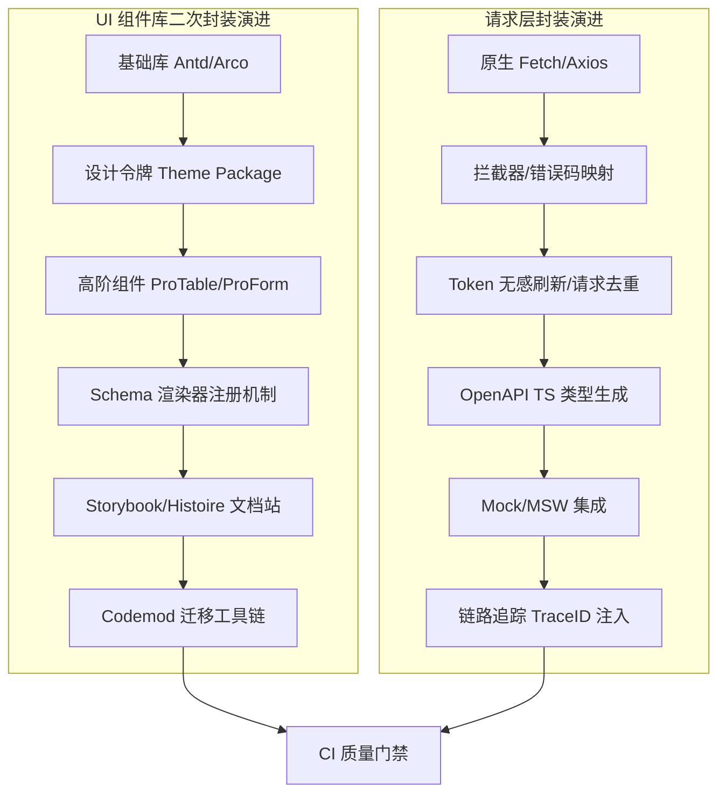

## 24.6 权限体系（RBAC）与动态路由 —— 让“菜单”和“按钮”听从后端指挥

### 24.6.1 为什么需要这个概念？

中后台核心诉求：不同角色看到不同菜单、拥有不同操作权限、访问不同页面。硬编码路由/权限会导致发版才能调整权限，无法满足运营/产品“即时生效”的需求。前端需实现：登录后拉取后端路由树 -> 动态注册路由 -> 递归生成侧边菜单 -> 页面/按钮级指令控制 -> 刷新保持状态（不丢失动态路由）。根据《20230418_117.md》（P004）、《20230418_038.md》（P038），需实现 RBAC 权限指令/组件、动态路由注册，展示后端返回路由树 → `router.addRoute` 动态注册 → 递归生成侧边菜单 → 刷新保持状态的完整方案。

### 24.6.2 核心定义

**RBAC (Role-Based Access Control)**（来源：《20230418_117.md》 P004、《20230418_038.md》 P038）

用户 -> 角色 -> 权限/资源 的映射模型。前端持有“权限码”集合（如 `user:list`, `user:delete`），通过指令 `v-auth="user:delete"` 或函数 `hasAuth('user:delete')` 控制 DOM 渲染。

**动态路由 (Dynamic Routing)**（来源：《20230418_117.md》 P004、《20230418_038.md》 P038）

后端返回符合 `RouteRecordRaw` 结构的路由数组（含 `path`, `component`, `meta: { roles, title, icon, keepAlive }`），前端通过 `router.addRoute` 动态挂载，配合 `router.removeRoute` 实现注销登录清理。

### 24.6.3 关键性质

**路由懒加载与代码分割**：后端返回 `component: 'user/management'` 字符串，前端映射为 `() => import('@/views/user/management.vue')`，实现按需加载，首屏不加载无权限代码。

**刷新保活策略**：动态路由存储于 Pinia（持久化插件），应用初始化 `initRouter()` 从 Store 恢复路由并 `addRoute`，避免 F5 刷新 404。

**401/403 降级体验**：无权限访问页面 -> 403 友好页（含申请权限入口）；Token 失效 -> 401 拦截 -> 记录当前路由 -> 跳转登录页 -> 登录成功回跳。

### 24.6.4 典型例子

**后端路由数据结构**：

```json
[
  {
    "path": "/user",
    "meta": { "title": "用户管理", "roles": ["admin"] },
    "children": [
      {
        "path": "list",
        "component": "user/list",
        "meta": { "title": "用户列表", "permission": "user:list" }
      }
    ]
  }
]
```

**权限指令实现**：`v-auth="['user:add', 'user:edit']"` 满足任一即显示；`v-auth.all="['admin', 'super']"` 需同时满足。

### 24.6.5 边界条件

**路由对象序列化陷阱**：`component` 属性不能存函数（无法持久化），必须存字符串路径，前端维护 `componentMap` 映射表。

**权限粒度膨胀**：避免定义过细权限码（如 `user:list:export:excel`），建议“资源:动作”二级粒度，细粒度交由后端接口层校验。

**微前端子应用权限隔离**：子应用独立路由实例，基座下发全局权限码给子应用，子应用自行过滤自有菜单，避免基座强耦合子应用权限逻辑。

### 24.6.6 方法演进图

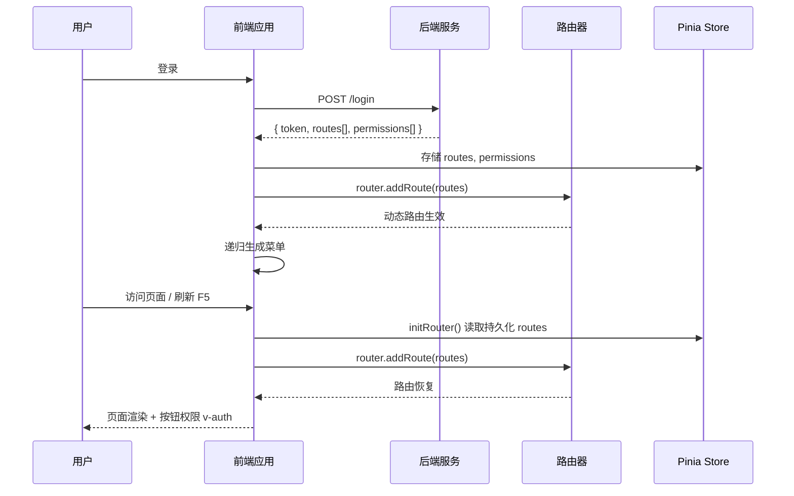

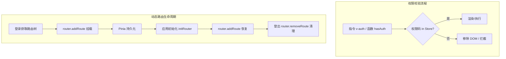

## 24.7 国际化与无障碍基线工程化 —— 让产品天生“懂世界、懂人”

### 24.7.1 为什么需要这个概念？

出海/多语言业务若上线后才补 i18n，需全量改写硬编码文本，成本极高；无障碍 (a11y) 若非基线建设，后期补齐需重构所有组件交互，且易被法律诉讼（如 ADA、欧洲无障碍法案）。必须在脚手架阶段接入 i18n/a11y 基建，制定规范、配置工具链、建立 CI 门禁，实现“默认合规、无感接入”。根据《20230418_117.md》（P005）、《20230418_019.md》（P019）、《PbGkdX4YVoO02mxYlYKcbgASnSg.md》，需对比 vue-i18n/react-i18next/lingui/formatjs 架构差异、ICU 语法处理复数/选择/嵌套、编译时优化包体积、TypeScript 类型安全键值；逐条落地可感知/可操作/可理解/健壮四大原则：颜色对比度、文本缩放、ARIA Landmarks/Roles/States、Tab 顺序、焦点陷阱、屏幕阅读器测试；集成 axe-core/lighthouse-ci 无障碍自动化扫描、i18n 缺失键/未使用键检测、PR 阻断门禁。

### 24.7.2 核心定义

**i18n 工程化**（来源：《PbGkdX4YVoO02mxYlYKcbgASnSg.md》）

采用 `vue-i18n`/`react-i18next` + `ICU MessageFormat` 标准，支持复数、性别、选择格式；集成 `lint-staged` 校验硬编码中文、CI 自动推拉翻译平台、TypeScript 类型安全键值提示。

**a11y 基线**（来源：《PbGkdX4YVoO02mxYlYKcbgASnSg.md》）

强制语义化 HTML、WCAG 2.1 AA 级达标（颜色对比度 4.5:1、键盘可达、ARIA 标签、焦点管理），组件库内置合规，业务组件继承合规。

### 24.7.3 关键性质

**编译时优化**：`@intlify/unplugin-vue-i18n` / `lingui` 编译时提取消息、移除运行时解析开销、Tree-shaking 未使用语言包，首屏 JS 体积减少 30%+。

**设计令牌驱动主题**：CSS Variables 定义色值/间距/圆角，`prefers-color-scheme` + `data-theme` 双模式切换零闪烁，i18n 文本方向 `dir=rtl` 自动适配阿拉伯语/希伯来语布局反转。

**自动化回归防护**：CI 集成 `axe-core`/`lighthouse-ci` 扫描 a11y 违规阻断合并、i18n 缺失键/未使用键检测报警。

### 24.7.4 典型例子

**翻译管理流水线**：开发提交代码 -> GitHub Actions 推送源语言 JSON 到 Crowdin -> 翻译/机翻 -> PR 合并前 Actions 拉取最新翻译 -> 校验完整率 100% -> 合并部署。

**无障碍组件模式**：`ProModal` 内置 `FocusTrap`（焦点陷阱）、`Esc` 关闭、打开时保存上一焦点元素关闭时恢复、`aria-modal=true` `aria-labelledby` 关联标题。

### 24.7.5 边界条件

**动态内容国际化**：富文本编辑器内容、用户生成内容（UGC）、后端返回错误码文本无法走前端 i18n，需后端多语言支持或前端建立错误码映射表。

**a11y 非银弹**：自动化工具仅能发现 30%-50% 问题（如缺 alt、对比度），复杂交互（如拖拽排序、虚拟列表键盘操作）必须人工 NVDA/VoiceOver 实测。

**字体加载策略**：多语言字体体积大（中日韩 5MB+），必须子集化、WOFF2 压缩、`font-display: swap`、按需动态加载（`unicode-range`），避免首屏阻塞。

### 24.7.6 方法演进图

```mermaid
graph TD
    subgraph i18n_Pipeline[i18n 工程化流水线]
        I1[代码提交] --> I2[lint-staged 校验硬编码]
        I2 --> I3[CI 提取消息 -> 推送翻译平台]
        I3 --> I4[翻译/机翻完成]
        I4 --> I5[PR 前拉取翻译]
        I5 --> I6[完整率 100% 校验]
        I6 --> I7[合并部署]
    end
    subgraph a11y_Baseline[a11y 基线建设]
        A1[组件库内置: 语义化/ARIA/FocusTrap] --> A2[业务组件继承合规]
        A2 --> A3[CI: axe-core/lighthouse-ci 扫描]
        A3 --> A4[违规阻断合并]
        A4 --> A5[人工 NVDA/VoiceOver 实测]
    end
    subgraph Theme_Driven[设计令牌驱动主题]
        T1[CSS Variables 定义 Token] --> T2[prefers-color-scheme 暗黑模式]
        T2 --> T3[data-theme 手动切换 零闪烁]
        T3 --> T4[dir=rtl RTL 布局自动反转]
        T4 --> T5[font-display: swap + unicode-range 按需加载]
    end
    i18n_Pipeline --> Prod[生产环境]
    a11y_Baseline --> Prod
    Theme_Driven --> Prod
```

## 24.8 异常监控与可观测性接入 —— 给应用装上“黑匣子”与“体检仪”

### 24.8.1 为什么需要这个概念？

生产环境报错“用户反馈 -> 开发复现 -> 排查日志”周期长，且无法量化错误影响面（多少用户、什么机型、什么版本）。缺乏性能基线，首屏慢、交互卡顿无感知。需在基建期接入 Sentry/自建监控 SDK，建立错误捕获、性能指标采集、用户行为关联、Source Map 自动上传的全链路可观测体系。根据《20230418_117.md》（P006）、《20230418_046.md》（P046）、《20230418_133.md》（P133），需实现 Sentry/自建监控 SDK 接入，实现 `window.onerror`/`unhandledrejection`/Vue `errorHandler`/React `ErrorBoundary` 多层兜底、接入 Sentry/Fundebug 或自建平台解析 Source Map 还原源码堆栈；轻量 SDK 设计：`PerformanceObserver` 监听 LCP/CLS/FID/INP、Resource Timing API 采集资源耗时、Long Task API 识别阻塞、`navigator.sendBeacon` 可靠上报；HTTP Header 透传 `trace-id`、`span-id`，前端生成根 Span、后端续接，统一 JSON 格式日志接入 Loki。

### 24.8.2 核心定义

**错误监控 SDK**（来源：《20230418_117.md》 P006、《20230418_046.md》 P046、《20230418_133.md》 P133）

重写 `window.onerror`、`unhandledrejection`、框架错误边界，采集堆栈、环境、用户标识、面包屑；Source Map 解析还原源码行号；聚合去重（指纹算法）防止风暴刷屏。

**性能监控 SDK**（来源：《20230418_046.md》 P046）

`PerformanceObserver` 采集 LCP/CLS/INP/TTFB/FID、Resource Timing 采集资源瀑布、Long Task API 识别阻塞主线程任务、`sendBeacon` 可靠上报。

**全链路追踪**（来源：《20230418_046.md》 P046、《20230418_133.md》 P133）

HTTP Header 透传 `trace-id`/`span-id`，前端生成根 Span，后端续接，打通前后端调用链。

### 24.8.3 关键性质

**采样率与成本控制**：错误 100% 上报，性能/行为按比例采样（如 10%），高价值用户/核心链路 100% 采样，平衡存储成本与洞察力。

**隐私合规**：IP 脱敏、PII 字段过滤、用户授权埋点、GDPR/个人信息保护法合规审计。

**告警分级与降噪**：P0（核心流程错误率>1%/LCP>4s）钉钉/电话即时叫醒；P1（非核心错误/性能劣化）工单处理；P2（预警）周报汇总。

### 24.8.4 典型例子

**SDK 接入代码**：

```typescript
import { initMonitor } from '@enterprise/monitor';
initMonitor({
  dsn: '...',
  appId: 'admin-main',
  environment: import.meta.env.MODE,
  sampleRate: 0.1,
  plugins: [vuePlugin, routerPlugin, requestPlugin]
});
```

**Source Map 自动上传**：Vite/Rollup 构建后 `sentry-cli sourcemaps inject` + `upload`，或 CI 步骤上传至自建 MinIO/对象存储，报错时后端下载解析。

### 24.8.5 边界条件

**Source Map 安全风险**：生产环境 Source Map 包含原始源码，严禁直接部署到 CDN 公开访问，必须存储在私有存储/监控平台后台，仅授权人员解密查看。

**框架错误边界覆盖盲区**：Vue `errorHandler` / React `ErrorBoundary` 无法捕获：事件处理器异步错误、生命周期钩子外的 Promise rejection、SSR 水合错误、Web Worker/Service Worker 错误，需分别针对性兜底。

**指标定义漂移**：LCP/CLS/INP 定义随 Chrome 版本演进（如 FID 退役替换为 INP），SDK 需版本化维护，仪表盘指标需标注版本基线。

### 24.8.6 方法演进图

```mermaid
graph TD
    subgraph Error_Monitoring[错误监控链路]
        E1[错误发生] --> E2[多层捕获: onerror/unhandledrejection/ErrorBoundary]
        E2 --> E3[采集上下文: 堆栈/环境/用户/面包屑]
        E3 --> E4[Source Map 解析还原源码]
        E4 --> E5[指纹聚合去重]
        E5 --> E6[上报监控平台]
        E6 --> E7[告警分级: P0/P1/P2]
    end
    subgraph Perf_Monitoring[性能监控链路]
        P1[PerformanceObserver] --> P2[Web Vitals: LCP/CLS/INP/TTFB]
        P2 --> P3[Resource Timing: 资源瀑布]
        P3 --> P4[Long Task: 主线程阻塞]
        P4 --> P5[sendBeacon 可靠上报]
        P5 --> P6[仪表盘展示/阈值告警]
    end
    subgraph Tracing[全链路追踪]
        T1[前端生成 TraceID/SpanID] --> T2[HTTP Header 透传]
        T2 --> T3[后端续接 Span]
        T3 --> T4[统一日志格式接入 Loki]
        T4 --> T5[Jaeger/Zipkin 链路可视化]
    end
```

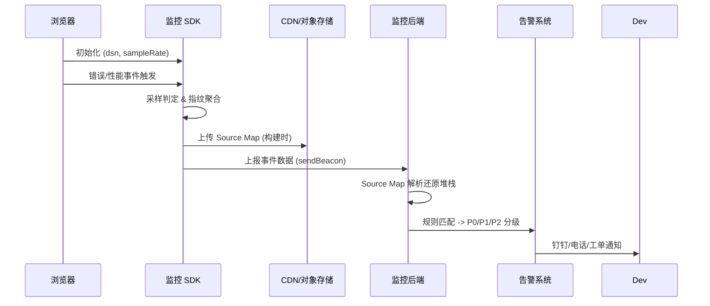

## 24.9 Schema 驱动的典型 CRUD 页面标准化 —— 从“写页面”到“配页面”

### 24.9.1 为什么需要这个概念？

中后台 80% 页面是列表/表单/详情的 CRUD 变体，手写重复代码（列表查询/分页/新增编辑弹窗/校验/提交/刷新）极其低效且易出错。需沉淀 `ProTable`/`ProForm`/`ProChart` 等 Schema 驱动组件，配合页面生成器，实现“JSON 配置 -> 完整页面”的降维打击。根据《20230418_117.md》（P007）、《20230418_045.md》（P045）、《20230418_099.md》（P099），需沉淀 `ProTable`/`ProForm`/`ProChart` 通用组件、Schema 驱动页面生成，设计 JSON Schema 描述页面结构、基于 Vue/React 实现渲染器插件化、Mobox/RedoManager 状态历史、AST 代码生成还原高代码。

### 24.9.2 核心定义

**Schema 驱动**（来源：《20230418_117.md》 P007、《20230418_045.md》 P045、《20230418_099.md》 P099）

定义 `PageSchema` 接口，包含 `layout`（布局）、`toolbar`（工具栏）、`table`（列/操作/选中）、`form`（字段/校验/布局/联动）、`actions`（API 映射/权限/确认文案）等声明式配置。

**通用组件三件套**（来源：《20230418_117.md》 P007、《20230418_045.md》 P045）

`ProTable`（表格+搜索+分页+工具栏）、`ProForm`（表单+校验+布局+联动）、`ProChart`（图表配置化渲染 ECharts/AntV），均基于 `@enterprise/ui` 封装。

### 24.9.3 关键性质

**代码生产力跃迁**：标准 CRUD 页面从 2-4 小时手写 -> 10-30 分钟配置，且自带类型校验、权限控制、Loading/Empty/Error 状态、无障碍属性。

**运行时动态性**：Schema 可后端下发（低代码平台）、可本地热更新（HMR）、可 A/B 测试不同布局，无需重新部署前端代码。

**扩展性设计**：`renderer` 注册机制，支持自定义渲染器（如 `ColorPickerRenderer`、`JsonEditorRenderer`）、自定义校验器、自定义工具栏按钮，避免“配置地狱”限制业务创新。

### 24.9.4 典型例子

**用户列表 PageSchema**：

```json
{
  "table": {
    "columns": [
      { "dataIndex": "name", "title": "姓名" },
      { "dataIndex": "status", "title": "状态", "renderer": "TagRenderer", "options": { "1": "启用", "0": "禁用" } },
      { "title": "操作", "renderer": "ActionRenderer", "actions": [
        { "type": "edit", "auth": "user:edit" },
        { "type": "delete", "auth": "user:delete", "confirm": true }
      ]}
    ]
  }
}
```

**表单联动配置**：

```json
{
  "form": {
    "fields": [
      {
        "name": "province",
        "onChange": "(val) => ({ setFieldsValue: { city: [] }, updateFieldProps: { city: { options: await fetchCities(val) } } })"
      }
    ]
  }
}
```

### 24.9.5 边界条件

**复杂交互不适用**：高度定制化交互（如可视化拖拽画布、复杂多步向导、实时协作编辑）不应强行塞入 Schema，应开发专用业务组件，Schema 仅作入口引用。

**Schema 版本演进**：Schema 结构变更需版本化（`schemaVersion: '2.0'`），提供迁移脚本自动升级旧 Schema，或兼容旧版渲染器并行运行。

**类型安全挑战**：Schema 高度动态，TypeScript 类型推导极其复杂，建议核心 Schema 定义用 Zod/Valibot 做运行时校验 + 类型推导，边缘扩展用 `any` 兜底并文档化。

### 24.9.6 方法演进图

```mermaid
graph TD
    subgraph Schema_Design[Schema 设计与演进]
        S1[定义 PageSchema 接口] --> S2[核心字段: layout/toolbar/table/form/actions]
        S2 --> S3[Renderer 注册表: 内置 + 自定义]
        S3 --> S4[Zod/Valibot 运行时校验 + TS 类型推导]
        S4 --> S5[版本化: schemaVersion + 迁移脚本]
    end
    subgraph Runtime_Render[运行时渲染流程]
        R1[获取 Schema (本地/远程)] --> R2[校验 Schema]
        R2 --> R3[ProTable/ProForm 递归渲染]
        R3 --> R4[渲染器工厂: 根据 renderer 字段分发]
        R4 --> R5[注入: 权限/国际化/无障碍/联动逻辑]
        R5 --> R6[挂载 DOM]
    end
    subgraph Code_Gen[代码生成/还原]
        C1[Schema] --> C2[AST 生成 Vue/React 组件代码]
        C2 --> C3[Mobox/RedoManager 状态历史]
        C3 --> C4[高代码模式: 开发者接管微调]
    end
    Schema_Design --> Runtime_Render
    Runtime_Render --> Code_Gen
```

## 24.10 微前端子应用接入与共享依赖治理 —— “分治”大仓，又要“合一”运行

### 24.10.1 为什么需要这个概念？

中后台业务线扩展、团队规模>10人、多技术栈共存（Vue 2/3、React、Angular 遗留）时，单体应用构建慢、耦合高、发布互斥。微前端将巨石应用拆分为基座+多子应用，实现独立开发、独立部署、技术栈无关。核心挑战：JS 沙箱隔离、样式隔离、公共依赖共享（React/Vue/设计系统单例）、基座与子应用通信、路由分发、部署运维复杂度。根据《20230418_117.md》（P008）、《20230418_043.md》（P043）、《20230418_010.md》（P010），需接入微前端基座（主应用/子应用通信/共享依赖），剖析 `snapshot`/`proxy` 双沙箱模式、`strictStyleIsolation` Shadow DOM 方案、`initGlobalState` 状态共享、嵌套微前端坑位；详解 `exposes`/`remotes`/`shared` 配置、运行时版本匹配算法、联邦模块热更新、与 Vite/Rspack 生态集成；制定《微前端接入规范》：基座提供 React/Vue 单例、路由基座分发、UI 组件库强制共享、统一监控 SDK 注入。

### 24.10.2 核心定义

**基座应用**（来源：《20230418_117.md》 P008、《20230418_043.md》 P043、《20230418_010.md》 P010）

负责注册子应用、路由分发（`/admin/user` -> 子应用 user）、全局状态分发（`initGlobalState`）、公共依赖提供（`importmap`/Module Federation）、统一监控/登录/权限注入。

**子应用**（来源：《20230418_043.md》 P043）

独立构建、独立部署的单页应用，暴露 `bootstrap`/`mount`/`unmount`/`update` 生命周期，运行在沙箱中，无感知基座存在。

### 24.10.3 关键性质

**沙箱隔离模式**：`snapshot`（记录/恢复 window 快照，适配旧应用）vs `proxy` (Proxy 代理 window，支持多实例并发，性能更优)。样式隔离：`scoped css` / `strictStyleIsolation: true` (Shadow DOM，最强隔离但样式穿透麻烦)。

**共享依赖单例策略**：基座在 `importmap` 或 Module Federation `shared` 配置声明 `react`/`vue`/`@enterprise/ui` 等单例，子应用 `external` 这些依赖，构建产物极小，运行时共享内存实例，避免多实例导致状态不同步、Hooks 报错。

**通信机制**：`initGlobalState` 基于发布订阅（基座发布，子应用订阅），适合用户信息、主题、权限等全局广播；复杂业务通信建议定义共享 `EventBus`/`SharedStore` 包。

### 24.10.4 典型例子

**qiankun 接入**：

```typescript
// 基座
registerMicroApps([{
  name: 'sub-user',
  entry: '//sub.user.com',
  container: '#subapp-viewport',
  activeRule: '/user'
}]);

// 子应用 vite.config.ts
export default defineConfig({
  build: { lib: { entry: 'src/main.ts', name: 'subUser' } }
});
```

**Module Federation 共享**：

```javascript
// 基座
exposes: { './store': './src/store' }
// 子应用
remotes: { host: 'host@//host.com/remoteEntry.js' }
shared: { react: { singleton: true }, 'antd': { singleton: true } }
```

### 24.10.5 边界条件

**不必微前端**：团队<5人、单技术栈、发布频次低、无遗留系统包袱，单体模块化架构（Monorepo + 动态导入）更优，微前端收益<复杂度成本。

**嵌套微前端深坑**：子应用再套子应用（三层+）会导致沙箱嵌套失效、路由基础路径计算错误、样式穿透失控，严禁嵌套超过两层。

**CSS 变量隔离冲突**：基座与子应用 CSS 变量命名冲突（如 `--primary-color`），必须约定命名空间（`--host-primary` / `--sub-user-primary`）或 Shadow DOM 隔离。

**公共依赖版本锁定治理**：制定《微前端接入规范》，基座锁定 React 18.2.0 / Vue 3.4.0 / Antd 5.12.0，子应用 package.json `peerDependencies` 声明兼容范围，CI 扫描违规版本阻断合并。

### 24.10.6 方法演进图

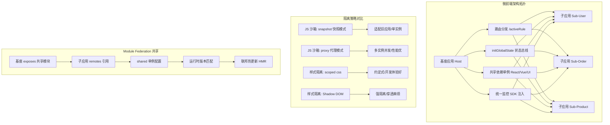

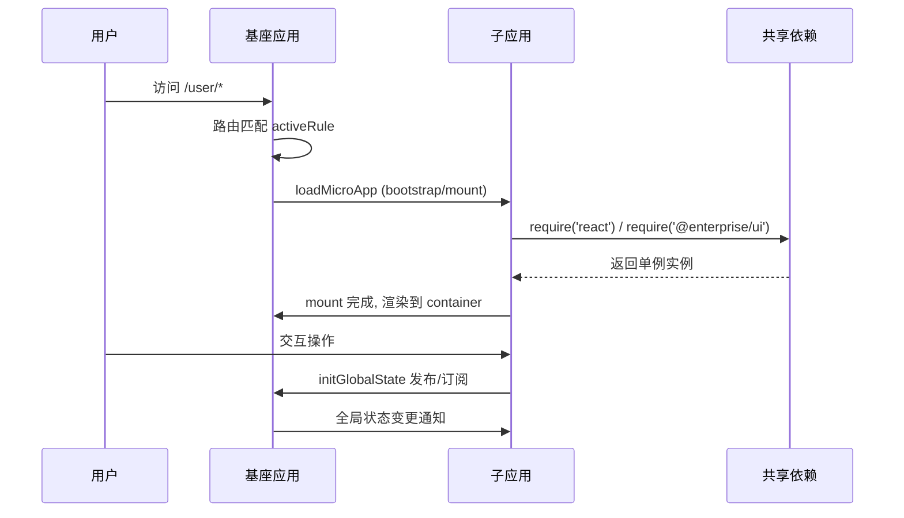

## 24.11 CI/CD 流水线与质量门禁 —— 让“不合格代码”进不了主分支

### 24.11.1 为什么需要这个概念？

代码规范、类型检查、单测、E2E、构建产物体积、安全扫描、无障碍合规若仅靠人工 Review，漏检率极高且效率低。必须在 CI 流水线设置硬性门禁，自动化拦截不合规提交。发布流程需标准化：构建 -> 扫描 -> 测试 -> 镜像构建 -> 推送制品库 -> 部署测试环境 -> 人工审批 -> 灰度发布 -> 全量发布 -> 回滚预案，全程可视、可追溯、可一键回滚。根据《20230418_117.md》（P009）、《20230418_039.md》（P039）、《20230418_041.md》（P041）、《20230418_042.md》（P042）、《PU9Id4IPMoZ3QdxLzZUcEPBRnWO.md》，需配置 GitLab CI/GitHub Actions：Lint/TypeCheck/Unit/E2E/Build/Scan/Deploy、性能预算/安全扫描/axe 无障碍阈值阻断、ArgoCD 金丝雀发布、混沌工程演练回滚；引用测试金字塔/奖杯模型，制定“核心逻辑单测全覆盖、关键交互集成测、核心链路 E2E 兜底”的团队规范；制定“LCP < 2.5s、CLS < 0.1、INP < 200ms”工程化达标标准；接入 `npm audit`/`pnpm audit`/`Snyk`/`Socket` CI 检查、`package-lock.json` 版本锁定、生成 CycloneDX SBOM 合规交付；落地 GitOps：ArgoCD 监控 Git 仓库声明式同步、PreSync/PostSync Hook 运行迁移/测试、自动回滚健康检查失败版本。

### 24.11.2 核心定义

**流水线阶段**（来源：《20230418_117.md》 P009、《20230418_039.md》 P039、《20230418_041.md》 P041、《20230418_042.md》 P042、《PU9Id4IPMoZ3QdxLzZUcEPBRnWO.md》）

`Lint/TypeCheck` (秒级) -> `Unit Test` (分钟级) -> `Build` (产物生成) -> `Security Scan` (依赖漏洞/SAST/秘钥扫描) -> `E2E Test` (关键链路) -> `Deploy Staging` -> `Visual Regression` (像素对比) -> `Manual Approve` -> `Canary Deploy` -> `Full Deploy`。

**质量门禁阈值**（来源：《20230418_041.md》 P041、《20230418_042.md》 P042）

ESLint Error=0 / TypeScript Error=0 / 单测覆盖率≥80%（核心包 95%）/ 关键 E2E 用例 100% 通过 / LCP<2.5s / CLS<0.1 / INP<200ms / 高危漏洞=0 / axe 违规=0。

### 24.11.3 关键性质

**快速反馈原则**：流水线总耗时<20min（并行矩阵、缓存节点、增量测试），失败即刻通知提交者，防止“红构建”长时间阻塞主分支。

**制品不可变性**：构建产物（Docker Image/NPM 包/静态资源包）打上 Git Commit SHA + 语义化版本标签，部署仅拉取制品，绝不在部署阶段二次构建。

**GitOps 交付**：ArgoCD 监控 GitOps 仓库（存放 K8s Manifest + Helm Values），集群状态自动收敛至 Git 声明状态，审计日志完整。

### 24.11.4 典型例子

**GitHub Actions 矩阵策略**：

```yaml
jobs:
  lint:
    runs-on: ubuntu-latest
  test:
    strategy:
      matrix:
        node: [18, 20]
        os: [ubuntu, macos]
    runs-on: ${{ matrix.os }}
```

**性能预算门禁**：

```javascript
// bundlesize.config.js
module.exports = { maxSize: '150 kB' }; // gzipped

// lighthouse-ci budget
budgets: [{ resourceSizes: [{ resourceType: 'script', budget: 170 }] }]
```

**安全扫描集成**：

```bash
pnpm audit --prod --audit-level=high
trivy fs .          # 文件系统漏洞扫描
gitleaks detect     # 秘钥泄露
syft packages dir:. -o cyclonedx-json  # 生成 SBOM
```

### 24.11.5 边界条件

**E2E 环境不稳定导致假阴性**：测试环境依赖后端服务/数据库/第三方 API，需引入 Contract Testing (Pact) 或 Mock Server (MSW/Prism) 解耦后端依赖，保证 E2E 确定性。

**视觉回归误报**：动画、时间戳、用户头像、广告位导致像素差异，需配置 `mask`/`ignoreRegions`/`threshold` 排除干扰区域，基线图定期人工校验更新。

**热修复绕过流水线风险**：生产紧急 Bug 需热修复时，允许 `hotfix/*` 分支简化流程（仅 Lint/TypeCheck/Unit/Build/Deploy），但强制事后补全完整流水线并回合主分支，记录“破例原因”供审计。

### 24.11.6 方法演进图

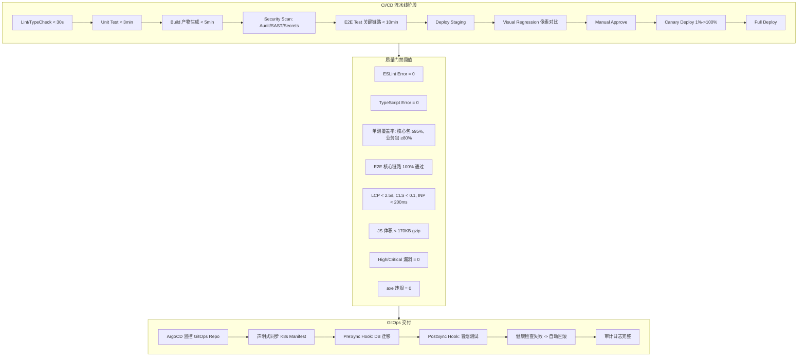

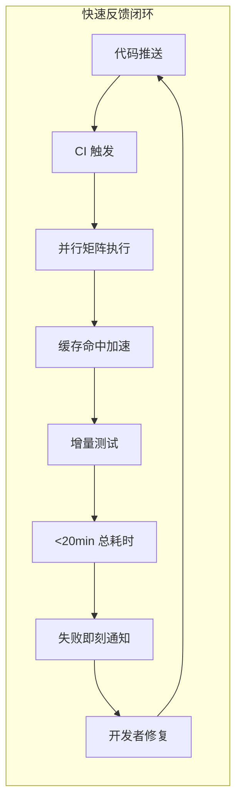

## 24.12 灰度发布与回滚演练 —— 在生产环境“小心翼翼”地试错

### 24.12.1 为什么需要这个概念？

即使通过所有 CI 门禁，生产环境真实流量、真实数据、真实网络环境仍会暴露潜在问题（内存泄漏、特定机型白屏、第三方接口超时、业务逻辑边界案例）。全量发布风险不可控，需灰度验证。回滚必须是“常态化演练”的肌肉记忆，而非事故发生时的临时抱佛脚，目标：RTO (恢复时间目标) < 5 分钟。根据《20230418_117.md》（P010）、《PU9Id4IPMoZ3QdxLzZUcEPBRnWO.md》，需配置 ArgoCD 金丝雀发布、混沌工程演练回滚；配置 RollingUpdate/Recreate 策略、Ingress TLS 终结/路由重写、ConfigMap 挂载运行时配置、Secret 管理敏感信息、HPA 基于 CPU/自定义指标弹性、Istio 金丝雀流量镜像；落地 GitOps：ArgoCD 监控 Git 仓库声明式同步、PreSync/PostSync Hook 运行迁移/测试、自动回滚健康检查失败版本。

### 24.12.2 核心定义

**金丝雀发布**（来源：《PU9Id4IPMoZ3QdxLzZUcEPBRnWO.md》）

流量按比例切分（1% -> 5% -> 20% -> 50% -> 100%），通过 Header/Cookie/IP/用户分层标识路由至新版本，实时监控错误率/延迟/业务指标，异常自动/人工熔断回滚。

**蓝绿部署**（来源：《PU9Id4IPMoZ3QdxLzZUcEPBRnWO.md》）

维护两套完全一致的生产环境，新版本部署至闲置环境，验证通过后流量瞬间切换，回滚仅需切回旧环境，零停机、零请求失败。

**特性开关**

代码层面 `if (featureFlag('new-checkout'))` 控制新功能暴露，部署与发布解耦，支持极速回滚（关闭开关）和定向人群测试。

### 24.12.3 关键性质

**观测驱动决策**：灰度期间重点监控：错误率、Apdex、核心业务转化漏斗（如下单支付成功率）、资源利用率（CPU/内存/连接数）、日志错误关键词告警。

**会话一致性**：同一用户灰度期间必须固定命中同一版本，避免请求在新旧版本间跳变导致状态错乱（如购物车丢失、表单提交 401）。

**数据库迁移兼容性**：灰度期间新旧版本共存，数据库迁移脚本必须向后兼容（仅增表/增列/加默认值，不删列/改类型/重命名），回滚时旧版本代码仍能跑通新库结构。

### 24.12.4 典型例子

**ArgoCD 金丝雀**：

```bash
argo rollouts set weight rollouts-demo 10  # 10% 流量
# 观测 30min
argo rollouts promote rollouts-demo        # 全量
# 或
argo rollouts abort rollouts-demo          # 回滚
```

**Nginx 灰度配置**：

```nginx
split_clients "$request_id" $version {
  10%  new_version;
  90%  old_version;
}
upstream new_version { server new:80; }
upstream old_version { server old:80; }
```

**回滚演练演练单**：季度演练，模拟“新版本导致支付回调失败”，验证：监控告警触发 -> 值班收到 -> 执行 `argo rollouts abort` -> 确认流量回切 -> 业务恢复 -> 事后复盘。

### 24.12.5 边界条件

**有状态服务灰度难题**：前端静态资源灰度容易（CDN 缓存+版本化文件名），但后端有状态服务灰度需配合数据库双写/读写分离/消息队列版本兼容，前端灰度策略需与后端发布节奏强绑定。

**缓存污染风险**：CDN/浏览器缓存可能导致灰度用户加载旧版本 JS 执行新版本 API（或反之），必须强制资源文件名含 Hash、HTML 不缓存或极短缓存、API 版本化（Header/URL）。

**特性开关技术债**：长期积累的 `if (flag) ... else ...` 会腐化代码库，需建立“旗标生命周期管理”：创建 -> 灰度 -> 全量 -> 清理旧分支代码 -> 删除旗标，定期扫描僵尸旗标强制清理。

### 24.12.6 方法演进图

```mermaid
graph TD
    subgraph Canary[金丝雀发布流程]
        C1[构建制品: Image/Static Assets] --> C2[部署 Canary 版本]
        C2 --> C3[流量切分: 1% 内部犬食]
        C3 --> C4[观测指标: 错误率/Apdex/转化率]
        C4 --> C5{达标?}
        C5 -- 否 --> C6[自动/人工熔断回滚]
        C5 -- 是 --> C7[扩大流量: 5% -> 20% -> 50%]
        C7 --> C4
        C7 -- 全量 --> C8[Promote: 100% 流量]
        C6 --> C9[回滚验证 & 复盘]
    end
    subgraph BlueGreen[蓝绿部署]
        B1[Blue 环境: 当前生产] --> B2[Green 环境: 新版本部署]
        B2 --> B3[全量验证 Green]
        B3 --> B4[切换流量: Blue <-> Green]
        B4 --> B5[保留 Blue 为回滚备选]
    end
    subgraph Rollback_Drill[回滚演练体系]
        R1[季度演练计划] --> R2[模拟故障场景]
        R2 --> R3[监控告警触发验证]
        R3 --> R4[值班响应 SLA]
        R4 --> R5[执行回滚命令]
        R5 --> R6[流量回切确认]
        R6 --> R7[业务恢复验收]
        R7 --> R8[事后复盘: RTO/RPO 统计]
    end
```

## 24.13 技术债务识别与重构提案（ADR 驱动） —— 让“欠债”变成“可控资产”

### 24.13.1 为什么需要这个概念？

长期迭代必然产生技术债务（过时依赖、耦合代码、缺失测试、性能瓶颈、设计模式腐化）。隐性债务会拖慢交付速度、增加故障率、劝退新人。需建立显性识别、量化评估、ADR 驱动重构的治理机制。重构不应是“程序员自嗨”，必须有业务价值锚定（如：提升开发效率 X%、降低故障率 Y%、支撑新业务 Z），通过 ADR 记录决策过程，纳入规划排期。根据《20230418_117.md》等 10 份实战素材（P011）、《KJ0CdYG18oMFStxpa17cxS0wnyt.md》，需定期产出《技术债务清单》《重构提案 ADR》《组件复用率报告》；推行 `adr-cli` 管理决策文档：标题/背景/决策/后果/替代方案、状态、关联 Issue；制定 12-18 月滚动路线图：主题（如“全链路类型安全”“微前端化”“研发效能平台化”）、季度里程碑、跨团队依赖识别、技术债务专项偿还预算；建立 RFC 提交模版、评审会议议程、决策矩阵（技术可行性/业务价值/实施成本/风险/团队能力）、事后复盘模版输出经验教训。

### 24.13.2 核心定义

**技术债务清单**（来源：《20230418_117.md》 P011、《KJ0CdYG18oMFStxpa17cxS0wnyt.md》）

结构化记录 `{ id, 标题, 类型(架构/代码/测试/文档/依赖/基建), 影响范围, 严重度(P0-P4), 产生原因, 当前痛点, 重构方案草案, 预估工时, 业务价值, 关联 ADR }`。

**重构提案 ADR**（来源：《KJ0CdYG18oMFStxpa17cxS0wnyt.md》）

复用 ADR 流程，在“背景”中量化债务成本（如：每次发版需人工修改 10 处配置，耗时 30min，半年 20 次发版，累计 10h 浪费），在“决策”中给出分阶段重构方案（绞杀者模式/防腐层/并行运行/渐进切换）。

### 24.13.3 关键性质

**分类分级治理**：P0（安全/数据丢失/核心链路阻塞）立即修复；P1（性能严重/频发故障/阻塞新需求）纳入下个 Sprint；P2/P3（代码异味/文档缺失/依赖旧版）纳入技术专项周/季度规划；P4（主观不爽/最佳实践未遵循）仅记录不强制。

**绞杀者模式**：大规模重构（如 Vue 2 -> Vue 3、JS -> TS、微前端拆分）禁止大爆炸式重写，需建立防腐层/适配器，新旧代码共存，按路由/页面/模块逐步迁移，灰度验证。

**度量驱动验收**：重构完成需通过指标验收：构建时间 -30%、包体积 -20%、核心页面 LCP -200ms、单测覆盖率 +15%、发版频次 +50%、Bug 回归率 -50%。

### 24.13.4 典型例子

**债务案例**：`DEBT-2024-001: 请求层未统一封装`，类型：基建/架构，严重度 P1，痛点：30+ 业务包各自封装 Axios，Token 刷新逻辑 5 种实现，排查网络问题无统一日志。重构方案：推出 `@enterprise/request`，6 个 Sprint 迁移存量，ADR-0045 记录决策。

**重构 ADR 片段**：

```markdown
## Decision: 采用绞杀者模式迁移 @enterprise/request。
Phase 1: 新项目强制使用；
Phase 2: 高频改动老项目迁移（提供 Codemod 脚本）；
Phase 3: 存量项目按需迁移；
Phase 4: 废弃旧封装。
```

### 24.13.5 边界条件

**重构陷阱**：避免“为重构而重构”，每个重构任务必须关联具体业务目标或痛点数据，拒绝“代码洁癖”驱动的无价值重构。

**遗留系统无测试重构**：无单测/E2E 兜底的遗留代码重构风险极高，必须先补齐“安全网”（E2E 核心链路覆盖）再动手，或采用“并行运行对比”策略（新旧同时跑，Diff 结果）。

**组件复用率统计陷阱**：单纯统计 `import '@enterprise/ui'` 次数无意义，需统计“业务组件复用率”（自研业务组件被多项目引用次数 / 总业务组件数），目标 > 60%，倒逼公共组件沉淀质量。

### 24.13.6 方法演进图

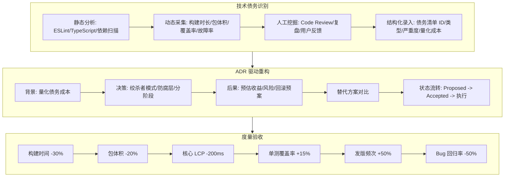

## 24.14 团队技术分享体系化与知识沉淀 —— 打造“会呼吸”的工程文化

### 24.14.1 为什么需要这个概念？

个人经验若不显性化、结构化、资产化，随人员流动流失，团队重复造轮子、重复踩坑。需建立低门槛、高频次、有产出、可考核的技术分享体系，将隐性知识转化为组织资产。配合架构演进白皮书，定期对外/对内输出系统性认知，建立团队技术品牌，吸引人才、沉淀口碑。根据《20230418_117.md》等 10 份实战素材（P012）、《KJ0CdYG18oMFStxpa17cxS0wnyt.md》、《YE1FdsTuxoaBbNx4f5dcnSNenxb.md》，需建立团队技术周会/月度深度分享/季度架构评审机制、沉淀《前端架构演进白皮书》；引入 Thoughtworks 技术雷达模式、季度雷达会议流程、Blip 迁移规则、开源工具 `tech-radar` 可视化发布、新人入职必读文档；制定内容生产节奏（周更/月更）、选题策略（踩坑复盘/源码解析/最佳实践/前沿解读）、开源项目孵化路径、演讲提案技巧。

### 24.14.2 核心定义

**分层分享机制**（来源：《20230418_117.md》 P012、《KJ0CdYG18oMFStxpa17cxS0wnyt.md》、《YE1FdsTuxoaBbNx4f5dcnSNenxb.md》）

- 周会（15min：踩坑复盘/新工具介绍/技术雷达预警）
- 月度深度分享（60min：源码解析/架构设计/最佳实践/前沿调研，产出文档/录屏/代码仓）
- 季度架构评审（半天：ADR 评审/路线图对齐/技术债务专项/跨团队依赖梳理）

**知识沉淀管道**

分享内容必须沉淀至团队知识库（Wiki/Notion/GitBook），形成《最佳实践指南》《避坑指南》《架构决策集》《组件使用手册》等结构化文档，支持全文检索、版本管理、标签分类。

### 24.14.3 关键性质

**产出导向**：分享不以“讲了”论功，以“留下了什么资产”论功（文档/代码/工具/规范/ADR）。鼓励“文档驱动分享”，先写文档再开会讲。

**新人传承机制**：入职前两周必读《团队技术白皮书》《架构演进史》《Top 10 避坑指南》，指定 Buddy 引导完成“微任务”（修复一个 Typo/补一个单测/改进一个文档），快速建立归属感。

**技术雷达联动**：分享内容同步更新技术雷达，新技术从“评估”->“试用”->“采纳”推进，废弃技术标记“暂缓”，指导选型与技能培训。

### 24.14.4 典型例子

**月度深度分享主题库**：`Vite 插件开发实战`、`Pinia 状态管理最佳实践`、`WebWorker 卸载主线程计算`、`微前端沙箱原理与调试`、`RAG 在前端知识库落地`、`前端性能优化实战：LCP 从 3.2s 降到 1.8s`。

**季度架构评审产出**：《2024 Q2 前端架构演进白皮书》包含：ADR 变更汇总、技术雷达移动轨迹、核心指标仪表盘（构建时长/包体积/部署频次/故障率/组件复用率）、下季度重点攻坚项目。

### 24.14.5 边界条件

**避免“分享疲劳”**：强制分享导致水化，采用“志愿报名 + 积分激励 + 绩效加分”模式，核心架构师/Tech Lead 做示范带头，营造“分享是荣誉、不分享无损失但错失成长”的氛围。

**知识库治理**：防止知识库变成“文档坟场”，设立“文档 Owner 制”，每份核心文档有明确维护人，半年必审一次，过期自动标记“待确认”，搜索结果优先展示高新鲜度文档。

**对外输出合规**：技术博客/开源/大会分享涉及公司核心代码/数据/架构细节，需走保密审批流程（法务/安全/领导签字），建立“可分享清单”与“脱敏规范”，鼓励在合规前提下建设技术影响力。

### 24.14.6 方法演进图

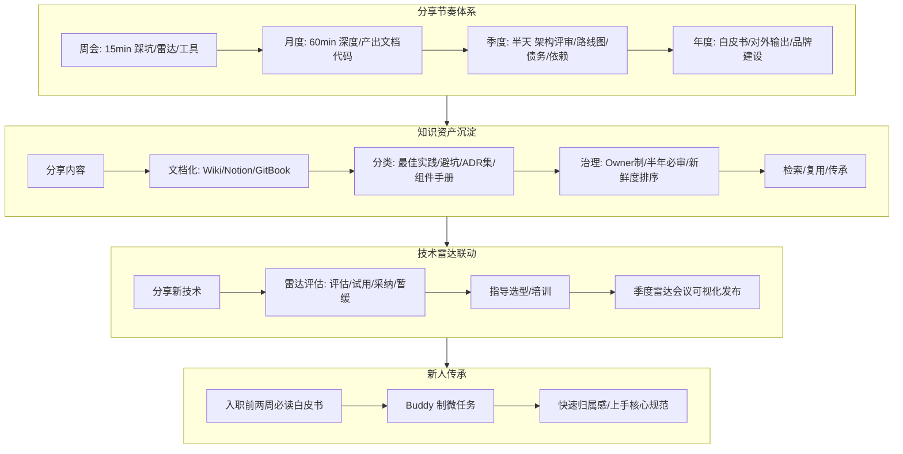

## 24.15 多源对照

### 共识

所有参考素材（`20230418_117.md` 至 `20230418_126.md`、`KJ0CdYG18oMFStxpa17cxS0wnyt.md`、`20230418_045.md`、`20230418_034.md`、`20230418_040.md`、`20230418_038.md`、`PbGkdX4YVoO02mxYlYKcbgASnSg.md`、`20230418_046.md`、`20230418_043.md`、`20230418_039.md`、`20230418_041.md`、`20230418_042.md`、`PU9Id4IPMoZ3QdxLzZUcEPBRnWO.md`、`YE1FdsTuxoaBbNx4f5dcnSNenxb.md`）一致认为：

1. **工程化先行**：必须在业务开发前完成技术选型、脚手架、基建封装，实现“Day 1 合规”（P001-P010 选型矩阵；P002/P045/P034 Monorepo/脚手架；P003/P040/P045/P124 UI/请求层）。
2. **自动化门禁**：CI/CD 质量门禁是保障交付质量的核心，必须包含 Lint、TypeCheck、测试、安全、性能、无障碍等维度（P009/P039/P041/P042/PU9Id4IPMoZ3QdxLzZUcEPBRnWO）。
3. **可观测性内建**：监控、追踪、日志需在基建期接入，而非事后补救（P006/P046/P133）。
4. **演进机制固化**：ADR、技术雷达、债务清单、分享体系是架构长期健康演进的必要基础设施（P011/P012/KJ0CdYG18oMFStxpa17cxS0wnyt/YE1FdsTuxoaBbNx4f5dcnSNenxb）。

### 分歧

- **微前端必要性**：`20230418_043.md` (P043) 强调团队>10人/多技术栈/独立发布才引入微前端；`20230418_117.md` 等实战素材（P008）倾向于在中后台标准化架构中预留微前端接入能力，即使初期单体运行，也为未来拆分做准备。
- **Monorepo 工具链**：`20230418_045.md` (P045) 推荐 Turborepo/Nx 做增量构建；`20230418_034.md` (P034) 侧重 Vite 原生生态，建议利用 Vite 多入口+库模式构建，配合 pnpm Workspace 原生特性，轻量化解决构建性能。
- **Schema 驱动边界**：`20230418_045.md` (P045，低代码视角) 倾向于 Schema 覆盖更广泛场景（含复杂交互）；`20230418_117.md` 等实战素材（P007/P099）主张 Schema 仅覆盖 80% 标准 CRUD，复杂场景开发专用组件，避免配置地狱。
- **CI/CD 部署策略**：`PU9Id4IPMoZ3QdxLzZUcEPBRnWO.md` 强调 ArgoCD GitOps + Istio 流量镜像的云原生交付；`20230418_039.md` (P039) 等更侧重 GitHub Actions/GitLab CI 的通用流水线配置，对部署层技术栈无强绑定。

## 24.16 设计中的取舍

**为什么不用 Polyrepo 而坚持 Monorepo？**

Polyrepo 在包版本同步、跨仓库重构、依赖升级协调上成本极高，且难以实现原子提交。Monorepo 配合 pnpm Workspace 和 Changesets，虽然引入了构建性能和权限隔离挑战，但通过 Turborepo/Nx 增量构建和私有 npm 源隔离敏感包可有效缓解，收益远大于成本（P002/P045/P034 共识）。

**为什么不直接用 Ant Design/Arco Design 原生组件，而要二次封装 `@enterprise/ui`？**

直接使用会导致业务代码强耦合第三方 API，升级底层库版本时面临全量改动风险。二次封装层吸收 Breaking Change，沉淀业务高阶组件，提供稳定企业级 API，是“为了不重复造轮子而造轮子”的典型工程权衡（P003/P040/P045/P124 共识）。

**为什么灰度发布不采用“全量部署后按用户分组”而是“流量逐级切分”？**

全量部署后再分组无法验证基础设施层面的问题（如 CDN 缓存、K8s 资源限额、网络策略）。流量逐级切分能在真实生产环境压力下验证全链路，且配合会话一致性和数据库兼容性策略，将故障半径控制在最小范围（P010/PU9Id4IPMoZ3QdxLzZUcEPBRnWO 共识）。

**为什么技术债务治理必须绑定 ADR 而非直接在 Jira 建任务？**

Jira 任务易丢失上下文、难以追溯决策理由、缺乏架构层面的后果分析。ADR 强制记录背景、决策、后果、替代方案，纳入代码仓库版本控制，使重构决策具有可追溯性、可审计性和传承性，避免“人走文档散、新人重踩坑”（P011/KJ0CdYG18oMFStxpa17cxS0wnyt 共识）。

## 24.17 动手练习

### 练习 1：技术选型决策矩阵与 ADR 实战演练

**场景**：团队需在 Vue 3 + Pinia + Vite 与 React 18 + Redux Toolkit + Rspack 两套技术栈中二选一，作为新中后台主应用基座。

**任务**：

1. 设计一个包含至少 6 个评估维度（如：团队熟悉度、生态成熟度、构建性能、长期维护成本、招聘市场供给、TypeScript 支持度）的决策矩阵，定义权重分配原则。
2. 模拟打分过程，计算加权得分。
3. 基于矩阵结果，编写一份 ADR 文档（包含 Context、Decision、Consequences、Alternatives、Status），并关联一个假设的 GitHub Issue 编号。

**思考题**：

- 如果 6 个月后团队核心成员流失 30%，导致熟悉度维度得分反转，ADR 应如何流转状态？是否需要新建 ADR？
- 如何避免决策矩阵沦为“为预设结论找理由”的工具？

### 练习 2：Monorepo 依赖治理与脚手架设计

**场景**：企业级 Monorepo 结构包含 `apps/admin-main`、`apps/admin-sub-user`、`packages/ui`、`packages/request`、`packages/config`（共享 ESLint/TS/Vite 配置）。

**任务**：

1. 绘制依赖关系图：标明哪些包依赖 `packages/config`、哪些包互相依赖、哪些为叶子节点。
2. 设计 `pnpm-workspace.yaml` 配置，要求：`packages/*` 互相链接、`apps/*` 消费 `packages/*`、根目录统一管理 `catalog` 依赖版本。
3. 编写 `create-enterprise-app` 脚手架核心交互逻辑伪代码：支持 `--framework=vue|react`、`--ui=arco|antd`、`--state=pinia|redux` 参数组合，生成对应的 `package.json` 依赖、`vite.config.ts` 插件、`tsconfig.json` 引用、`src/main.ts` 入口。

**思考题**：

- 当 `packages/ui` 升级导致 Breaking Change 时，如何利用 Monorepo 优势在单次 PR 中完成所有消费端适配并原子性发版？
- 核心加密算法包 `packages/crypto` 不能开源，如何在 Monorepo 中做权限隔离？

### 练习 3：Schema 驱动 CRUD 页面配置实战

**场景**：需快速生成“用户管理”列表页，包含：搜索区(用户名/状态/日期范围)、表格(姓名/手机/状态标签/角色标签/操作列)、分页、工具栏(新增/批量删除/导出)、新增/编辑抽屉表单(表单联动：选省份->加载城市)。

**任务**：

1. 定义该页面的 `PageSchema` JSON 结构（含 `layout`、`toolbar`、`table.columns`、`form.fields`、`actions.api` 映射、`permissions` 绑定）。
2. 针对“状态标签”列，设计 `renderer: 'TagRenderer'` 的 `options` 配置；针对“操作列”，设计 `renderer: 'ActionRenderer'` 的 `actions` 数组（含权限码、确认二次弹窗、图标）。
3. 编写表单联动配置：`province` 字段 `onChange` 回调中，如何声明式描述“清空 city 值”并“异步更新 city 选项”？

**思考题**：

- 当业务需求超出 Schema 表达能力（如：表格行内展开嵌套子表格、多步向导式表单），如何通过“渲染器注册机制”优雅扩展，而不污染核心 Schema 类型定义？
- Schema 版本从 1.0 升级到 2.0（如 `table.columns` 结构扁平化为 `columns` + `columnGroups`），如何设计迁移脚本自动转换存量 200+ 页面配置？

### 练习 4：CI/CD 质量门禁阈值设定与灰度发布策略推演

**场景**：中后台主应用日均部署 5 次，核心链路为“用户登录 -> 列表查询 -> 新建/编辑 -> 审批流转”。

**任务**：

1. 制定分阶段质量门禁阈值表：
   - Lint/TypeCheck: Error=0 (硬性)
   - 单测覆盖率: 核心包(@enterprise/*) ≥ 95%，业务包 ≥ 80%
   - E2E: 核心链路 100% 通过，非核心 ≥ 80%
   - 性能预算: LCP < 2.5s, CLS < 0.1, INP < 200ms, JS 体积 < 170KB(gzip)
   - 安全: High/Critical 漏洞 = 0, 秘钥扫描 = 0
   - 无障碍: axe-core 违规 = 0 (CI 阻断)
2. 设计金丝雀发布流量切分策略：1%(内部犬食) -> 5%(灰度用户组) -> 20%(新用户) -> 50% -> 100%，每阶段观测指标、持续时长、自动熔断条件(错误率>1% 或 核心转化率下降>5%)。
3. 编写回滚演练脚本大纲：模拟“新版本导致审批接口 500”，验证监控告警->值班响应->ArgoCD 回滚->流量回切->业务恢复全链路耗时。

**思考题**：

- 前端静态资源灰度易实现，但后端接口变更不兼容时，前端灰度如何通过 API 版本化/向后兼容字段/双写策略保证新旧前端版本共存？
- 视觉回归测试在动画/时间戳/用户头像场景频繁误报，如何设计 `mask` 与 `threshold` 策略平衡灵敏度与噪音？

### 练习 5：技术债务识别、量化与重构 ADR 闭环演练

**场景**：遗留项目中存在 3 个典型技术债务：
A. `utils/request.ts` 被 30+ 业务文件直接 import，内含 5 种 Token 刷新实现，无统一错误处理。
B. `UserTable.vue` 组件 1200 行，混杂搜索/表格/表单/权限/导出逻辑，零单测，改动必改 10 处。
C. 依赖 `lodash@4.17.15` (含原型污染漏洞) 与 `moment@2.29.0` (体积大、停维) 全量引入。

**任务**：

1. 填写《技术债务清单》结构化记录：为 A/B/C 分别定义 ID、类型、严重度(P0-P4)、影响范围、量化痛点数据(如：排查网络问题平均耗时+30min/次、单测覆盖率0%、包体积多增50KB)。
2. 为债务 A 编写重构提案 ADR：背景量化成本、决策采用绞杀者模式分 4 阶段迁移至 `@enterprise/request`、提供 Codemod 脚本自动替换 import 路径、定义验收指标(网络排查耗时-80%、请求层覆盖率 100%)。
3. 设计“技术债务专项偿还预算”在季度规划中的占比策略：如每 Sprint 预留 20% 带宽、每季度设立 1 周“技术攻坚周”、P0 债务随时插入。

**思考题**：

- 如何防止“重构债务”本身成为新债务？(提示：并行运行对比、防腐层、特性开关、度量验收)
- 组件复用率统计若仅计算 `import '@enterprise/ui'` 次数，有何盲区？如何设计更能反映真实复用价值的指标体系？

## 24.18 本章小结

这一章中我们学习了企业级中后台前端架构的全生命周期落地流程。首先，我们通过技术选型决策矩阵与 ADR 记录，为架构决策建立了可追溯的法庭；其次，我们掌握了 Monorepo 仓库初始化与标准化脚手架，让新项目创建变成一键生成；接着，我们深入剖析了 UI 组件库二次封装、统一请求层、RBAC 权限体系与动态路由、国际化无障碍基线、异常监控可观测性等核心基建模块的工程化落地；然后，我们探讨了 Schema 驱动的 CRUD 页面标准化与微前端子应用接入治理，实现效率与规范并重；最后，我们构建了 CI/CD 质量门禁、金丝雀灰度发布、回滚演练、技术债务 ADR 治理以及团队技术分享体系，打通了从开发到运维、从个人到组织的持续进化闭环。

本章我们一起学习了以下概念：

| 概念 | 解释 |
|------|------|
| 技术选型决策矩阵 | 多维度量化评分工具，将主观偏好转化为团队共识的客观决策依据 |
| 架构决策记录 (ADR) | 记录背景-决策-后果-替代方案的不可篡改单页文档，构建架构考古的证据链 |
| Monorepo (pnpm Workspace) | 单仓多包管理模式，实现依赖去重、原子提交、代码共享零成本、统一规范 |
| 标准化脚手架 | 将最佳实践固化为可交互生成的模版，保证新项目 Day 1 即满足工程规范 |
| 二次封装组件库 (@enterprise/ui) | 吸收底层库 Breaking Change，沉淀业务高阶组件(ProTable/ProForm)，提供稳定企业级 API |
| 统一请求层 (@enterprise/request) | 内置拦截器、类型安全、Token无感刷新、错误码映射、请求去重的网络层基建 |
| RBAC 与动态路由 | 基于后端下发路由树与权限码，实现菜单/按钮/页面级动态访问控制与刷新保活 |
| i18n/a11y 工程化基线 | ICU MessageFormat + 编译时优化 + CI门禁，WCAG 2.1 AA 级组件库内置合规 |
| 全链路可观测性 | 错误监控(Source Map还原) + 性能监控(Web Vitals) + 链路追踪(TraceID透传) 三位一体 |
| Schema 驱动开发 | 声明式 PageSchema 配置生成 CRUD 页面，配合渲染器注册机制平衡标准化与扩展性 |
| 微前端治理 (qiankun/Module Federation) | 沙箱隔离/样式隔离/共享依赖单例/基座分发/通信机制/版本锁定规范的系统性落地 |
| CI/CD 质量门禁 | 分阶段阻断：Lint/TypeCheck/Unit/E2E/Build/Scan/Perf/A11y，制品不可变 + GitOps 交付 |
| 金丝雀发布与回滚演练 | 流量渐进切分+会话一致性+数据库兼容+自动熔断+季度实战演练，RTO < 5min |
| 技术债务 ADR 治理 | 分级分类(P0-P4)、量化成本、绞杀者模式渐进重构、度量驱动验收(构建/体积/LCP/覆盖率/频次) |
| 团队技术分享与白皮书 | 周会/月度/季度分层机制，产出导向沉淀资产，技术雷达联动，新人传承标准化 |

下一章中，我们将学习如何将前端架构能力扩展到 AI 原生应用开发，探索大模型时代的前端工程新范式。

感谢你读到了这里，恭喜你，你已经完成了前端工程化核心体系的系统性学习与实战演练！

