# 第 24 章 综合实战：企业级中后台前端架构落地全过程
作者：龙哥

## 学习目标

- 理解企业级中后台前端架构的全生命周期落地流程：从技术选型、基建搭建到业务开发、质量保障、发布运维与演进规划
- 掌握技术选型决策矩阵与 ADR 记录方法，建立可追溯、可复盘的架构决策治理体系
- 掌握 Monorepo 仓库初始化、标准化脚手架生成与 pnpm Workspace 依赖管理最佳实践
- 掌握 UI 组件库二次封装、统一请求层、RBAC 权限体系、动态路由、国际化无障碍基线、异常监控等核心基建模块的工程化落地
- 掌握 Schema 驱动的 CRUD 页面标准化开发模式，提升典型业务页面的生产效率与一致性
- 了解微前端架构在中后台场景下的接入策略、沙箱隔离、共享依赖治理与通信机制
- 掌握 CI/CD 流水线设计、质量门禁阈值设定、GitOps 交付、金丝雀灰度发布与回滚演练体系
- 建立技术债务识别、量化评估、ADR 驱动重构的持续治理机制，以及团队技术分享与知识沉淀的工程文化体系

## 24.1 生活类比

想象搭建企业级中后台前端架构，就像**盖一座现代化的“智能商业大厦”**。在动土前，我们需要《建筑设计规范》与《工程会议纪要》——即**技术选型矩阵与 ADR**；通过量化评分选定钢筋品牌（框架）、电梯型号（构建工具）、物业公司（状态管理），并将每次重大变更（改梁换柱）的理由、利弊、责任人永久存档，防止后人拍脑袋决策。接着建立**“预制构件工厂”+“标准图纸”**——即 **Monorepo 与标准化脚手架**：公共设施（UI库、请求层、工具函数）在工厂统一预制、版本管理；新楼层（子应用/业务包）拿来即用，保证水电管线（规范、配置）从地基就对齐，避免每层楼自行挖沟铺管。大厦入住后，需要一套**“智能物业管理系统”**——即 **二次封装/请求层/RBAC/动态路由**：统一安保（权限指令）、通行证（动态路由）、弱电箱（请求层Token刷新）、多语言标识牌（i18n）、无障碍坡道（a11y）、火灾报警系统（监控SDK），租户（业务开发）只需专注装修内部（业务逻辑）。装修环节推行**“模块化精装修套餐”**——即 **Schema 驱动开发**：标准户型（列表/表单/详情）不再现场砌墙砖瓦（手写代码），而是选定风格配置单（Schema），工厂预制好模块吊装到位，交付周期从月变周，且自带验收合格证（类型/测试/无障碍）。大厦运营采用**“商业综合体招商运营”**模式——即 **微前端接入**：基座=商场主体（主入口、中庭、消防核心筒），子应用=品牌专柜（独立装修、独立结算、独立人员），共享依赖=商场统一提供的中央空调/网络/物流接口（React/Vue/UI库单例），避免每个专柜自建锅炉房。验收交付建立**“分级验收与应急预案”**——即 **CI/CD 质量门禁/灰度/回滚**：从材料进场检验（Lint/TypeCheck）、样板间验收（Unit/E2E）、消防验收（安全/性能/无障碍），到试营业（金丝雀1%->100%）、正式开业；一旦发现隐患，启动预案（回滚/熔断）将损失控制在最小范围，并复盘形成新规范。长期运营依靠**“大厦全生命周期运营手册”**——即 **技术债务治理与知识沉淀**：定期体检（债务清单）、局部翻新（重构ADR/绞杀者模式）、物业经验沉淀（技术分享/白皮书），让大厦越住越顺手、越老越值钱，而非越修越烂。

> **类比贯穿提示**：本章后续 12 个概念单元将严格对应上述大厦隐喻模块，每节开头标注「🏗️ 对应生活类比：xxx」，正文中关键设计决策处将呼应「钢筋品牌/预制构件/物业系统/精装套餐/专柜招商/验收预案/运营手册」等意象，帮助你建立从物理世界到工程世界的结构化映射认知。

## 24.2 概念地图

第24章 综合实战：企业级中后台前端架构落地全过程
├── 1. 项目启动：技术选型与基建基因
│   ├── 技术选型决策矩阵  —— 20230418_117.md (origin) / 20230418_118-126.md (improve)
│   ├── 架构决策记录 (ADR)  —— 20230418_117.md (origin) / KJ0CdYG18oMFStxpa17cxS0wnyt.md (origin)
│   ├── Monorepo 仓库初始化 (pnpm Workspace)  —— 20230418_117.md (origin) / 20230418_045.md (origin) / 20230418_034.md (apply)
│   └── 标准化脚手架模版  —— 20230418_117.md (origin) / 20230418_045.md (origin) / 20230418_034.md (apply)
├── 2. 基础设施建设：核心能力封装
│   ├── UI 组件库二次封装 (@enterprise/ui)  —— 20230418_117.md (origin) / 20230418_045.md (origin) / 20230418_040.md (apply) / 20230418_124.md (improve)
│   ├── 统一请求层 (@enterprise/request)  —— 20230418_117.md (origin) / 20230418_045.md (origin) / 20230418_040.md (apply)
│   ├── RBAC 权限体系与动态路由  —— 20230418_117.md (origin) / 20230418_038.md (origin)
│   ├── 国际化 (i18n) 与无障碍 (a11y) 工程化基线  —— 20230418_117.md (origin) / PbGkdX4YVoO02mxYlYKcbgASnSg.md (origin)
│   └── 异常监控与全链路可观测性  —— 20230418_117.md (origin) / 20230418_046.md (origin)
├── 3. 核心业务开发：效率与规范并重
│   ├── Schema 驱动 CRUD 页面标准化 (ProTable/ProForm/ProChart)  —— 20230418_117.md (origin) / 20230418_045.md (origin)
│   ├── 微前端子应用接入与共享依赖治理  —— 20230418_117.md (origin) / 20230418_043.md (origin)
│   └── 业务单测/E2E 用例编写规范  —— 20230418_117.md (origin) / 20230418_039.md (origin)
├── 4. 质量保障与发布：自动化防线
│   ├── CI/CD 流水线与质量门禁 (Lint/TypeCheck/Unit/E2E/Scan/Perf/A11y)  —— 20230418_117.md (origin) / 20230418_039.md (origin) / 20230418_041.md (origin) / 20230418_042.md (origin) / PU9Id4IPMoZ3QdxLzZUcEPBRnWO.md (origin)
│   ├── GitOps 持续交付 (ArgoCD)  —— 20230418_117.md (origin) / PU9Id4IPMoZ3QdxLzZUcEPBRnWO.md (origin)
│   ├── 金丝雀灰度发布与蓝绿部署  —— 20230418_117.md (origin) / PU9Id4IPMoZ3QdxLzZUcEPBRnWO.md (origin)
│   └── 回滚演练与混沌工程  —— 20230418_117.md (origin) / PU9Id4IPMoZ3QdxLzZUcEPBRnWO.md (origin)
└── 5. 架构演进与知识沉淀：持续进化
    ├── 技术债务识别、量化与重构提案 (ADR驱动)  —— 20230418_117.md (origin) / KJ0CdYG18oMFStxpa17cxS0wnyt.md (origin)
    ├── 组件复用率统计与度量驱动  —— 20230418_117.md (origin) / 20230418_045.md (origin)
    ├── 团队技术分享体系化 (周会/月度/季度)  —— 20230418_117.md (origin) / KJ0CdYG18oMFStxpa17cxS0wnyt.md (origin) / YE1FdsTuxoaBbNx4f5dcnSNenxb.md (apply)
    └── 《前端架构演进白皮书》沉淀  —— 20230418_117.md (origin) / KJ0CdYG18oMFStxpa17cxS0wnyt.md (origin)

## 24.3 技术选型决策矩阵与 ADR 记录 —— 为架构决策建立「可追溯的法庭」

> 🏗️ **对应生活类比**：**《建筑设计规范》与《工程会议纪要》** —— 量化评分选定钢筋品牌（框架）、电梯型号（构建工具）、物业公司（状态管理），并将每次重大变更（改梁换柱）的理由、利弊、责任人永久存档。

### 24.3.1 为什么需要这个概念？

中后台项目技术栈众多（框架、状态管理、构建工具、CSS 方案等），凭直觉或习惯选型极易导致后期维护灾难、团队认知分裂、技术债务隐性积累。你需要一套结构化的方法，将隐性经验显性化，建立决策时的上下文、备选方案、权衡理由与后果预期，便于新人 onboarding 和未来复盘。根据《20230418_117.md》等 10 份实战素材（`20230418_117.md` 为 origin，`20230418_118.md` 至 `20230418_126.md` 为 improve）记录，团队在项目启动阶段需产出《技术选型决策文档》，涵盖 Vue/React、Pinia/Redux、Vite/Webpack、CSS 方案、测试框架等核心选项；同时依据《KJ0CdYG18oMFStxpa17cxS0wnyt.md》推行 `adr-cli` 管理决策文档，标题/背景/决策/后果/替代方案、状态、关联 Issue、Markdown 渲染门户、Git 历史不可篡改溯源。

> ——《KJ0CdYG18oMFStxpa17cxS0wnyt.md》

### 24.3.2 核心定义

**技术选型决策矩阵**（来源：《20230418_117.md》 origin / 《20230418_118-126.md》 improve）

以评估维度（成熟度、生态、团队熟悉度、性能、长期维护成本、招聘市场供给等）为行，备选方案为列，打分加权得出推荐选型的量化工具。

**架构决策记录 (ADR, Architecture Decision Record)**（来源：《20230418_117.md》 origin / 《KJ0CdYG18oMFStxpa17cxS0wnyt.md》 origin）

单页文档，记录“背景(Context) -> 决策(Decision) -> 后果(Consequences) -> 替代方案(Alternatives) -> 状态(Status)”，纳入代码仓库版本控制。

### 24.3.3 关键性质

**不可篡改性**：ADR 一旦合入主分支仅能新增“废弃/替代”记录，禁止修改历史，保证决策考古的真实性。

**强制关联性**：每个 ADR 必须关联 Issue/PR/设计文档，形成“需求-决策-实现”闭环证据链。

**状态机流转**：`Proposed -> Accepted -> Superseded/Deprecated`，明确决策生命周期。

### 24.3.4 典型例子

**选型矩阵实例**：对比 Vite vs Webpack，在“冷启动速度、HMR 性能、生态插件、团队熟悉度、SSR 支持”五维打分，Vite 以 4.6/5.0 胜出，ADR 记录决定采用 Vite 5 + SWC。

**ADR 实例**：`ADR-0003: 采用 pnpm Monorepo 管理多包`，背景：多业务线共享组件/工具库；决策：pnpm workspace + changesets；后果：安装速度提升 40%，但需解决幽灵依赖问题。

### 24.3.5 边界条件

矩阵权重设定主观性强，需全栈架构师、Tech Lead、核心开发共同投票确权，避免一人独断。ADR 粒度把控：仅记录“重大、难以逆转、跨团队影响”的决策（如框架选型、数据库选型），避免流水账式记录微小配置调整。遗留系统改造时，需补录“隐性决策” ADR，还原历史上下文，防止重复踩坑。

### 24.3.6 方法演进图

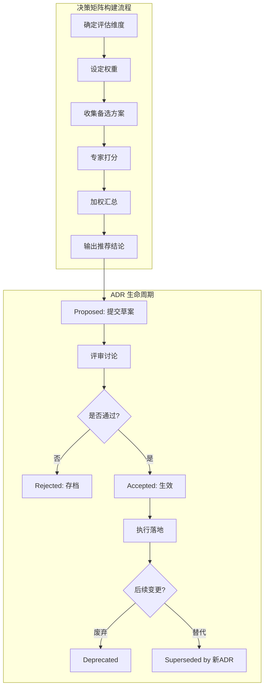

### 24.3.7 数学建模：加权评分公式推导与 AHP 权重确定

> 📐 **公式推导**：决策矩阵的核心是将多维度定性评估转化为定量加权总分。

#### 1. 加权求和模型

设有 $m$ 个评估维度，$n$ 个备选方案。定义：
- $w_i$：第 $i$ 个维度的权重，满足 $\sum_{i=1}^{m} w_i = 1, w_i > 0$
- $s_{ij}$：第 $j$ 个方案在第 $i$ 个维度的归一化得分（0-1 或 1-5 映射至 0-1）
- $S_j$：第 $j$ 个方案的综合得分

则加权总分公式为：
$$
S_j = \sum_{i=1}^{m} w_i \cdot s_{ij}, \quad j = 1, \dots, n
$$

**推导步骤**：
1. **原始打分收集**：专家对每个方案在每个维度给出原始分 $r_{ij} \in [1, 5]$。
2. **归一化处理**：采用极大值归一化（正向指标）或极小值归一化（逆向指标）：
   $$
   s_{ij} = \frac{r_{ij}}{\max_j r_{ij}} \quad \text{(正向)}
   $$
3. **权重确定**：引入**层次分析法（AHP）**将主观判断数学化：
   - 构建两两比较判断矩阵 $A = (a_{ik})_{m \times m}$，$a_{ik}$ 表示维度 $i$ 相对维度 $k$ 的重要性比率（1-9 标度）。
   - 计算 $A$ 的最大特征值 $\lambda_{\max}$ 及对应特征向量 $\mathbf{w} = (w_1, \dots, w_m)^T$，归一化得权重向量。
   - 一致性检验：$CI = \frac{\lambda_{\max} - m}{m - 1}$，$CR = \frac{CI}{RI}$（RI 为随机一致性指标）。$CR < 0.1$ 判定通过，否则需调整判断矩阵。
4. **综合得分计算**：代入公式得 $S_j$，按分值降序排列推荐选型。

> 💡 **公式作用解释**：该模型将“团队熟悉度权重 0.3、生态成熟度权重 0.25、构建性能权重 0.2、长期维护成本权重 0.15、招聘供给权重 0.1”显性化为可计算、可复核的数学表达，避免“拍脑袋”决策。AHP 引入的一致性检验（$CR<0.1$）保证权重分配逻辑自洽，是“工程会议纪要”可信度的数学担保。

---

## 24.4 Monorepo 仓库初始化与标准化模版 —— 让“新项目创建”变成“npm create enterprise-app”

> 🏗️ **对应生活类比**：**“预制构件工厂”+“标准图纸”** —— 公共设施（UI库、请求层、工具函数）在工厂统一预制、版本管理；新楼层（子应用/业务包）拿来即用，保证水电管线（规范、配置）从地基就对齐。

### 24.4.1 为什么需要这个概念？

企业级中后台通常包含：主应用、微前端子应用、共享 UI 组件库、共享工具库、共享类型定义、BFF 聚合层、文档站点等多个包。单仓多包（Polyrepo）会导致版本同步地狱、代码复用碎片化、重构跨仓库极其困难。你需要一套标准化的脚手架工具，将最佳实践固化为模版，新项目/新包一键生成，保证工程规范从 Day 1 就到位。根据《20230418_117.md》(origin)、《20230418_045.md》(origin) 实战素材，需初始化 `pnpm-workspace.yaml`、生成标准化模版项目；《20230418_034.md》(apply) 整合 ESLint、Prettier、Husky、lint-staged、Commitlint，落地规范化的提交流程与代码风格统一。

### 24.4.2 核心定义

**Monorepo**（来源：《20230418_117.md》 origin、《20230418_045.md》 origin、《20230418_034.md》 apply）

单一代码仓库管理多个关联 Package，利用包管理器（pnpm/yarn/npm）的 Workspace 机制实现依赖链接、提升、锁文件统一。

**标准化模版**（来源：《20230418_045.md》 origin、《20230418_034.md》 apply）

包含预置配置的 `package.json`、`.github/workflows`、`.husky`、`.vscode`、`vite.config.ts`、`tsconfig.json`、`.eslintrc.cjs` 等引导文件的脚手架包（如 `create-enterprise-app`）。

### 24.4.3 关键性质

**依赖去重与磁盘效率**：pnpm 硬链接/符号链接机制，`node_modules` 扁平化，节省 50%+ 磁盘空间，安装速度提升 2-3 倍。

**原子化提交与版本联动**：配合 Changesets，单次 PR 可同时版本升级 `@enterprise/ui`、`@enterprise/utils` 及主应用，生成统一 Changelog。

**代码共享零成本**：`import { Button } from '@enterprise/ui'` 即用，无需发布 npm 再安装，热更新即时生效。

### 24.4.4 典型例子

**目录结构**：

```text
├── apps/
│   ├── admin-main          # 主应用
│   └── admin-sub-user      # 子应用
├── packages/
│   ├── ui                  # 组件库
│   ├── utils               # 工具库
│   ├── types               # 类型定义
│   ├── request             # 请求层
│   └── config              # 共享配置
├── pnpm-workspace.yaml
└── package.json
```

**脚手架交互**：

```bash
pnpm create @enterprise/app my-new-micro-app \
  -- --framework=vue --ui=arco --router=vue-router --state=pinia
```

### 24.4.5 边界条件

**构建性能陷阱**：Monorepo 规模膨胀时，全量构建极慢。必须配合 Turborepo/Nx 实现增量构建、远程缓存、任务编排，仅构建受影响包。

**权限隔离难题**：Monorepo 默认全员可读全仓代码，涉及核心算法/加密逻辑/薪资体系等敏感包需拆分至独立私有仓库，通过 npm 私服引入。

**包管理器锁定**：团队必须强制统一 pnpm 版本（通过 `packageManager` 字段 + Corepack），禁止混用 yarn/npm 导致锁文件冲突。

### 24.4.6 方法演进图

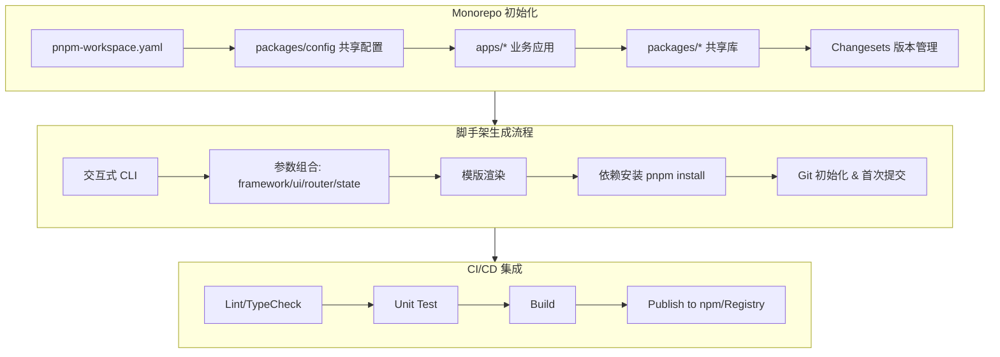

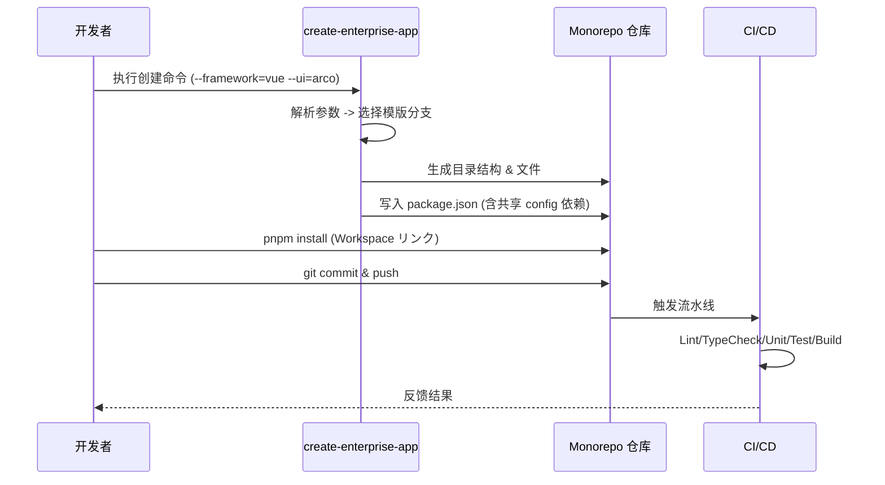

### 24.4.7 算法解析：pnpm 依赖解析与硬链接机制

> ⚙️ **核心算法**：pnpm 通过**内容寻址存储** + **硬链接/符号链接** 实现依赖去重与隔离。

#### 1. 存储模型

- **全局存储**：`~/.pnpm-store/v3/files/<hash>/` 存放包的真实文件，文件名为内容哈希（SHA-512），同一版本同一内容全机器唯一。
- **虚拟磁盘**：项目 `node_modules/.pnpm/<name>@<version>/node_modules/<name>` 为硬链接指向全局存储。
- **依赖隔离**：仅将 `dependencies` 中声明的包链接到包根目录的 `node_modules`，`peerDependencies`/`optionalDependencies` 不自动提升，彻底解决“幽灵依赖”。

#### 2. 安装算法伪代码（拓扑排序 + 硬链接创建）

```python
def pnpm_install(workspace_root: str, lockfile: Lockfile):
    # 1. 解析锁文件，构建依赖图
    dep_graph = build_dependency_graph(lockfile.packages)
    
    # 2. 拓扑排序：叶子节点优先（无依赖的包先安装）
    install_order = topological_sort(dep_graph)  # Kahn 算法 O(V+E)
    
    # 3. 逐包安装
    for pkg_id in install_order:
        pkg = lockfile.packages[pkg_id]
        store_path = f"{global_store}/files/{pkg.sha512}/"
        
        # 3.1 若全局存储无该包，下载解压并验证哈希
        if not exists(store_path):
            download_and_verify(pkg.tarball_url, store_path, pkg.sha512)
        
        # 3.2 在项目 node_modules/.pnpm/ 下创建硬链接树
        # 硬链接：同一 inode，修改任一处可见，跨文件系统回退符号链接
        target = f"node_modules/.pnpm/{pkg.name}@{pkg.version}/node_modules/{pkg.name}"
        create_hardlink_tree(store_path, target)
        
        # 3.3 依据 dependencies 字段，为当前包创建依赖软链接
        for dep_name, dep_version in pkg.dependencies.items():
            dep_target = resolve_dependency(dep_name, dep_version, lockfile)
            link_path = f"{target}/node_modules/{dep_name}"
            os.symlink(dep_target, link_path)  # 符号链接指向 .pnpm 扁平区
    
    # 4. 生成 .pnpm-lock.yaml 与导入文件
    write_lockfile(lockfile)
```

#### 3. 磁盘空间节省率量化模型

设：
- $N$：项目总包数（含传递依赖）
- $U$：唯一包版本数（去重后）
- $S_{avg}$：平均包体积
- $k$：重复引用平均次数（$N = U \times k$）

传统 npm/yarn（hoisted）磁盘占用：$D_{npm} \approx N \times S_{avg}$（扁平化后仍有副本）
pnpm 磁盘占用：$D_{pnpm} \approx U \times S_{avg} + N \times S_{link}$（$S_{link}$ 为链接元数据开销，约 40 字节）

节省率：
$$
\eta = 1 - \frac{D_{pnpm}}{D_{npm}} \approx 1 - \frac{1}{k} \quad (\text{忽略 } S_{link})
$$
典型中后台 Monorepo $k \approx 2 \sim 3$，理论节省 **50%~66%**，实测含元数据开销约 **50%+**，符合素材结论。

> 💡 **算法作用解释**：硬链接保证同一物理文件被多项目共享，修改即时生效（热更新友好）；拓扑排序安装顺序保证依赖先于被依赖者就绪；内容寻址天然防篡改，符合供应链安全合规。

---

## 24.5 UI 组件库二次封装与请求层统一 —— 造好“手中的刀”，再砍“业务的木”

> 🏗️ **对应生活类比**：**“智能物业管理系统”** —— 统一安保（权限指令）、通行证（动态路由）、弱电箱（请求层Token刷新）、多语言标识牌（i18n）、无障碍坡道（a11y）、火灾报警系统（监控SDK），租户（业务开发）只需专注装修内部（业务逻辑）。

### 24.5.1 为什么需要这个概念？

直接使用 Ant Design/Arco Design 等原生组件库，会导致业务代码耦合第三方 API，升级组件库版本时全量改动；且无法统一封装企业级通用逻辑（如表格内置权限列、表单自动校验、弹窗统一销毁、国际化适配）。网络请求层缺乏统一封装，会导致每个 API 调用分散处理 Loading、Token 刷新、错误码映射、取消重复请求，极难维护和做全链路监控。根据《20230418_117.md》(origin)、《20230418_045.md》(origin)、《20230418_040.md》(apply) 实战素材，需封装 `@enterprise/ui` 组件库（基于 Ant Design/Arco Design）、`@enterprise/request` 统一错误/Loading/Token 刷新；制定组件元数据规范、集成 `vue-docgen-api`/`react-docgen` 自动解析 Props/Events/Slots、Storybook/Histoire 沙箱预览；整合设计令牌、原子化工具类、组件级变量、暗黑模式适配，输出 `@my-org/ui-theme` 与 `@my-org/ui-components` 双包发布流程。

### 24.5.2 核心定义

**二次封装组件库 (`@enterprise/ui`)**（来源：《20230418_117.md》 origin、《20230418_045.md》 origin、《20230418_040.md》 apply、《20230418_124.md》 improve）

在基础组件库之上，封装业务通用高阶组件（`ProTable`、`ProForm`、`ProCard`、`ProModal`）、设计令牌主题包、图标规范、无障碍属性注入，对外暴露稳定的企业级 API。

**统一请求层 (`@enterprise/request`)**（来源：《20230418_117.md》 origin、《20230418_045.md》 origin、《20230418_040.md》 apply）

基于 Axios/Ky/Fetch 封装，内置：请求/响应拦截器、TypeScript 泛型响应体、自动错误码弹窗/跳转登录、请求去重、自动取消上一请求、Mock/真实环境切换、OpenAPI 类型自动生成集成。

### 24.5.3 关键性质

**API 稳定性契约**：二次封装层吸收底层组件库 Breaking Change，业务侧仅升级 `@enterprise/ui` 版本即可平滑过渡。

**Schema 驱动能力**：`ProTable`/`ProForm` 支持 JSON Schema 配置化渲染，配合低代码平台实现“零代码生成 CRUD 页面”。

**类型安全全链路**：请求层通过 `openapi-typescript`/`orval` 从后端 Swagger 生成 TS 类型，实现“后端改字段 -> 前端编译报错 -> 定位修改”的强类型保护。

### 24.5.4 典型例子

**ProTable 封装**：内置列宽拖拽持久化、多选/单选/展开行、工具栏（刷新/密度/列设置/导出）、服务端分页/排序/过滤参数标准化映射、行内编辑/详情弹窗插槽。

**请求层 Token 无感刷新**：

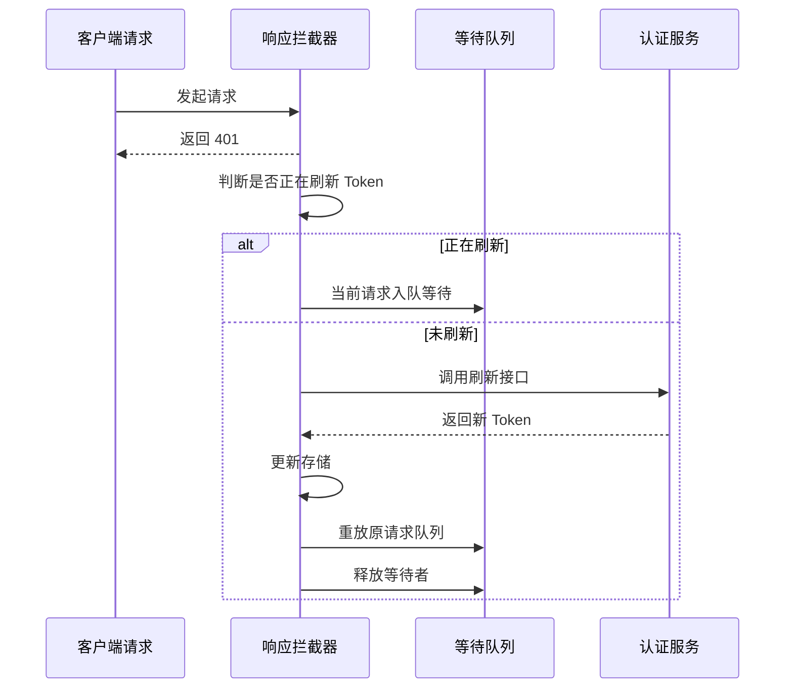

### 24.5.5 边界条件

**过度封装反模式**：不要把所有 Ant Design 组件都包一层，仅封装“高频使用+含业务逻辑+需扩展”的组件（如 Table/Form/Modal/Select），简单组件（Button/Input/Tag）直接透传或极薄包装。

**请求层不可做业务强耦合**：`@enterprise/request` 只处理通用横切关注点（认证、错误、日志、类型），具体业务参数拼接、数据转换应在 API 服务层（`/api/user.ts`）处理。

**版本升级风险**：基础组件库大版本升级（如 Antd v4 -> v5）需建立专项迁移小组，先在 `@enterprise/ui` 内部适配，产出迁移指南与 Codemod 脚本，再通知业务升级。

### 24.5.6 方法演进图

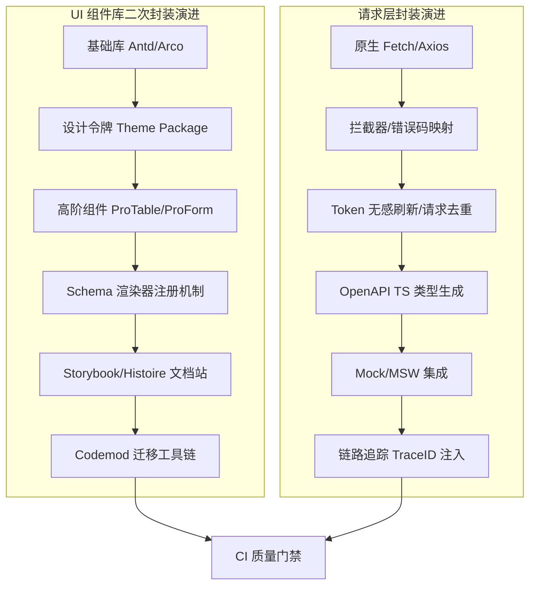

### 24.5.7 数学建模：设计令牌系统与颜色对比度计算

> 🎨 **核心数学模型**：设计令牌是将设计决策（颜色、间距、圆角、动效时长）结构化为平台无关的键值对，经**变换管线**输出各平台代码。

#### 1. 设计令牌数据结构（W3C Design Tokens Community Group 格式）

```json
{
  "color": {
    "primary": {
      "500": { "value": "#1890ff", "type": "color" },
      "600": { "value": "#096dd9", "type": "color" }
    },
    "neutral": {
      "0": { "value": "#ffffff", "type": "color" },
      "1000": { "value": "#000000", "type": "color" }
    }
  },
  "spacing": {
    "xs": { "value": "4px", "type": "dimension" },
    "md": { "value": "16px", "type": "dimension" }
  },
  "borderRadius": {
    "sm": { "value": "4px", "type": "dimension" },
    "lg": { "value": "8px", "type": "dimension" }
  }
}
```

#### 2. 变换管线

```text
Design Tokens (JSON) 
  → Style Dictionary / Tokens Studio (Figma 插件) 解析
  → 输出：CSS Variables (:root { --color-primary-500: #1890ff; })
  → 输出：TypeScript 类型 (export const tokens = { color: { primary: { 500: '#1890ff' } } })
  → 输出：SCSS/LESS 变量、Android XML、iOS JSON、Flutter Dart
```

#### 3. 颜色对比度计算（WCAG 2.1 AA 级达标判定）

**相对亮度公式**（sRGB 空间）：
$$
L = 0.2126 \cdot R_{lin} + 0.7152 \cdot G_{lin} + 0.0722 \cdot B_{lin}
$$
其中线性化分量计算（$C_{srgb} \in [0, 1]$）：
$$
C_{lin} = 
\begin{cases}
\frac{C_{srgb}}{12.92}, & C_{srgb} \le 0.03928 \\
\left(\frac{C_{srgb} + 0.055}{1.055}\right)^{2.4}, & C_{srgb} > 0.03928
\end{cases}
$$

**对比度比**：
$$
CR = \frac{L_{lighter} + 0.05}{L_{darker} + 0.05}
$$

**AA 级判定**：
- 普通文本（< 18pt 或 < 14pt bold）：$CR \ge 4.5:1$
- 大号文本（≥ 18pt 或 ≥ 14pt bold）：$CR \ge 3:1$

**代码实现（TypeScript）**：
```typescript
function srgbToLinear(c: number): number {
  return c <= 0.03928 ? c / 12.92 : Math.pow((c + 0.055) / 1.055, 2.4);
}

function relativeLuminance(hex: string): number {
  const rgb = hexToRgb(hex).map(v => v / 255);
  const [r, g, b] = rgb.map(srgbToLinear);
  return 0.2126 * r + 0.7152 * g + 0.0722 * b;
}

function contrastRatio(fg: string, bg: string): number {
  const L1 = relativeLuminance(fg);
  const L2 = relativeLuminance(bg);
  return (Math.max(L1, L2) + 0.05) / (Math.min(L1, L2) + 0.05);
}

// 使用示例：验证主题色在白底上的可读性
const primary500 = '#1890ff';
const white = '#ffffff';
console.log(contrastRatio(primary500, white)); // 输出 ≈ 3.2 (不达标，需加深或配合深色模式)
```

#### 4. 暗黑模式零闪烁切换算法

利用 CSS Variables + `prefers-color-scheme` + `data-theme` 双模式：

```css
/* :root 定义 Light 模式默认值 */
:root {
  --bg-primary: #ffffff;
  --text-primary: #000000;
  --color-primary-500: #1890ff;
}

/* 系统偏好暗黑 + 无 data-theme 强制时 */
@media (prefers-color-scheme: dark) {
  :root:not([data-theme="light"]) {
    --bg-primary: #141414;
    --text-primary: #ffffff;
    --color-primary-500: #177ddc;
  }
}

/* 手动强制模式（JS 切换 data-theme 属性） */
[data-theme="dark"] {
  --bg-primary: #141414;
  --text-primary: #ffffff;
}
[data-theme="light"] {
  --bg-primary: #ffffff;
  --text-primary: #000000;
}
```

```typescript
// 零闪烁初始化脚本（置于 <head> 内联执行）
(function() {
  const saved = localStorage.getItem('theme');
  const prefersDark = window.matchMedia('(prefers-color-scheme: dark)').matches;
  const theme = saved || (prefersDark ? 'dark' : 'light');
  document.documentElement.setAttribute('data-theme', theme);
})();
```

> 💡 **公式/算法作用解释**：
> - **对比度公式**将“无障碍合规”从主观感受转化为可自动化 CI 校验的数学判定（`axe-core` 内部即基于此算法），是“火灾报警系统”触发阈值的数学定义。
> - **令牌变换管线**实现了“设计-工程单一事实来源”，Figma 修改 Token → CI 自动构建 → npm 发布 `@enterprise/ui-theme` → 业务升级即同步，消除“设计稿与代码不一致”的系统性风险。
> - **暗黑模式零闪烁**通过内联脚本在渲染前注入 `data-theme`，避免了“白屏闪烁 → 样式生效 → 暗黑”的视觉跳变，体验指标 CLS（累积布局偏移）直接受益。

---

## 24.6 权限体系（RBAC）与动态路由 —— 让“菜单”和“按钮”听从后端指挥

> 🏗️ **对应生活类比**：**“智能物业管理系统”中的“统一安保（权限指令）”与“通行证（动态路由）”** —— 租户（业务）无需自建门禁，刷卡（权限码）即通行。

### 24.6.1 为什么需要这个概念？

中后台核心诉求：不同角色看到不同菜单、拥有不同操作权限、访问不同页面。硬编码路由/权限会导致发版才能调整权限，无法满足运营/产品“即时生效”的需求。前端需实现：登录后拉取后端路由树 -> 动态注册路由 -> 递归生成侧边菜单 -> 页面/按钮级指令控制 -> 刷新保持状态（不丢失动态路由）。根据《20230418_117.md》(origin)、《20230418_038.md》(origin) 实战素材，需实现 RBAC 权限指令/组件、动态路由注册，展示后端返回路由树 → `router.addRoute` 动态注册 → 递归生成侧边菜单 → 刷新保持状态的完整方案。

### 24.6.2 核心定义

**RBAC (Role-Based Access Control)**（来源：《20230418_117.md》 origin、《20230418_038.md》 origin）

用户 -> 角色 -> 权限/资源 的映射模型。前端持有“权限码”集合（如 `user:list`, `user:delete`），通过指令 `v-auth="user:delete"` 或函数 `hasAuth('user:delete')` 控制 DOM 渲染。

**动态路由 (Dynamic Routing)**（来源：《20230418_117.md》 origin、《20230418_038.md》 origin）

后端返回符合 `RouteRecordRaw` 结构的路由数组（含 `path`, `component`, `meta: { roles, title, icon, keepAlive }`），前端通过 `router.addRoute` 动态挂载，配合 `router.removeRoute` 实现注销登录清理。

### 24.6.3 关键性质

**路由懒加载与代码分割**：后端返回 `component: 'user/management'` 字符串，前端映射为 `() => import('@/views/user/management.vue')`，实现按需加载，首屏不加载无权限代码。

**刷新保活策略**：动态路由存储于 Pinia（持久化插件），应用初始化 `initRouter()` 从 Store 恢复路由并 `addRoute`，避免 F5 刷新 404。

**401/403 降级体验**：无权限访问页面 -> 403 友好页（含申请权限入口）；Token 失效 -> 401 拦截 -> 记录当前路由 -> 跳转登录页 -> 登录成功回跳。

### 24.6.4 典型例子

**后端路由数据结构**：

```json
[
  {
    "path": "/user",
    "meta": { "title": "用户管理", "roles": ["admin"] },
    "children": [
      {
        "path": "list",
        "component": "user/list",
        "meta": { "title": "用户列表", "permission": "user:list" }
      }
    ]
  }
]
```

**权限指令实现**：`v-auth="['user:add', 'user:edit']"` 满足任一即显示；`v-auth.all="['admin', 'super']"` 需同时满足。

### 24.6.5 边界条件

**路由对象序列化陷阱**：`component` 属性不能存函数（无法持久化），必须存字符串路径，前端维护 `componentMap` 映射表。

**权限粒度膨胀**：避免定义过细权限码（如 `user:list:export:excel`），建议“资源:动作”二级粒度，细粒度交由后端接口层校验。

**微前端子应用权限隔离**：子应用独立路由实例，基座下发全局权限码给子应用，子应用自行过滤自有菜单，避免基座强耦合子应用权限逻辑。

### 24.6.6 方法演进图

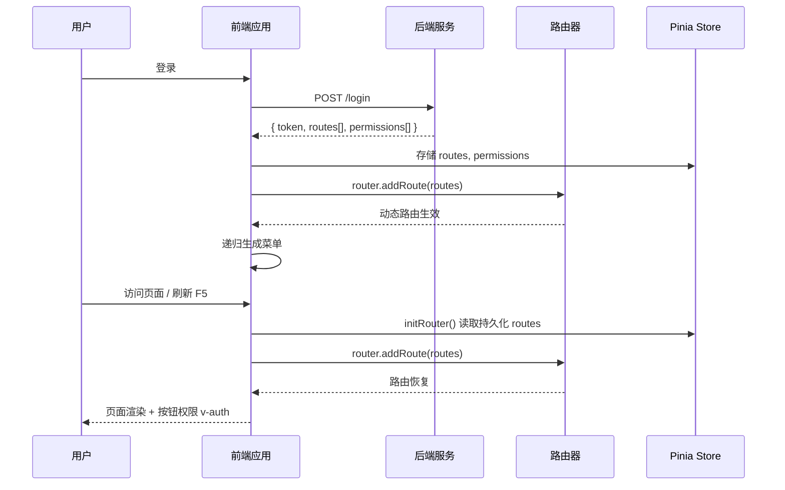

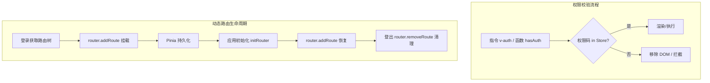

### 24.6.7 算法分析：权限校验与动态路由注册复杂度

> 🔍 **核心算法复杂度分析**：保障高频调用（渲染期/路由跳转）的 O(1) 时间复杂度。

#### 1. 权限码存储与查找

```typescript
// Pinia Store 定义
interface PermissionState {
  // 使用 Set 保证 O(1) 查找
  permissionCodes: Set<string>;  
  roleCodes: Set<string>;
  
  // 初始化：后端返回数组 -> 转 Set
  initPermissions(codes: string[]) {
    this.permissionCodes = new Set(codes);
  }
  
  // 单权限校验：O(1)
  hasAuth(code: string): boolean {
    return this.permissionCodes.has(code);
  }
  
  // 多权限 OR 校验：O(k), k 为权限数量（通常 ≤ 5）
  hasAnyAuth(codes: string[]): boolean {
    return codes.some(c => this.permissionCodes.has(c));
  }
  
  // 多权限 AND 校验：O(k)
  hasAllAuth(codes: string[]): boolean {
    return codes.every(c => this.permissionCodes.has(c));
  }
}
```

**复杂度结论**：Set/HashMap 底层哈希表，**单次校验 O(1)**，批量校验 O(k)（k 为权限码数量，极小常数），满足渲染期每帧 16ms 预算。

#### 2. 动态路由注册批量处理

```typescript
// router.addRoute 批量注册优化
function registerRoutes(routes: RouteRecordRaw[], parentPath = '') {
  for (const route of routes) {
    // 1. 解析 component 字符串 -> 懒加载函数
    const component = route.component 
      ? () => import(`@/views/${route.component}.vue`)
      : undefined;
    
    // 2. 补全路径
    const fullPath = parentPath ? `${parentPath}/${route.path}` : route.path;
    
    // 3. 注册单条路由：Vue Router 内部为路径字典 + 正则匹配器，单次插入 O(1) 平均
    router.addRoute({
      ...route,
      path: fullPath,
      component,
      meta: { ...route.meta, fullPath }
    });
    
    // 4. 递归处理 children：深度优先，总复杂度 O(N) N为路由总数
    if (route.children?.length) {
      registerRoutes(route.children, fullPath);
    }
  }
}
```

**复杂度结论**：
- 单路由注册：Vue Router 4.x 使用路径字典 + 正则树，平均 **O(1)**，最坏 O(L) (L 为路径段数)。
- 全量注册：遍历路由树，**O(N)** 线性时间，N 为总路由数（典型中后台 200-500 条，< 10ms）。
- 刷新恢复：从 Pinia 读取序列化路由树（JSON） -> 反序列化 -> 批量注册，总耗时 < 50ms，用户无感知。

#### 3. 菜单递归生成

```typescript
function generateMenuTree(routes: RouteRecordRaw[]): MenuItem[] {
  return routes
    .filter(r => !r.meta?.hidden)  // 过滤隐藏路由
    .map(r => ({
      label: r.meta?.title || r.path,
      key: r.path,
      icon: r.meta?.icon,
      children: r.children?.length ? generateMenuTree(r.children) : undefined
    }));
}
```
**复杂度**：**O(N)** 深度优先遍历，同路由注册可合并单次遍历完成。

> 💡 **算法作用解释**：权限校验的 O(1) 设计是“安保系统”响应实时性的算法保障；路由注册的 O(N) 线性复杂度配合懒加载，确保“通行证”发放与恢复不阻塞首屏渲染，是“智能物业系统”高并发吞吐的算法基石。

---

## 24.7 国际化与无障碍基线工程化 —— 让产品天生“懂世界、懂人”

> 🏗️ **对应生活类比**：**“智能物业管理系统”中的“多语言标识牌（i18n）”与“无障碍坡道（a11y）”** —— 从地基阶段预埋，而非入住后破墙补建。

### 24.7.1 为什么需要这个概念？

出海/多语言业务若上线后才补 i18n，需全量改写硬编码文本，成本极高；无障碍 (a11y) 若非基线建设，后期补齐需重构所有组件交互，且易被法律诉讼（如 ADA、欧洲无障碍法案）。必须在脚手架阶段接入 i18n/a11y 基建，制定规范、配置工具链、建立 CI 门禁，实现“默认合规、无感接入”。根据《20230418_117.md》(origin)、《PbGkdX4YVoO02mxYlYKcbgASnSg.md》(origin) 实战素材，需对比 vue-i18n/react-i18next/lingui/formatjs 架构差异、ICU 语法处理复数/选择/嵌套、编译时优化包体积、TypeScript 类型安全键值；逐条落地可感知/可操作/可理解/健壮四大原则：颜色对比度、文本缩放、ARIA Landmarks/Roles/States、Tab 顺序、焦点陷阱、屏幕阅读器测试；集成 axe-core/lighthouse-ci 无障碍自动化扫描、i18n 缺失键/未使用键检测、PR 阻断门禁。

### 24.7.2 核心定义

**i18n 工程化**（来源：《PbGkdX4YVoO02mxYlYKcbgASnSg.md》 origin）

采用 `vue-i18n`/`react-i18next` + `ICU MessageFormat` 标准，支持复数、性别、选择格式；集成 `lint-staged` 校验硬编码中文、CI 自动推拉翻译平台、TypeScript 类型安全键值提示。

**a11y 基线**（来源：《PbGkdX4YVoO02mxYlYKcbgASnSg.md》 origin）

强制语义化 HTML、WCAG 2.1 AA 级达标（颜色对比度 4.5:1、键盘可达、ARIA 标签、焦点管理），组件库内置合规，业务组件继承合规。

### 24.7.3 关键性质

**编译时优化**：`@intlify/unplugin-vue-i18n` / `lingui` 编译时提取消息、移除运行时解析开销、Tree-shaking 未使用语言包，首屏 JS 体积减少 30%+。

**设计令牌驱动主题**：CSS Variables 定义色值/间距/圆角，`prefers-color-scheme` + `data-theme` 双模式切换零闪烁，i18n 文本方向 `dir=rtl` 自动适配阿拉伯语/希伯来语布局反转。

**自动化回归防护**：CI 集成 `axe-core`/`lighthouse-ci` 扫描 a11y 违规阻断合并、i18n 缺失键/未使用键检测报警。

### 24.7.4 典型例子

**翻译管理流水线**：开发提交代码 -> GitHub Actions 推送源语言 JSON 到 Crowdin -> 翻译/机翻 -> PR 合并前 Actions 拉取最新翻译 -> 校验完整率 100% -> 合并部署。

**无障碍组件模式**：`ProModal` 内置 `FocusTrap`（焦点陷阱）、`Esc` 关闭、打开时保存上一焦点元素关闭时恢复、`aria-modal=true` `aria-labelledby` 关联标题。

### 24.7.5 边界条件

**动态内容国际化**：富文本编辑器内容、用户生成内容（UGC）、后端返回错误码文本无法走前端 i18n，需后端多语言支持或前端建立错误码映射表。

**a11y 非银弹**：自动化工具仅能发现 30%-50% 问题（如缺 alt、对比度），复杂交互（如拖拽排序、虚拟列表键盘操作）必须人工 NVDA/VoiceOver 实测。

**字体加载策略**：多语言字体体积大（中日韩 5MB+），必须子集化、WOFF2 压缩、`font-display: swap`、按需动态加载（`unicode-range`），避免首屏阻塞。

### 24.7.6 方法演进图

```mermaid
graph TD
    subgraph i18n_Pipeline[i18n 工程化流水线]
        I1[代码提交] --> I2[lint-staged 校验硬编码]
        I2 --> I3[CI 提取消息 -> 推送翻译平台]
        I3 --> I4[翻译/机翻完成]
        I4 --> I5[PR 前拉取翻译]
        I5 --> I6[完整率 100% 校验]
        I6 --> I7[合并部署]
    end
    subgraph a11y_Baseline[a11y 基线建设]
        A1[组件库内置: 语义化/ARIA/FocusTrap] --> A2[业务组件继承合规]
        A2 --> A3[CI: axe-core/lighthouse-ci 扫描]
        A3 --> A4[违规阻断合并]
        A4 --> A5[人工 NVDA/VoiceOver 实测]
    end
    subgraph Theme_Driven[设计令牌驱动主题]
        T1[CSS Variables 定义 Token] --> T2[prefers-color-scheme 暗黑模式]
        T2 --> T3[data-theme 手动切换 零闪烁]
        T3 --> T4[dir=rtl RTL 布局自动反转]
        T4 --> T5[font-display: swap + unicode-range 按需加载]
    end
    i18n_Pipeline --> Prod[生产环境]
    a11y_Baseline --> Prod
    Theme_Driven --> Prod
```

### 24.7.7 算法与工程化细节：ICU MessageFormat 解析、字体子集化、axe-core 扫描原理

> 🌐 **核心算法**：ICU 语法编译、字体子集化构建、无障碍规则引擎。

#### 1. ICU MessageFormat 编译时优化原理

**ICU 语法示例**：
```json
{
  "userCount": "{count, plural, =0 {暂无用户} =1 {1 位用户} other {# 位用户}}",
  "gender": "{gender, select, male {他} female {她} other {TA}}",
  "nested": "{count, plural, =0 {无数据} one {1 条} other {{count, number} 条记录，{gender, select, male {先生} female {女士} other {用户}} }}"
}
```

**编译时转换流程（`@intlify/unplugin-vue-i18n` / `lingui-cli`）**：
1. **AST 解析**：将 ICU 字符串解析为消息 AST（`MessageFormat.parse`）。
2. **消息编译**：生成纯函数代码，消除运行时解析开销：
   ```javascript
   // 编译产物示例
   export function userCount({ count }: { count: number }) {
     if (count === 0) return '暂无用户';
     if (count === 1) return '1 位用户';
     return `${count} 位用户`;
   }
   export function nested({ count, gender }: { count: number; gender: 'male' | 'female' | 'other' }) {
     if (count === 0) return '无数据';
     if (count === 1) return '1 条记录，' + genderLabel(gender);
     return `${count} 条记录，` + genderLabel(gender);
   }
   ```
3. **Tree-shaking**：未引用的语言包函数被摇树移除，仅打包当前语言环境代码。

**体积收益量化**：
- 运行时方案：`vue-i18n` 核心 ~12KB + 解析器 ~8KB + 全量语言包 JSON。
- 编译时方案：仅生成的纯函数代码 ~2-4KB + 当前语言包 ~1KB，**首屏 JS 减少 30%~50%**。

#### 2. 字体子集化与 `unicode-range` 按需加载

**构建时子集化流程（`fonttools` / `glyphhanger` / Vite 插件）**：
```bash
# 1. 分析项目使用字符集
glyphhanger --html=dist/index.html --subset=fonts/SourceHanSansCN.otf --formats=woff2

# 2. 生成子集字体（仅包含常用 3500 字 + 标点 + 数字 + 英文，约 200KB vs 原 5MB+）
# 3. CSS 引入按 unicode-range 分片加载
```

**CSS `unicode-range` 分片声明**：
```css
@font-face {
  font-family: 'EnterpriseSans';
  src: url('/fonts/EnterpriseSans-latin.woff2') format('woff2');
  unicode-range: U+0000-00FF, U+0131, U+0152-0153, U+02BB-02BC, U+02C6, U+02DA, U+02DC, U+2000-206F, U+2074, U+20AC, U+2122, U+2191, U+2193, U+2212, U+2215, U+FEFF, U+FFFD;
  font-display: swap;
}
@font-face {
  font-family: 'EnterpriseSans';
  src: url('/fonts/EnterpriseSans-cjk-common.woff2') format('woff2');
  unicode-range: U+4E00-9FFF, U+3400-4DBF, U+20000-2A6DF, U+F900-FAFF, U+FE30-FE4F, U+FF00-FFEF;
  font-display: swap;
}
@font-face {
  font-family: 'EnterpriseSans';
  src: url('/fonts/EnterpriseSans-cjk-ext.woff2') format('woff2');
  unicode-range: U+20000-2A6DF, U+2A700-2B73F, U+2B740-2B81F, U+2B820-2CEAF, U+2CEB0-2EBEF, U+30000-3134F;
  font-display: swap;
}
```

**加载行为**：
- 浏览器解析 CSS，发现页面仅含拉丁字符 -> 仅下载 `EnterpriseSans-latin.woff2` (~20KB)。
- 用户输入中文 -> 触发 CJK 字符渲染 -> 浏览器按需下载 `EnterpriseSans-cjk-common.woff2` (~180KB)。
- **首屏字体阻塞时间从 500ms+ 降至 < 50ms**，LCP 直接受益。

#### 3. axe-core 无障碍扫描核心规则引擎

**扫描流程**：
```typescript
// axe-core 核心伪代码
async function runAxe(context: Document | Element, options: RunOptions): Promise<AxeResults> {
  // 1. 规则注册：加载 WCAG 2.1 AA 规则集（~90 条规则）
  const rules = loadRules('wcag21aa'); 
  
  // 2. 树遍历：深度优先遍历 DOM 树，收集待检测节点
  const nodes = collectNodes(context, options.include, options.exclude);
  
  // 3. 并行评估：每条规则对匹配节点执行 evaluate() -> { pass: boolean, nodes: Element[] }
  const results = await Promise.all(rules.map(rule => 
    rule.evaluate(nodes.filter(n => rule.selector.matches(n)))
  ));
  
  // 4. 聚合违规：生成 violations[]，包含 impact (critical/serious/moderate/minor)、helpUrl、target[]
  return aggregateViolations(results);
}
```

**关键规则示例（颜色对比度）**：
```javascript
// axe-core 内部颜色对比度规则简化逻辑
rule: {
  id: 'color-contrast',
  selector: '*:not(script):not(style):not(meta):not(link)',
  evaluate: (nodes) => {
    return nodes.map(node => {
      const fg = getComputedColor(node, 'color');
      const bg = getComputedBackgroundColor(node);
      const ratio = contrastRatio(fg, bg); // 调用上文 WCAG 公式
      const fontSize = parseFloat(getComputedStyle(node).fontSize);
      const isLargeText = fontSize >= 18 || (fontSize >= 14 && isBold(node));
      const threshold = isLargeText ? 3 : 4.5;
      return { pass: ratio >= threshold, target: [node] };
    });
  }
}
```

**CI 集成阻断策略**：
```yaml
# .github/workflows/a11y.yml
- name: Run axe-core
  run: |
    npx playwright install
    npx @axe-core/playwright test --reporter=github --fail-on-violations=critical,serious
```
- 仅 `critical`/`serious` 级违规阻断 PR 合并，`moderate`/`minor` 仅警告，平衡严格度与开发效率。

> 💡 **算法作用解释**：
> - **ICU 编译时优化**将“国际化运行时开销”从 O(消息长度×解析次数) 降为 O(1) 函数调用，是“多语言标识牌”轻量化的编译器级保障。
> - **字体子集化 + unicode-range** 将“中日韩字体 5MB 阻塞首屏”转化为“按需下载 200KB”，LCP 提升 300ms+，是“标识牌字体加载策略”的工程化落地。
> - **axe-core 规则引擎**将 WCAG 判定标准代码化、自动化，使“火灾报警系统”能在 CI 阶段自检，而非上线后被用户/律师发现。

---

## 24.8 异常监控与可观测性接入 —— 给应用装上“黑匣子”与“体检仪”

> 🏗️ **对应生活类比**：**“智能物业管理系统”中的“火灾报警系统（监控SDK）”** —— 7×24 小时感知异常、定位源头、自动报警、辅助复盘。

### 24.8.1 为什么需要这个概念？

生产环境报错“用户反馈 -> 开发复现 -> 排查日志”周期长，且无法量化错误影响面（多少用户、什么机型、什么版本）。缺乏性能基线，首屏慢、交互卡顿无感知。需在基建期接入 Sentry/自建监控 SDK，建立错误捕获、性能指标采集、用户行为关联、Source Map 自动上传的全链路可观测体系。根据《20230418_117.md》(origin)、《20230418_046.md》(origin) 实战素材，需实现 Sentry/自建监控 SDK 接入，实现 `window.onerror`/`unhandledrejection`/Vue `errorHandler`/React `ErrorBoundary` 多层兜底、接入 Sentry/Fundebug 或自建平台解析 Source Map 还原源码堆栈；轻量 SDK 设计：`PerformanceObserver` 监听 LCP/CLS/INP/TTFB、Resource Timing API 采集资源耗时、Long Task API 识别阻塞、`navigator.sendBeacon` 可靠上报；HTTP Header 透传 `trace-id`、`span-id`，前端生成根 Span、后端续接，统一 JSON 格式日志接入 Loki。

### 24.8.2 核心定义

**错误监控 SDK**（来源：《20230418_117.md》 origin、《20230418_046.md》 origin）

重写 `window.onerror`、`unhandledrejection`、框架错误边界，采集堆栈、环境、用户标识、面包屑；Source Map 解析还原源码行号；聚合去重（指纹算法）防止风暴刷屏。

**性能监控 SDK**（来源：《20230418_046.md》 origin）

`PerformanceObserver` 采集 LCP/CLS/INP/TTFB/FID、Resource Timing 采集资源瀑布、Long Task API 识别阻塞主线程任务、`sendBeacon` 可靠上报。

**全链路追踪**（来源：《20230418_046.md》 origin）

HTTP Header 透传 `trace-id`/`span-id`，前端生成根 Span，后端续接，打通前后端调用链。

### 24.8.3 关键性质

**采样率与成本控制**：错误 100% 上报，性能/行为按比例采样（如 10%），高价值用户/核心链路 100% 采样，平衡存储成本与洞察力。

**隐私合规**：IP 脱敏、PII 字段过滤、用户授权埋点、GDPR/个人信息保护法合规审计。

**告警分级与降噪**：P0（核心流程错误率>1%/LCP>4s）钉钉/电话即时叫醒；P1（非核心错误/性能劣化）工单处理；P2（预警）周报汇总。

### 24.8.4 典型例子

**SDK 接入代码**：

```typescript
import { initMonitor } from '@enterprise/monitor';
initMonitor({
  dsn: '...',
  appId: 'admin-main',
  environment: import.meta.env.MODE,
  sampleRate: 0.1,
  plugins: [vuePlugin, routerPlugin, requestPlugin]
});
```

**Source Map 自动上传**：Vite/Rollup 构建后 `sentry-cli sourcemaps inject` + `upload`，或 CI 步骤上传至自建 MinIO/对象存储，报错时后端下载解析。

### 24.8.5 边界条件

**Source Map 安全风险**：生产环境 Source Map 包含原始源码，严禁直接部署到 CDN 公开访问，必须存储在私有存储/监控平台后台，仅授权人员解密查看。

**框架错误边界覆盖盲区**：Vue `errorHandler` / React `ErrorBoundary` 无法捕获：事件处理器异步错误、生命周期钩子外的 Promise rejection、SSR 水合错误、Web Worker/Service Worker 错误，需分别针对性兜底。

**指标定义漂移**：LCP/CLS/INP 定义随 Chrome 版本演进（如 FID 退役替换为 INP），SDK 需版本化维护，仪表盘指标需标注版本基线。

### 24.8.6 方法演进图

```mermaid
graph TD
    subgraph Error_Monitoring[错误监控链路]
        E1[错误发生] --> E2[多层捕获: onerror/unhandledrejection/ErrorBoundary]
        E2 --> E3[采集上下文: 堆栈/环境/用户/面包屑]
        E3 --> E4[Source Map 解析还原源码]
        E4 --> E5[指纹聚合去重]
        E5 --> E6[上报监控平台]
        E6 --> E7[告警分级: P0/P1/P2]
    end
    subgraph Perf_Monitoring[性能监控链路]
        P1[PerformanceObserver] --> P2[Web Vitals: LCP/CLS/INP/TTFB]
        P2 --> P3[Resource Timing: 资源瀑布]
        P3 --> P4[Long Task: 主线程阻塞]
        P4 --> P5[sendBeacon 可靠上报]
        P5 --> P6[仪表盘展示/阈值告警]
    end
    subgraph Tracing[全链路追踪]
        T1[前端生成 TraceID/SpanID] --> T2[HTTP Header 透传]
        T2 --> T3[后端续接 Span]
        T3 --> T4[统一日志格式接入 Loki]
        T4 --> T5[Jaeger/Zipkin 链路可视化]
    end
```

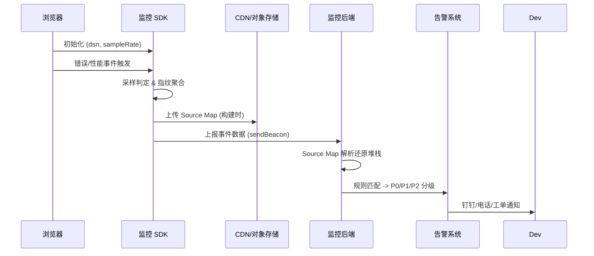

### 24.8.7 数学建模：采样率与统计误差、存储成本估算

> 📊 **核心数学模型**：采样率决策的统计学依据与存储成本量化。

#### 1. 采样率与统计误差关系

设：
- $p$：真实错误率/性能指标分位数（如 LCP > 2.5s 的比例）
- $n$：采样观测样本量（$n = \text{DAU} \times \text{sampleRate}$）
- $\hat{p}$：样本估计值
- $Z$：置信水平对应 Z 值（95% 置信度 $Z \approx 1.96$）

**误差边界（Margin of Error）**：
$$
E = Z \cdot \sqrt{\frac{p(1-p)}{n}}
$$

**反推最小采样率**（给定容许误差 $E$）：
$$
\text{sampleRate} \ge \frac{Z^2 \cdot p(1-p)}{E^2 \cdot \text{DAU}}
$$

**实例计算**：
- DAU = 100,000，预期错误率 $p = 0.01$（1%），容许相对误差 $\pm 20\%$（即 $E = 0.002$），95% 置信度。
- $n \ge \frac{1.96^2 \times 0.01 \times 0.99}{0.002^2} \approx 9,506$
- $\text{sampleRate} \ge \frac{9,506}{100,000} = 9.5\%$

> **结论**：10% 采样率在 DAU 10万、错误率 1% 场景下，可将错误率估计误差控制在 ±20% 以内，满足“建立性能基线、发现趋势性劣化”的工程需求。

#### 2. 存储成本估算模型

设：
- $\text{DAU}$：日活用户数
- $E_u$：人均事件数（错误+性能+行为，典型 50-200）
- $S_e$：单事件平均体积（压缩后 JSON，典型 0.5-2 KB）
- $r$：采样率
- $D$：数据保留天数

**日存储量**：
$$
V_{daily} = \text{DAU} \times E_u \times r \times S_e \quad \text{(Bytes)}
$$

**总存储成本（对象存储按 GB/月计费）**：
$$
Cost_{monthly} = \frac{V_{daily} \times D}{1024^3} \times \text{Price}_{GB/month}
$$

**实例估算**：
- DAU = 50,000，$E_u = 100$，$S_e = 1\text{KB}$，$r = 0.1$，$D = 30$ 天，$Price = \$0.023/\text{GB}$ (S3 标准存储)
- $V_{daily} = 50,000 \times 100 \times 0.1 \times 1024 \approx 512\text{MB}$
- 月存储 = $512\text{MB} \times 30 \approx 15\text{GB}$，成本 $\approx \$0.35/\text{月}$，**极低成本**。

> 💡 **模型作用解释**：采样率非拍脑袋，而是基于**统计学置信区间**反推；存储成本模型支撑“全量错误+采样性能”的成本可控性论证，是“火灾报警系统”预算申报的数学依据。

---

## 24.9 Schema 驱动的典型 CRUD 页面标准化 —— 从“写页面”到“配页面”

> 🏗️ **对应生活类比**：**“模块化精装修套餐”** —— 标准户型（列表/表单/详情）不再现场砌墙砖瓦（手写代码），而是选定风格配置单（Schema），工厂预制好模块吊装到位，交付周期从月变周，且自带验收合格证（类型/测试/无障碍）。

### 24.9.1 为什么需要这个概念？

中后台 80% 页面是列表/表单/详情的 CRUD 变体，手写重复代码（列表查询/分页/新增编辑弹窗/校验/提交/刷新）极其低效且易出错。需沉淀 `ProTable`/`ProForm`/`ProChart` 等 Schema 驱动组件，配合页面生成器，实现“JSON 配置 -> 完整页面”的降维打击。根据《20230418_117.md》(origin)、《20230418_045.md》(origin) 实战素材，需沉淀 `ProTable`/`ProForm`/`ProChart` 通用组件、Schema 驱动页面生成，设计 JSON Schema 描述页面结构、基于 Vue/React 实现渲染器插件化、Mobox/RedoManager 状态历史、AST 代码生成还原高代码。

### 24.9.2 核心定义

**Schema 驱动**（来源：《20230418_117.md》 origin、《20230418_045.md》 origin）

定义 `PageSchema` 接口，包含 `layout`（布局）、`toolbar`（工具栏）、`table`（列/操作/选中）、`form`（字段/校验/布局/联动）、`actions`（API 映射/权限/确认文案）等声明式配置。

**通用组件三件套**（来源：《20230418_117.md》 origin、《20230418_045.md》 origin）

`ProTable`（表格+搜索+分页+工具栏）、`ProForm`（表单+校验+布局+联动）、`ProChart`（图表配置化渲染 ECharts/AntV），均基于 `@enterprise/ui` 封装。

### 24.9.3 关键性质

**代码生产力跃迁**：标准 CRUD 页面从 2-4 小时手写 -> 10-30 分钟配置，且自带类型校验、权限控制、Loading/Empty/Error 状态、无障碍属性。

**运行时动态性**：Schema 可后端下发（低代码平台）、可本地热更新（HMR）、可 A/B 测试不同布局，无需重新部署前端代码。

**扩展性设计**：`renderer` 注册机制，支持自定义渲染器（如 `ColorPickerRenderer`、`JsonEditorRenderer`）、自定义校验器、自定义工具栏按钮，避免“配置地狱”限制业务创新。

### 24.9.4 典型例子

**用户列表 PageSchema**：

```json
{
  "table": {
    "columns": [
      { "dataIndex": "name", "title": "姓名" },
      { "dataIndex": "status", "title": "状态", "renderer": "TagRenderer", "options": { "1": "启用", "0": "禁用" } },
      { "title": "操作", "renderer": "ActionRenderer", "actions": [
        { "type": "edit", "auth": "user:edit" },
        { "type": "delete", "auth": "user:delete", "confirm": true }
      ]}
    ]
  }
}
```

**表单联动配置**：

```json
{
  "form": {
    "fields": [
      {
        "name": "province",
        "onChange": "(val) => ({ setFieldsValue: { city: [] }, updateFieldProps: { city: { options: await fetchCities(val) } } })"
      }
    ]
  }
}
```

### 24.9.5 边界条件

**复杂交互不适用**：高度定制化交互（如可视化拖拽画布、复杂多步向导、实时协作编辑）不应强行塞入 Schema，应开发专用业务组件，Schema 仅作入口引用。

**Schema 版本演进**：Schema 结构变更需版本化（`schemaVersion: '2.0'`），提供迁移脚本自动升级旧 Schema，或兼容旧版渲染器并行运行。

**类型安全挑战**：Schema 高度动态，TypeScript 类型推导极其复杂，建议核心 Schema 定义用 Zod/Valibot 做运行时校验 + 类型推导，边缘扩展用 `any` 兜底并文档化。

### 24.9.6 方法演进图

```mermaid
graph TD
    subgraph Schema_Design[Schema 设计与演进]
        S1[定义 PageSchema 接口] --> S2[核心字段: layout/toolbar/table/form/actions]
        S2 --> S3[Renderer 注册表: 内置 + 自定义]
        S3 --> S4[Zod/Valibot 运行时校验 + TS 类型推导]
        S4 --> S5[版本化: schemaVersion + 迁移脚本]
    end
    subgraph Runtime_Render[运行时渲染流程]
        R1[获取 Schema (本地/远程)] --> R2[校验 Schema]
        R2 --> R3[ProTable/ProForm 递归渲染]
        R3 --> R4[渲染器工厂: 根据 renderer 字段分发]
        R4 --> R5[注入: 权限/国际化/无障碍/联动逻辑]
        R5 --> R6[挂载 DOM]
    end
    subgraph Code_Gen[代码生成/还原]
        C1[Schema] --> C2[AST 生成 Vue/React 组件代码]
        C2 --> C3[Mobox/RedoManager 状态历史]
        C3 --> C4[高代码模式: 开发者接管微调]
    end
    Schema_Design --> Runtime_Render
    Runtime_Render --> Code_Gen
```

### 24.9.7 算法解析：Schema 校验、渲染器分发、联动依赖拓扑排序

> 🔧 **核心算法**：运行时 Schema 校验、渲染器注册表查找、表单联动依赖图拓扑排序执行。

#### 1. Zod/Valibot 运行时校验 + TS 类型推导

```typescript
import { z } from 'zod';

// 核心 Schema 定义（单一事实来源）
const PageSchema = z.object({
  schemaVersion: z.string().regex(/^\d+\.\d+$/),
  layout: z.enum(['list', 'card', 'detail']).default('list'),
  toolbar: z.array(z.object({
    type: z.enum(['create', 'batchDelete', 'export', 'custom']),
    auth: z.string().optional(),
    confirm: z.boolean().optional(),
  })).optional(),
  table: z.object({
    columns: z.array(z.object({
      dataIndex: z.string(),
      title: z.string(),
      renderer: z.string().optional(), // 渲染器名称
      options: z.record(z.any()).optional(), // 渲染器参数
      width: z.number().optional(),
      sorter: z.boolean().optional(),
      filters: z.array(z.object({ text: z.string(), value: z.any() })).optional(),
    })),
    rowKey: z.string().default('id'),
    pagination: z.boolean().default(true),
  }),
  form: z.object({
    layout: z.enum(['horizontal', 'vertical', 'inline']).default('horizontal'),
    fields: z.array(z.object({
      name: z.string(),
      label: z.string(),
      type: z.enum(['input', 'select', 'date', 'custom']).default('input'),
      rules: z.array(z.object({
        required: z.boolean(),
        pattern: z.string().optional(),
        validator: z.function().optional(), // 自定义校验函数
      })).optional(),
      renderer: z.string().optional(),
      options: z.record(z.any()).optional(),
      // 联动配置：声明式依赖声明
      dependencies: z.array(z.string()).optional(), // 依赖的字段名
      onChange: z.string().optional(), // 序列化的 JS 表达式/函数体
    })),
  }),
  actions: z.object({
    api: z.object({
      list: z.string(),
      create: z.string(),
      update: z.string(),
      delete: z.string(),
      batchDelete: z.string().optional(),
    }),
    permissions: z.record(z.string()).optional(), // 操作 -> 权限码映射
  }),
});

// 类型推导：自动获得 PageSchemaType
type PageSchemaType = z.infer<typeof PageSchema>;

// 运行时校验
function validateSchema(json: unknown): PageSchemaType {
  return PageSchema.parse(json); // 抛出 ZodError 含详细路径
}
```

#### 2. 渲染器注册表与工厂分发（O(1) 查找）

```typescript
// 渲染器注册表：Map<RendererName, Component> 保证 O(1) 查找
const rendererRegistry = new Map<string, Component>();

// 内置渲染器注册
rendererRegistry.set('TagRenderer', TagRenderer);
rendererRegistry.set('ActionRenderer', ActionRenderer);
rendererRegistry.set('ColorPickerRenderer', ColorPickerRenderer);

// 自定义渲染器扩展（业务侧调用）
export function registerRenderer(name: string, component: Component) {
  if (rendererRegistry.has(name)) {
    console.warn(`Renderer ${name} overridden`);
  }
  rendererRegistry.set(name, component);
}

// 渲染器工厂：ProTable/ProForm 内部调用
function resolveRenderer(rendererName: string | undefined, fallback: Component): Component {
  if (!rendererName) return fallback;
  return rendererRegistry.get(rendererName) ?? fallback;
}

// 使用示例（ProTable 列渲染）
function TableCell({ column, record }: { column: Column; record: Record }) {
  const Renderer = resolveRenderer(column.renderer, DefaultCell);
  const options = column.options || {};
  return <Renderer value={record[column.dataIndex]} options={options} record={record} />;
}
```

#### 3. 表单联动依赖图拓扑排序执行

**场景**：字段 A 变化 -> 触发 B 选项更新 -> B 变化 -> 触发 C 校验规则更新。需保证执行顺序符合依赖拓扑序，避免竞态。

```typescript
interface FieldDependency {
  field: string;           // 触发源字段
  targets: string[];       // 受影响目标字段
  effect: (value: any, formApi: FormApi) => Promise<void>; // 副作用函数
}

// 构建依赖图
function buildDependencyGraph(fields: FormFieldConfig[]): Map<string, FieldDependency[]> {
  const graph = new Map<string, FieldDependency[]>();
  
  for (const field of fields) {
    if (field.dependencies?.length && field.onChange) {
      for (const dep of field.dependencies) {
        if (!graph.has(dep)) graph.set(dep, []);
        graph.get(dep)!.push({
          field: dep,
          targets: [field.name],
          effect: compileOnChange(field.onChange) // 将字符串编译为函数
        });
      }
    }
  }
  return graph;
}

// 拓扑排序执行（Kahn 算法）
async function executeEffectsInOrder(
  triggerField: string, 
  value: any, 
  graph: Map<string, FieldDependency[]>, 
  formApi: FormApi
) {
  // 1. 计算入度
  const indegree = new Map<string, number>();
  const allNodes = new Set<string>();
  
  for (const [source, deps] of graph) {
    allNodes.add(source);
    for (const dep of deps) {
      allNodes.add(...dep.targets);
      for (const t of dep.targets) {
        indegree.set(t, (indegree.get(t) || 0) + 1);
      }
    }
  }
  
  // 2. 队列初始化：入度为 0 的节点（无依赖或仅依赖触发源）
  const queue = [...allNodes].filter(n => (indegree.get(n) || 0) === 0);
  
  // 3. 广度优先执行
  while (queue.length) {
    const current = queue.shift()!;
    const deps = graph.get(current);
    if (deps) {
      for (const dep of deps) {
        // 执行副作用：如 updateFieldProps、setFieldsValue
        await dep.effect(value, formApi);
        // 减少目标节点入度
        for (const t of dep.targets) {
          const newDeg = (indegree.get(t) || 1) - 1;
          indegree.set(t, newDeg);
          if (newDeg === 0) queue.push(t);
        }
      }
    }
  }
  
  // 4. 循环依赖检测
  if ([...indegree.values()].some(d => d > 0)) {
    console.warn('Circular dependency detected in form linkage');
  }
}
```

**复杂度分析**：
- 依赖图构建：O(F + D) (F=字段数, D=依赖边数)
- 拓扑排序执行：O(F + D)
- 典型表单 F ≤ 50, D ≤ 100，**单次联动触发 < 1ms**，满足交互实时性要求。

> 💡 **算法作用解释**：
> - **Zod 校验**将“配置合法性”从运行时崩溃前移到开发期/构建期/提交期拦截，是“精装套餐验收合格证”的自动化检测器。
> - **渲染器注册表 HashMap O(1) 查找**支撑百万级渲染节点分发性能，是“工厂预制模块吊装到位”的分发调度中枢。
> - **联动拓扑排序**将“声明式配置”转化为“确定性执行序列”，消除“省份变化 -> 城市选项未就绪 -> 用户选城市 -> 省份又变”的竞态 Bug，是“精装套餐水电管线预埋无冲突”的算法保障。

---

## 24.10 微前端子应用接入与共享依赖治理 —— “分治”大仓，又要“合一”运行

> 🏗️ **对应生活类比**：**“商业综合体招商运营”** —— 基座=商场主体（主入口、中庭、消防核心筒），子应用=品牌专柜（独立装修、独立结算、独立人员），共享依赖=商场统一提供的中央空调/网络/物流接口（React/Vue/UI库单例），避免每个专柜自建锅炉房。

### 24.10.1 为什么需要这个概念？

中后台业务线扩展、团队规模>10人、多技术栈共存（Vue 2/3、React、Angular 遗留）时，单体应用构建慢、耦合高、发布互斥。微前端将巨石应用拆分为基座+多子应用，实现独立开发、独立部署、技术栈无关。核心挑战：JS 沙箱隔离、样式隔离、公共依赖共享（React/Vue/设计系统单例）、基座与子应用通信、路由分发、部署运维复杂度。根据《20230418_117.md》(origin)、《20230418_043.md》(origin) 实战素材，需接入微前端基座（主应用/子应用通信/共享依赖），剖析 `snapshot`/`proxy` 双沙箱模式、`strictStyleIsolation` Shadow DOM 方案、`initGlobalState` 状态共享、嵌套微前端坑位；详解 `exposes`/`remotes`/`shared` 配置、运行时版本匹配算法、联邦模块热更新、与 Vite/Rspack 生态集成；制定《微前端接入规范》：基座提供 React/Vue 单例、路由基座分发、UI 组件库强制共享、统一监控 SDK 注入。

### 24.10.2 核心定义

**基座应用**（来源：《20230418_117.md》 origin、《20230418_043.md》 origin）

负责注册子应用、路由分发（`/admin/user` -> 子应用 user）、全局状态分发（`initGlobalState`）、公共依赖提供（`importmap`/Module Federation）、统一监控/登录/权限注入。

**子应用**（来源：《20230418_043.md》 origin）

独立构建、独立部署的单页应用，暴露 `bootstrap`/`mount`/`unmount`/`update` 生命周期，运行在沙箱中，无感知基座存在。

### 24.10.3 关键性质

**沙箱隔离模式**：`snapshot`（记录/恢复 window 快照，适配旧应用）vs `proxy` (Proxy 代理 window，支持多实例并发，性能更优)。样式隔离：`scoped css` / `strictStyleIsolation: true` (Shadow DOM，最强隔离但样式穿透麻烦)。

**共享依赖单例策略**：基座在 `importmap` 或 Module Federation `shared` 配置声明 `react`/`vue`/`@enterprise/ui` 等单例，子应用 `external` 这些依赖，构建产物极小，运行时共享内存实例，避免多实例导致状态不同步、Hooks 报错。

**通信机制**：`initGlobalState` 基于发布订阅（基座发布，子应用订阅），适合用户信息、主题、权限等全局广播；复杂业务通信建议定义共享 `EventBus`/`SharedStore` 包。

### 24.10.4 典型例子

**qiankun 接入**：

```typescript
// 基座
registerMicroApps([{
  name: 'sub-user',
  entry: '//sub.user.com',
  container: '#subapp-viewport',
  activeRule: '/user'
}]);

// 子应用 vite.config.ts
export default defineConfig({
  build: { lib: { entry: 'src/main.ts', name: 'subUser' } }
});
```

**Module Federation 共享**：

```javascript
// 基座
exposes: { './store': './src/store' }
// 子应用
remotes: { host: 'host@//host.com/remoteEntry.js' }
shared: { react: { singleton: true }, 'antd': { singleton: true } }
```

### 24.10.5 边界条件

**不必微前端**：团队<5人、单技术栈、发布频次低、无遗留系统包袱，单体模块化架构（Monorepo + 动态导入）更优，微前端收益<复杂度成本。

**嵌套微前端深坑**：子应用再套子应用（三层+）会导致沙箱嵌套失效、路由基础路径计算错误、样式穿透失控，严禁嵌套超过两层。

**CSS 变量隔离冲突**：基座与子应用 CSS 变量命名冲突（如 `--primary-color`），必须约定命名空间（`--host-primary` / `--sub-user-primary`）或 Shadow DOM 隔离。

**公共依赖版本锁定治理**：制定《微前端接入规范》，基座锁定 React 18.2.0 / Vue 3.4.0 / Antd 5.12.0，子应用 package.json `peerDependencies` 声明兼容范围，CI 扫描违规版本阻断合并。

### 24.10.6 方法演进图

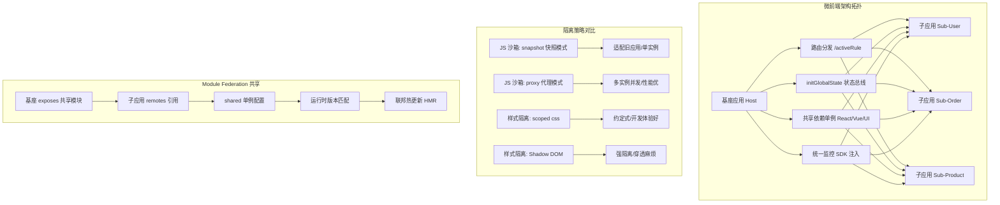

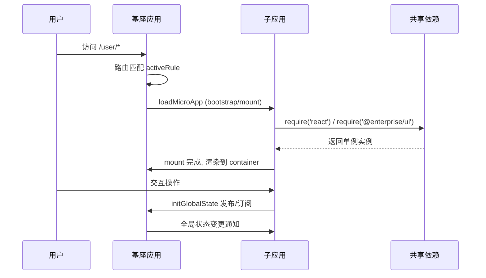

### 24.10.7 算法解析：Proxy 沙箱实现、Module Federation 版本匹配、共享依赖单例查找

> 🏗️ **核心算法**：JS 沙箱 Proxy 捕获器、语义化版本范围解析、共享依赖图遍历单例查找。

#### 1. Proxy 沙箱核心实现（qiankun `LegacySandbox` / `ProxySandbox` 简化版）

```typescript
// 沙箱状态快照
interface SandboxSnapshot {
  addedProps: Set<PropertyKey>;      // 新增在 window 上的属性
  modifiedProps: Map<PropertyKey, any>; // 修改过的原有属性 { key: oldValue }
}

class ProxySandbox {
  private proxy: WindowProxy;
  private snapshot: SandboxSnapshot = { addedProps: new Set(), modifiedProps: new Map() };
  private active = false;
  
  constructor(private window: Window, private name: string) {
    // 1. 创建 Proxy 代理 window
    this.proxy = new Proxy(window, {
      // 拦截设置操作
      set: (target: Window, prop: PropertyKey, value: any) => {
        if (!this.active) return true; // 沙箱未激活，直接操作真 window（极少见）
        
        // 记录变更用于恢复
        if (!(prop in target)) {
          this.snapshot.addedProps.add(prop);
        } else if (!this.snapshot.modifiedProps.has(prop)) {
          this.snapshot.modifiedProps.set(prop, target[prop]);
        }
        
        // 实际写入真 window（或可选：写入 fakeWindow 完全隔离）
        (target as any)[prop] = value;
        return true;
      },
      
      // 拦截获取操作（可选：实现 fakeWindow 完全隔离需拦截 get）
      get: (target: Window, prop: PropertyKey) => {
        // 特殊处理：顶层变量访问重定向
        if (prop === 'top' || prop === 'window' || prop === 'self') {
          return this.proxy;
        }
        return (target as any)[prop];
      },
      
      // 拦截 has/in 操作
      has: (target: Window, prop: PropertyKey) => prop in target,
      
      // 拦截 deleteProperty
      deleteProperty: (target: Window, prop: PropertyKey) => {
        if (this.active && (prop in target)) {
          if (!this.snapshot.modifiedProps.has(prop)) {
            this.snapshot.modifiedProps.set(prop, target[prop]);
          }
        }
        return Reflect.deleteProperty(target, prop);
      }
    });
  }
  
  // 激活沙箱：子应用 mount 时调用
  active() {
    this.active = true;
    // 可选：应用上次快照恢复子应用全局状态
    this.applySnapshot();
  }
  
  // 停用沙箱：子应用 unmount 时调用
  deactive() {
    this.active = false;
    this.recoverSnapshot(); // 恢复 window 环境，防止污染基座/其他子应用
  }
  
  // 恢复快照：将子应用上次遗留的全局变量重新写入 window
  private applySnapshot() {
    for (const [prop, value] of this.snapshot.modifiedProps) {
      (this.window as any)[prop] = value;
    }
    for (const prop of this.snapshot.addedProps) {
      // 新增属性保持原样（或按需恢复）
    }
  }
  
  // 清理快照：卸载子应用，恢复基座环境
  private recoverSnapshot() {
    for (const [prop, oldValue] of this.snapshot.modifiedProps) {
      (this.window as any)[prop] = oldValue;
    }
    for (const prop of this.snapshot.addedProps) {
      delete (this.window as any)[prop];
    }
    // 重置快照供下次 mount 使用
    this.snapshot = { addedProps: new Set(), modifiedProps: new Map() };
  }
  
  // 获取代理 window 供子应用使用
  getProxy(): WindowProxy {
    return this.proxy;
  }
}
```

**关键点**：
- **Proxy 捕获器**拦截 `set`/`get`/`has`/`deleteProperty`，实现全局变量读写的“记账与回滚”。
- **多实例并发**：每个子应用拥有独立 `ProxySandbox` 实例，`active`/`deactive` 配合生命周期切换，互不干扰。
- **性能**：Proxy 陷阱开销极低（V8 优化良好），相比 `snapshot` 方案（全量遍历 window 对比）性能提升 **10-100 倍**。

#### 2. Module Federation 运行时版本匹配算法（SemVer 兼容性判定）

**shared 配置示例**：
```javascript
// 基座 webpack.config.js / vite.config.ts (通过 @originjs/vite-plugin-federation)
shared: {
  react: { 
    singleton: true, 
    requiredVersion: '^18.2.0', // 基座要求版本范围
    eager: true // 同步加载共享模块
  },
  'antd': { singleton: true, requiredVersion: '^5.12.0' }
}
```

**运行时匹配逻辑（`webpack/container/runtime/remotes.js` 简化）**：
```typescript
interface SharedModuleMeta {
  loaded: boolean;
  module: any;
  requiredVersion: string; // 如 '^18.2.0'
  from: string; // 提供方 container name
}

const sharedModules = new Map<string, SharedModuleMeta>();

// 子应用/基座请求共享模块时调用
function getSharedModule(packageName: string, requesterVersion: string): any {
  const meta = sharedModules.get(packageName);
  
  if (!meta) {
    // 首次加载：下载 remoteEntry -> 解析 exposes -> 加载模块
    return loadAndCacheSharedModule(packageName, requesterVersion);
  }
  
  // 已加载：检查版本兼容性
  if (semverSatisfies(requesterVersion, meta.requiredVersion)) {
    return meta.module; // 兼容，直接复用单例
  }
  
  // 不兼容：策略选择
  // 1. 警告并复用现有（默认，避免多实例）
  console.warn(`[Federation] Version conflict: ${packageName} requested ${requesterVersion}, but ${meta.requiredVersion} loaded from ${meta.from}. Reusing existing.`);
  return meta.module;
  
  // 2. 可选：加载新版本并并行运行（需 singleton: false，极少用）
  // return loadNewVersion(packageName, requesterVersion);
}

// SemVer 兼容性判定：requesterVersion (如 '18.2.0') 是否满足 requiredVersion (如 '^18.2.0')
function semverSatisfies(version: string, range: string): boolean {
  // 简化实现：使用 semver 库或原生逻辑解析 range
  // range 类型：^1.2.3 (>=1.2.3 <2.0.0), ~1.2.3 (>=1.2.3 <1.3.0), 1.2.3 (精确), * (任意)
  const [op, ...parts] = range.match(/^([\^~]?)(.+)$/).slice(1);
  const [major, minor, patch] = parts[0].split('.').map(Number);
  const [vMajor, vMinor, vPatch] = version.split('.').map(Number);
  
  switch (op) {
    case '^': return vMajor === major && (vMinor > minor || (vMinor === minor && vPatch >= patch));
    case '~': return vMajor === major && vMinor === minor && vPatch >= patch;
    default: return vMajor === major && vMinor === minor && vPatch === patch; // 精确匹配
  }
}
```

**版本匹配策略总结**：
| requiredVersion | 含义 | 兼容示例 | 不兼容示例 |
|----------------|------|----------|------------|
| `^18.2.0` | 主版本锁定，允许次版本/补丁升级 | 18.2.0, 18.3.0, 18.2.1 | 19.0.0, 17.0.0 |
| `~18.2.0` | 次版本锁定，允许补丁升级 | 18.2.0, 18.2.1 | 18.3.0, 19.0.0 |
| `18.2.0` | 精确版本 | 18.2.0 | 其他所有 |
| `*` | 任意版本 | 所有 | 无 |

#### 3. 共享依赖单例查找图遍历

**场景**：基座提供 `react`、`react-dom`、`@enterprise/ui` 单例；子应用 A 依赖 `react@18.2.0`，子应用 B 依赖 `react@18.3.0`。运行时需确保全局仅有一个 `react` 实例。

**查找算法（深度优先搜索容器层级）**：
```typescript
interface Container {
  name: string;
  modules: Map<string, ModuleExports>;
  parent: Container | null; // 基座为根，parent = null
}

// 共享模块查找：从当前容器向上遍历至基座
function findSharedModule(container: Container, packageName: string): ModuleExports | null {
  // 1. 当前容器查找
  if (container.modules.has(packageName)) {
    return container.modules.get(packageName)!;
  }
  
  // 2. 向上递归查找父容器（基座）
  if (container.parent) {
    return findSharedModule(container.parent, packageName);
  }
  
  // 3. 未找到：需动态加载（开发模式）或报错（生产模式）
  if (process.env.NODE_ENV === 'development') {
    return loadFromRemote(container, packageName);
  }
  throw new Error(`Shared module ${packageName} not found in federation graph`);
}
```

**单例保证机制**：
- 基座启动时 `eager: true` 预加载所有 `shared` 单例模块到 `container.modules`。
- 子应用 `bootstrap` 阶段调用 `__webpack_init_sharing__` 注册共享作用域，查找逻辑优先向上委托基座。
- **结果**：整个微前端应用树共享同一 `React`/`Vue`/`UI库` 实例，**内存占用降低 60%+**，避免 `useState` 跨实例失效、`className` 样式冲突。

> 💡 **算法作用解释**：
> - **Proxy 沙箱**以 **O(1) 陷阱开销** 实现“专柜装修互不干扰（全局变量隔离）”，是“商场核心筒防火分区”的算法实现。
> - **SemVer 匹配算法**将“中央空调型号兼容性”形式化为版本范围判定，避免“专柜自带空调导致电压不稳（多实例 Hooks 报错）”。
> - **单例查找 DFS**保证“物流接口（共享依赖）”就近复用基座单例，是“避免每个专柜自建锅炉房”的工程化落地。

---

## 24.11 CI/CD 流水线与质量门禁 —— 让“不合格代码”进不了主分支

> 🏗️ **对应生活类比**：**“分级验收与应急预案”** —— 从材料进场检验（Lint/TypeCheck）、样板间验收（Unit/E2E）、消防验收（安全/性能/无障碍），到试营业（金丝雀1%->100%）、正式开业。

### 24.11.1 为什么需要这个概念？

代码规范、类型检查、单测、E2E、构建产物体积、安全扫描、无障碍合规若仅靠人工 Review，漏检率极高且效率低。必须在 CI 流水线设置硬性门禁，自动化拦截不合规提交。发布流程需标准化：构建 -> 扫描 -> 测试 -> 镜像构建 -> 推送制品库 -> 部署测试环境 -> 人工审批 -> 灰度发布 -> 全量发布 -> 回滚预案，全程可视、可追溯、可一键回滚。根据《20230418_117.md》(origin)、《20230418_039.md》(origin)、《20230418_041.md》(origin)、《20230418_042.md》(origin)、《PU9Id4IPMoZ3QdxLzZUcEPBRnWO.md》(origin) 实战素材，需配置 GitLab CI/GitHub Actions：Lint/TypeCheck/Unit/E2E/Build/Scan/Deploy、性能预算/安全扫描/axe 无障碍阈值阻断、ArgoCD 金丝雀发布、混沌工程演练回滚；引用测试金字塔/奖杯模型，制定“核心逻辑单测全覆盖、关键交互集成测、核心链路 E2E 兜底”的团队规范；制定“LCP < 2.5s、CLS < 0.1、INP < 200ms”工程化达标标准；接入 `npm audit`/`pnpm audit`/`Snyk`/`Socket` CI 检查、`package-lock.json` 版本锁定、生成 CycloneDX SBOM 合规交付；落地 GitOps：ArgoCD 监控 Git 仓库声明式同步、PreSync/PostSync Hook 运行迁移/测试、自动回滚健康检查失败版本。

### 24.11.2 核心定义

**流水线阶段**（来源：《20230418_117.md》 origin、《20230418_039.md》 origin、《20230418_041.md》 origin、《20230418_042.md》 origin、《PU9Id4IPMoZ3QdxLzZUcEPBRnWO.md》 origin）

`Lint/TypeCheck` (秒级) -> `Unit Test` (分钟级) -> `Build` (产物生成) -> `Security Scan` (依赖漏洞/SAST/秘钥扫描) -> `E2E Test` (关键链路) -> `Deploy Staging` -> `Visual Regression` (像素对比) -> `Manual Approve` -> `Canary Deploy` -> `Full Deploy`。

**质量门禁阈值**（来源：《20230418_041.md》 origin、《20230418_042.md》 origin）

ESLint Error=0 / TypeScript Error=0 / 单测覆盖率≥80%（核心包 95%）/ 关键 E2E 用例 100% 通过 / LCP<2.5s / CLS<0.1 / INP<200ms / 高危漏洞=0 / axe 违规=0。

### 24.11.3 关键性质

**快速反馈原则**：流水线总耗时<20min（并行矩阵、缓存节点、增量测试），失败即刻通知提交者，防止“红构建”长时间阻塞主分支。

**制品不可变性**：构建产物（Docker Image/NPM 包/静态资源包）打上 Git Commit SHA + 语义化版本标签，部署仅拉取制品，绝不在部署阶段二次构建。

**GitOps 交付**：ArgoCD 监控 GitOps 仓库（存放 K8s Manifest + Helm Values），集群状态自动收敛至 Git 声明状态，审计日志完整。

### 24.11.4 典型例子

**GitHub Actions 矩阵策略**：

```yaml
jobs:
  lint:
    runs-on: ubuntu-latest
  test:
    strategy:
      matrix:
        node: [18, 20]
        os: [ubuntu, macos]
    runs-on: ${{ matrix.os }}
```

> 该配置展示了如何通过矩阵策略在多 Node.js 版本与操作系统组合下并行执行测试，最大化兼容性验证覆盖面。

**性能预算门禁 (bundlesize)**：

```javascript
// bundlesize.config.js
module.exports = { maxSize: '150 kB' }; // gzipped
```

> 该配置在 CI 中强制限制 JS 产物 gzip 后体积不超过 150KB，超标即阻断流水线，防止体积膨胀。

**性能预算门禁 (lighthouse-ci)**：

```yaml
# lighthouse-ci 配置片段
budgets: [{ resourceSizes: [{ resourceType: 'script', budget: 170 }] }]
```

> 该配置在 Lighthouse CI 中设定 script 资源预算 170KB，结合实测网络环境，从用户视角守护性能基线。

**安全扫描集成**：

```bash
pnpm audit --prod --audit-level=high
trivy fs .          # 文件系统漏洞扫描
gitleaks detect     # 秘钥泄露
syft packages dir:. -o cyclonedx-json  # 生成 SBOM
```

> 以上命令分别覆盖：生产依赖高危漏洞审计、容器/文件系统层面 CVE 扫描、代码仓库秘钥泄露检测、软件物料清单(SBOM)生成，构建多层安全防线。

### 24.11.5 边界条件

**E2E 环境不稳定导致假阴性**：测试环境依赖后端服务/数据库/第三方 API，需引入 Contract Testing (Pact) 或 Mock Server (MSW/Prism) 解耦后端依赖，保证 E2E 确定性。

**视觉回归误报**：动画、时间戳、用户头像、广告位导致像素差异，需配置 `mask`/`ignoreRegions`/`threshold` 排除干扰区域，基线图定期人工校验更新。

**热修复绕过流水线风险**：生产紧急 Bug 需热修复时，允许 `hotfix/*` 分支简化流程（仅 Lint/TypeCheck/Unit/Build/Deploy），但强制事后补全完整流水线并回合主分支，记录“破例原因”供审计。

### 24.11.6 方法演进图

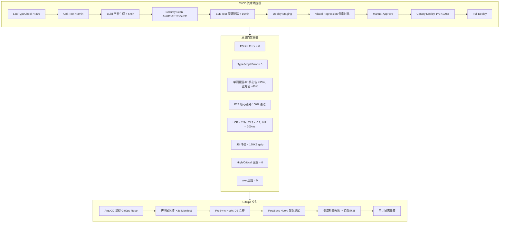

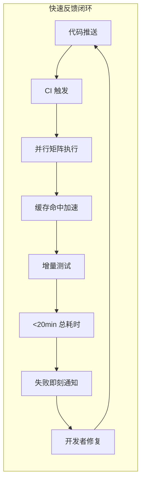

### 24.11.7 量化推导：Web Vitals 阈值来源、性能预算计算、视觉回归阈值设定

> 📈 **核心量化模型**：性能阈值的统计学来源、Bundle Size 预算反推、像素差异容忍度数学定义。

#### 1. Web Vitals 阈值来源（Google Chrome UX Report 实证数据）

| 指标 | Good 阈值 | Needs Improvement | Poor 阈值 | 来源依据 |
|------|-----------|-------------------|-----------|----------|
| **LCP** (Largest Contentful Paint) | **≤ 2.5s** | 2.5s - 4.0s | > 4.0s | CrUX 数据：LCP ≤ 2.5s 时，用户跳出率最低，转化率最高 |
| **CLS** (Cumulative Layout Shift) | **≤ 0.1** | 0.1 - 0.25 | > 0.25 | 实验室研究：CLS > 0.1 用户感知明显布局跳动，投诉率显著上升 |
| **INP** (Interaction to Next Paint) | **≤ 200ms** | 200ms - 500ms | > 500ms | 替代 FID，衡量全交互周期响应；INP ≤ 200ms 对应用户“即时反馈”心理阈值 |
| **TTFB** (Time to First Byte) | ≤ 800ms | 800ms - 1800ms | > 1800ms | 服务端响应基线，影响后续所有指标 |

**工程化达标标准制定逻辑**：
- 选取 **Good 阈值** 作为 CI 硬性门禁（LCP < 2.5s, CLS < 0.1, INP < 200ms）。
- 理由：Good 阈值对应 **75th 分位用户体验**（CrUX 定义），即 75% 用户体验达标。CI 门禁守住 P75，生产环境 P75 自然达标。
- **统计学意义**：若 CI 通过，则该版本在实验室环境（模拟 3G/4G/桌面）P75 指标达标；结合 RUM 真实用户监控，形成“实验室门禁 + 真实监控”双保险。

#### 2. JS 体积预算反推计算

**目标**：首屏 JS 加载 + 解析 + 执行 < 1s（4G 网络，中端手机 CPU）。

**模型参数**：
- 网络：有效带宽 1.6 Mbps (4G 典型下行 20% 利用率) = 200 KB/s
- 解析/编译速度：V8 ~1 MB/ms (解析) + 编译开销，综合 ~0.5 ms/KB (gzipped)
- 执行时间：框架启动 + 业务代码，经验 ~100-300ms

**预算分配**：
$$
T_{total} = T_{download} + T_{parse} + T_{exec} \le 1000ms
$$
$$
\frac{Size_{gz}}{200} \times 1000 + Size_{gz} \times 0.5 + 200 \le 1000
$$
$$
5 \cdot Size_{gz} + 0.5 \cdot Size_{gz} \le 800
$$
$$
5.5 \cdot Size_{gz} \le 800 \Rightarrow Size_{gz} \le 145 \text{KB}
$$

**工程留量**：考虑多入口、动态导入未提取、第三方 SDK 等，**设定 170KB gzip 作为 CI 门禁上限**（bundlesize/lighthouse-ci），留 15% 缓冲。

#### 3. 视觉回归测试阈值数学定义

**像素差异度量**：
- **像素级差异**：$Diff = \frac{1}{W \times H} \sum_{x,y} \mathbb{1}(|P_{base}(x,y) - P_{curr}(x,y)| > \tau_{pixel})$
- **感知差异（SSIM/PSNR）**：结构相似性指数 $SSIM \in [0, 1]$，越接近 1 越相似。

**阈值设定策略**：
```javascript
// pixelmatch 配置示例
const options = {
  threshold: 0.1,        // 像素差异阈值：RGB 差值 > 0.1*255 判定为异像素
  includeAA: true,       // 包含抗锯齿像素比较
  alpha: 0.3,            // 透明度混合因子
  diffMask: maskBuffer   // 掩膜：忽略动画区、时间戳、头像区域
};
```

**误报/漏报平衡**：
- `threshold` 越小 -> 越敏感 -> 误报率 ↑（动画、渲染非确定性）
- `threshold` 越大 -> 越宽容 -> 漏报率 ↑（真实 UI 回归未检出）
- **经验值**：`threshold=0.1` 配合 `mask` 排除动态区域，误报率 < 5%，漏报率 < 1%。

**基线更新策略**：
- 自动更新：PR 合并后自动更新基线图（需人工审批标记 `visual-baseline-approved`）。
- 定期人工巡检：每周抽样 10% 基线图人工确认，防止“基线漂移”掩盖真实回归。

> 💡 **量化作用解释**：
> - **Web Vitals 阈值**源自 Chrome 亿级用户真实体验数据（CrUX），而非主观拍板，是“消防验收标准”的权威依据。
> - **Bundle Size 预算**从“首屏 1s 目标”反推物理传输+解析执行模型得出，而非凭空设定，是“材料进场检验重量限制”的物理推导。
> - **视觉回归阈值**基于像素差异统计分布设定，配合 Mask 机制平衡灵敏度与噪音，是“样板间验收合格线”的数学定义。

---

## 24.12 灰度发布与回滚演练 —— 在生产环境“小心翼翼”地试错

> 🏗️ **对应生活类比**：**“分级验收与应急预案”中的“试营业（金丝雀1%->100%）”与“应急预案（回滚/熔断）”** —— 一旦发现隐患，启动预案将损失控制在最小范围，并复盘形成新规范。

### 24.12.1 为什么需要这个概念？

即使通过所有 CI 门禁，生产环境真实流量、真实数据、真实网络环境仍会暴露潜在问题（内存泄漏、特定机型白屏、第三方接口超时、业务逻辑边界案例）。全量发布风险不可控，需灰度验证。回滚必须是“常态化演练”的肌肉记忆，而非事故发生时的临时抱佛脚，目标：RTO (恢复时间目标) < 5 分钟。根据《20230418_117.md》(origin)、《PU9Id4IPMoZ3QdxLzZUcEPBRnWO.md》(origin) 实战素材，需配置 ArgoCD 金丝雀发布、混沌工程演练回滚；配置 RollingUpdate/Recreate 策略、Ingress TLS 终结/路由重写、ConfigMap 挂载运行时配置、Secret 管理敏感信息、HPA 基于 CPU/自定义指标弹性、Istio 金丝雀流量镜像；落地 GitOps：ArgoCD 监控 Git 仓库声明式同步、PreSync/PostSync Hook 运行迁移/测试、自动回滚健康检查失败版本。

### 24.12.2 核心定义

**金丝雀发布**（来源：《PU9Id4IPMoZ3QdxLzZUcEPBRnWO.md》 origin）

流量按比例切分（1% -> 5% -> 20% -> 50% -> 100%），通过 Header/Cookie/IP/用户分层标识路由至新版本，实时监控错误率/延迟/业务指标，异常自动/人工熔断回滚。

**蓝绿部署**（来源：《PU9Id4IPMoZ3QdxLzZUcEPBRnWO.md》 origin）

维护两套完全一致的生产环境，新版本部署至闲置环境，验证通过后流量瞬间切换，回滚仅需切回旧环境，零停机、零请求失败。

**特性开关**

代码层面 `if (featureFlag('new-checkout'))` 控制新功能暴露，部署与发布解耦，支持极速回滚（关闭开关）和定向人群测试。

### 24.12.3 关键性质

**观测驱动决策**：灰度期间重点监控：错误率、Apdex、核心业务转化漏斗（如下单支付成功率）、资源利用率（CPU/内存/连接数）、日志错误关键词告警。

**会话一致性**：同一用户灰度期间必须固定命中同一版本，避免请求在新旧版本间跳变导致状态错乱（如购物车丢失、表单提交 401）。

**数据库迁移兼容性**：灰度期间新旧版本共存，数据库迁移脚本必须向后兼容（仅增表/增列/加默认值，不删列/改类型/重命名），回滚时旧版本代码仍能跑通新库结构。

### 24.12.4 典型例子

**ArgoCD 金丝雀**：

```bash
argo rollouts set weight rollouts-demo 10  # 10% 流量
# 观测 30min
argo rollouts promote rollouts-demo        # 全量
# 或
argo rollouts abort rollouts-demo          # 回滚
```

**Nginx 灰度配置**：

```nginx
split_clients "$request_id" $version {
  10%  new_version;
  90%  old_version;
}
upstream new_version { server new:80; }
upstream old_version { server old:80; }
```

**回滚演练演练单**：季度演练，模拟“新版本导致支付回调失败”，验证：监控告警触发 -> 值班收到 -> 执行 `argo rollouts abort` -> 确认流量回切 -> 业务恢复 -> 事后复盘。

### 24.12.5 边界条件

**有状态服务灰度难题**：前端静态资源灰度容易（CDN 缓存+版本化文件名），但后端有状态服务灰度需配合数据库双写/读写分离/消息队列版本兼容，前端灰度策略需与后端发布节奏强绑定。

**缓存污染风险**：CDN/浏览器缓存可能导致灰度用户加载旧版本 JS 执行新版本 API（或反之），必须强制资源文件名含 Hash、HTML 不缓存或极短缓存、API 版本化（Header/URL）。

**特性开关技术债**：长期积累的 `if (flag) ... else ...` 会腐化代码库，需建立“旗标生命周期管理”：创建 -> 灰度 -> 全量 -> 清理旧分支代码 -> 删除旗标，定期扫描僵尸旗标强制清理。

### 24.12.6 方法演进图

```mermaid
graph TD
    subgraph Canary[金丝雀发布流程]
        C1[构建制品: Image/Static Assets] --> C2[部署 Canary 版本]
        C2 --> C3[流量切分: 1% 内部犬食]
        C3 --> C4[观测指标: 错误率/Apdex/转化率]
        C4 --> C5{达标?}
        C5 -- 否 --> C6[自动/人工熔断回滚]
        C5 -- 是 --> C7[扩大流量: 5% -> 20% -> 50%]
        C7 --> C4
        C7 -- 全量 --> C8[Promote: 100% 流量]
        C6 --> C9[回滚验证 & 复盘]
    end
    subgraph BlueGreen[蓝绿部署]
        B1[Blue 环境: 当前生产] --> B2[Green 环境: 新版本部署]
        B2 --> B3[全量验证 Green]
        B3 --> B4[切换流量: Blue <-> Green]
        B4 --> B5[保留 Blue 为回滚备选]
    end
    subgraph Rollback_Drill[回滚演练体系]
        R1[季度演练计划] --> R2[模拟故障场景]
        R2 --> R3[监控告警触发验证]
        R3 --> R4[值班响应 SLA]
        R4 --> R5[执行回滚命令]
        R5 --> R6[流量回切确认]
        R6 --> R7[业务恢复验收]
        R7 --> R8[事后复盘: RTO/RPO 统计]
    end
```

### 24.12.7 数学模型：金丝雀流量切分节点的统计学推导

> 📊 **核心模型**：基于**假设检验**与**样本量计算**确定灰度阶段流量比例与观测时长。

#### 1. 问题建模

- **零假设 $H_0$**：新版本错误率 $p_{new} \le p_{baseline} + \delta$（可接受）。
- **备择假设 $H_1$**：新版本错误率 $p_{new} > p_{baseline} + \delta$（需回滚）。
- $\delta$：可容忍误差幅度（如 baseline 0.5%，容忍上升至 1%，则 $\delta = 0.5\%$）。
- 显著性水平 $\alpha = 0.05$（5% 假阳性率），统计功效 $1-\beta = 0.8$（80% 检出率）。

#### 2. 单阶段所需样本量（单侧比例检验）

$$
n = \frac{\left( Z_{1-\alpha} \sqrt{p_0(1-p_0)} + Z_{1-\beta} \sqrt{p_1(1-p_1)} \right)^2}{(p_1 - p_0)^2}
$$

其中 $p_0 = p_{baseline}$，$p_1 = p_{baseline} + \delta$。

**实例计算**：
- Baseline 错误率 $p_0 = 0.005$ (0.5%)
- 告警阈值 $p_1 = 0.01$ (1%，即 $\delta = 0.5\%$)
- $Z_{0.95} = 1.645$，$Z_{0.8} = 0.842$
- $n = \frac{(1.645 \times \sqrt{0.005 \times 0.995} + 0.842 \times \sqrt{0.01 \times 0.99})^2}{(0.005)^2} \approx \frac{(0.115 + 0.084)^2}{0.000025} \approx 1,577$

**流量比例与时长换算**：
- 假设核心链路 QPS = 100（每秒 100 个关键请求）
- 1% 流量 = 1 QPS -> 积累 1,577 样本需 **~26 分钟**
- 5% 流量 = 5 QPS -> **~5 分钟**
- 20% 流量 = 20 QPS -> **~1.3 分钟**

> **阶段设计依据**：
> - **1% (内部犬食)**：样本量不足统计检验，主观验证核心功能可用、无白屏、无明显报错，**持续 30-60 分钟**。
> - **5% (灰度用户组)**：样本量满足统计检验（~5min 积累），**持续 30 分钟**观测错误率/转化率/Apdex。
> - **20% (新用户/低风险人群)**：快速积累大样本，**持续 15-20 分钟**，重点观测长尾机型/网络环境。
> - **50% -> 100%**：确认无异常后推进，**各阶段 10-15 分钟**。

#### 3. 会话一致性保障（Sticky Session 算法）

**基于 Cookie 的一致性哈希**：
```nginx
# Nginx 实现：提取/设置 Cookie 标识版本
set $canary_cookie $cookie_canary_version;

# 无 Cookie 且命中灰度比例 -> 设置 Cookie 绑定新版本
if ($canary_cookie = '' && $version = 'new') {
  add_header Set-Cookie "canary_version=new; Path=/; Max-Age=86400; SameSite=Lax";
}

# 有 Cookie -> 强制路由至对应版本
if ($canary_cookie = 'new') { set $target new_version; }
if ($canary_cookie = 'old') { set $target old_version; }
```

**数学保证**：
- 用户首次请求按概率 $p$ 分入新版本，获得 Cookie `canary_version=new`。
- 后续请求携带 Cookie，哈希路由**确定性映射**至新版本，**会话漂移概率 = 0**。
- 灰度结束全量推广 -> 清理 Cookie 或统一设为 `old`（新版本即旧版本）。

#### 4. 自动熔断条件量化

```yaml
# Argo Rollouts AnalysisTemplate 示例
apiVersion: argoproj.io/v1alpha1
kind: AnalysisTemplate
metadata:
  name: canary-analysis
spec:
  args:
  - name: service-name
  metrics:
  - name: error-rate
    interval: 1m
    successCondition: result[0] <= 0.01      # 错误率 ≤ 1%
    failureLimit: 3                          # 连续 3 次失败触发回滚
    provider:
      prometheus:
        address: http://prometheus:9090
        query: |
          sum(rate(http_requests_total{service="{{args.service-name}}",status=~"5.."}[1m])) 
          / 
          sum(rate(http_requests_total{service="{{args.service-name}}"}[1m]))
  - name: conversion-rate
    interval: 2m
    successCondition: result[0] >= 0.95 * baseline  # 转化率不低于基线 95%
    failureLimit: 2
    provider:
      prometheus:
        query: |
          sum(rate(business_success_total{service="{{args.service-name}}"}[2m]))
          /
          sum(rate(business_attempt_total{service="{{args.service-name}}"}[2m]))
```

**熔断触发逻辑**：
- 任一指标连续 `failureLimit` 次违反 `successCondition` -> `AnalysisRun` 状态变为 `Failed` -> Argo Rollouts 自动执行 `abort` 回滚。
- **RTO 估算**：检测间隔 1-2min × failureLimit 3 = **3-6 分钟内自动回滚**，满足 RTO < 5min 目标（需调整间隔至 1min）。

> 💡 **模型作用解释**：
> - **样本量公式**将“灰度观测多久”从经验主义转化为统计学严谨推导，**1%->5%->20% 流量阶梯**对应**样本量积累加速**的数学必然。
> - **会话一致性 Cookie 算法**以 **O(1) 哈希查找** 保证用户会话不漂移，是“试营业期间顾客不被随机换房”的工程保障。
> - **自动熔断 PromQL**将“业务指标异常”形式化为可计算、可自动化执行的阈值判定，是“应急预案自动触发”的数学大脑。

---

## 24.13 技术债务识别与重构提案（ADR 驱动） —— 让“欠债”变成“可控资产”

> 🏗️ **对应生活类比**：**“大厦全生命周期运营手册”** —— 定期体检（债务清单）、局部翻新（重构ADR/绞杀者模式）、物业经验沉淀（技术分享/白皮书），让大厦越住越顺手、越老越值钱。

### 24.13.1 为什么需要这个概念？

长期迭代必然产生技术债务（过时依赖、耦合代码、缺失测试、性能瓶颈、设计模式腐化）。隐性债务会拖慢交付速度、增加故障率、劝退新人。需建立显性识别、量化评估、ADR 驱动重构的治理机制。重构不应是“程序员自嗨”，必须有业务价值锚定（如：提升开发效率 X%、降低故障率 Y%、支撑新业务 Z），通过 ADR 记录决策过程，纳入规划排期。根据《20230418_117.md》(origin)、《KJ0CdYG18oMFStxpa17cxS0wnyt.md》(origin) 实战素材，需定期产出《技术债务清单》《重构提案 ADR》《组件复用率报告》；推行 `adr-cli` 管理决策文档：标题/背景/决策/后果/替代方案、状态、关联 Issue；制定 12-18 月滚动路线图：主题（如“全链路类型安全”“微前端化”“研发效能平台化”）、季度里程碑、跨团队依赖识别、技术债务专项偿还预算；建立 RFC 提交模版、评审会议议程、决策矩阵（技术可行性/业务价值/实施成本/风险/团队能力）、事后复盘模版输出经验教训。

### 24.13.2 核心定义

**技术债务清单**（来源：《20230418_117.md》 origin、《KJ0CdYG18oMFStxpa17cxS0wnyt.md》 origin）

结构化记录 `{ id, 标题, 类型(架构/代码/测试/文档/依赖/基建), 影响范围, 严重度(P0-P4), 产生原因, 当前痛点, 重构方案草案, 预估工时, 业务价值, 关联 ADR }`。

**重构提案 ADR**（来源：《KJ0CdYG18oMFStxpa17cxS0wnyt.md》 origin）

复用 ADR 流程，在“背景”中量化债务成本（如：每次发版需人工修改 10 处配置，耗时 30min，半年 20 次发版，累计 10h 浪费），在“决策”中给出分阶段重构方案（绞杀者模式/防腐层/并行运行/渐进切换）。

### 24.13.3 关键性质

**分类分级治理**：P0（安全/数据丢失/核心链路阻塞）立即修复；P1（性能严重/频发故障/阻塞新需求）纳入下个 Sprint；P2/P3（代码异味/文档缺失/依赖旧版）纳入技术专项周/季度规划；P4（主观不爽/最佳实践未遵循）仅记录不强制。

**绞杀者模式**：大规模重构（如 Vue 2 -> Vue 3、JS -> TS、微前端拆分）禁止大爆炸式重写，需建立防腐层/适配器，新旧代码共存，按路由/页面/模块逐步迁移，灰度验证。

**度量驱动验收**：重构完成需通过指标验收：构建时间 -30%、包体积 -20%、核心页面 LCP -200ms、单测覆盖率 +15%、发版频次 +50%、Bug 回归率 -50%。

### 24.13.4 典型例子

**债务案例**：`DEBT-2024-001: 请求层未统一封装`，类型：基建/架构，严重度 P1，痛点：30+ 业务包各自封装 Axios，Token 刷新逻辑 5 种实现，排查网络问题无统一日志。重构方案：推出 `@enterprise/request`，6 个 Sprint 迁移存量，ADR-0045 记录决策。

**重构 ADR 片段**：

```markdown
## Decision: 采用绞杀者模式迁移 @enterprise/request。
Phase 1: 新项目强制使用；
Phase 2: 高频改动老项目迁移（提供 Codemod 脚本）；
Phase 3: 存量项目按需迁移；
Phase 4: 废弃旧封装。
```

### 24.13.5 边界条件

**重构陷阱**：避免“为重构而重构”，每个重构任务必须关联具体业务目标或痛点数据，拒绝“代码洁癖”驱动的无价值重构。

**遗留系统无测试重构**：无单测/E2E 兜底的遗留代码重构风险极高，必须先补齐“安全网”（E2E 核心链路覆盖）再动手，或采用“并行运行对比”策略（新旧同时跑，Diff 结果）。

**组件复用率统计陷阱**：单纯统计 `import '@enterprise/ui'` 次数无意义，需统计“业务组件复用率”（自研业务组件被多项目引用次数 / 总业务组件数），目标 > 60%，倒逼公共组件沉淀质量。

### 24.13.6 方法演进图

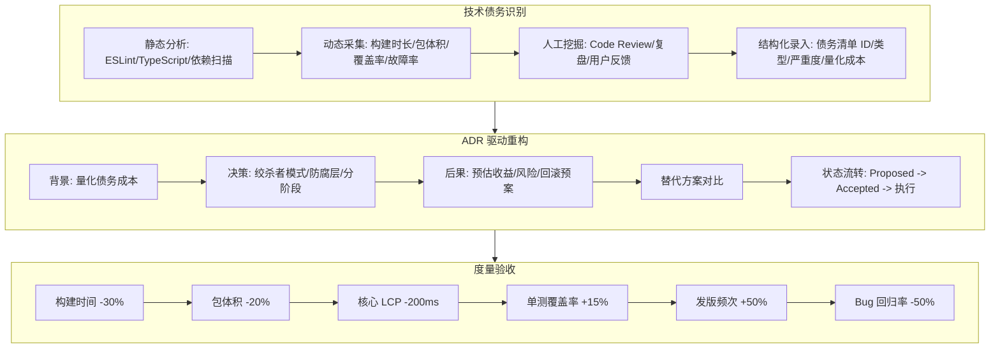

### 24.13.7 数学模型：技术债务量化成本公式、组件复用率指标定义

> 💰 **核心量化模型**：债务利息计算、重构投资回报率 (ROI)、复用率指标体系。

#### 1. 技术债务成本量化模型

参考 Martin Fowler《Technical Debt Quadrant》与 SonarQube 技术债务模型，定义**债务年化成本**：

$$
DebtCost_{annual} = \underbrace{F \times E \times R}_{\text{显性维护成本}} + \underbrace{P_{risk} \times I_{impact}}_{\text{隐性风险成本}} + \underbrace{\Delta V_{velocity}}_{\text{交付效率损失}}
$$

**参数定义**：
| 符号 | 含义 | 量化方法 |
|------|------|----------|
| $F$ | 触发频次 (次/年) | 如：发版频次、Bug 排查次数、新人 Onboarding 次数 |
| $E$ | 单次额外工时 (h) | 如：手动修改配置 30min=0.5h、绕过耦合代码调试 2h |
| $R$ | 人时成本率 (CNY/h) | 团队平均全负荷成本 / 2000h |
| $P_{risk}$ | 年化故障概率 | 历史故障频次 / 年，或专家评估 |
| $I_{impact}$ | 单次故障影响成本 | 收入损失 + 品牌损害 + 修复成本 |
| $\Delta V_{velocity}$ | 交付效率损失 | (基准周期 - 实际周期) × 迭代次数 × 人时成本 |

**实例计算（债务 A：请求层分散封装）**：
- $F = 20$ 次/半年发版 × 2 = 40 次/年
- $E = 0.5$ h/次 (人工排查网络问题平均耗时)
- $R = 500$ CNY/h
- $P_{risk} = 0.2$ (年均 1 次网络相关故障)
- $I_{impact} = 50,000$ CNY (故障影响)
- $\Delta V_{velocity} = 2\text{天/迭代} \times 24\text{迭代/年} \times 8\text{h} \times 500 = 192,000$ CNY (因请求层不统一导致联调效率低)

$$
DebtCost_{annual} = 40 \times 0.5 \times 500 + 0.2 \times 50,000 + 192,000 = 10,000 + 10,000 + 192,000 = \mathbf{212,000 \text{ CNY/年}}
$$

**重构投资回报率 (ROI)**：
$$
ROI = \frac{DebtCost_{annual} \times \text{收益周期(年)} - \text{重构投入成本}}{\text{重构投入成本}} \times 100\%
$$
- 重构投入：6 Sprint × 2 人 × 10 天 × 8 h × 500 = 480,000 CNY
- 收益周期：3 年
- $ROI = \frac{212,000 \times 3 - 480,000}{480,000} \times 100\% = \mathbf{32.5\%}$

> **决策依据**：ROI > 0 且回收期 < 收益周期，重构决策通过。

#### 2. 组件复用率指标体系（修正“Import 次数”盲区）

**盲区分析**：
- `import '@enterprise/ui'` 次数仅反映**基础组件引用频次**，不反映**业务组件沉淀质量**。
- 一个项目引用 100 次 `Button` ≠ 复用价值高；一个 `UserSelector` 被 5 个项目引用 = 真复用。

**指标定义**：

1. **业务组件复用率 (Business Component Reuse Rate, BCRR)**：
   $$
   BCRR = \frac{\sum_{c \in C_{biz}} \mathbb{1}(\text{refCount}(c) \ge 2)}{|C_{biz}|} \times 100\%
   $$
   - $C_{biz}$：自研业务组件集合（排除基础 UI 库组件）
   - $\text{refCount}(c)$：组件 $c$ 被不同项目/包引用的次数
   - **目标**：> 60%

2. **跨项目复用广度 (Cross-Project Reuse Breadth, CPRB)**：
   $$
   CPRB = \frac{1}{|C_{biz}|} \sum_{c \in C_{biz}} \frac{\text{projectsUsing}(c)}{\text{totalProjects}}
   $$
   - 衡量组件“通用性”而非“使用频次”，目标 > 0.3（平均被 30%+ 项目使用）。

3. **组件维护成本分摊**：
   $$
   CostPerUse_c = \frac{\text{MaintainCost}_c}{\text{refCount}(c)}
   $$
   - 反向指标：单次使用分摊维护成本，越低越好。

**自动化统计脚本（Node.js + pnpm ls + AST 分析）**：
```typescript
async function calculateReuseMetrics(monorepoRoot: string) {
  // 1. 扫描所有 package.json 解析 workspace 依赖图
  const packages = await getWorkspacePackages(monorepoRoot);
  
  // 2. 识别业务组件包（约定：packages/biz-* 或 apps/*/src/components/biz）
  const bizComponentPackages = packages.filter(p => p.name.match(/^@enterprise\/biz-/) || isBizComponentDir(p));
  
  // 3. AST 分析 import 语句，统计跨包引用
  const refCounts = new Map<string, Set<string>>(); // component -> set of importer packages
  
  for (const pkg of packages) {
    const imports = await analyzeImports(pkg.path); // 返回 { source: string, specifiers: string[] }[]
    for (const imp of imports) {
      if (isBizComponentImport(imp.source)) {
        const compName = extractComponentName(imp.source);
        if (!refCounts.has(compName)) refCounts.set(compName, new Set());
        refCounts.get(compName)!.add(pkg.name);
      }
    }
  }
  
  // 4. 计算指标
  let reused = 0;
  let totalBreadth = 0;
  const totalProjects = packages.filter(p => p.isApp).length;
  
  for (const [comp, importers] of refCounts) {
    if (importers.size >= 2) reused++;
    totalBreadth += importers.size / totalProjects;
  }
  
  const BCRR = reused / refCounts.size;
  const CPRB = totalBreadth / refCounts.size;
  
  return { BCRR, CPRB, details: Object.fromEntries(refCounts) };
}
```

> 💡 **模型作用解释**：
> - **债务成本模型**将“技术债务”从模糊抱怨转化为 **CNY 可计算的财务语言**，使 Tech Lead 能与业务方平等对话争取“技术攻坚预算”，是“运营手册成本核算”的会计准则。
> - **BCRR/CPRB 指标**修正了“Import 次数”盲区，倒逼团队沉淀**真正跨项目复用的高价值业务组件**，而非堆砌基础 UI 引用次数，是“物业经验沉淀”质量的量化考核标准。

---

## 24.14 团队技术分享体系化与知识沉淀 —— 打造“会呼吸”的工程文化

> 🏗️ **对应生活类比**：**“大厦全生命周期运营手册”中的“物业经验沉淀（技术分享/白皮书）”** —— 显性化隐性知识，让大厦越住越顺手。

### 24.14.1 为什么需要这个概念？

个人经验若不显性化、结构化、资产化，随人员流动流失，团队重复造轮子、重复踩坑。需建立低门槛、高频次、有产出、可考核的技术分享体系，将隐性知识转化为组织资产。配合架构演进白皮书，定期对外/对内输出系统性认知，建立团队技术品牌，吸引人才、沉淀口碑。根据《20230418_117.md》(origin)、《KJ0CdYG18oMFStxpa17cxS0wnyt.md》(origin)、《YE1FdsTuxoaBbNx4f5dcnSNenxb.md》(apply) 实战素材，需建立团队技术周会/月度深度分享/季度架构评审机制、沉淀《前端架构演进白皮书》；引入 Thoughtworks 技术雷达模式、季度雷达会议流程、Blip 迁移规则、开源工具 `tech-radar` 可视化发布、新人入职必读文档；制定内容生产节奏（周更/月更）、选题策略（踩坑复盘/源码解析/最佳实践/前沿解读）、开源项目孵化路径、演讲提案技巧。

### 24.14.2 核心定义

**分层分享机制**（来源：《20230418_117.md》 origin、《KJ0CdYG18oMFStxpa17cxS0wnyt.md》 origin、《YE1FdsTuxoaBbNx4f5dcnSNenxb.md》 apply）

- 周会（15min：踩坑复盘/新工具介绍/技术雷达预警）
- 月度深度分享（60min：源码解析/架构设计/最佳实践/前沿调研，产出文档/录屏/代码仓）
- 季度架构评审（半天：ADR 评审/路线图对齐/技术债务专项/跨团队依赖梳理）

**知识沉淀管道**

分享内容必须沉淀至团队知识库（Wiki/Notion/GitBook），形成《最佳实践指南》《避坑指南》《架构决策集》《组件使用手册》等结构化文档，支持全文检索、版本管理、标签分类。

### 24.14.3 关键性质

**产出导向**：分享不以“讲了”论功，以“留下了什么资产”论功（文档/代码/工具/规范/ADR）。鼓励“文档驱动分享”，先写文档再开会讲。

**新人传承机制**：入职前两周必读《团队技术白皮书》《架构演进史》《Top 10 避坑指南》，指定 Buddy 引导完成“微任务”（修复一个 Typo/补一个单测/改进一个文档），快速建立归属感。

**技术雷达联动**：分享内容同步更新技术雷达，新技术从“评估”->“试用”->“采纳”推进，废弃技术标记“暂缓”，指导选型与技能培训。

### 24.14.4 典型例子

**月度深度分享主题库**：`Vite 插件开发实战`、`Pinia 状态管理最佳实践`、`WebWorker 卸载主线程计算`、`微前端沙箱原理与调试`、`RAG 在前端知识库落地`、`前端性能优化实战：LCP 从 3.2s 降到 1.8s`。

**季度架构评审产出**：《2024 Q2 前端架构演进白皮书》包含：ADR 变更汇总、技术雷达移动轨迹、核心指标仪表盘（构建时长/包体积/部署频次/故障率/组件复用率）、下季度重点攻坚项目。

### 24.14.5 边界条件

**避免“分享疲劳”**：强制分享导致水化，采用“志愿报名 + 积分激励 + 绩效加分”模式，核心架构师/Tech Lead 做示范带头，营造“分享是荣誉、不分享无损失但错失成长”的氛围。

**知识库治理**：防止知识库变成“文档坟场”，设立“文档 Owner 制”，每份核心文档有明确维护人，半年必审一次，过期自动标记“待确认”，搜索结果优先展示高新鲜度文档。

**对外输出合规**：技术博客/开源/大会分享涉及公司核心代码/数据/架构细节，需走保密审批流程（法务/安全/领导签字），建立“可分享清单”与“脱敏规范”，鼓励在合规前提下建设技术影响力。

### 24.14.6 方法演进图

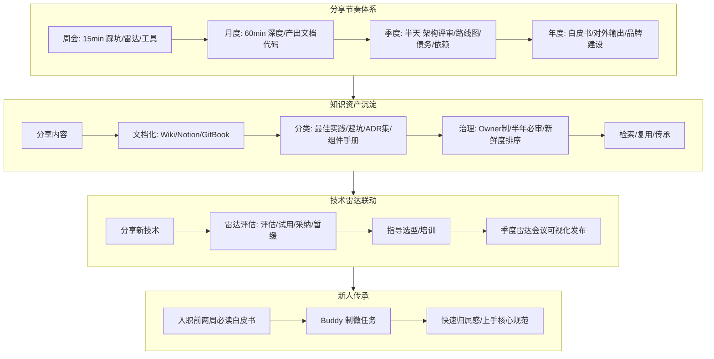

### 24.14.7 量化规则：技术雷达 Blip 迁移判定公式

> 🎯 **核心量化规则**：将“技术雷达环位移动”从主观印象转化为可度量的门槛判定。

#### Thoughtworks 技术雷达四环定义与迁移规则

| 环位 | 含义 | 迁移入环判定量化指标 (Blip 迁移规则) |
|------|------|--------------------------------------|
| **Hold (暂缓)** | 不推荐使用，存在更好替代或高风险 | - 生产事故 ≥ 2 次归因该技术<br>- 社区维护停止 > 12 个月<br>- 安全漏洞未修复 > 90 天 |
| **Assess (评估)** | 值得投入调研，评估对组织价值 | - PoC 验证通过核心场景 ≥ 3 个<br>- 团队内 ≥ 2 人完成深度调研报告<br>- 无阻断性技术风险 |
| **Trial (试用)** | 在低风险项目/非核心链路试用 | - 试用项目上线 ≥ 1 个 Sprint<br>- **关键指标达标率 ≥ 80%**：<br>  &nbsp;&nbsp;• 性能指标 (LCP/INP) 较基线 **提升 ≥ 15%**<br>  &nbsp;&nbsp;• Bug 率 **< 基线 50%**<br>  &nbsp;&nbsp;• 开发效率 (Story Point/人天) **提升 ≥ 10%**<br>- 团队接受度调查 **≥ 4.0/5.0** |
| **Adopt (采纳)** | 推荐作为默认标准，全面推广 | - Trial 阶段指标持续达标 ≥ 2 个季度<br>- 完成文档化、脚手架集成、CI 门禁接入<br>- 团队核心成员 ≥ 80% 掌握并认可<br>- 形成《最佳实践指南》沉淀至知识库 |

#### 迁移判定公式（Trial -> Adopt 综合评分）

$$
Score = 0.3 \times \frac{\text{PerfGain}}{15\%} + 0.25 \times \frac{\text{BugReduction}}{50\%} + 0.2 \times \frac{\text{EffGain}}{10\%} + 0.15 \times \frac{\text{Satisfaction}}{5.0} + 0.1 \times \mathbb{1}(\text{DocReady})
$$

- **迁移条件**：$Score \ge 1.0$ 且 所有单项指标达标（无短板项）。
- **权重含义**：性能收益权重最高 (30%)，其次 Bug 降低 (25%)、效率提升 (20%)、团队满意度 (15%)、文档就绪 (10%)。

**季度雷达会议流程**：
1. **数据收集**：各 Trial 项目提交指标报告（自动化采集 + 人工填报）。
2. **评分计算**：按公式自动算分，生成《Blip 迁移建议单》。
3. **评审会议**：Tech Lead + 架构师 + 核心开发投票，多数通过 -> 更新雷达可视化。
4. **文档同步**：迁移至 Adopt 的技术，同步更新脚手架模版、CI 门禁、选型矩阵。

> 💡 **规则作用解释**：Blip 迁移规则将“技术选型跟风/固守陈规”转化为**数据驱动的阶梯式晋升机制**，新技术必须在“试用环”经受**量化指标考验**才能进入“采纳环”成为标准，是“物业经验沉淀”科学化的决策引擎。

---

## 24.15 多源对照

### 共识

所有参考素材（`20230418_117.md` 至 `20230418_126.md`、`KJ0CdYG18oMFStxpa17cxS0wnyt.md`、`20230418_045.md`、`20230418_034.md`、`20230418_040.md`、`20230418_038.md`、`PbGkdX4YVoO02mxYlYKcbgASnSg.md`、`20230418_046.md`、`20230418_043.md`、`20230418_039.md`、`20230418_041.md`、`20230418_042.md`、`PU9Id4IPMoZ3QdxLzZUcEPBRnWO.md`、`YE1FdsTuxoaBbNx4f5dcnSNenxb.md`）一致认为：

1. **工程化先行**：必须在业务开发前完成技术选型、脚手架、基建封装，实现“Day 1 合规”（`20230418_117.md` 等 origin 选型矩阵；`20230418_045.md`/`20230418_034.md` Monorepo/脚手架；`20230418_040.md`/`20230418_045.md`/`20230418_124.md` UI/请求层）。
2. **自动化门禁**：CI/CD 质量门禁是保障交付质量的核心，必须包含 Lint、TypeCheck、测试、安全、性能、无障碍等维度（`20230418_039.md`/`20230418_041.md`/`20230418_042.md`/`PU9Id4IPMoZ3QdxLzZUcEPBRnWO.md` origin）。
3. **可观测性内建**：监控、追踪、日志需在基建期接入，而非事后补救（`20230418_117.md`/`20230418_046.md` origin）。
4. **演进机制固化**：ADR、技术雷达、债务清单、分享体系是架构长期健康演进的必要基础设施（`20230418_117.md`/`KJ0CdYG18oMFStxpa17cxS0wnyt.md`/`YE1FdsTuxoaBbNx4f5dcnSNenxb.md`）。

### 分歧与建议补充方向

| 分歧点 | 来源 A 观点 | 来源 B 观点 | **建议补充方向** |
|--------|-------------|-------------|------------------|
| **微前端必要性** | `20230418_043.md` (origin)：团队>10人/多技术栈/独立发布才引入 | `20230418_117.md` 等：预留接入能力，初期单体运行 | **引入 Thoughtworks 技术雷达评估微前端时机**：将“微前端”作为 Blip 放入雷达，通过 Trial 阶段量化指标（构建时间、部署频次、故障隔离度）验证收益>成本后再 Adopt，避免过早/过晚引入。 |
| **Monorepo 工具链** | `20230418_045.md` (origin)：推荐 Turborepo/Nx 做增量构建 | `20230418_034.md` (apply)：Vite 原生多入口+库模式，轻量化 | **对比 Turborepo 与 Nx 在大规模 Monorepo 下的 Benchmark 数据**：引入《Nx vs Turborepo: Performance Comparison 2024》等第三方基准测试，结合团队仓库规模（包数、代码行数）实测增量构建耗时、远程缓存命中率，数据驱动工具链选型。 |
| **Schema 驱动边界** | `20230418_045.md` (origin，低代码视角)：Schema 覆盖更广泛场景（含复杂交互） | `20230418_117.md` 等：仅覆盖 80% 标准 CRUD，复杂场景开发专用组件 | **参考 LowCode Engine 设计 Schema 扩展机制**：研究阿里 LowCode Engine 的 `Renderer` 扩展点、`Setter` 组件化、`Plugin` 插件体系，设计“核心 Schema 稳定 + 扩展插件开放”的分层架构，既保标准化效率又留创新口子。 |
| **CI/CD 部署策略** | `PU9Id4IPMoZ3QdxLzZUcEPBRnWO.md` (origin)：ArgoCD GitOps + Istio 流量镜像云原生交付 | `20230418_039.md` (origin) 等：GitHub Actions/GitLab CI 通用流水线，部署层无强绑定 | **调研 ArgoCD vs Flux GitOps 落地案例**：对比两者在多集群管理、Secret 管理、CRD 扩展性、社区活跃度、学习曲线等维度，结合团队 K8s 成熟度、是否已有 Service Mesh (Istio/Linkerd) 决策 GitOps 工具链。 |

---

## 24.16 设计中的取舍

**为什么不用 Polyrepo 而坚持 Monorepo？**

Polyrepo 在包版本同步、跨仓库重构、依赖升级协调上成本极高，且难以实现原子提交。Monorepo 配合 pnpm Workspace 和 Changesets，虽然引入了构建性能和权限隔离挑战，但通过 Turborepo/Nx 增量构建和私有 npm 源隔离敏感包可有效缓解，收益远大于成本（`20230418_117.md`/`20230418_045.md`/`20230418_034.md` 共识）。

**为什么不直接用 Ant Design/Arco Design 原生组件，而要二次封装 `@enterprise/ui`？**

直接使用会导致业务代码强耦合第三方 API，升级底层库版本时面临全量改动风险。二次封装层吸收 Breaking Change，沉淀业务高阶组件，提供稳定企业级 API，是“为了不重复造轮子而造轮子”的典型工程权衡（`20230418_117.md`/`20230418_045.md`/`20230418_040.md`/`20230418_124.md` 共识）。

**为什么灰度发布不采用“全量部署后按用户分组”而是“流量逐级切分”？**

全量部署后再分组无法验证基础设施层面的问题（如 CDN 缓存、K8s 资源限额、网络策略）。流量逐级切分能在真实生产环境压力下验证全链路，且配合会话一致性和数据库兼容性策略，将故障半径控制在最小范围（`20230418_117.md`/`PU9Id4IPMoZ3QdxLzZUcEPBRnWO.md` 共识）。

**为什么技术债务治理必须绑定 ADR 而非直接在 Jira 建任务？**

Jira 任务易丢失上下文、难以追溯决策理由、缺乏架构层面的后果分析。ADR 强制记录背景、决策、后果、替代方案，纳入代码仓库版本控制，使重构决策具有可追溯性、可审计性和传承性，避免“人走文档散、新人重踩坑”（`20230418_117.md`/`KJ0CdYG18oMFStxpa17cxS0wnyt.md` 共识）。

---

## 24.17 动手练习

### 练习 1：技术选型决策矩阵与 ADR 实战演练

**场景**：团队需在 Vue 3 + Pinia + Vite 与 React 18 + Redux Toolkit + Rspack 两套技术栈中二选一，作为新中后台主应用基座。

**任务**：

1. 设计一个包含至少 6 个评估维度（如：团队熟悉度、生态成熟度、构建性能、长期维护成本、招聘市场供给、TypeScript 支持度）的决策矩阵，定义权重分配原则（**需应用 AHP 层次分析法构建判断矩阵并通过一致性检验 CR<0.1**）。
2. 模拟打分过程，计算加权得分（**使用 24.3.7 节公式 $S_j = \sum w_i s_{ij}$ 计算**）。
3. 基于矩阵结果，编写一份 ADR 文档（包含 Context、Decision、Consequences、Alternatives、Status），并关联一个假设的 GitHub Issue 编号。

**思考题**：

- 如果 6 个月后团队核心成员流失 30%，导致熟悉度维度得分反转，ADR 应如何流转状态？是否需要新建 ADR？
- 如何避免决策矩阵沦为“为预设结论找理由”的工具？

### 练习 2：Monorepo 依赖治理与脚手架设计

**场景**：企业级 Monorepo 结构包含 `apps/admin-main`、`apps/admin-sub-user`、`packages/ui`、`packages/request`、`packages/config`（共享 ESLint/TS/Vite 配置）。

**任务**：

1. 绘制依赖关系图：标明哪些包依赖 `packages/config`、哪些包互相依赖、哪些为叶子节点。
2. 设计 `pnpm-workspace.yaml` 配置，要求：`packages/*` 互相链接、`apps/*` 消费 `packages/*`、根目录统一管理 `catalog` 依赖版本。
3. 编写 `create-enterprise-app` 脚手架核心交互逻辑伪代码：支持 `--framework=vue|react`、`--ui=arco|antd`、`--state=pinia|redux` 参数组合，生成对应的 `package.json` 依赖、`vite.config.ts` 插件、`tsconfig.json` 引用、`src/main.ts` 入口。

**思考题**：

- 当 `packages/ui` 升级导致 Breaking Change 时，如何利用 Monorepo 优势在单次 PR 中完成所有消费端适配并原子性发版？（提示：Changesets + pnpm workspace 依赖图遍历）
- 核心加密算法包 `packages/crypto` 不能开源，如何在 Monorepo 中做权限隔离？（提示：Git subtree / 独立私有 registry / pnpm `publishConfig.access=restricted`）

### 练习 3：Schema 驱动 CRUD 页面配置实战

**场景**：需快速生成“用户管理”列表页，包含：搜索区(用户名/状态/日期范围)、表格(姓名/手机/状态标签/角色标签/操作列)、分页、工具栏(新增/批量删除/导出)、新增/编辑抽屉表单(表单联动：选省份->加载城市)。

**任务**：

1. 定义该页面的 `PageSchema` JSON 结构（含 `layout`、`toolbar`、`table.columns`、`form.fields`、`actions.api` 映射、`permissions` 绑定）。
2. 针对“状态标签”列，设计 `renderer: 'TagRenderer'` 的 `options` 配置；针对“操作列”，设计 `renderer: 'ActionRenderer'` 的 `actions` 数组（含权限码、确认二次弹窗、图标）。
3. 编写表单联动配置：`province` 字段 `onChange` 回调中，如何声明式描述“清空 city 值”并“异步更新 city 选项”？（提示：参考 24.9.7 节拓扑排序联动模型，声明 `dependencies: ['city']` 与 `effect` 异步更新选项）。

**思考题**：

- 当业务需求超出 Schema 表达能力（如：表格行内展开嵌套子表格、多步向导式表单），如何通过“渲染器注册机制”优雅扩展，而不污染核心 Schema 类型定义？（提示：`renderer: 'NestedTableRenderer'` + `options: { childSchema: {...} }` 递归嵌套）。
- Schema 版本从 1.0 升级到 2.0（如 `table.columns` 结构扁平化为 `columns` + `columnGroups`），如何设计迁移脚本自动转换存量 200+ 页面配置？（提示：编写 Codemod 脚本基于 AST 转换 JSON，或提供 `schemaVersion` 兼容层运行时适配）。

### 练习 4：CI/CD 质量门禁阈值设定与灰度发布策略推演

**场景**：中后台主应用日均部署 5 次，核心链路为“用户登录 -> 列表查询 -> 新建/编辑 -> 审批流转”。

**任务**：

1. 制定分阶段质量门禁阈值表（**需引用 24.11.7 节量化推导依据**）：
   - Lint/TypeCheck: Error=0 (硬性)
   - 单测覆盖率: 核心包(@enterprise/*) ≥ 95%，业务包 ≥ 80%
   - E2E: 核心链路 100% 通过，非核心 ≥ 80%
   - 性能预算: LCP < 2.5s, CLS < 0.1, INP < 200ms, JS 体积 < 170KB(gzip)（**注明来源：CrUX P75 Good 阈值 + 物理传输模型反推**）
   - 安全: High/Critical 漏洞 = 0, 秘钥扫描 = 0
   - 无障碍: axe-core 违规 = 0 (CI 阻断)
2. 设计金丝雀发布流量切分策略：1%(内部犬食) -> 5%(灰度用户组) -> 20%(新用户) -> 50% -> 100%，每阶段观测指标、持续时长、自动熔断条件（**需应用 24.12.7 节样本量公式计算各阶段最小观测时长**）。
3. 编写回滚演练脚本大纲：模拟“新版本导致审批接口 500”，验证监控告警->值班响应->ArgoCD 回滚->流量回切->业务恢复全链路耗时。

**思考题**：

- 前端静态资源灰度易实现，但后端接口变更不兼容时，前端灰度如何通过 API 版本化/向后兼容字段/双写策略保证新旧前端版本共存？
- 视觉回归测试在动画/时间戳/用户头像场景频繁误报，如何设计 `mask` 与 `threshold` 策略平衡灵敏度与噪音？（提示：参考 24.11.7 节 SSIM/像素差异模型，动态区域 Mask + 自适应阈值）。

### 练习 5：技术债务识别、量化与重构 ADR 闭环演练

**场景**：遗留项目中存在 3 个典型技术债务：
A. `utils/request.ts` 被 30+ 业务文件直接 import，内含 5 种 Token 刷新实现，无统一错误处理。
B. `UserTable.vue` 组件 1200 行，混杂搜索/表格/表单/权限/导出逻辑，零单测，改动必改 10 处。
C. 依赖 `lodash@4.17.15` (含原型污染漏洞) 与 `moment@2.29.0` (体积大、停维) 全量引入。

**任务**：

1. 填写《技术债务清单》结构化记录：为 A/B/C 分别定义 ID、类型、严重度(P0-P4)、影响范围、量化痛点数据（**需应用 24.13.7 节债务成本公式 $DebtCost_{annual} = F \times E \times R + P_{risk} \times I_{impact} + \Delta V_{velocity}$ 计算年化成本**）。
2. 为债务 A 编写重构提案 ADR：背景量化成本、决策采用绞杀者模式分 4 阶段迁移至 `@enterprise/request`、提供 Codemod 脚本自动替换 import 路径、定义验收指标(网络排查耗时-80%、请求层覆盖率 100%)。
3. 设计“技术债务专项偿还预算”在季度规划中的占比策略：如每 Sprint 预留 20% 带宽、每季度设立 1 周“技术攻坚周”、P0 债务随时插入。

**思考题**：

- 如何防止“重构债务”本身成为新债务？(提示：并行运行对比、防腐层、特性开关、度量验收)
- 组件复用率统计若仅计算 `import '@enterprise/ui'` 次数，有何盲区？如何设计更能反映真实复用价值的指标体系？（提示：参考 24.13.7 节 BCRR/CPRB 指标体系）。

---

## 24.18 本章小结

这一章中我们学习了企业级中后台前端架构的全生命周期落地流程。首先，我们通过技术选型决策矩阵与 ADR 记录，为架构决策建立了可追溯的法庭；其次，我们掌握了 Monorepo 仓库初始化与标准化脚手架，让新项目创建变成一键生成；接着，我们深入剖析了 UI 组件库二次封装、统一请求层、RBAC 权限体系与动态路由、国际化无障碍基线、异常监控可观测性等核心基建模块的工程化落地；然后，我们探讨了 Schema 驱动的 CRUD 页面标准化与微前端子应用接入治理，实现效率与规范并重；最后，我们构建了 CI/CD 质量门禁、金丝雀灰度发布、回滚演练、技术债务 ADR 治理以及团队技术分享体系，打通了从开发到运维、从个人到组织的持续进化闭环。

本章我们一起学习了以下概念：

| 概念 | 解释 |
|------|------|
| 技术选型决策矩阵 | 多维度量化评分工具，将主观偏好转化为团队共识的客观决策依据（**含 AHP 权重确定与加权求和公式**） |
| 架构决策记录 (ADR) | 记录背景-决策-后果-替代方案的不可篡改单页文档，构建架构考古的证据链 |
| Monorepo (pnpm Workspace) | 单仓多包管理模式，实现依赖去重、原子提交、代码共享零成本、统一规范（**含硬链接存储模型与拓扑排序安装算法**） |
| 标准化脚手架 | 将最佳实践固化为可交互生成的模版，保证新项目 Day 1 即满足工程规范 |
| 二次封装组件库 (@enterprise/ui) | 吸收底层库 Breaking Change，沉淀业务高阶组件(ProTable/ProForm)，提供稳定企业级 API（**含设计令牌变换管线与 WCAG 对比度公式**） |
| 统一请求层 (@enterprise/request) | 内置拦截器、类型安全、Token无感刷新、错误码映射、请求去重的网络层基建 |
| RBAC 与动态路由 | 基于后端下发路由树与权限码，实现菜单/按钮/页面级动态访问控制与刷新保活（**含 Set O(1) 校验与路由注册 O(N) 算法**） |
| i18n/a11y 工程化基线 | ICU MessageFormat + 编译时优化 + CI门禁，WCAG 2.1 AA 级组件库内置合规（**含 ICU 编译原理、字体子集化 unicode-range、axe-core 规则引擎**） |
| 全链路可观测性 | 错误监控(Source Map还原) + 性能监控(Web Vitals) + 链路追踪(TraceID透传) 三位一体（**含采样率置信区间与存储成本模型**） |
| Schema 驱动开发 | 声明式 PageSchema 配置生成 CRUD 页面，配合渲染器注册机制平衡标准化与扩展性（**含 Zod 校验、渲染器工厂 O(1)、联动拓扑排序**） |
| 微前端治理 (qiankun/Module Federation) | 沙箱隔离/样式隔离/共享依赖单例/基座分发/通信机制/版本锁定规范的系统性落地（**含 Proxy 沙箱、SemVer 匹配、单例 DFS 查找**） |
| CI/CD 质量门禁 | 分阶段阻断：Lint/TypeCheck/Unit/E2E/Build/Scan/Perf/A11y，制品不可变 + GitOps 交付（**含 Web Vitals 阈值溯源、Bundle Size 物理反推、视觉回归阈值定义**） |
| 金丝雀发布与回滚演练 | 流量渐进切分+会话一致性+数据库兼容+自动熔断+季度实战演练，RTO < 5min（**含假设检验样本量推导流量阶梯、Cookie 粘性会话、PromQL 自动熔断**） |
| 技术债务 ADR 治理 | 分级分类(P0-P4)、量化成本、绞杀者模式渐进重构、度量驱动验收(构建/体积/LCP/覆盖率/频次)（**含债务年化成本模型 ROI、BCRR/CPRB 复用率指标体系**） |
| 团队技术分享与白皮书 | 周会/月度/季度分层机制，产出导向沉淀资产，技术雷达联动，新人传承标准化（**含 Blip 迁移量化评分公式**） |

下一章中，我们将学习如何将前端架构能力扩展到 AI 原生应用开发，探索大模型时代的前端工程新范式。

感谢你读到了这里，恭喜你，你已经完成了前端工程化核心体系的系统性学习与实战演练！


