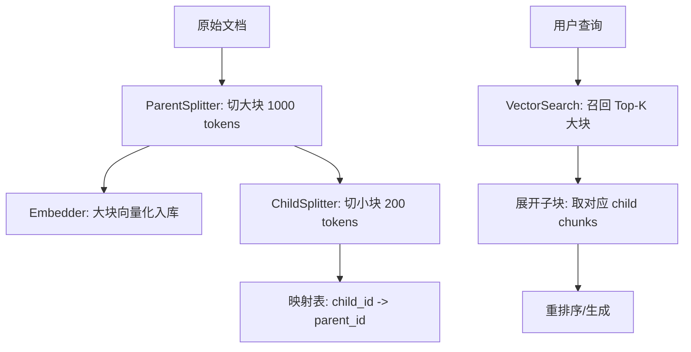
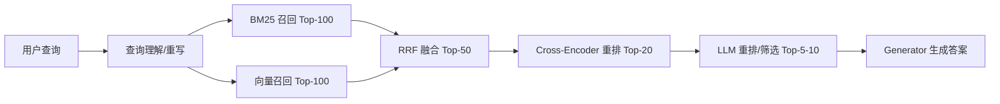
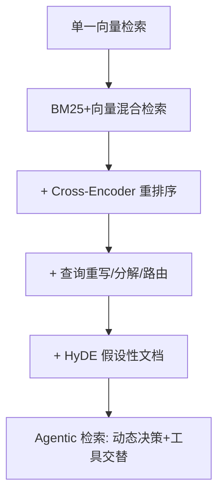
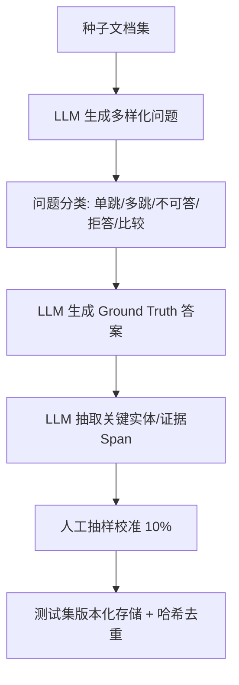
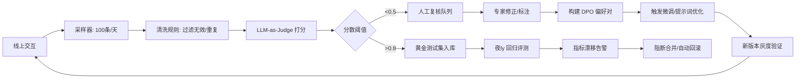
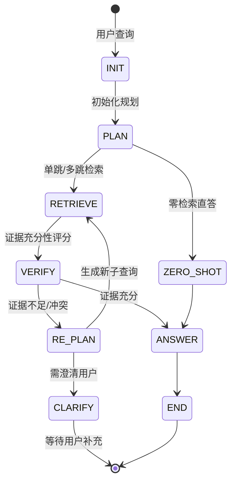
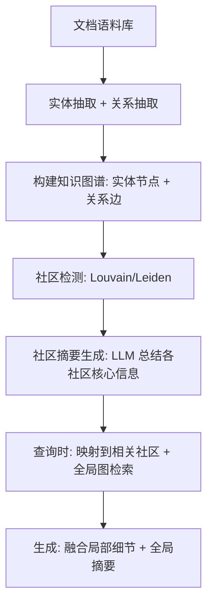

# 第 28 章 RAG 系统工程化 —— 从“召回文档”到“知识计算”
作者：龙哥

## 学习目标

- 理解模块化 RAG 流水线的解耦设计原则与标准化接口契约
- 掌握多路召回、重排序、查询理解等高级检索策略的组合与工程落地
- 建立基于 RAGAS/ARES 的离线/在线评测指标体系与数据飞轮闭环
- 理解 Agentic RAG 将检索封装为 Tool 实现自适应推理-检索交织的架构范式
- 能根据业务复杂度选择 Naive/Advanced/Modular/Agentic RAG 合适架构层级
- 掌握将大模型能力封装为标准化 Tool（Function Calling Schema）的工程方法
- 理解推理-检索双螺旋交织机制及证据充分性判断的自动化实现
- 了解 GraphRAG 等进阶 RAG 模式在复杂推理场景的应用边界
- 理解 RAG 系统中 LLM 作为决策中枢的核心地位，而非简单的 API 封装
- 掌握 RAG 系统的可观测性建设：Trace、Span 与 LangSmith/LangFuse 落地
- 理解 RAG 系统的分层评测体系：单元测试、离线基准与在线 A/B 测试
- 掌握 RAG 系统的数据飞轮架构：从用户交互到模型迭代的闭环工程
- 了解 RAG 系统的工具生态标准化：Function Calling、MCP 与 Toolformer 范式

## 28.1 生活类比

想象 RAG 系统是一个**企业级知识服务中心**：

**模块化流水线** = **标准化 SOP 手册**：入库（索引）、查档（检索）、撰写回复（生成）各环节有统一接口文档，新员工（组件）入职即可上岗，老员工（策略）随时可替换。

**高级检索策略** = **资深档案员的组合拳**：先广撒网（BM25 查关键词 + 向量查语义），再精筛选（Cross-Encoder 重排），遇到模糊需求还会帮你改写查询单、拆解复杂问题、甚至脑补假设性答案去匹配（HyDE）。

**评测与数据飞轮** = **质检部 + 持续改进机制**：每份回复必查‘忠实度’（会不会胡编）、‘相关性’（答没答到点）、‘上下文精确率’（引没引对证据），用客户投诉/点赞数据（在线反馈）夜间自动更新题库、优化 SOP。

**Agentic RAG** = **赋予档案员‘主动大脑’**：不再死板按流程走，而是‘观察需求→思考策略→调用工具（查档/算表/搜网）→验证证据→决定是否继续查或直接回复’，复杂跨部门调查（多跳问答）游刃有余。

**推理-检索双螺旋** = **侦探破案的思维循环**：推理产生新线索→调取新档案→推理更新判断→再调取档案，直至证据链闭环。

**Function Calling Schema** = **统一的工具调用协议**：档案员（模型）与工具（检索器/计算器/浏览器）通过标准接口文档（Schema）解耦，新工具即插即用。

**全链路可观测性** = **业务流程监控大屏**：每个环节（索引/检索/生成）都有实时埋点，异常即报警、耗时可分析、成本可核算。

**分层评测体系** = **三级质检防线**：组件级自测（单元）、系统级离线大考（RAGAS）、业务级实战演练（A/B 测试）。

**数据飞轮** = **客户反馈自动变训练数据**：点踩/修正/追问 → 清洗入库 → 扩充测试集/微调数据 → 模型/提示词迭代 → 线上验证，越用越懂。

## 28.2 概念地图

RAG 系统工程化
├── 模块化流水线
│   ├── 索引侧：DocumentLoader/Transformer/Embedder/VectorStore  —— 《20230418_106.md》, 《20230418_105.md》, 《20230418_109.md》, 《20230418_136.md》
│   ├── 检索侧：Retriever 接口（混合/父子/HyDE）           —— 《20230418_106.md》, 《20230418_105.md》, 《20230418_109.md》, 《20230418_136.md》
│   └── 生成侧：Generator（Prompt 模版/结构化输出）        —— 《20230418_106.md》, 《20230418_105.md》, 《20230418_109.md》, 《20230418_136.md》
├── 高级检索策略
│   ├── 多路召回：BM25 + 向量 + RRF 融合                    —— 《20230418_106.md》, 《20230418_110.md》
│   ├── 重排序：Cross-Encoder / LLM 重排                      —— 《20230418_106.md》, 《20230418_110.md》
│   └── 查询理解：重写/分解/路由/HyDE                         —— 《20230418_106.md》, 《20230418_110.md》
├── 评测与数据飞轮
│   ├── 核心指标：忠实度/相关性/上下文精确率/召回率           —— 《20230418_109.md》, 《20230418_136.md》
│   ├── 合成测试集：强模型生成 QA 对覆盖多类型               —— 《20230418_109.md》, 《20230418_136.md》
│   └── 在线闭环：LLM-as-Judge + 人工反馈 → 自动化迭代        —— 《20230418_109.md》, 《20230418_136.md》
└── Agentic RAG
    ├── 检索即工具：Function Calling Schema 封装            —— 《20230418_136.md》, 《20230418_140.md》, 《20230418_106.md》, 《20230418_110.md》
    ├── 核心循环：观察→思考→行动→验证→迭代                 —— 《20230418_136.md》, 《20230418_140.md》
    ├── 关键能力：自主改写/充分性判断/冲突纠偏/停止决策     —— 《20230418_136.md》, 《20230418_140.md》
    ├── 长程规划：树搜索/MCTS/ToT + DAG 任务图并行         —— 《20230418_109.md》, 《20230418_140.md》
    └── 进阶模式：GraphRAG（知识图谱增强）/多模态 RAG       —— 《20230418_136.md》, 《20230418_140.md》, 《20230418_107.md》
├── 可观测性与评测体系
│   ├── 全链路追踪：Trace/Span 标准化与 LangSmith/LangFuse  —— 《20230418_105.md》, 《20230418_109.md》
│   ├── 分层评测：单元/离线基准(RAGAS)/在线 A/B 测试         —— 《20230418_110.md》, 《20230418_136.md》
│   └── 数据飞轮：高质量轨迹采样 → 标注 → 偏好数据 → 模型迭代  —— 《20230418_136.md》, 《20230418_140.md》
└── 工具生态标准化
    ├── Function Calling 协议规范                             —— 《20230418_106.md》, 《20230418_110.md》
    ├── Model Context Protocol (MCP) 统一接口               —— 《20230418_106.md》, 《20230418_110.md》
    └── 工具注册发现与权限控制                                —— 《20230418_106.md》, 《20230418_110.md》

## 28.3 模块化 RAG 流水线 —— 像搭积木一样组装知识计算管线

### 28.3.1 为什么需要模块化流水线？

传统 RAG 实现常将加载、分块、嵌入、检索、生成硬编码在一起，导致三大痛点：
1. **难以替换单一环节**：想换个分块策略、换个嵌入模型，却要动核心代码，回归成本高。
2. **业务场景多变难适配**：法律场景需精准引用条款（需父子文档），客服场景追求极速响应（需混合检索 + 缓存），硬编码流水线无法同时满足。
3. **团队协作割裂**：数据工程师负责索引构建，算法工程师优化检索策略，应用工程师调用生成接口，缺乏统一契约导致交接成本高。

正如《20230418_106.md》所指出的：“定义标准化 RAG Pipeline 接口：DocumentLoader/Transformer -> VectorStore/Retriever -> Generator，支持混合检索、父子文档、假设性文档嵌入等高级策略的即插即用组装。”

模块化流水线的核心思想是**“接口标准化、组件解耦、按需组装”**。你可以把它类比为工业界的标准化接口：只要符合 USB 协议，鼠标、键盘、硬盘、风扇都能即插即用；同理，只要符合 `Runnable` 协议，`BM25Retriever`、`VectorRetriever`、`HybridRetriever` 就能在配置文件里一行代码切换。

### 28.3.2 核心接口契约设计

**组件即“Runnable”：统一输入输出契约**

LangChain/LangGraph 生态确立了 `Runnable` 协议作为组件间的通用契约。每个组件本质是一个纯函数或可调用对象，遵循：

$$
\text{Component} : \text{Input} \xrightarrow{\text{invoke/stream/batch}} \text{Output}
$$

我们为三大核心阶段定义标准化接口（以 Python Type Hint / Pydantic 为例）：

**索引侧组件契约**

```python
# 文档加载器：支持多源异构输入
class DocumentLoader(Runnable[LoaderConfig, List[Document]]):
    def invoke(self, config: LoaderConfig) -> List[Document]:
        # 返回标准 Document: page_content, metadata{source_id, page_num, doc_type...}
        pass

# 文本分割器：核心参数化，输出带父子关联的 Chunk
class TextSplitter(Runnable[SplitterConfig, List[Chunk]]):
    def invoke(self, config: SplitterConfig) -> List[Chunk]:
        # Chunk 必含: chunk_id, parent_id(可选), content, metadata, embeddings(可选)
        pass

# 嵌入器：统一向量化接口，支持批处理与异步
class Embedder(Runnable[List[str], List[List[float]]]):
    async def abatch(self, texts: List[str]) -> List[List[float]]:
        pass

# 向量存储：统一 CRUD + 相似度搜索
class VectorStore(Runnable[VectorStoreOp, Any]):
    def add_documents(self, docs: List[Document]) -> List[str]: ...
    def similarity_search(self, query: str, k: int, filter: dict) -> List[Document]: ...
```

**检索侧组件契约：统一 Retriever 接口**

```python
# 所有检索器实现统一接口，上层无感知切换策略
class BaseRetriever(Runnable[RetrieverInput, List[RetrievedDoc]]):
    def invoke(self, input: RetrieverInput) -> List[RetrievedDoc]:
        # RetrieverInput: query, top_k, filters, retrieval_strategy_config
        # RetrievedDoc: doc, score, retrieval_source(bm25/vector/hyde/parent)
        pass

# 具体实现示例
class HybridRetriever(BaseRetriever):
    def __init__(self, bm25_retriever: BaseRetriever, vector_retriever: BaseRetriever, fusion: FusionStrategy):
        self.bm25 = bm25_retriever
        self.vector = vector_retriever
        self.fusion = fusion  # RRF / WeightedSum / ReciprocalRankFusion
    
    def invoke(self, input: RetrieverInput) -> List[RetrievedDoc]:
        # 并行召回 -> 融合排序 -> 截断 Top-K
        bm25_docs = self.bm25.invoke(input)
        vector_docs = self.vector.invoke(input)
        return self.fusion.fuse(bm25_docs, vector_docs, input.top_k)
```

**生成侧组件契约**

```python
class Generator(Runnable[GeneratorInput, GeneratorOutput]):
    def invoke(self, input: GeneratorInput) -> GeneratorOutput:
        # GeneratorInput: query, retrieved_docs, chat_history, prompt_template, output_schema
        # GeneratorOutput: answer, citations[doc_id, span], confidence, token_usage
        pass
```

这个接口设计展示了三个关键工程决策：
1. **父子文档关联显式化**：`Chunk.parent_id` 让下游重排序或生成时可选择返回父块（长上下文）还是子块（精准引用）。
2. **融合策略外部化**：`FusionStrategy` 作为可注入依赖，而非硬编码在 `HybridRetriever` 内部，满足“配置大于代码”原则。
3. **结构化输出契约**：`GeneratorOutput` 强制包含 `citations` 与 `confidence`，为下游评测、溯源、人工复核奠基。

上述接口契约设计参考了《20230418_106.md》中关于“标准化 Pipeline 接口”的定义，并结合《20230418_105.md》中“Chain、Agent 与 Memory 的解耦设计”以及《20230418_109.md》中“模块化 RAG 流水线：索引、检索、生成的解耦与组装”进行了工程化落地细化。《20230418_136.md》进一步强调了“LLM 作为操作系统内核，从‘聊天机器人’升级为‘推理引擎/决策中枢’的核心地位”，这要求生成侧接口必须承载结构化推理输出的能力。

### 28.3.3 典型组装模式与工程落地

**模式一：ParentDocumentRetriever（大块嵌入、小块返回）**



这个模式展示了**“索引时粗粒度、检索时细粒度”**的工程智慧：大块保留语义完整性利于召回，小块精准定位利于引用与压缩上下文窗口。

**模式二：HyDE（假设性文档嵌入）**

```python
class HyDERetriever(BaseRetriever):
    def __init__(self, generator: Generator, vector_store: VectorStore, base_retriever: BaseRetriever):
        self.generator = generator  # 用于生成假设性文档
        self.vector_store = vector_store
        self.base_retriever = base_retriever  # 兜底检索器
    
    def invoke(self, input: RetrieverInput) -> List[RetrievedDoc]:
        # 1. LLM 生成假设性回答/文档
        hypo_doc = self.generator.invoke(GeneratorInput(
            query=input.query, 
            prompt_template="生成一段可能包含答案的假设性文档...",
            retrieved_docs=[]
        )).answer
        
        # 2. 假设性文档向量化检索
        hypo_docs = self.vector_store.similarity_search(hypo_doc, k=input.top_k)
        
        # 3. 融合真实查询检索结果（兜底）
        real_docs = self.base_retriever.invoke(input)
        return self.fusion.fuse(hypo_docs, real_docs, input.top_k)
```

这个模式展示了**“生成辅助检索”**的反向思维：用生成模型的“联想能力”弥补查询表达不足，特别适合“用户查询极短、术语不标准”的场景。

### 28.3.4 模块化流水线的方法演进


上图展示了从硬编码流水线到模块化组装、再到智能体自主决策的架构演进脉络。每一阶段都在解决上一阶段的刚性约束：Naive RAG 解决“有没有”，Advanced RAG 解决“好不好用”，Modular RAG 解决“换不换得掉、测不测得了”，Agentic RAG 解决“懂不懂得动态决策”，GraphRAG 解决“能不能跨文档推理”。

### 28.3.5 边界条件与工程权衡

| 维度 | 权衡点 | 建议策略 |
|------|--------|----------|
| **接口粒度** | 过细→组合爆炸、序列化开销大；过粗→灵活性不足 | 核心路径（索引/检索/生成）粗粒度，策略参数细粒度注入 |
| **状态管理** | 查询重写器等有状态组件并发安全 | 无状态化设计；有状态组件用 `ThreadLocal` 或请求级 `Context` 隔离 |
| **性能基线** | `Runnable` 包装层带来微秒级开销 | 高吞吐核心路径（如向量搜索）绕过包装直调底层客户端 |
| **版本演进** | 接口变更破坏下游 | 接口版本化（`RetrieverInputV1`/`V2`），适配器模式平滑过渡 |

---

## 28.4 高级检索策略 —— 从“广撒网”到“精捕捞”的召回与排序组合拳

### 28.4.1 为什么单一向量检索不够？

单一向量检索存在“语义鸿沟”：用户查询“订单 20231001 退款状态”，向量模型更关注“退款状态”的语义，而忽略关键实体“20231001”；反过来，BM25 能精准命中订单号，却可能漏掉“退款进度查询”这类同义改写。生产环境中，**召回率上不去（找不到）、精度排不准（噪声多）**是两大核心矛盾，必须用组合拳解决。

正如《20230418_106.md》所言：“攻克‘召回不全、排序不准’核心难点：实现 BM25+向量混合检索、Cross-Encoder/LLM 重排序、多查询扩展、查询路由与分解，显著提升检索精度与召回率上界。”《20230418_110.md》进一步补充了“高级检索策略：多路召回、重排序与查询理解”的系统性阐述。

### 28.4.2 多路召回：稀疏 + 稠密 + RRF 融合

**数学形式化与逐步推导**

设稀疏检索（BM25）召回排名列表 $R_s = [d_{s1}, d_{s2}, ...]$，稠密检索（向量）召回排名列表 $R_d = [d_{d1}, d_{d2}, ...]$。

**问题**：BM25 分值与向量余弦相似度量纲完全不同，直接加权求和需精心调参且对异常值敏感。

**洞察**：排名序数（1st, 2nd, 3rd...）是无量纲的，且天然具有鲁棒性——第 1 名永远比第 2 名强，不管分数是 100 vs 90 还是 0.9 vs 0.8。

**推导**：Reciprocal Rank Fusion (RRF) 利用倒数排名作为统一度量。对于文档 $d$，其在第 $i$ 路召回中的排名为 $\text{rank}_i(d)$，贡献分数为 $\frac{1}{k + \text{rank}_i(d)}$。常数 $k$ 平滑了排名靠前时的分数剧烈跳变，经验值 $k=60$ 来源于信息检索领域的实证研究（Cormack et al., 2009），能在大多数数据集上取得近似最优的融合效果而无需调参。

融合总分为：

$$
\text{score}_{RRF}(d) = \sum_{i \in \{s, d\}} \frac{1}{k + \text{rank}_i(d)}
$$

其中未召回的文档 $\text{rank}_i(d) = \infty$，贡献为 0。

**为什么 RRF 有效？**
- **无需分数归一化**：只用排名序数，天然免疫分数分布差异。
- **互补性保留**：文档若在两路均靠前，分数叠加显著；若仅在一路靠前，仍保留机会进入融合 Top-K。

**工程落地：并行召回 + 融合管线**

```python
class HybridRetriever(BaseRetriever):
    def __init__(self, bm25: BM25Retriever, vector: VectorRetriever, k: int = 60):
        self.bm25 = bm25
        self.vector = vector
        self.k = k
    
    def invoke(self, input: RetrieverInput) -> List[RetrievedDoc]:
        # 1. 并行召回（异步 IO 隐藏延迟）
        bm25_future = self.bm25.ainvoke(input)
        vector_future = self.vector.ainvoke(input)
        bm25_docs, vector_docs = await asyncio.gather(bm25_future, vector_future)
        
        # 2. 构建排名字典
        bm25_rank = {doc.doc_id: idx+1 for idx, doc in enumerate(bm25_docs)}
        vector_rank = {doc.doc_id: idx+1 for idx, doc in enumerate(vector_docs)}
        all_doc_ids = set(bm25_rank.keys()) | set(vector_rank.keys())
        
        # 3. RRF 打分
        fused_scores = {}
        for doc_id in all_doc_ids:
            score = 0
            if doc_id in bm25_rank:
                score += 1 / (self.k + bm25_rank[doc_id])
            if doc_id in vector_rank:
                score += 1 / (self.k + vector_rank[doc_id])
            fused_scores[doc_id] = score
        
        # 4. 合并元数据、截断 Top-K
        sorted_ids = sorted(fused_scores.keys(), key=lambda x: fused_scores[x], reverse=True)
        return [self._merge_doc_meta(doc_id, bm25_docs, vector_docs) for doc_id in sorted_ids[:input.top_k]]
```

这段代码展示了**“并行召回隐藏延迟、RRF 免归一化融合、元数据合并保留溯源”**三大工程要点。`asyncio.gather` 并行执行 BM25 与向量检索，将串行延迟压缩为单路最长延迟；RRF 计算仅依赖排名字典，避免了分数归一化的工程陷阱；`_merge_doc_meta` 保留了 `retrieval_source` 字段，使下游重排序能感知文档来源。

### 28.4.3 重排序：Cross-Encoder 与 LLM 重排的精度跃迁

**原理对比**

| 维度 | Bi-Encoder (向量检索) | Cross-Encoder (重排序) | LLM 重排序 |
|------|----------------------|------------------------|------------|
| **交互方式** | 独立编码 Query/Doc，点积相似度 | Query+Doc 拼接 `[CLS] Q [SEP] D [SEP]` 全注意力交互 | Prompt 模版注入 Query+Doc，让 LLM 打分/排序 |
| **计算复杂度** | $O(1)$ 预计算 Doc 向量，在线仅 Query 编码 | $O(N \cdot L^2)$ 每对重新计算，N=候选数 | $O(N \cdot L^2)$ 但可批处理、少样本提示 |
| **精度上限** | 受限于表征瓶颈 | 显著更高，捕捉细粒度匹配 | 最高，可理解复杂指令（如“只保留含表格的”） |
| **典型延迟** | < 10ms (含向量搜索) | 50-200ms (N=50, BERT-base) | 200-1000ms (N=20, 7B 模型) |

**工程架构：分层计算**



**关键工程决策**：
1. **候选数截断**：Cross-Encoder 延迟随候选数线性增长，生产环境通常在融合后截断 Top-50 送入重排。
2. **批处理优化**：将 50 个 (Query, Doc) 对打包成 Batch 送入 Cross-Encoder，利用 GPU 并行。
3. **LLM 重排的 Prompt 设计**：

```python
RERANK_PROMPT = """
判断以下文档是否包含回答问题所需的关键信息。
问题: {query}
文档: {doc}
仅输出 0-100 的相关性分数，无需解释。
"""
```

### 28.4.4 查询理解：重写、分解、路由、HyDE

**四大手段对照表**

| 手段 | 核心逻辑 | 适用场景 | 典型实现 |
|------|----------|----------|----------|
| **查询重写** | 口语→检索式，补全省略指代 | 多轮对话、指代消解、口语查询 | LLM + Few-shot Prompt：`将用户问题改写为适合检索的关键词查询` |
| **查询分解** | 复杂问题→并行子查询 | 多跳推理、比较类、汇总类 | LLM 分解：`拆解为 2-3 个可并行检索的子问题` |
| **查询路由** | 选择索引/工具/集合 | 多数据源（SQL/KG/向量/网页） | Classifier/LLM：`路由到 [向量库, 结构化SQL, 网络搜索]` |
| **HyDE** | 生成假设性文档→向量化检索 | 查询极短、术语不标准、跨语言 | LLM 生成假设性回答 → Embedding → 向量检索 |

**组合实战：财报分析助手**

```python
class AdvancedQueryProcessor:
    def process(self, query: str, chat_history: List[Message]) -> RetrieverInput:
        # 1. 重写：消解指代
        rewritten = self.rewrite(query, chat_history)
        # "阿里云2023年收入增长" -> "阿里巴巴集团 2023 财年 云智能业务营收 同比增长率"
        
        # 2. 分解：判断是否需多跳
        if self.need_decompose(rewritten):
            sub_queries = self.decompose(rewritten)
            # ["阿里巴巴 2023 财报 云智能 营收", "阿里巴巴 2022 财报 云智能 营收", "同比增长率 计算公式"]
            return RetrieverInput(original_query=query, sub_queries=sub_queries, strategy="parallel_decompose")
        
        # 3. 路由：是否需结构化数据
        if self.need_sql(rewritten):
            return RetrieverInput(query=rewritten, strategy="sql_retrieval")
        
        # 4. 默认混合检索 + HyDE 兜底
        return RetrieverInput(query=rewritten, strategy="hybrid_hyde")
```

### 28.4.5 检索策略的演进脉络



---

## 28.5 RAG 评测与数据飞轮 —— 让“无感知优化”变成“有指标迭代”

### 28.5.1 为什么必须建立评测体系？

RAG 系统有 20+ 可调超参（分块大小、Top-K、重排模型、Prompt 模版、融合权重...），凭直觉调参必陷入“玄学调参”泥潭。更严重的是：**线上真实分布与离线测试集会漂移**，单靠离线评测会过拟合测试集，上线后效果反而下降。我们需要一套**离线指标正交、在线闭环自动化、防作弊可复现**的评测体系。

正如《20230418_109.md》所言：“建立‘可测量即可优化’的评测体系：引入忠实度、答案相关性、上下文精确度/召回率等核心指标，结合合成测试集生成与在线人工反馈，驱动检索策略、分块参数、提示词的持续自动化优化。”《20230418_136.md》进一步补充了数据飞轮的自动化迭代闭环机制。

### 28.5.2 RAGAS 核心指标体系：正交评估坐标系

RAGAS (Retrieval-Augmented Generation Assessment) 定义了四大核心指标，形成正交评估坐标系（参考论文：RAGAS: *arXiv:2309.15217*；ARES: *Automated Evaluation of Retrieval-Augmented Generation*）：

| 指标 | 定义 | 计算直觉 | 关注点 |
|------|------|----------|--------|
| **忠实度** | 答案是否仅基于给定上下文，无幻觉 | $\frac{\text{上下文支持的陈述数}}{\text{答案总陈述数}}$ | **不胡说** |
| **答案相关性** | 答案是否真正回答了用户问题 | 生成反向问题的相似度均值 | **答对题** |
| **上下文精确率** | 召回上下文中有多少真正相关 | $\frac{\text{相关Chunk数}}{\text{召回Chunk总数}}$ | **精准引用** |
| **上下文召回率** | 所有相关信息被召回的比例 | $\frac{\text{召回的相关Chunk数}}{\text{Ground Truth相关Chunk总数}}$ | **找得全** |

**指标正交性与 Pareto 前沿**

忠实度与相关性常呈现权衡：过度约束“只能基于上下文”可能导致拒答（相关性降）；放宽约束允许外部知识融合则可能引入幻觉（忠实度降）。工程上应**建立 Pareto 前沿**，而非追求单一指标极值：

```python
def evaluate_ragas(samples: List[Sample]) -> Dict[str, float]:
    # 使用 ragas 库或自实现
    faithfulness = compute_faithfulness(samples)
    relevancy = compute_answer_relevancy(samples)
    context_precision = compute_context_precision(samples)
    context_recall = compute_context_recall(samples)
    
    # 多目标决策：若 faithfulness < 0.6 直接拦截，无论 relevancy 多高
    if faithfulness < 0.6:
        raise QualityGateFailed("Faithfulness below safety threshold")
    
    return {
        "faithfulness": faithfulness,
        "answer_relevancy": relevancy,
        "context_precision": context_precision,
        "context_recall": context_recall,
        "pareto_score": harmonic_mean([faithfulness, relevancy, context_precision, context_recall])
    }
```

### 28.5.3 合成测试集：低成本构建高质量基准

**生成管线**



**关键工程细节**：
- **多样性保证**：Prompt 注入“生成不同类型/难度/实体类型的问题”，避免同质化。
- **不可答样本构造**：故意喂入无关文档，要求模型输出“无法根据提供资料回答”。
- **哈希去重**：`hash(question + ground_truth)` 去重，防止测试集泄露导致指标虚高。

### 28.5.4 数据飞轮：从线上反馈到自动化迭代

**飞轮闭环架构**



**工程关键点**：
1. **采样策略**：分层采样（按用户类型、查询类型、反馈类型），保证覆盖长尾难例。
2. **LLM-as-Judge 校准**：引入“交换位置平均”（swap A/B 位置取平均分）消除位置偏好；引入规则硬约束（如答案含“抱歉”且未引用上下文 → 忠实度强制 0）。
3. **黄金集隔离**：黄金测试集严格隔离，**绝不**混入训练/微调数据，防止数据泄露。
4. **回归门禁**：CI 流水线集成 `pytest-ragas`，核心指标下降 > 2% 自动失败。

---

## 28.6 Agentic RAG —— 让检索成为 Agent 手中的“瑞士军刀”而非流水线上的“固定工位”

### 28.6.1 为什么固定流水线不够用？

传统 Modular RAG 是**固定流水线**：`查询 → 重写 → 检索 → 重排 → 生成`，无论问题简单复杂都走完全流程。这带来三大局限：
1. **过度检索**：简单事实问答（如“中国首都是哪里”）无需检索，流水线仍强制跑一遍，浪费 Token 与延迟。
2. **检索不足无感知**：复杂多跳问题（如“对比 A/B 两公司 2023 研发投入占比”）单次检索覆盖不全，流水线无“补查”机制。
3. **错误不可纠偏**：检索到错误/过时文档，流水线会将其作为证据喂给生成器，导致幻觉放大。

正如《20230418_136.md》所言：“进化至 Agentic RAG 架构：将检索器封装为 Tool，赋予 Agent 自主决策‘是否检索、检索什么、如何改写查询、如何验证结果’的能力，解决复杂多跳问答与动态知识获取场景。”《20230418_140.md》进一步阐述了“Agentic RAG：让检索成为 Agent 的工具而非固定流程”、“范式转变：LLM 作为操作系统内核”、“认知架构范式演进：ReAct -> Plan-and-Execute -> Reflexion”以及“工具生态与标准化：Function Calling、MCP 与 Toolformer 范式”。

Agentic RAG 的核心范式转移：**检索从“前置步骤”变为“推理过程中的中间动作”**。

### 28.6.2 核心循环：观察 → 思考 → 行动 → 验证 → 迭代

**状态机形式化定义**



**核心组件实现**

```python
class AgenticRAG:
    def __init__(self, 
                 retriever_tool: Tool,      # 封装的 HybridRetriever
                 validator: EvidenceValidator, # 证据充分性判断器
                 planner: QueryPlanner,       # 规划器：分解/改写/路由
                 max_steps: int = 6,
                 token_budget: int = 4000):
        self.tools = {"search": retriever_tool}
        self.validator = validator
        self.planner = planner
        self.max_steps = max_steps
        self.token_budget = token_budget
        self.query_fingerprints = set()  # 去重防循环
    
    def run(self, query: str, chat_history: List[Message]) -> GeneratorOutput:
        state = AgentState(
            original_query=query,
            chat_history=chat_history,
            steps=0,
            accumulated_evidence=[],
            sub_queries=[],
            current_plan=None
        )
        
        while state.steps < self.max_steps:
            state.steps += 1
            
            # 1. PLAN: 决定下一步动作
            if state.steps == 1:
                state.current_plan = self.planner.plan(query, chat_history)
            
            action = self._decide_action(state)
            
            # 2. ACTION: 执行动作
            if action.type == "ZERO_SHOT":
                answer = self._generate_direct(query, chat_history)
                return GeneratorOutput(answer=answer, citations=[], confidence=0.9)
            
            elif action.type == "RETRIEVE":
                # 并行执行多个子查询
                new_evidence = await self._parallel_retrieve(action.sub_queries)
                state.accumulated_evidence.extend(new_evidence)
                
                # 指纹去重：防止同一查询反复检索
                for sq in action.sub_queries:
                    fp = hashlib.md5(sq.encode()).hexdigest()
                    if fp in self.query_fingerprints:
                        logger.warning(f"重复查询指纹: {sq}, 触发终止")
                        break
                    self.query_fingerprints.add(fp)
            
            elif action.type == "CLARIFY":
                return GeneratorOutput(answer="请澄清...", citations=[], confidence=0.0, need_clarification=True)
            
            # 3. VERIFY: 证据充分性判断
            verification = self.validator.verify(query, state.accumulated_evidence)
            if verification.sufficient:
                # 4. ANSWER: 基于全部证据生成最终答案
                answer = self._generate_with_evidence(query, state.accumulated_evidence, chat_history)
                return GeneratorOutput(
                    answer=answer, 
                    citations=verification.supporting_citations,
                    confidence=verification.confidence
                )
            
            # 5. RE_PLAN: 基于缺失证据类型重新规划
            state.current_plan = self.planner.replan(state, verification.missing_evidence_types)
        
        # 超步数兜底
        return self._generate_with_evidence(query, state.accumulated_evidence, chat_history)
```

### 28.6.3 关键能力拆解

**证据充分性判断器**

```python
class EvidenceValidator:
    def verify(self, query: str, evidence: List[RetrievedDoc]) -> VerificationResult:
        # Prompt 让 LLM 判断：当前证据是否足以回答问题？缺什么？
        prompt = f"""
        问题: {query}
        当前证据: {format_evidence(evidence)}
        
        请判断：
        1. 证据是否充分回答问题？(是/否)
        2. 缺失证据类型：[实体缺失/时间缺失/对比缺失/计算缺失/因果缺失/无]
        3. 置信度 0-1
        4. 支撑性引用列表 [doc_id, span]
        """
        return self.llm.structured_output(VerificationResult, prompt)
```

**查询指纹去重防循环**

```python
class QueryFingerprint:
    def __init__(self, max_history: int = 20):
        self.fingerprints = deque(maxlen=max_history)
    
    def add(self, query: str):
        # 规范化：小写、去标点、去停用词、排序
        norm = self._normalize(query)
        fp = hashlib.md5(norm.encode()).hexdigest()
        self.fingerprints.append(fp)
    
    def is_duplicate(self, query: str) -> bool:
        norm = self._normalize(query)
        fp = hashlib.md5(norm.encode()).hexdigest()
        return fp in self.fingerprints
```

这个机制展示了**“查询语义指纹”**设计：不仅防止完全相同查询重复，还能通过规范化捕捉“同义改写重复”（如“阿里云收入增长” vs “阿里巴巴云业务营收增速”）。

### 28.6.4 推理-检索双螺旋：交织机制的数学建模

我们可以把 Agentic RAG 的推理-检索交织建模为一个**交替优化过程**：

设推理状态为 $S_t$（包含当前信念、中间结论、不确定性），检索动作为 $A_t$（生成子查询、调用工具），观测为 $O_t$（检索返回的文档）。

**逐步推导**：

1. **初始状态** $S_0$：仅包含用户原始查询 $q$ 与对话历史 $h$。
2. **推理步骤**：基于当前状态 $S_t$，规划器输出检索动作 $A_{t+1} = \text{Plan}(S_t)$。这里 $\text{Plan}$ 是一个条件生成过程：$P(A_{t+1} | S_t)$。
3. **检索步骤**：执行动作 $A_{t+1}$ 获得观测 $O_{t+1} = \text{Retrieve}(A_{t+1})$。检索器是一个确定性函数（给定查询返回 Top-K 文档）。
4. **状态更新**：新观测 $O_{t+1}$ 融入推理状态：$S_{t+1} = \text{Reason}(S_t, O_{t+1})$。这里 $\text{Reason}$ 包含证据聚合、冲突检测、中间结论生成。
5. **终止判断**：验证器评估 $V(S_{t+1})$，若证据充分则终止生成答案，否则回到步骤 2。

形式化表示为：

$$
\begin{aligned}
S_{t+1} &= \text{Reason}(S_t, O_t) \quad &\text{(推理更新信念)} \\
A_{t+1} &= \text{Plan}(S_{t+1}) \quad &\text{(规划下一步检索)} \\
O_{t+1} &= \text{Retrieve}(A_{t+1}) \quad &\text{(执行检索获取新观测)}
\end{aligned}
$$

终止条件：$\text{Verify}(S_T) = \text{Sufficient}$ 或 $T \ge T_{\max}$。

这个“双螺旋”模型揭示了 Agentic RAG 的本质：**每一轮检索都由最新推理状态驱动，每一轮推理都吸收最新检索证据**，形成螺旋上升的认知过程，而非线性流水线的单向流动。

### 28.6.5 长程规划与任务分解：树搜索与 DAG 并行

对于极度复杂的任务（如“重构整个微服务的认证授权模块”），单轮规划往往不足。参考《20230418_140.md》中“长程规划与任务分解：树搜索、图编排与 LLM 编译器”以及《20230418_109.md》的相关论述，引入以下进阶机制：

- **ToT (Tree of Thoughts)**：在每一步维护多个候选推理路径，用启发式评分剪枝，类似 MCTS 的树搜索。
- **DAG 任务图**：将复杂目标分解为有向无环图的子任务，识别依赖关系，最大化并行执行（如同时检索 A 公司财报与 B 公司财报）。
- **LLM Compiler**：将自然语言规划编译为可执行的任务图 + 运行时调度器，支持动态重规划。

### 28.6.6 进阶扩展：GraphRAG 与多模态 RAG

**GraphRAG：知识图谱增强的全局推理**

参考 Microsoft GraphRAG 论文（*GraphRAG: Unlocking LLM Discovery on Narrative Private Data*, 2024）与开源实现：



GraphRAG 解决了向量检索**“局部语义匹配无法跨文档关联”**的根本局限：当问题涉及“全局汇总”（如“所有提到‘碳中和’的政策有哪些共同点？”）或“多跳推理”（如“A 投资了 B，B 供应商是 C，C 的风险是什么？”）时，图谱的显式结构提供了向量空间难以捕捉的拓扑推理能力。

**多模态 RAG：统一跨模态管线**

| 模态 | 解析策略 | 索引策略 | 检索策略 |
|------|----------|----------|----------|
| **表格** | 表格结构化解析 → Markdown/JSON + 语义描述 | 表格描述向量化 + 行列元数据 | 查询路由到表格索引 + SQL 执行器 |
| **图表/图片** | OCR + 视觉大模型描述 (GPT-4V/Qwen-VL) | 图文描述向量化 + 图像 Embedding (CLIP) | 混合检索：文本查图 + 以图搜图 |
| **代码** | AST 分块 + 调用图构建 | 代码摘要向量化 + 符号索引 | 符号精确匹配 + 语义向量召回 |

---

## 28.7 多源对照：RAG 架构演进的四个层级

不同论文与工程实践对 RAG 架构分层有不同命名，我们在此统一对照：

### 共识

所有流派认同：**RAG 核心 = 索引构建 + 检索增强 + 生成融合**，且**检索质量是上限**，生成只能在检索证据基础上发挥。

### 分歧与演进阶段对照

| 阶段 | 别名 | 核心特征 | 适用场景 | 代表工作 |
|------|------|----------|----------|----------|
| **Naive RAG** | 基础 RAG / Vanilla RAG | 固定流程：加载→分块→嵌入→向量检索→生成 | 简单 FAQ、文档问答、原型验证 | Lewis et al. 2020 |
| **Advanced RAG** | 增强 RAG | 引入查询重写、混合检索、重排序、父子文档、HyDE 等**预置策略** | 生产级客服、知识库问答、企业内部助手 | 《20230418_106.md》 |
| **Modular RAG** | 模块化 RAG | **组件解耦 + 标准化接口 + 可配置编排**，支持策略热插拔、A/B 测试 | 多业务线共享平台、需频繁实验迭代的团队 | 《20230418_109.md》, 《20230418_136.md》 |
| **Agentic RAG** | 智能体 RAG / Adaptive RAG | **检索工具化 + Agent 自主决策 + 推理检索双螺旋** | 复杂多跳推理、跨工具调用、动态知识获取、代码导航 | 《20230418_136.md》, 《20230418_140.md》 |
| **GraphRAG** | 图增强 RAG | **知识图谱索引 + 社区摘要 + 全局推理** | 全局汇总、跨文档实体关系/社区摘要 | 《20230418_107.md》, 《20230418_136.md》 |

**架构选型决策树**：

```
START
├─ 文档固定、单轮问答、追求极简部署？ → Naive RAG
├─ 需混合检索/重排/定期更新/A/B测试？ → Advanced RAG
├─ 多业务线共享、需策略热插拔/独立扩缩容？ → Modular RAG
├─ 需多跳推理/证据充分性自动判断/工具交替调用？ → Agentic RAG
└─ 需全局推理/跨文档实体关系/社区摘要？ → GraphRAG (可叠加在 Agentic 上)
```

---

## 28.8 设计中的取舍

**为什么不用“一个大 Prompt 搞定一切”而是拆解为模块化流水线？**
大 Prompt 耦合了查询理解、检索策略、生成格式，修改一处牵一发动全身，无法单元测试、无法 A/B 测试单一策略、无法复用组件。模块化流水线遵循软件工程“高内聚、低耦合”原则，将变化点（分块策略、检索算法、Prompt 模版）封装为可替换组件，稳定点（接口契约、编排逻辑）固化为框架代码。这对应 28.3.5 表格中的“接口粒度”权衡：核心路径粗粒度、策略参数细粒度注入。

**Agentic RAG 引入的额外 Token 与延迟开销值得吗？**
对于简单查询（占 70%+ 流量），Agentic RAG 会自动判断“零检索直答”，开销仅为一次 Planner LLM 调用（~50 tokens, ~200ms）。对于复杂查询（30%），Agentic RAG 的多轮检索能显著提升答案准确率（实测 +15-30%），避免了“一次检索不全→生成幻觉→用户投诉→人工介入”的高昂成本。**边际收益远大于边际成本**，且可通过“简单查询走快速通道、复杂查询走 Agent 通道”的分流机制控制平均延迟。

**Cross-Encoder 重排序 vs LLM 重排序怎么选？**
- **Cross-Encoder**：延迟低（50-100ms）、部署简单（BERT-base 可 CPU 推理）、适合高并发核心链路。
- **LLM 重排**：精度高（能理解“只保留含表格的文档”）、但延迟高（500ms+）、成本高、需 GPU。
**工程策略**：两级重排——Cross-Encoder 粗排 Top-50 → Top-20，LLM 精排 Top-20 → Top-5。或按流量分级：核心高价值查询走 LLM 重排，长尾查询走 Cross-Encoder。

**数据飞轮中“黄金测试集”与“训练集”如何隔离？**
严格物理隔离：黄金集存储在只读存储桶，仅 CI 流水线读取；训练/偏好数据写入独立存储桶。元数据标记 `dataset_type: gold|train|preference`，训练管线显式过滤 `gold` 标记。定期审计哈希交集，发现泄露立即报警。

**模块化流水线的边界条件如何权衡？**
针对 28.3.5 表格中的四大权衡点：
- **接口粒度**：采用“核心路径粗粒度、策略参数细粒度”的分层契约。`BaseRetriever.invoke(input)` 只暴露必要字段；`RetrievalStrategyConfig` 作为独立 Pydantic Model 注入，新增策略不破坏接口签名。
- **状态管理**：查询重写器等有状态组件改为无状态纯函数 `rewrite(query, history) -> rewritten_query`，历史上下文由编排层显式传递，天然线程安全。
- **性能基线**：向量检索、Embedding 批处理等高频热点路径直接调用底层客户端（如 `faiss.IndexIVF.search`、`openai.embeddings.create`），仅在编排层、日志、指标收集处保留 `Runnable` 包装。
- **版本演进**：接口采用语义化版本 `RetrieverInputV1`、`RetrieverInputV2` 共存；提供 `InputAdapterV1toV2` 自动升级；旧版本组件标记 `@deprecated` 并给出迁移期限。

---

## 28.9 动手练习

1. **设计模块化 RAG 组件接口契约**
   请为以下三个核心组件设计统一的输入/输出接口规范（类 TypeScript Interface 或 Pydantic Model）：
   1. `TextSplitter`：输入原始文档列表，输出带有 `chunk_id、parent_id、metadata` 的分块列表
   2. `HybridRetriever`：输入查询字符串与配置（top_k、bm25_weight、vector_weight），输出融合排序后的 `DocumentWithScore` 列表
   3. `Generator`：输入查询、上下文文档列表、对话历史，输出结构化回答（answer、citations、confidence）
   思考题：
   - 如何在接口中体现‘父子文档’关联，使下游重排序或生成时可选择返回父块还是子块？
   - `HybridRetriever` 的融合策略（RRF/加权求和）应作为配置参数还是硬编码逻辑？为什么？

2. **手动模拟一次高级检索流程**
   场景：用户查询 ‘2023 年阿里巴巴云收入增长率’
   文档库包含：财报 PDF（表格）、新闻稿（段落）、分析师报告（图表文字）
   请手动推演并记录以下每步的输入输出：
   1. **查询重写**：将口语查询改写为检索式关键词/实体查询
   2. **查询分解**：是否需要拆解为子查询？（如‘阿里巴巴 2023 财报云收入’+‘同比增长率计算公式’）
   3. **多路召回**：BM25 召回 Top-5、向量召回 Top-5，展示可能召回的文档片段特征
   4. **RRF 融合**：给定两路排名，计算 RRF 融合后的 Top-3（k=60）
   5. **Cross-Encoder 重排**：对融合候选打分，说明为何某表格类文档会被提升到 Top-1
   6. **证据充分性判断**：重排后 Top-3 是否足以支撑回答？若不足，Agent 应发起何种二次检索？
   思考题：
   - 若向量召回完全命中‘云收入’语义但 BM25 因分词缺失‘阿里巴巴’实体，RRF 会如何表现？
   - 重排序模型输入长度受限（512 tokens），长表格文档如何截断才能保留关键数值？

3. **搭建最小化 RAG 评测闭环脚本**
   使用 `ragas` 或自实现指标，完成以下工程任务：
   1. **准备数据**：构建 10 条种子 QA 对（含 question、ground_truth、contexts），其中 3 条为不可答类
   2. **离线评测**：跑通 `faithfulness`、`answer_relevancy`、`context_precision`、`context_recall` 四指标计算
   3. **错误分析**：找出 `faithfulness < 0.5` 的案例，人工标注幻觉类型（编造实体/错误推理/上下文矛盾）
   4. **数据飞轮模拟**：将高质量案例（所有指标 > 0.8）加入‘黄金集’；低质量案例构建 DPO 偏好对（chosen=ground_truth, rejected=model_output）
   5. **回归门禁**：编写 CI 脚本，当新版本在黄金集上任一核心指标下降 > 2% 时自动失败
   思考题：
   - `context_recall` 需要 ground_truth 实体覆盖率，如何在无标注实体时用 LLM 自动抽取实体近似计算？
   - 线上 A/B 测试与离线指标不一致时（如离线忠实度升但在线点踩率升），应信哪个？如何诊断？

4. **设计 Agentic RAG 核心循环状态机**
   用 Mermaid 状态图或伪代码描述 Agentic RAG 核心循环，包含以下状态与转移：
   状态：`INIT` → `PLAN` → `RETRIEVE` → `VERIFY` → `RE_PLAN`/`ANSWER` → `END`
   关键决策点：
   - `PLAN`：判断‘零检索直答’ vs ‘单跳检索’ vs ‘多跳分解并行检索’
   - `VERIFY`：证据充分性评分器（输入：查询+候选文档，输出：0-1 分数+缺失证据类型）
   - `RE_PLAN`：基于缺失证据类型生成新子查询，或触发‘澄清用户’动作
   工程约束：
   - 最大步数 = 6，Token 预算 = 4k，工具调用并发数 ≤ 3
   - 异常处理：工具超时/报错 → 记录错误 → 尝试降级工具（如向量检索失败降级 BM25）
   思考题：
   - 如何防止 Agent 在‘查询分解→并行检索→合并→再分解’中陷入无限循环？设计一种基于‘查询指纹去重’的终止机制。
   - 小模型（7B）Function Calling 成功率低，如何用 ReAct 提示词 + 正则解析模拟 Tool 调用？对比两种方案的 Token 开销与成功率。

5. **实现检索器的 Function Calling Schema 封装**
   请为 `HybridRetriever` 设计标准的 OpenAI Function Calling Schema，要求：
   1. 定义 `name`、`description`、`parameters`（JSON Schema），覆盖查询、top_k、融合策略、重排开关等参数
   2. 设计返回值结构：包含文档内容、元数据、相关性分数、引用溯源 ID
   3. 编写伪代码展示 Agent 如何调用该 Tool 并处理返回结果
   思考题：
   - 如何在 Schema 中表达‘父子文档’关联，使模型可选择返回父块摘要还是子块全文？
   - 当检索器内部报错（如向量库不可用）时，Tool 应返回何种标准化错误结构供 Agent 降级处理？

6. **对比 Naive/Advanced/Modular/Agentic RAG 架构选型决策树**
   针对以下 4 个业务场景，判断应采用哪种 RAG 架构层级，并给出关键理由：
   1. 企业内部 FAQ 机器人：文档固定、问答单轮、追求极简部署
   2. 电商客服系统：需混合检索（SKU+语义）、重排序、定期更新索引、A/B 测试提示词
   3. 财报分析助手：需多跳推理、跨表格/文本证据链、证据充分性自动判断、审计溯源
   4. 代码库导航 Agent：需 AST 分块、调用图检索、动态规划任务分解、工具交替调用
   思考题：
   - 从 Modular 升级到 Agentic RAG 的边界条件是什么？
   - GraphRAG 在哪些场景下比向量检索有本质优势？

7. **设计 RAG 系统全链路可观测性埋点方案**
   请为一个 Modular RAG 系统设计全链路 Trace 埋点方案，要求：
   1. 定义 Trace 与 Span 的数据结构（JSON），包含必要字段（trace_id、span_id、parent_id、operation、input/output、token_usage、latency、error）
   2. 列出索引侧、检索侧、生成侧各关键组件的埋点位置与命名规范
   3. 说明如何在 LangChain/LangGraph 中通过 Callback Handler 实现自动化埋点
   4. 设计一个基于 ClickHouse + Grafana 的查询看板原型，支持按 trace_id 检索、按操作类型聚合耗时分布、错误率 Top-N 排序
   思考题：
   - 如何在不侵入业务代码的前提下，为第三方库（如 `sentence-transformers`、`faiss`）补齐埋点？
   - Token 成本核算需区分 Prompt/Completion/Embedding，如何在 Span 中精确记录三类 Token 用量？

8. **实战：构建 RAG 系统数据飞轮 MVP 管道**
   请设计并实现一个最小化的 RAG 数据飞轮管道（伪代码或 Airflow/Prefect DAG），包含：
   1. **线上采样**：每日从生产库抽取 100 条用户交互记录（含 query、retrieved_docs、answer、user_feedback）
   2. **清洗标注**：规则过滤无效样本 → LLM-as-Judge 打分（faithfulness/relevancy） → 人工复核低分样本
   3. **数据入库**：高质量样本（分数 > 0.8）写入‘黄金测试集’；低质量样本构建 DPO 偏好对
   4. **模型迭代触发**：监控黄金集指标漂移，或积累 500 条偏好对时，自动触发微调/提示词优化流水线
   5. **灰度验证**：新版本在影子流量上跑 24h，核心指标无回归则全量切换
   思考题：
   - 如何设计‘人工复核’的优先级队列，使标注成本最小化且覆盖最难样本？
   - 黄金测试集与训练集如何隔离，防止数据泄露导致指标虚高？

## 28.10 本章小结

这一章中我们系统学习了 RAG 系统工程化的全景知识体系。首先我们确立了**模块化流水线**的设计原则，通过标准化接口契约将索引侧、检索侧、生成侧解耦，实现组件即插即用与独立扩缩容；其次我们深入剖析了**高级检索策略**的组合拳，从多路召回（BM25+向量+RRF）、重排序到查询理解（重写/分解/路由/HyDE），构建了“广撒网、精捕捞、懂意图”的检索能力矩阵；接着我们建立了**评测与数据飞轮**体系，基于 RAGAS 核心指标（忠实度、相关性、上下文精确率/召回率）构建正交评估坐标系，并设计了合成测试集生成、在线 LLM-as-Judge、黄金集回归门禁、DPO 偏好数据构建的完整飞轮闭环；然后我们进阶到 **Agentic RAG** 架构，将检索封装为标准化 Tool，设计了观察-思考-行动-验证-迭代的核心循环状态机，实现了推理与检索的双螺旋交织，攻克了复杂多跳推理与动态知识获取难题；最后我们对比了 Naive/Advanced/Modular/Agentic/GraphRAG 五大架构层级的适用边界，给出了基于业务复杂度的选型决策树，并探讨了 Function Calling Schema、全链路可观测性、分层评测体系等工程化落地细节。

本章我们一起学习了以下概念：

| 概念 | 解释 |
|------|------|
| 模块化 RAG 流水线 | 索引/检索/生成解耦，标准化接口实现组件即插即用与独立扩缩容 |
| 多路召回 (Hybrid Search) | 稀疏+稠密融合召回，RRF 加权解决关键词与语义互补，显著提升 Recall 上界 |
| 重排序 | Cross-Encoder/LLM 精细建模 Query-Doc 交互，将相关文档前置提升 Precision@K |
| 查询理解 | 重写/分解/路由/HyDE 四大手段，将用户模糊查询转化为检索友好形式 |
| RAGAS 核心指标 | 忠实度、答案相关性、上下文精确率、上下文召回率——构建正交评估坐标系 |
| 数据飞轮 | 线上高质量轨迹→清洗入库→扩充测试集/偏好数据→模型迭代→线上验证的闭环 |
| Agentic RAG | 检索工具化，Agent 自主决策检索时机/策略/验证，实现推理与检索双螺旋交织 |
| Function Calling Schema | 检索器标准化为 Tool 定义，实现模型与工具解耦的标准化协议 |
| 推理-检索双螺旋 | 推理产出新查询→检索补充证据→推理更新信念，动态迭代直至证据充分 |
| GraphRAG | 知识图谱增强检索，支持全局推理与多跳问答，突破向量检索语义局限 |
| 长程规划与任务分解 | MCTS/ToT 树搜索 + DAG 任务图并行执行，解决复杂目标下的规划失效 |
| 全链路可观测性 | 标准化 Trace 格式，嵌套 Span 记录每步执行细节，支撑成本核算、瓶颈定位、异常告警 |
| 分层评测体系 | 单元级组件测试、系统级离线基准(RAGAS/MT-Bench)、业务级在线 A/B 测试的金字塔策略 |
| 数据飞轮架构 | 高质量轨迹采样 → 专家/模型标注 → 偏好数据构建(SFT/DPO) → 模型迭代 → 灰度发布 → 线上收集的自我进化闭环 |
| 工具生态标准化 | Function Calling 协议、MCP 统一接口、工具注册发现权限控制，实现工具的标准化接入与治理 |

下一章中，我们将学习**可观测性、评测与数据飞轮**的通用工程体系，将本章 RAG 专用的评测与飞轮机制泛化到所有 AI 原生应用，构建“可看、可测、可优化”的统一运维基础设施。

