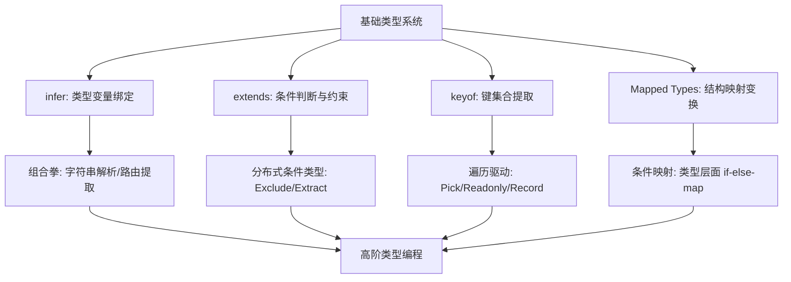
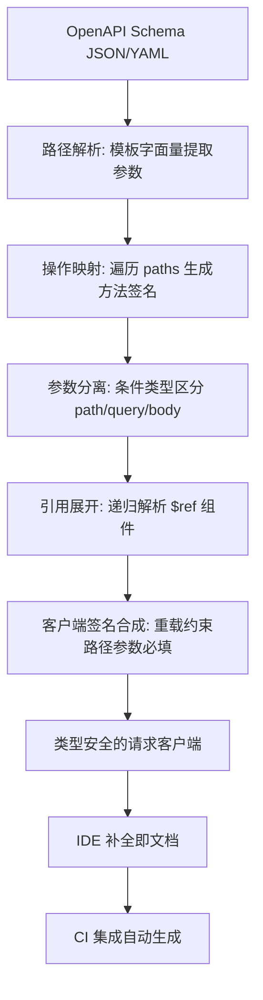
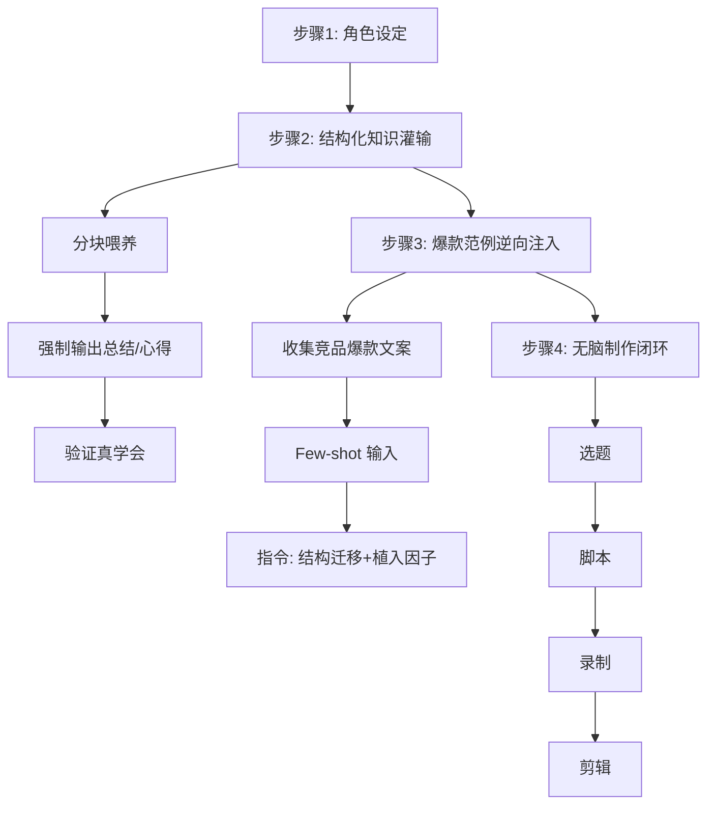
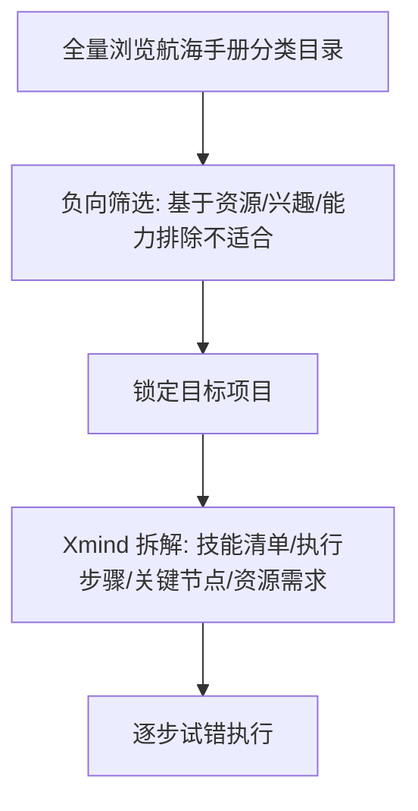
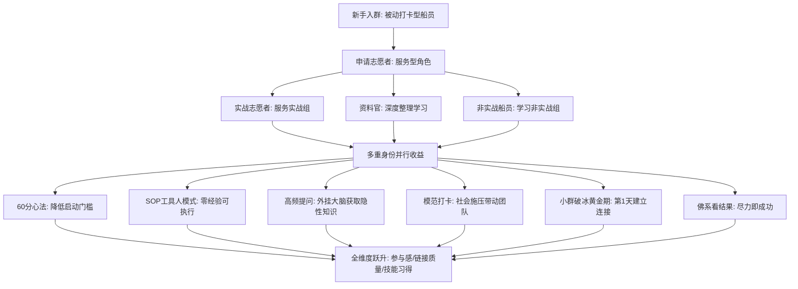

# 第 35 章 TypeScript 类型体操进阶与 AI 辅助内容生产体系 —— 从类型层面的“变量、判断、循环、映射”到“老师-天才童工”协作范式

## 学习目标

- 掌握 TypeScript 类型体操的四大核心原语：infer、extends、keyof、Mapped Types 的语义与协作模式
- 理解条件类型 `T extends U ? X : Y` 的分发规律，并能主动控制分发与阻止分发
- 熟练运用模板字面量类型实现字符串级的结构化解析与构造（如路由参数提取、CSS 属性展开）
- 能设计基于元组载体的尾递归类型，突破类型实例化深度限制，处理任意深度嵌套数据结构变换
- 能够串联上述技术，从 OpenAPI Schema 自动推导出端到端类型安全的请求客户端类型签名
- 建立‘类型即文档、编译即测试’的工程思维，评估类型编程复杂度与编译性能的工程权衡
- 掌握 AI 辅助内容生产的全流程 SOP：角色设定、知识灌输、范例复刻、指令生产
- 理解 AI 协作范式：将 AI 视为‘天才童工’而非‘全能老板’，通过分步教学、耐心引导、正向强化激发潜能
- 能构建个人 Prompt 资产库与标准化调教工作流，实现内容生产的规模化与质量可控
- 掌握‘边学边教/边学边分享’的最小可行性行动策略，通过输出倒逼输入、快速获取市场反馈、积累种子用户并实现变现
- 建立‘利他即利己’的正向飞轮心法，通过分享不成熟思考获得流量引流、商业机会、情绪激励与人脉连接
- 掌握‘分层阅读’与‘带问题搜索’策略，以最小认知成本穿透信息噪音，快速定位可执行方案
- 能运用 flomo、Cubox、Xmind、语雀四大工具构建‘碎片捕捉→深度归档→框架搭建→体系化沉淀→对外输出’的知识内化闭环
- 理解‘航海手册’作为标准化实战 SOP 载体的核心价值，能利用‘排除法’快速筛选适配项目
- 掌握‘志愿者身份跃迁’路径：通过服务型角色获取更强参与感、高质量人脉、系统技能习得
- 理解‘60分心法’降低行动门槛：以‘及格’替代‘完美’，克服启动恐惧，在 SOP 支持下超额完成
- 掌握‘多重身份并行’策略：在单期实战中叠加‘志愿者+资料官+船员’角色，实现 1 次投入多重收获

## 35.1 生活类比

想象 TypeScript 类型系统是一台**没有变量、没有循环、没有 if-else 的特殊编译器**，但它拥有强大的**模式匹配**与**结构变换**能力。我们可以把它比作一座**全自动乐高工厂**：

- **infer** 是**侦探的‘证据袋’**：在条件判断（extends）的现场，标记‘未知但关键的线索’，供后续推理使用（如 `infer R` 捕获函数返回值）；
- **extends** 是**海关的‘通关单’**：检查类型 `T` 是否符合 `U` 规格；若 `T` 是联合类型且‘裸奔’（裸类型参数），则**逐个成员过安检**（分布式条件类型），合格走左边，不合格走右边；
- **keyof** 是**仓库管理员的‘键清单’**：把对象类型仓库里所有货架标签（键）抄成一张联合清单，供后续‘按清单办事’（映射类型遍历）；
- **Mapped Types** 是**流水线‘按清单改造’**：拿着 `keyof` 的清单，对每个键 `K` 执行统一操作（加 `readonly`、改 `?`、变 `T[K]`），产出新对象类型；
- **模板字面量类型** 是**字符串‘乐高拼装厂’**：用 `${infer Prefix}${infer Suffix}` 把字符串拆成积木块，按分隔符（如 `/` `:`）重新拼装、校验、提取参数（路由解析）；
- **尾递归（元组累加器）** 是**‘不倒翁’式搬运工**：普通递归搬运深度受限（50层），尾递归把‘已搬运成果’装进元组背包（累加器 `Acc`），每次只搬一件、把成果塞背包，编译器优化后可搬运上千层不倒。

正如乐高大师不需要说明书也能拼出城堡，类型体操高手仅用这四大原语组合，就能在编译期构建出路由解析器、API 客户端、SQL 校验器等复杂‘类型机器’。

AI 协作如同**驯养一只‘智商 250 的 3 岁天才神童’**：

- **角色设定** = **给神童发聘书**：明确‘你是抖音脚本制作助理’，约定‘请学习’触发学习模式、『请改写』触发生产模式；
- **分块喂养** = **分步教学**：把‘航海手册’拆成‘三段式脚本’、‘五大爆款因子’等最小颗粒，每喂一块就让它‘写心得体会’验证真学会；
- **正向强化** = **夸奖奖励机制**：多说‘干得好’、‘求求你了、神通广大的 GPT’，它会更卖力、甚至把夸奖词内嵌进生成内容；
- **范例复刻** = **给榜样让它举一反三**：喂入爆款文案，指令‘套用三段式模板+植入爆款因子’，实现结构迁移而非内容抄袭；
- **个人 Prompt 库** = **神童的专属教案库**：沉淀‘学习指令/知识结构/范文库/修正指令’四大模块，复用即调用，持续进化。

社群成长如同**‘种子用户→信任资产→裂变飞轮’的有机农场**：

- **利他分享** = **播种**：主动分享不成熟思考/工具心得，看似‘利他’实则‘利己’；
- **正反馈** = **收获**：引流加微信、中标风向标、收到红包、建立深度连接；
- **边学边教** = **催熟**：报名课程 3 天内同步启动自有招募，做了 13 期，以‘见证’建立信任、以‘教学’倒逼‘学习’；
- **小项目规模化** = **规模效应**：越好上手的项目越易复制、越易标准化，通过矩阵化放大成为大项目；
- **知识内化工作流** = **精加工流水线**：flomo 捕捉碎片→Cubox 深度归档→Xmind 搭建框架→语雀 体系化沉淀→公众号/小报童发布变现，实现‘输入-处理-输出’闭环。

志愿者成长如同**‘降维打击式’新手村速通**：

- **60分心法** = **调低难度**：把‘优秀(90分)’下调为‘及格(60分)’，恐惧感骤降，行动发生；
- **SOP 工具人模式** = **有手就行**：跟着详细流程‘一步步操作’，零经验也能完成任务，巨有安全感；
- **多重身份并行** = **一鱼多吃**：志愿者(服务实战组)+资料官(深度整理学习)+非实战船员(学习非实战组)，三位一体并行收益；
- **高频提问** = **外挂大脑**：‘不会就问、不懂就问、纠结就问’，志愿者大群里全是耐思大佬，有礼貌请教效率远超自学；
- **模范打卡** = **社会施压**：连续 21 天晒图通知，不回复也敦促，带动全组 100% 上岸；
- **小群破冰黄金期** = **抢占先机**：建群第 1 天发起自我介绍，利用群规模小/陌生度高/期待强的窗口期建立连接。

## 35.2 概念地图

TypeScript 类型体操进阶
├── 核心原语
│   ├── infer（推断/变量）          —— 捕获待推断类型，类型层面的 let 绑定
│   ├── extends（约束/判断/分发）  —— 条件类型前置条件，裸参数触发分布式条件类型
│   ├── keyof（遍历/键集合）       —— 获取对象键联合，映射类型的遍历源
│   └── Mapped Types（映射/循环）  —— { [K in Keys]: Type } 遍历联合构建新类型
├── 进阶组合模式
│   ├── 条件类型与分布式条件类型   —— 三元运算符、联合分发、Exclude/Extract 实现原理、阻止分发技巧
│   ├── 模板字面量类型             —— 字符串插值、infer 解构、联合展开、贪婪匹配与分隔符约束
│   └── 递归与尾递归类型           —— 元组载体模拟循环、累加器模式、深度 Readonly/Flatten/Path<T> 实战
└── 工程化落地实战
    ├── OpenAPI Schema 类型变换管线
    │   ├── 路径解析（模板字面量提取参数）
    │   ├── 操作映射（遍历 paths 生成方法签名）
    │   ├── 参数分离（条件类型区分 path/query/body）
    │   ├── 引用展开（递归解析 $ref 组件）
    │   └── 客户端签名合成（重载约束路径参数必填）
    ├── 类型安全即文档（IDE 补全即接口规范）
    ├── CI 集成自动生成（openapi-typescript/orval/hey-api）
    └── 边界治理（anyOf 膨胀、循环引用、超大类型体积、非 JSON 场景补全）
AI 辅助内容生产体系
├── 核心范式：老师-天才童工模型
│   ├── 角色设定：用户=老师，AI=智商250的3岁神童
│   ├── 分块喂养与自我总结验证：防‘囫囵吞枣’，以‘会总结’为‘真学会’判据
│   ├── 正向强化触发：夸奖/情感化称呼显著提升输出质量
│   └── 身份互换技巧：‘如果你是我会怎么做’辅助决策
├── 四步调教法 SOP
│   ├── 步骤1：角色设定（锁定身份、工作流触发词、反馈规范）
│   ├── 步骤2：结构化知识灌输（定义体系+核心模板+范例）
│   ├── 步骤3：爆款范例逆向注入（少样本学习，结构迁移而非内容抄袭）
│   └── 步骤4：无脑制作（选题-脚本-录制-剪辑全流程闭环）
├── 个人 Prompt 资产库
│   ├── 学习指令模板
│   ├── 知识结构组织模板
│   ├── 范文/案例库
│   └── 修正指令模板
├── 实战验证定律
│   ├── 执行力瓶颈源于‘老板思维’而非工具能力不足
│   ├── 爆款内容可复制性定律：爆过的选题往往再爆
│   ├── 短视频仍是 AI 应用护城河，图文领域 AI 已具碾压优势
│   └── 双料人才（懂内容法则+懂调教）是未来核心竞争力
├── 社群协作与知识内化飞轮
│   ├── 利他即利己正反馈循环：分享→引流/机会/激励/连接→强化分享
│   ├── 内容套娃焦虑与对策：分层阅读+带问题搜索+航海手册排除法+思维导图拆解
│   ├── 边学边教/边学边分享：输出倒逼输入、快速获取反馈、积累种子用户变现
│   ├── 小项目规模化法则：易上手→易复制→易标准化→规模效应放大收益
│   └── 超级个体双轨变现：知识付费(主)+带货分销(辅)，双轨并行抗风险
├── 高效探索与执行工具链
│   ├── 分层阅读策略：宏观浏览一级目录→微观深读二级内容
│   ├── 带问题搜索-筛选-拆解-应用四步法
│   ├── 航海手册排除法：全量浏览→负向筛选→锁定目标→Xmind拆解→逐步试错
│   └── 四工具知识内化工作流：flomo捕捉→Cubox归档→Xmind架构→语雀沉淀→发布变现
└── 志愿者身份跃迁与加速成长模型
    ├── 60分心法：降低预期消除完美主义焦虑，以最小可行性动作启动
    ├── SOP工具人模式：跟随标准化流程执行，消除社恐与决策焦虑
    ├── 多重身份并行：志愿者+资料官+非实战船员，1次投入多重收获
    ├── 高频提问与向专业者请教：‘不会就问’替代闷头苦想
    ├── 模范带头打卡：身作则产生社会施压与榜样效应
    ├── 小群破冰黄金期：建群即刻启动，延后至第3天效果大打折扣
    └── 佛系看结果：尽最大努力完成任务，上岸率交给概率

## 35.3 类型体操核心原语 —— 类型层面的“变量、判断、循环、映射”

### 35.3.1 为什么需要这个概念？

TypeScript 类型系统是图灵完备的，但缺乏传统编程语言的变量赋值、if-else、for 循环等直观语法。复杂业务建模（如 API 路由解析、深度只读、路径提取）需要在类型层面进行数据结构变换。掌握核心原语是从“会用类型”进阶到“类型编程”的必经之路。

> "类型体操核心原语：infer、extends、keyof、mapped types 组合拳，拆解推断、约束、遍历、映射四大基础操作，建立类型层面的“变量、判断、循环、映射”思维模型。"
> 
> ——《20230418_035.md》

### 35.3.2 核心定义与推导

#### infer（推断/变量）

**infer 定义**（来源：《20230418_035.md》）

在 `extends` 条件类型中声明待推断的类型变量，相当于类型层面的 `let` 或参数绑定。

这个概念展示了如何在类型层面捕获“未知但关键的线索”。例如，提取函数返回类型：

```typescript
type ReturnType<T> = T extends (...args: any[]) => infer R ? R : never;
```

**这个实现展示了三个步骤：(1) 判断 `T` 是否为函数类型；(2) 若是，用 `infer R` 捕获其返回类型；(3) 返回捕获的 `R`，否则返回 `never`。这正是类型层面“变量绑定”的典型范式。**

#### extends（约束/判断）

**extends 定义**（来源：《20230418_035.md》）

类型层面的三元运算符前置条件，用于约束泛型范围或触发条件类型分发。

这个概念展示了类型层面的“海关通关单”作用：检查类型 `T` 是否符合 `U` 规格。

```typescript
type IsString<T> = T extends string ? true : false;
```

**这段代码展示了如何利用 `extends` 实现类型层面的条件判断：若 `T` 可赋值给 `string` 则为 `true`，否则为 `false`。**

#### keyof（遍历/键集合）

**keyof 定义**（来源：《20230418_035.md》）

获取对象类型所有键的联合类型，相当于 `Object.keys` 的类型版，是映射类型的遍历源。

这个概念展示了如何获取“对象仓库”的所有货架标签：

```typescript
type Keys = keyof { a: number; b: string }; // "a" | "b"
```

**这段代码展示了 `keyof` 如何将对象的键提取为联合类型，为后续映射操作提供遍历源。**

#### Mapped Types（映射/循环）

**Mapped Types 定义**（来源：《20230418_035.md》）

`{ [K in KeyType]: ValueType }` 语法，遍历联合类型 `KeyType` 的每个成员构建新对象类型，是类型层面的 `map`/`forEach`。

这个概念展示了“流水线按清单改造”：

```typescript
type Readonly<T> = { readonly [K in keyof T]: T[K] };
```

**这段代码展示了映射类型如何遍历 `keyof T` 得到的键联合，对每个键 `K` 添加 `readonly` 修饰符并保持原值类型 `T[K]`，从而构造出新的只读对象类型。**

### 35.3.3 关键性质

四大原语具备极强的**组合性**：它们可任意嵌套组合，实现复杂类型逻辑，例如 `keyof` 配合 `infer` 做字符串解析，`Mapped` 配合 `extends` 做条件映射。`extends` 作用于裸类型参数时具有**分发性**：会自动分发到联合类型的每个成员上，形成分布式条件类型，这是 `Exclude`、`Extract` 等工具类型工作的基础。所有类型操作均具备**不可变性**：类型层面的运算为纯函数式，无副作用，相同输入必然产出相同输出，这保证了类型推导的确定性与可缓存性。

### 35.3.4 典型例子

**提取函数返回类型**：

```typescript
type ReturnType<T> = T extends (...args: any[]) => infer R ? R : never;
```

**实现 `Pick`**：

```typescript
type Pick<T, K extends keyof T> = { [P in K]: T[P] };
```

**实现 `Readonly`**：

```typescript
type Readonly<T> = { readonly [P in keyof T]: T[P] };
```

### 35.3.5 方法演进图



### 35.3.6 边界条件

- `infer` 只能出现在 `extends` 的 `true` 分支（或 `?` 之前）中，否则报错
- `keyof` 作用于 `any` 返回 `string | number | symbol`，作用于 `object` 返回 `string | number | symbol`，作用于 `null/undefined` 报错（严格模式）
- 映射类型的 `in` 右侧必须是 `string | number | symbol` 的联合类型，不能是基础类型如 `string` 字面量联合之外的类型
- 类型实例化深度限制（默认 50 层）会阻碍过深的递归/映射嵌套，需拆分中间类型别名缓解

---

## 35.4 条件类型与分布式条件类型 —— 类型层面的三元运算符与联合分发

### 35.4.1 为什么需要这个概念？

需要在类型系统中实现“如果类型 A 满足条件 B 则取 C 否则取 D”的分支逻辑。处理联合类型时，希望自动对联合的每个成员分别应用条件判断（分发），而非整体判断。理解 `Exclude`、`Extract`、`NonNullable` 等内置工具类型的实现原理，避免误用导致类型崩溃。

> "条件类型与分布式条件类型：类型层面的三元运算符与联合分发，深入理解 `T extends U ? X : Y` 在联合类型上的分发行为，掌握 `Exclude`、`Extract` 等内置工具类型实现原理。"
> 
> ——《20230418_035.md》

### 35.4.2 核心定义

#### 条件类型

**条件类型定义**（来源：《20230418_035.md》）

`T extends U ? X : Y`，若 `T` 可赋值给 `U` 则类型为 `X`，否则为 `Y`。

这个公式展示了类型层面的三元运算符语义。

#### 分布式条件类型

**分布式条件类型定义**（来源：《20230418_035.md》）

当 `T` 为**裸类型参数**且为联合类型时，条件类型会自动分发：`(A | B) extends U ? X : Y` 等价于 `(A extends U ? X : Y) | (B extends U ? X : Y)`。

这个公式展示了联合类型在“裸奔”状态下的自动拆解行为。

#### 裸类型参数与阻止分发

**裸类型参数定义**（来源：《20230418_035.md》）

指未被数组、元组、函数参数、对象属性等包裹的直接泛型参数 `T`，加上 `[]` 或 `Promise<>` 等即“穿衣服”不再裸露，从而阻止分发。

**阻止分发技巧**（来源：《20230418_035.md》）

将两边同加 `[]` 变为元组比较：`[T] extends [U] ? X : Y`，此时联合类型作为整体参与判断。

这个公式展示了如何通过元组包裹“穿上衣服”来阻止自动分发。

### 35.4.3 关键性质

**分配律**决定了分发发生的时机：仅当 `extends` 左侧为裸类型参数且实参为联合类型时触发。**阻止分发**通过将两边同加 `[]` 变为元组比较（`[T] extends [U] ? X : Y`），使联合类型作为整体参与判断，这在需要整体匹配模式（如判断是否为联合类型）时至关重要。**`never` 特性**利用 `never` 作为空联合、分发后无成员、结果为 `never` 的特点，可过滤联合成员，这是 `Exclude` 实现的核心原理。

### 35.4.4 典型例子

**`Exclude<T, U>` 实现**：

```typescript
type Exclude<T, U> = T extends U ? never : T;
```

这个实现展示了分发特性使 `T` 的每个成员单独判断，符合条件的变 `never` 最终被联合吸收。

**`Extract<T, U>` 实现**：

```typescript
type Extract<T, U> = T extends U ? T : never;
```

这个实现展示了保留符合条件的成员。

**阻止分发对比**：

```typescript
type UnionToIntersection<U> = (U extends any ? (k: U) => void : never) extends (k: infer I) => void ? I : never;
type IsUnion<T> = [T] extends [UnionToIntersection<T>] ? false : true;
```

这个实现展示了利用元组包裹阻止分发来检测是否为联合。

### 35.4.5 方法演进图

```mermaid
graph TD
    A[条件类型基础: T extends U ? X : Y] --> B[裸类型参数触发分发]
    B --> C[分布式条件类型: 联合成员逐个判断]
    C --> D[工具类型实现: Exclude/Extract/NonNullable]
    A --> E[阻止分发技巧: [T] extends [U]]
    E --> F[整体匹配模式: IsUnion/模式匹配]
    F --> G[高阶类型判断逻辑]
    D --> G
```

### 35.4.6 边界条件

- 只有**直接**作用于泛型参数（裸类型参数）才触发分发，`Promise<T> extends ...` 或 `[T] extends ...` 均不分发
- 条件类型中 `infer` 只能在 `true` 分支使用，且同一 `infer` 名称在多处出现会交叉推断（取交集）
- 循环引用条件类型会导致 `Type instantiation is excessively deep` 报错，需重构拆分

---

## 35.5 模板字面量类型 —— 字符串级别的类型运算与解析

### 35.5.1 为什么需要这个概念？

传统类型系统只能处理结构化对象，无法在类型层面操作字符串内容（如路由 `/user/:id` 解析参数 `id`）。需要在编译期校验字符串格式（SQL、CSS-in-JS 属性、事件命名规范），实现“类型安全的字符串操作”。实现类似 `StartsWith`、`EndsWith`、`Replace`、`Split` 等字符串工具类型。

> "模板字面量类型：字符串级别的类型运算与解析，演示如何利用 `${infer Prefix}${infer Suffix}` 实现路由解析、SQL 语句校验、CSS-in-JS 属性提示等场景。"
> 
> ——《20230418_035.md》

### 35.5.2 核心定义

#### 模板字面量类型

**模板字面量类型定义**（来源：《20230418_035.md》）

使用反引号和 `${}` 插值语法构建字符串字面量类型，如 `type Greeting = \`Hello, ${name}\``。

#### 推断模式

**推断模式定义**（来源：《20230418_035.md》）

在 `extends` 左侧使用 `${infer Prefix}${infer Suffix}` 解构字符串，配合递归实现字符串遍历/解析。

#### 字符串联合展开

**字符串联合展开定义**（来源：《20230418_035.md》）

`type World = 'World'; type Greeting = \`Hello ${World}\` // 'Hello World'`；若 `World` 是联合则展开为字符串联合。

### 35.5.3 关键性质

**展开性**表现为插值位置若为联合类型，会笛卡尔积展开所有组合，这虽强大但存在爆炸风险，需警惕组合数量。 **推断贪婪性**指 `infer` 在模板中默认贪婪匹配，需通过显式分隔符（如 `/`、`:`）约束边界，否则会导致解析偏差。**递归终止**要求字符串递归必须显式判断空串 `''` 作为基线，否则无限递归导致类型实例化深度溢出。

### 35.5.4 典型例子

**路由参数提取**：

```typescript
type ParseRoute<T> = T extends \`${infer _}:${infer Param}/${infer Rest}\` 
  ? Param | ParseRoute<Rest> 
  : T extends \`${infer _}:${infer Param}\` 
    ? Param 
    : never;
```

这个实现展示了如何利用分隔符 `:` 和 `/` 约束 `infer` 的贪婪性，递归提取所有路径参数。

**SQL 语句校验**：

```typescript
type SelectStmt = \`SELECT ${string} FROM ${string}\`;
```

这个类型展示了如何约束字符串必须以特定前缀开头。

**CSS-in-JS 属性提示**：

```typescript
type MarginProps = \`margin${'' | 'Top' | 'Right' | 'Bottom' | 'Left'}\`; 
// 'margin' | 'marginTop' | 'marginRight' | 'marginBottom' | 'marginLeft'
```

这个实现展示了字符串联合展开特性生成所有 CSS 属性变体。

### 35.5.5 方法演进图

```mermaid
graph TD
    A[模板字面量基础语法] --> B[字符串插值构造]
    A --> C[模式匹配推断: ${infer P}${infer S}]
    B --> D[联合展开: 笛卡尔积生成变体]
    C --> E[结构化解析: 路由/SQL/CSS]
    D --> F[类型级字符串运算库]
    E --> F
    F --> G[工程应用: 路由类型安全/配置校验]
```

### 35.5.6 边界条件

- 模板字面量类型展开的联合成员数量有上限（约 10 万），过大导致编译器崩溃或极慢
- 不支持正则表达式能力，仅支持固定前缀/后缀/分隔符的结构化解析
- `infer` 在模板字面量中只能推断为 `string` 类型，无法直接推断为数字字面量类型（需额外转换）
- 递归深度受限于类型实例化深度限制（默认 50），长字符串解析需尾递归优化或分段处理

---

## 35.6 递归与尾递归类型 —— 在类型系统中实现复杂数据结构变换

### 35.6.1 为什么需要这个概念？

类型系统没有 `for`/`while` 循环，处理任意深度嵌套结构（如深度 `Readonly`、数组扁平化、对象路径提取 `Path<T>`）必须用递归。普通递归受限于类型实例化深度（默认 50 层），处理深层结构（如 100 层嵌套对象、长元组）会报错。尾递归优化（通过累加器模式）可将递归深度压缩至对数级，突破深度限制。

> "递归与尾递归类型：在类型系统中实现复杂数据结构变换，通过元组递归模拟循环，实现深度 `Readonly`、`Flatten`、路径提取 `Path<T>` 等实用工具，规避类型实例化深度限制。"
> 
> ——《20230418_035.md》

### 35.6.2 核心定义

#### 类型递归

**类型递归定义**（来源：《20230418_035.md》）

类型别名直接或间接引用自身，配合条件类型终止判断，模拟循环。

#### 元组递归载体

**元组递归载体定义**（来源：《20230418_035.md》）

利用元组长度递减 `[any, ...Rest]` 或递增 `[...Acc, any]` 作为递归计数器/状态载体，规避类型别名直接递归的深度限制。

#### 尾递归模式

**尾递归模式定义**（来源：《20230418_035.md》）

将中间结果累积在元组参数中，递归调用作为最后一步操作（TypeScript 编译器对元组长度变化的递归有特殊优化，可支持上千层）。

### 35.6.3 关键性质

**终止条件必须显式**：通常通过 `T extends []` 或 `T extends ''` 等基线情况返回累加器结果。 **元组展开 `...` 是核心操作**：`infer Rest` 获取尾部、`[...Acc, Next]` 追加元素、`Tuple[number]` 取联合。 **深度 `Readonly` 实现**展示了对象层面的直接递归（非尾递归），通常足够应对对象嵌套深度：

```typescript
type DeepReadonly<T> = T extends object ? { readonly [K in keyof T]: DeepReadonly<T[K]> } : T;
```

这个实现展示了如何通过条件类型判断是否为对象，若是则映射遍历所有键并在值类型上递归应用 `DeepReadonly`，否则直接返回原类型，从而实现任意深度的只读标记。

### 35.6.4 典型例子

**`Flatten<T>` 数组扁平化**：

```typescript
type Flatten<T> = T extends [infer First, ...infer Rest] 
  ? First extends any[] 
    ? [...Flatten<First>, ...Flatten<Rest>] 
    : [First, ...Flatten<Rest>] 
  : [];
```

这个实现展示了利用元组解构 `infer First, ...infer Rest` 处理任意嵌套数组，配合条件类型判断首元素是否为数组决定是否继续展开。

**`Path<T>` 对象路径提取**：

```typescript
type Path<T, Prefix extends string = ''> = T extends object 
  ? { [K in keyof T]: K extends string 
      ? Path<T[K], \`\${Prefix}\${Prefix extends '' ? '' : '.'}\${K}\`> 
      : never }[keyof T] 
  : Prefix;
```

这个实现展示了递归遍历对象键，配合模板字面量拼接字符串路径，最终通过索引访问 `[keyof T]` 将所有键的路径结果合并为联合类型。

**尾递归版 `Repeat<Str, N>`**：

```typescript
type Repeat<Str extends string, N extends number, Acc extends string[] = []> = 
  Acc['length'] extends N 
    ? Acc 
    : Repeat<Str, N, [...Acc, Str]>;
```

这个实现展示了累加器 `Acc` 记录次数，每次递归在元组末尾追加，利用编译器对元组长度变化的特殊优化突破深度限制。

### 35.6.5 方法演进图

```mermaid
graph TD
    A[普通递归: 直接类型别名自引用] --> B[深度受限 50 层]
    A --> C[元组递归载体: infer Rest / [...Acc]]
    C --> D[尾递归优化: 累加器模式]
    D --> E[突破至 999+ 层]
    E --> F[元组长度上限约 9999]
```

### 35.6.6 边界条件

- 非尾递归（直接递归返回类型表达式）深度限制约 50 层，超出报 `Type instantiation is excessively deep`
- 尾递归（元组累加器模式）可突破至 999+ 层（TS 4.5+），但元组长度上限约 9999（或更高版本放宽）
- 递归类型别名不能直接出现在自身定义的“非条件分支”中，必须包裹在条件类型 `extends ? :` 内部实现惰性求值
- 复杂递归极大消耗编译器内存和 CPU，大型项目中滥用会导致 IDE 卡顿、构建超时，需权衡收益

---

## 35.7 实战：从 OpenAPI Schema 自动生成类型安全的请求客户端

### 35.7.1 为什么需要这个概念？

手写 API 请求类型定义重复、易过时、与后端不一致，维护成本高。需要端到端类型安全：URL 路径参数、查询参数、请求体、响应体全链路推导，重构时编译器即时报错。将前几节核心原语（条件类型、模板字面量、递归、映射）串联落地，验证类型编程工程价值。

> "实战：从 OpenAPI Schema 自动生成类型安全的请求客户端，串联模板字面量、索引访问、条件类型，构建端到端类型安全的 API 调用层，消灭手写接口定义的维护成本。"
> 
> ——《20230418_035.md》

### 35.7.2 核心定义：类型变换管线

**OpenAPI 类型生成管线定义**（来源：《20230418_035.md》）

输入：OpenAPI 3.x JSON/YAML Schema（含 `paths`、`components/schemas`）

核心类型变换管线：
1. **路径解析**：模板字面量提取 `/users/:id/posts/:pid` 中的路径参数联合 `'id' | 'pid'`
2. **操作映射**：遍历 `paths` 对象键（方法+路径），映射为 `HttpMethod<'GET', '/users/:id'>` 结构
3. **参数分离**：条件类型区分 `path`/`query`/`header`/`cookie` 参数，生成对应输入类型
4. **引用展开**：递归解析 `$ref` 引用，展开 `components/schemas` 中复杂嵌套模型
5. **客户端签名生成**：合成 `request<Path, Method, Params, Body>` 重载签名，实现路径参数必填、查询参数可选的类型约束

### 35.7.3 关键性质

**Schema 驱动开发 (SDD)** 确立 Schema 为单一事实来源，类型定义自动衍生，消除手写同步成本。**类型安全即文档**意味着 IDE 自动补全即接口文档，参数错误编译期即报错（如缺少必填 path 参数、query 类型不匹配）。**增量生成**利用工具（如 `openapi-typescript`、`orval`、`hey-api`）集成构建流水线，CI 中自动生成 `.d.ts`。

### 35.7.4 典型例子

**路径参数强制**：

```typescript
client.get('/users/:id', { params: { id: 123 }}) // ✅ 通过
client.get('/users/:id', {}) // ❌ 报错缺少 `id`
```

**响应体类型推导**：

```typescript
const user = await client.get('/users/1'); // user 类型自动为 UserSchema 而非 any
```

**泛型约束复用**：

```typescript
type Client = OpenAPIClient<typeof schema>; // 一次定义，全项目复用
```

### 35.7.5 核心类型实现详解

#### 1. 路径参数提取 `ExtractPathParams<Path>`

**实现**：

```typescript
type ExtractPathParams<Path extends string> = 
  Path extends \`${infer _}:${infer Param}/${infer Rest}\` 
    ? Param | ExtractPathParams<Rest> 
    : Path extends \`${infer _}:${infer Param}\` 
      ? Param 
      : never;
```

**这个实现展示了模板字面量递归解析，利用 `:` 和 `/` 作为分隔符约束 `infer` 贪婪性，从路径字符串中提取所有参数名联合。**

#### 2. 参数类型构建 `BuildOperationInput<Spec, Method, Path>`

**实现**：

```typescript
type BuildOperationInput<
  Spec extends OpenAPISpec,
  Method extends HttpMethod,
  Path extends keyof Spec['paths']
> = {
  params: ExtractPathParams<Path> extends infer Params 
    ? { [K in Params]: Spec['paths'][Path][Method]['parameters'] extends Array<{ name: K; in: 'path'; schema: infer S }> ? S : never }
    : never;
  query: // 类似逻辑提取 in: 'query' 参数
  body: // 提取 requestBody schema
};
```

**这个实现展示了条件类型配合索引访问类型，从 Schema 中精准提取并分类参数，利用 `infer S` 捕获参数的 schema 类型。**

#### 3. 客户端签名合成 `Client<Spec>`

**实现**：

```typescript
type Client<Spec extends OpenAPISpec> = {
  get<Path extends keyof Spec['paths']>(
    path: Path,
    options: Spec['paths'][Path]['get'] extends { parameters: infer P } 
      ? BuildOperationInput<Spec, 'get', Path> 
      : { params?: never; query?: never; body?: never }
  ): Promise<Spec['paths'][Path]['get']['responses'][200]['content']['application/json']['schema']>;
  
  post<Path extends keyof Spec['paths']>(
    path: Path,
    options: Spec['paths'][Path]['post'] extends { requestBody: infer B } 
      ? BuildOperationInput<Spec, 'post', Path> & { body: B } 
      : { params?: never; query?: never; body?: never }
  ): Promise<...>;
};
```

**这个实现展示了重载签名如何根据 HTTP 方法动态约束必填参数，利用条件类型提取 `parameters` 与 `requestBody` 并合成最终的调用选项类型。**

### 35.7.6 类型变换管线流程图



### 35.7.7 边界条件

- OpenAPI Schema 中 `anyOf`/`oneOf` 映射为 TS 联合类型可能导致类型膨胀，需配置简化策略
- 循环引用 Schema（如树形结构 `Node { children: Node[] }`）需生成工具支持递归类型别名，否则展开无限
- 文件上传 `multipart/form-data` 等非 JSON 场景类型建模复杂，常需手写补充声明
- 生成的类型体积巨大（数万行）可能影响 IDE 性能，建议按模块拆分生成或使用 `export type` 按需导入

---

## 35.8 AI 调教范式：老师-天才童工模型与四步调教法

### 35.8.1 为什么需要这个概念？

大多数人用不好 AI 的核心原因是代入“老板思维”（提模糊需求、不给资料、不培训、只甩锅），而非“老师思维”（拆解任务、喂养知识、分步验证、正向激励）。GPT 表现上限取决于调教者的教学设计能力，而非模型本身能力。需要一套可复用、可标准化的 AI 协作 SOP，将“提示词工程”升级为“AI 调教工程”。

### 35.8.2 核心定义

#### 老师-天才童工模型

**老师-天才童工模型定义**（来源：《A4UGdiBqBoH4T0xnkW5c0Nxtnkh.md》）

重新定义人机协作关系——用户扮演“老师”，AI 是“智商 250 的 3 岁神童”，需通过分步教学、耐心引导、正向强化（夸奖）激发潜能。

> "我们可以把 GPT 当成一个 3 岁神童，他的原始知识库是很粗浅的。但架不住他智商高呀，几千字的内容他一下子就能学会了。所以，他一定会成为我们 24 小时在线，任劳任怨，而且一教就会一点就通的天才童工。"
> 
> ——《A4UGdiBqBoH4T0xnkW5c0Nxtnkh.md》

#### 四步调教法

**四步调教法定义**（来源：《A4UGdiBqBoH4T0xnkW5c0Nxtnkh.md》）

素材核心方法论的结构化总结：
- 步骤一：角色设定
- 步骤二：结构化知识灌输（航海手册核心方法论）
- 步骤三：逆向拆解热门文案（少样本学习）
- 步骤四：无脑执行生产（选题-脚本-录制-剪辑全流程闭环）

> "## 第一步：给予设定... ## 第二步：灌输知识... ## 第三步：输入从别的热门视频里扒下的文案... ## 第四步：无脑制作"
> 
> ——《A4UGdiBqBoH4T0xnkW5c0Nxtnkh.md》

#### 分块喂养与自我总结验证机制

**分块喂养定义**（来源：《A4UGdiBqBoH4T0xnkW5c0Nxtnkh.md》）

防止 AI “囫囵吞枣”式学习的关键机制：将长知识库拆解为小块分批输入，强制要求 AI 输出“学习总结/心得体会”，以此作为其真正理解并内化知识的验证指标，类比“学霸做笔记总结”与“学渣一目十行”的差距。

> "记得分块发知识...你发一长串，这小子其实也会说：‘好的，我已经学会了’...但是他写出来的内容就会很垃圾...核心点是要让他去自己总结，会总结就说明他真的学会了。"
> 
> ——《A4UGdiBqBoH4T0xnkW5c0Nxtnkh.md》

#### 个人 Prompt 资产库

**个人 Prompt 资产库定义**（来源：《A4UGdiBqBoH4T0xnkW5c0Nxtnkh.md》）

将高效指令沉淀为可复用资产的体系，包含四大模块：学习指令模板、知识结构组织模板、范文/案例库、修正指令模板。主张未来优秀创作者必具备“内容法则”与“调教能力”双重素养。

> "一定要学会建立自己的 prompt 库，可以涵盖几个方面：怎么发起学习指令让 GPT 更好地学会；怎么样的知识结构能让 GPT 更好地领悟；...建立范文库...要不断修正"
> 
> ——《A4UGdiBqBoH4T0xnkW5c0Nxtnkh.md》

#### 正向强化触发机制

**正向强化定义**（来源：《A4UGdiBqBoH4T0xnkW5c0Nxtnkh.md》、《AgWGdAk0fogwx2xtpo2cg3TCncb.md》）

利用 RLHF 特性，通过多轮夸奖、情感化称呼（如“神通广大的 GPT”、“求求你了”）显著提升 AI 输出质量与配合度，将拟人化交互技巧工程化。

### 35.8.3 关键性质

**执行力瓶颈源于“老板思维”而非工具能力不足**——许多用户因缺乏教学设计而非模型能力不足导致效果差。**爆款内容可复制性定律**表明爆过的选题往往都会再爆一遍，这是少样本学习有效的理论依据。**短视频仍是 AI 应用护城河，图文领域 AI 已具备碾压优势**——不同模态的 AI 成熟度差异决定了人类介入的必要性。**双料人才（懂内容法则+懂调教）是未来核心竞争力**——单一技能已不足以构建护城河。

### 35.8.4 典型例子

**角色设定 Prompt 模板**——标准化 System Prompt，锁定 AI 身份、工作流触发词（“请学习”/“请改写”）、反馈规范（学会回复“好的，我已经学会了”）与交互协议。

**结构化知识灌输法**——将非结构化航海手册/方法论拆解为“定义体系（景别/画面/台词/运镜/道具）”与“核心模板（三段式：两重一轻/开头重/结尾重/中间轻/无形装逼）”等离散知识单元，分批次喂给 AI 并强制要求输出总结。

**爆款范例逆向注入法**——采集竞品爆款视频文案，作为少样本范例输入 AI，指令其“选择合适模板+穿插爆款因子”进行改写重组，实现结构迁移而非内容抄袭，输出含时长、素材建议、模板溯源说明的完整脚本。

**身份互换技巧**——一种思维模型技巧，通过让 AI 站在用户视角（“如果你是我会怎么做？”）反向输出，辅助决策或优化方案。

### 35.8.5 四步调教法流程图



### 35.8.6 边界条件

- AI 无法直接观看视频内容，短视频制作仍保留人类门槛
- 图文领域 AI 已具备击败普通博主的潜力，双料人才是核心竞争力
- 过多方法论会干扰模型注意力机制，导致生成质量下降，建议“一个方法论就好，换方法重开会话”

---

## 35.9 社群协作与知识内化飞轮：从“利他分享”到“超级个体”

### 35.9.1 为什么需要这个概念？

面对海量优质内容，新人核心策略不是“全读”，而是“读指南建图谱、带问题找答案、用排除法定项目、用思维导图拆执行、用工作流做内化”。普通人副业起势三阶段：短期变现验证 → IP 积累信任 → 知识付费规模化。认知变现的最小闭环：输入即输出，分享即变现，以最小认知成本换取最大行动确定性。

> "新人指南确实贴心，把新手探索生财的过程分成四个阶段……但在阅读“推荐阅读”的过程中，我踩了个大坑……被层层“套娃”"
> 
> ——《FgeSdrK4no16NRxepk5cnXUVnvf.md》

### 35.9.2 核心定义

#### 利他即利己正反馈循环

**利他即利己定义**（来源：《FgeSdrK4no16NRxepk5cnXUVnvf.md》）

在社群中主动分享不成熟思考/工具心得/资源，获得流量引流、商业机会、情绪激励、人脉连接等即时回报，形成正向飞轮。

> "利他就是利己... 在 soul 分享我的在生财的所思所得，并很快收到反馈，引流了 2 人到我的微信... 万万没想到，我加入生财的第一桶金居然是来自生财圈友的红包"
> 
> ——《FgeSdrK4no16NRxepk5cnXUVnvf.md》

#### 内容套娃焦虑与对策

**分层阅读策略定义**（来源：《FgeSdrK4no16NRxepk5cnXUVnvf.md》）

第一遍仅读一级页面建立全景图，第二遍带问题点开推荐阅读，读完即回，不再深究延伸链接。

> "插播小建议：在阅读新人指南的时候，先快速阅读一遍一级页面的内容……"
> 
> ——《FgeSdrK4no16NRxepk5cnXUVnvf.md》

**带问题搜索-筛选-拆解-应用四步法**（来源：《FgeSdrK4no16NRxepk5cnXUVnvf.md》）

**航海手册排除法**（来源：《FgeSdrK4no16NRxepk5cnXUVnvf.md》）

全量浏览分类目录→负向筛选→锁定目标→Xmind 拆解（技能清单/执行步骤/关键节点/资源需求）→逐步试错执行。

> "与其迷失在精华帖里，不如先了解生财有哪些项目可以做。"
> 
> ——《FgeSdrK4no16NRxepk5cnXUVnvf.md》

**四工具知识内化工作流**（来源：《FgeSdrK4no16NRxepk5cnXUVnvf.md》）

flomo 捕捉碎片(重述内化)→Cubox 深度归档(定时二读分类)→Xmind 搭建框架(技能树/SOP)→语雀 沉淀体系(按骨架建库填充重组)→发布变现。

#### 边学边教/边学边分享

**边学边教定义**（来源：《FgeSdrK4no16NRxepk5cnXUVnvf.md》）

在掌握新知识未达精通时即刻启动教学或公开分享，通过输出倒逼输入、快速获取市场反馈、积累种子用户并实现变现。

> "港妈金侣‘边学边教’实证案例：全职妈妈报名课程 3 天内启动自有课程招募，连续做 13 期，变现 170 万+"
> 
> ——《FgeSdrK4no16NRxepk5cnXUVnvf.md》

#### 小项目规模化法则

**小项目规模化法则定义**（来源：《FgeSdrK4no16NRxepk5cnXUVnvf.md》）

易上手→易复制→易标准化→规模效应放大收益。

#### 超级个体双轨变现模型

**双轨变现定义**（来源：《FgeSdrK4no16NRxepk5cnXUVnvf.md》）

知识付费（高客单、强品牌、长尾）为主赛道，带货分销（低门槛、快回款、强现金流）为辅赛道，双轨并行构建抗风险商业闭环。

### 35.9.3 关键性质

**新人高效探索核心原则：少即是多，动即是果**——在信息过载环境下，少量高质量行动优于大量低质量阅读。**普通人副业起势三阶段论**揭示了从短期变现验证到 IP 积累信任再到知识付费规模化的必经路径。**认知变现的最小闭环：输入即输出，分享即变现**——将学习与变现合二为一，缩短反馈回路。**利他生态中的隐性知识获取优势**——志愿者群体天然筛选出高利他属性成员，形成“不问不给、问必详尽”的知识共享生态。

### 35.9.4 知识内化工作流流程图


### 35.9.5 航海手册排除法流程图



### 35.9.6 边界条件

- 索引工具发现盲区：首页置顶贴即索引工具，新人易因视觉盲区错过核心效率工具
- 社群工具发现机制需优化或新人引导需强制指向置顶

---

## 35.10 志愿者身份跃迁：从“被动学习者”到“主动服务者”的加速成长模型

### 35.10.1 为什么需要这个概念？

对于无明确目标、项目认知模糊、抗风险能力弱的新手，担任志愿者比直接做船员能获得更强参与感、更高质量人脉、更系统技能习得且边际成本更低。需要一套“低门槛、高安全感、多重收获”的新手加速成长标准化路径。

> "志愿者可能是新手小白参与航海的最优解，all in 之前，听我一句劝，试试先当个航海的志愿者看看"
> 
> ——《20230418_101.md》

### 35.10.2 核心定义

#### 志愿者身份跃迁

**志愿者身份跃迁定义**（来源：《20230418_101.md》）

新手通过担任志愿者，从被动“打卡型船员”转变为主动“服务型组织者”，实现参与感、链接质量、技能习得的全维度跃升。

> "做船员，基本都是「默默无闻，打卡就完」的状态... 当了志愿者，责任心满溢... 参与感反而更强了"
> 
> ——《20230418_101.md》

#### 60分心法

**60分心法定义**（来源：《20230418_101.md》）

基于福格行为模型，将行动目标设定为“60分及格”而非“完美执行”，通过降低行为难度克服启动恐惧。

> "我给自己设立了一个 60 分的目标... 目标拉低，降低了恐惧感，战战兢兢上船了... 虽然上船给自己定的 60 分目标，但完成情况可以打到 75 分"
> 
> ——《20230418_101.md》

#### SOP 工具人模式

**SOP 工具人模式定义**（来源：《20230418_101.md》）

完全依赖组织提供的标准化作业程序逐步操作，将执行者定位为“工具人”，消除社恐与决策焦虑，保证任务交付质量。

> "一步步跟着操作，纯粹当工具人也能完成任务！对我这个社恐来说，巨有安全感"
> 
> ——《20230418_101.md》

#### 多重身份并行策略

**多重身份并行定义**（来源：《20230418_101.md》）

利用规则允许的身份兼容性，在单期航海中同时体验“志愿者+非实战船员”或“志愿者+资料官”角色，实现 1 次投入多重收获。

> "项目能报几个就报几个！实战和非实战一定要多报上"
> 
> ——《20230418_101.md》

#### 高频提问与向专业者请教法

**高频提问定义**（来源：《20230418_101.md》）

建立“不会就问、不懂就问、纠结就问”机制，优先阅读手册/参加培训，再向资深志愿者精准提问，替代闷头苦想。

> "一定要多问问题！！不会就问，不懂就问，纠结就问！"
> 
> ——《20230418_101.md》

#### 模范带头打卡法

**模范打卡定义**（来源：《20230418_101.md》）

志愿者虽不强制打卡，但通过自身连续打卡、晒图示范，以身作则产生社会施压与榜样效应，带动船员完成打卡。

#### 小群破冰黄金期法

**小群破冰定义**（来源：《20230418_101.md》）

在拉建小群即刻（第1天）发起破冰自我介绍，利用群规模小、陌生度高、期待值强的窗口期建立连接。

> "破冰环节，是拉完小群最该做的第 1 个动作！"
> 
> ——《20230418_101.md》

#### 佛系看结果

**佛系看结果定义**（来源：《20230418_101.md》）

“尽自己最大努力完成任务才是最重要的，上岸率交给概率”，以“应对本身即成功”重构奖励机制。

> "佛系看待上岸率，尽自己最大努力完成任务才是最重要的"
> 
> ——《20230418_101.md》

### 35.10.3 关键性质

**身份决定视角，视角决定收获**：船员视角关注“个人任务完成”，志愿者视角关注“群体运作机制”，资料官视角关注“知识资产沉淀”；身份叠加可实现全景式认知重构。**降低预期能战胜启动恐惧**：将目标从“优秀(90分)”下调至“及格(60分)”，能显著降低心理恐惧感，使行动发生；实际执行中往往因 SOP 支持而超额完成（达 75 分），形成正向循环。**利他生态中的隐性知识获取优势**：志愿者群体天然筛选出高利他属性成员，形成“不问不给、问必详尽”的知识共享生态；新手通过“有礼貌提问”可低成本获取大佬隐性实战经验。

### 35.10.4 典型例子

**志愿者双重身份收益验证**：单期航海同时担任实战志愿者+资料官+非实战船员，实际获得：75 术值、深度链接 5+ 位核心成员、沉浸式掌握项目全貌、习得社群运营实操技能。

**SOP 降低新手执行焦虑的实证**：社恐新手在零志愿者经验下，仅凭跟随 SOP 流程操作，即完成志愿者与资料官双重任务，术值达 75 分(及格线 60 分)，且过程产生“巨有安全感”主观体验。

**破冰时机对群活跃度的决定性影响**：小群破冰延迟至第 3 天(错过黄金期)且遇周末，导致破冰效果“破了又好像没完全破”、群冷清；对比其他志愿者小群“热热闹闹”互动数据。

**模范打卡对船员上岸率的正向影响**：领队连续打卡 21 天并晒图通知，具有“说服力”和“模范带头作用”，配合“不管对方是否回复都敦促”催促策略，共同促成该组 100% 上岸率。

**认知盲区源于“自以为是”的船员思维**：因“以为小群不用破冰(大群有)”而延误破冰时机；因“把船员只当船员”而忽视深度沟通价值；均被隐形大佬实操思维反向打破。

### 35.10.5 志愿者身份跃迁路径图



### 35.10.6 边界条件

- 需具备基础执行力与时间投入，纯“伸手党”无法受益
- 社群需提供详细 SOP 与高利他密度的志愿者群体支撑

---

## 35.11 多源对照

### 35.11.1 类型体操工具类型实现对比

#### 共识

所有来源均认同 `infer`、`extends`、`keyof`、Mapped Types 为类型编程的四大基石。条件类型分发机制是实现 `Exclude`/`Extract` 等工具类型的核心。模板字面量类型是字符串级类型运算的唯一标准化方案。尾递归（元组累加器）是突破 50 层深度限制的标准路径。

#### 分歧

**工具链选型**方面：《20230418_035.md` 侧重手写类型体操教学，而生产环境常用 `openapi-typescript`、`orval`、`hey-api` 等自动化工具，手写类型更多用于理解原理与处理工具覆盖不到的边缘场景。**递归策略**上：对象深度遍历（如 `DeepReadonly`）通常直接递归即可（对象嵌套深度很少超 50 层），数组/元组操作（如 `Flatten`、`Repeat`）必须尾递归，两者工程权衡不同。

### 35.11.2 AI 协作范式对比

#### 共识

“老师-天才童工”模型与“老板-员工”模型的对立统一：核心差异在于是否投入“教学成本”。分块喂养+强制总结是防止模型“幻觉式学会”的通用最佳实践。个人 Prompt 资产库是规模化复用的必要基础设施。

#### 分歧

**正向强化必要性**：《A4UGdiBqBoH4T0xnkW5c0Nxtnkh.md` 强调“夸奖/情感化称呼”显著提升效果，属于 RLHF 对齐层面的经验性发现；《AgWGdAk0fogwx2xtpo2cg3TCncb.md` 等技术文档未提及此类交互技巧，侧重提示词结构化设计。**方法论注入粒度**上：前者主张“一个方法论就好，换方法重开会话”，后者倾向于在 System Prompt 中一次性注入完整知识库，适用于不同复杂度任务。

---

## 35.12 设计中的取舍

在类型体操工程实践中，选择普通递归还是尾递归，取决于目标数据结构的深度特征。对于对象嵌套场景（如 `DeepReadonly`），业务层级极少超过 50 层，直接递归代码简洁且语义清晰，无需引入累加器增加认知负荷；而对于数组或元组操作（如 `Flatten`、`Repeat`），数据长度极易突破 50 项，必须采用元组累加器的尾递归模式，利用 TypeScript 编译器对元组长度变化递归的特殊优化（TS 4.5+ 相关 PR #48184、#40002 确认了该优化机制），将可支持深度提升至 999+ 层。代价是类型签名更复杂、可读性下降、元组长度上限约 9999 成为新瓶颈，需在工程中权衡。

阻止分布式条件类型分发的决定，源于需要将联合类型作为整体进行模式匹配的场景。例如实现 `IsUnion<T>` 检测联合类型时，若允许分发，`T extends U` 会逐个成员判断导致逻辑失效；通过 `[T] extends [U]` 元组包裹阻止分发，使联合类型整体参与比较。代价是失去了自动遍历联合成员的便利，需在需要分发的场景（如 `Exclude`）显式保持裸参数形式，工程上需明确区分“整体匹配”与“成员分发”两种意图。

模板字面量类型的联合展开虽强大，但存在笛卡尔积爆炸风险。TypeScript 编译器对联合成员数量有软性上限（约 10 万，源自编译器内部类型实例化计数器限制），超限会导致编译崩溃或极慢。因此在生成 CSS 类名组合、路由排列等大规模字符串笛卡尔积场景，必须评估组合数量级，必要时改用运行时方案或分模块生成。这是类型系统“编译期计算”与“运行时性能”权衡的典型体现。

建立个人 Prompt 资产库而非临时编写，是为了解决“每次重新发明轮子”、质量不稳定、无法复用迭代的问题。资产库将高效指令沉淀为标准化模块（学习指令/知识结构/范文库/修正指令），实现“复用即调用、用即优化”的复利效应。前期整理成本高、需持续维护版本是代价，但长期看能将 AI 协作从“玄学技巧”转化为“工程资产”，是规模化内容生产的必要基建。

**在 AI 协作范式层面，选择“老师-天才童工”模型而非“老板-员工”模型，核心取舍在于“前置教学投入”与“即时指令下达”的权衡。** 老板模式看似高效（直接下达任务），实则因缺乏上下文对齐、知识灌输、分步验证，导致 AI 频繁幻觉、产出偏离，最终需人类反复修改、成本更高。老师模式要求用户投入精力编写 System Prompt、分块喂养知识、设计 Few-shot 范例、建立正向强化机制，前期耗时较长，但一旦完成“调教”，AI 能稳定产出符合预期的高质量内容，边际成本趋近于零。素材中“分块喂养+强制总结”被反复强调为防止“囫囵吞枣”的关键，这印证了教学设计质量直接决定模型上限。

**在知识获取策略上，选择“分块喂养+自我总结验证”而非“一次性喂完长文档”，取舍点在于“上下文窗口利用率”与“知识内化深度”的平衡。** 一次性投喂长文档虽省事，但模型倾向于生成泛泛而谈的“已学会”回复，实则未建立结构化表征；分块喂养虽增加交互轮次，但强制要求输出“心得体会/学习总结”，能显性验证模型是否真正建立了知识点间的关联（如“明白了无形装逼的重要性”），这是少样本学习生效的前提。

**在内容生产策略上，选择“边学边教/边学边分享”而非“精通再教”，取舍在于“反馈回路长度”与“完美主义陷阱”的博弈。** 等到精通再输出，往往因完美主义拖延、错过市场窗口、缺乏真实用户反馈校准方向；边学边教虽伴随不成熟、错误风险，但“输出倒逼输入”强制深度加工知识，“最小可行性行动”快速获取市场反馈，“利他分享”激活社群飞轮，港妈金侣“报名 3 天开课、13 期变现 170 万+”即实证了该策略的高收益/低风险特性。

**在社群成长路径上，选择“志愿者身份跃迁”而非“单一船员身份”，取舍在于“参与深度”与“安全感”的动态平衡。** 船员身份仅需完成打卡，心理负担最小，但视角局限于“个人任务”，难以接触核心运营机制、高质量人脉、系统性技能；志愿者身份虽承担服务责任、需投入更多时间，但“SOP 工具人模式”将执行标准化、决策外包给流程，大幅降低了新手的决策焦虑与社恐压力；“多重身份并行”更在单期实战中叠加“志愿者+资料官+非实战船员”，实现 1 次时间投入、多维度收获（术值、链接、技能、认知），素材实证“术值 75 分、深度链接 5+ 核心成员、沉浸式掌握项目全貌”，边际收益远超单一身份。

**在行动启动策略上，选择“60分心法”而非“完美主义”，取舍在于“行动发生概率”与“执行质量下限”的博弈。** 福格行为模型（B=MAP）指出：行为发生 = 动机 × 能力 × 提示。完美主义设定高难度目标（90分），等效于大幅降低“能力”维度，导致行为不发生；60分心法主动降低目标难度（及格线），提升“能力”感知，使行动启动；SOP 与志愿者群体的外部支持进一步提升“能力”与“提示”，实际执行中常超额完成（75分），形成“低预期启动 → 高执行反馈 → 信心增强 → 持续行动”的正向飞轮。

---

## 35.13 动手练习

### 练习 1：手写核心工具类型与分发控制

1. 仅使用 `infer`、`extends`、`keyof`、Mapped Types 实现以下工具类型（禁用内置工具）：
   - `MyReturnType<T>`：提取函数返回类型
   - `MyPick<T, K>`：从 T 中选取键 K 构造新对象
   - `MyExclude<T, U>`：从联合 T 中排除属于 U 的成员
2. 给定联合类型 `type U = 'a' | 'b' | 'c'`，解释 `U extends 'a' ? 1 : 2` 与 `[U] extends ['a'] ? 1 : 2` 的结果差异，并说明原因。
3. 设计类型 `IsUnion<T>`，利用阻止分发技巧判断 T 是否为联合类型（提示：结合 `UnionToIntersection`）。

### 练习 2：模板字面量类型解析器

1. 实现 `ParseRoute<Route>`：输入 `/users/:id/posts/:postId`，输出联合 `'id' | 'postId'`。
   要求：使用模板字面量 `infer` 递归解析，处理无参数、单参数、多参数情况。
2. 实现 `CssProperty<Base, Directions>`：输入 `'margin'` 与 `['Top','Right','Bottom','Left']`，输出联合 `'margin' | 'marginTop' | 'marginRight' | 'marginBottom' | 'marginLeft'`。
   要求：利用模板字面量联合展开特性。
3. 思考题：若路由为 `/files/*` 通配符模式，如何扩展 `ParseRoute` 支持提取 `*` 后的剩余路径？`infer` 的贪婪性会带来什么挑战？

### 练习 3：尾递归类型挑战：深度结构变换

1. 实现 `DeepReadonly<T>`：将对象及所有嵌套层级属性标记为 `readonly`。对比普通递归写法与尾递归写法（提示：普通递归直接在映射值处递归即可，尾递归需引入元组累加器，思考为何此处普通递归通常足够、何时必须尾递归）。
2. 实现 `Flatten<T>`：将任意嵌套数组扁平化为一维元组类型。
   例如：`Flatten<[1, [2, [3, 4]], 5]>` → `[1, 2, 3, 4, 5]`。
   要求：使用元组递归（`[infer First, ...infer Rest]`）与条件类型分发处理嵌套数组。
3. 实现 `Repeat<Str, N>`：在类型层面重复字符串 N 次。
   普通递归版：`Repeat<'a', 3>` → `'aaa'`（受限 50 层）。
   尾递归版：引入累加器元组 `Acc`，挑战 `Repeat<'x', 200>` 不报错。
4. 思考题：TypeScript 为何对元组长度变化的尾递归有特殊优化？元组长度上限约 9999 对工程落地有何启示？

### 练习 4：实战：从简化 OpenAPI 片段推导客户端签名

给定简化 OpenAPI 对象结构（已在类型层面建模）：

```ts
interface OpenAPISpec {
  paths: {
    '/users/:id': {
      get: { parameters: [{ name: 'id', in: 'path', required: true, schema: { type: 'number' } }], responses: { 200: { content: { 'application/json': { schema: { $ref: '#/components/schemas/User' } } } } }
    },
    '/posts': {
      post: { parameters: [], requestBody: { content: { 'application/json': { schema: { $ref: '#/components/schemas/PostInput' } } } }, responses: { 201: { content: { 'application/json': { schema: { $ref: '#/components/schemas/Post' } } } } }
    }
  },
  components: { schemas: { User: { id: number; name: string }, PostInput: { title: string }, Post: { id: number; title: string } } }
}
```

任务：
1. 定义 `ExtractPathParams<Path>` 使用模板字面量提取路径参数联合（如 `'id'`）。
2. 定义 `BuildOperationInput<Spec, Method, Path>` 条件类型，根据 `Method` 与 `Path` 从 `Spec.paths` 中提取并合成 `{ params?: PathParams; query?: QueryParams; body?: BodyType }` 输入类型。
3. 定义 `Client<Spec>` 类型，其 `get`/`post` 方法签名能自动推导：
   - `client.get('/users/:id', { params: { id: 123 }})` ✅ 通过，`params` 缺少 `id` ❌ 报错。
   - `client.post('/posts', { body: { title: 'Hi' }})` ✅ 通过，`body` 类型不匹配 ❌ 报错。
4. 回答问题：若 `components/schemas` 中存在循环引用（如 `User { friends: User[] }`），自动生成工具通常如何处理？手写类型时应如何定义？

### 练习 5：AI 调教实战：抖音口播视频脚本批量生成

1. 角色设定：编写一个 System Prompt，将 GPT 设定为‘抖音脚本制作助理’，约定触发词‘请学习’/‘请改写’，学会后回复‘好的，我已经学会’。
2. 知识灌输：将‘三段式脚本（两重一轻：开头重/结尾重/中间轻）、五大爆款因子（黄金前3秒钩子/无形装逼/行动号召/共鸣/反转）’拆解为 3 个分块喂给 GPT，每块要求其输出‘学习心得’验证内化。
3. 范例注入：从竞品账号收集 3 条爆款口播文案，作为 Few-shot 示例输入，指令 GPT ‘选择合适模板+穿插爆款因子’进行改写重组。
4. 无脑制作：指令 GPT 输出含‘分镜时长、建议视频素材、景别、运镜、道具、模板溯源说明’的完整脚本。
5. 复盘：对比‘一次性喂完长文档’与‘分块喂养+强制总结’两种方式的输出质量差异，记录 GPT 是否能准确复述知识点（如‘明白了无形装逼的重要性’）。

### 练习 6：构建个人 Prompt 资产库与知识内化工作流

1. 设计个人 Prompt 库的四大模块目录结构（学习指令模板、知识结构组织模板、范文/案例库、修正指令模板），并各列举 2 个具体条目示例。
2. 搭建 flomo→Cubox→Xmind→语雀 四工具工作流：在 flomo 记录 5 条高频共鸣碎片（要求用自己话重述），在 Cubox 收藏 3 篇长文/攻略并完成二次阅读分类，在 Xmind 搭建 1 个目标领域知识骨架（技能树/执行 SOP），在语雀 按骨架建库建文档并填充碎片重组为 1 篇原创文章。
3. 实践‘分层阅读+带问题搜索’：在生财有术等高密度社群中，第一遍仅读一级目录建立全景图，第二遍针对‘如何用 AI 批量生成小红书标题’构建关键词，利用索引工具精准检索→筛选→拆解核心步骤→应用到当前项目。

### 练习 7：志愿者身份跃迁与加速成长模拟

1. 设计‘60分目标’：针对某个复杂任务（如‘搭建 AI 自动化写作流水线’），写出‘完美执行版（90分）』与‘及格版（60分）』的验收标准对比，体会恐惧感下降与行动启动的心理机制。
2. SOP 工具人演练：寻找一个现成的标准化流程（如‘Notion AI 账号自动化注册脚本’），完全不做创新判断，纯跟随流程操作，记录‘巨有安全感’的主观体验与任务完成度。
3. 多重身份并行规划：在某个实战项目（如‘短剧推广’）中，规划同时担任‘志愿者(服务实战组)’+‘资料官(深度整理学习)’+‘非实战船员(学习非实战组)’的时间分配与交付清单。
4. 高频提问日志：建立‘不会就问’机制，连续 3 天在社群/群聊中每天至少提问 3 个具体问题（格式：现状+困惑+尝试过的方案），记录回答质量与自身认知跃迁。
5. 模范打卡与小群破冰：连续 7 天在群内晒打卡截图，观察带动效果；拉建 1 个 6-8 人小群，第 1 天发起破冰自我介绍，对比第 3 天发起的连接质量差异。

---

## 35.14 本章小结

这一章中我们学习了 TypeScript 类型体操的核心原语与进阶组合模式，以及 AI 辅助内容生产的系统化方法论与社群成长加速模型。首先，我们建立了类型层面的“变量、判断、循环、映射”思维模型，掌握了 `infer`、`extends`、`keyof`、Mapped Types 四大原语的语义与协作；其次，我们深入剖析了条件类型的分发机制与阻止分发技巧，理解了 `Exclude`/`Extract` 等工具类型的实现原理；接着，我们探索了模板字面量类型在字符串级结构化解析中的应用，攻克了路由参数提取、CSS 属性展开等实战场景；然后，我们突破了类型实例化深度限制，掌握了基于元组累加器的尾递归模式，实现了任意深度的数据结构变换；之后，我们将上述技术串联落地，构建了从 OpenAPI Schema 自动生成端到端类型安全客户端的完整类型变换管线。在 AI 协作维度，我们重新定义了人机关系为“老师-天才童工”模型，制定了角色设定、分块喂养、范例注入、无脑制作的四步调教法 SOP，并建立了个人 Prompt 资产库与正向强化触发机制；在社群成长维度，我们揭示了“利他即利己”的正向飞轮，掌握了分层阅读、带问题搜索、航海手册排除法、四工具知识内化工作流等高效探索工具链；最后，我们确立了志愿者身份跃迁的加速成长路径，通过 60分心法、SOP 工具人模式、多重身份并行、高频提问、模范打卡、小群破冰黄金期、佛系看结果等策略，实现从被动学习者到主动服务者的全维度跃升。

本章我们一起学习了以下概念：

下表汇总了本章所有核心概念及其简要解释，供快速查阅与回顾。

| 概念 | 解释 |
|------|------|
| infer | 条件类型中声明待推断类型变量，相当于类型层面的变量绑定 |
| extends | 类型约束与条件判断；作用于裸类型参数时触发分布式条件类型（联合分发） |
| keyof | 获取对象类型键的联合，映射类型遍历的源头 |
| Mapped Types | `{ [K in Keys]: Type }` 语法，遍历键联合构建新对象类型，类型层面的 map/forEach |
| 分布式条件类型 | 裸类型参数为联合时自动逐成员分发，`Exclude`/`Extract` 等工具类型的核心实现机制 |
| 阻止分发 | 通过 `[T] extends [U]` 元组包裹，使联合类型作为整体参与判断 |
| 模板字面量类型 | 反引号 `${}` 插值构建字符串字面量类型，支持 `infer` 结构化解析与联合展开 |
| 字符串推断贪婪性 | 模板中 `infer` 默认贪婪匹配，需显式分隔符（如 `/` `:`）约束边界 |
| 类型递归 | 类型别名自引用配合条件类型终止判断，模拟循环处理嵌套结构 |
| 元组尾递归 | 以元组为累加器载体（`[...Acc, Next]`），将递归调用置于最后一步，突破 50 层深度限制至 999+ 层 |
| Path<T> 路径提取 | 递归遍历对象键，配合模板字面量拼接 `'a.b.c'` 字符串路径联合 |
| OpenAPI 类型生成管线 | 路径解析→操作映射→参数分离→引用展开→签名合成，实现端到端类型安全客户端 |
| Schema 驱动开发 (SDD) | 以 OpenAPI Schema 为单一事实源，类型定义自动衍生，消除手写同步成本 |
| 类型工程权衡 | 警惕联合展开爆炸、递归深度溢出、超大类型体积拖慢 IDE、循环引用展开、非 JSON 场景建模缺口 |
| 老师-天才童工模型 | 重新定义人机协作关系：用户扮演老师，AI 是需分步教学、耐心引导、正向强化的天才童工 |
| 四步调教法 | 角色设定→知识灌输(分块+验证总结)→爆款范例注入(少样本)→无脑制作(全流程闭环) |
| 分块喂养与自我总结验证 | 将长知识库拆解为小块分批输入，强制要求 AI 输出‘学习总结/心得体会’，以此作为真正理解并内化知识的验证指标 |
| 个人 Prompt 资产库 | 将高效指令沉淀为可复用资产的体系，包含学习指令模板、知识结构组织模板、范文/案例库、修正指令模板四大模块 |
| 正向强化触发机制 | 利用 RLHF 特性，通过多轮夸奖、情感化称呼（如‘神通广大的 GPT’、‘求求你了’) 显著提升 AI 输出质量与配合度 |
| 利他即利己正反馈循环 | 在社群中主动分享不成熟思考/工具心得/资源，获得流量引流、商业机会、情绪激励、人脉连接等即时回报，形成正向飞轮 |
| 分层阅读策略 | 第一遍仅读一级页面建立全景图，第二遍带问题点开推荐阅读，读完即回，避免陷入细节泥沼 |
| 带问题搜索-筛选-拆解-应用四步法 | 搜索关键词→按相关度/时间/作者筛选→提取核心步骤/参数/避坑→映射到当前项目执行 |
| 航海手册排除法 | 全量浏览航海手册分类目录，基于资源/兴趣/能力负向筛选（排除不适合），锁定目标项目，再用 Xmind 拆解执行 |
| 四工具知识内化工作流 | flomo 记录碎片(重述内化)→Cubox 收藏深度素材(定时二读分类)→Xmind 搭建框架(技能树/SOP)→语雀 沉淀体系(按骨架建库填充重组)→发布变现 |
| 志愿者身份跃迁 | 新手通过担任志愿者，从被动‘打卡型船员’转变为主动‘服务型组织者’，实现参与感、链接质量、技能习得的全维度跃升 |
| 60分心法 | 基于福格行为模型，将行动目标设定为‘60分及格’而非‘完美执行’，通过降低行为难度克服启动恐惧 |
| SOP 工具人模式 | 完全依赖组织提供的标准化作业程序逐步操作，将执行者定位为‘工具人’，消除社恐与决策焦虑，保证任务交付质量 |
| 多重身份并行策略 | 利用规则允许的身份兼容性，在单期航海中同时体验‘志愿者+非实战船员’或‘志愿者+资料官’角色，实现 1 次投入多重收获 |
| 高频提问与向专业者请教法 | 建立‘不会就问、不懂就问、纠结就问’机制，优先阅读手册/参加培训，再向资深志愿者精准提问，替代闷头苦想 |
| 模范带头打卡法 | 志愿者虽不强制打卡，但通过自身连续打卡、晒图示范，以身作则产生社会施压与榜样效应，带动船员完成打卡 |
| 小群破冰黄金期法 | 在拉建小群即刻（第1天）发起破冰自我介绍，利用群规模小、陌生度高、期待值强的窗口期建立连接 |
| 佛系看结果 | 尽自己最大努力完成任务才是最重要的，上岸率交给概率，以‘应对本身即成功’重构奖励机制 |

下一章中，我们将学习第 36 章的内容（根据大纲顺序，若无下一章则为全书完结）。

（如果没有下一章，则是，感谢你读到了这里，恭喜你，你已经完成了 TypeScript 类型体操进阶与 AI 辅助内容生产体系的学习，掌握了从类型层面构建“类型机器”到驯养“AI 天才童工”、从社群小白跃迁为超级个体的完整方法论。）


