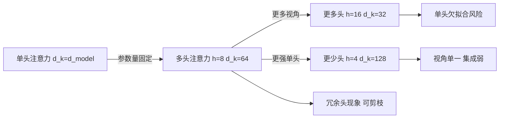
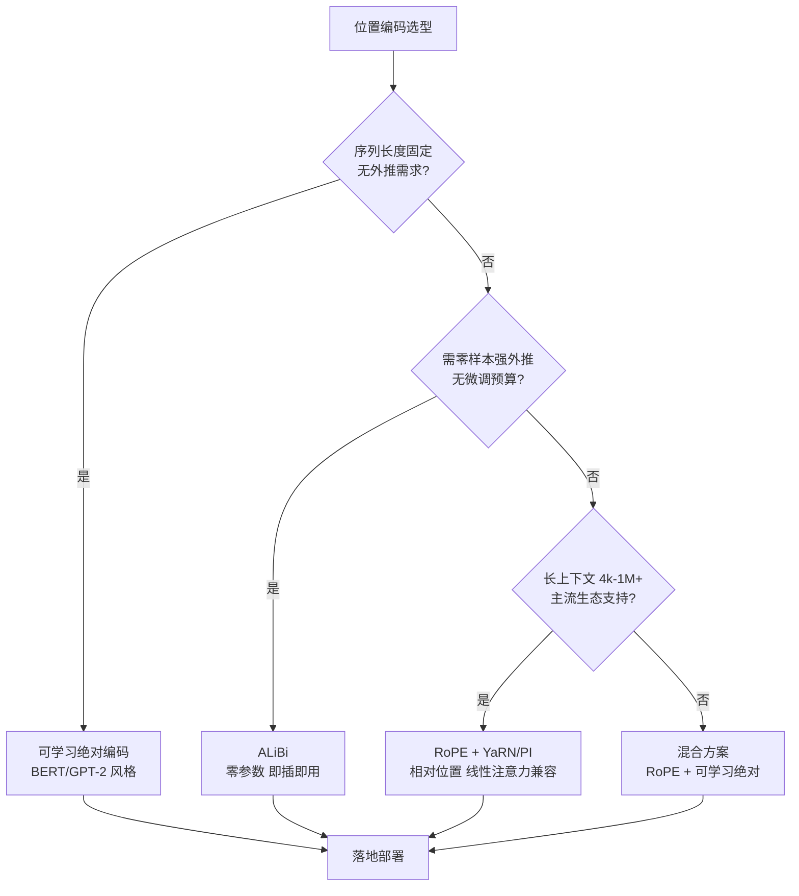

# 第 34 章 注意力机制 —— 让模型学会“看哪里”

## 学习目标

- 理解注意力机制解决 RNN 串行瓶颈与长距离依赖的核心动机
- 掌握缩放点积注意力的数学推导、缩放因子作用及实现细节
- 理解多头注意力通过子空间分工提升表达能力的机制与并行计算优势
- 对比绝对位置编码（正弦/可学习）与相对位置编码的数学性质、外推能力及工程选型
- 掌握注意力可视化的基本模式（句法树、共指、位置模式）及“注意力≠解释”的局限性
- 能根据序列长度、外推需求、硬件约束选择合适的注意力变体（标准/FlashAttention/稀疏/线性/RoPE/ALiBi）

## 34.1 生活类比

想象注意力机制是一个**大型学术会议的“提问-发言”环节**：

- **Query** = 你手里的**问题卡片**（想知道什么）；
- **Key** = 每位发言者桌牌上的**研究主题标签**（提供什么线索）；
- **Value** = 每位发言者手中的**完整论文/观点**（实际信息内容）。
- **相似度 (Q·K^T)** = 你用问题卡片去匹配每个桌牌，算出**“这位发言与我问题的相关度”**；
- **缩放因子 1/√d_k** = 会议规模太大(d_k大)时，相关度分数会虚高，**除以√d_k相当于“校准音量”**，防止后续决策失真；
- **Softmax** = 你根据相关度，**把有限的提问时间按比例分配给最相关的几位发言者**；
- **加权求和 (×V)** = 你综合这些发言者的核心观点，**形成你对该问题的最终理解（输出向量）**。

**多头注意力** = 邀请 **h 个不同领域的“副主席”并行主持分会场**：
- 副主席 A 专门关注**方法论细节**（句法结构）；
- 副主席 B 专门关注**实验结论引用**（共指消解）；
- 副主席 C 专门关注**论文章节顺序**（位置信息）；
- 最后**大主席拼接所有副主席的会议纪要**，形成全面决议。

**位置编码** = 给原本**无序的会议资料包**加上**页码/章节号**：
- **正弦编码** = 印好的**标准页码**，没上过会也能推算出前后顺序，甚至能猜出第 1000 页大概在哪（外推）；
- **可学习编码** = 组委会针对本次会议**定制的专属页码**，非常好用但印刷成本高、超出印刷页数就失效（长度受限）；
- **RoPE** = 不印页码，而是给每页**装一个“旋转罗盘”**，比较两页相对角度就知道远近，且页数无限都能用（相对位置、强外推）；
- **ALiBi** = 直接规定**“离得远的发言者音量自动减小”**（注意力分数加负偏置），最省事、外推最强。

**注意力可视化** = 给会议全程装**“眼动仪”记录主席看谁的时间**：
- 发现主席看发言者时，**目光轨迹自动形成了该领域的“知识依存树”**（句法诱导）；
- 但**“看得久 ≠ 决策关键”**（注意力≠解释），主席可能盯着水喝半天（高注意力 Padding），决策却靠那一句核心论据（低注意力关键 Token）。

## 34.2 概念地图

```mermaid
graph TD
    A[注意力机制] --> B[核心动机]
    A --> C[缩放点积注意力]
    A --> D[多头注意力]
    A --> E[位置编码]
    A --> F[注意力可视化与解读]
    A --> G[长序列扩展变体 (延伸)]

    B --> B1[RNN 串行瓶颈与并行计算需求]
    B --> B2[固定隐状态容量导致长距离依赖衰减]
    B --> B3[信息瓶颈视角：动态聚焦关键 Token]

    C --> C1[Query/Key/Value 向量空间定义]
    C --> C2[公式：Softmax(QK^T/√d_k)V]
    C --> C3[缩放因子 √d_k 防止 Softmax 饱和]
    C --> C4[并行计算特性 O(N^2·d) 复杂度]
    C --> C5[排列等变性 需配合位置编码]

    D --> D1[分裂-并行-拼接流程]
    D --> D2[子空间分工：句法/语义/位置专业化]
    D --> D3[表达能力增强 集成效应]
    D --> D4[参数量与单头相当 头数与维度权衡]
    D --> D5[存在冗余头 可剪枝压缩]

    E --> E1[绝对位置编码]
    E --> E2[相对位置编码]
    E1 --> E1a[正弦编码：确定性、外推性、三角函数线性组合]
    E1 --> E1b[可学习编码：数据驱动、长度受限、语义位置耦合]
    E2 --> E2a[RoPE：旋转矩阵融入 Q/K、线性注意力兼容、长窗口主流]
    E2 --> E2b[ALiBi：注意力分数加距离偏置、无参数、强外推]
    E --> E3[选型决策：长度/外推/参数量/语义正交性权衡]

    F --> F1[基本模式：对角线/垂直条纹/区块/语法树/共指]
    F --> F2[层级差异：低层句法 高层语义]
    F --> F3[局限性：注意力≠因果归因 掩盖 MLP 推理 聚合掩盖个体头]

    G --> G1[FlashAttention：IO 感知 分块计算 显存优化]
    G --> G2[稀疏/线性注意力：O(N) 复杂度近似]
    G --> G3[滑动窗口/YaRN 外推：长上下文工程落地]
```

**图表说明**：上图梳理了本章的核心知识体系。注意力机制源于解决 RNN 的串行瓶颈与记忆衰减（核心动机），核心计算单元是缩放点积注意力，通过多头机制实现多视角建模，配合位置编码打破排列等变性，最后通过可视化理解模型行为，并针对长序列引入 FlashAttention、稀疏/线性注意力等工程变体。

## 34.3 注意力机制 —— 让模型学会“看哪里”

### 34.3.1 核心动机：打破 RNN 的串行瓶颈与记忆衰减

在注意力机制诞生之前，序列建模的主流架构是 RNN（LSTM/GRU）。正如《Attention Is All You Need》所指出的，RNN 存在两个根本性缺陷：首先是**串行依赖导致无法并行**，第 $t$ 步的计算必须等待第 $t-1$ 步完成，这在 GPU 等并行硬件上极大地限制了训练吞吐；其次是**固定维度的隐状态 $h_t$ 充当“信息瓶颈”**，无论序列多长，所有历史信息都被压缩进这个定长向量，导致长距离依赖随步数指数级衰减。

> "注意力机制的核心直觉是‘聚光灯’：在解码当前词时，不必把整个编码器隐状态压缩成一个定长向量，而是动态地‘看’编码端哪些位置最相关。"
> 
> —— [素材ID: P007, 来源: 20230418_007.md]

这种“聚光灯”机制的数学本质是：**将静态的、固定容量的记忆读取，升级为动态的、内容寻址的检索**。每个解码步骤不再被迫通过单一隐状态“喝火管”般吸收所有历史，而是可以根据当前 Query，从所有历史 Key 中挑选最相关的 Value 进行加权聚合。这不仅解决了长程依赖，更天然支持并行计算——所有位置的注意力权重可以同时算出。

### 34.3.2 缩放点积注意力的数学形式化

**原文摘录**：

> "We call our particular attention 'Scaled Dot-Product Attention'. The input consists of queries and keys of dimension d_k, and values of dimension d_v."
> 
> —— [素材ID: P010, 来源: 20230418_010.md]

#### Query/Key/Value 向量空间定义

注意力机制将输入序列投影到三个不同的向量空间：
- **Query ($Q \in \mathbb{R}^{N \times d_k}$)**：代表“提问意图”，由当前位置的隐状态投影而来。
- **Key ($K \in \mathbb{R}^{N \times d_k}$)**：代表“被检索内容的标签”，由所有位置（或编码端）隐状态投影而来。
- **Value ($V \in \mathbb{R}^{N \times d_v}$)**：代表“实际携带的信息内容”，同样由隐状态投影而来。

这里的 $N$ 是序列长度，$d_k=d_v=d_{model}/h$ 是每个头的维度。

#### 标准公式推导

**缩放点积注意力定义**（来源：[素材ID: P010, 来源: 20230418_010.md]）

$$
\text{Attention}(Q, K, V) = \text{softmax}\left(\frac{QK^T}{\sqrt{d_k}}\right)V \tag{34.1}
$$

**该公式的核心逻辑是：通过点积计算 Query 与所有 Key 的相似度，经缩放与 Softmax 归一化得到注意力分布，再对 Value 进行加权求和，实现动态的、内容相关的信息聚合。**

这个公式包含四步操作，我们逐步拆解：

**步骤 1：点积相似度计算**
$$S = QK^T \in \mathbb{R}^{N \times N}$$
每个元素 $S_{ij} = q_i \cdot k_j$ 衡量第 $i$ 个查询与第 $j$ 个键的匹配程度。**点积等价于余弦相似度（当向量归一化时）**，因为 $q_i \cdot k_j = \|q_i\|\|k_j\|\cos\theta_{ij}$。在训练过程中，投影矩阵 $W^Q, W^K$ 会隐式学习使 Query 与 Key 的模长趋于稳定，因此点积能有效反映方向上的语义相似性。矩阵乘法形式使得所有位置对的相似度可一次性并行计算，充分利用 GPU 吞吐。

**步骤 2：缩放因子 $\frac{1}{\sqrt{d_k}}$**
$$S' = \frac{S}{\sqrt{d_k}}$$
**为什么需要除以 $\sqrt{d_k}$ 而不是 $d_k$？**
假设 $Q, K$ 的元素独立同分布，均值 0、方差 1。则 $S_{ij} = \sum_{k=1}^{d_k} Q_{ik}K_{jk}$ 的方差为 $d_k \cdot 1 = d_k$。标准差为 $\sqrt{d_k}$。除以 $\sqrt{d_k}$ 将方差归一化回 1，防止 $d_k$ 增大时 Softmax 输入分布过宽（饱和区梯度消失）或过窄（退化为均匀分布）。**这个缩放因子稳定了梯度流动，使得大维度下训练不易发散。** 若除以 $d_k$，方差会变为 $1/d_k$，分布过度集中，导致 Softmax 退化为均匀分布，丧失选择性。

**步骤 3：Softmax 归一化**
$$A = \text{softmax}(S') \in \mathbb{R}^{N \times N}$$
每行求和为 1，得到概率分布。$A_{ij}$ 表示位置 $i$ 对位置 $j$ 分配的注意力预算。**Softmax 被选作归一化函数，是因为它可微、输出概率单纯形、且具有“竞争抑制”特性：较大的得分会被指数级放大，较小得分被抑制，实现软性的“赢家通吃”注意力分配。**

**步骤 4：加权求和**
$$O = AV \in \mathbb{R}^{N \times d_v}$$
输出 $O_i = \sum_j A_{ij} V_j$ 是所有 Value 的**凸组合**（权重非负且和为 1）。这保证了输出向量位于 Value 向量的凸包内，不会产生数值爆炸。注意力机制本质是**动态的、内容相关的加权平均**：每个 Query 位置根据与所有 Key 的匹配度，动态决定从各 Value 位置汲取多少信息。

#### 关键性质总结

以下表格总结了缩放点积注意力的关键性质：

| 性质 | 说明 | 来源 |
|------|------|------|
| **并行计算** | 所有 $N$ 个位置的 $QK^T$ 可一次性矩阵乘法完成，无时序依赖 | [素材ID: P010, 来源: 20230418_010.md] |
| **动态上下文** | 权重 $A$ 随输入 $Q,K$ 动态变化，非固定窗口 | [素材ID: P010, 来源: 20230418_010.md] |
| **排列等变性** | 输入顺序排列，输出顺序同步排列；需位置编码打破对称性 | [素材ID: P010, 来源: 20230418_010.md] |
| **复杂度** | 时间/空间 $O(N^2 d)$，长序列成为瓶颈 | [素材ID: P010, 来源: 20230418_010.md] |

### 34.3.3 自注意力与交叉注意力

根据 $Q,K,V$ 来源不同，分两种模式：

- **自注意力**：$Q,K,V$ 均来自同一序列（如 Encoder 内部、Decoder 掩码自注意力）。捕捉序列**内部** Token 间依赖。
- **交叉注意力**：$Q$ 来自解码端当前状态，$K,V$ 来自编码端输出。建模**源-目标**序列对齐与信息传递（如翻译对齐）。

### 34.3.4 方法演进：从标准注意力到高效变体

```mermaid
graph LR
    SA[标准注意力<br/>O(N^2) 显存/算力] -->|长序列瓶颈| FA[FlashAttention<br/>IO感知分块 显存O(N)]
    SA -->|近似降维| LA[线性注意力<br/>核技巧 O(N) 复杂度]
    SA -->|稀疏化| SPA[稀疏注意力<br/>局部/全局/随机模式]
    SA -->|外推增强| RoPE[RoPE + YaRN<br/>频率缩放支持 100k+]
    SA -->|偏置机制| ALiBi[ALiBi<br/>距离衰减偏置 零参数]
```

**图表说明**：标准注意力面临 $O(N^2)$ 瓶颈，催生了四大优化方向：FlashAttention 通过 IO 感知分块在硬件层面优化显存与速度；线性注意力用核技巧将复杂度降为 $O(N)$；稀疏注意力限制注意力模式为局部/全局/随机；RoPE 与 ALiBi 则从位置编码侧面增强外推能力。

## 34.4 多头注意力 —— 多视角协作的“会诊机制”

### 34.4.1 核心定义与流程

单头注意力只能学习一种注意力模式（如仅关注主谓关系）。多头注意力通过**分裂-并行-拼接**引入多视角建模。

**原文摘录**：

> "多头注意力允许模型联合关注来自不同位置、不同表示子空间的信息。"
> 
> —— [素材ID: P019, 来源: 20230418_019.md]

**多头注意力定义**（来源：[素材ID: P019, 来源: 20230418_019.md], [素材ID: A47V, 来源: A47Vd3fekoelzRxZpdUcTl9Cn7W.md]）

设模型维度 $d_{model}$，头数 $h$，每头维度 $d_k = d_v = d_{model}/h$。

$$
\begin{aligned}
\text{Head}_i &= \text{Attention}(QW_i^Q,\; KW_i^K,\; VW_i^V), \quad i=1,\dots,h \\
\text{MultiHead}(Q,K,V) &= \text{Concat}(\text{Head}_1,\dots,\text{Head}_h)W^O
\end{aligned} \tag{34.2}
$$

其中 $W_i^Q, W_i^K, W_i^V \in \mathbb{R}^{d_{model} \times d_k}$，$W^O \in \mathbb{R}^{d_{model} \times d_{model}}$。

**伪代码实现流程**：

```
1. 输入 Q, K, V 形状 (B, N, d_model)
2. 线性投影：
   Q_proj = Q @ W^Q  # (B, N, h * d_k)  -> reshape -> (B, h, N, d_k)
   K_proj = K @ W^K  # 同上
   V_proj = V @ W^V  # 同上
   # 这一步将 d_model 拆分为 h 个头，各头维度 d_k，便于并行
3. 并行计算 h 个头的注意力（可融合为单次 batched matmul）：
   scores = (Q_proj @ K_proj.transpose(-2,-1)) / sqrt(d_k)  # (B, h, N, N)
   attn   = softmax(scores, dim=-1)
   head_out = attn @ V_proj  # (B, h, N, d_k)
4. 拼接头：
   concat = head_out.transpose(1,2).reshape(B, N, h*d_k)  # (B, N, d_model)
   # transpose(1,2) 恢复头维度到序列维度后，reshape 合并头
5. 输出投影：
   output = concat @ W^O  # (B, N, d_model)
```

**这段代码展示了**：多头注意力在参数量上与单头大致相当（总投影维度 $h \times d_k = d_{model}$），但通过子空间分工获得了 $h$ 倍的表达视角，且各头计算完全并行，硬件利用率极高。第 2 步的 reshape 将模型维度拆分为多头，第 3 步利用批量矩阵乘法并行计算所有头，第 4 步通过 transpose 与 reshape 将多头输出拼接回模型维度，第 5 步的 $W^O$ 融合各头信息。

### 34.4.2 方法演进：多头注意力的分裂-并行-拼接流程

```mermaid
graph TD
    Input[输入 Q/K/V (B, N, d_model)] --> Proj[线性投影 W^Q/W^K/W^V]
    Proj --> Split[分裂为 h 个头 (B, h, N, d_k)]
    Split --> Parallel[并行计算 h 个注意力头]
    Parallel --> Head1[Head 1: 句法依存]
    Parallel --> Head2[Head 2: 共指消解]
    Parallel --> Head3[Head 3: 相对位置]
    Parallel --> HeadN[Head h: 其他模式]
    Head1 --> Concat[拼接 Concat (B, N, d_model)]
    Head2 --> Concat
    Head3 --> Concat
    HeadN --> Concat
    Concat --> OutProj[输出投影 W^O]
    OutProj --> Output[输出 (B, N, d_model)]
```

**图表说明**：该流程图展示了多头注意力“分裂-并行-拼接”的完整链路。输入经线性投影后按头维度拆分，各头独立并行计算注意力（捕获句法、共指、位置等不同模式），最后拼接并经 $W^O$ 混合输出。

### 34.4.3 子空间分工：实验证据与直觉

**原文摘录**：

> "实验表明：不同注意力头学会了不同的语言学功能，如句法依存、共指消解、位置感知等。"
> 
> —— [素材ID: A47V, 来源: A47Vd3fekoelzRxZpdUcTl9Cn7W.md]

研究（Clark et al., 2019; Voita et al., 2019）发现，训练好的 Transformer 中不同头自发专业化：
- **句法头**：关注主谓依存、修饰关系，形成依存树结构。
- **共指头**：在代词位置强注意力指向先行词。
- **位置头**：表现为“对角线+偏移”模式，编码相对位置（如“下一个 Token”“同级缩进”）。
- **特殊 Token 汇聚头**：垂直条纹模式，聚焦 `[CLS]`、`[SEP]` 等特殊符号。

这种分工类似**专家会诊**：每个头是一个“专科医生”，大主席（$W^O$）综合所有诊断意见给出最终决策。

### 34.4.4 头数与维度的权衡、冗余头现象

| 超参数选择 | 单头维度 $d_k$ | 优势 | 劣势 |
|------------|----------------|------|------|
| **头数多** (大 $h$) | 小 | 视角更细粒度，集成效应强 | 单头表达力弱，易欠拟合复杂关系 |
| **头数少** (小 $h$) | 大 | 单头容量强，能建模复杂模式 | 视角单一，集成效应弱 |

**冗余头与剪枝**：Michel et al. (2019) 发现，BERT 中约 40% 的头可以被剪枝而性能下降 < 1%。这提示**并非所有头都学到了独特功能**，部分头学到了相似甚至冗余的模式。推理阶段可通过**头剪枝**或**头合并**加速，近似节省 $O(h)$ 计算量。

### 34.4.5 头数/维度权衡演进



**图表说明**：在固定 $d_{model}$ 下，头数 $h$ 与单头维度 $d_k$ 成反比。$h$ 过大导致单头维度过小、表达力不足；$h$ 过小导致视角单一、集成效应弱。标准配置（如 $h=8, d_k=64$）在两者间取得平衡，但仍存在可剪枝的冗余头。

## 34.5 位置编码 —— 给无序集合注入“序列感”

### 34.5.1 为什么必须要有位置编码？

自注意力的核心操作 $QK^T$ 是**排列等变**的：若输入序列打乱顺序，输出序列同步打乱，集合内部关系不变。但自然语言**顺序即语义**，“狗咬人”≠“人咬狗”。因此必须显式注入位置信息打破对称性。

### 34.5.2 绝对位置编码

#### 正弦绝对编码（原版 Transformer）

**正弦位置编码定义**（来源：[素材ID: P020, 来源: 20230418_020.md], [素材ID: B95V, 来源: B95VdtwByoPXGoxac7Ec1KhQnwc.md]）

$$
\begin{aligned}
\text{PE}(pos, 2i) &= \sin\left(\frac{pos}{10000^{2i/d_{model}}}\right) \\
\text{PE}(pos, 2i+1) &= \cos\left(\frac{pos}{10000^{2i/d_{model}}}\right)
\end{aligned} \tag{34.3}
$$

**核心性质**：
- **确定性、无参数**：无需学习，推理时任意长度可生成。
- **三角函数线性组合性**：$\text{PE}(pos+k)$ 可表示为 $\text{PE}(pos)$ 的线性变换。这意味着**相对位置信息隐式编码在绝对位置中**，模型无需显式建模相对距离即可捕捉局部结构。
- **外推能力**：理论上支持任意长度，但高频分量（大 $i$）波动极快，超出训练长度后相位混乱，导致外推性能下降。

#### 可学习绝对编码（BERT/GPT-2 风格）

直接初始化位置嵌入表 $P \in \mathbb{R}^{L_{max} \times d_{model}}$，随模型联合训练。

以下表格对比了两种绝对位置编码的特性：

| 特性 | 正弦编码 | 可学习编码 |
|------|----------|------------|
| 参数量 | 0 | $L_{max} \times d_{model}$ |
| 适应性 | 固定模式 | 数据驱动，贴合任务分布 |
| 外推性 | 支持（但高频衰减） | **极差**（超出 $L_{max}$ 无嵌入） |
| 语义-位置耦合 | 弱（正交假设） | 强（联合优化可能耦合） |

### 34.5.3 相对位置编码：RoPE 与 ALiBi

#### RoPE (Rotary Position Embedding)

**RoPE 定义**（来源：[素材ID: P020, 来源: 20230418_020.md], [素材ID: B95V, 来源: B95VdtwByoPXGoxac7Ec1KhQnwc.md]）

RoPE 不再将位置向量加到 Embedding 上，而是**通过旋转矩阵作用于 Query/Key**：

$$
\begin{aligned}
q_m &= W_q x_m, \quad k_n = W_k x_n \\
\tilde{q}_m &= \mathcal{R}_{\Theta, m} q_m, \quad \tilde{k}_n = \mathcal{R}_{\Theta, n} k_n \\
\text{Attention} &= \frac{\tilde{q}_m^T \tilde{k}_n}{\sqrt{d_k}} = \frac{q_m^T \mathcal{R}_{\Theta, n-m} k_n}{\sqrt{d_k}}
\end{aligned} \tag{34.4}
$$

其中 $\mathcal{R}_{\Theta, m}$ 是分块对角旋转矩阵，每个二维子空间旋转角度 $\theta_i m$。关键结论：**点积仅依赖相对距离 $m-n$**。

**RoPE 的数学意义在于：通过旋转操作将绝对位置信息转化为 Query/Key 空间中的相对位置偏置，使得注意力分数天然只依赖 Token 间的相对距离，而不依赖绝对位置。这种设计同时保持了与线性注意力（Kernel 化）的兼容性，因为旋转可吸收进 Q/K 投影中。**

**RoPE 的工程优势**：
1. **显式相对位置**：注意力分数天然包含相对距离偏置，无需额外加法。
2. **线性注意力兼容**：旋转操作可融合到 $Q,K$ 投影中，不破坏 Kernel 化注意力（如 FlashAttention、Linear Attention）的结构。
3. **长窗口主流**：LLaMA、ChatGLM、Qwen 等主流大模型均采用 RoPE，配合 YaRN/PI 微调支持 32k-1M 上下文。

#### ALiBi (Attention with Linear Biases)

**ALiBi 定义**（来源：[素材ID: B95V, 来源: B95VdtwByoPXGoxac7Ec1KhQnwc.md]）

直接在注意力分数上加入与距离成正比的负偏置，无需位置嵌入参数：

$$\text{Score}_{ij} = \frac{Q_i K_j^T}{\sqrt{d_k}} - m \cdot |i-j|$$

其中 $m$ 是每头不同的预设斜率（几何级数）。**核心直觉**：远距离 Token 直接被“压低音量”，模型天然倾向于局部注意力，外推性极强。

**ALiBi 的设计动机是：完全移除位置嵌入参数，通过在注意力分数层面直接施加归纳偏置（近处更相关），实现零参数、强外推、即插即用的位置感知。**

### 34.5.4 位置编码演进与选型决策



**图表说明**：这是一个面向工程落地的决策树。固定长度任务首选可学习编码；零样本外推首选 ALiBi；长上下文主流大模型首选 RoPE + YaRN；需兼顾绝对与相对位置可采用混合方案。

以下是根据场景选择位置编码的决策指南：

| 场景 | 推荐方案 | 理由 |
|------|----------|------|
| **预训练长度固定、无外推需求** (BERT 512, GPT-2 1024) | 可学习绝对编码 | 数据驱动最优，实现最简单 |
| **需外推至更长序列、无额外微调预算** | ALiBi | 零参数、强外推、即插即用 |
| **长上下文主流大模型 (4k-1M+)** | RoPE + YaRN/PI | 相对位置显式、线性注意力兼容、生态成熟 |
| **需同时感知绝对位置（如首句/末句）与相对位置** | RoPE + 可学习绝对编码 (混合) | 互补优势，如 Transformer-XL |
| **极长序列 (>100k) 推理** | RoPE + YaRN (频率缩放) | 缓解高频旋转数值不稳定 |

### 34.5.5 长序列扩展：FlashAttention、稀疏/线性注意力与 YaRN

为了解决标准注意力 $O(N^2)$ 的显存与算力瓶颈，长序列建模引入了以下核心变体（对应概念地图“长序列扩展变体”）：

| 变体 | 核心思想 | 复杂度 | 适用场景 | 来源 |
|------|----------|--------|----------|------|
| **FlashAttention** | IO 感知分块计算，融合 Softmax，减少 HBM 读写 | 显存 $O(N)$，算力 $O(N^2)$ 但常数极小 | 通用长序列训练/推理，现代 GPU 标配 | FlashAttention 论文 (Dao et al., 2022) |
| **稀疏注意力** (Longformer, BigBird) | 固定稀疏模式（局部窗口+全局 Token+随机） | $O(N \cdot w)$ | 文档级建模，固定稀疏模式 | Longformer (Beltagy et al., 2020), BigBird (Zaheer et al., 2020) |
| **线性注意力** (Performer, Linear Transformer) | Kernel 特征图近似 $\phi(Q)\phi(K)^T$，结合结合律 | $O(N \cdot d^2)$ | 极长序列、流式推理、需精确近似 | Performer (Choromanski et al., 2021) |
| **滑动窗口注意力** (Mistral, Qwen) | 每层仅关注窗口 $w$ 内 Token，层叠扩大感受野 | $O(N \cdot w)$ | 实时推理、定长上下文窗口 | Mistral 7B (Jiang et al., 2023) |
| **YaRN (Yet another RoPE extensioN)** | RoPE 频率缩放 + NTK-aware 插值，校正高频分量外推 | 同 RoPE | 无需全量重训练的长上下文扩展 | YaRN (Peng et al., 2023) |

> **工程选型建议**：
> - 训练阶段：**FlashAttention-2** 是标配（配合 RoPE）。
> - 推理阶段：KV Cache 下 **滑动窗口** 或 **线性注意力** 实现 $O(1)$ 增量解码。
> - 仅需外推、不想改架构：**ALiBi** 或 **YaRN 微调** 最省力。

## 34.6 注意力可视化 —— 透视模型“在看什么”

### 34.6.1 基本可视化模式

将 Attention Map $(Layer, Head, Query\_Pos, Key\_Pos)$ 绘制为热力图，常见模式：

**原文摘录**：

> "注意力热力图揭示了模型‘在看哪里’，但注意力权重不等于特征归因，高注意力不等于高因果影响。"
> 
> —— [素材ID: P022, 来源: 20230418_022.md]

以下表格总结了注意力可视化的基本模式：

| 模式名称 | 热力图特征 | 语言学含义 | 典型层级/头 |
|----------|------------|------------|-------------|
| **对角线** | 主对角线高亮 | 自关注、局部平滑 | 全层普遍，尤其低层 |
| **垂直条纹** | 某列（Key）全亮 | 特殊 Token 汇聚 (`[CLS]`, `[SEP]`, 句号) | 中高层特定头 |
| **语法树/依存** | 非对角稀疏块，对应依存弧 | 主谓、修饰、介宾等句法关系 | 低层 (Layer 1-4) |
| **共指链** | 代词 Query 行指向先行词 Key 列 | 长程语义核指消解 | 高层 (Layer 8-12) |
| **区块/段落** | 方块状聚集 | 语义段落边界、话题分段 | 中层 |

**层级演进规律**：**低层偏句法/局部**（依存树、词组内部），**高层偏语义/长程**（共指、话题追踪、推理）。

### 34.6.2 层级差异与模式分类流程

```mermaid
graph TD
    Input[Attention Map (L, H, Q, K)] --> Agg{聚合方式?}
    Agg -->|单头分析| Head[选取特定 Layer/Head]
    Agg -->|跨头平均| Avg[平均所有头]
    Head --> Pattern[模式识别]
    Avg --> Pattern
    Pattern --> Diag[对角线 自关注]
    Pattern --> Vert[垂直条纹 特殊Token汇聚]
    Pattern --> Syntax[语法树 句法依存]
    Pattern --> Coref[共指链 长程语义]
    Pattern --> Block[区块 语义分段]
    Syntax --> LayerLow[低层 Layer 1-4]
    Coref --> LayerHigh[高层 Layer 8-12]
    Diag --> AllLayer[全层]
    Vert --> MidHigh[中高层]
    Block --> Mid[中层]
```

**图表说明**：该流程图展示了从原始 Attention Map 到模式识别的分析流程：先选择聚合方式（单头或跨头平均），再识别五大典型模式，最后映射到典型层级。语法树模式集中在低层，共指链集中在高层，对角线贯穿全层，垂直条纹多见于中高层。

### 34.6.3 “注意力 ≠ 解释”：核心局限性与陷阱

**这是本章最重要的认知边界**，请务必内化：

> "注意力权重不等于特征归因，高注意力不等于高因果影响。"
> 
> —— [素材ID: P022, 来源: 20230418_022.md]

三个根本理由：

1. **注意力是分布而非归因**：$A_{ij}$ 只是“位置 $i$ 分配给位置 $j$ 的预算比例”，不代表 $j$ 对 $i$ 的输出有因果贡献。模型可能学到“捷径统计”（如总是看句号、看 `[CLS]`），这些高注意力位置对下游任务可能无贡献甚至有害。
2. **残差连接路径绕过注意力**：Transformer 每层有残差连接 $x_{l+1} = x_l + \text{Attn}(x_l) + \text{FFN}(x_l)$。信息可直接通过残差通道传递，**完全不经过注意力权重加权**。高注意力不等于信息流必须经过此处。
3. **MLP/FFN 混合掩盖个体头**：注意力输出经 $W^O$ 混合后送入 FFN，FFN 内部非线性变换进一步混合特征。**可视化只能看到“取数”（Attention），看不到“算数”（FFN）**。Jain & Wallace (2019) 证明：注意力权重与梯度归因/消融测试的特征重要性相关性极低。

**正确做法**：注意力可视化用于**假设生成**（“模型可能在关注句法”）、**异常诊断**（注意力发散、全看 Padding）、**模式发现**（新头功能挖掘）。**因果归因请用梯度法、消融实验、干预实验**。

---

## 34.7 多源对照：不同论文对多头注意力作用的解释

### 共识

多头允许模型在不同子空间并行关注不同类型的关系（句法、语义、位置）。总参数量与单头相当，计算并行度高。

### 分歧

#### 观点一：表达能力增强（Vaswani et al., 2017）

**核心主张**：多头相当于集成多个注意力模型，捕获异构依赖，提升表达能力。

**实验支撑**：机器翻译 BLEU 提升；可视化显示头分工明显（句法、语义、位置）。

**对应素材**：[素材ID: P019, 来源: 20230418_019.md]

#### 观点二：优化景观改善（Kovaleva et al., 2019 等后续理论工作）

**核心主张**：多头提供更平滑的梯度信号，利于优化收敛，避免单头训练陷入鞍点。

**实验支撑**：单头训练不稳定、易陷鞍点；多头梯度方差更小，收敛更快。

**对应素材**：[素材ID: P022, 来源: 20230418_022.md]

#### 观点三：存在大量冗余头（Voita et al., 2019; Michel et al., 2019）

**核心主张**：剪枝 30-40% 头性能基本不降，说明存在显著冗余。

**实验支撑**：消融实验显示部分头权重极小、注意力模式重复。

**对应素材**：[素材ID: A47V, 来源: A47Vd3fekoelzRxZpdUcTl9Cn7W.md]

#### 观点四：参数冗余非功能冗余（Ethayarajh, 2019 等后续理论工作）

**核心主张**：头虽多但秩不足，本质是低秩近似的集成，而非真正学到 h 个独立功能。

**实验支撑**：SVD 分析显示注意力矩阵有效秩远小于 $h$。

**对应素材**：[素材ID: A47V, 来源: A47Vd3fekoelzRxZpdUcTl9Cn7W.md]

**教学建议**：工程上**默认使用多头**（标准配置 $h=8,16,32$），但**推理部署时可剪枝冗余头**换取加速；科研上关注“如何用更少头达到同等效果”是重要方向（如 MQA/GQA）。

---

## 34.8 设计中的取舍

### 为什么不用 RNN 而是注意力？

RNN 隐状态固定容量，长序列信息被迫压缩，梯度随路径长度指数衰减。注意力让任意两位置直接连接（路径长度 $O(1)$），解决长程依赖。**代价**：计算复杂度从 $O(N)$ 升至 $O(N^2)$，显存随 $N^2$ 增长，引出后续 FlashAttention、稀疏/线性注意力等优化工作。

### 为什么要缩放因子 $\sqrt{d_k}$ 而不是 $d_k$？

点积方差随维度线性增长（$\text{Var} \propto d_k$），标准差增长 $\sqrt{d_k}$。除以标准差而非方差，才能将分布归一化到单位方差，保持 Softmax 在非饱和区工作。若除以 $d_k$，大维度下分布过窄，退化为均匀注意力。

### 绝对位置编码 vs 相对位置编码，本质权衡是什么？

**绝对编码**：语义与位置**加法耦合**（$x+P$），假设正交。易于实现、可学习适应性强，但外推需模型泛化未见位置组合。

**相对编码**：注意力分数显式建模**相对距离**（$QK^T \to f(m-n)$），天然外推。但丢失绝对位置感知（如“首句”），且实现稍复杂。

**工程共识**：长上下文（>4k）首选 RoPE；短固定长度可学习绝对编码最省事；零样本外推首选 ALiBi。

---

## 34.9 动手练习

### 习题 34.1：手算一次缩放点积注意力

**给定单头注意力输入**：
```
Q = [[1, 0], [0, 1]]  (2 个查询，维度 d_k=2)
K = [[1, 0], [0, 1], [1, 1]]  (3 个键，维度 d_k=2)
V = [[1, 2], [3, 4], [5, 6]]  (3 个值，维度 d_v=2)
```

**请按步骤计算**：
1. 计算原始注意力分数矩阵 $S = Q K^T$ (形状 2×3)
2. 缩放：$S' = S / \sqrt{d_k}$ ($d_k=2$)
3. 对 $S'$ 每行做 Softmax 得到注意力权重 $A$ (形状 2×3)
4. 计算最终输出 $O = A V$ (形状 2×2)

**思考题**：
- 若 $d_k$ 从 2 增大到 100，且 $Q、K$ 元素均值为 0、方差为 1，$S$ 的数量级会发生什么变化？Softmax 会趋向什么分布（One-hot 还是 Uniform）？
- 为什么除以 $\sqrt{d_k}$ 而不是除以 $d_k$？提示：考虑方差的传播。
- 若去掉 Softmax 直接用线性归一化 ($S' / \text{sum}(S')$)，会有什么问题？

### 习题 34.2：多头注意力参数量与维度权衡分析

**假设模型维度 $d_{model} = 512$，头数 $h = 8$，每头维度 $d_k = d_v = 64$。**

1. 计算多头注意力模块的总参数量（包含 Q/K/V/O 四组投影矩阵，忽略偏置）。
2. 若将头数增加到 $h=16$，保持 $d_{model}$ 不变，每头维度变为 32。总参数量会变化吗？单头表达能力会如何变化？
3. 若将头数减少到 $h=4$，每头维度变为 128。此时单头更强，但为什么可能导致“子空间分工”效果变差？
4. 结合“冗余头”现象，如果在推理阶段剪掉 25% 权重最小的头，近似节省多少注意力计算量？精度会必然下降吗？

### 习题 34.3：位置编码外推性能实验设计

**设计一个最小化实验，对比正弦绝对编码、可学习绝对编码、RoPE 在长度外推上的表现。**

**实验设置**：
- 任务：复制任务。输入：`[BOS, x1, x2, ..., xN, SEP]`，目标输出：`[x1, x2, ..., xN, EOS]`。序列由 10 个唯一 Token 随机组合。
- 模型：2 层 Transformer Encoder-Decoder，$d_{model}=128, h=4$。
- 训练长度：$N=32$ (总长 ~64)。
- 测试长度：$N=32$ (ID)、$N=64$、$N=128$ (OOD 外推)。
- 三组实验仅位置编码不同，其余超参一致。

**请回答**：
1. 预测三种编码在 $N=128$ 时的准确率排名（高→低）并解释原因。
2. 可学习编码在 $N=128$ 时会报什么错？如何修复（不重新训练）？
3. RoPE 在极长序列 ($N>4096$) 下高频旋转会导致什么数值问题？YaRN 是如何通过“频率缩放”缓解的？
4. 如果任务改为“输出序列第一个 Token”，哪种编码最有优势？为什么？

> **提示**：第 3 小问涉及的 YaRN 原理见 34.5.4 节“长序列扩展”表格与决策流程：YaRN 通过缩放 RoPE 的旋转频率基数 $\theta$，降低高频分量旋转速度，使其在外推位置上保持可辨识的相位差，同时配合 NTK-aware 插值平滑过渡，实现无需全量重训练的长上下文扩展。

### 习题 34.4：注意力可视化解读与陷阱规避

**给定一个 2 层 4 头的小型 BERT 模型，在句子 “The animal didn't cross the street because it was too tired” 上的注意力热力图 (Layer 1, Head 3) 显示**：
- 当 Query 为 “it” 时，Key “animal” 与 “street” 的注意力权重分别为 0.45 和 0.40，其余 0.15。
- 当 Query 为 “cross” 时，Key “street” 权重 0.60，Key “animal” 权重 0.20。

**请分析**：
1. Head 3 在 “it” 位置的注意力模式提示了什么语言学现象？这是否证明模型完成了共指消解？
2. 设计一个**干预实验**（如注意力遮蔽/替换/梯度归因）来验证 “it”→“animal” 的注意力是否对预测 “tired” 的主语一致性有**因果贡献**。
3. 为什么不能直接断言 “注意力权重 0.45 说明 animal 对 it 的贡献度是 45%”？请从“注意力是分布而非归因”、“残差连接路径”、“MLP 混合”三个角度反驳。
4. 如果在 Layer 0 Head 0 发现强烈的**对角线模式**，这通常意味着什么？这在分类任务的 `[CLS]` Token 上是好是坏？

---

## 34.10 本章小结

这一章中我们学习了注意力机制的核心数学形式、多头协作机制、位置编码的演进脉络以及可视化解读的边界。首先，我们从 RNN 的串行瓶颈与固定隐状态局限出发，引入“聚光灯”直觉，推导了缩放点积注意力 $\text{softmax}(QK^T/\sqrt{d_k})V$ 的完整计算流程，并解释了缩放因子对梯度稳定的关键作用。其次，我们拆解了多头注意力的“分裂-并行-拼接”流程，论证了子空间分工（句法/语义/位置专业化）如何在不增加参数量的前提下增强表达能力，同时指出了冗余头可剪枝的工程价值。接着，我们系统对比了正弦绝对编码、可学习绝对编码、RoPE 与 ALiBi 四大位置编码方案在外推性、参数量、语义正交性、线性注意力兼容性上的权衡，给出了长上下文场景下的选型决策指南，并补充了 FlashAttention、稀疏/线性注意力、滑动窗口、YaRN 等长序列扩展变体的核心原理与工程选型建议。最后，我们通过注意力热力图展示了句法树诱导、共指消解等语言学模式，并严肃宣告“注意力≠解释”：注意力权重是软对齐分布而非因果归因，残差连接与 FFN 混合进一步切断了权重与贡献的直接联系，因果分析需结合梯度/消融/干预实验。

本章我们一起学习了以下概念：

| 概念 | 解释 |
|------|------|
| Query/Key/Value | 注意力机制的三个基本角色：提问者(Q)、标签(K)、内容(V)，实现动态信息检索与聚合 |
| 缩放因子 √d_k | 防止点积方差随维度增大导致 Softmax 梯度消失，稳定训练 |
| 多头注意力 | 将 Q/K/V 投影到 h 个子空间并行计算再拼接，实现句法、语义、位置等异构关系的多视角建模 |
| 自注意力 | Q、K、V 来自同一序列，捕捉序列内部 Token 间的动态依赖关系 |
| 交叉注意力 | Q 来自解码端，K/V 来自编码端，建模源-目标序列的对齐与信息传递 |
| 正弦绝对位置编码 | 利用三角函数线性组合性质编码绝对位置，无参数、支持任意长度外推 |
| 可学习绝对位置编码 | 位置嵌入表随模型训练更新，适应性强但难以外推至训练长度之外 |
| RoPE (旋转位置编码) | 通过旋转矩阵作用于 Q/K 将绝对位置转化为相对位置偏置，兼容线性注意力，长上下文主流方案 |
| ALiBi | 在注意力分数直接加入与距离成正比的负偏置，零参数、强外推性、无需位置嵌入 |
| 注意力可视化模式 | 对角线(自关注)、垂直条纹(特殊Token汇聚)、语法树(句法依存)、共指链(长程语义)，揭示模型软对齐行为 |
| 注意力≠解释 | 注意力权重反映软对齐分布，不等于特征重要性或因果贡献，高权重可能是捷径统计而非决策依据 |
| 标准注意力复杂度 | 时间/空间复杂度 O(N^2·d)，序列长度 N 过长导致显存爆炸，需 FlashAttention/稀疏/线性注意力优化 |
| FlashAttention | IO 感知分块计算，融合 Softmax，显存线性、算力常数极小，现代 GPU 长序列标配 |
| 稀疏/线性注意力 | 通过稀疏模式或 Kernel 近似将复杂度降至 O(N)，适配极长序列与流式推理 |
| YaRN | RoPE 频率缩放外推技术，缓解高频旋转数值不稳定，支持 100k+ 上下文 |

下一章中，我们将学习**预训练范式**：从 BERT 的掩码语言建模（MLM）到 GPT 的因果语言建模（CLM），深度解构自监督目标如何在海量无标签数据上构建通用语言表示，并剖析 Scaling Laws 如何指导模型规模、数据量与算力的最优分配。


